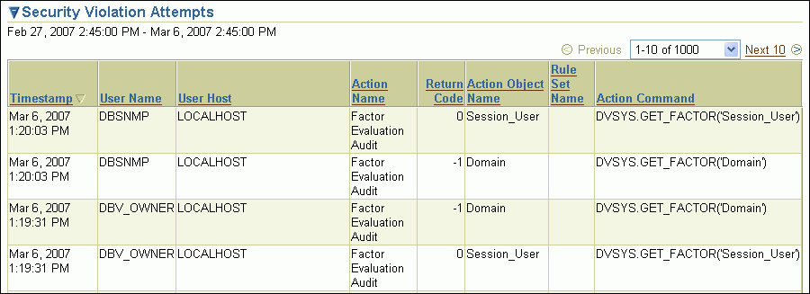
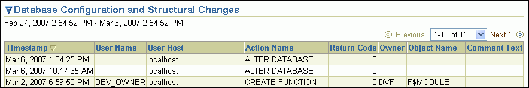
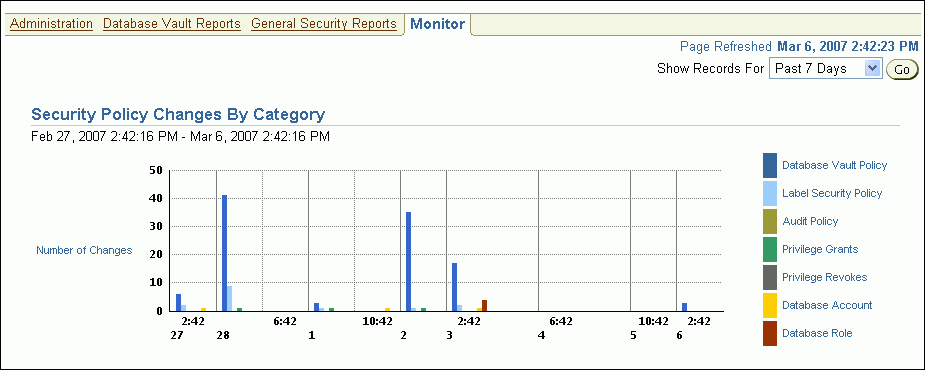
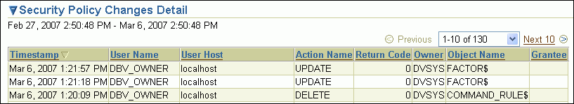

## 17 Monitoring Oracle Database Vault

This chapter contains:

See Also:

["Providing Textual Descriptions of Database Vault Administrator Charts"](dvca.md) for information about configuring the charts in the Monitor page to provide textual descriptions for screen readers

## Security Violation Attempts

You can check for security violations, such as realm or command rule violations. This feature displays data such as the user name of the person committing the violation, the action they committed, and a time stamp of the activity.

Before you can view these events, you must ensure that the `AUDIT_TRAIL` initialization parameter is set to `DB` or `DB, EXTENDED`. For detailed information about the `AUDIT_TRAIL` parameter settings, see [Oracle Database Security Guide](https://docs.oracle.com/cd/E11882_01/network.112/e36292/auditing.htm#DBSEG66232).

To check for security violations:

1. Log in to Oracle Database Vault Administrator as a user who has been granted the `DV_OWNER`, `DV_ADMIN`, `DV_MONITOR`, or `DV_SECANALYST` role.
	["Starting Oracle Database Vault"](getting_started.md) explains how to log in.
2. In the Administration page, click Monitor.
3. At the top of the Monitor page, set a period for the monitoring action by selecting from the Show Records For list and clicking Go.
	This section of the Monitor page also indicates the last time the data on the page was refreshed.
4. In the Monitor page, click Security Violation Attempts.
	A table appears, listing security policy changes.
	

> This screen shows the Security Violation Attempts area with sample data. Categories are as follows: Timestamp, User Name, User Host, Action Name, Return Code, Action Object Name, Rule Set Name, Action Command.
>
> [Copyright © 2006, 2016, Oracle and/or its affiliates. All rights reserved.](https://docs.oracle.com/cd/E11882_01/dcommon/html/cpyr.htm)

## Database Configuration and Structural Changes

You can view structural changes to the database or database schema objects. This feature also audits statements such as `CREATE TABLE`, `ALTER TABLE`, `DROP TABLE`, and `ALTER DATABASE`. It audits all commands, not just commands that are used in command rules. For example, if someone has unexpectedly altered a table on a production system, you can use this feature to determine what is happening.

Before you can view these events, you must ensure that the `AUDIT_TRAIL` initialization parameter is set to `DB` or `DB, EXTENDED`. For detailed information about the `AUDIT_TRAIL` parameter settings, see [Oracle Database Security Guide](https://docs.oracle.com/cd/E11882_01/network.112/e36292/auditing.htm#DBSEG66232).

Follow these steps:

1. Log in to Oracle Database Vault Administrator as a user who has been granted the `DV_OWNER`, `DV_ADMIN`, `DV_MONITOR`, or `DV_SECANALYST` role.
	["Starting Oracle Database Vault"](getting_started.md) explains how to log in.
2. In the Administration page, click Monitor.
3. At the top of the Monitor page, set a period for the monitoring action by selecting from the Show Records For list and clicking Go.
	This section of the Monitor page also indicates the last time the data on the page was refreshed.
4. In the Monitor page, click Database Configuration and Structural Changes.
	A table similar to the following appears:
	

> This figure shows the Database Configuration and Structural Changes table. Columns are: Timestamp, User Name, User Host, Action Name, Return Code, Owner, Object Name, and Comment Text.
>
> [Copyright © 2006, 2016, Oracle and/or its affiliates. All rights reserved.](https://docs.oracle.com/cd/E11882_01/dcommon/html/cpyr.htm)

## Security Policy Changes by Category

This section contains:

- About Monitoring Security Policy Changes by Category
- Procedure for Monitoring Security Policy Changes by Category

### About Monitoring Security Policy Changes by Category

You can check the number of policy changes for the categories in the following list. These categories reflect changes to the database security policy (that is, its configuration) in any given environment. If something changes that is security related, you can use the chart and tables to drill down to find unexpected changes that should be investigated.

Before you can view these events, you must ensure that the `AUDIT_TRAIL` initialization parameter is set to `DB` or `DB, EXTENDED`. For detailed information about the `AUDIT_TRAIL` parameter settings, see [Oracle Database Security Guide](https://docs.oracle.com/cd/E11882_01/network.112/e36292/auditing.htm#DBSEG66232).

- Database Vault policy: Shows changes made through the Oracle Database Vault administrative packages or user interface, indicating Oracle Database Vault configuration or policy changes.
- Label Security policy: Shows changes made through the Oracle Database Vault administrative packages or user interface, indicating Oracle Label Security policy or privilege changes.
- Audit Policy: Shows changes to the database audit policy coming from `AUDIT` or `NOAUDIT` statements.
- Privilege Grants: Shows changes to system or object privilege `GRANT` statements.
- Privilege Revokes: Shows changes to system or object privilege `REVOKE` statements.
- Database Account: Shows changes to `CREATE USER`, `ALTER USER`, or `DROP USER` statements.
- Database Role: Shows changes to `CREATE ROLE`, `ALTER ROLE`, or `DROP ROLE` statements.

### Procedure for Monitoring Security Policy Changes by Category

To monitor security policy changes by category:

1. Log in to Oracle Database Vault Administrator as a user who has been granted the `DV_OWNER`, `DV_ADMIN`, `DV_MONITOR`, or `DV_SECANALYST` role.
	["Starting Oracle Database Vault"](getting_started.md) explains how to log on.
2. In the Administration page, click Monitor.
3. At the top of the Monitor page, set a period for the monitoring action by selecting from the Show Records For list and clicking Go.
	This section of the Monitor page also indicates the last time the data on the page was refreshed.
4. In the Monitor page, check the graph under Security Policy Changes by Category.
	A graph similar to the following appears, which shows the number of security policy changes based on the following categories: Oracle Database Vault policy, Oracle Label Security policy, audit policy, privilege grants and revokes, database accounts, and database roles.
	

> This figure shows the Security Policy Changes By Category. X axis displays the time period; the Y axis shows the number of changes.
>
> [Copyright © 2006, 2016, Oracle and/or its affiliates. All rights reserved.](https://docs.oracle.com/cd/E11882_01/dcommon/html/cpyr.htm)

## Security Policy Changes Detail

You can check the details of security policy changes, such the user who made the change, the action that occurred, the time stamp of the change, and so on.

Before you can view these events, you must ensure that the `AUDIT_TRAIL` initialization parameter is set to `DB` or `DB, EXTENDED`. For detailed information about the `AUDIT_TRAIL` parameter settings, see [Oracle Database Security Guide](https://docs.oracle.com/cd/E11882_01/network.112/e36292/auditing.htm#DBSEG66232).

To monitor security policy changes by detail:

1. Log in to Oracle Database Vault Administrator as a user who has been granted the `DV_OWNER`, `DV_ADMIN`, `DV_MONITOR`, or `DV_SECANALYST` role.
	["Starting Oracle Database Vault"](getting_started.md) explains how to log in.
2. In the Administration page, click Monitor.
3. At the top of the Monitor page, set a period for the monitoring action by selecting from the Show Records For list and clicking Go.
	This section of the page also indicates the last time the data on the page was refreshed.
4. In the Monitor page, click Security Policy Changes by Detail.
	A table appears, listing the details for security policy changes.
	

> This screen shows the Security Policy Changes Detail area with sample data. Categories are as follows: Timestamp, User Name, User Host, Action Name, Return Code, Action Object Name, Rule Set Name, Action Command.
>
> [Copyright © 2006, 2016, Oracle and/or its affiliates. All rights reserved.](https://docs.oracle.com/cd/E11882_01/dcommon/html/cpyr.htm)
