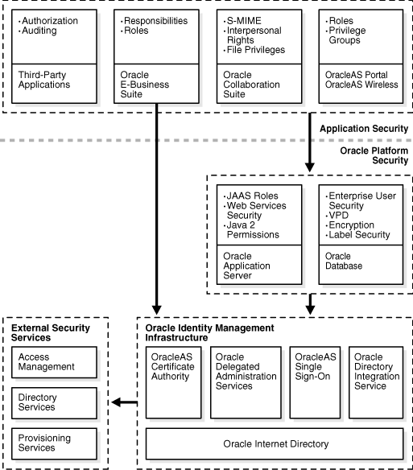
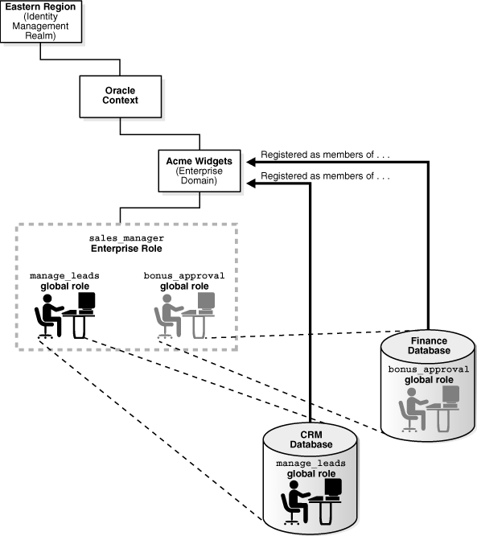
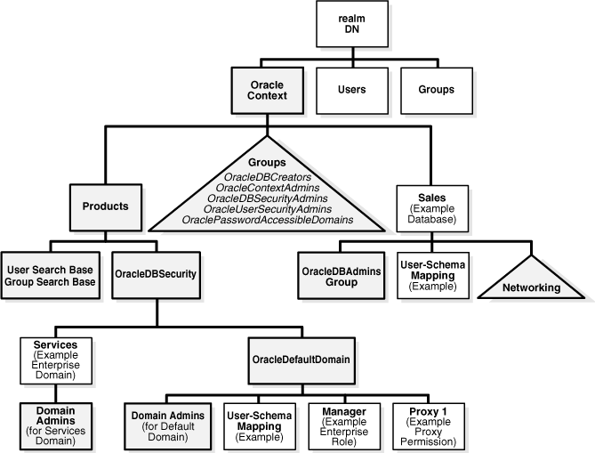

## 1 Introducing Enterprise User Security

Enterprise User Security is an important component of Oracle Database 11g Release 2 (11.2) Enterprise Edition. It enables you to address administrative and security challenges for a large number of enterprise database users. Enterprise users are those users that are defined in a directory. Their identity remains constant throughout the enterprise. Enterprise User Security relies on Oracle Identity Management infrastructure, which in turn uses an [LDAP](glossary.md) -compliant directory service to centrally store and manage users.

This chapter explains what Enterprise User Security is and how it works, in the following topics:

## 1.1 Introduction to Enterprise User Security

This overview of Enterprise User Security explains how it benefits an organization and how enterprise users authenticate and access resources across a distributed database system. It contains the following topics:

- The Challenges of User Management
- Enterprise User Security: The Big Picture
- About Enterprise User Security Directory Entries

### 1.1.1 The Challenges of User Management

Administrators must keep user information up to date and secure for the entire enterprise. This task becomes more difficult as the number of applications and users increases. Typically, each user has multiple accounts on different databases, which means that each user must remember multiple passwords. The result is too many passwords for users to remember and too many accounts for administrators to effectively manage.

With thousands of users accessing database accounts, user administration requires substantial resources. Common information used by multiple applications, such as usernames, telephone numbers, and system roles and privileges, is typically fragmented across the enterprise. Such data increasingly becomes redundant, inconsistent, and difficult to manage.

In addition to user and account management problems, these conditions produce security problems as well. For example, any time a user leaves a company or changes jobs, that user's privileges should be changed the same day in order to guard against their misuse. However, large enterprises often have many user accounts distributed over multiple databases, and an administrator may be unable to make such timely changes.

Similarly, if your users have too many passwords, they may write them down, making them easy for others to copy. They may choose passwords that are easy to remember, making them easy for others to guess, and use the same password for multiple applications, risking wider consequences from a compromised password. All such user efforts to track multiple passwords can compromise enterprise security.

### 1.1.2 Enterprise User Security: The Big Picture

Enterprise User Security addresses user, administrative, and security challenges by relying on the identity management services supplied by Oracle Internet Directory, an LDAP-compliant directory service. Identity management is the process by which the complete security life cycle for network entities is managed in an organization. It typically refers to the management of an organization's application users, where steps in the security life cycle include account creation, suspension, privilege modification, and account deletion.

Figure 1-1 shows how Enterprise User Security fits into the Oracle security architecture, which uses the Oracle Identity Management infrastructure as its foundation.

Figure 1-1 Enterprise User Security and the Oracle Security Architecture



> This is a text description of asoag038.gif, an image which shows the Oracle Security Architecture and where Enterprise User Security fits in. The image depicts three layers as follows:
>
> The Application Security layer is at the top and it includes the following elements:
>
> - Third-Party Applications, which provide Authorization and Auditing
> - Oracle E-Business Suite, which provides Responsibilities and Roles
> - Oracle Collaboration Suite, which provides S-MIME (secure e-mail), Interpersonal Rights, and File Privileges
> - OracleAS Portal and OracleAS Wireless, which provide Roles and Privilege Groups
>
> The Oracle Platform Security layer is in the middle and it includes the following elements:
>
> - Oracle Application Server, which provides JAAS Roles, Web Services Security, and Java 2 Permissions
> - Oracle Database, which provides Enterprise User Security, Virtual Private Database, Encryption, and Label Security
>
> The Oracle Identity Management Infrastructure layer is on the bottom and it includes the following elements:
>
> - OracleAS Certificate Authority
> - Oracle Delegated Administration Services
> - OracleAS Single Sign-On
> - Oracle Directory Integration Service
> - Oracle Internet Directory (which is at the very bottom, signifying that all the other identity management elements use the directory as their foundation)
>
> The Oracle Identity Management Infrastructure communicates with External Security Services, which are located adjacent to the infrastructure to signify that the external services are at the same layer. External Security Services include the following elements:
>
> - Access Management
> - Directory Services
> - Provisioning Services
  

Users benefit from Enterprise User Security through [single sign-on (SSO)](glossary.md) or [single password authentication](glossary.md), depending on the configuration chosen by the administrator. Using single sign-on, users need to authenticate only once and subsequent authentications take place transparently. This functionality requires SSL, which should not be confused with OracleAS Single Sign-On, a component of Oracle Identity Management infrastructure.

Single password authentication lets users authenticate to multiple databases with a single global password although each connection requires a unique authentication. The password is securely stored in the centrally located, LDAP-compliant directory, and protected with security mechanisms including encryption and [Access Control Lists (ACLs)](glossary.md). This approach improves usability by reducing the number of passwords to remember and manage, and by eliminating the overhead of setting up SSL.

Enterprise User Security requires Oracle Internet Directory 10g (9.0.4) or higher. Other LDAP-compliant directory services are supported by using Oracle Internet Directory Integration Platform to synchronize them with Oracle Internet Directory. Another directory services product, Oracle Virtual Directory, provides a single, dynamic access point to multiple data sources through LDAP or XML protocols. Oracle Virtual Directory can provide multiple application-specific views of identity data stored in, for example, Oracle Internet Directory, Microsoft Active Directory and Sun Java Systems Directory instances, and can also be used to secure data access to the application-specific sources and enhance high-availability to existing data-sources.

This section contains the following topics:

- How Oracle Internet Directory Implements Identity Management
- Enterprise Users Compared to Database Users
- About Enterprise User Schemas
- How Enterprise Users Access Database Resources with Database Links
- How Enterprise Users Are Authenticated
	See Also:
	[Oracle Internet Directory Administrator's Guide](http://www.oracle.com/pls/topic/lookup?ctx=db112&id=OIDAG), for information about using Oracle Directory Integration Platform and Oracle Virtual Directory with other directories
	Note:
	Microsoft Active Directory is supported only for Oracle databases on Windows platforms.

#### 1.1.2.1 How Oracle Internet Directory Implements Identity Management

Oracle Internet Directory uses the concept of identity management realms to organize information in the directory information tree (DIT), which is a hierarchical tree-like structure consisting of directory object entries. In a directory, each collection of information about an object is called an entry. This object may be a person, but it can also be information about a networked device, such as configuration information. To name and identify the location of directory objects in the DIT, each entry is assigned a unique distinguished name (DN). The DN of an entry consists of the entry itself and its parent entries, connected in ascending order, from the entry itself up to the root (top) entry in the DIT.

##### 1.1.2.1.1 About Identity Management Realms

An identity management realm is a subtree of directory entries, all of which are governed by the same administrative policies. For example, all employees in an enterprise who have access to the intranet may belong to one realm, while all external users who access the public applications of the enterprise may belong to another realm. Use of different realms enables an enterprise to isolate user populations and enforce different administrative policies, such as password policies or naming policies, in each realm. The default nickname attribute, used to identify the login identity, is uid, and it is set in each identity management realm

##### 1.1.2.1.2 About Identity Management Realm-Specific Oracle Contexts

Each identity management realm has a realm-specific Oracle Context (realm Oracle Context) that stores Oracle product information for that realm. A realm Oracle Context stores application data, how users are named and located, how users must be authenticated, group locations, and privilege assignments, all specific to the particular identity management realm in which the realm Oracle Context is located.

See Also:

- [Oracle Internet Directory Administrator's Guide](http://www.oracle.com/pls/topic/lookup?ctx=db112&id=OIDAG002) for information about Oracle Internet Directory and its architecture
- "About Enterprise User Security Directory Entries" for information about Oracle Internet Directory entries that are used for Enterprise User Security

#### 1.1.2.2 Enterprise Users Compared to Database Users

Database users are typically defined in the database by using the `CREATE USER` statement as follows:

```
CREATE USER username IDENTIFIED BY password;
```

This creates a database user, associated with a user schema, who can access the database and be authenticated by using a password with the `CONNECT` command as follows:

```
CONNECT username@database_service_name
Enter Password:
```

Database users must be created in each database they need to access, and they can choose a different password for each database. Database user privileges are controlled by local roles in each database.

In contrast, enterprise users are provisioned and managed centrally in an LDAP-compliant directory, such as Oracle Internet Directory, for database access. Enterprise users have a unique identity in the directory called the [distinguished name (DN)](glossary.md). When enterprise users log on to a database, the database authenticates those users by using their DN.

Enterprise users are defined in the database as global users. Global users can have their own schemas, or they can share a global schema in the databases they access. You can create enterprise users by using the `GLOBALLY` clause in the `CREATE USER` statement in two different ways.

You can specify a user's directory DN with an `AS` clause, which is shown in the following statement:

```
CREATE USER username IDENTIFIED GLOBALLY AS '<DN of directory user entry>';
```

In this case, they have a schema allocated exclusively to them.

Alternatively, you can specify a null string with the `AS` clause as the following statement shows:

```
CREATE USER username IDENTIFIED GLOBALLY AS '';
```

When you specify a null string with the `AS` clause, the directory maps authenticated users to the appropriate database schema. In this case, multiple users can be mapped to a shared schema based on the mapping information set up and stored in Oracle Internet Directory.

Note:

You can also use the following syntax to create a shared schema:
```
CREATE USER username IDENTIFIED GLOBALLY;
```

This is the same as specifying a null string.

When enterprise users connect over SSL to the database, they do not use a password. Instead they use the following `CONNECT` command, which looks up the wallet location based on information in the client's `sqlnet.ora` file:

```
CONNECT /@database_service_name
```

Password-authenticated enterprise users use the same `CONNECT` statement to connect to the database as regular database users. For example, password-authenticated enterprise users connect to the database by using the following syntax:

```
CONNECT username@database_service_name
Enter password:
```

When the database receives a connection request from an enterprise user, the database refers to the directory for user authentication and authorization (role) information.

See Also:

- [Chapter 2, "Getting Started with Enterprise User Security"](getstrtd.md) for a tutorial on creating and using enterprise users
- ["Creating New Enterprise Users"](adminste.md)
- [Oracle Database Security Guide](https://docs.oracle.com/cd/E11882_01/network.112/e36292/toc.htm) for more information about global users
- [Oracle Internet Directory Administrator's Guide](http://www.oracle.com/pls/topic/lookup?ctx=db112&id=OIDAG007) for information about defining users in the directory

#### 1.1.2.3 About Enterprise User Schemas

Enterprise users can retain their individual database schemas (exclusive schemas) or share schemas if the enterprise security administrator maps them to a shared schema.

##### 1.1.2.3.1 Private or Exclusive Schemas

If users want to retain their individual schemas in the databases that they access, then

- Create enterprise users in the directory, and
- Create a global user schema for each user in each database that they access.

Creating separate accounts for each enterprise user on each database that they access results in significant overhead. Instead, creating enterprise users who access a single, generic shared schema in each database increases the efficiency of the enterprise user solution.

##### 1.1.2.3.2 Shared Schemas

To receive the real benefit of the enterprise user solution, you can use shared schemas for your enterprise users. For this strategy

- Create enterprise users in the directory,
- Create a single shared schema in each database, and
- Create a single shared schema mapping in Oracle Internet Directory.

Mapping enterprise users to a generic, shared schema on each of the databases that they access greatly reduces the overhead of creating separate schemas for each enterprise user.

Shared schema enterprise users can be mapped to generic, shared schemas on all of the databases that they access, or they can have exclusive schemas on some databases and shared schemas on others. The shared schema mappings are stored in the directory.

See Also:

- "About Using Shared Schemas for Enterprise User Security" for more information about creating and using shared schemas for enterprise users
- ["Creating a Shared Schema in the Database"](getstrtd.md) for a tutorial on creating a shared schema in the database

#### 1.1.2.4 How Enterprise Users Access Database Resources with Database Links

Database links are network objects stored in the local database or in the network definition that identify a remote database, a communication path to that database, and optionally, a user name and password. Once defined, the database link is used to access the remote database. Oracle Database supports connected user links, fixed user links, and current user links.

Enterprise users can use all three types of database links. Connected user links are accessed by a local user who has an account on the remote server. Fixed user links contain a user name and password as part of the link definition. Current user database links allow enterprise users to access objects on remote databases without passing authentication information during link execution, or storing authentication information in the link definition. They require SSL for the database network connections, which means public key infrastructure (PKI) credentials must be obtained and maintained for the databases. Current user database links can be used to connect to the remote database only as an enterprise user.

See Also:

- "About Using Current User Database Links for Enterprise User Security" for detailed information about creating and using current user database links
- [Oracle Database Administrator's Guide](https://docs.oracle.com/cd/E11882_01/server.112/e25494/ds_concepts.htm#ADMIN02801) for information about all of the different types of database links supported by Oracle Database

#### 1.1.2.5 How Enterprise Users Are Authenticated

Enterprise User Security supports the following authentication methods:

- - Password-based authentication
		- SSL-based authentication
		- Kerberos-based authentication

Each authentication method has advantages and disadvantages. Table 1-1 summarizes the criteria for selecting which authentication method is best for your Enterprise User Security implementation.

Table 1-1 Enterprise User Security Authentication: Selection Criteria

| Password Authentication | SSL Authentication | Kerberos Authentication |
| --- | --- | --- |
| Password-based authentication | Provides strong authentication over SSL | Provides strong authentication by using Kerberos, version 5 tickets |
| Provides centralized user and password management | Provides centralized user and PKI credential/wallet management | Provides centralized user and Kerberos credential management |
| Separate authentications required for each database connection | Supports [single sign-on (SSO)](glossary.md) using SSL | Supports SSO using Kerberos, version 5 encrypted tickets and authenticators, and authentication forwarding |
| Retains users' current authentication methods | Initial configuration maybe more difficult because PKI credentials must be generated for all users. (Dependent on administrators' PKI knowledge) | Initial configuration maybe more difficult because Kerberos must be installed and configured to authenticate database users |
| User identity can be used in two-tier or multitier applications. OracleAS Single Sign-On users and enterprise users use the same stored password | Compatible with either a two-tier or multitier environment | Compatible with either a two-tier or multitier environment |
| Supports Oracle Release 7.3 and later clients with Oracle Database 10g and later | Supports Oracle8i and later clients with Oracle Database 10g and later | Supports Oracle Database 10g and later clients with Oracle Database 10g and later |
| Supports current user database links only if the connection between databases is over SSL | Supports current user database links | Supports current user database links only if the connection between databases is over SSL |
| Can use third-party directories to store users if synchronized with Oracle Internet Directory <sup>Foot 1</sup> | Can use third-party directories to store users if synchronized with Oracle Internet Directory <sup>Foot 2</sup> | Can use third-party directories to store users if synchronized with Oracle Internet Directory <sup>Foot 3</sup> |

<sup>Footnote 1</sup> If third-party directory is Microsoft Active Directory, then when user passwords change, they must be changed in both Active Directory and in Oracle Internet Directory.

<sup>Footnote 2</sup> Must modify the Directory Integration Services agent to synchronize user PKCS #12 attributes.

<sup>Footnote 3</sup> If third-party directory is Microsoft Active Directory, then login to Windows gives you single sign-on login to databases. However, you must modify the Directory Integration Services agent for other third-party directories to synchronize the `KrbPrincipalName` attribute. This synchronization is automatic for Microsoft Active Directory.

Note:

Enterprise User Security supports three-tier environments. Oracle Database [proxy authentication](glossary.md) features enable

(i) proxy of user names and passwords through multiple tiers, and

(ii) proxy of X.509 certificates and distinguished names through multiple tiers.

See Also:

- [Chapter 4, "Enterprise User Security Configuration Tasks and Troubleshooting"](configur.md) for information about configuring the various authentication types for enterprise user security
- [Oracle Database Security Guide](https://docs.oracle.com/cd/E11882_01/network.112/e36292/toc.htm), for information about using proxy authentication

### 1.1.3 About Enterprise User Security Directory Entries

In a directory, a collection of information about an object is called an entry. For Enterprise User Security, elements such as users, roles, and databases are directory objects, and information about these objects is stored as entries in the directory.

Each entry in the directory is uniquely identified by a DN. The DN tells you exactly where the entry resides in the directory entry hierarchy, which is commonly called the [directory information tree (DIT)](glossary.md).

Note:

For Oracle Database 10g and later, databases must be registered in a complete [identity management realm](glossary.md) of Oracle Internet Directory.

See Also:

[Oracle Internet Directory Administrator's Guide](http://www.oracle.com/pls/topic/lookup?ctx=db112&id=OIDAG002) for a complete discussion of directory entries

The following sections describe directory entries related to Enterprise User Security:

#### 1.1.3.1 Enterprise Users

An enterprise user is one who is defined and managed in a directory. Each enterprise user has a unique identity across an enterprise. Enterprise user entries can reside at any location within the identity management realm, except within the realm Oracle Context.

Note:

When creating enterprise users in a 9.0.4 or later Oracle Internet Directory, use the tools that come with that 9.0.4 or later Oracle Internet Directory, such as Delegated Administration System (DAS). Even if your databases are 9i or 9iR2, do not use the 9i or 9iR2 Enterprise Security Manager GUI tool to create users in a 9.0.4 or later Oracle Internet Directory.

Use only DAS-based tools, like the Oracle Internet Directory Self-Service Console, that ship with Oracle Application Server 10g, to create enterprise users in identity management realms.

The entries described in the following sections can reside only within a [realm Oracle Context](glossary.md).

#### 1.1.3.2 Enterprise Roles

An enterprise role is a directory object that acts like a container to hold one or more database [global role](glossary.md) s. Each global role is defined in a specific database where it is assigned privileges, but then it is managed in the directory by using enterprise roles. Enterprise users can be assigned an enterprise role, which determines their access privileges on databases. Figure 1-3 shows an example of an enterprise role called Manager under OracleDefaultDomain.

As an example, consider the enterprise role `sales_manager`, which contains the global role `manage_leads` with its privileges on the Customer Relationship Management (CRM) database, and the `bonus_approval` global role with its privileges on the Finance database. Figure 1-2 illustrates this example.

Figure 1-2 Example of Enterprise Roles



> This is a text description of asoag033.gif, an image which shows an example of an enterprise role. This image depicts a section of an Oracle Internet Directory directory information tree where the enterprise roles are stored. A directory information tree is a hierarchical structure that resembles an inverted tree. It contains entries in the directory.
>
> An identity management realm, labeled "Eastern Region," appears at the top of the image. An Oracle Context, a container specifically designed to store Oracle product information in Oracle Internet Directory, branches off from the identity management realm. An enterprise domain labeled "Acme Widgets" branches off from the Oracle Context. The enterprise role labeled "sales\_manager" branches off from the enterprise domain. The sales\_manager enterprise role contains two database global roles, "manage\_leads" and "bonus\_approval." The manage\_leads global database role is defined in the Customer Relationship Management (CRM) database. The bonus\_approval global role is defined in the Finance database. Both databases are registered in the Acme Widgets enterprise domain. When a database is registered in an enterprise domain, an entry for the database is created in the directory. This enables the database to bind with (log in to) the directory.
  

An enterprise role can be assigned to one or more enterprise users. For example, you could assign the enterprise role `sales_manager` to a number of enterprise users who hold the same job. This information is protected in the directory, and only a directory administrator can manage users and assign their roles. A user can be granted local roles and privileges in a database in addition to enterprise roles, by virtue of the privileges on the schema to which the user connects.

Enterprise role entries are stored in [enterprise domain](glossary.md) subtrees. Each enterprise role contains information about associated global roles on each database server and the associated enterprise users. The [enterprise domain administrator](glossary.md) creates and manages enterprise roles by using Oracle Enterprise Manager.

See Also:

["Configuring Enterprise Roles"](adminste.md) for information about using Oracle Enterprise Manager to create and manage enterprise roles

Note:

The database obtains a user's global roles from the directory as part of the login process. If you change a user's global roles in the directory, then those changes do not take effect until the next time the user logs in to the database.

#### 1.1.3.3 Enterprise Domains

An enterprise domain is a group of databases and enterprise roles. An example of a domain could be the engineering division in an enterprise or a small enterprise itself. Figure 1-3 shows an example of an enterprise domain called Services that resides under the OracleDBSecurity entry in an identity management realm. It is here, at the enterprise domain level, that the [enterprise domain administrator](glossary.md), using Oracle Enterprise Manager, assigns enterprise roles to users and manages enterprise security.

An enterprise domain subtree in a directory is composed of three types of entries: enterprise role entries, user-schema mappings, and the enterprise domain administrator's group for that domain. Enterprise domains are used to manage information that applies to multiple databases. All user-schema mappings entries contained in an enterprise domain apply to all databases in the domain. If you need to apply different user-schema mappings to individual databases, then use database server entries, which are discussed in the following section.

Enterprise roles apply to specific databases in the domain, as explained in the previous section. Enterprise roles, domain-level mappings, and the domain administrators group are all administered by using Oracle Enterprise Manager.

See Also:

["Administering Enterprise Domains"](adminste.md)

#### 1.1.3.4 Database Server Entries

A database server entry (represented as "Sales" in Figure 1-3) is a directory entry containing information about one database server. It is created by the Database Configuration Assistant during database registration. A database server entry is the parent of database-level mapping entries called user-schema mappings, which describe mappings between full or partial user DNs and database shared schema names. User-schema mapping entries are created by the [database administrator](glossary.md) by using Oracle Enterprise Manager.

See Also:

["Oracle Enterprise Manager"](toolover.md)

Database administrators belong to the directory administrative group, [OracleDBAdmins](glossary.md), which is also managed with Oracle Enterprise Manager. Only OracleDBAdmins or [OracleContextAdmins](glossary.md) group members can add or remove users from the OracleDBAdmins group. When a user registers a database in the directory, Database Configuration Assistant automatically puts the person who performs registration into the OracleDBAdmins group. The directory entry for this group is located under the database server entry in the DIT.

Figure 1-3 Related Entries in a Realm Oracle Context



> This is a text description of asoag032.gif, an image which shows the structure of a typical Oracle Context. An Oracle Context is an entry in Oracle Internet Directory called cn=OracleContext. All Oracle software relevant information is kept in the Oracle Context, including entries for Oracle Net directory naming and enterprise user security. Each identity management realm in an Oracle Internet Directory instance has one Oracle Context.
>
> This diagram shows a hierarchical structure that resembles an inverted tree. The identity management realm, labeled "realm DN" for realm distinguished name, is at the top of the tree. Branching off under the realm DN are containers for Users, Groups, and the Oracle Context. Branching off under the Oracle Context are containers for Products, Groups, and Database Servers (in this example, the Database Servers container is labeled "Sales.") Of these three containers that branch off of the Oracle Context container, Products and Groups are default container names. Under each of these containers additional sub-containers branch out as follows:
>
> 1. The Products container holds two sub-containers. These are the subcontainer which holds the User Search Base and the Group Search Base, and the OracleDBSecurity subcontainer. These two subcontainers are both default containers. The OracleDBSecurity container has two sub-containers that branch off under it. These are: An Enterprise Domain container, labeled "Services" in this example, and the OracleDefaultDomain container. The OracleDefaultDomain container is a default container. Under the Enterprise Domain container that is labeled "Services," is one sub-container. This sub-container is the Services Domain container and it is labeled Domain Admins in this example. The second container under OracleDBSecurity, the OracleDefaultDomain container, has three sub-containers branching off under it. These are "Domain Admins," which is an example of a Default Domain container, "Schema Mapping," which is an example of a user-defined container, and the "Manager" sub-container, which is an example of an Enterprise Roles container.
> 2. The Groups container is actually another subtree that branches off under the Oracle Context. It contains subtrees with root containers for the following groups: OracleDBCreators, OracleContextAdmins, OracleDBSecurityAdmins, OracleUserSecurityAdmins, and OraclePasswordAccessibleDomains.
> 3. The Database Server container that is labeled "Sales" has three sub-containers that branch off under it. These sub-containers are OracleDBAdmins Group, Schema Mapping, and Networking. The Networking subcontainer is another subtree that branches off under the database server container. OracleDBAdminsGroup and Networking are default containers. User-Schema Mapping is an example of a user-defined container. All of these containers are described in the surrounding text.
  

#### 1.1.3.5 User-Schema Mappings

A user-schema mapping is a directory entry that contains mapping information between a user's DN and an Oracle database schema. The users referenced in the mapping are connected to the specified schema when they connect to the database. User-schema mapping entries can apply to only one database or they can apply to all databases in a domain, depending on where they reside in the realm Oracle Context.

#### 1.1.3.6 Administrative Groups

An identity management realm contains administrative groups related to Enterprise User Security. Figure 1-3 shows these administrative groups in a realm in the triangle labeled "Groups." Each administrative group includes [Access Control Lists (ACLs)](glossary.md) that control access to the group itself. ACLs elsewhere in the directory may refer to these groups, which allows directory administrators access to perform necessary administrative tasks. The administrative user who creates the realm automatically becomes the first member of each of these groups, thus gaining the associated privileges provided by each group. However, this user can be removed.

The relevant administrative groups in a realm are described in Table 1-2.

Note:

Observe the following practices. Using other methods may break the security configuration for Enterprise User Security objects and may break enterprise user functionality as well.
- Do not modify the ACLs for the objects contained in a realm Oracle Context. Modified realm Oracle Context object ACLs are not supported.
- Use only Oracle tools, such as Oracle Enterprise Manager, Oracle Internet Directory Self-Service Console, and Database Configuration Assistant, to modify Enterprise User Security directory entries.

Table 1-2 Administrative Groups in a Realm Oracle Context

| Administrative Group | Description |
| --- | --- |
| OracleContextAdmins | DN: (`cn=OracleContextAdmins,cn=Groups,cn=OracleContext`...)  Default owner: The user who created the identity management realm. (If it is the realm created during installation, then it is `orcladmin`.)  OracleContextAdmins have full access to all groups and entries within the associated realm Oracle Context. |
| OracleDBAdmins | DN: (`cn=OracleDBAdmins,cn=<database_entry_name>,cn=OracleContext`...)  Default owner: None. Database Configuration Assistant automatically makes the user who registers a database in the directory a member of this group.  Members of this group manage [user-schema mapping](glossary.md) s specific to this database. Only users who are already members of this group or OracleContextAdmins can add or remove users from the OracleDBAdmins group. |
| OracleDBCreators | DN: `(cn=OracleDBCreators,cn=OracleContext`...`)`  Default owner: OracleContextAdmins  During default realm Oracle Context creation, Oracle Internet Directory Configuration Assistant sets up the following access rights/permissions for these group members:  - `Add` permission for database service objects in the realm Oracle Context - `Modify` permission for the Default Domain  OracleDBCreators create new databases and register them in the directory by using Database Configuration Assistant |
| OracleDBSecurityAdmins | DN: (`cn=OracleDBSecurityAdmins,cn=OracleContext`...)  Default owner: All group members.  During default realm Oracle Context creation, Oracle Internet Directory Configuration Assistant sets up the following access rights/permissions for these group members:  - All privileges in the OracleDBSecurity subtree - Modify privileges for membership in this group  OracleDBSecurityAdmins have permissions on all of the domains in the enterprise and perform the following tasks:  - Sets Enterprise User Security configurations for the realm, such as the default database-to-directory authentication method - Group owner administers the OracleDBSecurityAdmins group - Creates and deletes enterprise domains - Moves databases from one domain to another within the enterprise |
| OracleDomainAdmins | DN: (`cn=OracleDomainAdmins,cn=<enterprise_domain_name>,`  `cn=OracleDBSecurity,cn=Products,cn=OracleContext....`)  Default owner: The user creating or updating the domain.  If a new context and OracleDefaultDomain are created, then the initial member will be the context creator.  Members of the OracleDomainAdmins group have full privileges for the enterprise domain. They manage mappings, enterprise roles, and proxy permissions specific to the entire domain. You should be a member of OracleDomainAdmins (for the domain), OracleDBSecurityAdmins, or OracleContextAdmins to modify membership of this group. |
| OracleUserSecurityAdmins | DN: (`cn=OracleUserSecurityAdmins,cn=Groups,cn=OracleContext`...)  Default owner: The user who created the identity management realm.  By default, an ACL is set at the directory root in Oracle Internet Directory that sets up the relevant permissions so OracleSecurityAdmins can administer Oracle user security. |
| OraclePasswordAccessibleDomains | DN: (`cn=OraclePasswordAccessibleDomains,cn=Groups,cn=OracleContext`...)  Default owner: Same as OracleDBSecurityAdmins  Group members are enterprise domains, which contain databases enabled for password-authorized enterprise users. |

#### 1.1.3.7 Password Policies

Password policies are a set of rules that apply to all user passwords in an identity management realm. Password policies include settings for password complexity, minimum password length, and the like. They also include account lockout and password expiration settings.

A password policy entry is defined in Oracle Internet Directory for every identity management realm. Password policies in Oracle Internet Directory are standard Oracle Internet Directory entries that can be used by Oracle Database for Enterprise User Security.

Oracle Internet Directory ensures that all enterprise user passwords meet the rules specified in the password policy entry for the realm. The database communicates with Oracle Internet Directory when authenticating an enterprise user. It requests Oracle Internet Directory to report any password policy violations. If the database gets a policy violation response from Oracle Internet Directory, then it flashes the appropriate warning or error message to the user.

The database reports the following events:

- It flashes a warning when the user password is about to expire and displays the number of days left for the user to change his or her password.
- It flashes a warning when the password has expired and informs the user about the number of grace logins that remain.
- It displays an error when the user password has expired and the user does not have any grace logins left.
- It displays an error when the user account has been locked due to repeated failed attempts at login.
- It displays an error if the user account has been disabled by the administrator.
- It displays an error if the user account is inactive.

Enterprise user login attempts to the database update the user account status in Oracle Internet Directory. For example, consecutive failed login attempts to the database results in the account getting locked in the directory, as per the directory's password policy.

See Also:

[Oracle Internet Directory Administrator's Guide](http://www.oracle.com/pls/topic/lookup?ctx=db112&id=OIDAG) for detailed information on password policies and their management

## 1.2 About Using Shared Schemas for Enterprise User Security

The following sections describe shared schemas, and how to set them up:

- Overview of Shared Schemas Used in Enterprise User Security
- How Shared Schemas Are Configured for Enterprise Users
- How Enterprise Users Are Mapped to Schemas

### 1.2.1 Overview of Shared Schemas Used in Enterprise User Security

Users do not necessarily require individual accounts or schemas set up in each database. Alternatively, they can connect to a [shared schema](glossary.md) and be granted access to the objects associated with target applications. For example, suppose that users Tom, Dick, and Harriet require access to the Payroll application on the Finance database. They do not need to create unique objects in the database, and therefore do not need their own schemas, but they do need access to the objects in the Payroll schema.

Oracle Database supports mapping multiple users stored in an enterprise directory to a shared schema on an individual database. This separation of users from schemas reduces administration costs by reducing the number of user accounts on databases. It means that you do not need to create an account for each user (user schema) in addition to creating the user in the directory. Instead, you can create a user in the enterprise directory, and map that user to a shared schema. Other enterprise users can also be mapped to that schema.

For example, if Tom, Dick and Harriet all access both the Sales and the Finance databases, you do not need to create an account for each user on each database. Instead, you can create a single shared schema on each database, such as `GUEST`, that all three users can access. Then individual access to objects in the Sales or Finance database can be granted to these three users by using enterprise roles. A typical environment can have up to 5,000 enterprise users mapped to one shared schema and each user can be assigned a set of enterprise roles.

Oracle recommends that you create a separate shared schema that contains no objects to use as an entry point. Then, grant access to application objects in other schemas through enterprise roles. Otherwise, application objects can be inadvertently or maliciously deleted or altered.

In summary, shared schemas provide the following benefits:

- Shared schemas eliminate the need to have a dedicated database schema on each database for each enterprise user.
- Each enterprise user can be mapped to a shared schema on each database the user needs to access. The user connects to the shared schema when the user connects to a database.
- Shared schemas lower the cost of managing users in an enterprise.

### 1.2.2 How Shared Schemas Are Configured for Enterprise Users

To configure shared schemas, the local database administrator (DBA) must create at least one database schema in a database. Enterprise users can be mapped to this schema.

In the following example, the administrator creates a shared schema and maps users to it:

1. The administrator creates a global shared schema called `EMPLOYEE` and the global role `HRMANAGER` on the HR database.
2. The administrator uses the Oracle Internet Directory Self-Service Console and Oracle Enterprise Manager to create and manage enterprise users and roles in the directory. For example, the administrator creates enterprise user Harriet and an enterprise role named `MANAGER`. The administrator then assigns the HR database global role of `HRMANAGER` to the enterprise role `MANAGER`.
3. The administrator assigns enterprise roles to enterprise users in the directory. For example, the administrator assigns the enterprise role `MANAGER` to Harriet.
4. The administrator uses Oracle Enterprise Manager to map the user Harriet in the directory to the shared schema EMPLOYEE on the HR database.

When Harriet connects to the HR database, she is automatically connected to the `EMPLOYEE` schema and is given the global role of `HRMANAGER`. Multiple enterprise users can be mapped to the same shared schema. For example, the enterprise security administrator can create another enterprise user Scott and map Scott to the `EMPLOYEE` schema. From that point on, both Harriet and Scott automatically use the `EMPLOYEE` schema when connecting to the HR database, but each can have different roles and can be individually audited.

See Also:

[Oracle Database Security Guide](https://docs.oracle.com/cd/E11882_01/network.112/e36292/auditing.htm#DBSEG006) for more information about auditing

### 1.2.3 How Enterprise Users Are Mapped to Schemas

Global schemas (those created with `CREATE USER IDENTIFIED GLOBALLY AS ''`) can be owned by one enterprise user (exclusive schema) or shared among multiple enterprise users (shared schema). The mapping between a single enterprise user and his or her exclusive schema is stored in the database as an association between the user DN and the schema name. The mapping between enterprise users and a shared schema is done in the directory by means of one or more mapping objects. A mapping object is used to map the [distinguished name (DN)](glossary.md) of a user to a database schema that the user will access. You create a mapping object by using Oracle Enterprise Manager. This mapping can be one of the following:

- Entry-level (full DN) mapping
	This method associates the DN of a single directory user with a particular schema on a database. It results in one mapping entry for each user.
- Subtree-level (partial DN) mapping
	This method lets multiple enterprise users share part of their DN to access the same shared schema. This method is useful if multiple enterprise users are already grouped under some common root in the directory tree. The subtree that these users share can be mapped to a shared schema on a database. For example, you can map all enterprise users in the subtree for the engineering division to one shared schema, BUG\_APP\_USER, on the bug database. Note that the root of the subtree is not mapped to the specified schema.
	When an enterprise user connects to a database, the database retrieves a DN for the user, either from the network (in the case of SSL) or from the directory (in the case of password and Kerberos-authenticated enterprise users).
	When determining which schema to connect the user to, the database uses the user DN and the following precedence rules:
	1. It looks for an exclusive schema locally (in the database).
		2. If it does not find an exclusive schema locally, then it searches the directory. Within the directory, it looks under the database server entry, first for an entry-level mapping, and then for a subtree-level mapping.
		3. If it does not find a mapping entry under the server entry, then it looks under the enterprise domain entry, first for an entry-level mapping, and then for a subtree-level mapping.
		4. If it does not find an exclusive schema locally or an applicable mapping entry in the database, then the database refuses the connection. Otherwise, the database connects the user to the appropriate schema.

For example, suppose that Harriet is trying to connect to the HR database but the database does not find Harriet's exclusive schema (in the database). In this case, the following events occur:

1. The HR database looks up a user schema mapping with Harriet's DN in the directory. The directory has a mapping of Harriet to the shared schema `EMPLOYEE` and returns this schema.
2. The database logs Harriet in and connects her to the `EMPLOYEE` schema.
3. The database retrieves this user's global roles for this database from the directory.
4. The database also retrieves from its own tables any local roles and privileges associated with the database schema to which the user is mapped.
5. The database uses both the global and the local roles to determine the information that the user can access.

Continuing this example, assume that the enterprise role `MANAGER` contains the global roles `ANALYST` on the HR database, and `USER` on the Payroll database. When Harriet, who has the enterprise role `MANAGER`, connects to the HR database, she uses the schema EMPLOYEE on that database.

- Her privileges on the HR database are determined by:
	- The global role `ANALYST`
		- Any local roles and privileges associated with the EMPLOYEE schema on the HR database
- When Harriet connects to the Payroll database, her privileges are determined by:
	- The global role `USER`
		- Any local roles and privileges associated with the `EMPLOYEE` schema on the Payroll database

You can grant privileges to a specified group of users by granting roles and privileges to a database schema. Every user sharing such a schema gets these local roles and privileges in addition to personal enterprise roles. However, you should exercise caution when doing this because every user who is mapped to this shared schema can exercise the privileges assigned to it. Accordingly, Oracle does not recommend granting roles and privileges to a shared schema.

See Also:

- ["Task 1: Create Global Schemas and Global Roles in the Database"](configur.md) for detailed information about how to create shared schemas for enterprise users
- "Enterprise User Proxy"

## 1.3 Enterprise User Proxy

Sometimes, an enterprise user needs to connect to a database as another user, temporarily having the target user's authorizations and privileges. This capability is particularly useful for midtier tools or applications, which often operate across various databases as enterprise users, their identities established as entries in Oracle Internet Directory. Such an application can maintain a single database connection while switching end user identities, thereby providing functionality in the name of each authorized user in turn.

Enterprise User Security 11g Release 1 (11.1) enhanced the efficiency of the proxy mechanism by introducing a single-session model. The two-session proxy model required maintaining separate sessions for the proxy user and the target user. In the new model, only one session is maintained in the security context of the target user. This leads to an improvement in performance.

Enterprise User Security 11g Release 1 (11.1), and later, allows greater granularity in assigning proxy permissions to enterprise users. Enterprise users can be individually granted permissions to proxy as local database users. The permissions no longer need to be associated with the user's shared schema in the database.

That you can assign proxy permissions individually to enterprise users means that the permissions can be more specific. Assigning permissions to a shared schema, on the other hand, forces you to assign the same permissions to all users who map to the schema. This can lead to unwarranted rights and privileges.

Enterprise user proxy permissions are created and stored in Oracle Internet Directory. A permission allows one or more enterprise users or groups to proxy as a target database user. Permissions can apply to specific databases or to all databases in the enterprise domain.

By default, domain administrators can manage proxy permissions in the directory for an enterprise domain. These permissions are configured and managed using Oracle Enterprise Manager.

See Also:

For more information on configuring enterprise user proxy permissions, see ["Configuring Proxy Permissions"](adminste.md)

Setting up such proxying has several stages:

1. Identify all enterprise users who need permissions to proxy to various databases.
2. Identify all the target users in each such database.
3. Issue `ALTER USER` commands for each such target user, in the following form:
	- `ALTER USER` target\_user `GRANT CONNECT THROUGH ENTERPRISE USERS`
	The `target_user` can now be proxied to by the enterprise users that have proxy permissions in Oracle Internet Directory. Revoking proxy permission uses similar syntax, replacing `GRANT` with `REVOKE`.
	See Also:
	For the full `ALTER USER` syntax, see [Oracle Database SQL Language Reference](https://docs.oracle.com/cd/E11882_01/server.112/e41084/statements_4003.htm#SQLRF01103)
	For Oracle Call Interface usage, see [Oracle Call Interface Programmer's Guide](https://docs.oracle.com/cd/E11882_01/appdev.112/e10646/oci02bas.htm#LNOCI020)
4. Grant proxy permissions to each enterprise user either individually or as a member of a group. See the section entitled ["Granting Proxy Permissions to Enterprise Users"](adminste.md).
	Note:
	To establish a group representing those enterprise users who will proxy to the same database user, use Oracle Delegated Administration Services as described in the [Oracle Identity Management Guide to Delegated Administration](http://www.oracle.com/pls/topic/lookup?ctx=db112&id=OIMDA012).
5. With all four of the preceding steps accomplished, your identified enterprise users can proxy to any of the local database users you identified and associated with them. Two versions of the `CONNECT` command can be used. In (a), you supply the enterprise user's password in the command. In (b), you do not, relying instead on the password being in a wallet whose location was put in the sqlnet.ora file.
	1. To establish an enterprise user proxy connection as a database user, use the following SQL\*Plus command syntax, supplying the enterprise user's password:
		- ```
			CONNECT joeproxy[targetuser]@database_service_name
			Enter Password:
			```
			where you would replace `joeproxy` with the name of the enterprise user wishing to proxy as `targetuser`, and replace `targetuser` with the name of the registered user of the target database. The square brackets are required. Enter the enterprise user's password when prompted for the password.
		Once these identities are validated, this connection request results in a single session, in which the proxy user operates in the target database as the target user. The identity of the original user is maintained through to the database, and the audit records can capture both the proxy and the target user's identity.
		2. To connect as an enterprise user proxy for a database user without specifying a password, ensure that the `sqlnet.ora` file contains the location of the wallet holding that user's password. Then, use the following command syntax:
		- ```
			CONNECT  [targetuser]/@database_service_name
			```
			where you would replace `targetuser` with the name of the registered user of the target database. The square brackets are required. The current enterprise user proxies as the `targetuser`.

Note:

The regular proxy login mechanism using OCI calls can still be used. The `CONNECT` syntax is a new alternative. For more information on the OCI call mechanism, refer to [Oracle Database Security Guide](https://docs.oracle.com/cd/E11882_01/network.112/e36292/authentication.htm#DBSEG003).

Although the enterprise user proxy permissions are assigned in Oracle Internet Directory, the database administrator can decide as to which local accounts are to be available as enterprise user proxy targets. The enterprise domain administrator can assign proxy permissions to only those targets that are available in the dba\_proxies view of the database.

## 1.4 About Using Current User Database Links for Enterprise User Security

Oracle Database supports current user database links over an SSL-authenticated network connection. Current user database links let you connect to a second database as yourself, or as another user when used from within a stored procedure owned by that user. Such access is limited to the scope of the procedure. The security advantage of current user database links is that the other user's credentials are not stored in the database link definition and are not sent across the network connection between databases. Instead, security of these links is based on mutual trust, mutual authentication, and a secure network connection between the databases themselves.

For example, a current user database link lets Harriet, a user of the Finance database, procedurally access the Accounts Payable database by connecting as the enterprise user Scott.

For Harriet to access a current user database link to connect to the schema Scott, Scott must be a global schema (created as `IDENTIFIED GLOBALLY`) in both databases. Harriet, however, can be a user identified in one of three ways:

- By a password
- `GLOBALLY`
- `EXTERNALLY`

To create Scott as a global user in the first database, Finance, you must enter

```
CREATE USER Scott IDENTIFIED GLOBALLY as 'CN=Scott,O=nmt'
```

so that Scott has an exclusive schema. Then Scott can map to a shared schema in the second database, Accounts Payable. In order for the current user database link to work, the schema created for Scott in the first database cannot be shared with other users.

Current user database links operate only between trusted databases within a single enterprise domain. Databases within the domain trust each other to authenticate users. You specify an enterprise domain as trusted by using Oracle Enterprise Manager. When you use Oracle Enterprise Manager to enable current user database links for a domain, they will work for all databases within that domain. However, each database in the domain must have its own PKI credentials and use SSL to authenticate to the other databases. To specify a database as untrusted that is part of a trusted enterprise domain, use the PL/SQL package `DBMS_DISTRIBUTED_TRUST_ADMIN.` To obtain a list of trusted servers, use the `TRUSTED_SERVERS` view.

Note:

Oracle Advanced Security, an option to the Oracle Database Enterprise Edition, does not support RADIUS authentication over database links.

See Also:

- "What Is Meant by Trusted Databases"
- [Oracle Database Heterogeneous Connectivity User's Guide](https://docs.oracle.com/cd/E11882_01/server.112/e11050/toc.htm), for additional information about current user database links
- [Oracle Database SQL Language Reference,](https://docs.oracle.com/cd/E11882_01/server.112/e41084/toc.htm) for more information about SQL syntax
- [Oracle Database PL/SQL Packages and Types Reference](https://docs.oracle.com/cd/E11882_01/appdev.112/e40758/toc.htm), for information about the PL/SQL package `DBMS_DISTRIBUTED_TRUST_ADMIN`
- [Oracle Database Reference](https://docs.oracle.com/cd/E11882_01/server.112/e40402/toc.htm), for information about the `TRUSTED_SERVERS` view
- [Oracle Database Advanced Security Administrator's Guide](https://docs.oracle.com/cd/E11882_01/network.112/e40393/asossl.htm#ASOAG070), for information about configuring SSL for Oracle Net.
- [Oracle Database Advanced Security Administrator's Guide](https://docs.oracle.com/cd/E11882_01/network.112/e40393/asowalet.htm#ASOAG160), for information about creating wallets

## 1.5 Enterprise User Security Deployment Considerations

Consider the following issues before deploying Enterprise User Security:

- Security Aspects of Centralizing Security Credentials
- Security of Password-Authenticated Enterprise User Database Login Information
- Considerations for Defining Database Membership in Enterprise Domains
- Choosing Authentication Types between Clients, Databases, and Directories for Enterprise User Security

### 1.5.1 Security Aspects of Centralizing Security Credentials

Beyond the general benefits that flow from the centralization of enterprise users and their associated credentials, there are a number of security-related benefits and risks that should be reviewed.

#### 1.5.1.1 Security Benefits Associated with Centralized Security Credential Management

Centralizing management makes it easier and faster to administer users, credentials, and roles, and to quickly revoke a user's privileges on all applications and databases across the enterprise. With centralized management, the administrator can delete a user in one place to revoke all global privileges, minimizing the risk of retaining unintended privileges.

Centralizing management makes it possible to centralize an organization's security expertise. Specialized, security-aware administrators can manage all aspects of enterprise user security, including directory security, user roles and privileges, and database access. This is a substantial improvement over the traditional model, where DBAs are typically responsible for everything on the databases they manage, including security.

#### 1.5.1.2 Security Risks Associated with Centralized Security Credential Management

While Oracle Internet Directory is a secure repository, there is a security challenge and inherent risk in centralizing credentials in any publicly accessible repository. Although centralized credentials can be protected at least as securely as distributed credentials, the very nature of centralization increases the consequences of inadvertent credential exposure to unauthorized parties. It is therefore imperative to limit the privileges of administrators to set restrictive Access Control Lists (ACLs) in the directory, and to implement good security practices in the protection of security credentials when they are temporarily outside of the directory.

### 1.5.2 Security of Password-Authenticated Enterprise User Database Login Information

In all secure password-based authentication methods, a server authenticates a client with a password verifier, typically a hashed version of the password that must be rigorously protected. Password-based authentication to an Oracle database is no different. There is a password verifier, and it must be protected as well. This is true if the verifier is stored locally in the database or centrally in the directory. Note that a password verifier cannot be used to derive the original password.

An enterprise user's database password can be stored in a central directory service for access by multiple databases. It can be viewed and shared by all trusted databases to which the user has access. Although the password verifier stored in the directory is not the [cleartext](glossary.md) password, it is still necessary to protect it from casual or unauthorized access. It is therefore extremely important to define password-related ACLs in the directory that are as restrictive as possible while still enabling necessary access and usability. (Note that Oracle Database supports all verifier types that are supported by Oracle Internet Directory.)

Oracle tools help set up ACLs in the directory to protect these password verifiers during identity management realm creation. The approach that Oracle recommends is intended to balance security and usability considerations. If you require maximum security and can set up wallets for all users, you should require only SSL connections from users to databases. This SSL-only approach circumvents the entire directory password protection issue.

The following sections provide more information about trusted databases and protecting database password verifiers in the directory.

#### 1.5.2.1 What Is Meant by Trusted Databases

SSL provides strong authentication so databases are ensured of each others identity. With password-authenticated Enterprise User Security where database password verifiers are stored centrally in a directory and shared among multiple databases, each database that allows password-authenticated enterprise users to log in must be a trusted database. Each database has access to the shared password verifiers, so it is important that each database can be trusted to observe the following security precautions:

- Each database must be trusted to protect itself from tampering with the server code so a malicious user cannot misuse the database identity to gain access to password verifiers in the directory.
- Each database must be trusted to protect its PKI and other credentials from theft so a malicious user cannot use them to gain access to the password verifiers stored in the directory.

#### 1.5.2.2 Protecting Database Password Verifiers

The OraclePasswordAccessibleDomains group in each identity management realm is created automatically when the realm is created, and it can be managed by using Oracle Internet Directory tools like the Oracle Internet Directory Self-Service Console. Enterprise domains with member databases that must view users' database password verifiers in the directory are placed in this group.

For a selected realm, determine which databases can accept password-authenticated connections. Use Oracle Internet Directory Self-Service Console to place the domains containing those databases into the OraclePasswordAccessibleDomains group. An ACL on the user subtree permits access to the directory attribute that holds the password verifier used by the database.

All other users are denied access to this attribute. An ACL that prevents anonymous read access to the password verifier attributes is at the root of the directory tree.

Note that for usability, by default, OracleDefaultDomain is a member of the OraclePasswordAccessibleDomains group. It can be removed, if desired.

### 1.5.3 Considerations for Defining Database Membership in Enterprise Domains

Consider the following criteria when defining the database membership of a domain:

- Current user [database link](glossary.md) s operate only between databases within a single [enterprise domain](glossary.md). Use of these links requires mutual trust between these databases and between the DBAs who administer them.
- Accepted authentication types for enterprise users are defined at the domain level. Database membership in a domain should therefore be defined accordingly.
	Note:
	If one or more databases are intended to only support SSL-based certificate authentication, they cannot be combined in the same domain with password-authenticated databases.
- Enterprise roles are defined at the domain level. To share an [enterprise role](glossary.md) across multiple databases, the databases must be members of the same domain.

### 1.5.4 Choosing Authentication Types between Clients, Databases, and Directories for Enterprise User Security

Enterprise User Security supports the authentication types listed in Table 1-3 for connections between clients, databases, and directories.

Table 1-3 Enterprise User Security: Supported Authentication Types for Connections between Clients, Databases, and Directories

| Connection | Supported Authentication Types |
| --- | --- |
| Clients-to-Databases | Passwords, SSL, and Kerberos |
| Databases-to-Databases (Current User Database Links) | SSL only |
| Databases-to-Directories | SSL and Passwords |

However, some combinations of authentication types for connections make more sense than others. For example, it is unusual to have a high level of security for client-database connections by using SSL for all user connections, but then configuring the database to authenticate to the directory by using passwords. Although this configuration is supported, it does not provide consistent security for connections. Ideally, the database-directory connection should be at least as secure as that between users and databases.

#### 1.5.4.1 Typical Configurations

The following combinations of authentication types between clients, databases, and directories are typical:

- Password authentication for all connections with no need for current user database links
- SSL authentication for all connections
- Kerberos authentication for client-to-database connections, and password authentication for database-to-directory connections