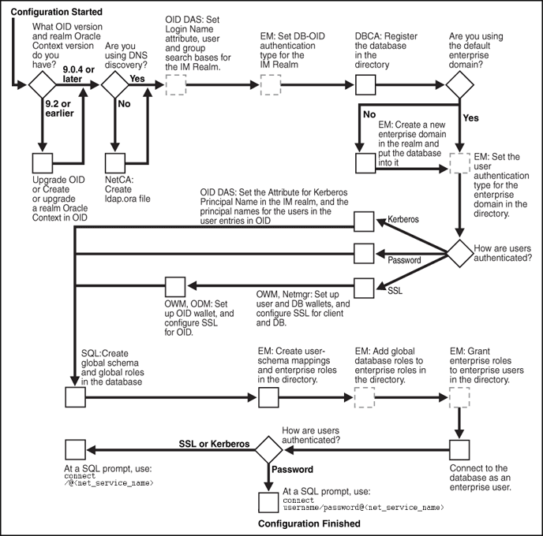

## 4 Enterprise User Security Configuration Tasks and Troubleshooting

This chapter describes configuring Enterprise User Security using a sequence of steps. They include the initial database and directory preparation through connecting to the database as an enterprise user, where authentication can use passwords, Kerberos tickets, or SSL. A troubleshooting section helps you when you test your Enterprise User Security implementation.

This chapter contains the following topics:

## 4.1 Enterprise User Security Configuration Overview

Configuring Enterprise User Security means creating shared schemas and global roles in databases that you want accessible to enterprise users. You configure the identity management realm in the directory to reflect those database roles and schemas, and then associate directory users with them. These steps apply regardless of the authentication method you choose: password, Kerberos, or SSL.

The primary configuration differences among the authentication types are in network connection configuration. You must consider the following three connection types:

- - Client-to-database
		- Database-to-directory
		- Database-to-database (current user database links can be secured by SSL only)

Enterprise User Security supports many combinations of authentication types between databases, directories, and clients. The three most common implementations of Enterprise User Security, described in this chapter, use the following authentication methods for client-database and database-directory connections:

- - Passwords for both connections
		- SSL for both connections
		- Kerberos for client-database connections and passwords for database-directory connections

You decide which of these to choose based primarily on your network environment, because the security and integrity of your enterprise data depend on creating secure network connections. Typical network environments can have all clients, databases, and directories residing within the same network behind a firewall, or distributed across several networks and perhaps exposed to the Internet. Different environments can dictate what authentication types you choose, in order to secure your Enterprise User Security network connections.

A second consideration in making such choices is the fact that more rigorous authentication types, such as SSL and Kerberos, require greater configuration complexity, additional software, and ongoing maintenance.

Figure 4-1 shows the configuration process for Enterprise User Security. It is a step-by-step process with decision points based on your implementation and how your users are authenticated. The configuration steps represented with broken lines are optional.

Figure 4-1 Enterprise User Security Configuration Flow Chart



> The image displays a flowchart, which is a pictorial description of the EUS configuration process. This has been described in the chapter.
>
> Copyright © 2000, 2013, Oracle and/or its affiliates. All rights reserved.  
> [Legal Notices](https://docs.oracle.com/cd/E11882_01/dcommon/html/cpyr.htm)
  

For brevity, some product names and features have been abbreviated in this flow chart. The following table lists the abbreviations used and the meaning of each:

| Abbreviation | Meaning |
| --- | --- |
| DBCA | Database Configuration Assistant |
| EM | Oracle Enterprise Manager Database Control or Grid Control |
| IM Realm | Identity Management Realm |
| Netmgr | Oracle Net Manager |
| ODM | Oracle Directory Manager |
| OID | Oracle Internet Directory |
| OID DAS | Oracle Internet Directory Delegated Administration Services |
| OWM | Oracle Wallet Manager |
| SQL | SQL\*Plus |

See Also:

[Chapter 1, "Introducing Enterprise User Security"](concepts.md) for information about the realm Oracle Context, its administrative groups, and entries that pertain to Enterprise User Security

## 4.2 Enterprise User Security Configuration Roadmap

This section provides detailed descriptions of the configuration steps that Figure 4-1 illustrates. They should be performed in the following order:

1. "Preparing the Directory for Enterprise User Security (Phase One)"
2. "Configuring Enterprise User Security Objects in the Database and the Directory (Phase Two)"
3. "Configure Enterprise User Security for the Authentication Method You Require (Phase Three)", which completes your Enterprise User Security configuration by establishing your chosen authentication method as one of the following three:
	- "Configuring Enterprise User Security for Password Authentication"
		- "Configuring Enterprise User Security for Kerberos Authentication"
		- "Configuring Enterprise User Security for SSL Authentication"

## 4.3 Preparing the Directory for Enterprise User Security (Phase One)

This configuration phase must be performed before you can configure any other part of Enterprise User Security.

Enterprise User Security for 11g Release 2 (11.2) requires Release 9.0.4 (or later) version of Oracle Internet Directory, which installs with the required version of the Oracle schema. This schema is backward compatible. After you have installed Oracle Internet Directory, perform the following directory usage configuration tasks:

- Task 1: (Optional) Create an identity management realm in the directory
- Task 2: (Optional) Set identity management realm properties
- Task 3: Identify administrative users in the directory
- Task 4: (Optional) Set the default database-to-directory authentication type for the identity management realm
- Task 5: (Optional) Configure your Oracle home for directory usage
- Task 6: Register the database in the directory

Task 1: (Optional) Create an identity management realm in the directory

If necessary, use Oracle Internet Directory Self-Service Console (Delegated Administration Service) to create an identity management realm in the directory. You can use Oracle Internet Directory Configuration Assistant to upgrade an Oracle9i Oracle Context to a 9.0.4 or higher version Identity Management Realm.

You must have version 9.0.4 (or later) identity management realm to use Oracle Database 10g or Oracle Database 11g. Version 9.0.4 realms are backward compatible to Oracle9i, so you can register Oracle9i and Oracle Database 11g Release 2 (11.2) in the same realm and place them in the same domain, if desired.

See Also:

[Oracle Identity Management Guide to Delegated Administration](http://www.oracle.com/pls/topic/lookup?ctx=db112&id=OIMDA) for more information on creating identity management realms in Oracle Internet Directory

Task 2: (Optional) Set identity management realm properties

Table 4-1 shows the defaults for a version 9.0.4 identity management realm.

Table 4-1 Identity Realm Defaults

| User Search Base | Group Search Base | Login Name Attribute (nickname) |
| --- | --- | --- |
| `cn=Users,``realm_DN` | `cn=Groups,``realm_DN` | `uid`, the user id |

If you want different settings, then use Oracle Internet Directory Self-Service Console to set the user search base, group search base, and login name attribute (nickname). You can also set up the necessary context administrators in the identity management realm you plan to use in the directory.

To perform this task, see ["Setting Properties of an Identity Management Realm"](adminste.md).

Note:

Each identity management realm includes an orcladmin user who is the root user of that realm only. These realm-specific orcladmin users are represented by the directory entries `cn=orcladmin,cn=Users,<realm_DN>`. Note that when you are logged in to Enterprise User Security administration tools as a realm-specific orcladmin user, then you can only manage directory objects for that realm. To manage objects in another realm, you must log in to administration tools as the orcladmin user for that realm.

Task 3: Identify administrative users in the directory

Identify administrative users in the directory who are authorized to perform the following tasks:

- - Register databases
		- Administer database security
		- Create and manage enterprise domains

If administrative users do not already exist who can perform these tasks, then see [Chapter 5, "Administering Enterprise User Security"](adminste.md) to create them.

Note:

Although one administrator can perform all Enterprise User Security administrative tasks, you can create many different kinds of administrators so security tasks can be assigned to different people. Separating security tasks in this way results in a more secure enterprise environment, but this requires coordination among the different administrators.

Task 4: (Optional) Set the default database-to-directory authentication type for the identity management realm

By default, the database-to-directory authentication type for the identity management realm is set to passwords. If you want a different default setting, then use the Oracle Enterprise Manager Database Control or Grid Control interface to change it. For example, if you are using a public key infrastructure (PKI), then you would need to set the authentication type to SSL. See ["Setting the Default Database-to-Directory Authentication Type for an Identity Management Realm"](adminste.md).

Note:

- This default realmwide setting can be overridden on a database by setting the `LDAP_DIRECTORY_ACCESS` initialization parameter. See [Oracle Database Reference](https://docs.oracle.com/cd/E11882_01/server.112/e40402/toc.htm) for more information about this parameter.
- If you are using SSL, then see [Oracle Internet Directory Administrator's Guide](http://www.oracle.com/pls/topic/lookup?ctx=db112&id=OIDAG) for information about setting up SSL with two-way authentication for Oracle Internet Directory.

Task 5: (Optional) Configure your Oracle home for directory usage

This step is optional because users of Domain Name System (DNS) discovery (automatic domain name lookup to locate the directory on a network) do not need to perform this step. (See [Oracle Internet Directory Administrator's Guide](http://www.oracle.com/pls/topic/lookup?ctx=db112&id=OIDAG) for information about DNS server discovery.)

If you are not using DNS discovery, then you must use Oracle Net Configuration Assistant (NetCA) to create an `ldap.ora` file for your Oracle home. This configuration file specifies the directory host and port information, and the location of the identity management realm so the database can connect to the directory. (See ["Starting Oracle Net Configuration Assistant"](toolover.md))

To create an `ldap.ora` file for your Oracle home:

1. In the Oracle Net Configuration Assistant welcome page, choose Directory Service Usage Configuration, and click Next.
2. On the Directory Usage Configuration page, select an option appropriate for your environment. Then follow the prompts in the wizard and refer to the online Help to create an `ldap.ora` file for your Oracle home.
	Note:
	- SSL authentication between your database and directory requires that the SSL port entered in the `ldap.ora` file support two-way authentication, in which both client and server send certificates to each other. Thus, you must acquire a PKI digital certificate and wallet for Oracle Internet Directory, and bring up Oracle Internet Directory in the SSL mutual authentication mode. The second port in the `ldap.ora` file should have the SSL mutual authentication port. (See [Oracle Internet Directory Administrator's Guide](http://www.oracle.com/pls/topic/lookup?ctx=db112&id=OIDAG).)
	- If you are using password authentication for your database-to-directory connection, then the SSL port entered in the `ldap.ora` file must support SSL with no authentication. No wallet or certificate is required for Oracle Internet Directory. The second port in the `ldap.ora` file should have the SSL no authentication port.

See Also:

["Configuring Your Database to Use the Directory"](getstrtd.md) for an example of using NetCA to configure directory usage

Task 6: Register the database in the directory

After you have configured your Oracle home for directory usage, use Database Configuration Assistant to register the database in the directory. Registration creates an entry in the directory so the database can bind (log in) to it.

Note:

To perform this task, you must be the directory superuser or a member of either the `OracleDBCreators` group or the `OracleContextAdmins` group.

When registering a database in the directory, Database Configuration Assistant performs the following configuration tasks:

- Creates a new database service entry and subtree, and assigns a DN to it in the Oracle Context for the identity management realm you are using.
- Adds the database to the default enterprise domain.
- Establishes the authentication type of the database to the directory by setting the `LDAP_DIRECTORY_ACCESS` parameter to one of the three allowable settings: `NONE`, `PASSWORD`, or `SSL`. Database Configuration Assistant reads the default database to directory authentication attribute setting for the identity management realm to determine the authentication type setting for the database.
	The `LDAP_DIRECTORY_ACCESS` parameter, residing in the database initialization parameter file, determines whether and how the database attempts authentication to the directory. An administrator can change this authentication type setting by using the `ALTER SYSTEM` command.
- Creates a database wallet, containing the database DN in the following form:
	`cn=` `short_database_name``,cn=OracleContext,``realm_DN`
	where `short_database_name` is the first part of the fully qualified domain name for a database.
	For example, if you have a database named `db1.us.example.com`, then the short database name is `db1`.
- Randomly generates a database password for directory access, storing it in the database wallet and in the directory.
- After creating the wallet, Database Configuration Assistant stores it at `$ORACLE_BASE` `/admin/` `Oracle_SID` `/wallet` (in UNIX environments), if the `ORACLE_BASE` environment variable is present. If the `ORACLE_BASE` environment variable is not present, then the `$ORACLE_HOME/admin/` `Oracle_SID` `/wallet` directory is used.
	In Windows environments, replace the slashes (/) with backslashes (\\).
	If a database wallet already exists, then Database Configuration Assistant uses it and updates the password in the wallet.
- Enables autologin for the database wallet.

Note:

The database's password-based credentials for authentication to Oracle Internet Directory are placed in the wallet when an Oracle database is registered in Oracle Internet Directory.

To register a database with the directory:

See ["Starting Database Configuration Assistant"](toolover.md) to start this tool.

1. After starting Database Configuration Assistant, select Configure Database Options in a Database and click Next.
2. Select a database and click Next.
3. To register the database, click Yes, Register the Database.
4. Enter the directory credentials for a user in the OracleDBCreators group.
5. Enter a password for the database wallet.
	Note:
	Remember the database wallet password you entered in Step 5. It cannot be retrieved after you finish database registration. If you do not know the password, a multistep process is required to generate a new wallet and reregister the database. See "About the Database Wallet and Password" for further information.
6. Click Finish if you are only registering the database. Click Next if you want to configure additional database features.

To change the database's directory password:

After starting Database Configuration Assistant, select Configure Database Options in a Database, and click Next.

1. Select a database and click Next.
2. Select Regenerate database password.
3. Enter the directory credentials for a user in the OracleDBCreators group and a password for the database wallet. Click OK.
4. Click Finish if you are only regenerating the password. Click Next if you want to configure additional database features.

To unregister a database from the directory:

See ["Starting Database Configuration Assistant"](toolover.md) to start this tool.

1. After starting Database Configuration Assistant, select Configure Database Options in a Database and click Next.
2. Select a database and click Next.
3. To unregister the database, select the Unregister option.
4. Enter the directory credentials for a user with the appropriate permissions.
5. Enter a password for the database wallet.

When you unregister a database from the directory, Database Configuration Assistant performs the following configuration tasks:

- Removes the database entry and subtree from the directory.
- Sets the `LDAP_DIRECTORY_ACCESS` parameter to `NONE`.
- Removes the database from its enterprise domain (if the user has sufficient permissions).
	Note:
	Depending on user permissions, Database Configuration Assistant may be unable to remove a database from its domain in the directory. If it cannot, then use Oracle Enterprise Manager Database Control or Grid Control to remove it from the enterprise domain.
- Does not remove the database wallet.
	See Also:
	"Navigating the Oracle Wallet Manager User Interface" and ["Managing Wallets"](https://docs.oracle.com/cd/E11882_01/network.112/e40393/asowalet.htm#ASOAG162) in the [Oracle Database Advanced Security Administrator's Guide](https://docs.oracle.com/cd/E11882_01/network.112/e40393/asowalet.htm#ASOAG162) for more information about deleting the wallet

Note:

To succeed at unregistering an Oracle Database from Oracle Internet Directory by using Database Configuration Assistant, you must be one of the following:
- A member of the Oracle Context Admin group
- A member of both the Database Admin group (for the database you are unregistering) and the Database Security Admin group
- A member of both the Database Admin group (for the database you are unregistering) and the Domain Admin group (for the enterprise domain that contains the database).

### 4.3.1 About the Database Wallet and Password

The database requires the wallet even if no SSL (Secure Sockets Layer) is used to secure the connection between the database and the directory. If SSL is used, then this wallet should be used to store the database's digital PKI certificate.

The wallet password you enter when using Database Configuration Assistant to register a database in the directory is the password to the wallet itself. This password is not the database's directory login credentials.

You can change this wallet password later, using Oracle Wallet Manager. However, if you forget this wallet password, then you must generate an entirely new wallet and password. To do so, you must first delete the existing database wallet, create a new wallet (which can be empty) and put it at the default wallet location, `$ORACLE_HOME/admin/` `Oracle_SID` `/wallet` (in UNIX environment). Next, unregister the database from the directory, and reregister the database in the directory. During that registration, another database wallet and password can be generated.

See Also:

["Using Oracle Wallet Manager"](https://docs.oracle.com/cd/E11882_01/network.112/e40393/asowalet.htm#ASOAG160) in the [Oracle Database Advanced Security Administrator's Guide](https://docs.oracle.com/cd/E11882_01/network.112/e40393/asowalet.htm#ASOAG160) for information about using Oracle Wallet Manager to change wallet passwords and, in general, to manage public key infrastructure (PKI) credentials

After you have prepared the directory for Enterprise User Security, then you can create the Enterprise User Security database and directory objects as described in "Configuring Enterprise User Security Objects in the Database and the Directory (Phase Two)".

See Also:

- [Oracle Internet Directory Administrator's Guide](http://www.oracle.com/pls/topic/lookup?ctx=db112&id=OIDAG) for information about configuring an identity management realm in the directory
- [Oracle Database Reference](https://docs.oracle.com/cd/E11882_01/server.112/e40402/toc.htm) for information about changing the value of the `LDAP_DIRECTORY_ACCESS` initialization parameter

#### 4.3.1.1 Sharing Wallets and sqlnet.ora Files Among Multiple Databases

Multiple databases (that are not replicas) cannot share wallets, because wallets contain a database's identity. Therefore, if a `sqlnet.ora` file contains a wallet location, then multiple databases cannot share that `sqlnet.ora` file.

In order to share a single `sqlnet.ora` file among multiple databases, the following preconditions are required:

- User authentication should use passwords or Kerberos.
- The wallet containing the password should reside at the default wallet location, which is where Database Configuration Assistant creates it.

If the preceding conditions are met, then multiple databases can share the `sqlnet.ora` file because no wallet location information is stored in that file.

However, when SSL authentication is used between the user (client) and the database, the wallet location must be specified in the database server's `sqlnet.ora` file. Such a `sqlnet.ora` file cannot be shared by multiple databases for SSL-authenticated enterprise users.

## 4.4 Configuring Enterprise User Security Objects in the Database and the Directory (Phase Two)

This is the second phase of configuration steps required to implement Enterprise User Security. The configuration steps in this section assume the following recommended setup:

- You have prepared your database and your directory by completing the tasks described in "Preparing the Directory for Enterprise User Security (Phase One)".
- Your users are stored in an identity management realm Users subtree.
- You use the OracleDefaultDomain, which is the default [enterprise domain](glossary.md) that Database Configuration Assistant uses when you register databases in the directory.

Note that databases must be in an enterprise domain that is in an identity management realm in order for enterprise user logins to work.

See Also:

If you do not use the OracleDefaultDomain or store your users in an identity management realm Users subtree, then see the following documentation:

- [Oracle Internet Directory Administrator's Guide](http://www.oracle.com/pls/topic/lookup?ctx=db112&id=OIDAG) for information about creating a new identity management realm or modifying an existing one, and for information about setting access control lists on directory objects
- ["Creating an Enterprise Domain"](adminste.md) to create another domain in which to put your database. Then substitute your new domain name for OracleDefaultDomain in the following configuration steps

To configure Enterprise User Security objects in the database and directory perform the following tasks:

- Task 1: Create Global Schemas and Global Roles in the Database
- Task 2: Configure User-Schema Mappings for the Enterprise Domain
- Task 3: Create Enterprise Roles in the Enterprise Domain
- Task 4: Add Global Database Roles to Enterprise Roles
- Task 5: Grant Enterprise Roles to Enterprise Users for Database Access

Task 1: Create Global Schemas and Global Roles in the Database

Although this step can also be completed by using Oracle Enterprise Manager, the following examples use SQL\*Plus directly:

1. Create a shared schema for enterprise users. The following syntax example creates a shared schema named guest:
	```
	SQL> CREATE USER guest IDENTIFIED GLOBALLY AS '';
	```
	If you do not want to use a shared schema, then specify a user DN between the single quotation marks to create an exclusive schema.
2. Grant the `CREATE SESSION` privilege to the shared schema created in Step 1 so users can connect to it. The following syntax example grants the `CREATE SESSION` privilege to the guest shared schema:
	```
	SQL> GRANT CREATE SESSION TO guest;
	```
	Alternatively, you can grant the `CREATE SESSION` privilege to a global role, which you grant to specific users through an [enterprise role](glossary.md). See Step 3.
3. Create global roles for the database to hold relevant privileges. The following syntax examples create the `emprole` and `custrole` global roles:
	```
	SQL> CREATE ROLE emprole IDENTIFIED GLOBALLY;
	SQL> CREATE ROLE custrole IDENTIFIED GLOBALLY;
	```
	Global roles are associated with enterprise roles, which are created later, and then are allocated to enterprise users.
4. Grant privileges to the new global roles that were created in Step 3. The following syntax example grants the `SELECT` privilege to `emprole` and `custrole` global roles on the products table:
	```
	SQL> GRANT select ON products TO custrole, emprole;
	```
	See Also:
	[Oracle Database SQL Language Reference](https://docs.oracle.com/cd/E11882_01/server.112/e41084/toc.htm) for information about the syntax used for these steps

Task 2: Configure User-Schema Mappings for the Enterprise Domain

Use Enterprise Manager to configure user-schema mappings for the OracleDefaultDomain by using the following steps:

1. Log in to Enterprise Manager.
2. Click the Server tab. Under the Security section, click Enterprise User Security.
	The Oracle Internet Directory Login page appears.
3. Enter the distinguished name (DN) of a directory user who can administer enterprise users in the User field. Enter the user password in the Password field. Click Login.
	The Enterprise User Security page appears.
4. Click Manage Enterprise Domains.
	The Manage Enterprise Domains page appears. This page lists the enterprise domains in the identity management realm.
5. Select OracleDefaultDomain. Click Configure.
	The Configure Domain page appears.
6. Click the User-Schema Mappings tab. All user-schema maps created at the domain level are displayed. User-schema maps created at database levels are not displayed here.
7. Click Create to create a new user-schema mapping for the domain.
	The Create Mapping page is displayed.
8. Under the From section, select Users to map an individual enterprise user to a database schema. Alternatively, select Subtree to map a directory subtree containing multiple users. You can use the Search icon to search for the appropriate user or subtree.
9. Under the To section, enter the name of the Schema to which the user or subtree should be mapped. This is the schema that you created in Task 1.
10. Click Continue in the Create Mapping page.
11. Click OK in the Configure Domain page.

Note:

You can also create user-schema mappings for an individual database in an enterprise domain. Such mappings apply only to that particular database and not to other databases in the domain.

See Also:

["Mapping Enterprise Users to the Shared Schema"](getstrtd.md) for an example on creating user-schema mappings

Task 3: Create Enterprise Roles in the Enterprise Domain

Use Enterprise Manager to create enterprise roles in the OracleDefaultDomain by using the following steps:

1. Select OracleDefaultDomain in the Manage Enterprise Domains page. Click Configure.
	The Configure Domain page appears.
2. Click the Enterprise Roles tab.
3. Click Create to create a new enterprise role.
	The Create Enterprise Role page appears.
4. Enter a name for the enterprise role in the Name field. Click Continue.
	The new role is displayed in the Configure Domain page.

See Also:

["Using Enterprise Roles"](getstrtd.md) for an example on creating and using enterprise roles

Task 4: Add Global Database Roles to Enterprise Roles

Use Enterprise Manager to add the global database roles that you created in Task 1 to the enterprise roles that you created in Task 3 by using the following steps:

1. Select the enterprise role that you just created in the Configure Domain page. Click Edit.
	The Edit Enterprise Role page is displayed.
2. Make sure that the DB Global Roles tab is selected. Click Add to add global roles from databases that are part of the enterprise domain.
	The Search and Select Database Global Roles page appears.
3. Select the Database that contains the global roles you wish to add. Log in to the selected database by supplying a User Name and Password. Click Go.
4. Select the global roles to add. Click Select.
	The selected roles appear in the Edit Enterprise Role page.

See Also:

["Using Enterprise Roles"](getstrtd.md) for an example on creating and using enterprise roles

Task 5: Grant Enterprise Roles to Enterprise Users for Database Access

Use Enterprise Manager to grant enterprise roles that you created in Task 3 to the enterprise users by using the following steps:

1. Click the Grantees tab in the Edit Enterprise Role page.
2. Click Add.
	The Select Users or Groups page is displayed.
3. Select the Search Base or the subtree that contains the user or group. Select User under View if you are granting the enterprise role to a user. Select Group under View, if you are granting the role to a group. Optionally, enter the common name of the user or group in the Name field. Click Go.
4. Select the users or groups to be granted the enterprise role. Click Select.
5. Click Continue in the Edit Enterprise Role page.
6. Click OK in the Configure Domain page.

See Also:

["Using Enterprise Roles"](getstrtd.md) for an example on creating and using enterprise roles

## 4.5 Configure Enterprise User Security for the Authentication Method You Require (Phase Three)

In the third phase, you complete the Enterprise User Security configuration based on the authentication method you have chosen. Go to one of the following sections:

- "Configuring Enterprise User Security for Password Authentication"
- "Configuring Enterprise User Security for Kerberos Authentication"
- "Configuring Enterprise User Security for SSL Authentication"
	See Also:
	[Table 1-1, "Enterprise User Security Authentication: Selection Criteria"](concepts.md) for a comparison of the benefits provided by password, Kerberos, and SSL authentication for Enterprise User Security

### 4.5.1 Configuring Enterprise User Security for Password Authentication

By default, new enterprise domains are configured to accept all supported user authentication types (password, Kerberos, and SSL). If you want enterprise users to be authenticated by passwords, then you must configure that as described in the following tasks.

The configuration steps in this section assume the following:

- You have prepared your directory by completing the tasks described in "Preparing the Directory for Enterprise User Security (Phase One)".
- You have configured your Enterprise User Security objects in the database and the directory by completing the tasks described in "Configuring Enterprise User Security Objects in the Database and the Directory (Phase Two)".
- You have configured an SSL instance with no authentication for Oracle Internet Directory as described in Oracle Internet Directory Administrator's Guide. If you are using an `ldap.ora` file, then also ensure that the port number for this SSL with no authentication instance is listed there as your directory SSL port.

To configure Enterprise User Security for password authentication, perform the following tasks:

- Task 1: (Optional) Enable the Enterprise Domain to Accept Password Authentication
- Task 2: Connect as a Password-Authenticated Enterprise User

Task 1: (Optional) Enable the Enterprise Domain to Accept Password Authentication

By default, OracleDefaultDomain is configured to accept password authentication. If this has been changed, then use Oracle Enterprise Manager Database Control or Grid Control to enable password authentication for OracleDefaultDomain using the following steps:

1. Log in to Enterprise Manager.
2. Click the Server tab for the database. Under the Security section, click Enterprise User Security.
	The Oracle Internet Directory Login page appears.
3. Enter the distinguished name (DN) of a directory user who can administer enterprise users in the User field. Enter the user password in the Password field. Click Login.
	The Enterprise User Security page appears.
4. Click Manage Enterprise Domains.
	The Manage Enterprise Domains page appears. This page lists the enterprise domains in the identity management realm.
5. Select OracleDefaultDomain. Click Configure.
	The Configure Domain page appears.
6. Click the Configuration tab.
7. Under User Authentication Types Accepted, select Password.
8. Click OK.

Task 2: Connect as a Password-Authenticated Enterprise User

For an enterprise user whose directory login name is `hscortea` and whose password is `Easy2rem`, enter the following to connect to the database by using SQL\*Plus:

```
SQL> connect hscortea@<Oracle Net Service Name>
Enter password:
/* Enter Easy2rem when prompted for the password*/
```

The database authenticates the enterprise user (`hscortea`) by verifying the username-password combination against the directory entry associated with this user. Then, it identifies the proper schema and retrieves the user's global roles. If successful, then the connection to the database is established.

If your connection succeeds, then the system responds `Connected to:...`. This is the confirmation message of a successful connect and setup. If an error message is displayed, then see "ORA-# Errors for Password-Authenticated Enterprise Users".

If you do connect successfully, then check that the appropriate global roles were retrieved from the directory, by entering the following at the SQL\*Plus prompt:

```
select * from session_roles
```

If the global roles were not retrieved from the directory, then see "NO-GLOBAL-ROLES Checklist".

You have completed password-authenticated Enterprise User Security configuration.

See Also:

- "Troubleshooting Enterprise User Security" for information about diagnosing and resolving errors
- [Chapter 5, "Administering Enterprise User Security"](adminste.md) for information about configuring the identity management realm, and about creating and managing enterprise domains, enterprise roles, and enterprise users

### 4.5.2 Configuring Enterprise User Security for Kerberos Authentication

The configuration steps in this section assume the following:

- You have registered your databases with the Kerberos authentication server and configured your Oracle Net Services as described under ["Configuring Kerberos Authentication"](https://docs.oracle.com/cd/E11882_01/network.112/e40393/asokerb.htm#ASOAG060) in the [Oracle Database Advanced Security Administrator's Guide](https://docs.oracle.com/cd/E11882_01/network.112/e40393/asokerb.htm#ASOAG060).
- You have prepared your directory by completing the tasks described in "Preparing the Directory for Enterprise User Security (Phase One)".
- You have configured your Enterprise User Security objects in the database and the directory by completing the tasks described in "Configuring Enterprise User Security Objects in the Database and the Directory (Phase Two)".
- You have configured an SSL instance with no authentication for Oracle Internet Directory as described in Oracle Internet Directory Administrator's Guide. If you are using an `ldap.ora`, then also ensure that the port number for this SSL with no authentication instance is listed there as your directory SSL port.

To configure Enterprise User Security for Kerberos authentication, perform the following tasks:

- Task 1: Configure Oracle Internet Directory Self-Service Console to display the Kerberos principal name attribute
- Task 2: (Optional) Configure the Kerberos Principal Name Directory Attribute for the Identity Management Realm
- Task 3: Specify the Enterprise User's Kerberos Principal Name in the krbPrincipalName Attribute
- Task 4: (Optional) Enable the Enterprise Domain to Accept Kerberos Authentication
- Task 5: Connect as a Kerberos-Authenticated Enterprise User

Task 1: Configure Oracle Internet Directory Self-Service Console to display the Kerberos principal name attribute

By default, the Oracle Internet Directory Self-Service Console user interface does not display the field where you can configure Kerberos principal names. The first time you create Kerberos-authenticated users in the directory, you must configure this tool to display the `krbPrincipalName` attribute in its Create User page by using the following steps:

1. Log in to the Oracle Internet Directory Self-Service Console.
	Enter the URL to access the Oracle Internet Directory Self-Service Console in a browser window. For example:
	```
	http://myhost1:7777/oiddas
	```
	Log in as the `orcladmin` user.
2. Click the Configuration tab. Click the User Entry subtab.
3. Click Next until the Configure User Attributes page appears.
4. In the Configure User Attributes page, click Add New Attribute.
	The Add New Attribute page appears.
5. In the Add New Attribute page, select krbPrincipalName from the Directory Attribute Name box (or the attribute that you have configured for `orclCommonKrbPrincipalAttribute` in your identity management realm) and perform the following steps on this page:
	1. Enter a value, say Kerberos Principal Name, for the UI Label.
		2. Select Searchable and Viewable.
		3. Select Single Line Text from the UI Type.
		4. ClickDone.
6. Click Next to navigate to the Configure Attribute Categories page. Select Basic Information and click Edit.
	The Edit Category page appears.
7. Perform the following steps on the Edit Category page:
	1. Select krbPrincipalName in the left category list.
		2. Click Move, to move krbPrincipalName to the right-hand list.
		3. Click Done.
8. Click Next until you reach the last step. Click Finish to save your work.

Task 2: (Optional) Configure the Kerberos Principal Name Directory Attribute for the Identity Management Realm

Use Oracle Internet Directory Self-Service Console to enter the directory attribute used to store the Kerberos principal name for the identity management realm you are using in the directory. By default, Kerberos principal names are stored in the `krbPrincipalName` attribute but can be changed to correspond to your directory configuration by changing `orclCommonKrbPrincipalAttribute` in the identity management realm. For more information about this task, see ["Setting Login Name, Kerberos Principal Name, User Search Base, and Group Search Base Identity Management Realm Attributes"](adminste.md).

Note:

By default, the Oracle Internet Directory Self-Service Console user interface does not display the field where you can configure Kerberos principal names. The first time you create Kerberos-authenticated users in the directory, you must configure the console to display the `krbPrincipalName` attribute in its Create User window.

Task 3: Specify the Enterprise User's Kerberos Principal Name in the krbPrincipalName Attribute

Use Oracle Internet Directory Self-Service Console to specify the enterprise user's Kerberos principal name (`Kerberos_username@Kerberos_realm`) in the `krbPrincipalName` attribute of the enterprise user's directory entry. For more information about this task, see ["Creating New Enterprise Users"](adminste.md).

Task 4: (Optional) Enable the Enterprise Domain to Accept Kerberos Authentication

By default, OracleDefaultDomain is configured to accept all types of authentication. If this has been changed or if you are using another domain, then use Oracle Enterprise Manager Database Control or Grid Control to enable Kerberos authentication for your enterprise domain by performing the following steps:

1. Log in to Enterprise Manager.
2. Click the Server tab for the database. Under the Security section, click Enterprise User Security.
	The Oracle Internet Directory Login page appears.
3. Enter the distinguished name (DN) of a directory user who can administer enterprise users in the User field. Enter the user password in the Password field. Click Login.
	The Enterprise User Security page appears.
4. Click Manage Enterprise Domains.
	The Manage Enterprise Domains page appears. This page lists the enterprise domains in the identity management realm.
5. Select OracleDefaultDomain. Click Configure.
	The Configure Domain page appears.
6. Click the Configuration tab.
7. Under User Authentication Types Accepted, select Kerberos.
8. Click OK.

Task 5: Connect as a Kerberos-Authenticated Enterprise User

If the [KDC](glossary.md) is not part of the operating system, such as Kerberos V5 from MIT, then the user must get an initial ticket with the `FORWARDABLE` flag set by using the `okinit` utility. See ["Obtaining the Initial Ticket with the okinit Utility"](https://docs.oracle.com/cd/E11882_01/network.112/e40393/asokerb.htm#ASOAG062) in the Oracle Database Advanced Security Administrator's Guide.

If the KDC is part of the operating system, such as Windows 2000 or some versions of Linux or UNIX, then the operating system automatically picks up the user's ticket (with the `FORWARDABLE` flag set) from the cache when the user logs in.

The user connects to the database by launching SQL\*Plus and entering the following at the command line:

```
SQL> connect /@<net_service_name>
```

The database uses Kerberos to authenticate the user. The database authenticates itself to the directory by password.

If your connection succeeds, then the system responds with `Connected to:...`. This is the confirmation message of a successful connect and setup. If an error message is displayed, then see "ORA-# Errors for Kerberos-Authenticated Enterprise Users".

If you do connect successfully, then check that the appropriate global roles were retrieved from the directory, by entering the following at the SQL\*Plus prompt:

```
select * from session_roles
```

If the global roles were not retrieved from the directory, then see "NO-GLOBAL-ROLES Checklist".

You have completed Kerberos-authenticated Enterprise User Security configuration.

See Also:

- "Troubleshooting Enterprise User Security" for information about diagnosing and resolving errors
- [Chapter 5, "Administering Enterprise User Security"](adminste.md) for information about configuring the identity management realm, and information about creating and managing enterprise domains, enterprise roles, and enterprise users

### 4.5.3 Configuring Enterprise User Security for SSL Authentication

The configuration steps in this section assume the following:

- You have obtained the appropriate PKI credentials and used Oracle Wallet Manager to create wallets for the directories, databases, and clients that you want to include in your Enterprise User Security implementation.
- You have confirmed that each enterprise user entry in Oracle Internet Directory is provisioned with a unique PKI credential. However, in this release an enterprise user can have different DNs in his or her PKI certificate and Oracle Internet Directory entry. Also in this release, the database entry can have different DNs in its PKI certificate and Oracle Internet Directory entry.
	You must provision user certificates in their respective Oracle Internet Directory user entries in order to support using different DNs in the certificate and the directory. A user certificate is provisioned in to the `usercertificate` attribute of the user entry. If you prefer not to provision the certificates, then you must make sure that the subject DNs in the certificates match the user DNs in the directory.
	Oracle Internet Directory 10g Release2 (10.1.2) includes certificate matching rules to support the new functionality of being able to use different DNs in the certificate and the directory. The `orclpkimatchingrule` attribute in Oracle Internet Directory determines the type of match that is used.
	The default value of `orclpkimatchingrule` is 2. This enables you to support both provisioned and non-provisioned user entries. The database finds out a user's Oracle Internet Directory DN based on a search for the user's certificate provisioned in the directory. If the certificate search fails, then the database reverts to using an exact match between the user's certificate DN and his or her Oracle Internet Directory DN.
	If all users have certificates provisioned in Oracle Internet Directory, then you can set the `orclpkimatchingrule` to 1. This instructs Oracle Internet Directory to always conduct a certificate search. For instance, if your certificate authority does not support two common names in certificate DNs but the directory DNs are using two common names, then you would need to provision all user certificates into the directory. You can then set the `orclpkimatchingrule` to 1.
	If you do not want to support the functionality of using different DNs in the PKI certificate and Oracle Internet Directory, then you can set the `orclpkimatchingrule` value to 0. You use this setting if all certificate DNs match directory DNs and you do not wish to provision the certificates.
	You can also create your own mapping rules to map certificate DNs to directory DNs in Oracle Internet Directory 10g Release 2 (10.1.2.0.2). To use mapping rules, `orclpkimatchingrule` is set to 3 or 4.
	When you want to use the mapping rule for all users, set `orclpkimatchingrule` to 3. If you also need to support certificate-based search and exact match, then set `orclpkimatchingrule` to 4.
	Table 4-2 describes the values of the `orclpkimatchingrule` attribute.
	Table 4-2 Oracle Internet Directory Matching Rules
	| Value | Rule |
	| --- | --- |
	| `orclpkimatchingrule=0` | Exact match. The bind is based on the subject DN of the client certificate. This DN is compared with the DN of the user in the directory. |
	| `orclpkimatchingrule=1` | Certificate hash. The bind is based on the hashed value of the certificate. |
	| `orclpkimatchingrule=2`  (default) | Certificate hash/exact match. The bind is based on the hashed value of the certificate. If this operation fails, then a bind based on the subject DN of the client certificate is performed. |
	| `orclpkimatchingrule=3` | Mapping rule only. |
	| `orclpkimatchingrule=4` | Mapping rule/certificate hash/exact match. The bind is based on the mapping rule. If this operation fails, a bind based on the hashed value of the certificate is performed. If this operation fails, then a bind based on an exact match of the certificate is performed. |
	See Also:
	[Oracle Internet Directory Administrator's Guide](http://www.oracle.com/pls/topic/lookup?ctx=db112&id=OIDAG) and [Oracle Identity Management User Reference Guide](http://www.oracle.com/pls/topic/lookup?ctx=db112&id=OIMUR) for information on how to modify the `orclpkimatchingrule` attribute
	Note:
	A certificate search will fail if there is no user entry under the realm's user search base with that certificate, or if you are using an older version of Oracle Internet Directory that does not support the certificate search functionality. If the certificate search fails, then the database will revert to the old behavior of matching the user DN with the certificate DN for a successful connection.
- You have enabled SSL for your client-database Oracle Net connections as described in ["Enabling SSL"](https://docs.oracle.com/cd/E11882_01/network.112/e40393/asossl.htm#ASOAG074) in the Oracle Database Advanced Security Administrator's Guide. Ensure that you included the following steps when you enabled SSL:
	- Enabled SSL for your database listener on `TCPS` and provided a corresponding TNS name
		- Stored your database PKI credentials in the database wallet that Database Configuration Assistant automatically created during database registration
- You have configured an SSL instance with two-way authentication for Oracle Internet Directory as described in [Oracle Internet Directory Administrator's Guide](http://www.oracle.com/pls/topic/lookup?ctx=db112&id=OIDAG).
- You have prepared your directory by completing the tasks described in "Preparing the Directory for Enterprise User Security (Phase One)".
- You have configured your Enterprise User Security objects in the database and the directory by completing the tasks described in "Configuring Enterprise User Security Objects in the Database and the Directory (Phase Two)".

To configure Enterprise User Security for SSL authentication, perform the following tasks:

- Task 1: Enable the Enterprise Domain to Accept SSL Authentication
- Task 2: Set the LDAP\_DIRECTORY\_ACCESS Initialization Parameter to SSL
- Task 3: Connect as an SSL-Authenticated Enterprise User

Task 1: Enable the Enterprise Domain to Accept SSL Authentication

By default, OracleDefaultDomain is configured to accept all types of authentication. If this has been changed or if you are using another domain, then use Oracle Enterprise Manager Database Control or Grid Control to enable SSL authentication for your enterprise domain by performing the following steps:

1. Log in to Enterprise Manager.
2. Click the Server tab for the database. Under the Security section, click Enterprise User Security.
	The Oracle Internet Directory Login page appears.
3. Enter the distinguished name (DN) of a directory user who can administer enterprise users in the User field. Enter the user password in the Password field. Click Login.
	The Enterprise User Security page appears.
4. Click Manage Enterprise Domains.
	The Manage Enterprise Domains page appears. This page lists the enterprise domains in the identity management realm.
5. Select OracleDefaultDomain. Click Configure.
	The Configure Domain page appears.
6. Click the Configuration tab.
7. Under User Authentication Types Accepted, select SSL.
8. Click OK.

Task 2: Set the LDAP\_DIRECTORY\_ACCESS Initialization Parameter to SSL

You can change this initialization parameter either by editing your database initialization parameter file or by issuing an `ALTER SYSTEM` SQL command with the `SET` clause.

For example, the following `ALTER SYSTEM` command changes the `LDAP_DIRECTORY_ACCESS` parameter value to `SSL` in the server parameter file:

```
ALTER SYSTEM SET LDAP_DIRECTORY_ACCESS=SSL SCOPE=SPFILE
```

See Also:

- [Oracle Database Administrator's Guide](https://docs.oracle.com/cd/E11882_01/server.112/e25494/toc.htm) for information about editing initialization parameters
- [Oracle Database Reference](https://docs.oracle.com/cd/E11882_01/server.112/e40402/toc.htm) for information about the `LDAP_DIRECTORY_ACCESS` initialization parameter
- [Oracle Database SQL Language Reference](https://docs.oracle.com/cd/E11882_01/server.112/e41084/toc.htm) for information about using the `ALTER SYSTEM` command with the `SET` clause

Task 3: Connect as an SSL-Authenticated Enterprise User

Connecting as an SSL-authenticated enterprise user involves ensuring that you have the appropriate Oracle wallet features configured and that you do not have a wallet location specified in the client `sqlnet.ora` file. If the client `sqlnet.ora` file contains a wallet location, then multiple users and databases cannot share that file. Only the server `sqlnet.ora` file must have a value for the wallet location parameter.

See Also:

Oracle Database Security Guide for the default location of a user's wallet when the authentication used between the user and the database is SSL

To connect as an SSL-authentication enterprise user, perform the following steps:

1. Use Oracle Wallet Manager to download a user wallet from the directory. See ["Downloading a Wallet from an LDAP Directory"](https://docs.oracle.com/cd/E11882_01/network.112/e40393/asowalet.htm#ASOAG164) in the Oracle Database Advanced Security Administrator's Guide.
2. Use Oracle Wallet Manager to enable autologin for the user wallet. Enabling autologin generates a single sign-on (`.sso`) file and enables authentication to the SSL adapter. See [Oracle Database Advanced Security Administrator's Guide](https://docs.oracle.com/cd/E11882_01/network.112/e40393/asowalet.htm#ASOAG161) for information about using the autologin feature of Oracle Wallet Manager.
3. Set the `TNS_ADMIN` environment variable (to point to the client's `sqlnet.ora` file) for the client if the client Oracle home points to a server Oracle home. (Because a server must have a wallet location set in its `sqlnet.ora` file and a client cannot have a wallet location specified there, the server and client cannot share `sqlnet.ora` files.)
	If you have a separate client Oracle home, then you do not need to set the `TNS_ADMIN` environment variable.
4. Launch SQL\*Plus and enter the following at the command line:
	```
	SQL> /@connect_identifier
	```
	where `connect_identifer` is the Oracle Net service name you set up when you configured SSL for the database client.
	If your connection succeeds, then the system responds with `Connected to:...`. This is the confirmation message of a successful connect and setup. If an error message is displayed, then see "ORA-# Errors for SSL-Authenticated Enterprise Users".
	If you do connect successfully, then check that the appropriate global roles were retrieved from the directory, by entering the following at the SQL\*Plus prompt:
	```
	select * from session_roles
	```
	If the global roles were not retrieved from the directory, then see "NO-GLOBAL-ROLES Checklist".

You have completed SSL-authenticated Enterprise User Security configuration.

Note:

For security purposes, ensure that you disable auto login for the user wallet after logging out from the enterprise user session with the database. This is especially important if the client computer is shared by more than one user. See [Oracle Database Advanced Security Administrator's Guide](https://docs.oracle.com/cd/E11882_01/network.112/e40393/asowalet.htm#ASOAG161) for information about using Oracle Wallet Manager to disable auto login for an Oracle wallet.

#### 4.5.3.1 Viewing the Database DN in the Wallet and in the Directory

When you use Database Configuration Assistant to register your database in the directory, this tool automatically creates identical DNs for the database wallet and the database directory entry. To view the database DN, use one of the following options:

Use Oracle Directory Manager to look in the directory under the realm Oracle Context for

`cn=<short_database_name>,cn=OracleContext,<` `realm_DN` `>`

where `short_database_name` is the first part of the fully qualified domain name for a database. For example, if you have a database named `db1.us.example.com`, then the short database name is `db1`.

- Use the following `mkstore` utility syntax on the command line:
	```
	mkstore -wrl <wallet_location> -viewEntry ORACLE.SECURITY.DN
	```
	where `wallet_location` is the path to the database wallet.
	See Also:
	- "Troubleshooting Enterprise User Security" for information about diagnosing and resolving errors
	- [Chapter 5, "Administering Enterprise User Security"](adminste.md) for information about configuring the identity management realm, and information about creating and managing enterprise domains, enterprise roles, and enterprise users

## 4.6 Enabling Current User Database Links

Current user database links require SSL-enabled network connections between the databases. Before you can enable current user database links, you must enable SSL, create Oracle wallets, and obtain PKI credentials for all databases involved.

Then, use Oracle Enterprise Manager Database Control or Grid Control to enable current user database links between databases within the [enterprise domain](glossary.md) in the directory by using the following steps:

1. Log in to Enterprise Manager.
2. Click the Server tab. Under the Security section, click Enterprise User Security.
	The Oracle Internet Directory Login page appears.
3. Enter the distinguished name (DN) of a directory user who can administer enterprise users in the User field. Enter the user password in the Password field. Click Login.
	The Enterprise User Security page appears.
4. Click Manage Enterprise Domains.
	The Manage Enterprise Domains page appears. This page lists the enterprise domains in the identity management realm.
5. Select the enterprise domain that you wish to configure. Click Configure.
	The Configure Domain page appears.
6. Click the Configuration tab.
7. Select Enable Current User Database Links in this domain.
8. Click OK.

## 4.7 Troubleshooting Enterprise User Security

This section describes potential problems and associated corrective actions in the following topics:

- ORA-# Errors for Password-Authenticated Enterprise Users
- ORA-# Errors for Kerberos-Authenticated Enterprise Users
- ORA-# Errors for SSL-Authenticated Enterprise Users
- NO-GLOBAL-ROLES Checklist
- USER-SCHEMA ERROR Checklist
- DOMAIN-READ-ERROR Checklist

### 4.7.1 ORA-# Errors for Password-Authenticated Enterprise Users

If you receive an ORA-# error while using password-authenticated Enterprise User Security, then locate the error in the following section and take the recommended action.

ORA-1017: Invalid username/password; login denied

Cause: As in error message

Action: See "USER-SCHEMA ERROR Checklist"

ORA-28030: Server encountered problems accessing LDAP directory service

Cause: Indicates a problem with the connection between the database and the directory.

Action: Check the following:
1. Check that the correct `wallet_location` value is specified in the database's `sqlnet.ora` file in case you are not using the default wallet location. You can use Oracle Net Manager to enter the wallet location. You do not need to specify a wallet location in the `sqlnet.ora` file if the default wallet location is being used. If a wallet location is specified in the `sqlnet.ora` file, then you must ensure that it is correct.
2. If Domain Name System (DNS) server discovery of Oracle Internet Directory is not used, check that there is a correct `ldap.ora` file in `$LDAP_ADMIN`, `$ORACLE_HOME/ldap/admin`, `$TNS_ADMIN`, or `$ORACLE_HOME/network/admin`. (See [Oracle Internet Directory Administrator's Guide](http://www.oracle.com/pls/topic/lookup?ctx=db112&id=OIDAG) for information about DNS server discovery.)
3. Check that the SSL port used (by way of either DNS discovery or an `ldap.ora` file) supports SSL with no authentication.
4. Check that the `LDAP_DIRECTORY_ACCESS` parameter is set to `PASSWORD` in the database initialization parameters file.
5. Use Database Configuration Assistant to reset the database password used to authenticate the database to Oracle Internet Directory. This resets it both locally in the database wallet, and remotely in the database entry in Oracle Internet Directory.
6. Check that the database wallet has autologin enabled. Either use Oracle Wallet Manager or check that there is a `cwallet.sso` file in `$ORACLE_HOME/admin/<ORACLE_SID>/wallet/`.
7. Use the password stored in the database wallet to check that the database can bind to Oracle Internet Directory:
	- Use the `mkstore` command-line utility to retrieve the database password from the wallet by using the following syntax:
		```
		mkstore -wrl <database wallet location> -viewEntry ORACLE.SECURITY.PASSWORD
		```
		- Use the password returned from `mkstore` in the following `ldapbind`:
		```
		ldapbind -h <directory host> -p <non-SSL directory port> -D "<database DN>" -q
		Please enter bind password: Password returned by mkstore
		```
8. Check to ensure that the database belongs to only one enterprise domain.
	Note:
	The `mkstore` utility is for troubleshooting purposes only. The name and functionality of this tool may change in the future.

ORA-28043: Invalid bind credentials for DB/OID connection

Cause: The database directory password no longer synchronizes with the directory.

Action: Use the Regenerate Password button in Database Configuration Assistant to generate a new directory password for the database, synchronize it with the directory, and store it in the database wallet.

ORA-28271: No permission to read user entry in LDAP directory service

Cause: As in error message

Action: Check the following:
1. Use Oracle Internet Directory Self-Service Console to check that a user search base containing this user is listed in the user search base attribute of the realm that you are using.
2. Check the ACL on the User Search Base in Oracle Internet Directory to ensure that the `verifierServices` group has read permission on the user entry, and that this permission is not prevented by an ACL between the User Search Base entry and the user entry in the directory tree.
3. Check that the enterprise domain is in the password-accessible domains group for that realm Oracle Context.

ORA-28272: Domain policy restricts password-based GLOBAL user authentication.

Cause: As in error message

Action: Use the Oracle Enterprise Manager interface to set the user authentication policy for this enterprise domain to Password or ALL.

ORA-28273: No mapping for user nickname to LDAP distinguished name exists

Cause: As in error message

Action: Check the following:
1. Check that a user entry exists in Oracle Internet Directory for your user.
2. Use Oracle Internet Directory Self-Service Console to check that a user search base containing this user is listed in the identity management realm that you are using.
3. Check that the user entry contains the correct login name:
	- Use Oracle Internet Directory Self-Service Console to find the login name attribute that is configured for the directory in your realm, and
		- Check that the name provided during the attempted user database login is the value for that attribute in the user directory entry.
4. If you have an exclusive schema for the global user in the database, then check that the DN in the database matches the DN of the user entry in Oracle Internet Directory.

ORA-28274: No ORACLE password attribute corresponding to user nickname exists

Cause: As in error message

Action: Check the following:
1. Check that the user entry in the directory has the `orcluser` object class. If it does not, then perform the following steps:
	- Use Oracle Internet Directory Self-Service Console to check that the default object classes for new user creation include `orcluser`, and then
		- Use Oracle Internet Directory Self-Service Console to re-create the user, or
		- Add the `orcluser` and the `orcluserV2` object classes.
2. Check that there is a value for the attribute `orclpassword` in the user entry. If there is no value, then reset the user's directory password (`userpassword` attribute). This should prompt Oracle Internet Directory to regenerate the database password verifier for the user.
3. Use Oracle Internet Directory Self-Service Console to check that the user search base containing this user is listed in the user search base attribute of the realm that you are using.
4. Check that the ACL on the user search base attribute allows read and search access to the `orclpassword` attributes by the `verifierServices` group. This is set properly by default, but may have been altered.

ORA-28275: Multiple mappings for user nickname to LDAP distinguished name exist

Cause: There are multiple user DNs in the directory within the user search base whose login name for the user matches what was provided during the database connection.

Action: Use Oracle Internet Directory Self-Service Console to make the login name value unique (no two users share the same login name) within all user search bases associated with the realm Oracle Context.

ORA-28277: LDAP search, while authenticating global user with passwords, failed

Cause: As in error message

Action: Check that the relevant directory instance is up and running.

ORA-28278: No domain policy registered for password-based GLOBAL users

Cause: The database cannot read the enterprise domain information that it needs.

Action: See "DOMAIN-READ-ERROR Checklist"

ORA-28862: SSL connection failed

Cause: As in error message

Action: Check that you are using a non-SSL connect string.

### 4.7.2 ORA-# Errors for Kerberos-Authenticated Enterprise Users

If you receive an ORA-# error while using Kerberos-authenticated Enterprise User Security, then locate the error in the following section and take the recommended action.

ORA-1017: Invalid username/password; login denied

Cause: As in error message

Action: See "USER-SCHEMA ERROR Checklist"

ORA-28030: Problem accessing LDAP directory service

Cause: Indicates a problem with the connection between the database and the directory.

Action: See the actions listed for resolving "ORA-28030: Server encountered problems accessing LDAP directory service" in the troubleshooting section for password-authenticated enterprise users.

ORA-28271: No permission to read user entry in LDAP directory service

Cause: As in error message

Action: See the actions listed for resolving "ORA-28271: No permission to read user entry in LDAP directory service" in the troubleshooting section for password-authenticated enterprise users.

ORA-28292: No domain policy registered for Kerberos-based authentication

Cause: As in error message

Action: Perform the following actions:
1. Use Oracle Enterprise Manager Database Control or Grid Control to set the user authentication policy for this enterprise domain to KERBEROS or ALL.
2. See "DOMAIN-READ-ERROR Checklist"

ORA-28290: Multiple entries found for the same Kerberos principal name

Cause: The Kerberos principal name for this user is not unique within the user search base containing this user.

Action: Use Oracle Internet Directory Self-Service Console to change the Kerberos principal name, or to change the other copies so that it is unique.

ORA-28291: No Kerberos principal value found

Cause: As in error message

Action: Check the following:
1. Check that the user entry in the directory has the `krbprincipalname` attribute.
	If it does not have the `krbprincipalname` attribute, then check the following:
	- Check that the default attributes for new user creation by using Oracle Internet Directory Self-Service Console include `krbprincipalname`, and then
		- Use Oracle Internet Directory Self-Service Console to create the user again, or
		- Add the `orclcommonattributes` object class.
2. Check that there is a value for the attribute `krbprincipalname` in the user entry. If there is no value, then use Oracle Internet Directory Self-Service Console to enter one.
3. Use Oracle Internet Directory Self-Service Console to check that the user search base containing this user is listed in the realm Oracle Context that you are using.
4. Check that the ACL on the user search base attribute allows read and search access to the `krbprincipalname` attributes by the `verifierServices` group. This is set properly by default, but may have been altered.

ORA-28293: No matched Kerberos principal found in any user entry.

Cause: As in error message

Action: Check the following:
1. Check that a user entry exists in Oracle Internet Directory for your user.
2. Use Oracle Internet Directory Self-Service Console or `ldapsearch` to check that a user search base containing this user is listed in the identity management realm that you are using.
3. Check that the user entry in the directory contains the correct Kerberos principal name, by using the following steps:
	- Use Oracle Internet Directory Self-Service Console to find the Kerberos principal name attribute that is configured for the directory in your realm, and
		- Check that the correct Kerberos principal name appears in that attribute in the user's directory entry.
4. If you have an exclusive schema for the global user in the database, check that the DN in the database matches the DN of the user entry in Oracle Internet Directory.

ORA-28300: No permission to read user entry in LDAP directory service

Cause: As in error message

Check that the database wallet contains the correct credentials for the database-to-directory connection. The wallet DN should be the DN of the database in Oracle Internet Directory. To retrieve the credentials, perform the following steps:
1. Use the `mkstore` command-line utility to retrieve the database password for the wallet by using the following syntax:
	```
	mkstore -wrl <database wallet location> -viewEntry ORACLE.SECURITY.PASSWORD -viewEntry ORACLE.SECURITY.DN
	```
2. If these values are incorrect, reset the database wallet by using Database Configuration Assistant.
3. Use the DN and the password returned by `mkstore` in the following `ldapbind`:
	```
	ldapbind -h <directory host> -p <non-SSL directory port> -D "<database DN>" -q
	Please enter bind password: Password returned by mkstore
	```
	Note:
	The `mkstore` utility is for troubleshooting purposes only. The name and functionality of this tool may change in the future.

ORA-28302: User does not exist in the LDAP directory service

Cause: As in error message

Action: Check that the user entry is present in the directory.

### 4.7.3 ORA-# Errors for SSL-Authenticated Enterprise Users

If you receive an ORA-# error while using SSL-authenticated Enterprise User Security, then locate the error in the following section and perform the recommended action.

ORA-1017: Invalid username/password; login denied

Cause: As in error message

Action: See "USER-SCHEMA ERROR Checklist"

ORA-28030: Problem accessing LDAP directory service

Cause: Indicates a problem with the connection between the database and the directory.

Action: Check the following:
1. Check that there is a correct `wallet_location` value in the database's `sqlnet.ora` file. If not, then use Oracle Net Manager to enter one.
2. If Domain Name System (DNS) server discovery of Oracle Internet Directory is not used, then check that there is a correct `ldap.ora` file in `$LDAP_ADMIN`, `$ORACLE_HOME/ldap/admin`, `$TNS_ADMIN` or `$ORACLE_HOME/network/admin`. (See [Oracle Internet Directory Administrator's Guide](http://www.oracle.com/pls/topic/lookup?ctx=db112&id=OIDAG) for information about DNS server discovery.)
3. Check that the Oracle Internet Directory SSL port used (by way of DNS discovery or an `ldap.ora` file) supports SSL with two-way authentication.
4. Check that the `LDAP_DIRECTORY_ACCESS` parameter is set to `SSL` in the database initialization parameters file.
5. Check that the database wallet has autologin enabled. Either use Oracle Wallet Manager or check that there is a `cwallet.sso` file in `$ORACLE_HOME/admin/<ORACLE_SID>/wallet/.`
6. Use the `mkstore` command-line utility to check that the database wallet has the database DN in it by using the following syntax:
	```
	mkstore -wrl <database_wallet_location> -viewEntry ORACLE.SECURITY.DN
	```
	If the wallet does not contain the database DN, then use Database Configuration Assistant to reregister the database with Oracle Internet Directory.
7. Check that the database can bind to Oracle Internet Directory, by using its wallet with the following `ldapbind`:
	```
	ldapbind -h <directory_host> -p <directory_SSLport> -U 3 -W "file:<database wallet_location>" -Q
	Please enter SSL wallet password: wallet_password
	```
8. Check to ensure that the database belongs to only one enterprise domain.
	Note:
	The `mkstore` utility is for troubleshooting purposes only. The name and functionality of this tool may change in the future.

ORA-28301: Domain policy has not been registered for SSL authentication

Cause: As in error message

Action: Use Oracle Enterprise Manager Database Control or Grid Control to set the user authentication policy for this enterprise domain to include SSL.

ORA-28862: SSL handshake failed

Cause: As in error message

Action: See the SSL (Secure Sockets Layer) chapter in [Oracle Database Advanced Security Administrator's Guide](https://docs.oracle.com/cd/E11882_01/network.112/e40393/asossl.htm#ASOAG070) for information about configuring your SSL connection.

### 4.7.4 NO-GLOBAL-ROLES Checklist

If the enterprise user can connect to the database but a `select * from session_roles` returns no global roles, then check the following:

1. Check that the global role has been created in the database. To create global roles, use the following syntax:
	```
	CREATE ROLE <role_name> IDENTIFIED GLOBALLY;
	```
2. Use Oracle Enterprise Manager to check that the global role is included in an enterprise role in the directory.
3. Use Oracle Enterprise Manager to check that the enterprise role is assigned to the user in the directory.
4. If these checks are fine, then see the "DOMAIN-READ-ERROR Checklist".

### 4.7.5 USER-SCHEMA ERROR Checklist

If your database cannot read the user schema, then check the following:

1. If this is an SSL-authenticated enterprise user, then ensure that the correct user wallet is being used by checking the following:
	- There is no `WALLET_LOCATION` parameter value in the client `sqlnet.ora` file, and
		- The `TNS_ADMIN` parameter is set properly so that the correct `sqlnet.ora` file is being used.
2. Check that the schema was created in the database as a global user, by using the following syntax:
	```
	CREATE USER username IDENTIFIED GLOBALLY AS ' ';
	```
	or by using the following syntax:
	```
	CREATE USER username IDENTIFIED GLOBALLY AS '<DN>';
	```
3. Suppose the following is true:
	- The user schema is an exclusive schema (created with the `CREATE USER` `username` `IDENTIFIED GLOBALLY AS '` `user_DN` `';` syntax), and
		- This is an SSL-authenticated user.
	Then, ensure that the DN in the user wallet matches the DN that was used in the `CREATE USER` statement.
	Use Oracle Wallet Manager to view the DN in the user wallet.
	Use the following syntax to view the DN that was used with the `CREATE USER` statement:
	```
	SELECT EXTERNAL_NAME FROM DBA_USERS WHERE USERNAME='schema';
	```
4. If you are using a shared schema, then check the following:
	- Use Oracle Enterprise Manager Database Control or Grid Control to ensure that you have created a user-schema mapping either for the entire enterprise domain or for the database.
		- If the user-schema mapping is intended to apply to this database (not to the entire enterprise domain), then check that the database can read its own entry and subtree in the directory.
		To check this, enter the following `ldapsearch` command for your database-to-directory connection type:
		- If the database connects to the directory over SSL, then use
			```
			ldapsearch -h directory_host -p directory_SSLport -U 3 -W "file:database_wallet_path" -Q -b "database_DN" "objectclass=*"
			Please enter SSL wallet password: wallet_password
			```
			where `wallet_password` is the password to the wallet, which enables you to open or change the wallet.
				- If the database connects to the directory by using password authentication, then use
			```
			ldapsearch -h directory_host -p directory_port -D database_DN -q -b "database_DN" "objectclass=*"
			Please enter bind password: database_directory_password
			```
			where `database_directory_password` is the database bind password returned by a utility like `mkstore`.
		You should see the database entry and the relevant mapping.
		- If the user-schema mapping applies to the entire enterprise domain rather than to only this individual database, then see "DOMAIN-READ-ERROR Checklist".

### 4.7.6 DOMAIN-READ-ERROR Checklist

If your database cannot read its enterprise domain information in Oracle Internet Directory, then check the following:

1. Use Oracle Enterprise Manager Database Control or Grid Control to check that the database is a member of exactly one enterprise domain, and add it to one if it is not.
2. Check that the database can see its domain, by entering one of the following at the command line:
	- If the database connects to the directory over SSL, then use
		```
		ldapsearch -h directory_host -p directory_SSLport -U 3 -W "file:database_wallet_path" -Q -b "cn=OracleContext, realm_DN" "objectclass=orclDBEnterpriseDomain"
		Please enter SSL wallet password: wallet_password
		```
		where `wallet_password` is the password to the wallet, which enables you to open or change the wallet.
		- If the database connects to the directory by using password authentication, then use
		```
		ldapsearch -h directory_host -p directory_port -D database_DN -q -b "cn=OracleContext, realm_DN" "objectclass=orclDBEnterpriseDomain"
		Please enter bind password: database_directory_password
		```
		where `database_directory_password` is the password in the database wallet, which is the database's password to Oracle Internet Directory.
	The `ldapsearch` command should return exactly one enterprise domain.
	If no domain is returned and Oracle Enterprise Manager shows the database as a member of a domain, then restart the database. Restarting the database updates the cached value for the enterprise domain.
	If more than one domain is returned, then use Oracle Enterprise Manager to remove the database from the additional domain.
3. Check that the database can read the enterprise domain subtree and thus can read its enterprise roles and mappings, by entering one of the following at the command line:
	- If the database connects to the directory over SSL, then use
		```
		ldapsearch -h directory_host -p directory_SSLport -U 3 -W "file:database_wallet_path" -Q -b "cn=OracleContext, realm_DN" "objectclass=orclDBEnterpriseRole"
		Please enter SSL wallet password: wallet_password
		```
		where `wallet_password` is the password to the wallet, which enables you to open or change the wallet.
		- If the database connects to the directory by using password authentication, then use
		```
		ldapsearch -h directory_host -p directory_port -D database_DN -q -b "cn=OracleContext, realm_DN" "objectclass=orclDBEnterpriseRole"
		Please enter bind password: database_directory_password
		```
		where `database_directory_password` is the password in the database wallet, which is the database password to Oracle Internet Directory.
	This `ldapsearch` should return all of the enterprise roles that you have created for this domain. If it does not, then use Oracle Enterprise Manager to create enterprise roles and mappings.
4. Use Oracle Enterprise Manager Database Control or Grid Control to set or reset the user authentication policy for the relevant enterprise domain. See ["Configuring User Authentication Types and Enabling Current User Database Links"](adminste.md) for information about setting the user authentication policy for an enterprise domain.