## 2 Getting Started with Enterprise User Security

Enterprise User Security enables you to centrally manage database users across the enterprise. Enterprise users are created in Oracle Internet Directory, and can be assigned roles and privileges across various enterprise databases registered with the directory.

This chapter uses a tutorial approach to help you get started with Enterprise User Security. The following steps discuss configuring Enterprise User Security:

## 2.1 Configuring Your Database to Use the Directory

The first step in configuring Enterprise User Security is to configure the database to use the directory. Running the Net Configuration Assistant (NetCA) tool enables you to configure the directory host name and port that your database should use.

To configure your database for directory usage:

1. Start NetCA using the `netca` command.
	- On Windows, you can also start NetCA from the Start menu:
		Click Start, All Programs, Oracle - OracleHomeName, Configuration and Migration Tools, Net Configuration Assistant.
		- On Unix systems, you can start NetCA using the following command:
		`$ORACLE_HOME` `/bin/netca`
	The Welcome screen appears.
	

> This is a text description of netca1.gif, which is an image of the opening screen in Oracle Net Configuration Assistant. This screen contains four radio buttons, which offer users the following options:
>
> - Listener configuration
> - Naming Methods configuration
> - Local Net Service Name configuration
> - Directory Usage configuration
>
> Choose Directory Usage configuration to create an ldap.ora file for your Oracle home.
>
> The following buttons are located at the bottom of the screen:
>
> - Cancel, which you can choose to exit the configuration assistant
> - Help, which you can choose to access the online help
> - Back, which is greyed out. Since this is the opening screen for the assistant, you cannot move to the previous screen.
> - Next, which you can choose to perform the next step in your configuration.

2. Select Directory Usage Configuration. Click Next.
	The Directory Type screen appears.
	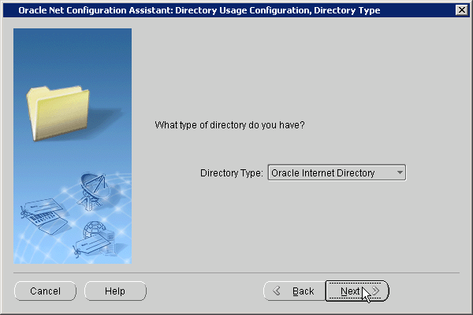

> Description can be found in the procedure.
>
> Copyright © 2000, 2013, Oracle and/or its affiliates. All rights reserved.  
> [Legal Notices](https://docs.oracle.com/cd/E11882_01/dcommon/html/cpyr.htm)

3. Click Next.
	The Directory Location screen appears.
	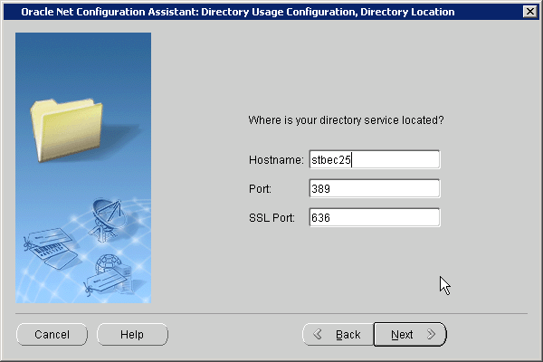

> Description can be found in the procedure.
>
> Copyright © 2000, 2013, Oracle and/or its affiliates. All rights reserved.  
> [Legal Notices](https://docs.oracle.com/cd/E11882_01/dcommon/html/cpyr.htm)

4. Enter the name of the host on which the Oracle Internet Directory server is running. Also enter the LDAP non-SSL and SSL port numbers. These port numbers are 389 and 636 by default. Click Next.
	The Select Oracle Context screen appears.
	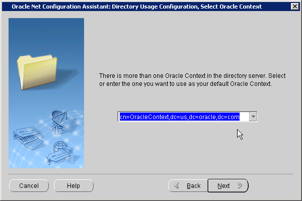

> Description can be found in the procedure.
>
> Copyright © 2000, 2013, Oracle and/or its affiliates. All rights reserved.  
> [Legal Notices](https://docs.oracle.com/cd/E11882_01/dcommon/html/cpyr.htm)

5. Select the default Oracle Context to use. You need to select this if there are multiple identity management realms on the directory server. Click Next.
	The Directory Usage Configuration, Done screen is displayed.
6. Confirm that the directory usage configuration is successfully completed. Click Next.
7. Click Finish.
	NetCA creates an `ldap.ora` file in the `$ORACLE_HOME` `/network/admin` directory. This is the `$ORACLE_HOME` `\network\admin` directory in Windows. The `ldap.ora` file stores the connection information details about the directory.

## 2.2 Registering Your Database with the Directory

The next step is to register the database with the directory service. The Database Configuration Assistant (DBCA) tool enables you to register the database with Oracle Internet Directory.

To register the database with the directory:

1. Start DBCA using the `dbca` command.
	- On Windows, you can also start DBCA from the Start menu:
		Click Start, All Programs, Oracle - OracleHomeName, Configuration and Migration Tools, Database Configuration Assistant.
		- On Unix systems, you can start DBCA using the following command:
		`$ORACLE_HOME` `/bin/dbca`
	The Welcome screen appears.
2. Click Next.
	The Operations screen is displayed.
	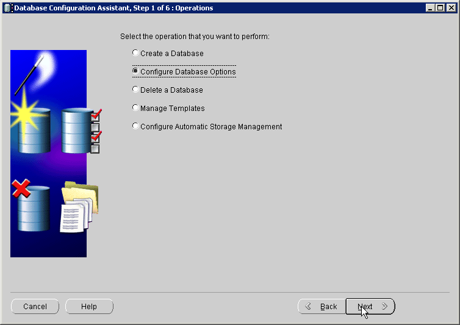

> Description can be found in the procedure.
>
> Copyright © 2000, 2013, Oracle and/or its affiliates. All rights reserved.  
> [Legal Notices](https://docs.oracle.com/cd/E11882_01/dcommon/html/cpyr.htm)

3. Select Configure Database Options. Click Next.
	The Database screen appears.
4. Select the database name that you wish to configure. You might also be asked to enter `SYS` user credentials if you are not using operating system authentication. Click Next.
	The Management Options screen appears.
5. Select Keep the database configured with Database Control if you want to continue using Database Control to manage the database. You also have the option of using Grid Control to manage the database. Click Next.
	The Security Settings screen appears.
6. Select Keep the enhanced 11g default security settings to keep the 11g security settings. Click Next.
	The Network Configuration screen appears.
	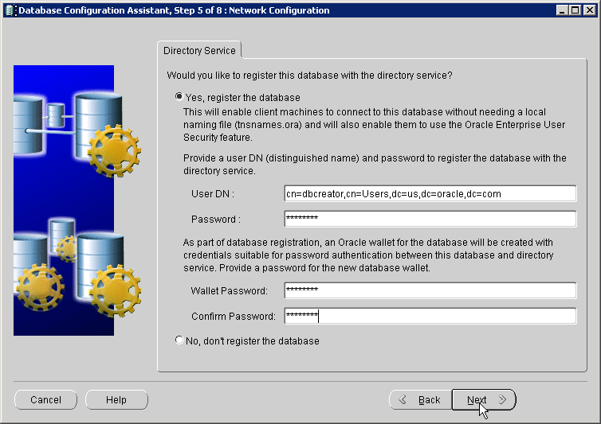

> Description can be found in the procedure.
>
> Copyright © 2000, 2013, Oracle and/or its affiliates. All rights reserved.  
> [Legal Notices](https://docs.oracle.com/cd/E11882_01/dcommon/html/cpyr.htm)

7. Select Yes, register the database to register the database with the directory. Enter the distinguished name (DN) of a user who is authorized to register databases in Oracle Internet Directory. Also, enter the password for the directory user. Enter a wallet password. Reenter the password in the Confirm Password field. Click Next.
	Note:
	The database uses a randomly generated password to log in to the directory. This database password is stored in an Oracle wallet. The wallet can also be used to store certificates needed for SSL connections.
	The wallet password that you specify is different from the database password. The wallet password is used to protect the wallet.
	The Database Components screen appears.
8. Click Next.
	The Connection Mode page appears.
9. Select Dedicated Server Mode or Shared Server Mode. Click Finish.
	The Confirmation dialog box appears.
10. Click OK.

Note:

After you register the database with the directory, make sure that auto login is enabled for the database wallet. The default wallet is created in the `$ORACLE_BASE` `/admin/` `database_sid` `/wallet` directory.

You can verify that auto login for the wallet is enabled by checking for the presence of the `cwallet.sso` file in the wallet directory. If the file is not present, you can enable auto login by opening the wallet using Oracle Wallet Manager, and using the option to enable auto login for the wallet.

## 2.3 Creating a Shared Schema in the Database

Creating a shared schema in the database enables you to map multiple enterprise users to the same schema. Example 2-1 creates a shared schema, `global_ident_schema_user`, and grants the `CONNECT` role to it.

Example 2-1 Creating a Shared Schema

```
SQL> CREATE USER global_ident_schema_user IDENTIFIED GLOBALLY;
User created.
SQL> GRANT CONNECT TO global_ident_schema_user;
Grant succeeded.
```

## 2.4 Mapping Enterprise Users to the Shared Schema

Enterprise User Security can be managed using Enterprise Manager. Example 2-2 maps the DN, `cn=users, dc=us, dc=oracle, dc=com` to the shared database schema, `global_ident_schema_user`.

Example 2-2 Mapping Enterprise Users to the Shared Schema

To create the user-schema mapping:

1. Log in to Enterprise Manager.
	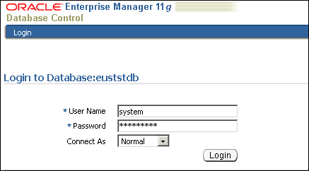

> Description can be found in the procedure.
>
> Copyright © 2000, 2013, Oracle and/or its affiliates. All rights reserved.  
> [Legal Notices](https://docs.oracle.com/cd/E11882_01/dcommon/html/cpyr.htm)

2. Click the Server tab. Under the Security section, click Enterprise User Security.
	The Oracle Internet Directory Login page appears.
	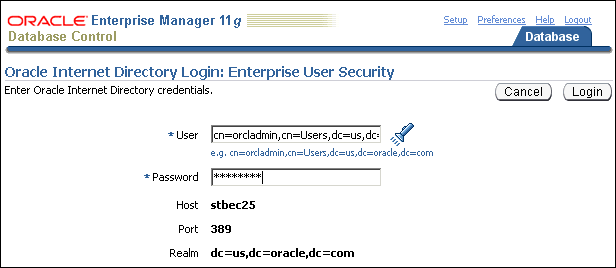

> Description can be found in the procedure.
>
> Copyright © 2000, 2013, Oracle and/or its affiliates. All rights reserved.  
> [Legal Notices](https://docs.oracle.com/cd/E11882_01/dcommon/html/cpyr.htm)

3. Enter the distinguished name (DN) of a directory user who can administer enterprise users in the User field. Enter the user password in the Password field. Click Login.
	The Enterprise User Security page appears.
	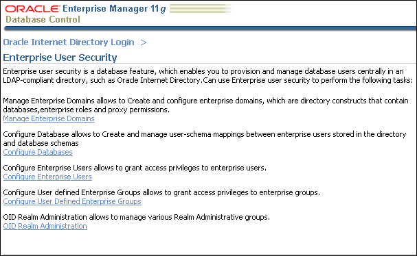

> Description can be found in the procedure.
>
> Copyright © 2000, 2013, Oracle and/or its affiliates. All rights reserved.  
> [Legal Notices](https://docs.oracle.com/cd/E11882_01/dcommon/html/cpyr.htm)

4. Click Manage Enterprise Domains.
	The Manage Enterprise Domains page appears.
	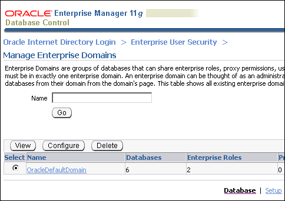

> Description can be found in the procedure.
>
> Copyright © 2000, 2013, Oracle and/or its affiliates. All rights reserved.  
> [Legal Notices](https://docs.oracle.com/cd/E11882_01/dcommon/html/cpyr.htm)

5. Select the enterprise domain which contains the database. Click Configure.
	The Configure Domain page appears.
6. Click the User-Schema Mappings tab. All user-schema maps that apply to the enterprise domain are displayed.
7. Click Create.
	The Create Mapping page is displayed.
	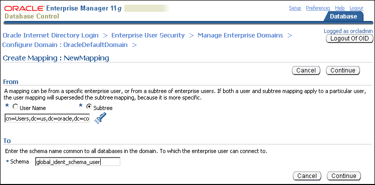

> Description can be found in the procedure.
>
> Copyright © 2000, 2013, Oracle and/or its affiliates. All rights reserved.  
> [Legal Notices](https://docs.oracle.com/cd/E11882_01/dcommon/html/cpyr.htm)

8. Under the From section, select Subtree. Click the Search icon. Select the DN, cn=Users, dc=us,dc=oracle,dc=com.
9. Under the To section, enter global\_ident\_schema\_user in the Schema field. Click Continue.
	The user-schema mapping is added in the Configure Domain page.
	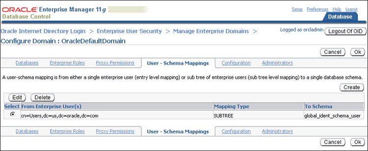

> Description can be found in the procedure.
>
> Copyright © 2000, 2013, Oracle and/or its affiliates. All rights reserved.  
> [Legal Notices](https://docs.oracle.com/cd/E11882_01/dcommon/html/cpyr.htm)

10. Click OK.

## 2.5 Connecting to the Database as an Enterprise User

All users in the mapped Oracle Internet Directory subtree can now connect to the database as enterprise users. Example 2-3 shows the `cn=orcladmin, cn=users, dc=us,dc=oracle,dc=com` user connecting to the database.

Example 2-3 Connecting to the Database as an Enterprise User

```
SQL> CONNECT orcladmin
Enter password:
Connected.
```

## 2.6 Using Enterprise Roles

Enterprise roles are created in the directory. Enterprise roles contain global roles from different databases that are part of the enterprise domain. Enterprise roles are used to assign database privileges to enterprise users.

Example 2-4 creates two enterprise users, Joe and Nina. Both these users are created in the subtree, `cn=Users, dc=us,dc=oracle,dc=com`, which is already mapped to the `global_ident_schema_user` in the EUSDB database.

Nina is an HR manager. She needs the `SELECT` privilege on the `hr.employees` table in the EUSDB database. Example 2-4 achieves this using enterprise roles.

Example 2-4 Using Enterprise Roles

We start by creating two enterprise users, Joe and Nina. You can create enterprise users using the Oracle Internet Directory Self Service Console.

To create enterprise users, Joe and Nina:

1. Connect to the Oracle Internet Directory Self Service Console. Use the following URL:
	`http://` `hostname`:`port` `/oiddas/`
	Here, `hostname` is the name of the host that is running the Oracle Internet Directory server. The `port` number is the TCP port number on which the Oracle Internet Directory Self Service Console is running. This is 7777 by default.
	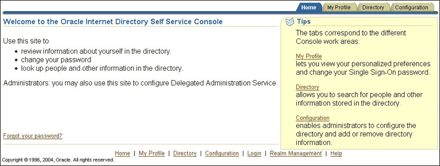

> Description can be found in the procedure.
>
> Copyright © 2000, 2013, Oracle and/or its affiliates. All rights reserved.  
> [Legal Notices](https://docs.oracle.com/cd/E11882_01/dcommon/html/cpyr.htm)

2. Click the Directory tab.
	The Sign In page appears.
	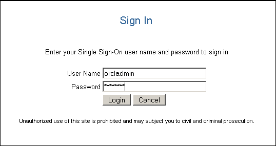

> Description can be found in the procedure.
>
> Copyright © 2000, 2013, Oracle and/or its affiliates. All rights reserved.  
> [Legal Notices](https://docs.oracle.com/cd/E11882_01/dcommon/html/cpyr.htm)

3. Log in as the user that can create users in Oracle Internet Directory.
	The User page appears.
4. Click Create.
	The Create User page appears.
	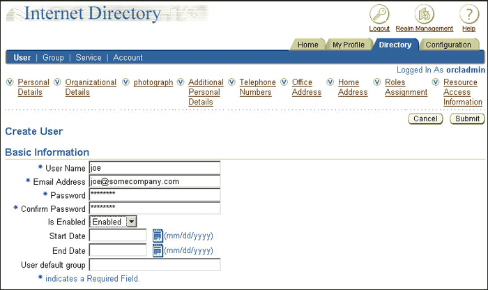

> Description can be found in the procedure.
>
> Copyright © 2000, 2013, Oracle and/or its affiliates. All rights reserved.  
> [Legal Notices](https://docs.oracle.com/cd/E11882_01/dcommon/html/cpyr.htm)

5. Enter joe under User Name. Enter values for the other required fields. Select Enabled under Is Enabled.
6. Click Submit.
7. Click Create Another User.
	The Create User page appears.
8. Enter Nina under User Name. Enter values for the other required fields. Select Enabled under Is Enabled.
9. Click Submit. Click OK.

Next, we create a global role in the database that allows access to the `hr.employees` table. The following SQL\*Plus statements create a global role, `hr_access` and grant the necessary privilege to it.

```
SQL> CREATE ROLE hr_access IDENTIFIED GLOBALLY;
Role created.
SQL> GRANT SELECT ON hr.employees TO hr_access;
Grant succeeded.
```

Next, we create an enterprise role called `hr_access` and assign the global role to it. We then assign this enterprise role to the enterprise user, Nina. The enterprise role can be created using Enterprise Manager.

To create the enterprise role, `hr_access:`

1. Log in to Enterprise Manager.
2. Click the Server tab. Under the Security section, click Enterprise User Security.
	The Oracle Internet Directory Login page appears.
3. Enter the distinguished name (DN) of a directory user who can administer enterprise users in the User field. Enter the user password in the Password field. Click Login.
	The Enterprise User Security page appears.
4. Click Manage Enterprise Domains.
	The Manage Enterprise Domains page appears. This page lists the enterprise domains in the identity management realm.
5. Select the enterprise domain that contains the database. Click Configure.
	The Configure Domain page appears.
6. Click the Enterprise Roles tab.
7. Click Create.
	The Create Enterprise Role page appears.
8. Enter hr\_access in the Name field.
	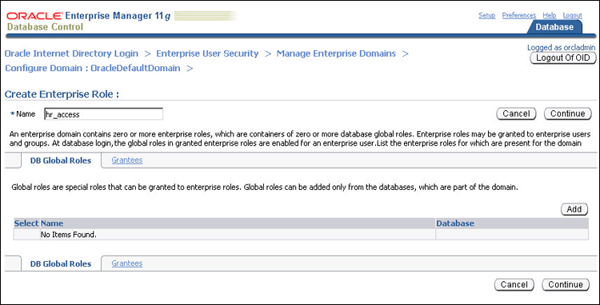

> Description can be found in the procedure.
>
> Copyright © 2000, 2013, Oracle and/or its affiliates. All rights reserved.  
> [Legal Notices](https://docs.oracle.com/cd/E11882_01/dcommon/html/cpyr.htm)

9. Click Add to add the database global role to the enterprise role.
	The Search and Select Database Global Roles window is displayed.
	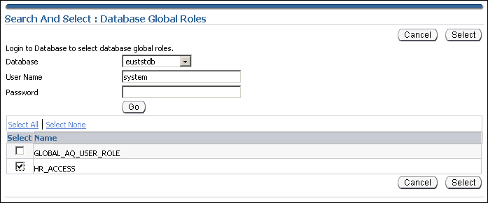

> Description can be found in the procedure.
>
> Copyright © 2000, 2013, Oracle and/or its affiliates. All rights reserved.  
> [Legal Notices](https://docs.oracle.com/cd/E11882_01/dcommon/html/cpyr.htm)

10. Select the `hr_access` global role in your database. Click Select.
	Note:
	You will be required to log in to the database before you can select the global role.
11. Click the Grantees tab. Click Add.
	The Select Users or Groups window appears.
12. Select user Nina. Click Select.
	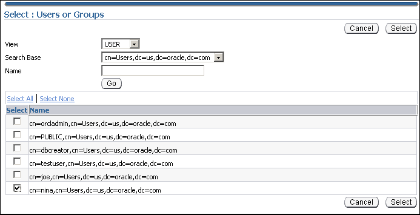

> Description can be found in the procedure.
>
> Copyright © 2000, 2013, Oracle and/or its affiliates. All rights reserved.  
> [Legal Notices](https://docs.oracle.com/cd/E11882_01/dcommon/html/cpyr.htm)

13. Click Continue in the Create Enterprise Role page.
14. Click OK in the Configure Domain page.

The enterprise user, Nina can now access the `hr.employees` table in the database. The following SQL\*Plus statements illustrate this:

```
SQL> CONNECT Nina
Enter password:
Connected.
SQL> SELECT employee_id FROM hr.employees;
EMPLOYEE_ID
-----------
        100
        101
        102
...
...
107 rows selected.
```

The enterprise user, Joe cannot access the `hr.employees` table, as he does not have the enterprise role assigned to him.

```
SQL> CONNECT joe
Enter password:
Connected.
SQL> SELECT employee_id FROM hr.employees;
SELECT employee_id FROM hr.employees

ERROR at line 1:
ORA-00942: table or view does not exist
```

## 2.7 Using Proxy Permissions

Proxy permissions are created at the enterprise domain level. Proxy permissions allow an enterprise user to proxy a local database user, which means that the enterprise user can log in to the database as the local database user. You can grant proxy permissions to individual enterprise users or groups. Proxy permissions are especially useful for middle-tier applications that operate across multiple databases as enterprise users.

Example 2-5 illustrates the use of proxy permissions. The enterprise user, `joe` is a sales manager and needs to log in to enterprise databases as the target database user, `SH`. The `SH` user owns the sample `SH` schema that contains Sales History related tables.

Example 2-5 Using Proxy Permissions

The first step in allowing enterprise user proxy is to `ALTER` the target database user to allow `CONNECT` through enterprise users. The following `SQL` statements unlock the `SH` database account, set a password for it, and `ALTER` the account to allow enterprise user proxy:

```
SQL> CONNECT SYSTEM
Enter password:
Connected.
SQL> ALTER USER SH IDENTIFIED BY hrd2guess ACCOUNT UNLOCK;
User altered.
SQL> ALTER USER SH GRANT CONNECT THROUGH ENTERPRISE USERS;
User altered.
```

Next, use Enterprise Manager to configure the proxy permission. This allows the enterprise user `joe` to connect as the local database user, `SH`.

To configure the proxy permission for enterprise user, `joe`:

1. Log in to Enterprise Manager.
2. Click the Server tab. Under the Security section, click Enterprise User Security.
	The Oracle Internet Directory Login page appears.
3. Enter the distinguished name (DN) of a directory user who can administer enterprise users in the User field. Enter the user password in the Password field. Click Login.
	The Enterprise User Security page appears.
4. Click Manage Enterprise Domains.
	The Manage Enterprise Domains page appears. This page lists the enterprise domains in the identity management realm.
5. Select the enterprise domain that you wish to configure. Click Configure.
	The Configure Domain page appears.
6. Click the Proxy Permissions tab.
	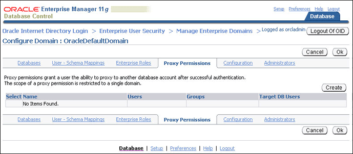

> Description can be found in the procedure.
>
> Copyright © 2000, 2013, Oracle and/or its affiliates. All rights reserved.  
> [Legal Notices](https://docs.oracle.com/cd/E11882_01/dcommon/html/cpyr.htm)

7. Click Create to create a new proxy permission.
	The Create Proxy Permission page appears.
8. Enter SH\_Proxy, as the name of the proxy permission, in the Name field.
	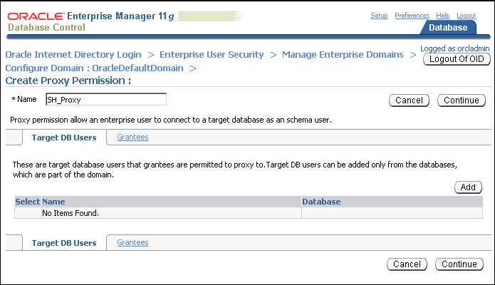

> Description can be found in the procedure.
>
> Copyright © 2000, 2013, Oracle and/or its affiliates. All rights reserved.  
> [Legal Notices](https://docs.oracle.com/cd/E11882_01/dcommon/html/cpyr.htm)

9. Ensure that the Target DB Users tab is selected. Click Add.
	The Search and Select window appears.
10. Log in to the database that contains the `SH` user. A list of all database users that have been altered to allow enterprise user proxy is displayed.
11. Select the SH user. Click Select.
	The `SH` user is added under Target DB Users in the Create Proxy Permission page.
	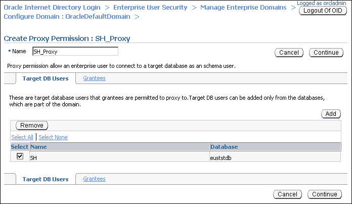

> Description can be found in the procedure.
>
> Copyright © 2000, 2013, Oracle and/or its affiliates. All rights reserved.  
> [Legal Notices](https://docs.oracle.com/cd/E11882_01/dcommon/html/cpyr.htm)

12. Click the Grantees tab.
13. Click Add.
	The Select Users or Groups window appears.
14. Select `cn=users,dc=us,dc=oracle,dc=com` under Search Base. Select `User` under View. Click Go.
	A list of users under the subtree, `cn=users,dc=us,dc=oracle,dc=com` is displayed.
	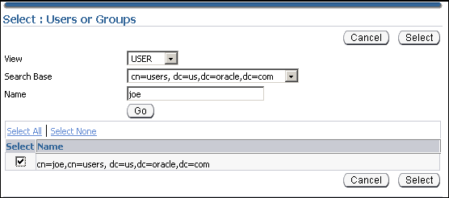

> Description can be found in the procedure.
>
> Copyright © 2000, 2013, Oracle and/or its affiliates. All rights reserved.  
> [Legal Notices](https://docs.oracle.com/cd/E11882_01/dcommon/html/cpyr.htm)

15. Select `cn=joe,cn=users,dc=us,dc=oracle,dc=com`. Click Select.
	The user `joe` is added under Grantees in the Create Proxy Permission page.
	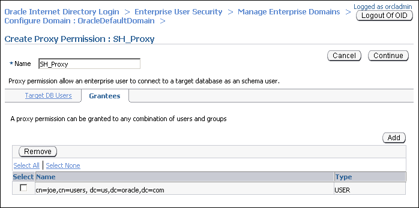

> Description can be found in the procedure.
>
> Copyright © 2000, 2013, Oracle and/or its affiliates. All rights reserved.  
> [Legal Notices](https://docs.oracle.com/cd/E11882_01/dcommon/html/cpyr.htm)

16. Click Continue in the Create Proxy Permission page.
	The proxy permission, `SH_Proxy` is added in the Configure Domain page.
	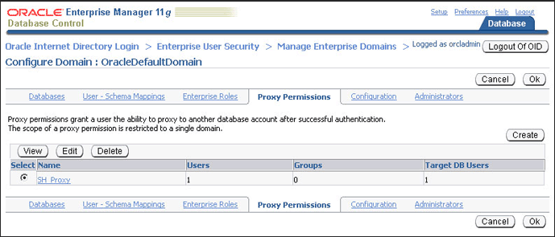

> Description can be found in the procedure.
>
> Copyright © 2000, 2013, Oracle and/or its affiliates. All rights reserved.  
> [Legal Notices](https://docs.oracle.com/cd/E11882_01/dcommon/html/cpyr.htm)

17. Click OK.

The enterprise user, `joe` can now log in as the local database user `SH`. The following `SQL` statements illustrate this:

```
SQL> REMARK Joe uses his own password to connect as the local database user, SH.
SQL> CONNECT joe[SH]
Enter password:
Connected.
SQL> SELECT * FROM SH.sales WHERE cust_id=4;

   PROD_ID    CUST_ID TIME_ID   CHANNEL_ID   PROMO_ID QUANTITY_SOLD AMOUNT_SOLD
---------- ---------- --------- ---------- ---------- ------------- -----------
        37          4 31-MAY-00          3        999             1       60.43
        39          4 31-MAY-00          3        999             1       38.45
        40          4 31-MAY-00          3        999             1        48.1
...
...
72 rows selected.
```