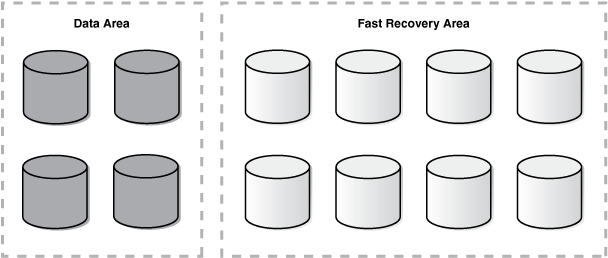
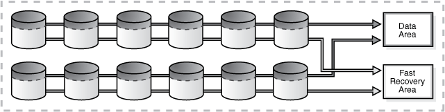

## 4 Configuring Storage

This chapter describes best practices for configuring a fault-tolerant storage subsystem that protects data while providing manageability and performance. These practices apply to all Oracle Database high availability architectures described in [Oracle Database High Availability Overview](https://docs.oracle.com/cd/E11882_01/server.112/e17157/architectures.htm#HAOVW004).

This chapter contains the following topics:

## 4.1 Evaluate Database Performance and Storage Capacity Requirements

Characterize your database performance requirements using different application workloads. Extract statistics during your target workloads by gathering the beginning and ending statistical snapshots. Some examples of target workloads include:

- Average load
- Peak load
- Application workloads such as batch processing, Online Transaction Processing (OLTP), decision support systems (DSS) and reporting, Extraction, Transformation, and Loading (ETL)

Evaluating Database Performance Requirements

You can gather the necessary statistics by using Automatic Workload Repository (AWR) reports or by querying the `GV$SYSSTAT` view. Along with understanding the database performance requirements, you must evaluate the performance capabilities of a storage array.

Choosing Storage

When you understand the performance and capacity requirements, choose a storage platform to meet those requirements.

See Also:

[Oracle Database Performance Tuning Guide](https://docs.oracle.com/cd/E11882_01/server.112/e41573/autostat.htm#PFGRF02601) for Overview of the Automatic Workload Repository (AWR) and on Generating Automatic Workload Repository Reports

## 4.2 Use Automatic Storage Management (Oracle ASM) to Manage Database Files

Oracle ASM is a vertical integration of both the file system and the volume manager built specifically for Oracle database files. Oracle ASM extends the concept of stripe and mirror everything (SAME) to optimize performance, while removing the need for manual I/O tuning (distributing the data file layout to avoid hot spots). Oracle ASM helps manage a dynamic database environment by letting you grow the database size without shutting down the database to adjust the storage allocation. Oracle ASM also enables low-cost modular storage to deliver higher performance and greater availability by supporting mirroring and striping.

Oracle ASM provides data protection against drive and SAN failures, the best possible performance, and extremely flexible configuration and reconfiguration options. Oracle ASM automatically distributes the data across all available drivers, transparently and dynamically redistributes data when storage is added or removed from the database.

Oracle ASM manages all of your database files. You can phase Oracle ASM into your environment by initially supporting only the fast recovery area.

Note:

Oracle recommends host-based mirroring using Oracle ASM.

See:

- [Oracle Automatic Storage Management Administrator's Guide](https://docs.oracle.com/cd/E11882_01/server.112/e18951/toc.htm) for information about Oracle ASM
- [Oracle Database Backup and Recovery User's Guide](https://docs.oracle.com/cd/E11882_01/backup.112/e10642/rcmdupdb.htm#BRADV010) for information about duplicating a database
- The MAA white papers "Migration to Automatic Storage Management (ASM)" and "Best Practices for Creating a Low-Cost Storage Grid for Oracle Databases" from the MAA Best Practices area for Oracle Database at
	`http://www.oracle.com/goto/maa`

### 4.2.1 Use Clustered Oracle ASM to Enable the Storage Grid

The Grid Infrastructure is the software that provides the infrastructure for an enterprise grid architecture. In a cluster, this software includes Oracle Clusterware and Oracle ASM.

You can use clustered Oracle ASM with both Oracle single-instance databases and Oracle Real Application Clusters (Oracle RAC). In an Oracle RAC environment, there is one Oracle ASM instance for each node, and the Oracle ASM instances communicate with each other on a peer-to-peer basis. Only one Oracle ASM instance is required and supported for each node regardless of the number of database instances on the node. Clustering Oracle ASM instances provides fault tolerance, flexibility, and scalability to your storage pool.

See Also:

[Oracle Automatic Storage Management Administrator's Guide](https://docs.oracle.com/cd/E11882_01/server.112/e18951/asmcon.htm#OSTMG03620) for more information about clustered Oracle ASM

### 4.2.2 Use Oracle Restart for Oracle ASM Instances (non-clustered Oracle Database)

Oracle Restart improves the availability of your Oracle database. When you install the Oracle Grid Infrastructure for a standalone server, it includes both Oracle ASM and Oracle Restart. Oracle Restart runs out of the Oracle Grid Infrastructure home, which you install separately from Oracle Database homes.

Oracle Restart provides managed startup and restart of a single-instance (non-clustered) Oracle Database, Oracle ASM instance, service, listener, and any other process running on the server. If an interruption of a service occurs after a hardware or software failure, Oracle Restart automatically takes the necessary steps to restart the component.

With Server Control Utility (SRVCTL) you can add a component, such as an Oracle ASM instance to Oracle Restart. You then enable Oracle Restart protection for the Oracle ASM instance. With SRVCTL, you also remove or disable Oracle Restart protection.

See Also:

- [Oracle Database Administrator's Guide](https://docs.oracle.com/cd/E11882_01/server.112/e25494/restart.htm#ADMIN12709) for more information about Oracle Restart
- [Oracle Automatic Storage Management Administrator's Guide](https://docs.oracle.com/cd/E11882_01/server.112/e18951/asminst.htm#OSTMG136) for more information about using Oracle Restart

## 4.3 Oracle ASM Strategic Best Practices

Use the following Oracle ASM strategic best practices:

- Use a Simple Disk and Disk Group Configuration
- Use Redundancy to Protect from Disk Failure
- Oracle ASM in the Grid Infrastructure Home
- Ensure Disks in the Same Disk Group Have the Same Characteristics
- Use Failure Groups When Using Oracle ASM Redundancy
- Use Intelligent Data Placement
- Use Oracle ACFS to Manage Files Outside the Database

### 4.3.1 Use a Simple Disk and Disk Group Configuration

Oracle recommends using Oracle high redundancy disk groups (3 way mirroring) or an external redundancy disk group with equivalent mirroring resiliency for mission critical applications. This higher level of mirroring provides greater protection and better tolerance of different storage failures. This is especially true during planned maintenance windows when a subset of the storage is offline for patching or upgrading. For more information about redundancy, see Chapter 4, "Use Redundancy to Protect from Disk Failure."

When you use Oracle ASM for database storage, create two disk groups: one disk group for the data area and another disk group for the fast recovery area:

- data area: contains the active database files and other files depending on the level of Oracle ASM redundancy. If Oracle ASM with high redundancy is used, then the data area can also contain OCR, Voting, spfiles, control files, online redo log files, standby redo log files, broker metadata files, and change tracking files used for RMAN incremental backup.
	For example (high redundancy):
	```
	CREATE DISKGROUP data HIGH REDUNDANCY
	FAILGROUP controller1 DISK
	     '/devices/c1data01' NAME c1data01,\
	     '/devices/c1data02' NAME c1data02
	FAILGROUP controller2 DISK
	     '/devices/c2data01' NAME c2data01,
	     '/devices/c2data02' NAME c2data02
	FAILGROUP controller3 DISK
	     '/devices/c3data01' NAME c3data01,
	     '/devices/c3data02' NAME c3data02
	ATTRIBUTE 'au_size'='4M',
	     'compatible.asm'  = '11.2',
	     'compatible.rdbms'= '11.2',
	     'compatible.advm' = '11.2';
	```
- fast recovery area: contains recovery-related files, such as a copy of the current control file, a member of each online redo log file group, archived redo log files, RMAN backups, and flashback log files.
	For example (normal redundancy):
	```
	CREATE DISKGROUP reco NORMAL REDUNDANCY
	FAILGROUP controller1 DISK
	     '/devices/c1reco01' NAME c1reco01,
	     '/devices/c1reco02' NAME c1reco02
	FAILGROUP controller2 DISK
	     '/devices/c2reco01' NAME c2reco01,
	     '/devices/c2reco02' NAME c2reco02
	ATTRIBUTE 'au_size'='4M',
	     'compatible.asm'  = '11.2',
	     'compatible.rdbms'= '11.2',
	     'compatible.advm' = '11.2';
	```

Note 1:

If you are using ASMLib in a Linux environment, then create the disks using the `ORACLEASM CREATEDISK` command. ASMLib is a support library for Oracle ASM and is not supported on all platforms. For more information about ASMLib, see Section 4.4.6, "Use ASMLib On Supported Platforms".

For example:

```
/etc/init.d/oracleasm createdisk lun1 /devices/lun01
```

Then, create the disk groups. For example:

```
CREATE DISKGROUP DATA DISK    
'ORCL:lun01','ORCL:lun02','ORCL:lun03','ORCL:lun04';
```

Note 2:

Oracle recommends using four (4) or more disks in each disk group. Having multiple disks in each disk group spreads kernel contention accessing and queuing for the same disk.

To simplify file management, use Oracle Managed Files to control file naming. Enable Oracle Managed Files by setting the following initialization parameters: `DB_CREATE_FILE_DEST` and `DB_CREATE_ONLINE_LOG_DEST_` `n`.

For example:

```
DB_CREATE_FILE_DEST=+DATA
DB_CREATE_ONLINE_LOG_DEST_1=+RECO
```

You have two options when partitioning disks for Oracle ASM:

- Allocate entire disks to the data area and fast recovery area disk groups. Figure 4-1 illustrates allocating entire disks.
- Partition each disk into two partitions, one for the data area and another for the fast recovery area. Figure 4-2 illustrates partitioning each disk into two partitions.

Figure 4-1 Allocating Entire Disks



> This graphic shows disks that have been partitioned into two areas: a "Data Area" and a "Fast Recovery Area." The data area disks are distinguished by a darker shade of gray and includes four complete disks. Light gray shows eight Fast Recovery Area disks.
>
> Copyright © 2005, 2014, Oracle and/or its affiliates. All rights reserved.  
> [Legal Notices](https://docs.oracle.com/cd/E11882_01/dcommon/html/cpyr.htm)
  

The advantages of the option shown in Figure 4-1 are:

- Easier management of the disk partitions at the operating system level because each disk is partitioned as just one large partition.
- Quicker completion of Oracle ASM rebalance operations following a disk failure because there is only one disk group to rebalance.
- Fault isolation, where storage failures only cause the affected disk group to go offline.
- Patching isolation, where you can patch disks or firmware for individual disks without impacting every disk.

The disadvantage of the option shown in Figure 4-1 is:

- Less I/O bandwidth, because each disk group is spread over only a subset of the available disks.

Figure 4-2 illustrates the partitioning option where each disk has two partitions. This option requires partitioning each disk into two partitions: a smaller partition on the faster outer portion of each drive for the data area, and a larger partition on the slower inner portion of each drive for the fast recovery area. The ratio for the size of the inner and outer partitions depends on the estimated size of the data area and the fast recovery area.

Figure 4-2 Partitioning Each Disk



> This graphic shows twelve ungrouped disks. Each disk is divided into dark gray and light gray portions to represent partitioning. The top portion of each disk is dark gray; arrows from the dark gray portions point to "Data Area." The bottom portion of each disk is light gray and arrows from the light gray portions point to the "Fast Recovery Area."
  

The advantages of the option shown in Figure 4-2 for partitioning are:

- More flexibility and easier to manage from a performance and scalability perspective.
- Higher I/O bandwidth is available, because both disk groups are spread over all available spindles. This advantage is considerable for the data area disk group for I/O intensive applications.
- There is no need to create a separate disk group with special, isolated storage for online redo logs or standby redo logs if you have sufficient I/O capacity.
- You can use the slower regions of the disk for the fast recovery area and the faster regions of the disk for data.

The disadvantages of the option shown in Figure 4-2 for partitioning are:

- A double partner disk failure will result in loss of both disk groups, requiring the use of a standby database or tape backups for recovery. This problem is eliminated when using high redundancy ASM disk groups.
- An Oracle ASM rebalance operation following a disk failure is longer, because both disk groups are affected.

See Also:

- [Oracle Database 2 Day DBA](https://docs.oracle.com/cd/E11882_01/server.112/e10897/asm.htm#ADMQS12079) for an Overview of Disks, Disk Groups, and Failure Groups and a description of normal redundancy, high redundancy and external redundancy
- [Oracle Database Backup and Recovery User's Guide](https://docs.oracle.com/cd/E11882_01/backup.112/e10642/rcmconfb.htm#BRADV8183) for details about setting up and sizing the fast recovery area
- [Oracle Automatic Storage Management Administrator's Guide](https://docs.oracle.com/cd/E11882_01/server.112/e18951/toc.htm) for details about Oracle ASM

### 4.3.2 Use Redundancy to Protect from Disk Failure

When setting up redundancy to protect from hardware failures, there are two options to consider:

- Storage Array Based RAID
- Oracle ASM Redundancy

See Also:

- [Oracle Automatic Storage Management Administrator's Guide](https://docs.oracle.com/cd/E11882_01/server.112/e18951/asmcon.htm#OSTMG03601) for an overview of Oracle Automatic Storage Management
- [Oracle Automatic Storage Management Administrator's Guide](https://docs.oracle.com/cd/E11882_01/server.112/e18951/asm_em.htm#OSTMG24000) for information about creating disk groups

#### 4.3.2.1 Storage Array Based RAID

If you are using a high-end storage array that offers robust built-in RAID solutions, then Oracle recommends that you configure redundancy in the storage array by enabling RAID protection, such as RAID1 (mirroring) or RAID5 (striping plus parity). For example, to create an Oracle ASM disk group where redundancy is provided by the storage array, first create the RAID-protected [logical unit numbers (LUNs)](glossary.md) in the storage array, and then create the Oracle ASM disk group using the `EXTERNAL` `REDUNDANCY` clause:

```
CREATE DISKGROUP DATA EXTERNAL REDUNDANCY DISK
    '/devices/lun1','/devices/lun2','/devices/lun3','/devices/lun4';
```

See Also:

- [Oracle Automatic Storage Management Administrator's Guide](https://docs.oracle.com/cd/E11882_01/server.112/e18951/asmdiskgrps.htm#OSTMG13711) for information about Oracle ASM Mirroring and Disk Group Redundancy
- [Oracle Database 2 Day DBA](https://docs.oracle.com/cd/E11882_01/server.112/e10897/asm.htm#ADMQS12085) for information about Creating a Disk Group

#### 4.3.2.2 Oracle ASM Redundancy

Oracle ASM provides redundancy with the use of failure groups, which are defined during disk group creation. The disk group type determines how Oracle ASM mirrors files. When you create a disk group, you indicate whether the disk group is a normal redundancy disk group (2-way mirroring for most files by default), a high redundancy disk group (3-way mirroring), or an external redundancy disk group (no mirroring by Oracle ASM). You use an external redundancy disk group if your storage system does mirroring at the hardware level, or if you have no need for redundant data. The default disk group type is normal redundancy. After a disk group is created the redundancy level cannot be changed.

Failure group definition is specific to each storage setup, but you should follow these guidelines:

- If every disk is available through every I/O path, as would be the case if using disk multipathing software, then keep each disk in its own failure group. This is the default Oracle ASM behavior if creating a disk group without explicitly defining failure groups.
	```
	CREATE DISKGROUP DATA NORMAL REDUNDANCY DISK
	    '/devices/diska1','/devices/diska2','/devices/diska3','/devices/diska4',
	    '/devices/diskb1','/devices/diskb2','/devices/diskb3','/devices/diskb4';
	```
- For an array with two controllers where every disk is seen through both controllers, create a disk group with each disk in its own failure group:
	```
	CREATE DISKGROUP DATA NORMAL REDUNDANCY 
	  DISK
	   '/devices/diska1','/devices/diska2','/devices/diska3','/devices/diska4',
	   '/devices/diskb1','/devices/diskb2','/devices/diskb3','/devices/diskb4';
	```
- If every disk is not available through every I/O path, then define failure groups to protect against the piece of hardware that you are concerned about failing. Here are some examples:
	- For an array with two controllers where each controller sees only half the drives, create a disk group with two failure groups, one for each controller, to protect against controller failure:
		```
		CREATE DISKGROUP DATA NORMAL REDUNDANCY 
		  FAILGROUP controller1 DISK
		   '/devices/diska1','/devices/diska2','/devices/diska3','/devices/diska4'
		  FAILGROUP controller2 DISK
		   '/devices/diskb1','/devices/diskb2','/devices/diskb3','/devices/diskb4';
		```
		- For a storage network with multiple storage arrays, you want to mirror across storage arrays, then create a disk group with two failure groups, one for each array, to protect against array failure:
		```
		CREATE DISKGROUP DATA NORMAL REDUNDANCY 
		  FAILGROUP array1 DISK
		   '/devices/diska1','/devices/diska2','/devices/diska3','/devices/diska4'
		  FAILGROUP array2 DISK
		   '/devices/diskb1','/devices/diskb2','/devices/diskb3','/devices/diskb4';
		```

When determining the proper size of a disk group that is protected with Oracle ASM redundancy, enough free space must exist in the disk group so that when a disk fails Oracle ASM can automatically reconstruct the contents of the failed drive to other drives in the disk group while the database remains online. The amount of space required to ensure Oracle ASM can restore redundancy following disk failure is in the column `REQUIRED_MIRROR_FREE_MB` in the `V$ASM_DISKGROUP` view. The amount of free space that you can use safely in a disk group, taking mirroring into account, and still be able to restore redundancy after a disk failure is in the `USABLE_FILE_MB` column in the `V$ASM_DISKGROUP` view. The value of the `USABLE_FILE_MB` column should always be greater than zero. If `USABLE_FILE_MB` falls below zero, then add more disks to the disk group.

See:

[Oracle Database 2 Day DBA](https://docs.oracle.com/cd/E11882_01/server.112/e10897/asm.htm#ADMQS12085) for information about Creating a Disk Group

### 4.3.3 Oracle ASM in the Grid Infrastructure Home

Oracle Automatic Storage Management (Oracle ASM) and Oracle Clusterware are installed into a single home directory, which is called the Grid home. Oracle Grid Infrastructure for a cluster software refers to the installation of the combined products. The Grid home is separate from the home directories of other Oracle software products installed on the same server.

See Also:

[Oracle Database 2 Day + Real Application Clusters Guide](https://docs.oracle.com/cd/E11882_01/rac.112/e17264/intro_tdprc.htm#TDPRC115) for information about Oracle ASM and the Grid home.

### 4.3.4 Ensure Disks in the Same Disk Group Have the Same Characteristics

Although ensuring that all disks in the same disk group have the same size and performance characteristics is not required, doing so provides more predictable overall performance and space utilization. When possible, present physical disks (spindles) to Oracle ASM as opposed to Logical Unit Numbers (LUNs) that create a layer of abstraction between the disks and Oracle ASM.

If the disks are the same size, then Oracle ASM spreads the files evenly across all of the disks in the disk group. This allocation pattern maintains every disk at the same capacity level and ensures that all of the disks in a disk group have the same I/O load. Because Oracle ASM load balances workload among all of the disks in a disk group, different Oracle ASM disks should not share the same physical drive.

See Also:

[Oracle Automatic Storage Management Administrator's Guide](https://docs.oracle.com/cd/E11882_01/server.112/e18951/asmdiskgrps.htm#OSTMG137) for complete information about administering Oracle ASM disk groups

### 4.3.5 Use Failure Groups When Using Oracle ASM Redundancy

Using failure groups to define a common failure component ensures continuous access to data when that component fails. For maximum protection, use at least three failure groups for normal redundancy and at least five failure groups for high redundancy. Doing so enables Oracle ASM to tolerate multiple failure group failures and avoids the confusing state of having Oracle ASM running without full redundancy.

Note:

If you have purchased a high-end storage array that has redundancy features built in, then you can optionally use those features from the vendor to perform the mirroring protection functions and set the Oracle ASM disk group to external redundancy. Along the same lines, use Oracle ASM normal or high redundancy with low-cost storage and Exadata storage.

### 4.3.6 Use Intelligent Data Placement

Intelligent Data Placement enables you to specify disk regions on Oracle ASM disks for best performance. Using the disk region settings you can ensure that frequently accessed data is placed on the outermost (hot) tracks which have greater speed and higher bandwidth. In addition, files with similar access patterns are located physically close, reducing latency. Intelligent Data Placement also enables the placement of primary and mirror extents into different hot or cold regions.

See Also:

[Oracle Automatic Storage Management Administrator's Guide](https://docs.oracle.com/cd/E11882_01/server.112/e18951/asmdiskgrps.htm#OSTMG13790) for more information about Intelligent Data Placement

### 4.3.7 Use Oracle ACFS to Manage Files Outside the Database

Oracle Automatic Storage Management Cluster File System (Oracle ACFS) is a multi-platform, scalable file system, and storage management technology that extends Oracle Automatic Storage Management (Oracle ASM) functionality to support customer files maintained outside of Oracle Database. Oracle ACFS includes a volume management service and comes with fine grained security policies, encryption, snapshotting and replication.

Oracle ACFS supports many database and application files, including executables, database trace files, database alert logs, application reports, BFILEs, and configuration files. Other supported files are video, audio, text, images, engineering drawings, and other general-purpose application file data.

Note:

Oracle database binaries can be put on Oracle ACFS but not binaries in the Grid Infrastructure home.

See Also:

[Oracle Automatic Storage Management Administrator's Guide](https://docs.oracle.com/cd/E11882_01/server.112/e18951/asmfilesystem.htm#OSTMG30000) for more information about Oracle ACFS

## 4.4 Oracle ASM Configuration Best Practices

Use the following Oracle ASM configuration best practices:

- Use Disk Multipathing Software to Protect from Path Failure
- Use Automatic Shared Memory Management with SGA\_TARGET and PGA\_AGGREGATE\_TARGET Parameters
- Set the PROCESSES Initialization Parameter
- Use Disk Labels
- Set the DISK\_REPAIR\_TIME Disk Group Attribute Appropriately
- Use ASMLib On Supported Platforms

### 4.4.1 Use Disk Multipathing Software to Protect from Path Failure

Disk multipathing software aggregates multiple independent I/O paths into a single logical path. The path abstraction provides I/O load balancing across host bus adapters (HBA) and nondisruptive failovers when there is a failure in the I/O path. You should use disk multipathing software with Oracle ASM.

When specifying disk names during disk group creation in Oracle ASM, use the logical device representing the single logical path. For example, when using Device Mapper on Linux 2.6, a logical device path of `/dev/dm-0` may be the aggregation of physical disks `/dev/sdc` and `/dev/sdh`. Within Oracle ASM, the `ASM_DISKSTRING` parameter should contain `/dev/dm-*` to discover the logical device `/dev/dm-0`, and that logical device is necessary during disk group creation:

```
asm_diskstring='/dev/dm-*'

CREATE DISKGROUP DATA DISK
'/dev/dm-0','/dev/dm-1','/dev/dm-2','/dev/dm-3';
```

Note:

For more information about using the combination of ASMLib and Multipath Disks, see "Configuring Oracle ASMLib on Multipath Disks" in My Oracle Support Note 309815.1 at

`https://support.oracle.com/CSP/main/article?cmd=show&type=NOT&id=309815.1`

See Also:

- [Oracle Automatic Storage Management Administrator's Guide](https://docs.oracle.com/cd/E11882_01/server.112/e18951/asmprepare.htm#OSTMG02500) for information about Oracle ASM and Multipathing
- For more information, see "Oracle ASM and Multi-Pathing Technologies" in My Oracle Support Note 294869.1 at
	`https://support.oracle.com/CSP/main/article?cmd=show&type=NOT&id=294869.1`

### 4.4.3 Set the PROCESSES Initialization Parameter

The `PROCESSES` initialization parameter affects Oracle ASM, but the default value is usually suitable. However, if multiple database instances are connected to an Oracle ASM instance, you can use the following formulas:

| For < 10 instances per node... | For > 10 instances per node... |
| --- | --- |
| ``` PROCESSES = 50 * (n + 1) ``` | ``` PROCESSES = 50 * MIN (n + 1, 11) + 10 * MAX (n - 10, 0) ``` |

where `n` is the number database instances connecting to the Oracle ASM instance.

See Also:

- [Oracle Automatic Storage Management Administrator's Guide](https://docs.oracle.com/cd/E11882_01/server.112/e18951/asminst.htm#OSTMG10140) for information about Oracle ASM Parameter Setting Recommendations
- [Oracle Database Administrator's Guide](https://docs.oracle.com/cd/E11882_01/server.112/e25494/create.htm#ADMIN11108) for more information about setting the `PROCESSES` initialization parameter
- [Oracle Database Reference](https://docs.oracle.com/cd/E11882_01/server.112/e40402/initparams202.htm#REFRN10175) for more information about the `PROCESSES` parameter

### 4.4.4 Use Disk Labels

Disk labels ensure consistent access to disks across restarts. ASMLib is the preferred tool for disk labeling. For more information about ASMLib, see Section 4.4.6, "Use ASMLib On Supported Platforms".

### 4.4.5 Set the DISK\_REPAIR\_TIME Disk Group Attribute Appropriately

The `DISK_REPAIR_TIME` disk group attribute specifies how long a disk remains offline before Oracle ASM drops the disk. If a disk is made available before the `DISK_REPAIR_TIME` parameter has expired, the storage administrator can issue the `ONLINE DISK` command and Oracle ASM resynchronizes the stale data from the mirror side. In Oracle Database 11g, the online disk operation does not restart if there is a failure of the instance on which the disk is running. You must reissue the command manually to bring the disk online.

You can set a disk repair time attribute on your disk group to specify how long disks remain offline before being dropped. The appropriate setting for your environment depends on how long you expect a typical transient type of failure to persist.

Set the `DISK_REPAIR_TIME` disk group attribute to the maximum amount of time before a disk is definitely considered to be out of service.

See Also:

[Oracle Automatic Storage Management Administrator's Guide](https://docs.oracle.com/cd/E11882_01/server.112/e18951/asmdiskgrps.htm#OSTMG10044) for information about restoring the redundancy of an Oracle ASM disk group after a transient disk path failure

### 4.4.6 Use ASMLib On Supported Platforms

To improve manageability use ASMLib on platforms where it is available. ASMLib is a support library for Oracle ASM.

Although ASMLib is not required to run Oracle ASM, using ASMLib is beneficial because ASMLib:

- Eliminates the need for every Oracle process to open a file descriptor for each Oracle ASM disk, thus improving system resource usage.
- Simplifies the management of disk device names, makes the discovery process simpler, and removes the challenge of having disks added to one node and not be known to other nodes in the cluster.
- Eliminates the impact when the mappings of disk device names change upon system restart.

Note:

ASMLib is not supported on all platforms.

See Also:

- [Oracle Database 2 Day + Real Application Clusters Guide](https://docs.oracle.com/cd/E11882_01/rac.112/e17264/preparing.htm#TDPRC523) for more information about installing ASMLib
- Oracle ASMLib website at
	`http://www.oracle.com/technetwork/topics/linux/asmlib/index-101839.html`

## 4.5 Oracle ASM Operational Best Practices

Use the following Oracle ASM operational best practices:

- Use SYSASM for Oracle ASM Authentication
- Set Rebalance to the Maximum Limit that Does Not Affect Service Levels
- Use a Single Command to Mount Multiple Disk Groups
- Use a Single Command to Add or Remove Storage
- Check Disk Groups for Imbalance
- Proactively Mine Vendor Logs for Disk Errors
- Use ASMCMD Utility to Ease Manageability of Oracle ASM
- Use Oracle ASM Configuration Assistant (ASMCA)

### 4.5.1 Use SYSASM for Oracle ASM Authentication

The Oracle ASM instance is managed by a privileged role called `SYSASM`, which grants full access to Oracle ASM disk groups. Using `SYSASM` enables the separation of authentication for the storage administrator and the database administrator. By configuring a separate operating system group for Oracle ASM authentication, you can have users that have `SYSASM` access to the Oracle ASM instances and do not have `SYSDBA` access to the database instances.

See Also:

[Oracle Automatic Storage Management Administrator's Guide](https://docs.oracle.com/cd/E11882_01/server.112/e18951/asminst.htm#OSTMG02600) for information about authentication to access Oracle ASM instances

### 4.5.2 Set Rebalance to the Maximum Limit that Does Not Affect Service Levels

Higher Oracle ASM rebalance power limits make a rebalance operation run faster but can also affect application service levels. Rebalancing takes longer with lower power values, but consumes fewer processing and I/O resources that are shared by other applications, such as the database.

After performing planned maintenance, for example adding or removing storage, it is necessary to subsequently perform a rebalance to spread data across all of the disks. There is a power limit associated with the rebalance. You can set a power limit to specify how many processes perform the rebalance. If you do not want the rebalance to impact applications, then set the power limit lower. However, if you want the rebalance to finish quickly, then set the power limit higher. To determine the default power limit for rebalances, check the value of the `ASM_POWER_LIMIT` initialization parameter in the Oracle ASM instance.

If the `POWER` clause is not specified in an `ALTER DISKGROUP` statement, or when rebalance is run implicitly when you add or drop a disk, then the rebalance power defaults to the value of the `ASM_POWER_LIMIT` initialization parameter. You can adjust the value of this parameter dynamically.

See Also:

[Oracle Automatic Storage Management Administrator's Guide](https://docs.oracle.com/cd/E11882_01/server.112/e18951/asmdiskgrps.htm#OSTMG10040) for more information about rebalancing Oracle ASM disk groups

### 4.5.3 Use a Single Command to Mount Multiple Disk Groups

Mounting multiple disk groups in the same command ensures that disk discovery runs only one time, thereby increasing performance. Disk groups that are specified in the `ASM_DISKGROUPS` initialization parameter are mounted automatically at Oracle ASM instance startup.

To mount disk groups manually, use the `ALTER DISKGROUP...MOUNT` statement and specify the `ALL` keyword:

```
ALTER DISKGROUP ALL MOUNT;
```

Note:

The `ALTER DISKGROUP...MOUNT` command only works on one node. For cluster installations use the following command:
```
srvctl start diskgroup -g
```

See Also:

[Oracle Automatic Storage Management Administrator's Guide](https://docs.oracle.com/cd/E11882_01/server.112/e18951/asmdiskgrps.htm#OSTMG10042) for information about mounting and dismounting disk groups

### 4.5.4 Use a Single Command to Add or Remove Storage

Oracle ASM permits you to add or remove disks from your disk storage system while the database is operating. When you add a disk to a disk group, Oracle ASM automatically redistributes the data so that it is evenly spread across all disks in the disk group, including the new disk. The process of redistributing data so that it is also spread across the newly added disks is known as rebalancing. By executing storage maintenance commands in the same command, you ensure that only one rebalance is required to incur minimal impact to database performance.

See Also:

[Oracle Automatic Storage Management Administrator's Guide](https://docs.oracle.com/cd/E11882_01/server.112/e18951/asmdiskgrps.htm#OSTMG10070) for information about Altering Disk Groups

### 4.5.5 Check Disk Groups for Imbalance

You should periodically check disk groups for imbalance. Occasionally, disk groups can become unbalanced if certain operations fail, such as a failed rebalance operation. Periodically checking the balance of disk groups and running a manual rebalance, if needed, ensures optimal Oracle ASM space utilization and performance.

Use the following methods to check for disk group imbalance:

- To check for an imbalance on all mounted disk groups, see "Script to Report the Percentage of Imbalance in all Mounted Diskgroups" in My Oracle Support Note 367445.1 at
	`https://support.oracle.com/CSP/main/article?cmd=show&type=NOT&id=367445.1`
- To check for an imbalance from an I/O perspective, query the statistics in the `V$ASM_DISK_IOSTAT` view before and after running a large SQL\*Plus statement. For example, if you run a large query that performs only read I/O, the `READS` and `BYTES_READ` columns should be approximately the same for all disks in the disk group.

### 4.5.6 Proactively Mine Vendor Logs for Disk Errors

You should proactively mine vendor logs for disk errors and have Oracle ASM move data off the bad disk spots. Disk vendors usually provide disk-scrubbing utilities that notify you if any part of the disk is experiencing problems, such as a media sense error. When a problem is found, use the ASMCMD utility `REMAP` command to move Oracle ASM extents from the bad spot to a good spot.

Note that this is only applicable for data that is not accessed by the database or Oracle ASM instances, because in that case Oracle ASM automatically moves the extent experiencing the media sense error to a different location on the same disk. In other words, use the ASMCMD utility `REMAP` command to proactively move data from a bad disk spot to a good disk spot before that data is accessed by the application.

See Also:

[Oracle Automatic Storage Management Administrator's Guide](https://docs.oracle.com/cd/E11882_01/server.112/e18951/asm_util.htm#OSTMG016) for information about the ASMCMD utility

### 4.5.7 Use ASMCMD Utility to Ease Manageability of Oracle ASM

Use the ASMCMD utility to ease the manageability of day-to-day storage administration. Use the ASMCMD utility to view and manipulate files and directories in Oracle ASM disk groups and to list the contents of disk groups, perform searches, create and remove directories and aliases, display space usage. Also, use the ASMCMD utility to backup and restore the metadata of the disk groups (using the `md_backup` and `md_restore` commands).

Note:

As a best practice to create and drop Oracle ASM disk groups, use SQL\*Plus, ASMCA, or Oracle Enterprise Manager.

See Also:

[Oracle Automatic Storage Management Administrator's Guide](https://docs.oracle.com/cd/E11882_01/server.112/e18951/asm_util004.htm#OSTMG01644) for more information about ASMCMD Disk Group Management Commands

### 4.5.8 Use Oracle ASM Configuration Assistant (ASMCA)

Oracle ASM Configuration Assistant (ASMCA) supports installing and configuring Oracle ASM instances, disk groups, volumes, and Oracle Automatic Storage Management Cluster File System (Oracle ACFS). In addition, you can use the ASMCA command-line interface as a silent mode utility.

See Also:

[Oracle Automatic Storage Management Administrator's Guide](https://docs.oracle.com/cd/E11882_01/server.112/e18951/asmca.htm#OSTMG50000)

## 4.6 Use Oracle Storage Grid

The Oracle Storage Grid consists of either:

- Oracle ASM and third-party storage using external redundancy.
- Oracle ASM and Oracle Exadata or third-party storage using Oracle ASM redundancy. The Oracle Storage Grid with Exadata seamlessly supports MAA-related technology, improves performance, provides unlimited I/O scalability, is easy to use and manage, and delivers mission-critical availability and reliability to your enterprise.

See Also:

[Oracle Automatic Storage Management Administrator's Guide](https://docs.oracle.com/cd/E11882_01/server.112/e18951/toc.htm)

### 4.6.1 Oracle Storage Grid Best Practices for Unplanned Outages

To protect storage against unplanned outages:

- Set the `DB_BLOCK_CHECKSUM` initialization parameter to `TYPICAL` (default) or `FULL`. For more information, see [Section 9.3.8.3, "Set `DB_BLOCK_CHECKSUM` = `FULL` and `DB_BLOCK_CHECKING=MEDIUM` or `FULL` "](config_dg.md).
	Note:
	Oracle Exadata Database Machine also prevents corruptions from being written to disk by incorporating the hardware assisted resilient data (HARD) technology in its software. HARD uses block checking, in which the storage subsystem validates the Oracle block contents, preventing corrupted data from being written to disk. HARD checks in Oracle Exadata operate completely transparently and no parameters must be set for this purpose at the database or storage tier. For more information see the White Paper "Optimizing Storage and Protecting Data with Oracle Database 11g" at
	`http://www.oracle.com/us/products/database/database-11g-managing-storage-wp-354099.pdf`
- Choose Oracle ASM redundancy type (`NORMAL` or `HIGH`) based on your desired protection level and capacity requirements
	The `NORMAL` setting stores two copies of Oracle ASM extents, while the `HIGH` setting stores three copies of Oracle ASM extents. Normal redundancy provides more usable capacity and high redundancy provides more protection.
- If a storage component is to be offlined when one or more databases are running, then verify that taking the storage component offline does not impact Oracle ASM disk group and database availability. Before dropping a failure group or offlining a storage component perform the appropriate checks.
- Ensure I/O performance can be sustained after an outage
	Ensure that you have enough I/O bandwidth to support your service-level agreement if a failure occurs. For example, a typical case for a Storage Grid with n storage components would be to ensure that n-1 storage components could support the application service levels (for example, to handle a storage component failure).

### 4.6.2 Oracle Storage Grid Best Practices for Planned Maintenance

Use the following list of best practices for planned maintenance:

- Size I/O for performance first, and then set it for capacity:
	When building your Oracle Storage Grid, make sure you have enough drives to support I/O's per second and MBs per second to meet your service-level requirements. Then, make sure you also have enough capacity. The order is important because you do not want to buy enough drives to support capacity but then find the system cannot meet your performance requirements.
	When you are sizing, you must consider what happens to performance when you offline a subset of storage for planned maintenance. For Example, when a subset of the overall storage is offlined you still must make sure you get the required number of IOPS if that is important to meet your SLAs. Also, if offlining storage means the system cannot add more databases, then one has to consider that upfront.
- Set Oracle ASM power limit for faster rebalancing For more information, see Section 4.5.2, "Set Rebalance to the Maximum Limit that Does Not Affect Service Levels".

See Also:

- [Oracle Automatic Storage Management Administrator's Guide](https://docs.oracle.com/cd/E11882_01/server.112/e18951/asminst.htm#OSTMG10144) for information about the `ASM_POWER_LIMIT` initialization parameter
- [Oracle Automatic Storage Management Administrator's Guide](https://docs.oracle.com/cd/E11882_01/server.112/e18951/asmdiskgrps.htm#OSTMG10221) for information about tuning rebalance operations
- [Oracle Database Reference](https://docs.oracle.com/cd/E11882_01/server.112/e40402/initparams012.htm#REFRN10246) for more information about the `ASM_POWER_LIMIT` initialization parameter