## 12 Monitoring for High Availability

This chapter provides best practices for monitoring your system using Enterprise Manager and to monitor and maintain a highly available environment across all tiers of the application stack.

This chapter contains the following topics:

## 12.1 Overview of Monitoring and Detection for High Availability

Continuous monitoring of the system, network, database operations, application, and other system components ensures early detection of problems. Early detection improves the user's system experience because problems can be avoided or resolved faster. In addition, monitoring captures system metrics to indicate trends in system performance, growth, and recurring problems. This information can facilitate prevention, enforce security policies, and manage job processing. For the database server, a sound monitoring system must measure availability and detect events that can cause the database server to become unavailable, and provide immediate notification about critical failures to responsible parties.

The monitoring system itself must be highly available and adhere to the same operational best practices and availability practices as the resources it monitors. Failure of the monitoring system leaves all monitored systems unable to capture diagnostic data or alert the administrator about problems.

Enterprise Manager provides management and monitoring capabilities with many different notification options. Recommendations are available for methods of monitoring the environment's availability and performance, and for using the tools in response to changes in the environment.

## 12.2 Using Enterprise Manager for System Monitoring

A major benefit of Enterprise Manager is its ability to manage components across the entire application stack, from the host operating system to a user or packaged application. Enterprise Manager treats each of the layers in the application as a target. Targets—such as databases, application servers, and hardware—can then be viewed along with other targets of the same type, or can be grouped by application type. You can also review all targets in a single view from the High Availability Console (for more information, Section 12.3.3, "Manage Database Availability with the High Availability Console"). Each target type has a default generated home page that displays a summary of relevant details for a specific target. You can group different types of targets by function; that is, as resources that support the same application.

Every target is monitored by an Oracle Management Agent. Every Management Agent runs on a system and is responsible for a set of targets. The targets can be on a system that is different from the one that the Management Agent is on. For example, a Management Agent can monitor a storage array that cannot host an agent natively. When a Management Agent is installed on a host, the host is automatically discovered along with other targets that are on the machine.

Moreover, to help you implement the Maximum Availability Architecture (MAA) best practices, Enterprise Manager provides the MAA Advisor (for more information, see Section 12.3.4, "Configure High Availability Solutions with MAA Advisor"). The MAA Advisor page recommends Oracle solutions for most outage types and describes the benefits of each solution.

In addition to monitoring infrastructure with Enterprise Manager in the Oracle HA environment, Oracle Auto Service Request (ASR) can be used to resolve problems faster by using auto-case generation for Oracle's Sun server and storage systems when specific hardware faults occur. For more information, see "Oracle Auto Service Request" in My Oracle Support Note 1185493.1 at

`https://support.oracle.com/CSP/main/article?cmd=show&type=NOT&id=1185493.1`

See Also:

[Oracle Enterprise Manager Concepts](http://www.oracle.com/pls/topic/lookup?ctx=db112&id=OEMCN) for information about Enterprise Manager Architecture and the Oracle Management Agent

### 12.2.1 Oracle Enterprise Manager Home Page

The Enterprise Manager home page in Figure 12-1 shows the availability of all discovered targets.

Figure 12-1 Enterprise Manager Home Page

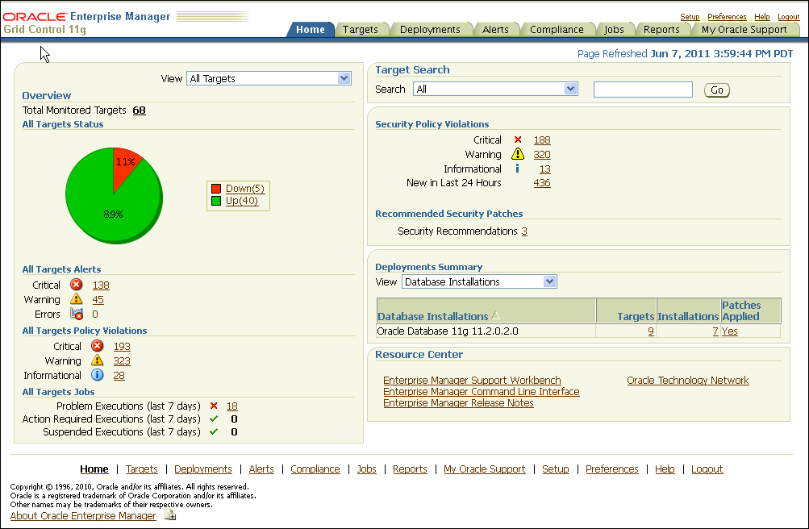

> This is a screenshot of the Enterprise Manager Grid Control home page.
>
> The top of the page shows the following tabs:
>
> Home  
> Targets  
> Deployments  
> Alerts  
> Compliance  
> Jobs  
> Reports  
> My Oracle Support
>
> Beneath the tabs the page is divided vertically down the middle into two main areas: Overview area on the left and a Target Search and details about Alerts, Policy Violations, Deployments, and Resource area on the right. An availability pie chart is on the upper left side of the Overview page. A View dropdown menu in this area shows "All Targets". Below the pie chart is a list of All Targets Policy Violations and All Targets Alerts (Critical, Warning, Errors) and the number of each kind of alert. Below the list All Targets Alerts is All Targets Jobs, with the number of Problem Executions, Action Required Executions, and Suspended Executions in the last 7 days.
>
> On the upper right side of the page, the Target Search area contains search fields for targets. Below Target Search is the Security Policy Violations area and Recommended Security Patches details.
>
> Next is Deployments Summary with a View menu. Below Deployments Summary is a table containing a list of database versions, the number of targets for each, the number of installations, and the number of interim patches applied.
>
> Below the database installations table, Resource Center provides links to related information.
  

The Enterprise Manager home page includes the following information:

- A snapshot of the current availability of all targets. The All Targets Status pie chart gives the administrator an immediate indication of any target that is Available (Up), unavailable (Down), or has lost communication with the console (Unknown).
- An overview of how many alerts and problems (for jobs) are known in the entire monitored system. You can display detailed information by clicking the links, or by navigating to the Alerts tab from any Enterprise Manager page.
- A view of the severity and total number of policy violations for all managed targets. Drill down to determine the source and type of violation.
- All Targets Jobs lists the number of scheduled, running, suspended, and problem (stopped/failed) executions for all Enterprise Manager jobs. Click the number next to the status group to view a list of those jobs.
- An overview of what is actually discovered in the system. This list can be shown at the hardware level and the Oracle level.

Alerts are generated by a combination of factors and are defined on specific metrics. A metric is a data point sampled by a Management Agent and sent to the Oracle Management Repository. An alert could be the availability of a component through a simple heartbeat test, or an evaluation of a specific performance measurement such as "disk busy" or percentage of processes waiting for a specific wait event.

There are four states that can be checked for any metric: error, warning, critical, and clear. The administrator must make policy decisions such as:

- What objects should be monitored (databases, nodes, listeners, or other services)?
- What instrumentation should be sampled (such as availability, CPU percent busy)?
- How frequently should the metric be sampled?
- What should be done when the metric exceeds a predefined threshold?

All of these decisions are predicated on the business needs of the system. For example, all components might be monitored for availability, but some systems might be monitored only during business hours. Systems with specific performance problems can have additional performance tracing enabled to debug a problem.

See Also:

[Oracle Enterprise Manager Cloud Control Introduction](http://www.oracle.com/pls/topic/lookup?ctx=db112&id=EMCON120) for more information about monitoring and using metrics in Enterprise Manager

### 12.2.2 Configure Metrics and Notification Rules for Each System

Notification Rules are defined sets of alerts on metrics that are automatically applied to a target when it is discovered by Enterprise Manager. For example, an administrator can create a rule that monitors the availability of database targets and generates an e-mail message if a database fails. After that rule is generated, it is applied to all existing databases and any database created in the future. Access these rules by navigating to Preferences and then choosing Rules.

The rules monitor problems that require immediate attention, such as those that can affect service availability, and Oracle or application errors. Service availability can be affected by an outage in any layer of the application stack: node, database, listener, and critical application data. A service availability failure, such as the inability to connect to the database, or the inability to access data critical to the functionality of the application, must be identified, reported, and reacted to quickly. Potential service outages such as a full archive log directory also must be addressed correctly to avoid a system outage.

Enterprise Manager provides a series of default rules that provide a strong framework for monitoring availability. A default rule is provided for each of the preinstalled target types that come with Enterprise Manager. You can modify these rules to conform to the policies of each individual site, and you can create rules for site-specific targets or applications. You can also set the rules to notify users during specific time periods to create an automated coverage policy.

Use the following best practices:

- Modify each rule for high-value components in the target architecture to suit your availability requirements by using the rules modification wizard. For the database rule, set the metrics in Table 12-1, Table 12-2, and Table 12-3 for each target. The frequency of the monitoring is determined by the service-level agreement (SLA) for each component.
- Use Beacon functionality to track the performance of individual applications. A Beacon can be set to perform a user transaction representative of normal application work. Enterprise Manager can then break down the response time of that transaction into its component pieces for analysis. In addition, an alert can be triggered if the execution time of that transaction exceeds a predefined limit.
- Add Notification Methods and use them in each Notification Rule. By default, the easiest method for alerting an administrator to a potential problem is to send e-mail. Supplement this notification method by adding a callout to an SNMP trap or operating system script that sends an alert by some method other than e-mail. This avoids problems that might occur if a component of the e-mail system fails. Set additional Notification Methods by using the Setup link at the top of any Enterprise Manager page.
- Modify Notification Rules to notify the administrator when there are errors in computing target availability. This might generate a false positive reading on the availability of the component, but it ensures the highest level of notification to system administrators.

See Also:

- [Oracle Enterprise Manager Cloud Control Introduction](http://www.oracle.com/pls/topic/lookup?ctx=db112&id=EMCON120) for conceptual information about Beacons
- [Oracle Enterprise Manager Advanced Configuration](http://www.oracle.com/pls/topic/lookup?ctx=db112&id=OEMCG0601) for information about configuring service tests and Beacons

Figure 12-2 shows the Edit Notification Rule property page for choosing availability states, with the Down option chosen.

Figure 12-2 Setting Notification Rules for Availability

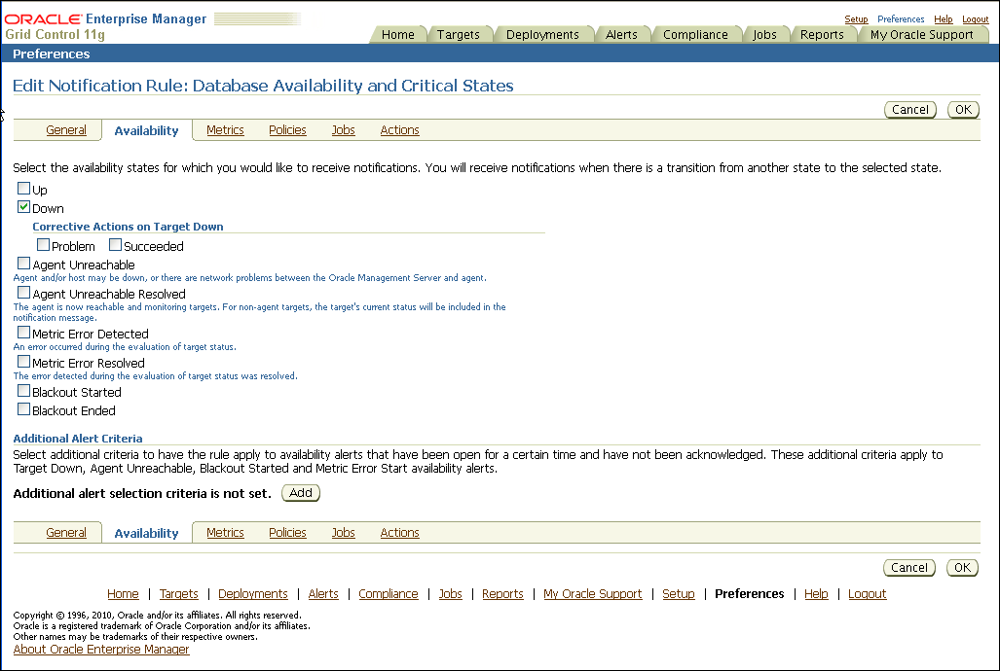

> The screen shot shows the Enterprise Manager page for Edit Notification Rule: Database Availability and Critical States.
>
> Page shows the following tabs:
>
> Home  
> Targets  
> Deployments  
> Alerts  
> Compliance  
> Jobs  
> Reports  
> My Oracle Support
>
> This pages shows tabs for: General, Availability, Metrics, Policies, Jobs, and Actions. Availability is selected.
>
> The availability states are listed with check boxes as follows: Up, Down (down is selected).
>
> Agent: Unreachable, Agent: Unreachable Resolved, Metric Error Detected, Metric Error Resolved, Blackout Started, Blackout Ended.
>
> An area includes the title "Additional Alert Criteria". This includes an Add button to add an additional alert.
>
> The page also includes Cancel and OK button.
  

In addition, ensure that the metrics listed in Table 12-1, Table 12-2, and Table 12-3 are added to the database notification rule. Configure those metrics using the Metrics and Policy Settings page, which can be accessed from the Related Links section of the Database Homepage.

Use the metrics shown in Table 12-1 to monitor space management conditions that have the potential to cause a service outage.

Table 12-1 Recommendations for Monitoring Space

| Metric | Recommendation |
| --- | --- |
| Tablespace Space Used (%) | Set this database-level metric to check the Available Space Used (%) for each tablespace. For cluster databases, this metric is monitored at the cluster database target level and not by member instances. This metric enables the administrator to choose the threshold percentages that Enterprise Manager tests against, and the number of samples that must occur in error before a message is generated and sent to the administrator. If the percentage of used space is greater than the values specified in the threshold arguments, then a warning or critical alert is generated.  The recommended default settings are 85% for a warning and 97% for a critical space usage threshold, but you should adjust these values appropriately, depending on system usage. Also, you can customize this metric to monitor specific tablespaces.  Note: there is an Enterprise Manager Job in the Job Library named:  `DISABLE TABLESPACE USED (%) ALERTS FOR UNDO AND TEMP TABLESPACES`  Use this Job to disable alerts for all `UNDO` and `TEMP` tablespaces. This job is useful if you encounter too many alerts on `TEMP` and `UNDO` tablespaces. |
| Dump Area Used (%) | Set this metric to monitor the dump directory destinations. Dump space must be available so that the maximum amount of diagnostic information is saved the first time an error occurs. The recommended default settings are 70% for a warning and 90% for an error, but these should be adjusted depending on system usage.  Set this metric in the Dump Area metric group. |
| Recovery Area Free Space (%) | This is a database-level metric that is evaluated by the server every 15 minutes or during a file creation, whichever occurs first. The metric is also printed in the alert log. For cluster databases, this metric is monitored at the cluster database target level and not by member instances.  The Critical Threshold is set for < 3% and the Warning Threshold is set for < 15%. You cannot customize these thresholds. An alert is returned the first time the alert occurs, and the alert is not cleared until the available space rises above 15%. |
| File System Available(%) | By default, this metric monitors the root file system per host. The default warning level is 20% and the critical warning is 5%. |
| Archive Area Used (%) | Set this metric to return the percentage of space used on the archive area destination. If the space used is more than the threshold value given in the threshold arguments, then a warning or critical alert is generated.  If the database is not running in `ARCHIVELOG` mode, this metric fails to register. The default warning threshold is 80%, but consider using 70% full to send a warning or 90% for the critical threshold. |

In Enterprise Manager 11g the mechanism for monitoring the Database Alert Log is tightly integrated with the Support Workbench, with the benefits of being able to generate packages for each problem or incident reported and quickly upload them to support.

As part of integrating with the Support Workbench, errors are categorized into different classes and groups, each served by a separate metric. At the highest level of categorization there are two different classes of errors: incidents and operational errors.

- Incidents are errors that are recorded in the database alert log file, which signify that the database being monitored has detected a critical error condition. For example a critical error condition could be a generic internal error or an access violation.
- Operational Errors are errors that are recorded in the database alert log file, which signify that the database being monitored has detected an error that may affect the operation of the database. For example, an operational error could be an indication that the archiver is hung or a media failure.

Configure the metrics that raise alerts for errors reported in the Alert Log as shown in Table 12-2.

Note:

For more information about the Alert Log metrics in Table 12-2 and Alert Log Monitoring for 11g database targets in Enterprise Manager, see "Monitoring 11g Database Alert Log Errors in Enterprise Manager" in My Oracle Support Note 949858.1 at

`https://support.oracle.com/CSP/main/article?cmd=show&type=NOT&id=949858.1`

Table 12-2 Recommendations for Monitoring the Alert Log

| Metric | Recommendation |
| --- | --- |
| Generic Internal Error Status | Set the Critical threshold to 0 to ensure an alert is raised each time one or more `ORA-0600` errors have been reported in the Alert Log since the last time the metric was collected. |
| Access Violation Status | Set the Critical threshold to 0 to ensure an alert is raised each time one or more `ORA-7445` or `ORA-3113` errors have been reported in the Alert Log since the last time the metric was collected. |
| Session Terminated Status | Set the Critical threshold to 0 to ensure an alert is raised each time one or more `ORA-603` errors have been reported in the Alert Log since the last time the metric was collected. |
| Out of Memory Status | Set the Critical threshold to 0 to ensure an alert is raised each time one or more `ORA-4030` or `ORA-4031` errors have been reported in the Alert Log since the last time the metric was collected. |
| Redo Log Corruption Status | Set the Critical threshold to 0 to ensure an alert is raised each time one or more `ORA-353`, `ORA-355`, or `ORA-356` errors have been reported in the Alert Log since the last time the metric was collected. |
| Inconsistent DB State Status | Set the Critical threshold to 0 to ensure an alert is raised each time one or more `ORA-1410` or `ORA-8103` errors have been reported in the Alert Log since the last time the metric was collected. |
| Deadlock Status | Set the Critical threshold to 0 to ensure an alert is raised each time one or more `ORA-4020` errors have been reported in the Alert Log since the last time the metric was collected.  Note: This metric does not raise alerts when application level deadlocks (`ORA-0060` errors) are reported in the Alert Log. |
| Internal SQL Error Status | Set the Critical threshold to 0 to ensure an alert is raised each time one or more `ORA-604` errors have been reported in the Alert Log since the last time the metric was collected. |
| Cluster Error Status | Set the Critical threshold to 0 to ensure an alert is raised each time one or more `ORA-29740` errors have been reported in the Alert Log since the last time the metric was collected. |
| Data Block Corruption Status | Set the Critical threshold to 0 to ensure an alert is raised each time one or more `ORA-1578`, `ORA-1157`, or `ORA-27048` errors have been reported in the Alert Log since the last time the metric was collected. |
| Media Failure Status | Set the Critical threshold to 0 to ensure an alert is raised each time one or more `ORA-1242` or `ORA-1243` errors have been reported in the Alert Log since the last time the metric was collected. |
| Generic Incident Status | Set the Critical threshold to 0 to ensure an alert is raised each time one or more of the errors: `ORA-700`, `ORA-255`, `ORA-239`, `ORA-601`, `ORA-602`, `ORA-255`, `ORA-240`, `ORA-494`, `ORA-3137`, `ORA-202`, `ORA-214`, `ORA-227`, `ORA-1103`, `ORA-312`, `ORA-313`, `ORA-1110`, `ORA-1542`, `ORA-32701`, `ORA-32703`, or `ORA-12751` have been reported in the Alert Log since the last time the metric was collected. |
| Generic Operational Error Status | Set the Critical threshold to 0 to ensure an alert is raised each time one or more generic operational errors have been reported in the Alert Log since the last time the metric was collected. |

Monitor the system to ensure that the processing capacity is not exceeded. The warning and critical thresholds for these metrics should be modified based on the usage pattern of the system, following the recommendations in Table 12-3.

Table 12-3 Recommendations for Monitoring Processing Capacity

| Metric | Recommendation |
| --- | --- |
| Process limit | Set thresholds for this metric to warn if the number of current processes approaches the value of the `PROCESSES` initialization parameter. |
| Session limit | Set thresholds for this metric to warn if the instance is approaching the maximum number of concurrent connections allowed by the database. |

Figure 12-3 shows the Metric and Policy settings page for setting and editing metrics. The online help contains complete reference information for every metric. To access reference information for a specific metric, use the online help search feature.

Figure 12-3 Setting Notification Rules for Metrics

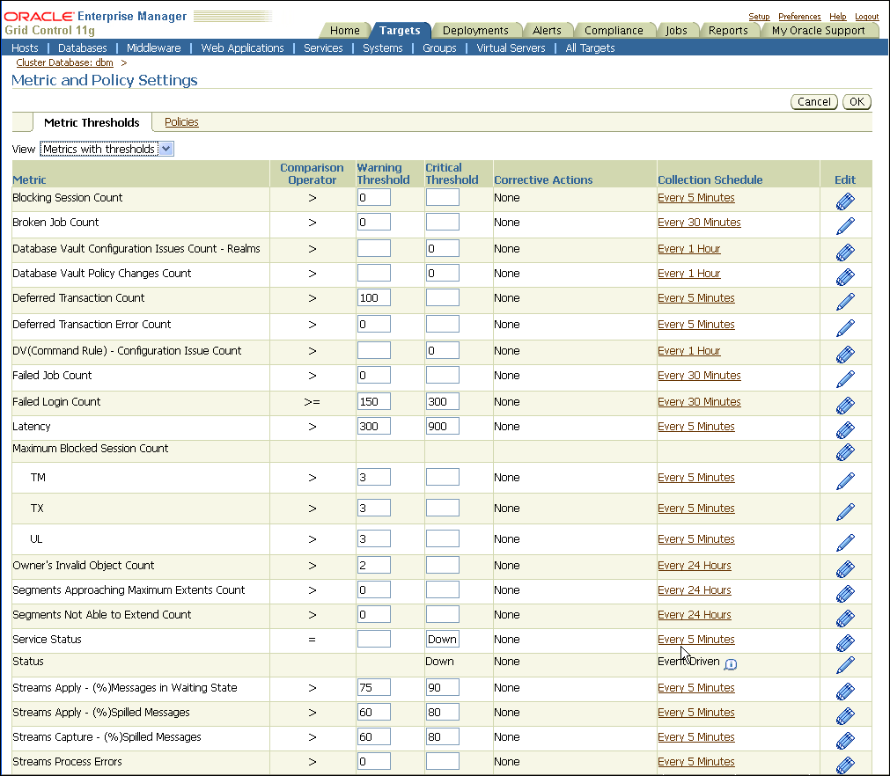

> Shows the Metric and Policy Page settings page.
>
> The illustration shows the Enterprise Manager page for Metric and Policy Settings. The page shows the following tabs:HomeTargetsDeploymentsAlertsComplianceJobsReportsMy Oracle SupportThe Targets tab is selected and shows the Metrics and Policy Settings page with Metrics Thresholds tab (there is also a Policies tab not showing). There is a menu View, with Metrics and Thresholds selected.The first column contains a list of Metrics for which you can set thresholds. There are 23 samples metrics shown in the list. The next column is Operator where you can select an operator such as "<" or ">=". The next two columns are for Warning threshold and Critical thresholds, respectively and contain values. The next column shows Corrective Actions and has the value none for all values in the table. The next column displays the Collection Schedule; the schedule for collecting the metric. The last column shows an icon with one or multiple pencils: a group of pencils indicates that the metric is monitoring multiple objects that can each have their own thresholds; a single pencil indicates the metric monitors a single object at a single set of thresholds
  

See Also:

- [Oracle Database 2 Day DBA](https://docs.oracle.com/cd/E11882_01/server.112/e10897/montune.htm#ADMQS010) for information about setting up notification rules and metric thresholds
- [Oracle Database 2 Day DBA](https://docs.oracle.com/cd/E11882_01/server.112/e10897/problems.htm#ADMQS12115) for more on Viewing Problems Using the Enterprise Manager Support Workbench
- [Oracle Enterprise Manager Oracle Database and Database-Related Metric Reference Manual](http://www.oracle.com/pls/topic/lookup?ctx=db112&id=EMDBM111) for information about available metrics

### 12.2.3 Use Database Target Views to Monitor Health, Availability, and Performance

The Database target Home page in Figure 12-4 shows system performance, space usage, and the configuration of important availability components such as the percentage space used in the Fast Recovery Area, and Flashback Database Logging status (the Fast Recovery Area is labeled Flash Recovery Area (%) in Enterprise Manager 11g).

You can see the most recent alerts for the target under the Alerts table, as shown in Figure 12-4. You can access further information about alerts by clicking the links in the Message column.

Figure 12-4 Database Home Page

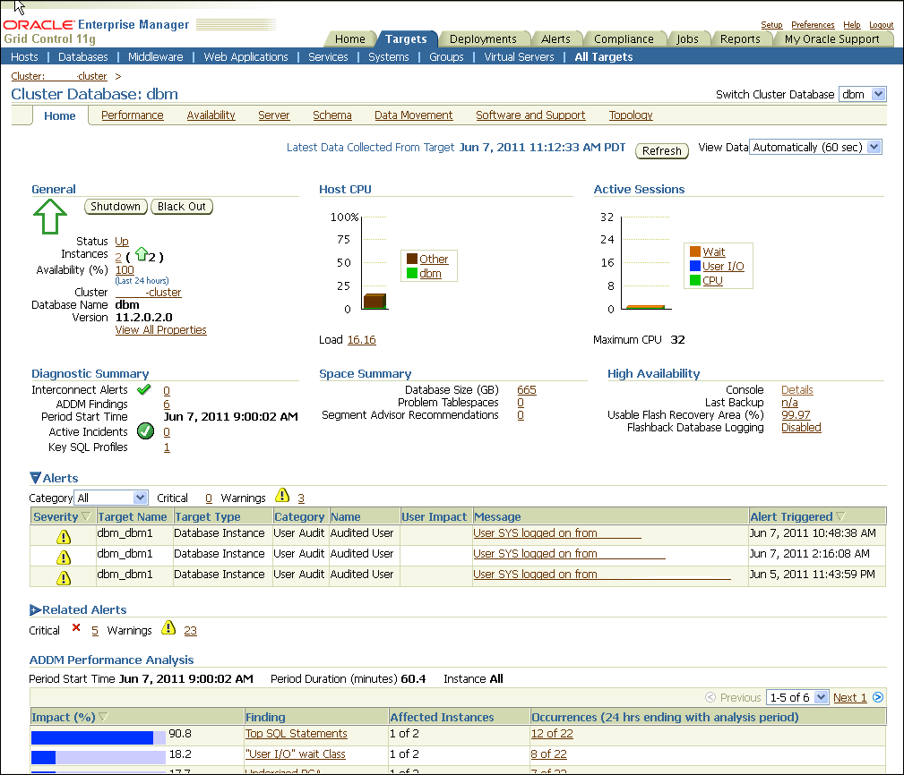

> The screen shot shows the Enterprise Manager Cluster Database home page.
>
> From left to right, the area contains the following information:
>
> At the top of the page are the following tabs:
>
> Home  
> Targets  
> Deployments  
> Alerts  
> Compliance  
> Jobs  
> Reports  
> My Oracle Support
>
> Targets is selected with All Targets. This area includes a menu Switch Cluster Database with dbm selected. For cluster database dbm, the Home area is shown, other options are Performance, Availability, Server, Schema, Data Movement, Software and Support, and Topology.
>
> - General (Status, Instances, Availability, Cluster, Database Name, Version)
> - Host CPU graph
> - Active Sessions graph
>
> From left to right, the next area contains the following information:
>
> - Diagnostic Summary (Interconnect Findings)
> - Space Summary (Database, Size, Problem Tablespaces, Segment Advisor Recommendations, Space Violations)
> - High Availability
>
> Below this area is an Alerts area. This includes a table with columns and values. The columns are: Severity, Target Name, Target Type, Category, Name, User Impact, Message and Alert Triggered.
>
> Below this area is a Related Alerts area listing Critical with a number and link and Warning and a number and link.
>
> Below this is the ADDM Performance Analysis area. This includes columns and values. The columns are: Impact (%), Finding, Affected Instances, Occurrences (24 hours ending with analysis period).
  

Performance Analysis and Performance Baseline

Many of the metrics for Database targets in Enterprise Manager pertain to performance. A system that is not meeting performance service-level agreements is not meeting High Availability system requirements. While performance problems seldom cause a major system outage, they can still cause an outage to a subset of customers. Outages of this type are commonly referred to as application service brownouts. The primary cause of brownouts is the intermittent or partial failure of one or more infrastructure components. IT managers must be aware of how the infrastructure components are performing (their response time, latency, and availability), and how they are affecting the quality of application service delivered to the end user.

A performance baseline, derived from normal operations that meet the service-level agreement should determine what constitutes a performance metric alert. Baseline data should be collected from the first day that an application is in production and should include the following:

- Application statistics (transaction volumes, response time, web service times)
- Database statistics (transaction rate, redo rate, hit ratios, top 5 wait events, top 5 SQL transactions)
- Operating system statistics (CPU, memory, I/O, network)

You can use Enterprise Manager to capture a baseline snapshot of database performance and create an Automatic Workload Repository (AWR) baseline. Enterprise Manager compares these values against system performance and displays the result on the database Target page. Enterprise Manager can also send alerts if the values deviate too far from the established baseline. See ["Use Automatic Performance Tuning Features"](config_db.md) for more information about Automatic Workload Repository.

Set the database notification rule to capture the metrics listed in Table 12-4 for all database targets.

Table 12-4 Recommendations for Performance Related Metrics

| Metric | Level | Recommendation |
| --- | --- | --- |
| I/O Requests (per second) | Instance | This metric represents the total rate of I/O read and write requests for the database. It sends an alert when the number of operations exceeds a user-defined threshold. Use this metric with operating system-level metrics that are also available with Enterprise Manager.  Set this metric based on the total I/O throughput available to the system, the number of I/O channels available, network bandwidth (in a SAN environment), the effects of the disk cache if you are using a storage array device, and the maximum I/O rate and number of spindles available to the database. |
| Database CPU Time (%) | Instance | This metric represents the percentage of database call time that is spent on the CPU. It can be used to detect a change in the operation of a system, for example, a drop in Database CPU time from 50% to 25%.  The `Consecutive Number of Occurrences Preceding Notification` column indicates the consecutive number of times the comparison against thresholds should hold `TRUE` before an alert is generated. This usage might be normal at peak periods, but it might also be an indication of a runaway process or of a potential resource shortage. |
| Wait Time (%) | Instance | Excessive idle time indicates that a bottleneck for one or more resources is occurring. Set this instance-level metric based on the system wait time when the application is performing as expected. |
| Network Bytes per Second | Instance | This metric reports network traffic that Oracle generates. This metric can indicate a potential network bottleneck. Set this metric based on actual usage during peak periods. |
| Pages Paged-in (per second) | Host | For UNIX-based systems, represents the number of pages paged in (read from disk to resolve fault memory references) per second. This metric checks the number of pages paged in for the CPU(s) specified by the Host CPU(s) parameter, such as `cpu_stat0` or `*` (for all CPUs on the system).  For Microsoft Windows, this metric is the rate at which pages are read from disk to resolve hard page faults. Hard page faults occur when a process refers to a page in virtual memory that is not in its working set or elsewhere in physical memory, and must be retrieved from disk. When a page is faulted, the system tries to read multiple contiguous pages into memory to maximize the benefit of the read operation. |
| Run Queue Length | Host | For UNIX-based systems, the Run Queue Length metrics represent the average number of processes in memory and subject to be run in the last interval (1 minute average, 5 minute average, and 15 minute average).  It is recommended to alert when Run Queue Length = # of CPUs. (An alternative way to do this is to monitor the Load Average metric and compare it to Maximum CPU.)  This metric is not available on Microsoft Windows. |

See Also:

- [Oracle Database Performance Tuning Guide](https://docs.oracle.com/cd/E11882_01/server.112/e41573/toc.htm) for more information about performance monitoring
- [Oracle Database 2 Day DBA](https://docs.oracle.com/cd/E11882_01/server.112/e10897/montune.htm#ADMQS010) for more information about monitoring and tuning using Enterprise Manager

### 12.2.4 Use Metrics to Monitor Data Guard System Availability

Set Enterprise Manager metrics to monitor the availability of Data Guard configurations. Table 12-5 shows the metrics that are available for monitoring Data Guard databases.

Table 12-5 Recommendations for Setting Data Guard Metrics

| Metric | Recommendation |
| --- | --- |
| Data Guard Status | Notifies you about system problems in a Data Guard configuration. |
| Apply Lag | Displays (in seconds) how far the standby is behind the primary database. This metric generates an alert on the standby database if it falls behind more than the user-specified threshold (if any). |
| Estimated Failover Time | Displays the approximate number of seconds required to failover to this standby database. |
| Redo Apply Rate | Displays the Redo Apply rate in KB/second on this standby database. |
| Transport Lag | Displays the approximate number of seconds of redo that is not yet available on this standby database. The lag may be because the redo data has not yet been transported or there may be a gap. This metric generates an alert on the standby database if it falls behind more than the user-specified threshold (if any). |

## 12.3 Managing the High Availability Environment with Enterprise Manager

Use Enterprise Manager as a proactive part of administering any system and for problem notification and analysis, with the following recommendations:

- Check Enterprise Manager Policy Violations
- Use Enterprise Manager to Manage Oracle Patches and Maintain System Baselines
- Manage Database Availability with the High Availability Console
- Configure High Availability Solutions with MAA Advisor

### 12.3.1 Check Enterprise Manager Policy Violations

Enterprise Manager comes with a pre-installed set of policies and recommendations of best practices for all databases. These policies are checked by default and the number of violations is displayed on the Targets page in the Policy Violations area, as shown in Figure 12-5.

Figure 12-5 Database Home Page with Targets Showing Policy Violations

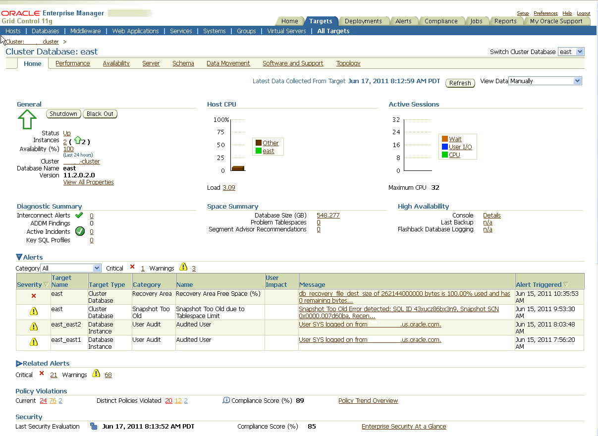

> The screen shot shows the Enterprise Manager Cluster Database home page.
>
> From left to right, the area contains the following information:
>
> At the top of the page are the following tabs:
>
> Home  
> Targets  
> Deployments  
> Alerts  
> Compliance  
> Jobs  
> Reports  
> My Oracle Support
>
> Targets is selected with All Targets. This area includes a menu Switch Cluster Database with dbm selected. For cluster database dbm, the Home area is shown, other options are Performance, Availability, Server, Schema, Data Movement, Software and Support, and Topology.
>
> - General (Status, Instances, Availability, Cluster, Database Name, Version)
> - Host CPU graph
> - Active Sessions graph
>
> From left to right, the next area contains the following information:
>
> - Diagnostic Summary (Interconnect Findings)
> - Space Summary (Database, Size, Problem Tablespaces, Segment Advisor Recommendations, Space Violations)
> - High Availability
>
> Below this area is an Alerts area. This includes a table with columns and values. The columns are: Severity, Target Name, Target Type, Category, Name, User Impact, Message and Alert Triggered.
>
> Below this area is a Related Alerts area listing Critical with a number and link and Warning and a number and link.
>
> Below this is the Policy Violations area.
  

To see more details on violations, select a link in the Policy Violations area. Figure 12-6 shows the Policy Tend Overview page.

Figure 12-6 Database Targets Policy Trend Overview Page

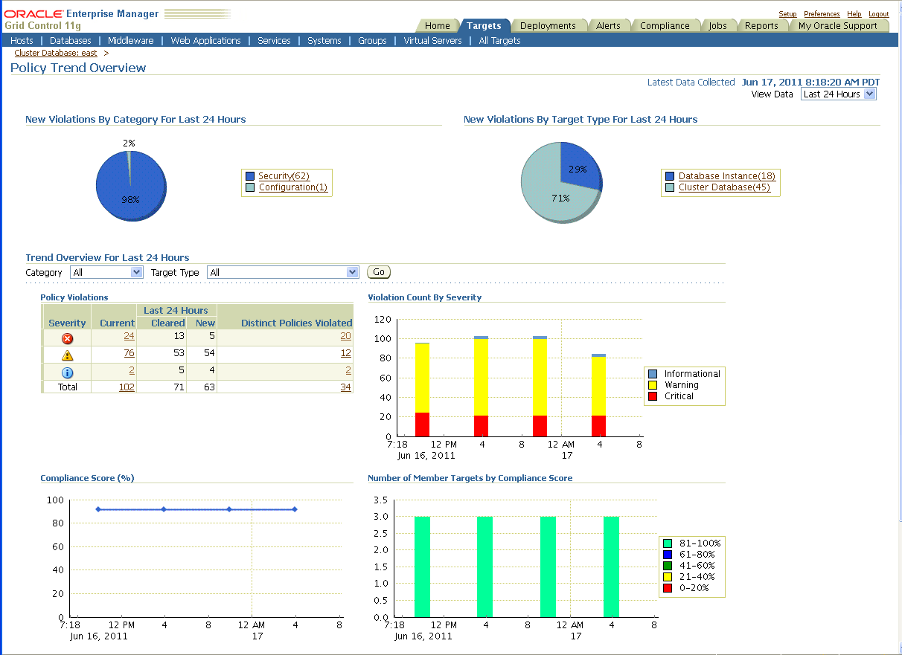

> The screen shot shows Policy Trend Overview page.
>
> The page contains the following information:
>
> At the top of the page are the following tabs:
>
> Home  
> Targets  
> Deployments  
> Alerts  
> Compliance  
> Jobs  
> Reports  
> My Oracle Support
>
> The Targets tab is selected.
>
> The page shown is the Policy Trend Overview. The top area includes two pie charts:
>
> New Violations By Category for Last 24 Hours:
>
> 98% Security (62), 2% Configuration(1)
>
> New Violations By Target Type for Last 24 Hours:
>
> 71% Cluster Database (45), 29% Database Instance (18)
>
> Trend Overview for Last 24 hours area that includes a selector for Category and Target Type and a Go button. This area includes a table and three charts:
>
> Policy Violations table: with columns: Severity, Current, Last 24 Hours Cleared and New, Distinct Policies Violated.
>
> Violation Count By Severity chart: Shown are values from 0 to 120 over the time period of the last two days, June 16 to June 17. Values in chart are for Informational violations (blue), Warning violations (yellow), and Critical Violations (red).
>
> Compliance Score (%) Graph: Shows a graph with four values over time. Graph shows 0 to 100 on y axis with dates on x-axis. The four values over time are all the same at about 95, with a line between them.
>
> Number of Member Targets by Compliance Score chart: Shows y-axis with values 0.0 to 3.5. Shows x-axis with values over time for two days, June 16 to June 17. Four bar graphs over this period show same value, in the range 81 to 100% (shown in light green).
  

To see Policy Violations, select Violations from the Compliance tab, as shown in Figure 12-7.

Figure 12-7 Shows Compliance Tab with Policy Violations

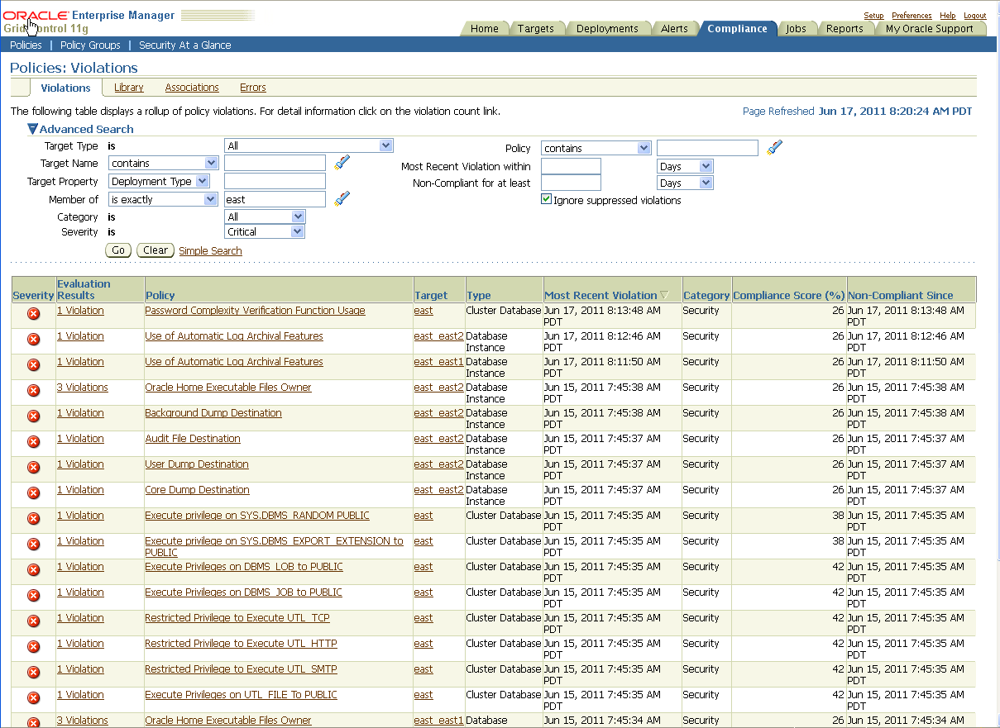

> The screen shot shows the Enterprise Manager Grid Control Compliance Tab with Policies: Violations page.
>
> The page contains the following information:
>
> At the top of the page are the following tabs:
>
> Home  
> Targets  
> Deployments  
> Alerts  
> Compliance  
> Jobs  
> Reports  
> My Oracle Support
>
> Compliance is selected and includes tabs: Violations, Library, Associates, and Errors. Violations is selected.
>
> Violations page includes an Advanced Search area with the following selectors: Target Type, Target Name, Target Property, Member of Category, Severity, Policy, Most Recent Violation within, Non-Compliant for at least, and an Ignore suppressed violations checkbox. This area also includes a Go and Clear button.
>
> Below the Advanced search area is a table with the following fields:
>
> Severity, Evaluation Results, Policy, Target, Type, Most Recent Violation, Category, Compliance (%), Non-Compliant Since.
  

See Also:

[Oracle Enterprise Manager Policy Reference Manual](http://www.oracle.com/pls/topic/lookup?ctx=db112&id=OEMPO) for definitions of existing policies

### 12.3.2 Use Enterprise Manager to Manage Oracle Patches and Maintain System Baselines

For any monitored system in the application environment, you can use Enterprise Manager to download and manage patches from My Oracle Support at

`https://support.oracle.com/`

You can set up a job to routinely check for patches that are relevant to the user environment. Those patches can be downloaded and stored directly in the Management Repository. Patches can be staged from the Management Repository to multiple systems and applied during maintenance windows.

You can examine patch levels for one system and compare them between systems in either a one-to-one or one-to-many relationship. In this case, a system can be identified as a baseline and used to demonstrate maintenance requirements in other systems. This can be done for operating system patches and database patches.

See Also:

- [Oracle Enterprise Manager Administrator's Guide for Software and Server Provisioning and Patching](http://www.oracle.com/pls/topic/lookup?ctx=db112&id=PVPTG) for information about Patching Using My Oracle Support
- [Oracle Enterprise Manager Administrator's Guide for Software and Server Provisioning and Patching](http://www.oracle.com/pls/topic/lookup?ctx=db112&id=PVPTG) for information about Patching Oracle Database
- [Section 14.2, "Eliminating or Reducing Downtime for Scheduled Outages"](schedule_outage.md)

### 12.3.3 Manage Database Availability with the High Availability Console

The High Availability (HA) Console is a one stop, dashboard-style page for monitoring the availability of each database. You can use it on any database and if a database is part of a Data Guard configuration, the HA Console allows you to switch your view from the primary database to any of the standby databases.

Use the HA Console to:

- Display high availability events including events from related targets such as standby databases
- View the high availability summary that includes the status of the database
- View the last backup status
- View the Fast Recovery Area Usage, if configured
- If Oracle Data Guard is configured: View the Data Guard summary, set up Data Guard standby databases for any database target, manage switchover and failover of database targets other than the database that contains the Management Repository, and monitor the health of a Data Guard configuration at a glance
- If Oracle RAC is configured: View the Oracle RAC Services summary including Top Services

Note:

Oracle Enterprise Manager Database Control uses the name Fast Recovery Area for the renamed Flash Recovery Area. In places, the HA Console and Enterprise Manager use the name Flash Recovery Area. For more information about the Fast Recovery Area, see [Section 5.1.3, "Use a Fast Recovery Area"](config_db.md).

Figure 12-8 shows the HA Console. This figure shows summary information, details, and historical statistics for the primary database and shows the standby databases for the primary target, various Data Guard standby performance metrics and settings, and the data protection mode.

Figure 12-8 Monitoring a Primary Database in the High Availability Console

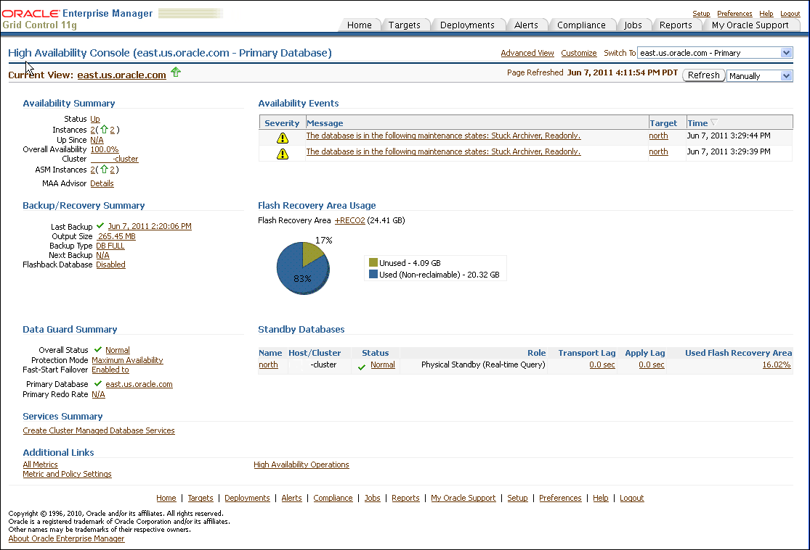

> This is a screenshot of the Grid Control High Availability Console.
>
> At the top of the page are the following tabs:
>
> Home  
> Targets  
> Deployments  
> Alerts  
> Compliance  
> Jobs  
> Reports  
> My Oracle Support  
>   
> The page includes a Current view area showing east.us.oracle.com and a Switch To menu where east.us.oracle.com - Primary is selected.
>
> The High Availability Console page is arranged into the following areas, Availability Summary, Backup and Recovery Summary, Data Guard Summary, Services Summary, Additional Links, Availability Events, Flash Recovery Usage, and Standby Databases.
>
> For each area there are availability details and historical sections that provide more information.
>
> The Availability Summary section shows basic information about the status and availability of the current database. The Availability Summary section displays the current Status of the database, the Up or Down, Instances, Up Since, Overall Availability, Cluster, ASM Instances, MAA Advisor.
>
> Use the Availability Events section to view information about specific high availability events (alerts) for the current target and all related targets (includes standby databases and Oracle ASM instances). The event table lists the Severity, Message, Target, and Time of the event.
>
> The Flash Recovery Area Usage includes a graph and usage.
>
> The Backup/Recovery Summary shows: Last Backup, Output Size, Backup Type, Next Backup and Flashback Database (Enabled or Disabled).
>
> The Data Guard Summary shows: Overall Status, Protection Mode, Fast Start Failover, Primary Database, Primary RECO Rate.
>
> The Standby Databases area shows a list with columns: Name, Host/Cluster, Status, Role, Transport Log, Apply Log, Used Flash Recovery Area.
>
> Use the Refresh button on the page to refresh manually or in 60 second or five minute intervals. When refreshing manually, metric data is collected in the background. The page displays a timestamp of the most recent time it was refreshed. You can customize the appearance of the page by clicking Customize to display the High Availability Console Options page.
  

In Figure 12-8, the Availability Summary shows that the primary database is up and its availability is currently 100%. The Availability Summary also shows Oracle ASM instances status. The Availability Events table shows specific high availability events (alerts). You can click the message to obtain more details (or to suppress the event). To set up, manage, and configure a specific solution area for this database, under Availability Summary, next to MAA Advisor, click Details to go to the Maximum Availability Architecture (MAA) Advisor page (described in more detail in Section 12.3.4, "Configure High Availability Solutions with MAA Advisor").

The Backup/Recovery Summary area displays the Last Backup and Next Backup information. The Fast Recovery Area Usage chart indicates about 83% of the fast recovery area is currently used. The Used (Non-reclaimable) Fast Recovery Area (%) chart shows the usage over the last 2 hours. You can click the chart to display the page with the metric details.

The Data Guard Summary area shows the primary database is running in Maximum Availability mode and has Fast-Start Failover enabled. You can click the link next to Protection Mode to modify the data protection mode. In the Standby Databases table, the physical standby database (north) is caught up with the primary database (Apply/Transport Lag) metrics are showing 0 seconds, and the Used Fast Recovery Area (FRA) is 16.02%. The Primary Database Redo Rate chart shows the redo trend over the past 2 hours. Note that if Data Guard is not configured, the "Switch To" box in the corner of the console is not displayed.

Figure 12-9 shows information similar to figure Figure 12-8, but for the standby database (north), which is a physical standby database running real-time query. In the Standby Databases table, the Apply/Transport Lag metrics indicate that the physical standby database is caught up with the primary database, and the Used Fast Recovery Area (FRA) is 16%. Note that if Data Guard is not configured, the "Switch To" box in the corner of the console is not displayed.

Figure 12-9 Monitoring the Standby Database in the High Availability Console

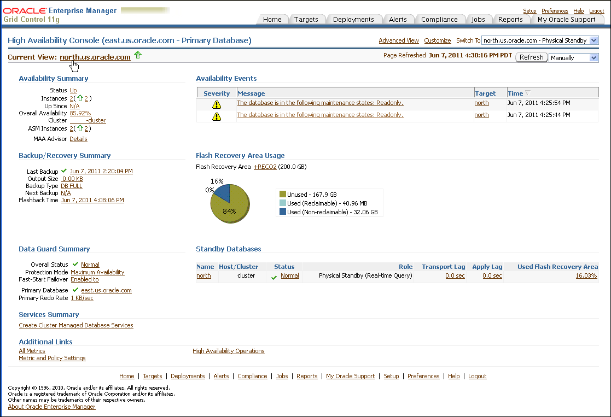

> This is a screenshot of the Grid Control High Availability Console and shows statistics for the Current View: north.us.oracle.com.
>
> The page includes a Current view area showing north.us.oracle.com and a Switch To menu where north.us.oracle.com - Physical Standby is selected.
>
> At the top of the page are the following tabs:
>
> Home  
> Targets  
> Deployments  
> Alerts  
> Compliance  
> Jobs  
> Reports  
> My Oracle Support
>
> The High Availability Console page is arranged into the following areas, Availability Summary, Backup and Recovery Summary, Data Guard Summary, Services Summary, Additional Links, Availability Events, Flash Recovery Usage, and Standby Databases.
>
> For each area there are availability details and historical sections that provide more information.
>
> The Availability Summary section shows basic information about the status and availability of the current database. The Availability Summary section displays the current Status of the database, the Up or Down, Instances, Up Since, Overall Availability, Cluster, ASM Instances, MAA Advisor.
>
> Use the Availability Events section to view information about specific high availability events (alerts) for the current target and all related targets (includes standby databases and Oracle ASM instances). The event table lists the Severity, Message, Target, and Time of the event.
>
> The Flash Recovery Area Usage includes a graph and usage.
>
> The Backup/Recovery Summary shows: Last Backup, Output Size, Backup Type, Next Backup and Flashback Database (Enabled or Disabled).
>
> The Data Guard Summary shows: Overall Status, Protection Mode, Fast Start Failover, Primary Database, Primary RECO Rate.
>
> The Standby Databases area shows a list with columns: Name, Host/Cluster, Status, Role, Transport Log, Apply Log, Used Flash Recovery Area.
>
> Use the Refresh button on the page to refresh manually or in 60 second or five minute intervals. When refreshing manually, metric data is collected in the background. The page displays a timestamp of the most recent time it was refreshed. You can customize the appearance of the page by clicking Customize to display the High Availability Console Options page.
  

Figure 12-10 shows sample values for Services Summary and Services Details areas. These areas show summary and detail information about Oracle RAC Services, including Top Services and problem services.

Figure 12-10 Monitoring the Cluster in the High Availability Console Showing Services

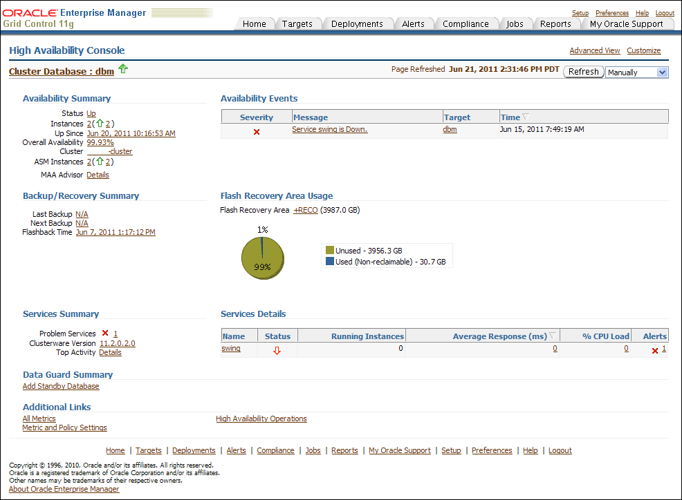

> This is a screenshot of the Grid Control High Availability Console and shows statistics for the Cluster Database: dbm
>
> At the top of the page are the following tabs:
>
> Home  
> Targets  
> Deployments  
> Alerts  
> Compliance  
> Jobs  
> Reports  
> My Oracle Support
>
> The High Availability Console page is arranged into the following areas, Availability Summary, Backup/Recovery Summary, Services Summary, Data Guard Summary, Additional Links, Availability Events, Flash Recovery Usage, and Services Details.
>
> For each area there are availability details and historical sections that provide more information.
>
> The Availability Summary section shows basic information about the status and availability of the current database. The Availability Summary section displays the current Status of the database, the Up or Down, Instances, Up Since, Overall Availability, Cluster, ASM Instances, and MAA Advisor.
>
> Use the Availability Events section to view information about specific high availability events (alerts) for the current target. The event table lists the Severity, Message, Target, and Time of the event.
>
> The Flash Recovery Area Usage includes a graph and usage.
>
> The Backup/Recovery Summary area shows: Last Backup, Next Backup, and Flashback Time.
>
> The Services Summary area shows: Problem Services, Clusterware Version, and Top Activity (a Details link).
>
> The Data Guard Summary shows a link, Add Standby Database.
>
> The Services Details area shows a table with columns: Name, Status, Running Instances, Average Response (ms), % CPU Load, and Alerts.
>
> Use the Refresh button on the page to refresh manually or in 60 second or five minute intervals. When refreshing manually, metric data is collected in the background. The page displays a timestamp of the most recent time it was refreshed. You can customize the appearance of the page by clicking Customize to display the High Availability Console Options page.
  

See Also:

[Oracle Enterprise Manager Cloud Control Introduction](http://www.oracle.com/pls/topic/lookup?ctx=db112&id=EMCON124) for information about Database Management

### 12.3.4 Configure High Availability Solutions with MAA Advisor

The goal of the MAA Advisor is to help you implement Oracle's best practices to achieve the optimal high availability architecture.

From the Availability Summary section on the High Availability Console, you can link to the MAA Advisor to:

- View recommended Oracle solutions for each outage type (site failures, computer failures, storage failures, human errors, and data corruptions)
- View the configuration status and use the links in the Oracle Solution column to go to the Enterprise Manager page where the solution can be configured.
- Understand the benefits of each solution
- Link to the MAA website for white papers, documentation, and other information

The MAA Advisor page contains a table that lists the outage type, Oracle solutions for each outage, configuration status, and benefits. The MAA Advisor allows you to view High Availability solutions in the following ways:

- Primary Database Recommendations Only—This condensed view shows only the recommended solutions (the default view) for the primary database.
- All Solutions —This expanded view shows all configuration recommendations and status for all primary and standby databases in this configuration. It includes an extra column Target Name:Role that provides the database name and shows the role (Primary, Physical Standby, or Logical Standby) of the database.

Figure 12-11 shows an example of the MAA Advisor page with the Show All Solutions view selected.

Figure 12-11 Maximum Availability Architecture (MAA) Advisor Page in Enterprise Manager

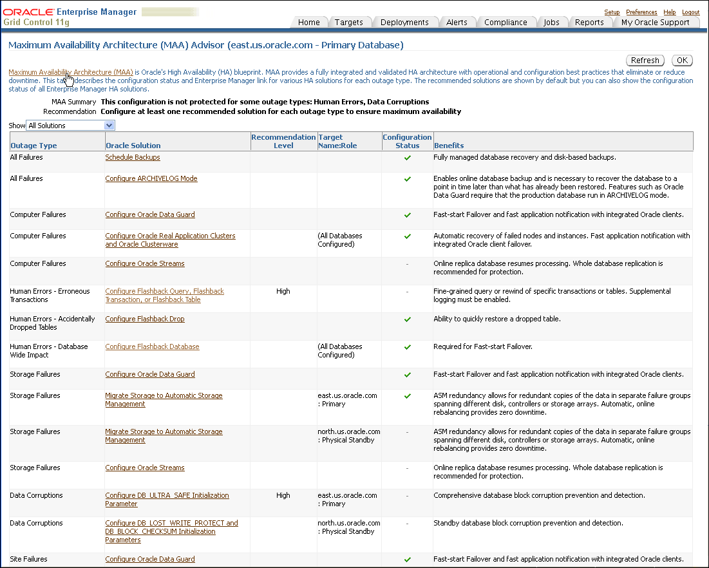

> The MAA Advisor page shows the "All Solutions" that contains a table with column headers for Outage Type, Oracle Solution, Recommendation Level, Target Name:Role, Configuration Status, and Benefits.
>
> For some solutions, the third column contains the word "High" to show a strong recommendation for configuring Human Errors- Erroneous Transactions (with Flashback Query, Flashback Transaction, or Flashback Transaction. For Data Corruptions: Configure DB\_ULTRA\_SAFE Initialization Parameter.
  

You can click the link in the Oracle Solution column to go to a page where you can set up, manage, and configure the specific solution area. Once a solution has been configured, click Refresh to update the configuration status. Once the page is refreshed, click Advisor Details on the Console page to see the updated values.

## 12.4 Using Cluster Health Monitor

The Cluster Health Monitor (CHM) gathers operating system metrics in real time and stores them in its repository for later analysis to determine the root cause of many Oracle Clusterware and Oracle RAC issues with the assistance of Oracle Support. It also works with Oracle Database Quality of Service Management (Oracle Database QoS Management) by providing metrics to detect memory over-commitment on a node. With this information, Oracle Database QoS Management can take action to relieve the stress and preserve existing workloads.

See:

[Oracle Clusterware Administration and Deployment Guide](https://docs.oracle.com/cd/E11882_01/rac.112/e41959/intro.htm#CWADD90958) for an Overview of Managing Oracle Clusterware Environments and for more information about Cluster Health Monitor (CHM)