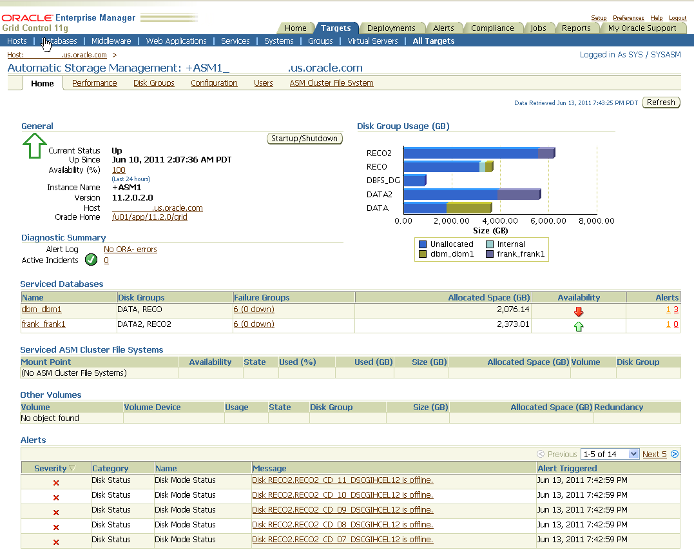
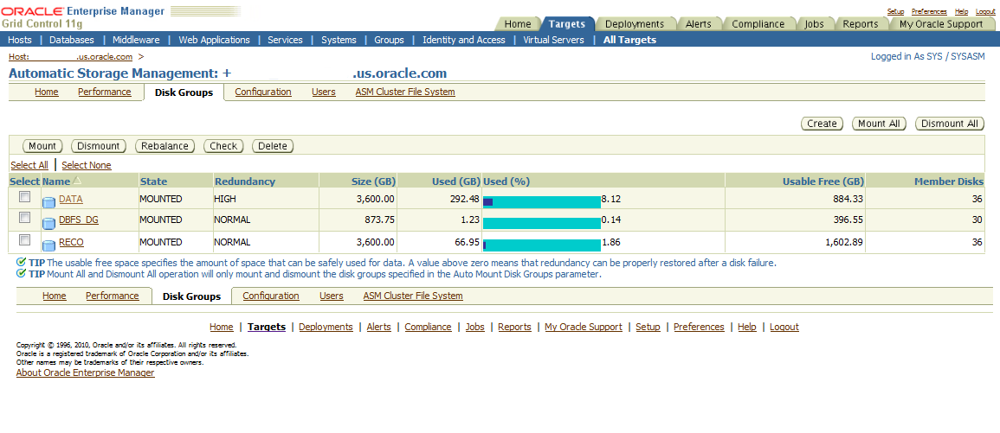
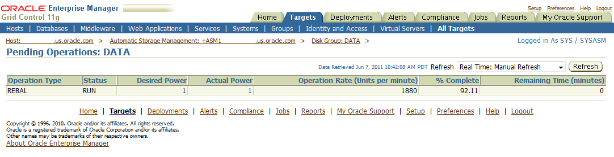
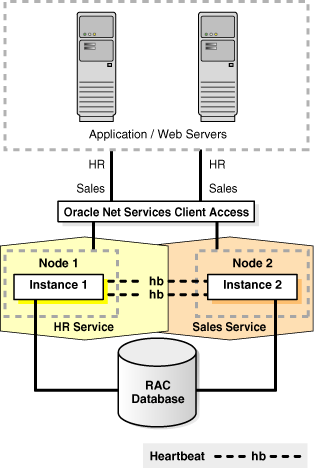
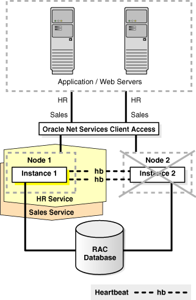
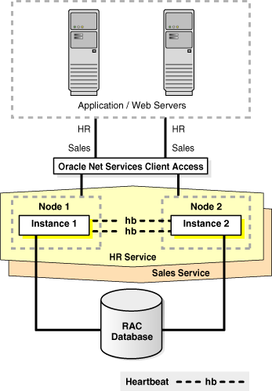
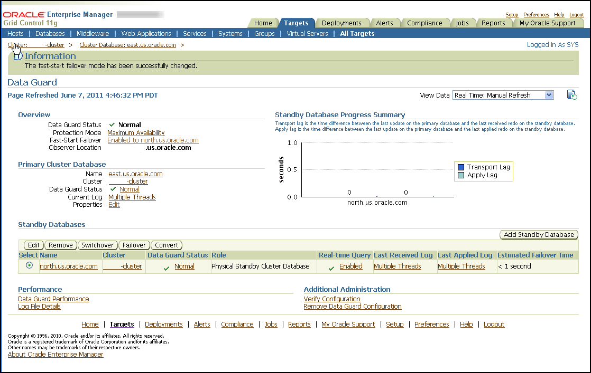
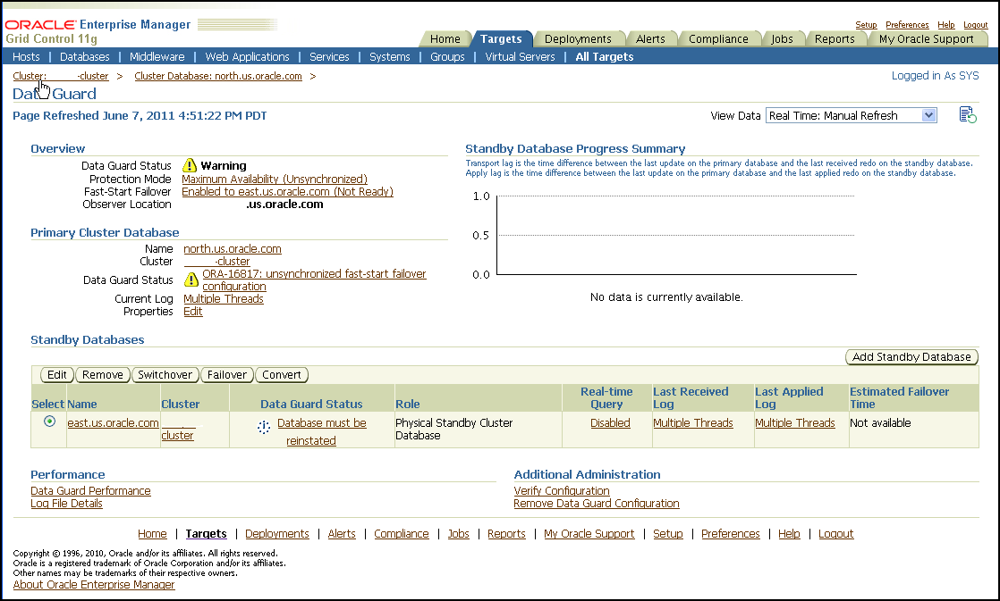

## 13 Recovering from Unscheduled Outages

This chapter describes the Oracle operational best practices that can tolerate or manage each unscheduled outage type and minimize downtime.

This chapter contains the following topics:

See Also:

[Chapter 14, "Reducing Downtime for Planned Maintenance"](schedule_outage.md) for information about scheduled outages.

## 13.1 Overview of Unscheduled Outages

This section describes unscheduled outages that affect the primary or secondary site components, and describes the recommended methods to repair or minimize the downtime associated with each outage.

Unscheduled outages are unanticipated failures in any part of the technology infrastructure that supports the application, including the following components:

- Hardware
- Software
- Network infrastructure
- Naming services infrastructure
- Database

Your monitoring and high availability infrastructure should provide rapid detection and recovery from downtime. [Chapter 12, "Monitoring for High Availability"](monitor.md) describes detection, while this chapter focuses on reducing downtime.

### 13.1.1 Managing Unscheduled Outages on the Primary Site Best Practices

Solutions for unscheduled outages are critical for maximum availability of the system. Table 13-1 compares the most common Oracle high availability architectures and summarizes the recovery steps for unscheduled outages on the primary site. For outages that require multiple recovery steps, the table includes links to the detailed descriptions in Section 13.2, "Recovering from Unscheduled Outages".

Table 13-1 Recovery Times and Steps for Unscheduled Outages on the Primary Site

| Outage Scope | Oracle Database 11g | Oracle Database 11g with Oracle RAC and Oracle Clusterware | Oracle Database 11g with Data Guard <sup>Foot 1</sup> | Oracle Database 11g MAA |
| --- | --- | --- | --- | --- |
| [site failure](glossary.md) | Hours to days  1. Restore site. 2. Restore from tape backups. 3. Recover database. | Hours to days  1. Restore site. 2. Restore from tape backups. 3. Recover database. | Seconds to 5 minutes <sup>Foot 2</sup>  1. Section 13.2.2, "Database Failover with a Standby Database" 2. Section 13.2.1, "Complete Site Failover (Failover to Secondary Site)" 3. Section 13.2.4, "Application Failover" | Seconds to 5 minutes <sup>Footref 2</sup>  1. Section 13.2.2, "Database Failover with a Standby Database" 2. Section 13.2.1, "Complete Site Failover (Failover to Secondary Site)" 3. Section 13.2.4, "Application Failover" |
| [clusterwide failure](glossary.md) | Not applicable | Hours to days  1. Restore cluster or restore at least one node. 2. Optionally restore from tape backups if the data is lost or corrupted. 3. Recover database. | Not applicable | Seconds to 5 minutes  1. Section 13.2.2, "Database Failover with a Standby Database" 2. Section 13.2.4, "Application Failover" |
| [computer failure](glossary.md) (node) | Minutes to hours <sup>Foot 3</sup>  1. Restart node and restart database with Oracle Restart. See [Oracle Database Administrator's Guide](https://docs.oracle.com/cd/E11882_01/server.112/e25494/restart.htm#ADMIN12708) 2. Reconnect users. | No downtime <sup>Foot 4</sup>  Managed automatically by Section 13.2.3, "Oracle RAC Recovery for Unscheduled Outages (for Node or Instance Failures)" | Seconds to 5 minutes <sup>Footref 3</sup>  1. Section 13.2.2, "Database Failover with a Standby Database" 2. Section 13.2.4, "Application Failover" | No downtime <sup>Footref 4</sup>  Managed automatically by Section 13.2.3, "Oracle RAC Recovery for Unscheduled Outages (for Node or Instance Failures)" |
| [computer failure](glossary.md) (instance) | Minutes <sup>Footref 3</sup>  1. Restart instance. 2. Reconnect users. | No downtime <sup>Footref 4</sup>  Managed automatically by Section 13.2.3, "Oracle RAC Recovery for Unscheduled Outages (for Node or Instance Failures)" | Minutes <sup>Footref 3</sup>  1. Restart instance. 2. Reconnect users.  or  Seconds to 5 minutes <sup>Footref 2</sup>  1. Section 13.2.2, "Database Failover with a Standby Database" 2. Section 13.2.4, "Application Failover" | No downtime <sup>Footref 4</sup>  Managed automatically by Section 13.2.3, "Oracle RAC Recovery for Unscheduled Outages (for Node or Instance Failures)" |
| [storage failure](glossary.md) | No downtime <sup>Foot 5</sup>  Section 13.2.5, "Oracle ASM Recovery After Disk and Storage Failures" | No downtime <sup>Footref 5</sup>  Section 13.2.5, "Oracle ASM Recovery After Disk and Storage Failures" | No downtime <sup>Footref 5</sup>  Section 13.2.5, "Oracle ASM Recovery After Disk and Storage Failures" | No downtime <sup>Footref 5</sup>  Section 13.2.5, "Oracle ASM Recovery After Disk and Storage Failures" |
| [data corruption](glossary.md) | Minutes to hours  Section 13.2.6, "Recovering from Data Corruption" | Minutes to hours  Section 13.2.6, "Recovering from Data Corruption" | Possible no downtime with Active Data Guard: Section 13.2.6.2, "Use Active Data Guard"  Seconds to 5 minutes  1. Section 13.2.2, "Database Failover with a Standby Database" 2. Section 13.2.4, "Application Failover" | Possible no downtime with Active Data Guard: Section 13.2.6.2, "Use Active Data Guard"  Seconds to 5 minutes  1. Section 13.2.2, "Database Failover with a Standby Database" 2. Section 13.2.4, "Application Failover" |
| [human error](glossary.md) | < 30 minutes <sup>Foot 6</sup>  Section 13.2.7, "Recovering from Human Error (Recovery with Flashback)" | < 30 minutes <sup>Footref 6</sup>  Section 13.2.7, "Recovering from Human Error (Recovery with Flashback)" | <30 minutes <sup>Footref 6</sup>  Section 13.2.7, "Recovering from Human Error (Recovery with Flashback)" | < 30 minutes <sup>Footref 6</sup>  Section 13.2.7, "Recovering from Human Error (Recovery with Flashback)" |
| [hang or slow down](glossary.md) | customized and configurable <sup>Foot 7</sup>  Section 13.2.4, "Application Failover" | customized and configurable <sup>Footref 7</sup>  Section 13.2.4, "Application Failover" | customized and configurable <sup>Foot 8</sup>  Section 13.2.4, "Application Failover" | customized and configurable <sup>Footref 7</sup> and <sup>Footref 8</sup>  Section 13.2.4, "Application Failover" |

<sup>Footnote 1</sup> While Data Guard physical replication is the most common data protection and availability solution used for Oracle Database, there are cases where active-active logical replication may be preferred, especially when control over the application makes it possible to implement. You may use Oracle GoldenGate in place of Data Guard for these requirements. See the topic, "Oracle Active Data Guard and Oracle GoldenGate" for additional discussion of the trade-offs between physical and logical replication at `http://www.oracle.com/technetwork/database/features/availability/dataguardgoldengate-096557.html`

<sup>Footnote 2</sup> Recovery time indicated applies to database and existing connection failover. Network connection changes and other site-specific failover activities may lengthen overall recovery time.

<sup>Footnote 3</sup> Recovery time consists largely of the time it takes to restart the failed system.

<sup>Footnote 4</sup> Database is still available, but portion of application connected to failed system is temporarily affected.

<sup>Footnote 5</sup> Storage failures are prevented by using Oracle ASM with mirroring and its automatic rebalance capability.

<sup>Footnote 6</sup> Recovery times from human errors depend primarily on detection time. If it takes seconds to detect a malicious DML or DLL transaction, then it typically only requires seconds to flash back the appropriate transactions, if properly rehearsed. Referential or integrity constraints must be considered.

<sup>Footnote 7</sup> Oracle Enterprise Manager or a customized application heartbeat can be configured to detect application or response time slowdown and react to these SLA breaches. For example, you can configure the Enterprise Manager Beacon to monitor and detect application response times. Then, after a certain threshold expires, Enterprise Manager can alert and possibly restart the database.

<sup>Footnote 8</sup> Oracle Enterprise Manager or a customized application heartbeat can be configured to detect application or response time slowdown and react to these SLA breaches. For example, you can configure the Enterprise Manager Beacon to monitor and detect application response times. Then, after a certain threshold expires, Enterprise Manager can call the Oracle Data Guard DBMS\_DG.INITIATE\_FS\_FAILOVER PL/SQL procedure to initiate a failover.

See:

- [Oracle Data Guard Broker](https://docs.oracle.com/cd/E11882_01/server.112/e40771/dbresource.htm#DGBKR3399) for more information about "Application Initiated Fast-Start Failover"
- The topic, "Oracle Active Data Guard and Oracle GoldenGate" for additional discussion of the trade-offs between physical and logical replication at
	`http://www.oracle.com/technetwork/database/features/availability/dataguardgoldengate-096557.html`

### 13.1.2 Managing Unscheduled Outages on the Standby Site Best Practices

Outages on the standby site do not impact the availability of the primary database when using Data Guard Maximum Availability (synchronous communication with net\_timeout) or Maximum Performance (asynchronous communication).

Note:

Outages to a system that uses the Active Data Guard option with the standby database can affect applications that are using the standby database for read activity, but such outages do not impact the availability of the primary database (the availability is based on the mode you specify).

Data Guard Maximum Protection, however, has an impact on availability if the primary database does not receive acknowledgment from a standby database running in SYNC transport mode (net\_timeout does not apply to Maximum Protection). For this reason, if you are using Maximum Protection you should follow the MAA best practice of deploying two SYNC standby databases, each at its own site. With two standby databases a single standby outage does not impact primary availability or zero data loss protection.

If limited system resources make it impractical to deploy two standby databases, then the availability of the primary database can be restored simply by downgrading the data protection mode to Maximum Availability and restarting the primary database.

Table 13-2 summarizes the recovery steps for unscheduled outages of the standby database on the secondary site. For outages that require multiple recovery steps, the table includes links to the detailed descriptions in Section 13.2, "Recovering from Unscheduled Outages".

Table 13-2 Recovery Steps for Unscheduled Outages on the Secondary Site

| Outage Type | Recovery Steps for Single-Instance or Oracle RAC Standby Database |
| --- | --- |
| Computer failure (instance) | 1. Restart node and standby instance when they are available. 2. Restart recovery.  The broker automatically restarts the log apply services.  Note 1: If there is only one standby database and if Maximum Protection is configured, then the primary database shuts down to ensure that there is no data divergence with the standby database (no unprotected data).  Note 2: If this is an Oracle RAC standby database, then there is no affect on primary database availability if you configured the primary database Oracle Net descriptor to use connect-time failover to an available standby instance. If you are using the broker, connect-time failover is configured automatically. |
| Data corruption | Section 13.3.5, "Restoring Fault Tolerance After a Standby Database Data Failure" |
| Primary database opens with `RESETLOGS` because of Flashback Database operations or point-in-time media recovery | Section 13.3.6, "Restoring Fault Tolerance After the Primary Database Was Opened Resetlogs" |

See Also:

- [Section 9.1, "Oracle Data Guard Configuration Best Practices"](config_dg.md)
- [Oracle Data Guard Concepts and Administration](https://docs.oracle.com/cd/E11882_01/server.112/e41134/protection.htm#SBYDB02000) for information about "Data Guard Protection Modes"
- [Oracle Data Guard Concepts and Administration](https://docs.oracle.com/cd/E11882_01/server.112/e41134/standby.htm#SBYDB00101) for more information about Oracle Active Data Guard option and when Redo Apply can be active while the physical standby database is open
- [Oracle Data Guard Broker](https://docs.oracle.com/cd/E11882_01/server.112/e40771/dbresource.htm#DGBKR275) for information about "How the Protection Modes Influence Broker Operations"

## 13.2 Recovering from Unscheduled Outages

This section describes best practices for recovering from various types of unscheduled outages.

- Complete Site Failover (Failover to Secondary Site)
- Database Failover with a Standby Database
- Oracle RAC Recovery for Unscheduled Outages (for Node or Instance Failures)
- Application Failover
- Oracle ASM Recovery After Disk and Storage Failures
- Recovering from Data Corruption
- Recovering from Human Error (Recovery with Flashback)
- Recovering Databases in a Distributed Environment

### 13.2.1 Complete Site Failover (Failover to Secondary Site)

With complete site failover, the database, the middle-tier application server, and all user connections fail over to a secondary site that is prepared to handle the production load.

#### 13.2.1.1 When to Use Complete Site Failover

If the standby site meets the prerequisites, then complete site failover is recommended for the following scenarios:

- Primary site disaster, such as natural disasters or malicious attacks
- Primary network-connectivity failures
- Primary site power failures

#### 13.2.1.2 Best Practices for Complete Site Failover

To expedite site failover in minutes:

- Use the Data Guard configuration best practices in [Section 9.3, "General Data Guard Configuration Best Practices"](config_dg.md)
- Use Data Guard fast-start failover to automatically fail over to the standby database, with a recovery time objective (RTO) of less than 30 seconds (described in [Section 9.4.2.3, "Fast-Start Failover Best Practices"](config_dg.md))
- Maintain a running middle-tier application server on the secondary site to avoid the startup time, or redirect existing applications to the new primary database using the Fast Connection Failover best practices described in:
	- [Chapter 11, "Configuring Fast Connection Failover"](config_fcf.md)
		- The MAA white paper: "Client Failover Best Practices for Data Guard 11g Release 2" from the MAA Best Practices area for Oracle Database at
		`http://www.oracle.com/goto/maa`
- Configure Automatic Domain Name Server (DNS) failover procedure. Automatic DNS failover occurs after a primary site is inaccessible and the wide-area traffic manager at the secondary site returns the virtual IP address of a load balancer at the secondary site and clients are directed automatically on the subsequent reconnect.

The potential for data loss is dependent on the Data Guard protection mode used: Maximum Protection, Maximum Availability, or Maximum Performance.

#### 13.2.1.3 Repair Solution

A wide-area traffic manager on the primary and secondary sites provides the site failover function. The wide-area traffic manager can redirect traffic automatically if the primary site, or a specific application on the primary site, is not accessible. It can also be triggered manually to switch to the secondary site for switchovers. Traffic is directed to the secondary site only when the primary site cannot provide service due to an outage or after a switchover. If the primary site fails, then user traffic is directed to the secondary site automatically.

Figure 13-1 illustrates the possible network routes before site failover:

1. Client requests enter the client tier of the primary site and travel by the WAN traffic manager.
2. Client requests are sent through the firewall into the demilitarized zone (DMZ) to the application server tier.
3. Requests are forwarded through the active load balancer to the application servers.
4. Requests are sent through another firewall and into the database server tier.
5. The application requests, if required, are routed to an Oracle RAC instance.
6. Responses are sent back to the application and clients by a similar path.

Figure 13-1 Network Routes Before Site Failover


> The illustration shows network routes before site failover. From top to bottom, it shows the client, the Internet, the client tier of the primary and secondary sites, the application server tier of the primary and secondary sites, and the database server tier of the primary and secondary sites.
>
> The client tier of the primary site contains two routers, an active firewall and a standby firewall, and a WAN traffic manager. There is a "heartbeat" between the two firewalls. The routers are connected to each other, to both firewalls, and to the WAN traffic manager. There is a firewall between the client tier and the application server tier.
>
> The application server tier of the primary site contains active and standby switches, active and standby hardware-based load balancers, application/web servers, IMAP servers, LDAP servers, and an active firewall and a standby firewall. The switches are connected to each other and to their load balancers. The switches are also connected to the 3 kinds of servers. The active switches are connected to the active firewall, and the standby switches are connected to the standby firewall. There is a heartbeat between the two firewalls. There is a firewall between the application server tier and the database server tier.
>
> The database server tier of the primary site contains active and standby switches, a router, two RAC instances, and a RAC database. There is a heartbeat between the active and standby switches. There are two heartbeats between the RAC instances. Both kinds of switches are connected to both RAC instances. The instances are connected to the database.
>
> The components of the secondary site are identical to the components of the primary site.
>
> The route of the client request is described in the text preceding the figure.
>
> End of image description.
  

Figure 13-2 illustrates the network routes after site failover. Client or application requests enter the secondary site at the client tier and follow the same path on the secondary site that they followed on the primary site.

Figure 13-2 Network Routes After Site Failover


> The illustration shows network routes after failover.
>
> From top to bottom, the illustration shows the client, the Internet, the client tier of the primary and secondary sites, the application server tier of the primary and secondary sites, and the database server tier of the primary and secondary sites.
>
> The client tier of the primary site contains two routers, an active firewall and a standby firewall, and a WAN traffic manager. There is a "heartbeat" between the two firewalls. The routers are connected to each other, to both firewalls, and to the WAN traffic manager. There is a firewall between the client tier and the application server tier.
>
> The application server tier of the primary site contains active and standby switches, active and standby hardware-based load balancers, application/web servers, IMAP servers, LDAP servers, and an active firewall and a standby firewall. The switches are connected to each other and to their load balancers. The switches are also connected to the 3 kinds of servers. The active switches are connected to the active firewall, and the standby switches are connected to the standby firewall. There is a heartbeat between the two firewalls. There is a firewall between the application server tier and the database server tier.
>
> The database server tier of the primary site contains active and standby switches, a router, two RAC instances, and a RAC database. There is a heartbeat between the active and standby switches. There are two heartbeats between the RAC instances. Both kinds of switches are connected to both RAC instances. The instances are connected to the database.
>
> The components of the secondary site are identical to the components of the primary site.
>
> The route of the client request is described in the text preceding the figure.
>
> End of image description.
  

The following steps describe the effect of a failover or switchover on network traffic:

1. The administrator has failed over or switched over the primary database to the secondary site. This is automatic if you are using Data Guard fast-start failover.
2. The administrator starts the middle-tier application servers on the secondary site, if they are not running.
3. The wide-area traffic manager selection of the secondary site can be automatic for an entire site failure. The wide-area traffic manager at the secondary site returns the virtual IP address of a load balancer at the secondary site and clients are directed automatically on the subsequent reconnect. In this scenario, the site failover is accomplished by an automatic domain name system (DNS) failover.
	Alternatively, a DNS administrator can manually change the wide-area traffic manager selection to the secondary site for the entire site or for specific applications. The following is an example of a manual DNS failover:
	1. Change the DNS to point to the secondary site load balancer:
		The master (primary) DNS server is updated with the zone information, and the change is announced with the DNS `NOTIFY` announcement.
		The slave DNS servers are notified of the zone update with a DNS `NOTIFY` announcement, and the slave DNS servers pull the zone information.
		Note:
		The master and slave servers are authoritative name servers. Therefore, they contain trusted DNS information.
		2. Clear affected records from caching DNS servers.
		A caching DNS server is used primarily for performance and fast response. The caching server obtains information from an authoritative DNS server in response to a host query and then saves (caches) the data locally. On a second or subsequent request for the same data, the caching DNS server responds with its locally stored data (the cache) until the time-to-live (TTL) value of the response expires. At this time, the server refreshes the data from the zone master. If the DNS record is changed on the primary DNS server, then the caching DNS server does not pick up the change for cached records until TTL expires. Flushing the cache forces the caching DNS server to go to an authoritative DNS server again for the updated DNS information.
		Flush the cache if the DNS server being used supports such a capability. The following is the flush capability of common DNS BIND versions:
		BIND 9.3.0: The command `rndc` `flushname` `name` flushes individual entries from the cache.
		BIND 9.2.0 and 9.2.1: The entire cache can be flushed with the command `rndc` `flush`.
		BIND 8 and BIND 9 up to 9.1.3: Restarting the named server clears the cache.
		3. Refresh local DNS service caching.
		Some operating systems might cache DNS information locally in the local name service cache. If so, this cache must also be cleared so that DNS updates are recognized quickly.
		Solaris: `nscd`
		Linux: `/etc/init.d/nscd restart`
		Microsoft Windows: `ipconfig /flushdns`
		Apple Mac OS X: `lookupd -flushcache`
		4. The secondary site load balancer directs traffic to the secondary site middle-tier application server.
		5. The secondary site is ready to take client requests.

Failover also depends on the client's web browser. Most browser applications cache the DNS entry for a period. Consequently, sessions in progress during an outage might not fail over until the cache timeout expires. To resume service to such clients, close the browser and restart it.

### 13.2.2 Database Failover with a Standby Database

Failover is the operation of transitioning one standby database to the role of primary database. A failover operation is invoked when an unplanned failure occurs on the primary database and there is no possibility of recovering the primary database in a timely fashion.

With Oracle Data Guard, you can automate the failover process using the broker and fast-start failover, or you can perform the failover manually:

- Fast-start failover eliminates the uncertainty of a process that requires manual intervention and automatically executes a zero loss or minimum-loss failover (that you configure using the `FastStartFailoverLagLimit` property) within seconds of an outage being detected. See [Section 9.4.2.3, "Fast-Start Failover Best Practices"](config_dg.md) for configuration best practices.
- Manual failover allows for a failover process where decisions are user driven using any of the following methods:
	- Oracle Enterprise Manager
		- The broker command-line interface (DGMGRL)
		- SQL\*Plus statements
		See Section 13.2.2.3, "Best Practices for Performing Manual Failover".

A database failover is accompanied by an application failover and, in some cases, preceded by a site failover. After the Data Guard failover, the secondary site hosts the primary database. You must reinstate the original primary database as a new standby database to restore fault tolerance of the configuration. See Section 13.3.2, "Restoring a Standby Database After a Failover."

A failover operation typically occurs in under a minute, and with little or no data loss.

See Also:

- [Oracle Data Guard Concepts and Administration](https://docs.oracle.com/cd/E11882_01/server.112/e41134/toc.htm).for a complete description of failover processing
- The "Data Guard Fast-Start Failover" and "Data Guard Switchover and Failover" MAA best practice white papers available from the MAA Best Practices area for Oracle Database at
	`http://www.oracle.com/goto/maa`

#### 13.2.2.1 When To Perform a Data Guard Failover

When a primary database failure cannot be repaired in time to meet your Recovery Time Objective (RTO) using local backups or Flashback technology, you should perform a failover using Oracle Data Guard.

You should perform a failover manually due to an unplanned outage such as:

- A site disaster, which results in the primary database becoming unavailable
- Damage resulting from user errors that cannot be repaired in a timely fashion
- Data failures, which impact the production application

A failover requires that you reinstate the initial primary database as a standby database to restore fault tolerance to your environment. You can quickly reinstate the standby database using Flashback Database provided the original primary database has not been damaged. See Section 13.3.2, "Restoring a Standby Database After a Failover."

#### 13.2.2.2 Best Practices for Implementing Fast-Start Failover

A fast-start failover is completely automated and requires no user intervention.

There are no procedural best practices to consider when performing a fast-start failover. However, it is important to address all of the configuration best practices described in [Section 9.4.2.3, "Fast-Start Failover Best Practices"](config_dg.md).

See Also:

The MAA white paper "Data Guard Switchover and Failover Best Practices" from the MAA Best Practices area for Oracle Database at

`http://www.oracle.com/goto/maa`

#### 13.2.2.3 Best Practices for Performing Manual Failover

When performing a manual failover:

- Follow the configuration best practices outlined in [Section 9.4.2.4, "Manual Failover Best Practices."](config_dg.md)
- Choose from the following methods:
	- Oracle Enterprise Manager
		See [Oracle Data Guard Broker](https://docs.oracle.com/cd/E11882_01/server.112/e40771/cli.htm#DGBKR575) for complete information about how to perform a manual failover using Oracle Enterprise Manager. The procedure is the same for both physical and logical standby databases.
		- Oracle Data Guard broker command-line interface (DGMGRL)
		See [Oracle Data Guard Broker](https://docs.oracle.com/cd/E11882_01/server.112/e40771/cli.htm#DGBKR575) for complete information about how to perform a manual failover using Oracle Enterprise Manager. The procedure is the same for both physical and logical standby databases.
		- SQL\*Plus statements:
		- [Oracle Data Guard Concepts and Administration](https://docs.oracle.com/cd/E11882_01/server.112/e41134/role_management.htm#SBYDB00625) for information about Physical standby database steps for "Performing a Failover to a Physical Standby Database"
				- [Oracle Data Guard Concepts and Administration](https://docs.oracle.com/cd/E11882_01/server.112/e41134/role_management.htm#SBYDB00635) for information about Logical standby database steps for "Performing a Failover to a Logical Standby Database"

### 13.2.3 Oracle RAC Recovery for Unscheduled Outages (for Node or Instance Failures)

Oracle RAC Recovery is performed automatically when there is a node or instance failure. In regular multi instance Oracle RAC environments, surviving instances automatically recover the failed instances and potentially aid in the automatic client failover. Recover times can be bounded by adopting the database and Oracle RAC configuration best practices and can usually lead to instance recovery times of seconds to minutes in very large busy systems, with no data loss. For Oracle RAC One Node configurations recover times are expected to take longer than full Oracle RAC; with Oracle RAC One Node a replacement instance must be started first before it can do the instance recovery.

For instance or node failures with Oracle RAC and Oracle RAC One Node, use the following recovery methods:

- Automatic Instance Recovery for Failed Instances
- Automatic Service Relocation
- Oracle Cluster Registry Recovery

#### 13.2.3.1 Automatic Instance Recovery for Failed Instances

Instance failure occurs when software or hardware problems cause an instance to shutdown or abort. After instance failure, Oracle automatically uses the online redo log file to perform database recovery.

Instance recovery in Oracle RAC does not include restarting the failed instance or the recovery of applications that were running on the failed instance. Applications will run continuously using service relocation and fast application notification (as described in Section 13.2.3.2, "Automatic Service Relocation").

When one instance performs recovery for another instance, the recovering instance:

- Reads redo log entries generated by the failed instance and uses that information to ensure that committed transactions are recorded in the database. Thus, data from committed transactions is not lost
- Rolls back uncommitted transactions that were active at the time of the failure and releases resources used by those transactions

When multiple instances fail, if one instance survives Oracle RAC performs instance recovery for any other instances that fail. If all instances of an Oracle RAC database fail, then on subsequent restart of any instance a crash recovery occurs and all committed transactions are recovered. Data Guard is the recommended solution to survive outages when all instances of a cluster fail.

#### 13.2.3.2 Automatic Service Relocation

Service reliability is achieved by configuring and failing over among the surviving instances. A service will be made available by multiple database instances to provide a service that is needed. If a hardware failure occurs and the failure adversely affects an Oracle RAC database instance, then depending on the configuration, Oracle Clusterware does one the following:

- Oracle Clusterware automatically moves any services on the failed database instance to another available instance, as configured with DBCA or Enterprise Manager. Oracle Clusterware recognizes when a failure affects a service and automatically fails over the service across the surviving instances supporting the service.
	Note:
	With Oracle RAC One Node the relocation occurs when another instance on a different node is started and enabled for the appropriate services. Thus, Oracle RAC One Node starts a new instance when an instance fails but the new instance is not a "surviving instance."
- A service can be made available on multiple instances by default. In this case, when one of those multiple instances is lost the clients continue to use the available services across the surviving instances, but there are less resources to do the work.

In parallel, Oracle Clusterware attempts to restart and integrate the failed instances and dependent resources back into the system and Cluster Ready Services (CRS) will try to restart the database instance three times. Clients can "subscribe" to node failure events, in this way clients can be notified of instance problems quickly and new connections can be setup (Oracle Clusterware does not setup the new connections, the clients setup the new connections). Notification of failures using fast application notification (FAN) events occur at various levels within the Oracle Server architecture. The response can include notifying external parties through Oracle Notification Service (ONS), advanced queuing, or FAN callouts, recording the fault for tracking, event logging, and interrupting applications. Notification occurs from a surviving node when the failed node is out of service. The location and number of nodes serving a service is transparent to applications. Restart and recovery after a node shutdown or clusterware restart are done automatically.

#### 13.2.3.3 Oracle Cluster Registry Recovery

Loss of the Oracle Cluster Registry (OCR) file affects the availability of Oracle RAC and Oracle Clusterware. The OCR file can be restored from a backup that is automatically created or from an export file that is manually created by using the `ocrconfig` tool (also use `ocrconfig` to restore the backup). Additionally, Oracle can optionally mirror the OCR so that a single OCR device failure can be tolerated. Ensure the OCR mirror is on a physically separate device and preferably on a separate controller. For more information, see [Section 6.2.7, "Mirror Oracle Cluster Registry (OCR) and Configure Multiple Voting Disks with Oracle ASM"](config_cw.md).

If all of the voting disks are corrupted, then you must restore them. To do this you use the `crsctl` command. The steps you use depend on where you store your voting files. If the voting disks are stored in Oracle ASM, then run the commands to migrate the voting disks to the Oracle ASM disk group you specify, with: `crsctl replace votedisk`. If you did not store voting disks in Oracle ASM, then you run the commands to delete and add the voting disks: `crsctl delete css votedisk` and `crsctl add css votedisk`.

See Also:

- [Section 6.3.2, "Regularly Back Up OCR to Tape or Offsite"](config_cw.md)
- [Oracle Real Application Clusters Administration and Deployment Guide](https://docs.oracle.com/cd/E11882_01/rac.112/e41960/storage.htm#RACAD703) for information about Administering Storage in Real Application Clusters
- [Oracle Clusterware Administration and Deployment Guide](https://docs.oracle.com/cd/E11882_01/rac.112/e41959/votocr.htm#CWADD92002) for information about Restoring Oracle Cluster Registry
- [Oracle Clusterware Administration and Deployment Guide](https://docs.oracle.com/cd/E11882_01/rac.112/e41959/votocr.htm#CWADD90961) for information about Restoring Voting Disks

### 13.2.4 Application Failover

With a minimal configuration, applications can receive fast and efficient notification when instances providing services become unavailable. When notified, application reconnects occur transparently to the surviving instances of an Oracle RAC database or to a standby database that has assumed the primary role following a failover.

In an Oracle RAC configuration, services are essential to achieving fast and transparent application failover. Clients are notified of a service relocation through Fast Application Notification (FAN).

In an Oracle Data Guard configuration, you can configure services for client failover across sites. After a site failure in a Data Guard configuration, the new primary database can automatically publish the production service while notifying affected clients, through FAN events, that the services are no longer available on the failed primary database.

For hangs or situations in which the response time is unacceptable, you can configure Oracle Enterprise Manager or a custom application heartbeat to detect application or response time slowdown and react to these situations. For example, you can configure the Enterprise Manager Beacon to monitor and detect application response times. Then, after a certain time threshold expires, Enterprise Manager can call the Oracle Data Guard `DBMS_DG.INITIATE_FS_FAILOVER` PL/SQL procedure to initiate a database failover immediately followed by an application failover using FAN notifications and service relocation.

FAN notifications and service relocation enable automatic and fast redirection of clients if any failure or planned maintenance results in an Oracle RAC or Oracle Data Guard fail over.

See Also:

- [Chapter 11, "Configuring Fast Connection Failover"](config_fcf.md)
- The MAA white paper "Client Failover for Highly Available Oracle Databases" from the MAA Best Practices area for Oracle Database at
	`http://www.oracle.com/goto/maa`
- [Oracle Data Guard Broker](https://docs.oracle.com/cd/E11882_01/server.112/e40771/dbresource.htm#DGBKR3399) for more information about Application Initiated Fast-Start Failover and the `DBMS_DG.INITIATE_FS_FAILOVER` PL/SQL procedure

### 13.2.5 Oracle ASM Recovery After Disk and Storage Failures

Table 13-3 summarizes the impacts and recommended repairs for various Oracle ASM failure types.

Table 13-3 Types of Oracle ASM Failures and Recommended Repair

| Failure | Description | Impact | Recommended Repair |
| --- | --- | --- | --- |
| Oracle ASM instance failure | Oracle ASM instance fails | All database instances accessing Oracle ASM storage from the same node shut down | Automatic Section 13.2.3, "Oracle RAC Recovery for Unscheduled Outages (for Node or Instance Failures)"  If Oracle RAC is not used, use Data Guard failover (see Section 13.2.2.2, "Best Practices for Implementing Fast-Start Failover")  If Oracle RAC and Data Guard are not used, fix the underlying problem and then restart Oracle ASM and the database instances |
| Oracle ASM disk failure | One or more Oracle ASM disks fail, but all disk groups remain online | All data remains accessible. This is possible only with normal or high redundancy disk groups | Oracle ASM automatically rebalances to the remaining disk drives and reestablishes redundancy. There must be enough free disk space in the remaining disk drives to restore the redundancy or the rebalance may fail with an `ORA-15041`. For more information, see [Section 4.6.2, "Oracle Storage Grid Best Practices for Planned Maintenance"](config_storage.md) Note: External redundancy disk groups should use mirroring in the storage array to protect from disk failure. Disk failures should not be exposed to Oracle ASM. |
| Data area disk-group failure | One or more Oracle ASM disks fail, and data area disk group goes offline | Databases accessing the data area disk group shut down | Perform Data Guard failover or local recovery as described in Section 13.2.5.3, "Data Area Disk Group Failure" |
| Fast recovery area disk-group failure | One or more Oracle ASM disks fail, and the fast recovery area disk group goes offline | Databases accessing the fast recovery area disk group shut down | Perform local recovery or Data Guard failover as described in Section 13.2.5.4, "Fast Recovery Area Disk Group Failure" |

#### 13.2.5.1 Oracle ASM Instance Failure

If the Oracle ASM instance fails, then database instances accessing Oracle ASM storage from the same node shut down. The following list describes failover processing:

- If the primary database is an Oracle RAC database, then application failover occurs automatically and clients connected to the database instance reconnect to remaining instances. Thus, the service is provided by other instances in the cluster and processing continues. The recovery time typically occurs in seconds.
- If the primary database is not an Oracle RAC database, then an Oracle ASM instance failure shuts down the entire database.
- If the configuration uses Oracle Data Guard and fast-start failover is enabled, a database failover is triggered automatically and clients automatically reconnect to the new primary database after the failover completes. The recovery time is the amount of time it takes to complete an automatic Data Guard fast-start failover operation. If fast-start failover is not configured, then you must recover from this outage by either restarting the Oracle ASM and database instances manually, or by performing a manual Data Guard failover.
- If the configuration includes neither Oracle RAC nor Data Guard, then you must manually restart the Oracle ASM instance and database instances. The recovery time depends on how long it takes to perform these tasks.

#### 13.2.5.2 Oracle ASM Disk Failure

If the Oracle ASM disk fails, then failover processing is as follows:

- External redundancy
	If an Oracle ASM disk group is configured as an external redundancy type, then a failure of a single disk is handled by the storage array and should not be seen by the Oracle ASM instance. All Oracle ASM and database operations using the disk group continue normally.
	However, if the failure of an external redundancy disk group is seen by the Oracle ASM instance, then the Oracle ASM instance takes the disk group offline immediately, causing Oracle instances accessing the disk group to crash. If the disk failure is temporary, then you can restart Oracle ASM and the database instances and crash recovery occurs after the disk group is brought back online.
- Normal or a high-redundancy
	If an Oracle ASM disk group is configured as a normal or a high-redundancy type, then disk failure is handled transparently by Oracle ASM and the databases accessing the disk group are not affected.
	An Oracle ASM instance automatically starts an Oracle ASM rebalance operation to distribute the data of one or more failed disks to the remaining, intact disks of the Oracle ASM disk group. While the rebalance operation is in progress, subsequent disk failures may affect disk group availability if the disk contains data that has yet to be remirrored. When the rebalance operation completes successfully, the Oracle ASM disk group is no longer at risk in the event of a subsequent failure. Multiple disk failures are handled similarly, provided the failures affect only one failure group in an Oracle ASM disk group with normal redundancy.

The failure of multiple disks in multiple failure groups where a primary extent and all of its mirrors have been lost causes the disk group to go offline.

When Oracle ASM disks fail, use the following recovery methods:

- Using Enterprise Manager to Repair Oracle ASM Disk Failure
- Using SQL to Add Replacement Disks Back to the Disk Group

##### 13.2.5.2.1 Using Enterprise Manager to Repair Oracle ASM Disk Failure

Figure 13-3 shows Enterprise Manager reporting disk failures. Five of 14 alerts are shown. The five alerts shown are Offline messages for Disk RECO2.

Figure 13-3 Enterprise Manager Reports Disk Failures



> Screen shot of Enterprise Manager reporting disk failures.
>
> At the top of the page are the following tabs:
>
> Home  
> Targets  
> Deployments  
> Alerts  
> Compliance  
> Jobs  
> Reports  
> My Oracle Support
>
> Shows the Targets tab, with Automatic Storage Management home tab.
>
> Display includes a General Area with the following items:
>
> Current Status: Up and a Startup/Shutdown button
>
> Up Since with a date
>
> Availability (%) with value 100 (for last 24 hours)
>
> Instance Name: value +ASM1
>
> Version 11.2.0.2.0
>
> Host: hostname
>
> Oracle Home: /u01/app/11.2.0/grid
>
> Disk Group Usage (GB) area with items:
>
> Graph showing bars to the right with values for:
>
> RECO2
>
> RECO
>
> DBFS\_DG
>
> DATA2
>
> DATA
>
> Key includes colors with values for: Unallocated (Blue), dbm\_dbm1 (green), Internal (blue green), and frank\_frank1 (purple)
>
> Graph includes values from 0 to 8000 (GB)
>
> Diagnostic Summary area with items:
>
> Alert Log: No ORA-errors
>
> Active Incidents with green checkmark and value 0
>
> Serviced Databases table with columns:
>
> Name, Disk Groups, Failure Groups, Allocated Space (GB), Availability, and Alerts.
>
> Serviced ASM Cluster File Systems table with columns:
>
> Mount Point, Availability, State, Used (%), Used (GB), Size (GB), Allocated Space (GB), Volume, Disk Group
>
> Other Volumes table with columns:
>
> Volume, Volume Device, Usage, State, Disk Group, Size (GB), Allocated Space (GB), Redundancy
>
> Alerts Table with columns:
>
> Severity, Category, Name, Message, Alert Triggered
  

Figure 13-4 shows Enterprise Manager reporting the status of data area disk group `DATA`, database Data Guard disk group `DBFS_DG`, and recovery area disk group `RECO`.

Figure 13-4 Enterprise Manager Reports Oracle ASM Disk Groups Status



> Shows the Automatic Storage Management page with Disk Groups tab.
>
> At the top of the page are the following tabs:
>
> Home  
> Targets  
> Deployments  
> Alerts  
> Compliance  
> Jobs  
> Reports  
> My Oracle Support
>
> Shows the Targets tab, with Automatic Storage Management Disk Groups.
>
> Includes a list with action buttons: Mount, Dismount, Rebalance, Check, Delete.
>
> Columns in the list for the actions are: Select, Name, State, Redundancy, Size (GB), Used(GB), Used (%), Usable Free (GB), and Member Disks.
>
> Report shows the status of three Oracle ASM disk groups with values for, DATA, DBFS\_DG, and RECO.
  

Figure 13-5 shows Enterprise Manager reporting a pending `REBAL` operation on the `DATA` disk group. The operation is almost done, as shown in % Complete, and the Remaining Time is estimated to be 0 minutes.

Figure 13-5 Enterprise Manager Reports Pending REBAL Operation



> Shows the Automatic Storage Management Rebalance (REBAL) page
>
> At the top of the page are the following tabs:
>
> Home  
> Targets  
> Deployments  
> Alerts  
> Compliance  
> Jobs  
> Reports  
> My Oracle Support
>
> Shows the Targets tab, with Automatic Storage Management Disk Groups and Disk Group information for the DATA disk group.
>
> Shows Pending Operations list. The list includes the columns: Operation Type Status, Desired Power, Actual Power, Operation Rate (Units per minute), % Complete, Remaining Time (Minutes). This shows the operation pending is `REBAL` operation on the DATA disk group. Values are Status, run, Desired Power, 1, Actual Power, 1, Operation Rate 1880, % Complete, 92.11, and Remaining Time, 0.
  

##### 13.2.5.2.2 Using SQL to Add Replacement Disks Back to the Disk Group

Perform these steps after one or more failed disks of one specific failure group have been dropped and must be replaced with new disks:

1. Add the one or more replacement disks to the failed disk group with the following SQL command:
	```
	ALTER DISKGROUP disk_group 
	   ADD FAILGROUP failure_group 
	   DISK 'disk1','disk2',...;
	```
2. Check the progress of the operation:
	```
	SELECT * FROM V$ASM_OPERATION;
	```

#### 13.2.5.3 Data Area Disk Group Failure

A data area disk group failure should occur only when there have been multiple failures. For example, if the data area disk group is defined as external redundancy, a single-disk failure should not be exposed to Oracle ASM. However, multiple disk failures in a storage array may be seen by Oracle ASM causing the disk group to go offline. Similarly, multiple disk failures in different failure groups in a normal or high-redundancy disk group may cause the disk group to go offline.

When one or more disks fail in a normal or high redundancy disk group, and the Oracle ASM disk group is accessible, there is no loss of data and no immediate loss of accessibility. An Oracle ASM instance automatically starts an Oracle ASM rebalance operation to distribute the data on the one or more failed disks to the disks that remain intact in the Oracle ASM disk group. When the rebalance operation completes successfully, the Oracle ASM disk group is no longer at risk if a second failure occurs. There must be enough free disk space on the remaining disks in the disk group for the rebalance to complete successfully.

Table 13-4 summarizes the possible solutions for recovering from a data area disk group failure.

Table 13-4 Recovery Options for Data Area Disk Group Failure

| Recovery Option | Recovery Time Objective (RTO) | Recovery Point Objective (RPO) |
| --- | --- | --- |
| Data Guard failover (see Section 13.2.5.4, "Fast Recovery Area Disk Group Failure") | Five minutes or less | Varies depending on the data protection level chosen |
| Local Recovery (see "Local Recovery Steps") | Database restore and recovery time | Zero |

If Data Guard is being used and fast-start failover is configured, then an automatic failover occurs when the database shuts down due to the data area disk group going offline. If fast-start failover is not configured, then perform a manual failover.

If you decide to perform a Data Guard failover then the [recovery time objective (RTO)](glossary.md) is expressed in terms of minutes or seconds, depending on the presence of the Data Guard observer process and fast-start failover. However, if a manual failover occurs and not all data is available on the standby site, then data loss might result.

After Data Guard failover has completed and the application is available, you must resolve the data area disk group failure. Continue with the following "Local Recovery Steps" procedure to resolve the Oracle ASM disk group failure.

The RTO for local recovery only is based on the time required to:

1. Repair and replace the failed storage components
2. Restore and recover the database

Because the loss affects only the data-area disk group, there is no loss of data. All transactions are recorded in the Oracle redo log members that reside in the fast recovery area, so complete media recovery is possible.

If you are not using Data Guard, then perform the following local recovery steps. The time required to perform local recovery depends on how long it takes to restore and recover the database. There is no data loss when performing local recovery.

Local Recovery Steps

Perform these steps after one or more failed disks have been replaced and access to the storage has been restored:

Note:

If you have performed an Oracle Data Guard failover to a new primary database, then you can now use the following procedure to restore and sync the Data Guard setup. Also, see Section 13.3.2, "Restoring a Standby Database After a Failover".

1. Rebuild the Oracle ASM disk group using the new storage location by issuing the following SQL\*Plus statement on the Oracle ASM instance:
	```
	SQL> CREATE DISKGROUP DATA NORMAL REDUNDANCY DISK 'path1','path2',...force;
	```
2. Start the database instance `NOMOUNT` by issuing the following RMAN command:
	```
	RMAN> STARTUP FORCE NOMOUNT;
	```
3. Restore the control file from the surviving copy located in the recovery area:
	```
	RMAN> RESTORE CONTROLFILE FROM 'recovery_area_controlfile';
	```
4. Start the database instance `MOUNT`:
	```
	RMAN> STARTUP FORCE MOUNT;
	```
5. Restore the database:
	```
	RMAN> RESTORE DATABASE
	```
6. Recover the database:
	```
	RMAN> RECOVER DATABASE;
	```
7. If you use block change tracking, then disable and re-enable the block change tracking file using SQL\*Plus statements:
	```
	SQL> ALTER DATABASE DISABLE BLOCK CHANGE TRACKING;
	SQL> ALTER DATABASE ENABLE BLOCK CHANGE TRACKING;
	```
8. Open the database:
	```
	SQL> ALTER DATABASE OPEN;
	```
9. Re-create the log file members on the failed Oracle ASM disk group:
	```
	SQL> ALTER DATABASE DROP LOGFILE MEMBER 'filename';
	SQL> ALTER DATABASE ADD LOGFILE MEMBER 'disk_group' TO GROUP group_no;
	```
10. Perform an incremental level 0 backup using the following RMAN command:
	```
	RMAN> BACKUP INCREMENTAL LEVEL 0 DATABASE;
	```

#### 13.2.5.4 Fast Recovery Area Disk Group Failure

When the fast recovery-area disk group fails, the database crashes because the control file member usually resides in the fast recovery area and Oracle requires that all control file members are accessible. The fast recovery area can also contain the flashback logs, redo log members, and all backup files.

Because the failure affects only the fast recovery-area disk group, there is no loss of data. No database media recovery is required, because the data files and the online redo log files are still present and available in the data area.

A fast recovery area disk group failure typically occurs only when there have been multiple failures. For example, if the fast recovery-area disk group is defined as external redundancy, a single-disk failure should not be exposed to Oracle ASM. However, multiple disk failures in a storage array may affect Oracle ASM and cause the disk group to go offline. Similarly, multiple disk failures in different failure groups in a normal or high-redundancy disk group may cause the disk group to go offline.

Table 13-5 summarizes possible solutions when the fast recovery-area disk group fails.

Table 13-5 Recovery Options for Fast Recovery Area Disk Group Failure

| Recovery Option | Recovery Time Objective (RTO) | Recovery Point Objective (RPO) |
| --- | --- | --- |
| Local recovery (see Section 13.2.5.4.1, "Local Recovery for Fast Recovery Area Disk Group Failure") | Five minutes or less | Zero |
| Data Guard failover or switchover (see Section 13.2.5.4.2, "Data Guard Role Transition for Fast Recovery Area Disk Group Failure") | Five minutes or less | Zero |

##### 13.2.5.4.1 Local Recovery for Fast Recovery Area Disk Group Failure

If you decide to perform local recovery then you must perform a fast local restart to start the primary database after removing the controlfile member that is located in the fast recovery area from the init.ora and allocate another disk group as the fast recovery area for archiving.

For a fast local restart, perform the following steps on the primary database:

1. Change the `CONTROL_FILES` initialization parameter to specify only the members in the Data Area:
	```
	ALTER SYSTEM SET CONTROL_FILES='+DATA/sales/control1.dbf' SCOPE=spfile;
	```
2. Change local archive destinations and the fast recovery area to the local redundant, scalable destination:
	```
	ALTER SYSTEM SET DB_RECOVERY_FILE_DEST='+DATA' SCOPE=spfile;
	```
3. Start the database with the new settings:
	```
	STARTUP MOUNT:
	```
4. Drop the redo log members that were in the lost disk group. For example, issue the following command:
	```
	ALTER DATABASE DROP LOGFILE MEMBER '+RECO/dbm/onlinelog/group_2.258.750768395';
	```
5. If the flashback logs were damaged or lost, it may be necessary to disable and reenable Flashback Database:
	```
	ALTER DATABASE FLASHBACK OFF;
	ALTER DATABASE FLASHBACK ON;
	ALTER DATABASE OPEN;
	```

However, this is a temporary fix until you create a fast recovery area to replace the failed storage components. Oracle recommends using the Local Recovery Steps. For more information, see "Data Guard Role Transition for Fast Recovery Area Disk Group Failure Local Recovery Steps".

##### 13.2.5.4.2 Data Guard Role Transition for Fast Recovery Area Disk Group Failure

If you decide to perform a Data Guard role transition then the recovery time objective (RTO) can be expressed in terms of seconds or minutes, depending on the presence of the Data Guard observer process and fast-start failover.

If the protection level is maximum performance or the standby database is unsynchronized with the primary database, then:

1. Temporarily start the primary database by removing the controlfile member and pointing to a temporary fast recovery area (file system) in the SPFILE.
2. Perform a Data Guard switchover to ensure no data loss.
3. After the switchover has completed and the application is available, resolve the fast recovery area disk group failure.
4. Shut down the affected database and continue by using the instructions in the Local Recovery Steps to resolve the Oracle ASM disk group failure. For more information, see "Data Guard Role Transition for Fast Recovery Area Disk Group Failure Local Recovery Steps".

##### 13.2.5.4.3 Data Guard Role Transition for Fast Recovery Area Disk Group Failure Local Recovery Steps

Local Recovery Steps

Note:

If you performed an Oracle Data Guard failover to a new primary database, then you cannot use this procedure to reintroduce the original primary database as a standby database. This is because Flashback Database log files that are required as part of reintroducing the database have been lost. You must perform a full reinstatement of the standby database.
1. Replace or get access to storage to use for a fast recovery area
2. Rebuild the Oracle ASM disk group using the storage location by issuing the following SQL\*Plus statement:
	```
	SQL> CREATE DISKGROUP RECO NORMAL REDUNDANCY DISK 'path1','path2',...force;
	```
3. Start the database instance `NOMOUNT` using the following RMAN command:
	```
	RMAN> STARTUP FORCE NOMOUNT;
	```
4. Restore the control file from the surviving copy located in the data area:
	```
	RMAN> RESTORE CONTROLFILE FROM 'data_area_controlfile';
	```
5. Start the database instance `MOUNT`:
	```
	RMAN> STARTUP FORCE MOUNT;
	```
6. If you use Flashback Database, then disable it with the following SQL\*Plus statement:
	```
	SQL> ALTER DATABASE FLASHBACK OFF;
	```
7. Open the database and allow instance recovery to complete:
	```
	SQL> ALTER DATABASE OPEN;
	```
8. Issue the following statements only if Flashback Database is required:
	```
	SQL> SHUTDOWN IMMEDIATE;
	SQL> STARTUP MOUNT;
	SQL> ALTER DATABASE FLASHBACK ON;
	SQL> ALTER DATABASE OPEN;
	```
9. Re-create the log file members on the failed Oracle ASM disk group:
	```
	SQL> ALTER DATABASE DROP LOGFILE MEMBER 'filename';
	SQL> ALTER DATABASE ADD LOGFILE MEMBER 'disk_group' TO GROUP group_no;
	```
10. Synchronize the control file and the fast recovery area using the following RMAN commands:
	```
	RMAN> CATALOG RECOVERY AREA;
	RMAN> CROSSCHECK ARCHIVELOG ALL;
	RMAN> CROSSCHECK BACKUPSET;
	RMAN> CROSSCHECK DATAFILECOPY ALL;
	RMAN> LIST EXPIRED type;
	RMAN> DELETE EXPIRED type;
	```
	In the example, the `type` variable is a placeholder for both `LIST EXPIRED BACKUP` and `LIST EXPIRED COPY` commands, and also for the `DELETE EXPIRED BACKUP` and `DELETE EXPIRED COPY` commands. You should run all of these commands now.
11. Assuming that data has been lost, perform a backup:
	```
	RMAN> BACKUP INCREMENTAL LEVEL 0 DATABASE;
	```

### 13.2.6 Recovering from Data Corruption

A data block is corrupted when it is not in a recognized Oracle Database format, or its contents are not internally consistent. Data block corruption can damage internal Oracle control information or application and user data, leading to crippling loss of critical data and services. The Oracle Database corruption prevention, detection, and repair capabilities are built on internal knowledge of the data and transactions it protects, and on the intelligent integration of its comprehensive high availability solutions. For more information, see [Section 5.1.6, "Protect Against Data Corruption"](config_db.md).

The recovery process begins when you either suspect or discover a block corruption (for example: `ORA-1578`, `ORA-752`, and `ORA-600` `[``3020``]`). Once a corrupt block is found, Oracle provides various techniques for recovering from most block corruptions.

There are various techniques for recovering data blocks, including:

- Data Recovery Advisor is the easiest way to diagnose and repair most problems. For more information, see Section 13.2.6.1, "Use Data Recovery Advisor".
- Active Data Guard can automatically repair corrupt data blocks in a primary or standby database. For more information, see Section 13.2.6.2, "Use Active Data Guard".
- RMAN block media recovery can repair individual corrupted blocks by retrieving the blocks from good backups. For more information, see Section 13.2.6.3, "Use RMAN and Block Media Recovery".
- Data Guard switchover or failover to a standby database. For more information, see Section 13.2.6.2.2, "Extracting Data from a Physical Standby Databases".
- Data File Media Recovery with RMAN. For more information, see Section 13.2.6.3, "Use RMAN and Block Media Recovery"
- When encountering lost write corruptions that result in `ORA-752` or `ORA-600 [3020]`, follow the guidelines in "Resolving ORA-752 or ORA-600 \[3020\] During Standby Recovery" in My Oracle Support Note 1265884.1 at
	`https://support.oracle.com/CSP/main/article?cmd=show&type=NOT&id=1265884.1`

Whatever method you use to recover corrupted blocks, you first must analyze the type and degree of corruption to perform the recovery. Implementing the optimal techniques to prevent and prepare for data corruptions can save time, effort, and stress when dealing with the possible consequences-lost data and downtime.

MAA best practices provide a step-by-step process for resolving most corruptions and stray or lost writes, including the following:

1. Use Data Recovery Advisor
2. Use Active Data Guard
3. Use RMAN and Block Media Recovery
4. Perform a Data Guard Role Transition
5. Use RMAN and Data File Media Recovery

See Also:

- For more information see the "Preventing, Detecting, and Repairing Block Corruption: Database 11g" MAA white paper from the MAA Best Practices area for Oracle Database at
	`http://www.oracle.com/goto/maa`
- See, "Best Practices for Corruption Detection, Prevention, and Automatic Repair - in a Data Guard Configuration" in My Oracle Support Note 1302539.1 at
	`https://support.oracle.com/CSP/main/article?cmd=show&type=NOT&id=1302539.1`

#### 13.2.6.1 Use Data Recovery Advisor

Data Recovery Advisor enables you to perform restore operations and recovery procedures or use Flashback Database as follows:

- Perform block media recovery of data files that have corrupted blocks
- Perform point-in-time recovery of the database or selected tablespaces
- Rewind the entire database with Flashback Database
- Completely restore and recover the database from a backup

Data Recovery Advisor has both a command-line and GUI interface. The GUI interface is available when you click Perform Recovery with Oracle Enterprise Manager Database Control (Support Workbench); this allows you use Data Recovery Advisor.

Using the RMAN command-line interface, the Data Recovery Advisor commands include: `LIST` `FAILURE`, `ADVISE FAILURE`, `REPAIR FAILURE`, and `CHANGE FAILURE`.

If the Data Recover Advisor fixes the problem, then there is no need to continue with any further recovery methods. However, continue to periodically check the alert log for any ORA- errors and any corruption warnings on the primary and standby databases. While the database is operational and corruption is detected, corruption errors are recorded as `ORA-600` or `ORA-01578` in the alert log.

Note:

In the current release, Data Recovery Advisor only supports single-instance databases. Oracle RAC databases are not supported. See [Oracle Database Backup and Recovery User's Guide](https://docs.oracle.com/cd/E11882_01/backup.112/e10642/rcmrepai.htm#BRADV89724) for more information about Data Recovery Advisor supported database configurations.

See Also:

- [Section 5.2.2, "Use Data Recovery Adviser to Detect, Analyze and Repair Data Failures"](config_db.md)
- [Oracle Database 2 Day DBA](https://docs.oracle.com/cd/E11882_01/server.112/e10897/storage.htm#ADMQS0635) documentation for details on how to use the GUI interface for Data Recovery Advisor
- [Oracle Database Backup and Recovery User's Guide](https://docs.oracle.com/cd/E11882_01/backup.112/e10642/rcmrepai.htm#BRADV246) for more information about Diagnosing and Repairing Failures with Data Recovery Advisor

#### 13.2.6.2 Use Active Data Guard

There are two options for using a standby database to repair block corruption on the primary database:

- Oracle Active Data Guard and Automatic Block Repair
- Extracting Data from a Physical Standby Databases

Alternatively, if the corruption is widespread, you may choose to failover or switchover to the standby database while you make repairs to the primary database. For more information, see Section 13.2.6.4, "Perform a Data Guard Role Transition".

##### 13.2.6.2.1 Oracle Active Data Guard and Automatic Block Repair

Starting in Oracle Database 11g Release 2 (11.2), the primary database automatically attempts to repair a corrupted block in real time by fetching a good version of the same block from a physical standby database. This capability is referred to as Automatic Block Repair; Automatic Block Repair allows corrupt data blocks to be automatically repaired as soon as the corruption is detected. Automatic Block Repair reduces the amount of time that data is inaccessible due to block corruption and reduces block recovery time by using up-to-date good blocks in real-time, as opposed to retrieving blocks from disk or tape backups, or from Flashback logs.

Thus, with Automatic Block Repair you use an Oracle Active Data Guard standby database for automatic repair of data corruptions detected by the primary database. Additionally if the corruption is discovered on an Active Data Guard physical standby database the corruption is automatically repaired with a good block from the Primary. Both of these operations are transparent to the applications.

Note:

Automatic Block Repair requires the use of the Oracle Active Data Guard option.

See Also:

[Oracle Data Guard Concepts and Administration](https://docs.oracle.com/cd/E11882_01/server.112/e41134/manage_ps.htm#SBYDB4782) for more information about Oracle Active Data Guard option and the Automatic Block Repair feature

##### 13.2.6.2.2 Extracting Data from a Physical Standby Databases

You can use a Data Guard physical standby database to repair data file wide block corruption on the primary database by replacing the corrupted data files with good copies from the standby database. Once the files are restored on the primary database, data file or tablespace recovery makes the data files consistent with the rest of the database.

See Also:

[Oracle Data Guard Concepts and Administration](https://docs.oracle.com/cd/E11882_01/server.112/e41134/rman.htm#SBYDB5060) for information about Recovery from Loss of Data Files on the Primary Database Using Files On a Standby Database

#### 13.2.6.3 Use RMAN and Block Media Recovery

Block media recovery recovers one block or a set of data blocks marked "media corrupt" in a data file by using the RMAN `RECOVER` `BLOCK` command. When a small number of data blocks are marked media corrupt and require media recovery, you can selectively restore and recover damaged blocks rather than whole data files. Block media recovery minimizes redo application time and avoids I/O overhead during recovery. Block media recovery also enables affected data files to remain online during recovery of the corrupt blocks. The corrupt blocks, however, remain unavailable until they are completely recovered.

Use block media recovery when:

- A small number of blocks require media recovery and you know which blocks need recovery.
- Blocks are marked corrupt (you can verify this with the RMAN `VALIDATE` `CHECK` `LOGICAL` command).
- The backup file for the corrupted data file is available locally or can be retrieved from a remote location.

Note:

Do not use block media recovery to recover from user errors or software bugs that cause logical corruption where the data blocks are intact.

If a significant portion of the data file is corrupt or if the amount of corruption is unknown, then use either RMAN to restore the file from a backup or switch to an on disk image copy, or switchover to your Data Guard standby database.

When corruption is detected, recover the block through the Oracle Enterprise Manager Restore and Recovery Wizard or directly with RMAN. For example, to recover a specific corrupt block using RMAN block media recovery:

```
RMAN> RECOVER BLOCK DATAFILE 7 BLOCK 3;
```

After a corrupt block is repaired, the row identifying this corrupted block is deleted from the `V$DATABASE_BLOCK_CORRUPTION` view.

See Also:

[Oracle Database Backup and Recovery User's Guide](https://docs.oracle.com/cd/E11882_01/backup.112/e10642/toc.htm) for information about RMAN's block media recovery

#### 13.2.6.4 Perform a Data Guard Role Transition

If the primary database corruption is widespread due to a bad controller or other hardware or software problem, then you may want to failover or switchover to the standby database while repairs to the primary database server are made. Use Data Guard switchover or failover for data corruption or data failure when:

- The database is down or when the database is up but the application is unavailable because of data corruption or failure, and the time to restore and recover locally is long or unknown.
- Recovering locally takes longer than the business service-level agreement or RTO.

See Also:

[Oracle Data Guard Concepts and Administration](https://docs.oracle.com/cd/E11882_01/server.112/e41134/role_management.htm#SBYDB00600) for more information about Data Guard failovers and switchovers

#### 13.2.6.5 Use RMAN and Data File Media Recovery

When you cannot use any of the following methods to resolve corruptions and stray or lost writes, then use RMAN traditional media recovery:

- Use Data Recovery Advisor
- Use Active Data Guard
- Use RMAN and Block Media Recovery
- Perform a Data Guard Role Transition

Note:

If you do not have a Data Guard Physical standby, then you must use traditional media recovery. Using traditional media recovery, a backup copy of one or more files is restored and then data file, tablespace, or database recovery brings the database back to a consistent state.

Data file media recovery affects an entire data file or set of data files for a database by using the RMAN `RECOVER` command. When a large or unknown number of data blocks are marked "media corrupt" and require media recovery, or when an entire file is lost, you must restore and recover the applicable data files.

See Also:

[Oracle Database Backup and Recovery User's Guide](https://docs.oracle.com/cd/E11882_01/backup.112/e10642/osadvsce.htm#BRADV018) for information about Advanced User-Managed Recovery Scenarios

### 13.2.7 Recovering from Human Error (Recovery with Flashback)

Oracle Flashback technology revolutionizes data recovery. Before Flashback technology, it took seconds to damage a database but from hours to days to recover it. With Flashback technology, the time to correct errors can be as short as the time it took to make the error. Fixing human errors that require rewinding the database, table, transaction, or row level changes to a previous point in time is easy and does not require any database or object restoration. Flashback technology provides fine-grained analysis and repair for localized damage such as erroneous row deletion. Flashback technology also enables correction of more widespread damage such as accidentally running the wrong application batch job. Furthermore, Flashback technology is exponentially faster than a database restoration.

Flashback technologies are applicable only to repairing the following human errors:

- Erroneous or malicious update, delete, or insert transactions
- Erroneous or malicious `DROP TABLE` statements
- Erroneous or malicious batch job or wide-spread application errors

Flashback technologies cannot be used for media or data corruption such as block corruption, bad disks, or file deletions. See Section 13.2.2, "Database Failover with a Standby Database" to repair these outages.

Note:

For information about Flashback Database configuration best practices, see [Section 5.1.4, "Enable Flashback Database"](config_db.md)

Table 13-6 summarizes the Flashback solutions for outage varying in scope from destroying a row, such as through a bad update, to destroying a whole database (such as by deleting all the underlying files at the operating system level).

Table 13-6 Flashback Solutions for Different Outages

| Outage Scope | Examples of Human Errors | Flashback Solutions | See Also |
| --- | --- | --- | --- |
| Row or transaction | Accidental deletion of row  Erroneous transaction | Flashback Query  Flashback Version Query  Flashback Transaction Query  Flashback Transaction | See Also: Section 13.2.7.2, "Resolving Row and Transaction Inconsistencies" |
| Table | Dropped table  Erroneous transactions affecting one table or a set of tables | Flashback Drop  Flashback Table | See Also: Section 13.2.7.1, "Resolving Table Inconsistencies" |
| Tablespace or database | Erroneous batch job affecting many tables or an unknown set of tables  Series of database-wide malicious transactions | [Enable Flashback Database](config_db.md) or use multiple Flashback Table commands | See Also: Section 13.2.7.3, "Resolving Database-Wide Inconsistencies" |
| Single tablespace or a subset of tablespaces | Erroneous transactions affecting a small number of tablespaces | RMAN Tablespace Point-in-Time Recovery (TSPITR) | See Also: Section 13.2.7.4, "Resolving One or More Tablespace Inconsistencies" |

Table 13-7 summarizes each Flashback feature.

Table 13-7 Summary of Flashback Features

| Flashback Feature | Description | Changes are propagated to... |
| --- | --- | --- |
| Flashback Query | Flashback Query enables you to view data at an earlier point in time. You can use it to view and reconstruct lost data that was deleted or changed by accident. Developers can use this feature to build self-service error correction into their applications, empowering end users to undo and correct their errors. | Physical and logical standby databases |
| Flashback Version Query | Flashback Version Query uses undo data stored in the database to view the changes to one or more rows along with all the metadata of the changes. | Physical and logical standby databases |
| Flashback Transaction Query | Flashback Transaction Query enables you to examine changes to the database at the transaction level. As a result, you can diagnose problems, perform analysis, and audit transactions. | Physical and logical standby databases |
| Flashback Transaction | Flashback Transaction provides a way to roll back one or more transactions and their dependent transactions, while the database remains online. | Physical and logical standby databases |
| Flashback Drop | Flashback Drop provides a way to restore accidentally dropped tables. | Physical standby databases |
| Flashback Table | Flashback Table enables you to quickly recover a table to an earlier point in time without restoring a backup. | Physical and logical standby databases |
| Flashback Database | Flashback Database enables you to quickly return the database to an earlier point in time by undoing all of the changes that have taken place since that time. This operation is fast because you do not have to restore the backups. | Physical and logical standby databases |

Flashback Database uses the Oracle Database flashback logs, while all other features of flashback technology use the Oracle Database unique undo and multiversion read consistency capabilities. For more information, see the configuration best practices for the database, as documented in [Section 5.1, "Database Configuration High Availability and Fast Recoverability Best Practices"](config_db.md) to configure Flashback technologies to ensure that the resources from these solutions are available at a time of failure.

See Also:

- [Oracle Database Administrator's Guide](https://docs.oracle.com/cd/E11882_01/server.112/e25494/tables.htm#ADMIN01512) for information about Recovering Tables Using Oracle Flashback Table
- [Oracle Database Backup and Recovery User's Guide](https://docs.oracle.com/cd/E11882_01/backup.112/e10642/flashdb.htm#BRADV71000) for information about Using Flashback Database and Restore Points
- [Oracle Database Concepts](https://docs.oracle.com/cd/E11882_01/server.112/e40540/cncptdba.htm#CNCPT1439) for information about Oracle Flashback Technology

In general, the recovery time when using Flashback technologies is equivalent to the time it takes to cause the human error plus the time it takes to detect the human error.

Flashback technologies allow recovery up to the point that the human error occurred.

Use the following recovery methods:

- Resolving Table Inconsistencies
- Resolving Row and Transaction Inconsistencies
- Resolving Database-Wide Inconsistencies
- Resolving One or More Tablespace Inconsistencies

#### 13.2.7.1 Resolving Table Inconsistencies

Dropping or deleting database objects by accident is a common mistake. Users soon realize their mistake, but by then it is too late and there has been no way to easily recover the dropped tables and its indexes, constraints, and triggers. Objects once dropped were dropped forever. Loss of very important tables or other objects (like indexes, partitions or clusters) required DBAs to perform a point-in-time recovery, which can be time-consuming and lead to loss of recent transactions.

Oracle provides the following statements to help resolve table inconsistencies:

- `Flashback Table` statement to restore a table to a previous point in the database
- `Flashback Drop` statement to recover from an accidental `DROP TABLE` statement
- `Flashback Transaction` statement to roll back one or more transactions and their dependent transactions, while the database remains online

Flashback Table

Flashback Table provides the ability to quickly recover a table or a set of tables to a specified point in time. In many cases, Flashback Table alleviates the more complicated point-in-time recovery operations. For example:

```
FLASHBACK TABLE orders, order_items 
      TO TIMESTAMP 
      TO_DATE('28-Jun-11 14.00.00','dd-Mon-yy hh24:mi:ss');
```

This statement rewinds any updates to the `ORDERS` and `ORDER_ITEMS` tables that have been done between the current time and a specified timestamp in the past. Flashback Table performs this operation online and in place, and it maintains referential integrity constraints between the tables.

Flashback Drop

Flashback Drop provides a safety net when dropping objects. When a user drops a table, Oracle places it in a recycle bin. Objects in the recycle bin remain there until the user decides to permanently remove them or until space limitations begin to occur on the tablespace containing the table. The recycle bin is a virtual container where all dropped objects reside. Users view the recycle bin and undrop the dropped table and its dependent objects. For example, the `employees` table and all its dependent objects would be undropped by the following statement:

```
FLASHBACK TABLE employees TO BEFORE DROP;
```

Flashback Transaction

Oracle Flashback Transaction increases availability during logical recovery by easily and quickly backing out a specific transaction or set of transactions and their dependent transactions, while the database remains online.

Use the `DBMS_FLASHBACK.TRANSACTION_BACKOUT()` PL/SQL procedure to roll back a transaction and its dependent transactions. This procedure uses undo data to create and execute the compensating transactions that return the affected data to its pre-transaction state.

See Also:

- [Oracle Database Advanced Application Developer's Guide](https://docs.oracle.com/cd/E11882_01/appdev.112/e41502/adfns_flashback.htm#ADFNS1010) for information about Using Flashback Transaction
- `DBMS_FLASHBACK.TRANSACTION_BACKOUT()` in [Oracle Database PL/SQL Packages and Types Reference](https://docs.oracle.com/cd/E11882_01/appdev.112/e40758/d_flashb.htm#ARPLS142)

#### 13.2.7.2 Resolving Row and Transaction Inconsistencies

Resolving row and transaction inconsistencies might require a combination of Flashback Query, Flashback Version Query, Flashback Transaction Query, and the compensating SQL statements constructed from undo statements to rectify the problem. This section describes a general approach using a human resources example to resolve row and transaction inconsistencies caused by erroneous or malicious user errors.

Flashback Query

Flashback Query enables an administrator or user to query any data from some earlier point in time. Use this feature to view and reconstruct data that might have been deleted or changed by accident.

Developers can use Flashback Query to build self-service error correction into their applications, empowering end users to undo and correct their errors without delay, and freeing database administrators from having to perform this task. Flashback Query is easy to manage because the database automatically keeps the necessary information to reconstruct data for a configurable time into the past.

The following partial statement displays rows from the `EMPLOYEES` table starting from 2:00 p.m. on June 28, 2011.

```
SELECT * FROM EMPLOYEES 
       AS OF TIMESTAMP 
       TO_DATE('28-Jun-11 14:00','DD-Mon-YY HH24:MI')
WHERE ...
```

Flashback Version Query

Flashback Version Query provides a way to view changes made to the database at the row level. Flashback Version Query is an extension to SQL and enables the retrieval of all the different versions of a row across a specified time interval. For example:

```
SELECT * FROM EMPLOYEES
       VERSIONS BETWEEN TIMESTAMP
       TO_DATE('28-Jun-11 14:00','dd-Mon-YY hh24:mi') AND
       TO_DATE('28-Jun-11 15:00','dd-Mon-YY hh24:mi')
WHERE ...
```

This statement displays each version of the row, each entry changed by a different transaction, between 2 and 3 p.m. on June 28, 2011. A database administrator can use this to pinpoint when and how data is changed and trace it back to the user, application, or transaction. Flashback Version Query enables the database administrator to track down the source of a logical corruption in the database and correct it. It also enables application developers to debug their code.

Flashback Transaction Query

Flashback Transaction Query provides a way to view changes made to the database at the transaction level. Flashback Transaction Query is an extension to SQL that enables you to see all changes made by a transaction. For example:

```
SELECT UNDO_SQL
FROM FLASHBACK_TRANSACTION_QUERY 
WHERE XID = '000200030000002D';
```

This statement shows all of the changes that resulted from this transaction. In addition, compensating SQL statements are returned and can be used to undo changes made to all rows by this transaction. Using a precision tool like Flashback Transaction Query, the database administrator and application developer can precisely diagnose and correct logical problems in the database or application.

Consider a human resources (HR) example involving the `SCOTT` schema. The HR manager reports to the database administrator that there is a potential discrepancy in Ward's salary. Sometime before 9:00 a.m., Ward's salary was increased to $1875. The HR manager is uncertain how this occurred and wishes to know when the employee's salary was increased. In addition, he instructed his staff to reset the salary to the previous level of $1250. This was completed around 9:15 a.m.

The following steps show how to approach the problem.

1. Assess the problem.
	Fortunately, the HR manager has provided information about the time when the change occurred. You can query the information as it was at 9:00 a.m. using Flashback Query.
	```
	SELECT EMPNO, ENAME, SAL
	FROM EMP
	AS OF TIMESTAMP TO_DATE('28-JUN-11 09:00','dd-Mon-yy hh24:mi')
	WHERE ENAME = 'WARD';
	     EMPNO ENAME             SAL
	---------- ---------- ----------
	      7521 WARD             1875
	```
	You can confirm that you have the correct employee by the fact that Ward's salary was $1875 at 09:00 a.m. Rather than using Ward's name, you can now use the employee number for subsequent investigation.
2. Query previous rows or versions of the data to acquire transaction information.
	Although it is possible to restrict the row version information to a specific date or SCN range, you might want to query all the row information that is available for the employee WARD using Flashback Version Query.
	```
	SELECT EMPNO, ENAME, SAL, VERSIONS_STARTTIME, VERSIONS_ENDTIME, VERSIONS_XID
	    FROM EMP
	    VERSIONS BETWEEN TIMESTAMP MINVALUE AND MAXVALUE
	    WHERE EMPNO = 7521
	    ORDER BY NVL(VERSIONS_STARTSCN,1);
	EMPNO ENAME  SAL  VERSIONS_STARTTIME     VERSIONS_ENDTIME      VERSIONS_XID
	----- ------ ---  ---------------------- -------------------- ---------------
	 7521 WARD  1250  28-JUN-11 08.48.43 AM  28-JUN-11 08.54.49 AM 0006000800000086
	 7521 WARD  1875  28-JUN-11 08.54.49 AM  28-JUN-11 09.10.09 AM 0009000500000089
	 7521 WARD  1250  28-JUN-11 09.10.09 AM                        000800050000008B
	```
	You can see that WARD's salary was increased from $1250 to $1875 at 08:54:49 the same morning and was subsequently reset to $1250 at approximately 09:10:09.
	Also, you can see that the ID of the erroneous transaction that increased WARD's salary to $1875 was "0009000500000089".
3. Query the erroneous transaction and the scope of its effect.
	With the transaction information (`VERSIONS_XID` pseudocolumn), you can now query the database to determine the scope of the transaction, using Flashback Transaction Query.
	```
	SELECT UNDO_SQL
	FROM FLASHBACK_TRANSACTION_QUERY
	WHERE XID = HEXTORAW('0009000500000089');
	UNDO_SQL                                                                    
	----------------------------------------------------------------------------
	update "SCOTT"."EMP" set "SAL" = '950' where ROWID = 'AAACV4AAFAAAAKtAAL';      
	update "SCOTT"."EMP" set "SAL" = '1500' where ROWID = 'AAACV4AAFAAAAKtAAJ';     
	update "SCOTT"."EMP" set "SAL" = '2850' where ROWID = 'AAACV4AAFAAAAKtAAF';      
	update "SCOTT"."EMP" set "SAL" = '1250' where ROWID = 'AAACV4AAFAAAAKtAAE';    
	update "SCOTT"."EMP" set "SAL" = '1600' where ROWID = 'AAACV4AAFAAAAKtAAB';     
	                                                                            
	6 rows selected.
	```
	You can see that WARD's salary was not the only change that occurred in the transaction. Now you can send the information that was changed for the other four employees at the same time as employee WARD, back to the HR manager for review.
4. Determine if the corrective statements should be executed.
	If the HR manager decides that the corrective changes suggested by the `UNDO_SQL` column are correct, then the database administrator can execute the statements individually.
5. Query the `FLASHBACK_TRANSACTION_QUERY` view for additional transaction information. For example, to determine the user that performed the erroneous update, issue the following query:
	```
	SELECT LOGON_USER FROM FLASHBACK_TRANSACTION_QUERY
	WHERE XID = HEXTORAW('0009000500000089');
	LOGON_USER
	----------------------------
	MSMITH
	```
	In this example, the query shows that the user MSMITH was responsible for the erroneous transaction.

#### 13.2.7.3 Resolving Database-Wide Inconsistencies

To bring an Oracle database to a previous point in time, the traditional method is point-in-time recovery. However, point-in-time recovery can take hours or even days, because it requires the whole database to be restored from backup and recovered to the point in time just before the error was introduced into the database. With the size of databases constantly growing, it takes hours or even days just to restore the whole database.

Flashback Database is a strategy for doing point-in-time recovery. Flashback Database quickly rewinds an Oracle database to a previous time to correct any problems caused by logical data corruption or user error. Flashback logs are used to capture old versions of changed blocks. When recovery must be performed the flashback logs are quickly replayed to restore the database to a point in time before the error and just the changed blocks are restored. Flashback Database is extremely fast and reduces recovery time from hours to minutes. In addition, it is easy to use. A database can be recovered to 2:05 p.m. by issuing a single statement. Before the database can be recovered, all instances of the database must be shut down and one instance subsequently mounted. The following is an example of a `FLASHBACK DATABASE` statement.

```
FLASHBACK DATABASE TO TIMESTAMP SYSDATE-1;
```

No restoration from tape, no lengthy downtime, and no complicated recovery procedures are required to use it. You can also use Flashback Database and then open the database in read-only mode and examine its contents. If you determine that you flashed back too far or not far enough, then you can reissue the `FLASHBACK DATABASE` statement or continue recovery to a later time to find the proper point in time before the database was damaged. Flashback Database works with a primary database, a physical standby database, or a logical standby database.

These steps are recommended for using Flashback Database:

1. Determine the time or the SCN to which to flash back the database.
2. Verify that there is sufficient flashback log information.
	```
	SELECT OLDEST_FLASHBACK_SCN, 
	  TO_CHAR(OLDEST_FLASHBACK_TIME, 'mon-dd-yyyy HH:MI:SS') 
	  FROM V$FLASHBACK_DATABASE_LOG;
	```
3. Flash back the database to a specific time or SCN. (The database must be mounted to perform a Flashback Database.)
	```
	FLASHBACK DATABASE TO SCN scn;
	```
	or
	```
	FLASHBACK DATABASE TO TIMESTAMP TO_DATE date;
	```
4. Open the database in read-only mode to verify that it is in the correct state.
	```
	ALTER DATABASE OPEN READ ONLY;
	```
	If more flashback data is required, then issue another `FLASHBACK DATABASE` statement. (The database must be mounted to perform a Flashback Database.)
	If you want to move forward in time, then issue a statement similar to the following:
	```
	RECOVER DATABASE UNTIL [TIME date | CHANGE scn];
	```
5. Open the database:
	```
	ALTER DATABASE OPEN RESETLOGS;
	```

Other considerations when using Flashback Database are as follows:

- If there are not sufficient flashback logs to flash back to the target time, then use an alternative:
	- Use Data Guard to recover to the target time if the standby database lags behind the primary database or flash back to the target time if there's sufficient flashback logs on the standby.
		- Restore from backups.
- After flashing back a database, any dependent database such as a standby database must be flashed back. See Section 13.3, "Restoring Fault Tolerance".

Flashback Database does not automatically fix a dropped tablespace, you can use Flashback Database to significantly reduce the downtime. You can flash back the primary database to a point before the tablespace was dropped and then restore a backup of the corresponding data files using `SET NEWNAME` from the affected tablespace and recover to a time before the tablespace was dropped.

#### 13.2.7.4 Resolving One or More Tablespace Inconsistencies

Recovery Manager (RMAN) automatic tablespace point-in-time recovery (TSPITR) enables you to quickly recover one or more tablespaces in a database to an earlier time without affecting the rest of the tablespaces and objects in the database. You can only use TSPITR on tablespaces whose data is completely segregated from the rest of the database. This usually means that TSPITR is something for which you must plan in advance.

RMAN TSPITR is most useful for the following situations:

- To recover a logical database to a point different from the rest of the physical database, when multiple logical databases exist in separate tablespaces of one physical database. For example, you maintain logical databases in the Orders and Personnel tablespaces. An incorrect batch job or DML statement corrupts the data in only one tablespace.
- To recover data lost after DDL operations that change the structure of tables. You cannot use Flashback Table to rewind a table to before the point of a structural change such as a truncate table operation.
- To recover a table after it has been dropped with the `PURGE` option.
- To recover from the logical corruption of a table.

You perform TSPITR by using the RMAN `RECOVER TABLESPACE` command.

See Also:

[Oracle Database Backup and Recovery User's Guide](https://docs.oracle.com/cd/E11882_01/backup.112/e10642/rcmtspit.htm#BRADV009) for detailed information about performing RMAN TSPITR

### 13.2.8 Recovering Databases in a Distributed Environment

Some applications may update multiple databases and participate in distributed transactions. Global consistency between the participating databases may be expected and crucial to the application.

If one database in a distributed database environment requires recovery to an earlier time, it is often necessary to recover all other databases in the configuration to the same point in time when global data consistency is required by the application.

To achieve coordinated, time-based, distributed database recovery:

1. Recover the database that requires the recovery operation using time-based recovery.
	For example, if a database must be recovered because of a media failure, then recover this database first using time-based recovery. Do not recover the other databases at this point.
2. After you have recovered the database and opened it with the `RESETLOGS` option, search the `alert_SID.log` of the database for the `RESETLOGS` message. Your next step depends on the message that you find in the log file, as described in following table:
	| If the message returned is... | Then... |
	| --- | --- |
	| " `RESETLOGS` after complete recovery through change nnn" | Recovery is complete. You have applied all the changes in the database and performed complete recovery. Do not recover any of the other databases in the distributed system because this unnecessarily removes database changes. |
	| " `RESETLOGS` after incomplete recovery `UNTIL CHANGE` `nnn` " | You have successfully performed an incomplete recovery. Record the change number from the message and proceed to the next step. |
3. Recover or flash back all other databases in the distributed database system using change-based recovery, specifying the change number (SCN) that you recorded in Step 2.

Note:

If a database that is participating in distributed transactions fails, in-doubt distributed transactions may exist in the participating databases. If the failed database recovers completely and communications resume between the databases, then the in-doubt transactions is automatically resolved by the Oracle recoverer process (RECO) process. If you cannot wait until the failed database becomes available, you can also manually commit or rollback in-doubt transactions.

See Also:

- [Oracle Database Backup and Recovery User's Guide](https://docs.oracle.com/cd/E11882_01/backup.112/e10642/osrecvry.htm#BRADV90035) for more information about performing time-based recovery
- [Oracle Database Administrator's Guide](https://docs.oracle.com/cd/E11882_01/server.112/e25494/ds_txns.htm#ADMIN12233) for information about how to handle in-doubt transactions and about recovery from distributed transaction failures
- For an additional methodology for recovering multiple Oracle databases to a consistent state with local and distributed database transactions, see My Oracle Support Note 1096993.1. The participating databases may be involved in distributed or remote transactions or can be completely independent but are required to be "synchronized" for application consistency. Siebel, Peoplesoft, SAP, and other custom applications that include multiple databases are real world examples that may require global consistency across multiple databases. For more information, see "Recovery for Global Consistency in an Oracle Distributed Database Environment ", in My Oracle Support Note 1096993.1 at
	`https://support.oracle.com/CSP/main/article?cmd=show&type=NOT&id=1096993.1`

## 13.3 Restoring Fault Tolerance

Whenever a component in a high availability architecture fails, the full protection, or fault tolerance, of the architecture is compromised and possible single points of failure exist until the component is repaired. Restoring the high availability architecture to full fault tolerance to reestablish full Oracle RAC, Data Guard, or MAA protection requires repairing the failed component. While full fault tolerance might be sacrificed during planned downtime, the method of repair is well understood because it is planned, the risk is controlled, and it ideally occurs at times best suited for continued application availability. However, for unplanned downtime the risk of exposure to a single point of failure must be clearly understood.

This section provides the following topics that describe the steps needed to restore database fault tolerance:

- For Oracle Database 11g with Oracle RAC or Oracle RAC One Node
	- Restoring Failed Nodes or Instances in Oracle RAC and Oracle RAC One Node
- For Oracle Database 11g with Data Guard and Oracle Database 11g with Oracle RAC and Data Guard - MAA
	- Restoring a Standby Database After a Failover
		- Restoring Oracle ASM Disk Groups after a Failure
		- Restoring Fault Tolerance After Planned Downtime on Secondary Site or Cluster
		- Restoring Fault Tolerance After a Standby Database Data Failure
		- Restoring Fault Tolerance After the Primary Database Was Opened Resetlogs
		- Restoring Fault Tolerance After Dual Failures

### 13.3.1 Restoring Failed Nodes or Instances in Oracle RAC and Oracle RAC One Node

Ensuring that application services fail over quickly and automatically in an Oracle RAC cluster—or between primary and secondary sites—is important when planning for both scheduled and unscheduled outages. Similarly, using Oracle RAC One Node you must ensure that applications failover to the new instance that starts if an Oracle RAC One Node instance fails. To ensure that the environment is restored to full fault tolerance after any errors or issues are corrected, it is also important to understand the steps and processes for restoring failed instances or nodes within an Oracle RAC cluster or databases between sites.

Adding a failed node back into the cluster or restarting a failed Oracle RAC instance or Oracle RAC One Node instance is easily done after the core problem that caused the specific component to originally fail has been corrected. However, you should also consider:

- When to perform these tasks to incur minimal or no effect on the current running environment
- Failing back or rebalancing existing connections

After the problem that caused the initial node or instance failure has been corrected, a node or instance can be restarted and added back into the Oracle RAC environment at any time. For an Oracle RAC One Node, you can also restart a failed instance and go back to running the instance on the original node. Processing to complete the reconfiguration of a node may require additional system resources.

Table 13-8 summarizes additional processing that may be required when adding a node.

Table 13-8 Additional Processing When Restarting or Rejoining a Node or Instance

| Action | Additional Resources |
| --- | --- |
| Restarting a node or rejoining a node into a cluster | When using only Oracle Clusterware, there is no impact when a node joins the cluster.  When using vendor clusterware, there may be performance degradation while reconfiguration occurs to add a node back into the cluster. The impact on current applications should be evaluated with a full test workload. |
| Restarting or rejoining of an Oracle RAC instance | When you restart an Oracle RAC instance, there might be some potential performance impact while lock reconfiguration takes place. The impact on current applications is usually minimal, but it should be evaluated with a full test workload. |

Use the following recovery methods:

- Recovering Service Availability for Oracle RAC
- Recovering Service Availability for Oracle RAC One Node
- Considerations for Client Connections After Restoring an Oracle RAC Instance

See Also:

- [Oracle Real Application Clusters Administration and Deployment Guide](https://docs.oracle.com/cd/E11882_01/rac.112/e41960/toc.htm) for more information about restarting an Oracle RAC instance
- Your vendor-specified cluster management documentation for detailed steps on how to start and join a node back into a cluster

#### 13.3.1.1 Recovering Service Availability for Oracle RAC

Note:

These descriptions for recovering service availability are for Oracle RAC and do not apply for Oracle RAC One Node systems.

After a failed node has been brought back into the cluster and its instance has been started, Cluster Ready Services (CRS) automatically manages the virtual IP address used for the node and the services supported by that instance automatically. A particular service might or might not be started for the restored instance. The decision by CRS to start a service on the restored instance depends on how the service is configured and whether the proper number of instances are currently providing access for the service. A service is not relocated back to a preferred instance if the service is still being provided by an available instance to which it was moved by CRS when the initial failure occurred.

CRS restarts services on the restored instance if the number of instances that are providing access to a service across the cluster is less than the number of preferred instances defined for the service. After CRS restarts a service on a restored instance, CRS notifies registered applications of the service change.

For example, suppose the HR service is defined with instances A and B as preferred and instances C and D as available in case of a failure. If instance B fails and CRS starts the HR service on C automatically, then when instance B is restarted, the HR service remains at instance C. CRS does not automatically relocate a service back to a preferred instance.

Suppose a different scenario in which the HR service is defined with instances A, B, C, and D as preferred and no instances defined as available, spreading the service across all nodes in the cluster. If instance B fails, then the HR service remains available on the remaining three nodes. CRS automatically starts the HR service on instance B when it rejoins the cluster because it is running on fewer instances than configured. CRS notifies the applications that the HR service is again available on instance B.

See Also:

[Oracle Real Application Clusters Administration and Deployment Guide](https://docs.oracle.com/cd/E11882_01/rac.112/e41960/toc.htm)

#### 13.3.1.2 Recovering Service Availability for Oracle RAC One Node

Oracle RAC One Node databases are administered slightly differently from Oracle RAC or single-instance databases. For administrator-managed Oracle RAC One Node databases, you must monitor the candidate node list and make sure a server is always available for failover, if possible. Candidate servers reside in the Generic server pool and the database and its services will fail over to one of those servers.

For policy-managed Oracle RAC One Node databases, you must ensure that the server pools are configured such that a server will be available for the database to fail over to in case its current node becomes unavailable. Also, for policy-managed Oracle RAC One Node databases, the destination node for online database relocation must be located in the database's server pool.

See Also:

[Oracle Real Application Clusters Administration and Deployment Guide](https://docs.oracle.com/cd/E11882_01/rac.112/e41960/onenode.htm#RACAD7894) for information about Administering Oracle RAC One Node

#### 13.3.1.3 Considerations for Client Connections After Restoring an Oracle RAC Instance

After an Oracle RAC instance has been restored, additional steps might be required, depending on the current resource usage and system performance, the application configuration, and the network load balancing that has been implemented.

Existing connections, that might have failed over or started as a new session, on the surviving Oracle RAC instances are not automatically redistributed or failed back to an instance that has been restarted. Failing back or redistributing users might or might not be necessary, depending on the current resource utilization and the capability of the surviving instances to adequately handle and provide acceptable response times for the workload. If the surviving Oracle RAC instances do not have adequate resources to run a full workload or to provide acceptable response times, then it might be necessary to move (disconnect and reconnect) some existing user connections to the restarted instance.

Note:

In Oracle RAC One Node there is only one instance for a database (unless you are migrating). Thus an Oracle RAC One Node configuration does not require you to rethink the strategy for 'rebalancing' the connections as there is only one. Clients using Oracle RAC One Node must be able to work with FAN and other client and service facilities to be informed about the status of services.

Connections are started as they are needed, on the least-used node, assuming connection load balancing has been configured. Therefore, the connections are automatically load-balanced over time.

An application service can be:

- Managed with services running on a subset of Oracle RAC instances
- Nonpartitioned so that all services run equally across all nodes

This is valuable for modularizing application and database form and function while still maintaining a consolidated data set. For cases where an application is partitioned or has a combination of partitioning and nonpartitioning, you should consider the response time and availability aspects for each service.

If redistribution or failback of connections for a particular service is required, then you can rebalance workloads automatically using Oracle Universal Connection Pool (UCP). If you are using UCP, then connections are automatically redistributed to the new node.

Note:

Oracle Universal Connection Pool (UCP) provides fast and automatic detection of connection failures and removes terminated connections for any Java application using, Fast Connection Failover, and FAN events

For load-balancing application services across multiple Oracle RAC instances, Oracle Net connect-time failover and connection load balancing are recommended. This feature does not require changes or modifications for failover or restoration. It is also possible to use hardware-based load balancers. However, there might be limitations in distinguishing separate application services (which is understood by Oracle Net Services) and restoring an instance or a node. For example, when a node or instance is restored and available to start receiving connections, a manual step might be required to include the restored node or instance in the hardware-based load balancer logic, whereas Oracle Net Services does not require manual reconfiguration.

Table 13-9 summarizes the considerations for new and existing connections after an instance has been restored. The considerations differ depending on whether the application services are partitioned, nonpartitioned, or are a combination of both. The actual redistribution of existing connections might or might not be required depending on the resource utilization and response times.

Table 13-9 Restoration and Connection Failback

| Application Services | Failback or Restore Existing Connections | Failback or Restore New Connections |
| --- | --- | --- |
| Partitioned | Existing sessions are not automatically relocated back to the restored instance. Use the `SRVCTL` utility to manually start, stop, and relocate services. See [Oracle Real Application Clusters Administration and Deployment Guide](https://docs.oracle.com/cd/E11882_01/rac.112/e41960/hafeats.htm#RACAD849) "Administering Services" for more information. | Automatically routes to the restored instance by using the Oracle Net Services configuration. |
| Nonpartitioned | No action is necessary unless the load must be rebalanced, because restoring the instance means that the load there is low. If the load must be rebalanced, then the same problems are encountered as if application services were partitioned. | Automatically routes to the restored instance (because its load should be lowest) by using the Oracle Net Services configuration |

Figure 13-6 shows a two-node partitioned Oracle RAC database. Each instance services a different portion of the application (HR and Sales). Client processes connect to the appropriate instance based on the service they require.

Figure 13-6 Partitioned Two-Node Oracle RAC Database



> The illustration shows RAC architecture for a partitioned 2-node database.
>
> A RAC database is connected to two instances on different nodes. Each instance is associated with a service: HR and Sales. The instances monitor each other by checking "heartbeats". Oracle Net Services provide client access to the application/web server tier.
>
> End of image description.
  

Figure 13-7 shows what happens when one Oracle RAC instance fails.

Figure 13-7 Oracle RAC Instance Failover in a Partitioned Database



> The illustration shows RAC instance failover in a partitioned database. Node 2 and instance two fail, and the Sales service moves to node 1 and instance 1, which are connected to the RAC database.
>
> Oracle Net Services provide client access to the application/web server tier.
>
> End of image description.
>
> Copyright © 2005, 2014, Oracle and/or its affiliates. All rights reserved.  
> [Legal Notices](https://docs.oracle.com/cd/E11882_01/dcommon/html/cpyr.htm)
  

If one Oracle RAC instance fails, then the service and existing client connections can be automatically failed over to another Oracle RAC instance. In this example, the HR and Sales services are both supported by the remaining Oracle RAC instance. In addition, you can route new client connections for the Sales service to the instance now supporting this service.

After the failed instance has been repaired and restored to the state shown in Figure 13-6 and the Sales service is relocated to the restored instance, then you might need to identify and failback any failed-over clients and any new clients that had connected to the Sales service on the failed-over instance. Client connections that started after the instance has been restored should automatically connect back to the original instance. Therefore, over time, as older connections disconnect, and new sessions connect to the Sales service, the client load migrates back to the restored instance. Rebalancing the load immediately after restoration depends on the resource utilization and application response times.

Figure 13-8 shows a nonpartitioned application. Services are evenly distributed across both active instances. Each instance has a mix of client connections for both HR and Sales.

Figure 13-8 Nonpartitioned Oracle RAC Instances



> The illustration shows nonpartitioned RAC instances.The RAC database connects to node 1 and node 2, which contain instance 1 and instance2, respectively. The HR and Sales services are distributed across both nodes. Oracle Net Services provide client access to the application/web server tier.
>
> End of image description.
>
> Copyright © 2005, 2014, Oracle and/or its affiliates. All rights reserved.  
> [Legal Notices](https://docs.oracle.com/cd/E11882_01/dcommon/html/cpyr.htm)
  

If one Oracle RAC instance fails, then Oracle Clusterware moves the services that were running on the failed instance. If one Oracle RAC instance fails, new client connections are only accepted on the remaining instances that offers that service.

After the failed instance has been repaired and restored to the state shown in Figure 13-8, some clients might have to be moved back to the restored instance. For nonpartitioned applications, identifying appropriate services is not required for rebalancing the client load among all available instances. Also, this is necessary only if a single-instance database is not able to adequately service the requests.

Client connections that started after the instance has been restored should automatically connect back to the restored instance because it has a smaller load. Therefore, over time, as older connections disconnect and new sessions connect to the restored instance, the client load evenly balances again across all available Oracle RAC instances. Rebalancing the load immediately after restoration depends on the resource usage and application response times.

### 13.3.2 Restoring a Standby Database After a Failover

Following unplanned downtime on a primary database that requires a failover, full fault tolerance is compromised until the standby database is reestablished. Full database protection should be restored as soon as possible. The steps for restoring fault tolerance differ slightly between physical and logical standby databases.

Reinstating databases is automated if you are using Data Guard fast-start failover. After a fast-start failover completes, the observer automatically attempts to reinstate the original primary database as a standby database. Reinstatement restores high availability to the broker configuration so that, if the new primary database fails, another fast-start failover can occur. The reinstated database can act as the fast-start failover target for the primary database, making a subsequent fast-start failover possible. The standby database is a viable target of a failover when it begins applying redo data received from the new primary database. If you want to prevent automatic reinstatement (for example, to perform diagnostic or repair work after failover has completed), set the `FastStartFailoverAutoReinstate` configuration property to `FALSE`.

The `FastStartFailoverAutoReinstate` configuration property controls whether the observer should automatically reinstate the original primary after a fast-start failover occurred because a fast-start failover was initiated due to the primary database being isolated for longer than the number of seconds specified by the `FastStartFailoverThreshold` property. In some cases, an automatic reinstatement might not be wanted until further diagnostic or recovery work is done.

To reinstate the original primary database, the database must be started and mounted, but it cannot be opened. The broker reinstates the database as a standby database of the same type (physical or logical) as the original standby database.

If the original primary database cannot be reinstated automatically, you can manually reinstate it using either the DGMGRL `REINSTATE` command or Enterprise Manager. Step-by-step instructions for manual reinstatement are described in [Oracle Data Guard Broker](https://docs.oracle.com/cd/E11882_01/server.112/e40771/sofo.htm#DGBKR395).

Standby databases do not have to be re-created if you use the Oracle Flashback Database feature. Flashback Database has the following advantages:

- Saves hours of database restoration time
- Reduces overall complexity in restoring fault tolerance
- Reduces the time that the system is vulnerable because the standby database is re-created more quickly

See Also:

- [Oracle Data Guard Concepts and Administration](https://docs.oracle.com/cd/E11882_01/server.112/e41134/scenarios.htm#SBYDB4888) for information about Flashing Back a Failed Primary Database into a Physical Standby Database
- [Oracle Data Guard Concepts and Administration](https://docs.oracle.com/cd/E11882_01/server.112/e41134/scenarios.htm#SBYDB4889) for information about Flashing Back a Failed Primary Database into a Logical Standby Database

This section includes the following topics:

- Reinstating the Original Primary Database After a Fast-Start Failover
- Reinstating a Standby Database Using Enterprise Manager After a Failover

#### 13.3.2.1 Reinstating the Original Primary Database After a Fast-Start Failover

Following a fast-start failover, the observer periodically attempts to reconnect to the original primary database. When the observer regains network access to the original primary database, it initiates a request for the broker to automatically reinstate it as a standby database to the new primary. This quickly restores disaster protection and high availability for the configuration.

You can enable fast-start failover from any site, including the observer site, in Enterprise Manager while connected to any database in the broker configuration. The broker simplifies switchovers and failovers by allowing you to invoke them using a single key click in Oracle Enterprise Manager, as shown in Figure 13-9.

Figure 13-9 Fast-Start Failover and the Observer Are Successfully Enabled



> This screenshot shows Enterprise Manager Fast Start Failover for Data Guard information.
>
> The top of the page shows the following tabs:
>
> Home  
> Targets  
> Deployments  
> Alerts  
> Compliance  
> Jobs  
> Reports  
> My Oracle Support
>
> The main area includes Data Guard information for: Overview, Primary Cluster Database, Standby Databases, and a Standby Database Progress Summary area.
>
> Overview includes: Data Guard status showing Normal, Protection Mode, as Maximum Availability, Fast-Start Failover: Enabled to north.us.oracle.com, and Observer Location, a hostname.
>
> Primary Cluster Database includes: Name: east.us.oracle.com, Cluster, cluster name, Data Guard Status: Normal, Current Log: Multiple Threads, Properties: Edit.
>
> The Standby Database Progress Summary shows a graph with seconds and no values.
>
> The Standby Databases area includes a button, Add Standby Database, and a list with exiting standby databases. The list includes buttons: Edit, Remove, Switchover, Failover, and Convert. The fields (and values) in the list are: Select (selected), Name (north.us.oracle.com), Cluster (name), Data Guard Status (Normal), Role, Real-Time Query(Enabled), Last Received Log(Multiple Threads), Last Applied Log(Multiple Threads), and Estimated Failover Time (< 1 second).
  

#### 13.3.2.2 Reinstating a Standby Database Using Enterprise Manager After a Failover

Furthermore, you can use Enterprise Manager to reinstate the original primary as the new standby. Figure 13-10 shows an example of the warning message that shows in Enterprise Manager when a reinstatement is needed.

Figure 13-10 Reinstating the Original Primary Database After a Fast-Start Failover



> This screenshot shows Enterprise Manager Fast Start Failover for Data Guard information.
>
> The top of the page shows the following tabs:
>
> Home  
> Targets  
> Deployments  
> Alerts  
> Compliance  
> Jobs  
> Reports  
> My Oracle Support
>
> The main area includes Data Guard information for: Overview, Primary Cluster Database, Standby Databases, and a Standby Database Progress Summary area.
>
> Overview includes: Data Guard status showing Normal, Protection Mode, as Maximum Availability, Fast-Start Failover: Enabled to north.us.oracle.com, and Observer Location, a hostname.
>
> Primary Cluster Database includes: Name: east.us.oracle.com, Cluster, cluster name, Data Guard Status: Normal, Current Log: Multiple Threads, Properties: Edit.
>
> The Standby Database Progress Summary shows a graph with seconds and no values.
>
> The Standby Databases area includes a button, Add Standby Database, and a list with exiting standby databases. The list includes buttons: Edit, Remove, Switchover, Failover, and Convert. The fields (and values) in the list are: Select (selected), Name (north.us.oracle.com), Cluster (name), Data Guard Status (Normal), Role, Real-Time Query(Enabled), Last Received Log(Multiple Threads), Last Applied Log(Multiple Threads), and Estimated Failover Time (< 1 second).
  

### 13.3.3 Restoring Oracle ASM Disk Groups after a Failure

Follow the steps in Section 13.2.5.3, "Data Area Disk Group Failure" or Section 13.2.5.4, "Fast Recovery Area Disk Group Failure".

### 13.3.4 Restoring Fault Tolerance After Planned Downtime on Secondary Site or Cluster

After performing the planned maintenance on the secondary site, the standby database and log apply services must be restarted, and then the Data Guard redo transport services automatically catch up the standby database with the primary database. You can use Enterprise Manager and the broker to monitor the Data Guard state.

The following steps are required to restore full fault tolerance after planned downtime on a secondary site or clusterwide outage:

Note:

The following steps can be accomplished manually (as described below) or automatically using Enterprise Manager.
1. Start the standby database
	You might have to restore the standby database from local backups, local tape backups, or from the primary site backups if the data in the secondary site has been damaged. Re-create the standby database from the new primary database by following the steps for creating a standby database in [Oracle Data Guard Concepts and Administration](https://docs.oracle.com/cd/E11882_01/server.112/e41134/create_ps.htm#SBYDB00200).
	After the standby database has been reestablished, start the standby database.
	Table 13-10 SQL Statements for Starting Standby Databases
	| Type of Standby Database | SQL Statement |
	| --- | --- |
	| Physical | `STARTUP MOUNT;` |
	| Logical | `STARTUP;` |
	| Active Data Guard | `STARTUP;` |
2. Start Redo Apply (physical standby) or SQL Apply (logical standby):
	Table 13-11 SQL Statements to Start Redo Apply and SQL Apply
	| Type of Standby Database | SQL Statement |
	| --- | --- |
	| Physical (or Active Data Guard) | `RECOVER MANAGED STANDBY DATABASE DISCONNECT;` |
	| Logical | `ALTER DATABASE START LOGICAL STANDBY APPLY;` |
3. Verify redo transport services on the primary database
	You might have to reenable the primary database remote archive destination. Query the `V$ARCHIVE_DEST_STATUS` view first to see the current state of the archive destinations:
	```
	SELECT DEST_ID, DEST_NAME, STATUS, PROTECTION_MODE, DESTINATION, ERROR, SRL 
	      FROM V$ARCHIVE_DEST_STATUS;
	ALTER SYSTEM SET LOG_ARCHIVE_DEST_STATE_n=ENABLE; 
	ALTER SYSTEM ARCHIVE LOG CURRENT;
	```
	Verify redo transport services between the primary and standby databases by checking for errors. Query the `V$ARCHIVE_DEST` and `V$ARCHIVE_DEST_STATUS` views:
	```
	SELECT STATUS, TARGET, LOG_SEQUENCE, TYPE, PROCESS, REGISTER, ERROR 
	    FROM V$ARCHIVE_DEST; 
	SELECT * FROM V$ARCHIVE_DEST_STATUS WHERE STATUS!='INACTIVE';
	```
4. Verify that recovery is progressing on standby database
	- For a physical standby database, verify that there are no errors from the managed recovery process and that the recovery has applied the redo from the archived redo log files:
		```
		SELECT MAX(SEQUENCE#), THREAD# FROM V$LOG_HISTORY GROUP BY THREAD;
		SELECT PROCESS, STATUS, THREAD#, SEQUENCE#, CLIENT_PROCESS
		    FROM V$MANAGED_STANDBY;
		```
		- For a logical standby database, verify that there are no errors from the logical standby process and that the recovery has applied the redo from the archived redo logs:
		```
		SELECT THREAD#, SEQUENCE# SEQ# 
		    FROM DBA_LOGSTDBY_LOG LOG, DBA_LOGSTDBY_PROGRESS PROG 
		    WHERE PROG.APPLIED_SCN BETWEEN LOG.FIRST_CHANGE# AND LOG.NEXT_CHANGE# 
		    ORDER BY NEXT_CHANGE#;
		```
5. Restore primary database protection mode
	If you had to change the protection mode of the primary database from maximum protection to either maximum availability or maximum performance because of the standby database outage, then change the primary database protection mode back to maximum protection depending on your business requirements.
	```
	ALTER DATABASE SET STANDBY DATABASE TO MAXIMIZE [PROTECTION | AVAILABILITY];
	```

See Also:

[Oracle Data Guard Concepts and Administration](https://docs.oracle.com/cd/E11882_01/server.112/e41134/toc.htm)

### 13.3.5 Restoring Fault Tolerance After a Standby Database Data Failure

Following unplanned downtime on the standby database that requires a full or partial data file restoration (such as data or media failure), full fault tolerance is compromised until the standby database is brought back into service. Full database protection should be restored as soon as possible.

To repair data corruption and data failures on a logical standby database, you require a backup of the logical standby file and not a backup from the primary database. Otherwise, you must reinstate or re-create the relevant objects affected by the corruption.To repair data corruption or data failures on the standby database, you can use the following repair solutions:

- Use RMAN and Block Media Recovery (described in Section 13.2.6.3, "Use RMAN and Block Media Recovery")
- Use RMAN and Data File Media Recovery (described in Section 13.2.6.5, "Use RMAN and Data File Media Recovery")
- Re-Create Objects Manually for logical standby databases only (described in Section 14.2.6.7, "Re-Create Objects Manually")

If you had to change the protection mode of the primary database from maximum protection to either maximum availability or maximum performance because of the standby database outage, then change the primary database protection mode back to maximum protection (depending on your business requirements).

```
ALTER DATABASE SET STANDBY DATABASE TO MAXIMIZE [PROTECTION | AVAILABILITY];
```

### 13.3.6 Restoring Fault Tolerance After the Primary Database Was Opened Resetlogs

If the primary database is activated because it was flashed back to correct a logical error or because it was restored and recovered to a point in time, then the corresponding standby database might require additional maintenance. No additional work is required if the primary database completed recovery with no resetlogs.

After opening the primary database with the `RESETLOGS` option, execute the queries shown in Table 13-12.

Table 13-12 Queries to Determine RESETLOGS SCN and Current SCN OPEN RESETLOGS

| Database | Query |
| --- | --- |
| Primary | `SELECT TO_CHAR(RESETLOGS_CHANGE# - 2) FROM V$DATABASE;` |
| Physical standby | `SELECT TO_CHAR(CURRENT_SCN) FROM V$DATABASE;` |
| Logical standby | `SELECT APPLIED_SCN FROM DBA_LOGSTDBY_PROGRESS;` |

Table 13-13 shows the actions you take to restore fault tolerance if the standby database is behind the primary database's resetlogs SCN.

Table 13-13 SCN on Standby Database is Behind RESETLOGS SCN on the Primary Database

| Database | Action |
| --- | --- |
| Physical standby | 1. Ensure that the standby database has received an archived redo log file from the primary database. 	See Also: "Verify redo transport services on the primary database" 2. Restart Redo Apply. |
| Logical standby | Ensure that the standby database has received an archived redo log file from the primary database.  See Also: "Verify redo transport services on the primary database" |

Table 13-14 shows the actions you take to restore fault tolerance if the standby database is ahead of the primary database's resetlogs SCN.

Table 13-14 SCN on the Standby is Ahead of Resetlogs SCN on the Primary Database

| Database | Action |
| --- | --- |
| Physical standby | 1. Ensure that the standby database has received an archived redo log file from the primary database. 	See Also: "Verify redo transport services on the primary database" 2. Issue the `SHUTDOWN IMMEDIATE` statement, if necessary. 3. Issue the `STARTUP MOUNT` statement. 4. Issue the `FLASHBACK DATABASE TO SCN` `flashback_scn` statement where `flashback_scn` is the SCN returned from the primary database query in Table 13-12. The SCN returned from the primary database query is 2 less than the `RESETLOGS_CHANGE#`. 	Issue the `FLASHBACK DATABASE TO SCN resetlogs_change#_minus_2` statement. 5. Restart Redo Apply with or without real-time apply: 	With real-time apply: 	``` 	ALTER DATABASE RECOVER MANAGED STANDBY DATABASE USING CURRENT LOGFILE DISCONNECT; 	``` 	Without real-time apply: 	``` 	ALTER DATABASE RECOVER MANAGED STANDBY DATABASE DISCONNECT; 	``` |
| Logical standby | 1. Determine the SCN at the primary database. 	On the primary database, use the following query to obtain the value of the system change number (SCN) that is 2 SCNs before the RESETLOGS operation occurred on the primary database: 	``` 	SQL> SELECT TO_CHAR(RESETLOGS_CHANGE# - 2) AS FLASHBACK_SCN FROM V$DATABASE; 	``` 2. Determine the target SCN for flashback operation at the logical standby: 	``` 	SQL> SELECT DBMS_LOGSTDBY.MAP_PRIMARY_SCN (PRIMARY_SCN => FLASHBACK_SCN)2> AS TARGET_SCN FROM DUAL; 	``` 3. Flash back the logical standby to the `TARGET_SCN` returned. 	Issue the following SQL statements to flash back the logical standby database to the specified SCN, and open the logical standby database with the `RESETLOGS` option: 	``` 	SQL> SHUTDOWN; 	SQL> STARTUP MOUNT EXCLUSIVE; 	SQL> FLASHBACK DATABASE TO SCN TARGET_SCN; 	SQL> ALTER DATABASE OPEN RESETLOGS; 	``` 4. Start SQL Apply: 	``` 	SQL> ALTER DATABASE START LOGICAL STANDBY APPLY IMMEDIATE; 	``` |

### 13.3.7 Restoring Fault Tolerance After Dual Failures

If a dual failure affecting both the standby and primary databases occurs, then you must re-create the primary database first. Because the sites are identical, the primary database can be created wherever the most recent backup resides.

Table 13-15 summarizes the recovery strategy depending on the type of backups that are available.

Table 13-15 Re-Creating the Primary and Standby Databases

| Available Backups | Re-Creating the Primary Database |
| --- | --- |
| Local backup on primary and standby databases | Restore backup from the primary database. Recover and activate the database as the new primary database. |
| Local backup only on standby database. Tape backups on standby database. | Restore the local standby backup to the standby database. Recover and activate the database as the new primary database. |
| Tape backups only | Restore tape backups locally. Recover the database and activate it as the new primary database. |

See Also:

[Oracle Data Guard Concepts and Administration](https://docs.oracle.com/cd/E11882_01/server.112/e41134/create_ps.htm#SBYDB00200) for the steps for creating a standby database after the primary database is re-created