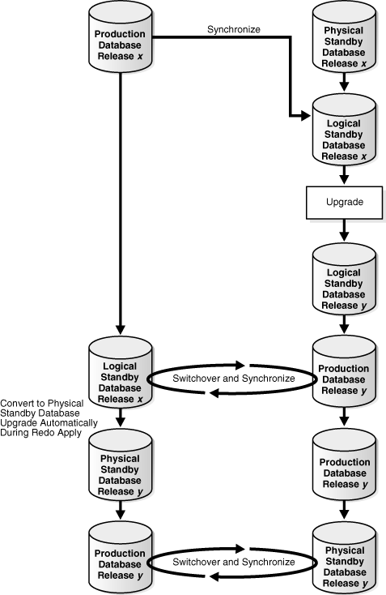
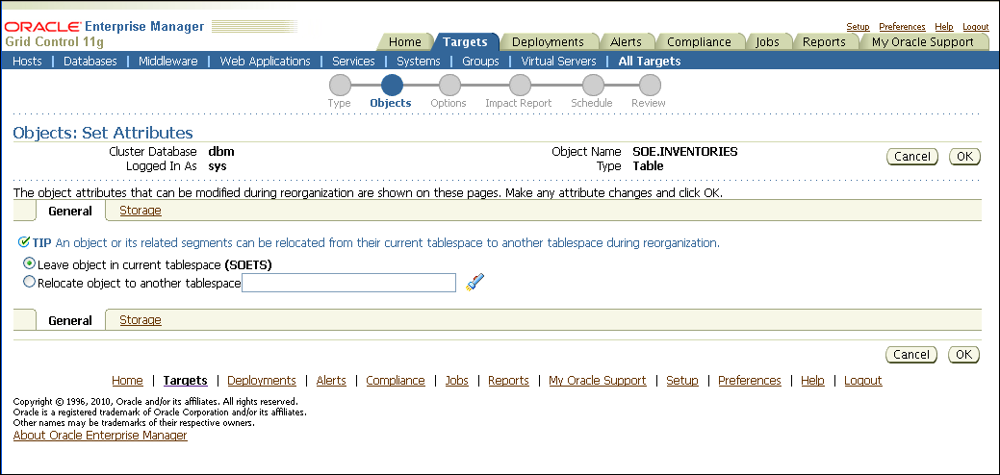

## 14 Reducing Downtime for Planned Maintenance

This chapter describes scheduled outages and the Oracle operational best practices that can tolerate or manage each outage type and minimize downtime.

This chapter contains the following topics:

- Overview of Scheduled Outages
- Eliminating or Reducing Downtime for Scheduled Outages

See Also:

[Chapter 13, "Recovering from Unscheduled Outages"](outage.md) for information about unscheduled outages

## 14.1 Overview of Scheduled Outages

Scheduled outages are required for regular maintenance of the technology infrastructure that supports the application, including tasks such as:

- Hardware maintenance, repair, and upgrades
- Software upgrades and patching
- Application (programmatic) changes, patches, and upgrades
- Changes to improve performance and manageability of systems

You can implement many of these tasks while maintaining continuous application availability.

The following sections provide best practice recommendations for reducing scheduled outages on the primary and secondary sites:

- Managing Scheduled Outages on the Primary Site
- Managing Scheduled Outages On the Secondary Site

### 14.1.1 Managing Scheduled Outages on the Primary Site

Table 14-1 shows the preferred solutions for performing scheduled outages on the primary site. The table includes links to detailed descriptions in Section 14.2, "Eliminating or Reducing Downtime for Scheduled Outages".

Table 14-1 Solutions for Scheduled Outages on the Primary Site

| Planned Maintenance | Description and Examples | Preferred Oracle Solution | Estimated Downtime |
| --- | --- | --- | --- |
| Site maintenance | Maintenance performed on the entire site where the current primary database resides is unavailable. Usually known well in advance.  - Scheduled power outages - Site maintenance - Regular planned switchovers to test infrastructure | Section 14.2.1, "Site, Hardware, and Software Maintenance Using Database Switchover" | < 5 minutes |
| Hardware maintenance or system software maintenance that impacts the entire database cluster | Hardware maintenance on a database server cluster.  - Upgrade of the cluster interconnect - Upgrade to the storage tier that requires downtime on the database tier | Section 14.2.1, "Site, Hardware, and Software Maintenance Using Database Switchover" | < 5 minutes |
| Hardware maintenance or system software maintenance that impacts a subset of the database cluster | Hardware maintenance or system software maintenance on a database server. The scope of the downtime is restricted to a node of the database cluster.  - Proactive replacement of RAID card battery - Addition of memory or CPU to an existing node in the database tier - Upgrade of a software component such as the operating system - Changes to the configuration parameters for the operating system | Oracle RAC service relocation (see Section 14.2.11, "Automatic Workload Management for System Maintenance") | No downtime |
| Perform patch set, maintenance, or major upgrade to Oracle Grid Infrastructure upgrade (includes Oracle Clusterware and Oracle ASM) | Software maintenance of Grid Infrastructure.  - Patch set upgrade Grid from 11g Release 2 (11.2.0.1) to 11g Release 2 (11.2.0.2) Patch Set 1 - Maintenance release upgrade from 11g Release 1 to 11g Release 2 - Major release upgrade from 10g to 11g | See [Oracle Database 2 Day + Real Application Clusters Guide](https://docs.oracle.com/cd/E11882_01/rac.112/e17264/softpatch2.htm#TDPRC443) and see your platform-specific Oracle Grid Infrastructure Installation Guide for complete details, in the appendix, "How to Upgrade to Oracle Grid Infrastructure" | No downtime  < 5 minutes  No downtime (when no role transition or < 5 minutes if role transition occurs |
| Perform patch set, maintenance, or major upgrade to Oracle Database | Software maintenance of Oracle Database.  - Patch set upgrade Grid from 11g Release 2 (11.2.0.1) to 11g Release 2 (11.2.0.2) Patch Set 1 - Maintenance release upgrade from 11g Release 1 to 11g Release 2 - Major release upgrade from 10g to 11g | - Oracle Database rolling upgrade with Data Guard SQL Apply (see Section 14.2.6.2, "Upgrading with Data Guard SQL Apply or Transient Logical Standby Database") 	or - Oracle GoldenGate (see Section 14.2.6.3, "Upgrading with Oracle GoldenGate") | < 5 minutes |
| Apply Patch Set Update (PSU), Critical Patch Update (CPU), or patch bundle | Software maintenance of Grid Infrastructure or Oracle Database.  - Installation of Patch Set Update 11.2.0.2.3 - Installation of 11.2.0.2 Grid Infrastructure Bundle 1 - Installation of Critical Patch Update July 2011 - Installation of Exadata Database Bundle Patch 8 | - Oracle RAC rolling patch upgrade using OPatch (see Section 14.2.4, "Oracle RAC Patches") 	or - Section 14.2.3, "Data Guard Standby-First Patch Apply" | No downtime  No downtime (when no role transition or < 5 minutes if role transition occurs |
| Apply Oracle interim ("one-off") or diagnostic patch | Patch Oracle software to fix a specific customer issue.  - Installation of patch 10205230 | - Oracle RAC rolling patch upgrade using OPatch (see Section 14.2.4, "Oracle RAC Patches") 	or - Section 14.2.3, "Data Guard Standby-First Patch Apply" 	or - Section 14.2.2, "Online Patching" | No downtime  No downtime (when no role transition or < 5 minutes if role transition occurs  No downtime |
| Database object reorganization or redefinition | Changes to the logical structure or the physical organization of Oracle Database objects, primarily to improve performance or manageability.  Changes to the data or schema.  Using the Oracle Database online redefinition feature enables objects to be available during the reorganization or redefinition.  - Moving an object to a different tablespace - Converting a table to a partitioned table - Add, modify, or drop one or more columns in a table or cluster | Online object reorganization with `DBMS_REDEFINITION` (see Section 14.2.10, "Data Reorganization and Redefinition") | No downtime |
| Database storage maintenance | Maintenance of storage where database files reside.  - Converting to Oracle ASM - Adding or removing storage - Patching or upgrading storage firmware or software | Online storage maintenance using Oracle ASM (see Section 14.2.5.2, "Storage Maintenance") | No downtime |
| Database platform or location migration | Changing operating system platform of the primary and standby databases.  Changing physical location of the primary database  - Moving to the Linux operating system - Moving the primary database from one data center to another | Section 14.2.7, "Database Platform or Location Migration" | < 5 minutes to hours  (depending on method chosen) |
| Application changes | May include data changes, schema, and other programmatic changes.  - Application upgrades | - Section 14.2.8, "Edition-Based Redefinition for Online Application Maintenance and Upgrades" 	or - Section 14.2.6.3, "Upgrading with Oracle GoldenGate" | < 5 minutes |

### 14.1.2 Managing Scheduled Outages On the Secondary Site

Scheduled outages on the secondary site may impact availability of applications that use Active Data Guard to offload read-intensive work from the primary database. Outages on the secondary site might affect the RTO and RPO if there are concurrent failures on the primary site. Outages on the secondary site can be managed with no effect on primary database availability:

- If maximum protection database mode is configured and there is only one standby database protecting the primary database, then you must downgrade the protection mode before scheduled outages on the standby instance or database so that there is no downtime on the primary database.
- If maximum protection database mode is configured and there are multiple standby databases, there is no need to downgrade the protection mode if at least one standby database that is configured with the `LGWR SYNC AFFIRM` attributes is available, and to which the primary database can transmit redo data.

When scheduling secondary site maintenance, consider that the duration of a site-wide or clusterwide outage adds to the time that the standby database lags behind the primary database, which in turn lengthens the time to restore fault tolerance. See [Section 9.2, "Determine Protection Mode and Data Guard Transport"](config_dg.md) for an overview of the Data Guard protection modes.

Table 14-2 describes the steps for performing scheduled outages on the secondary site.

Table 14-2 Managing Scheduled Outages on the Secondary Site

| Planned Maintenance | Oracle Database 11g with Data Guard | Oracle Database 11g - MAA |
| --- | --- | --- |
| Site shutdown | Before the outage:  Section 14.1.2, "Managing Scheduled Outages On the Secondary Site"  After the outage:  [Section 13.3.4, "Restoring Fault Tolerance After Planned Downtime on Secondary Site or Cluster"](outage.md) | Before the outage:  Section 14.1.2, "Managing Scheduled Outages On the Secondary Site"  After the outage:  [Section 13.3.4, "Restoring Fault Tolerance After Planned Downtime on Secondary Site or Cluster"](outage.md) |
| Hardware or non-Oracle database software maintenance on the node that is running the managed recovery process (MRP) | Before the outage:  Section 14.1.2, "Managing Scheduled Outages On the Secondary Site" | Before the outage:  Section 14.1.2, "Managing Scheduled Outages On the Secondary Site" |
| Hardware or non-Oracle database software maintenance on a node that is not running the MRP | Not applicable | No effect because the primary standby node or instance receives redo logs that are applied with the managed recovery process  After the outage: Restart node and instance, when available |
| Hardware or non-Oracle database software maintenance (clusterwide impact) | Not applicable | Before the outage:  Section 14.1.2, "Managing Scheduled Outages On the Secondary Site"  After the outage:  [Section 13.3.4, "Restoring Fault Tolerance After Planned Downtime on Secondary Site or Cluster"](outage.md) |
| Oracle patch and software upgrades | Downtime needed for upgrade, but there is no effect on the primary node unless the configuration is in maximum protection database mode | Downtime needed for upgrade, but there is no effect on the primary node unless the configuration is in maximum protection database mode |

## 14.2 Eliminating or Reducing Downtime for Scheduled Outages

The best practices for eliminating or reducing downtime for scheduled outages includes the following sections:

- Site, Hardware, and Software Maintenance Using Database Switchover
- Online Patching
- Data Guard Standby-First Patch Apply
- Oracle RAC Patches
- Storage Maintenance
- Database Upgrades
- Database Platform or Location Migration
- Edition-Based Redefinition for Online Application Maintenance and Upgrades
- Oracle GoldenGate for Online Application Upgrades
- Data Reorganization and Redefinition
- Automatic Workload Management for System Maintenance

Before performing any update to your system, Oracle recommends you perform extensive testing.

### 14.2.1 Site, Hardware, and Software Maintenance Using Database Switchover

A switchover is a planned transition that includes a series of steps to switch database roles between the primary and standby databases. Following a successful switchover operation, the standby database assumes the primary role and the primary database becomes a standby database. Database switchover can be done by Oracle Enterprise Manager, Oracle Data Guard broker, or by issuing SQL\*Plus statements. At times the term switchback is also used within the scope of database role management. A switchback operation is a subsequent switchover operation to return the standby databases to their original roles.

Switchovers are useful in many situations when performing site maintenance, and hardware or software maintenance such as database upgrades.

#### 14.2.1.1 When to Perform a Data Guard Switchover

Switchover can occur whenever a primary database is started, the target standby database is available, and all the archived redo logs are available.

Switchovers are useful in the following situations:

- Scheduled maintenance such as hardware maintenance or firmware patches on the primary host
- Resolution of data failures when the primary database is still opened
- Testing and validating the secondary resources, as a means to test disaster recovery readiness
- When using SQL Apply to perform a rolling upgrade (see Section 14.2.6.2, "Upgrading with Data Guard SQL Apply or Transient Logical Standby Database")

Switchover is not possible or practical under the following circumstances:

- Archived redo log files that are needed for apply are missing
- A point-in-time recovery is required
- The primary database is not open and cannot be opened

#### 14.2.1.2 Best Practices for Configuring Data Guard Switchover

Before performing a switchover, employ the Data Guard configuration best practices. For more information, see [Section 9.4.1, "Oracle Data Guard Switchovers Best Practices"](config_dg.md).

#### 14.2.1.3 How to Perform Data Guard Switchover

You should perform switchovers dynamically using Oracle Enterprise Manager. If you are not using Oracle Enterprise Manager, then you can perform switchovers manually using the DGMGRL command-line interface or SQL\*Plus statements:

- Using Oracle Enterprise Manager, as described in [Oracle Data Guard Broker](https://docs.oracle.com/cd/E11882_01/server.112/e40771/cli.htm#DGBKR570)
- Using the DGMGRL command-line interface, as described in [Oracle Data Guard Broker](https://docs.oracle.com/cd/E11882_01/server.112/e40771/cli.htm#DGBKR570)
- Using SQL\*Plus:
	- Role Transitions Involving Physical Standby Databases:
		See [Oracle Data Guard Concepts and Administration](https://docs.oracle.com/cd/E11882_01/server.112/e41134/role_management.htm#SBYDB00620) for detailed steps on Role Transitions Involving Physical Standby Databases.
		- Role Transitions Involving Logical Standby Databases:
		See [Oracle Data Guard Concepts and Administration](https://docs.oracle.com/cd/E11882_01/server.112/e41134/role_management.htm#SBYDB00630) for detailed step on Role Transitions Involving Logical Standby Databases.

After performing the Data Guard Switchover do the following:

- If the database is moved to the secondary site and the application tier is also moved to the secondary site, perform complete site failover. For more information see [Section 13.2.1, "Complete Site Failover (Failover to Secondary Site)."](outage.md)
- If only the database is moved to the secondary site, perform application failover. See [Section 13.2.4, "Application Failover"](outage.md) for more information.

### 14.2.2 Online Patching

Beginning with Oracle Database 11g there is support for online patching for some qualified interim and diagnostic patches. Online patching provides the ability to patch the processes in an Oracle instance without bringing the instance down. Each process associated with the instance checks for patched code at a safe execution point, and then copies the code into its process space. Thus, the processes being patched may not necessarily pick up the new code at the exact same time.

A key difference between traditional patching and online patching is that traditional patching is implemented at the software level and online patching is implemented at the software or Oracle Database instance level. In other words, instances using an `ORACLE_HOME` that receives a traditional patch always use the patched code whereas instances using an `ORACLE_HOME` that receives an online patch receive the patched code only if the instance is specified when the patch is applied.

Note:

For online patching, note the following:
- See the patch README for details on whether a patch supports online installable.

The best practices for online patching:

- During the next scheduled maintenance, when instances can be shutdown, rollback all online patches and apply the patches in an offline manner.
- Patches that are online installable should be installed in an online manner when the patch needs to be applied urgently and downtime cannot be taken to apply the patch. If instance downtime is acceptable, then apply the patch in an offline manner (as described in the patch README).
- Apply the patch to one instance at a time.
- When rolling back online patches, ensure all patched instances are included to avoid the dangerous and confusing situation of having different software across instances using the same `$ORACLE_HOME`.
- Assess memory impact on a test system before deploying to production (for example: using the `pmap` command).
- Never remove the `$ORACLE_HOME/hpatch` directory.

See Also:

- [Oracle Universal Installer and OPatch User's Guide for Windows and UNIX](https://docs.oracle.com/cd/E11882_01/em.112/e12255/oui7_opatch.htm#OUICG305) for information about Patching Oracle Software with OPatch
- For the most up-to-date information about online patching, installation and rollback, see "RDBMS Online Patching - Hot Patching" in My Oracle Support Note 761111.1 at
	`https://support.oracle.com/CSP/main/article?cmd=show&type=NOT&id=761111.1`

### 14.2.3 Data Guard Standby-First Patch Apply

Oracle Data Guard Standby-First Patch Apply provides support for different software releases between a primary database and its physical standby database to apply and validate Oracle patches in rolling fashion for low risk to the production database. Oracle Data Guard Standby-First Patch Apply is supported for certified software patches for Oracle Database Enterprise Edition Release 2 (11.2) release 11.2.0.1 and later. Refer to the README for the patch to determine if a target patch is certified as being a Standby-First Patch.

The Oracle Database `COMPATIBLE` initialization parameter values must remain the same between the primary and physical standby systems.

All Oracle Exadata Storage Server Software changes that do not have any dependencies on the existing database or Oracle Grid Infrastructure software releases are applicable.

Software changes that potentially disrupt the interoperability between primary and physical standby systems, or any SQL code changes, may not be applicable.

Oracle Data Guard Standby-First Patch Apply provides a supported method to apply a patch initially to a physical standby database while the primary database remains at the previous software release.

If the standby database is completely separate from the primary database (i.e. it does not share any storage, network, or cluster component), then

- Qualified Oracle patches applied to the database home can be applied and tested on the standby database first. Examples of Oracle database software in this category are:
	- Exadata Database Bundle Patch
		- Patch Set Update (PSU)
		- Critical Patch Update (CPU)
		- Interim (“one-off”) patches
- Any other Oracle or system software can be applied and tested on the standby database first. Examples of software in this category are:
	- Oracle patches applied to the grid home
		- Operating system patches and firmware
		- Storage patches
		- Network patches

If the standby database shares infrastructure or server components with the primary database then you cannot evaluate patches to the shared components in a manner that will reduce risk to the primary database. For example, if you have a standby database running on a cluster separate from the primary database but it shares the same storage grid as the primary database, then you cannot patch the standby storage first without affecting the primary database.

The following are the advantages for Oracle Data Guard Standby-First Patch Apply:

- Ability to apply software changes to the physical standby database for recovery, backup, or query validation before role transition, or before application on the primary production database. This mitigates risk and potential downtime on the production database.
- Ability to switch over to the targeted database after completing validation with reduced risk and minimum downtime.
- Ability to switch back, also known as fallback, if there are any major stability or performance regressions.

Oracle patch sets and major release upgrades do not apply. Use the Data Guard transient logical standby method for patch sets and major releases. For more information, see Section 14.2.6.2, "Upgrading with Data Guard SQL Apply or Transient Logical Standby Database".

See Also:

- [Oracle Database Upgrade Guide](https://docs.oracle.com/cd/E11882_01/server.112/e23633/intro.htm#UPGRD12474) for information about Considerations for Downgrading and Compatibility and the Oracle Database `COMPATIBLE` parameter
- [Oracle Automatic Storage Management Administrator's Guide](https://docs.oracle.com/cd/E11882_01/server.112/e18951/asmdiskgrps.htm#OSTMG10045) for information about Disk Group Compatibility Attributes
- See "Oracle Patch Assurance - Data Guard Standby-First Patch Apply" in My Oracle Support Note 1265700.1 at
	`https://support.oracle.com/CSP/main/article?cmd=show&type=NOT&id=1265700.1`

### 14.2.4 Oracle RAC Patches

With Oracle RAC, you can apply certain database patches to one node or instance at a time, which enables continual application and database availability. Interim ("one-off" patches, Patch Set Updates (PSUs), and Critical Patch Updates (CPUs) to database software are usually applied to implement known fixes for software problems an installation has encountered or to apply diagnostic patches to gather information regarding a problem. Such patch application is often carried out during a scheduled maintenance outage.

Oracle now provides the capability to do rolling patch upgrades with Oracle RAC with little or no database downtime. The tool used to achieve this is the `opatch` command-line utility.

The advantage of an Oracle RAC rolling upgrade is that it enables at least some instances of the Oracle RAC installation to be available during the scheduled outage required for patch upgrades. Only the Oracle RAC instance that is currently being patched must be brought down. The other instances can continue to remain available. Thus, the effect on the application downtime required for such scheduled outages is further minimized. Oracle's `opatch` utility enables the user to apply the patch successively to the different instances of the Oracle RAC installation.

Rolling upgrade is available only for patches that have been certified by Oracle to be eligible for rolling upgrades. The patch README file indicates whether a patch can be applied in an Oracle RAC rolling manner. Typically, patches that can be installed in a rolling manner include:

- Exadata Database Bundle Patches
- Patch Set Update (PSU)
- Critical Patch Update (CPU)
- Interim (“one-off”) patches
- Diagnostic patches

Rolling upgrade of patches is currently available for one-off patches only. Rolling upgrade is not available for patch sets.

Rolling patch upgrades are not available for deployments where the Oracle Database software is shared across the different nodes. This is the case where the Oracle home is on Cluster File System (CFS) or on shared volumes provided by file servers or NFS-mounted drives. The feature is only available where each node has its own copy of the Oracle Database software.

#### 14.2.4.1 Best Practices to Minimize Downtime for All Database Patch Upgrades

Use the following recommended practices for all database patch upgrades:

- Always confirm with Oracle Support Services that the patch is valid for your problem and for your deployment environment.
- Have a plan for applying the patch and a plan for backing out the patch.
- Apply the patch to your test environment first and verify that it fixes the problem.
- When you plan the elapsed time for applying the patch, include time for starting up and shutting down the other tiers of your technology stack if necessary.
- If the patch is not a candidate for Oracle RAC rolling upgrade and you can incur the downtime for applying the patch, go to Section 14.2.6, "Database Upgrades" to assess whether other solutions are feasible.

#### 14.2.4.2 Best Practices to Minimize Downtime for Database Rolling Upgrades

The following are additional recommended practices for Oracle RAC rolling upgrades.

- If multiple instances share an Oracle home, then all of them are affected by application of a patch. Administrators should verify that this does not cause unintentional side effects. Also, you must shut down all such instances on a node during the patch application. You must take this into account when scheduling a planned outage. As a best practice, only similar applications should share an Oracle home on a node. This provides greater flexibility for patching.
- The Oracle inventory on each node is the repository that keeps a central inventory of all Oracle software installed. The inventory is node-specific. It is shared by all Oracle software installed on the node. It is similar across nodes only if all nodes are the same in terms of the Oracle Database software deployed, the deployment configuration, and patch levels. Because the Oracle inventory greatly aids the patch application and patch management process, it is recommended that its integrity be maintained. Oracle inventory should be backed up after each patch installation to any Oracle software on a specific node. This applies to the Oracle inventory on each node of the cluster.
- Use the Oracle Universal Installer to install all Oracle database software. This creates the relevant repository entries in the Oracle inventory on each node of the cluster. Also, use the Oracle Universal Installer to add nodes to an existing Oracle RAC cluster.
	However, if this was not done or is not feasible for some reason, adding information about an existing Oracle database software installation to the Oracle inventory can be done with the `attach` option of the `opatch` utility. Node information can be also added with this option.
- The nature of the Oracle rolling patch upgrade enables it to be applied to only some nodes of the Oracle RAC cluster. So an instance can be operating with the patch applied, while another instance is operating without the patch. This is not possible for nonrolling patch upgrades. Apply nonrolling patch upgrades to all instances before the Oracle RAC deployment is activated. A mixed environment is useful if a patch must be tested before deploying it to all the instances. Applying the patch with the `-local` option is the recommended way to do this.
	In the interest of keeping all instances of the Oracle RAC cluster at the same patch level, it is strongly recommended that after a patch has been validated, it should be applied to all nodes of the Oracle RAC installation. When instances of an Oracle RAC cluster have similar patch software, services can be migrated among instances without running into the problem a patch might have fixed.
- Maintain all patches (including those applied by rolling upgrades) online and do not remove them after they have been applied. Keeping the patches is useful if a patch must be rolled back or applied again.
	Store the patches in a location that is accessible by all nodes of the cluster. Thus all nodes of the cluster are equivalent in their capability to apply or roll back a patch.
- Perform rolling patch upgrades, just like any other patch upgrade, when no other patch upgrade or Oracle installation is being performed on the node. The application of multiple patches is a sequential process, so plan the scheduled outage accordingly.
- If you must apply multiple patches at the same time but only some patches are eligible for rolling upgrade, then apply all of the patches in a nonrolling manner. This reduces the overall time required to accomplish the patching process.
- For patches that are not eligible for rolling upgrade, the next best option for Oracle RAC deployments is the `MINIMIZE_DOWNTIME` option of the `APPLY` command.
- Perform the rolling upgrade when system usage is low to ensure minimal disruption of service for the end users.

See Also:

[Oracle Universal Installer and OPatch User's Guide for Windows and UNIX](https://docs.oracle.com/cd/E11882_01/em.112/e12255/toc.htm) for more information about the opatch utility

#### 14.2.4.3 Out-of-place Software Installation and Patching

The following software installations are performed, by default, out-of-place by Oracle Universal Installer (OUI). Software installations performed by OUI are full software installations:

- Major release
- Maintenance release
- Patch set (beginning with 11g Release 2)

The following software installations are performed in-place by the OPatch utility. OPatch installs the software update into an existing `ORACLE_HOME` by overwriting existing software with updated software from the patch being installed:

- Interim patch installation
- Bundle patch installation
- Patch Set Update (PSU) installation
- Critical Patch Update (CPU) installation
- Diagnostic patch installation

Advantages of out-of-place patching

- Applications remain available while software is upgraded in the new `ORACLE_HOME`.
- The configuration inside the `ORACLE_HOME` is retained because the cloning procedure involves physically copying the software (examples are files such as `LISTENER.ORA`, `TNSNAMES.ORA`, and `INITSID.ORA`).
- It is easier to rollback or test between the original `ORACLE_HOME` and the patched `ORACLE_HOME`.
- When consolidating, you could have multiple versions of `ORACLE_HOME`, so this option should better support consolidation.

Considerations for using out-of-place patching

- When performing out-of-place patch installation with cloning, you must change any `ORACLE_HOME` environment variable hard coded in application code and Oracle-specific scripts.
- Out-of-place patching requires more disk space than in-place patching.

Out-of-place patching with OPatch

Traditionally, patches installed with OPatch are done in-place, which means that the new code is applied directly over the old code.

The disadvantages of in-place patching are:

- The application cannot connect to the database while new code is being installed.
- If patch rollback is required, the application cannot connect to the database while old code is being reinstalled.

Note:

This downside to an in-place database patch set upgrade does not apply when you use Standby-First Patch apply.

For more information, see Section 14.2.3, "Data Guard Standby-First Patch Apply."

Software installation performed by OPatch to the Oracle Database software home or the Grid Infrastructure software home can be performed out-of-place by using `ORACLE_HOME` cloning techniques to copy the software to a new home directory before applying a patch to the new `ORACLE_HOME` with OPatch. The high-level approach to perform out-of-place patching is:

1. Clone the active `ORACLE_HOME` to a new `ORACLE_HOME`.
2. Patch the new `ORACLE_HOME`.
3. Switch to make the new `ORACLE_HOME` the active software home. This can be done in a rolling manner one node at a time.

See Also:

For details about out-of-place patching, see "Minimal downtime patching via cloning 11gR2 ORACLE\_HOME directories on Oracle Database Machine" My Oracle Support Note 1136544.1 at

`https://support.oracle.com/CSP/main/article?cmd=show&type=NOT&id=1136544.1`

#### 14.2.4.4 Using OPlan for Patching

OPlan is a utility that facilitates the patch installation process by providing you with step-by-step patching instructions specific to your environment for both in-place and out-of-place patch installation. Currently, OPlan is supported for Exadata Database Bundle Patches. For the latest information, see "Oracle Software Patching with OPLAN" in My Oracle Support Note 1306814.1 at

`https://support.oracle.com/CSP/main/article?cmd=show&type=NOT&id=1306814.1`

### 14.2.5 Grid Infrastructure Maintenance

Beginning with Oracle Database 11g release 2 (11.2), Oracle ASM is installed when you install the Oracle Grid Infrastructure components, and it shares an Oracle home with Oracle Clusterware when installed in a cluster such as with Oracle RAC. When performing maintenance on the Grid Infrastructure, such as patching or upgrade, it will impact both Oracle ASM and Oracle Clusterware.

#### 14.2.5.1 Grid Infrastructure Rolling Upgrade

Grid Infrastructure upgrade means taking the Oracle Clusterware and Oracle ASM to a later major version, maintenance version, or patch set. Grid Infrastructure upgrade is performed in a rolling manner.

See Also:

[Oracle Database 2 Day + Real Application Clusters Guide](https://docs.oracle.com/cd/E11882_01/rac.112/e17264/toc.htm)

Oracle Grid Infrastructure Installation Guide for your platform for complete details, in the Appendix, "How to Upgrade to Oracle Grid Infrastructure"

#### 14.2.5.2 Storage Maintenance

Use the following procedure when adding or upgrading storage on the system. The procedures in the following sections assume that you are adding storage to an Oracle ASM disk group.

- Migrating to Oracle ASM Storage
- Adding and Removing Storage
- Upgrading Oracle ASM Nodes

##### 14.2.5.2.1 Migrating to Oracle ASM Storage

If you have an existing Oracle database that stores database files on a file system or on raw devices, you can migrate some or all of these database files to Oracle ASM. To minimize downtime, use a physical standby database to migrate data to Oracle ASM storage. Use Oracle Recovery Manager (RMAN) or the ASMCMD utility to migrate to Oracle ASM with very little downtime. The Oracle Recovery Manager (RMAN) and ASMCMD utility allow you to copy individual files into Oracle ASM.

For complete migrations Oracle Data Guard or Oracle GoldenGate are better alternatives to migrate to Oracle ASM with even less downtime (migration occurs in approximately the same amount of time it takes to perform a switchover).

See Also:

- [Oracle Database Backup and Recovery User's Guide](https://docs.oracle.com/cd/E11882_01/backup.112/e10642/rcmdupdb.htm#BRADV010) for information about performing Oracle ASM data migration using RMAN
- The MAA white paper: "Minimal Downtime Migration to ASM" at
	```
	http://www.oracle.com/goto/maa
	```

##### 14.2.5.2.2 Adding and Removing Storage

Disks can be added to and removed from Oracle ASM with no downtime. When disks are added or removed, Oracle ASM automatically starts a rebalance operation to evenly spread the disk group contents over all drives in the disk group.The best practices for adding or removing storage include:

- Make sure your host operating system and storage hardware can support adding and removing storage with no downtime before using Oracle ASM to do so.
- Use a single `ALTER DISKGROUP` command when adding or removing multiple disk drives (this way there is only one rebalance operation where, with separate drops and adds there are two or more rebalance operations. For more information, see [Section 4.5.4, "Use a Single Command to Add or Remove Storage"](config_storage.md)).
	For example, if the storage maintenance is to add drives and remove existing drives, use a single `ALTER DISKGROUP` command with the `DROP DISK` clause to remove the existing drives and the `ADD DISK` clause to add the drives:
	```
	ALTER DISKGROUP data
	       DROP DISK diska5
	       ADD FAILGROUP failgrp1 DISK '/devices/diska9' NAME diska9;
	```
- When dropping disks from a disk group, specify the `WAIT` option in the `REBALANCE` clause so the `ALTER DISKGROUP` statement does not return until the contents of the drives being dropped have been moved to other drives. After the statement completes, the drives can be safely removed from the system. For example:
	```
	ALTER DISKGROUP data
	DROP DISK diska5
	ADD FAILGROUP failgrp1 DISK '/devices/diska9' NAME diska9
	REBALANCE WAIT;
	```
- When dropping disks in a normal or high redundancy disk group, ensure there is enough free disk space in the disk group to reconstruct full redundancy.
- Monitor the progress of rebalance operations using Enterprise Manager or by querying `V$ASM_OPERATION`.
- For long-running rebalance operations that occur during periods of low database activity, increase the rebalance power limit to reduce the rebalance time.

See Also:

[Oracle Automatic Storage Management Administrator's Guide](https://docs.oracle.com/cd/E11882_01/server.112/e18951/toc.htm)

##### 14.2.5.2.3 Upgrading Oracle ASM Nodes

Perform an Oracle ASM rolling upgrade to independently upgrade or patch clustered Oracle ASM nodes without affecting database availability, thus providing greater uptime. You can use Oracle ASM rolling upgrades only to upgrade clustered Oracle ASM instances for environments running Oracle Database 11g or later releases.

See Also:

[Oracle Automatic Storage Management Administrator's Guide](https://docs.oracle.com/cd/E11882_01/server.112/e18951/asminst.htm#OSTMG02400) for complete information about Using Oracle ASM Rolling Upgrades

### 14.2.6 Database Upgrades

Database upgrade means taking the database to a later major release, maintenance release, or patch set. The following Oracle features are available to perform database upgrades:

- Upgrading with Database Upgrade Assistant (DBUA)
- Upgrading with Data Guard SQL Apply or Transient Logical Standby Database
- Upgrading with Oracle GoldenGate
- Upgrading with Transportable Tablespaces

The method you choose to perform database upgrades can vary depending on the following considerations:

- Downtime required to complete the upgrade
- Setup time and effort required before the downtime
- Temporary additional resources necessary (for example, disk space or CPU)
- Complexity of the steps allowed to complete the upgrade

Table 14-3 lists the methods that you can use for database upgrades, and recommends what method to use for particular cases.

Table 14-3 Database Upgrade Options

| Upgrade Method | Use This Method When... |
| --- | --- |
| Upgrading with Database Upgrade Assistant (DBUA) | Recommended method when the maintenance window is sufficient or when data type constraints prohibit the use of the other methods in this table. |
| Upgrading with Data Guard SQL Apply or Transient Logical Standby Database | DBUA cannot finish within the maintenance window and the database is not a candidate for Oracle RAC rolling patch upgrade.  Use a transient logical standby when the configuration has only a physical standby database. |
| Upgrading with Oracle GoldenGate | Oracle GoldenGate is already used for complete database replication or when the database version predates Oracle 10g (the minimum version for Oracle Data Guard database rolling upgrades), or when additional flexibility for replicating back to the previous version is required (fast fall back option) or where zero downtime upgrades using multi-master replication is required. |
| Upgrading with Transportable Tablespaces | The database is using data types unsupported by Data Guard SQL Apply or Oracle GoldenGate, and the user schemas are simple. |

Regardless of the upgrade method you use, you should follow the guidelines and recommendations provided in the [Oracle Database Upgrade Guide](https://docs.oracle.com/cd/E11882_01/server.112/e23633/toc.htm) and its companion document, "Oracle 11gR2 Upgrade Companion" in My Oracle Support Note 785351.1 at

`https://support.oracle.com/CSP/main/article?cmd=show&type=NOT&id=785351.1`

See Also:

- "Oracle Support Lifecycle Advisors" in My Oracle Support Note 250.1 at
	`https://support.oracle.com/CSP/main/article?cmd=show&type=NOT&id=250.1`
- Oracle Technology Network Oracle Database Upgrade web page at
	`http://www.oracle.com/technetwork/database/upgrade/index.html`

#### 14.2.6.1 Upgrading with Database Upgrade Assistant (DBUA)

Database Upgrade Assistant (DBUA) is used to upgrade a database in place from an earlier software version.

When deciding if DBUA is the proper tool to use when performing a database upgrade with minimal downtime, consider the following:

- DBUA upgrades the database dictionary and all components. For example: Java, XDB, and so on, that have been installed while the database is unavailable for normal user activity.
- Downtime required for a database upgrade when using DBUA is determined by the time needed to:
	- Upgrade all database dictionary objects to the new version
		- Restart the database
		- Reconnect the clients to the upgraded database
- To reduce the amount of downtime required for a database upgrade when using DBUA:
	- Remove any database options that are not being used.
		DBUA upgrades all of the installed database options, whether they are required by an application. By reducing the number of options that must be upgraded, you can reduce the overall upgrade time.
		- Update data dictionary statistics immediately before the upgrade.

Use DBUA for a database upgrade when the time to perform the upgrade with this method fits within the maintenance window.

See Also:

- [Oracle Database Upgrade Guide](https://docs.oracle.com/cd/E11882_01/server.112/e23633/upgrade.htm#UPGRD105) for more information about DBUA and upgrading your Oracle Database software
- "Oracle 11gR2 Upgrade Companion" in My Oracle Support Note 785351.1 at
	`https://support.oracle.com/CSP/main/article?cmd=show&type=NOT&id=785351.1`
- To upgrade from Oracle9i to Oracle Database 11g, see "Oracle 11gR1 Upgrade Companion" in My Oracle Support Note 601807.1 at
	`https://support.oracle.com/CSP/main/article?cmd=show&type=NOT&id=601807.1`

#### 14.2.6.2 Upgrading with Data Guard SQL Apply or Transient Logical Standby Database

Use Data Guard SQL Apply or a transient logical standby database to upgrade a database with minimal downtime using a process called a rolling upgrade. Data Guard currently supports homogeneous environments where the primary and standby databases run on the same platform.

See Also:

For exceptions that are specific to heterogeneous environments and for other late-breaking information about rolling upgrades with SQL Apply, see "Data Guard Support for Heterogeneous Primary and Physical Standbys in Same Data Guard Configuration" in My Oracle Support Note 413484.1 at

`https://support.oracle.com/CSP/main/article?cmd=show&type=NOT&id=413484.1`

##### 14.2.6.2.1 SQL Apply Rolling Upgrades

Use Data Guard SQL Apply for rolling database upgrade when a conventional upgrade cannot complete the upgrade within the maintenance window and the application does not use user-defined types. Oracle Data Guard using SQL Apply is the recommended solution for performing patch set and database upgrades with minimal downtime.

Note the following points when deciding if Data Guard SQL Apply is the appropriate method for minimizing downtime during a database upgrade:

- SQL Apply has some data type restrictions (see [Oracle Data Guard Concepts and Administration](https://docs.oracle.com/cd/E11882_01/server.112/e41134/data_support.htm#SBYDB00305) for a list of the restrictions). If there are data type restrictions, consider implementing Extended Datatype Support (EDS). If the source database is using data types not natively supported by SQL Apply, you can use Extended Datatype Support (EDS) to accommodate several more advanced data types.
- You can perform a SQL Apply rolling upgrade for any upgrade, including a major release upgrade if the source release is Oracle Database 10g release 1 (10.1.0.3) or higher. Before you begin, review the detailed steps for a SQL Apply rolling upgrade and verify the supported data types in [Oracle Data Guard Concepts and Administration](https://docs.oracle.com/cd/E11882_01/server.112/e41134/rollup.htm#SBYDB00830).
- If the source database is using a software version not supported by SQL Apply rolling upgrade (earlier than Oracle Database release 10.1.0.3) or using EDS cannot sufficiently resolve SQL Apply data type conflicts, then consider using Database Upgrade Assistant (DBUA), transportable tablespace, or Oracle GoldenGate.
- Downtime required for a database upgrade (rolling upgrade) when using Data Guard SQL Apply is determined by the time needed to:
	- Perform a Data Guard switchover
		- Reconnect the clients to the new database

See Also:

- [Oracle Data Guard Concepts and Administration](https://docs.oracle.com/cd/E11882_01/server.112/e41134/rollup.htm#SBYDB00830) for information about Using SQL Apply to Upgrade the Oracle Database
- The MAA white paper "Database Rolling Upgrade Using Data Guard SQL Apply Oracle Database 11g and 10gR2" at `http://www.oracle.com/goto/maa`
- For SQL Apply, EDS support starts from Oracle Database Release 10.2.0.4. The ESD implementation is different from 10.2.0.4 to 11.1 and in Oracle Database Release 11.2, for more information:
	From 10.2.0.4 to 11.1 you must build ESD following the examples specified in detail in "Extended Datatype Support (EDS) for SQL Apply" in My Oracle Support Note 559353.1 at
	`https://support.oracle.com/CSP/main/article?cmd=show&type=NOT&id=559353.1`
	In Oracle Database Release 11.2 EDS-related procedures are part of the `DBMS_LOGSTDBY` package; for more information see "SQL Apply Extended Datatype Support - 11.2" in My Oracle Support Note 949516.1 at
	`https://support.oracle.com/CSP/main/article?cmd=show&type=NOT&id=949516.1`

##### 14.2.6.2.2 Transient Logical Standby Database Rolling Upgrade

You can use a [transient logical standby database](glossary.md) to perform a rolling database upgrade using your current physical standby database by temporarily converting it to a logical standby database. Use a transient logical standby when your configuration only has a physical standby database. Performing a rolling upgrade using a transient logical standby is similar to the standard SQL Apply rolling upgrade with the following differences:

- A guaranteed restore point is created on the primary database to flash the database back to a physical standby database after the switchover.
- The conversion of a physical standby database to a logical standby database uses the `KEEP IDENTITY` clause to retain the same `DB_NAME` and `DBID` as that of its primary database.
- The `ALTER DATABASE CONVERT TO PHYSICAL STANDBY` statement converts the original primary database from a logical standby to a physical standby database.
- The original primary database is actually upgraded through Redo Apply after it is converted from the transient logical standby database role to a physical standby database.

Figure 14-1 shows the flow of processing that occurs when you perform a rolling upgrade with a transient logical standby database.

Note:

To simplify the operation shown in Figure 14-1, a Bourne shell script is available that automates the database rolling upgrade procedure (starting with Oracle Database 11g Release 1). The database rolling upgrade is performed using an existing Data Guard physical standby database and the transient logical standby rolling upgrade process. The Bourne shell script, named `physru`, is available for download with details in "Oracle 11g Data Guard: Database Rolling Upgrade Shell Script" in My Oracle Support Note 949322.1 at

`https://support.oracle.com/CSP/main/article?cmd=show&type=NOT&id=949322.1`

Figure 14-1 Using a Transient Logical Standby Database for Database Rolling Upgrade



> This figure shows the steps in the process of performing a rolling upgrade using a transient logical standby database. The configuration starts out with the primary and physical standby databases running Oracle Database release x before the physical standby is converted into the logical standby role. The transient logical standby database is upgraded from release x to release y and then a switchover is performed. When the logical standby database becomes the new primary database, this has the effect of automatically upgrading the new primary database to release y. As the original primary database is transitioned to the logical standby role, SQL Apply synchronizes the new logical standby database with the new primary database, which has the effect of automatically upgrading the new logical standby database to release y.
>
> Next, the new logical standby database is returned to the physical standby database role, Redo Apply is started, and the physical standby database is automatically upgraded to release y as the primary and physical standby databases are synchronized. The figure shows the optional final step in which a switchover is performed to return the databases to their original (pre-upgrade) roles.
  

See Also:

- [Oracle Data Guard Concepts and Administration](https://docs.oracle.com/cd/E11882_01/server.112/e41134/rollup.htm#SBYDB00830) for more information about " [Performing a Rolling Upgrade With an Existing Physical Standby Database](https://docs.oracle.com/cd/E11882_01/server.112/e41134/rollup.htm#SBYDB00830) "
- The MAA white paper, "Database Rolling Upgrades Made Easy by Using a Data Guard Physical Standby Database", which describes the process of automating many of the tasks associated with a database rolling upgrade, available from the MAA Best Practices area for Oracle Database at
	`http://www.oracle.com/goto/maa`

#### 14.2.6.3 Upgrading with Oracle GoldenGate

Consider using Oracle GoldenGate as an alternative to Data Guard database rolling upgrades for upgrading the database software from one version to another with minimal downtime, for requirements that Oracle Data Guard is not designed to address. Oracle GoldenGate offers the following advantages over Oracle Data Guard for this purpose:

- Oracle GoldenGate can upgrade an Oracle Database in rolling fashion from an Oracle Database release before Oracle Database 10g (Data Guard Database Rolling Upgrades are supported beginning with Oracle Database 10g).
- Oracle GoldenGate can be configured for one-way replication from a later Oracle Database release to a previous Oracle Database release to enable a fast fall-back option (Oracle Data Guard can only replicate from a earlier database release to a later release). This is useful in cases where you want to operate at the new release for a period and have the option to quickly revert to the previous release should unanticipated issues arise days after production cut-over. By configuring one-way replication from the new release to the previous release, production can be switched to the prior release quickly, without losing data or incurring the time of a downgrade, while the problems are resolved.
- Oracle GoldenGate can be configured for multi-master replication between different Oracle Database releases to facilitate a zero downtime upgrade (Oracle Data Guard is a one-way replication solution). When the new Oracle release is deployed and ready for user connections, new user connections can be directed to the new release while existing user connections at the old release continue to process transactions. As existing user connections terminate, utilization of the Oracle Database operating at the previous release diminishes naturally without users perceiving any downtime. Multi-master replication keeps both databases synchronized during this transitional phase. Once all users have migrated to the new release, simpler one-way replication can maintain synchronization of the previous database release to provide a fast fall-back option as described in the previous bullet item. Note that multi-master replication is not suitable for all applications - conflict detection and resolution is required.
- If you cannot use the procedure described in Section 14.2.6.2, "Upgrading with Data Guard SQL Apply or Transient Logical Standby Database" to upgrade your database and you require zero-to-minimum downtime while performing the database or application upgrade, then configure Oracle GoldenGate to perform a database upgrade with little or no downtime. For more information, see the White Paper, "Zero-Downtime Database Upgrades Using Oracle GoldenGate" at
	`http://www.oracle.com/technetwork/middleware/goldengate/overview/ggzerodowntimedatabaseupgrades-174928.pdf`

See Also:

Oracle GoldenGate For Windows and UNIX Administrator's Guide for more information about database upgrades using Oracle GoldenGate

#### 14.2.6.4 Upgrading with Transportable Tablespaces

Use transportable tablespaces to accomplish a database upgrade by transporting all user data files into a pre-created, prepared target database.

Note the following points when deciding if transportable tablespaces is the appropriate method for performing a database upgrade:

- The `SYSTEM` tablespace cannot be moved with transportable tablespaces. The target database `SYSTEM` tablespace contents, including user definitions and objects necessary for the application, must be built manually. Use Data Pump to move the contents of the `SYSTEM` tablespace.
- Downtime required for a database upgrade when using transportable tablespaces is determined by the time needed to:
	- Place the source database tablespaces in read-only mode.
		- Perform a network import of the transportable metadata.
		- If the target database is on a remote system, then include the time to transfer all data files from the source system to the target system. However, note that using transportable tablespaces to perform a database upgrade is useful only if you can use the data files in their current location. Using the transportable tablespace method is not recommended if doing so requires that you copy the data files to the target location.
		The time it takes to transfer the data files can be reduced significantly by using a storage infrastructure that can make the data files available to the target system without physically moving the files, or by using a physical standby database.

Using transportable tablespaces to perform a database upgrade is recommended when:

- You can use the data files in their current location to avoid copying data files as part of the transport process. If the target database is on a different machine, this requires that the storage is accessible to both the source and target systems.
- DBUA cannot complete within the maintenance window.
- Oracle GoldenGate or Data Guard SQL Apply cannot be used due to data type restrictions.
- The Oracle database has a simple schema.

See Also:

- [Oracle Database Administrator's Guide](https://docs.oracle.com/cd/E11882_01/server.112/e25494/tspaces.htm#ADMIN01101) for an Introduction to Transportable Tablespaces
- The MAA white paper "Database Upgrade Using Transportable Tablespaces" available at
	`http://www.oracle.com/goto/maa`

### 14.2.7 Database Platform or Location Migration

When you perform a database migration, the primary goal is to move your data out of an existing source system and into an Oracle 11g database. Moving your data is accomplished with tools such as Data Pump, Transportable Tablespaces, Oracle Data Guard, and Oracle GoldenGate. However, during a migration you should address two equally important items that should be goals for any migration plan:

- Simplify: during a migration, simplify your implementation. Most database environments that have evolved through different versions and different DBAs contain old information (and the current DBA might question why something is used in the system). The purpose of simplifying is to make administration easier and more reliable; this simplification leads to a more highly available system.
- Optimize: during a migration you can optimize your implementation. In many cases the migration involves an updated database version so you have new features available. While performing a migration you should consider adopting new features and practices.

Add the following steps to your migration planning to simplify and optimize:

- Consider Your Options and Your Migration Strategy
- Plan Your Migration
- Oracle Features for Platform Migration and Upgrades

#### 14.2.7.1 Consider Your Options and Your Migration Strategy

When developing your migration strategy the first step will be to learn about your new target environment and determine how your data is going to physically move from your source system to the target system. At the heart of the target environment is the Oracle Database. As with any Oracle database upgrade or migration, you should follow the guidelines and recommendations provided in the [Oracle Database Upgrade Guide](https://docs.oracle.com/cd/E11882_01/server.112/e23633/toc.htm) and its companion document, "Oracle 11gR2 Upgrade Companion" in My Oracle Support Note 785351.1 at

`https://support.oracle.com/CSP/main/article?cmd=show&type=NOT&id=785351.1`

- Update init.ora during migration.
	Take your existing init.ora file and remove parameters you consider no longer important. For changes that take parameters away from their default setting, justify the changes. For example, you might be able to remove underscore parameters that are set to work around issues found in previous releases (for example to handle an optimizer problem you resolved in a previous release).
- Update SQL during migration.
	Remove SQL hints added in a previous Oracle Database version that were put in place to force the optimizer to generate the desired plan. The optimizer generally creates a good execution plan without the need for hints when provided good statistics.
- Simplify or change schema objects during migration.
	You should consider if there are changes to the schema layout that you can make during a migration. For example, consider the following:
	- Changes in the partitioning scheme for large tables
		- Adoption of newly available compression capabilities, such as Hybrid Columnar Compression (HCC) if migrating to Oracle Exadata Database Machine (see [Oracle Database Concepts](https://docs.oracle.com/cd/E11882_01/server.112/e40540/tablecls.htm#CNCPT89198) for more information)
		- Adoption of Transparent Data Encryption (TDE), especially if migrating to a system that provides cryptographic hardware acceleration
	Also, determine if there are objects that should not be migrated, such as excessive use of indexes. If you are going to have altered or fewer schema objects in the database you must consider whether it is better to migrate the database in its current form, then perform the changes after migration, or be more selective during the migration.
- Remove unused tablespaces and data files during migration.
	You should consider if you can remove unused or unnecessary tablespaces and data files during a migration. Using fewer tablespaces and data files leads to better manageability and performance.

#### 14.2.7.2 Plan Your Migration

As you plan the migration consider the following points:

- Consider upgrading the source database to Oracle Database 11g Release 2 as this may improve the migration (in some cases significantly). For example, the parallel capabilities of Data Pump are significantly better in Oracle Database 11g Release 2 than in Oracle Database Release 10.2, so a database export from the source system could be improved and completed faster if the source database is upgraded to Oracle Database 11g Release 2.
- Consider dropping schema objects that are not needed in the source database before the migration. This can reduce the amount of data that has to be migrated.
- Determine and consider the business needs and downtime requirements. Review the Oracle features for platform migration in Section 14.2.7.3, "Oracle Features for Platform Migration and Upgrades," for the factors that influence the amount of downtime required.
- Consider whether there is a requirement or an opportunity to perform the migration in stages. For example, if there is a large amount of read only data in the source database, it might be migrated well before the live data migration to reduce downtime.
- Any platform migration exercise should include a significant amount of testing.

#### 14.2.7.3 Oracle Features for Platform Migration and Upgrades

The following Oracle features are available to perform platform migrations and upgrades:

- Physical Standby Databases for Platform Migration
- Transportable Database for Platform Migration
- Oracle GoldenGate for Platform Migration
- Oracle Data Pump for Platform Migration
- Transportable Tablespaces for Platform Migration
- Data Guard Redo Apply (Physical Standby Database) for Location Migration

The method you choose to perform these database maintenance tasks depends on the following considerations:

- Downtime required to complete the maintenance operations
- Setup time and effort required before the downtime
- Amount of temporary additional resources necessary, such as disk space or CPU
- Complexity of the steps allowed to complete maintenance operations

Table 14-4 summarizes the methods you can use for platform migrations and database upgrades, and recommends which method to use for each operation.

Table 14-4 Platform and Location Migration Options

| Operation | Recommended Method | Alternate Methods |
| --- | --- | --- |
| Platform migration to same endian platform | Physical Standby Databases for Platform Migration | 1. Use Transportable Database for Platform Migration when a cross-platform physical standby database is not available for the platform combination to be migrated. 2. Use Oracle GoldenGate for Platform Migration transportable database cannot finish within the maintenance window. |
| Platform migration to different endian platform | Oracle Data Pump for Platform Migration | 1. Use Oracle GoldenGate for Platform Migration when Data Pump cannot finish within the maintenance window. 2. Use Transportable Tablespaces for Platform Migration when the database is using data types unsupported by Oracle GoldenGate. |
| Location Migration Only | Data Guard Redo Apply (Physical Standby Database) for Location Migration | None. |

Note:

Query the `V$TRANSPORTABLE_PLATFORM` view to determine the endian format of all platforms. Query the `V$DATABASE` view to determine the platform ID and platform name of the current system.

#### 14.2.7.4 Physical Standby Databases for Platform Migration

The recommended approach for platform migration is to create a physical standby and perform a switchover. Physical standby databases support certain heterogeneous platform combinations. For an up-to-date list of platform combinations, see "Data Guard Support for Heterogeneous Primary and Physical Standbys in Same Data Guard Configuration" in My Oracle Support Note 413484.1 at

`https://support.oracle.com/CSP/main/article?cmd=show&type=NOT&id=413484.1`

Oracle Data Guard and physical standby databases are the recommended solution for performing system and cluster upgrades that are not upgradeable using Oracle RAC rolling upgrades. For example, Data Guard is also recommended for:

- System upgrades that cannot be upgraded using Oracle RAC rolling upgrades due to system restrictions.
- Migrations to Oracle ASM, to Oracle RAC from a nonclustered environment, to 64-bit systems, to a different platform with the same endian format or to a different platform with the same processor architecture, or to Windows from Linux or to Linux from Windows.
- When you have a primary database with 32-bit Oracle binaries on Linux 32-bit, and a physical standby database with 64-bit Oracle binaries on Linux 64-bit. Such configurations must follow additional procedures during Data Guard role transitions (switchover and failover) as described in Support Note 414043.1.

See Also:

- See "Data Guard Support for Heterogeneous Primary and Physical Standbys in Same Data Guard Configuration" in My Oracle Support Note 413484.1 at
	`https://support.oracle.com/CSP/main/article?cmd=show&type=NOT&id=413484.1`
- See "Role Transitions for Data Guard Configurations Using Mixed Oracle Binaries" in My Oracle Support Note 414043.1 at
	`https://support.oracle.com/CSP/main/article?cmd=show&type=NOT&id=414043.1`

#### 14.2.7.5 Transportable Database for Platform Migration

Transportable database is the recommended solution for migrating an entire database to another platform that has the same endian format, but only when a cross-platform physical standby database is not available for the source/target platform combination to be migrated.

Consider the following points when deciding if transportable database is the appropriate method to use when moving a database to another platform:

- Transportable database supports moving databases between platforms with the same endian format.
- Downtime required for a platform migration when using transportable database is determined by the time needed to:
	- Place the source database in read-only mode.
		- Convert data files. Only files that contain undo segments, or files that contain automatic segment-space management (ASSM) segment headers if converting from or to HP Tru64, require conversion.
		- Transfer all data files from the source system to the target system.
		You can significantly reduce the amount of downtime by using a storage infrastructure that can make the data files available to the target system without physically moving the files.

See Also:

- [Oracle Database Backup and Recovery User's Guide](https://docs.oracle.com/cd/E11882_01/backup.112/e10642/rcmxplat.htm#BRADV05432) for more information about cross platform use of transportable database
- The MAA white paper "Platform Migration Using Transportable Database" at
	`http://www.oracle.com/goto/maa`

#### 14.2.7.6 Oracle GoldenGate for Platform Migration

You can use Oracle GoldenGate to move a database from one platform to another with minimal downtime. Consider using Oracle GoldenGate if transportable database cannot perform the migration quickly enough, when the application does not use user-defined types, and you can perform any extra administrative effort required to perform the migration.

Note the following points when deciding if Oracle GoldenGate is an appropriate method for performing a platform migration:

- Oracle GoldenGate does not support user-defined types, such as object types, REF values, varrays, and nested tables.
- Extra administrative effort may be required to set up and maintain the Oracle GoldenGate environment.
- Downtime required for a platform migration when using Oracle GoldenGate is determined by the time needed to apply the remaining transactions in the queue and to reconnect clients to the new database.

See:

[Oracle GoldenGate For Windows and UNIX Administrator's Guide](http://www.oracle.com/pls/topic/lookup?ctx=db112&id=GWUAD)

#### 14.2.7.7 Oracle Data Pump for Platform Migration

Oracle Data Pump technology enables very high-speed movement of data and metadata from one database to another, across different platforms and different database versions.

Note the following when deciding if Data Pump is an appropriate method for a platform migration:

- Downtime required for a platform migration when using Data Pump is determined by the time needed to perform a full database export, transfer the export dump files to the target system, then perform a full database import.
- Downtime may be reduced by performing the export to storage that is shared between the source and target systems, thus eliminating the need to transfer the export dump files.
- Data Pump supports the ability to load the target database directly from the source database over database links, known as network import. In some cases a network import may be faster than the multi-step approach of export database, transfer dump files, and import database.

Use Data Pump when moving a database to a platform with different endian format when the network import time is acceptable.

See Also:

- [Oracle Database Utilities](https://docs.oracle.com/cd/E11882_01/server.112/e22490/dp_overview.htm#SUTIL100) for more information about Oracle Data Pump
- [Oracle Database Upgrade Guide](https://docs.oracle.com/cd/E11882_01/server.112/e23633/toc.htm) for more information about upgrading your Oracle Database software

#### 14.2.7.8 Transportable Tablespaces for Platform Migration

Transportable tablespaces accomplish a platform migration by transporting all user data files into a pre-created, prepared target database. Use transportable tablespaces when the database is using data types unsupported by Oracle GoldenGate and the user schemas are simple.

Note the following points when deciding if transportable tablespaces is the appropriate method for performing a platform migration:

- The `SYSTEM` tablespace cannot be moved with transportable tablespaces. The target database `SYSTEM` tablespace contents, including user definitions and objects necessary for the clients, must be built manually. Use Data Pump to move the necessary contents of the `SYSTEM` tablespace.
- Downtime required for a platform migration or database upgrade when using transportable tablespaces is determined by the time needed to:
	- Place the source database tablespaces in read-only mode.
		- Perform a network import of the transportable metadata.
		- Transfer all data files from the source system to the target system.
		This time can be reduced significantly by using a storage infrastructure that can make the data files available to the target system without the physically moving the files.
		- Convert all data files to the new platform format using RMAN.

Use transportable tablespaces to migrate to a platform when Oracle Data Pump cannot complete within the maintenance window, and Oracle GoldenGate or Data Guard SQL Apply cannot be used due to data type restrictions.

See Also:

[Oracle Database Administrator's Guide](https://docs.oracle.com/cd/E11882_01/server.112/e25494/tspaces.htm#ADMIN01101) for more information about transportable tablespaces

#### 14.2.7.9 Data Guard Redo Apply (Physical Standby Database) for Location Migration

You can use Data Guard Redo Apply to change the location of a database to a remote site with minimal downtime by setting up a temporary standby database at a remote location and performing a switchover operation.

The downtime required for a location migration when using Data Guard Redo Apply is determined by the time required to perform a switchover operation.

See Also:

[Oracle Data Guard Concepts and Administration](https://docs.oracle.com/cd/E11882_01/server.112/e41134/toc.htm) for more information about Redo Apply and physical standby databases

### 14.2.8 Edition-Based Redefinition for Online Application Maintenance and Upgrades

Edition-based redefinition enables you to upgrade a database component of an application while it is in use, thereby minimizing or eliminating down time. This is accomplished by changing (redefining) database objects in a private environment known as an edition.

To upgrade an application while it is in use, you copy the database objects that comprise the application and redefine the copied objects in isolation. Your changes do not affect users of the application—they continue to run the unchanged application. When you are sure that your changes are correct, you make the upgraded application available to all users.

In favorable cases, rollover is possible. You can use the pre-upgrade and the post-upgrade editions concurrently so that sessions that were started before the post-upgrade edition was published can continue to use the pre-upgrade edition until they are terminated naturally while new sessions use the post-upgrade edition. In less favorable cases, all pre-upgrade sessions must be terminated before new sessions can be allowed to use the post-upgrade edition. In such cases, the application suffers a small amount of downtime.

See:

- [Oracle Database Advanced Application Developer's Guide](https://docs.oracle.com/cd/E11882_01/appdev.112/e41502/adfns_editions.htm#ADFNS020) for information about Edition-Based Redefinition
- [Oracle Database Administrator's Guide](https://docs.oracle.com/cd/E11882_01/server.112/e25494/general.htm#ADMIN13166) for information about Managing Editions

### 14.2.9 Oracle GoldenGate for Online Application Upgrades

An application upgrade may include a database upgrade plus any required application code and schema changes. If you require zero-to-minimum downtime while performing the database or application upgrade, then use Oracle GoldenGate to perform a database upgrade with little or no downtime. Oracle GoldenGate provides continuous system availability and eliminates planned outages to allow uninterrupted business operations.

See Also:

[Oracle GoldenGate For Windows and UNIX Administrator's Guide](http://www.oracle.com/pls/topic/lookup?ctx=db112&id=GWUAD)

### 14.2.10 Data Reorganization and Redefinition

Many scheduled outages related to the data server involve some reorganization of the database objects. The Online Reorganization and Redefinition feature of Oracle Database enables data reorganization to be performed even while the underlying data is being modified. This feature enhances availability and manageability by allowing users full access to the database during a data reorganization operation.

In highly available systems, it is occasionally necessary to redefine large tables that are constantly accessed to improve the performance of queries or DML. Using Online Reorganization and Redefinition, administrators have the flexibility to modify table physical attributes and transform both data and table structure at the same time users have full access to the database. This capability improves data availability, query performance, response time, and disk space usage, all of which are important in a mission-critical environment. Plus, Online Reorganization and Redefinition can make the application upgrade process easier, safer and faster.

The recommended best practice is to reorganize tables using the `DBMS_REDEFINITION` PL/SQL package, because it provides a significant increase in availability compared to traditional methods of redefining tables that require tables to be taken offline. Whether you call `DBMS_REDEFINITION` manually at the command line or using Oracle Enterprise Manager Reorganize Objects wizard, the entire reorganization process occurs while users have full access to the table, thus ensuring system availability.

Figure 14-2 shows a page in the Oracle Enterprise Manager Reorganize Objects wizard that you can use as an alternative to calling the `DBMS_REDEFINITION` package at the SQL\*Plus command line. After you answer a few questions in the wizard, it generates a script and performs the reorganization.

Figure 14-2 Database Object Reorganization Using Oracle Enterprise Manager



> This shows an example of the Reorganize Objects Wizard in Oracle Enterprise Manager.
>
> The top of the figure shows the following tabs:
>
> Home  
> Targets  
> Deployments  
> Alerts  
> Compliance  
> Jobs  
> Reports  
> My Oracle Support
>
> Targets tab is selected and the page shows the Objects part of the wizard. You can use this wizard as an alternative to calling the DBMS\_REDEFINITION package manually.
>
> This pages shows the Objects: Set Attributes page. This includes the Cancel and OK buttons. The following labels and values are shown: Cluster Database: dbm, Logged In As: sys, Object Name: SOE.INVENTORIES, Type: Table.
>
> There are two tabs: General and Storage, with General showing. This includes a radio button to select either: Leave object in current tablespace (selected), or Relocate object to another tablespace with a text entry area and a browse icon.
>
> , After answering a few questions, Oracle Enterprise Manager generates the script and then performs the reorganization.
  

Consider the following when performing data reorganization:

- Minimize concurrent activity on the table during an online operation.
	During an online operation, Oracle recommends users minimize activities on the base table. Database activities should affect less than 10% of the table while an online operation is in progress. Also the database administrator can use the Database Resource Manager to minimize the affect of the data reorganization to users by allocating enough resources to the users.
- Oracle does not recommend running online operations at peak times or running a batch job that modifies a large amount of data during an online data reorganization.
- Rebuild indexes online versus dropping an index and then re-creating an index online.
	Rebuilding an index online requires additional disk space for the new index during the operation, whereas dropping an index and then re-creating an index does not require additional disk space.
- Coalesce an index online versus rebuilding an index online.
	Online index coalesce is an in-place data reorganization operation, hence does not require additional disk space like index rebuild does. Index rebuild requires temporary disk space equal to the size of the index plus sort space during the operation. Index coalesce does not reduce the height of the B-tree. It only tries to reduce the number of leaf blocks. The coalesce operation does not free up space for users but does improve index scan performance.
	If a user must move an index to a new tablespace, use online index rebuild.
- Perform online maintenance of local and global indexes.
	Oracle Database 11g supports both local and global partitioned indexes with online operations. When tables and indexes are partitioned, this allows administrators to perform maintenance on these objects, one partition at a time, while the other partitions remain online.

See Also:

- [Oracle Database Administrator's Guide](https://docs.oracle.com/cd/E11882_01/server.112/e25494/tables.htm#ADMIN01514) for more information about redefining tables online
- The Online Reorganization link from the Oracle Database High Availability page at
	`http://www.oracle.com/technetwork/database/features/availability/index.html`

### 14.2.11 Automatic Workload Management for System Maintenance

For a scheduled outage that requires an instance, node, or other component to be isolated, Oracle RAC provides the ability to relocate, disable, and enable services. Relocation migrates a service to another instance. Services and instances can be selectively disabled while repair, change, or upgrade is performed on hardware or system software and reenabled after the maintenance is complete. This ensures that the service or instance is not started during the maintenance outage. The service and instance is disabled at the beginning of the planned outage. It is then enabled after the maintenance outage.

When using Oracle RAC, Oracle Clusterware daemons start automatically at the time the node is started. When performing maintenance that requires one or more system restarts or requires that all non-operating system processes be shut down, use the `crsctl` command to stop and disable the startup of the Oracle Clusterware daemons. After maintenance is complete, enable and start the Oracle Clusterware daemons with `crsctl` commands.

See Also:

- [Oracle Real Application Clusters Administration and Deployment Guide](https://docs.oracle.com/cd/E11882_01/rac.112/e41960/admcon.htm#RACAD7276) for information about Automatic Workload Management
- [Oracle Real Application Clusters Administration and Deployment Guide](https://docs.oracle.com/cd/E11882_01/rac.112/e41960/appsupport.htm#RACAD025) for information about using the `crsctl` command
- The MAA white paper: "Optimizing Availability During Planned Maintenance Using Oracle Clusterware and Oracle RAC" at
	`http://www.oracle.com/goto/maa`