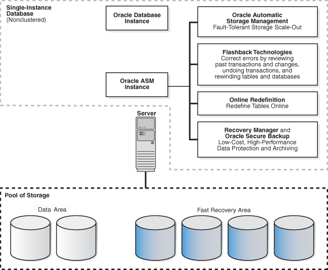
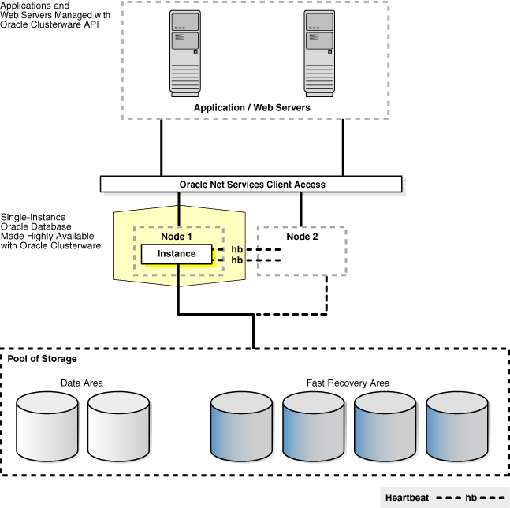
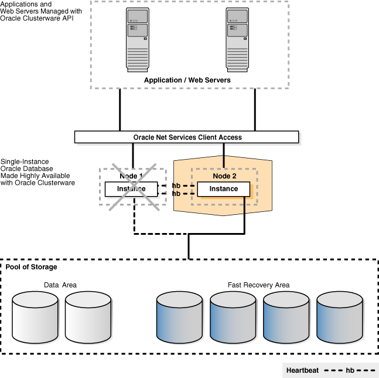
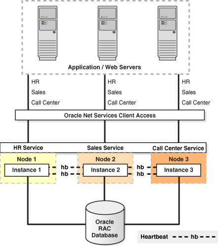
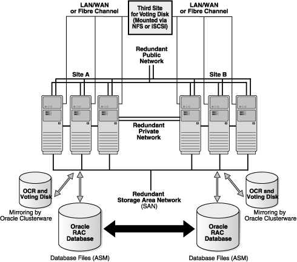
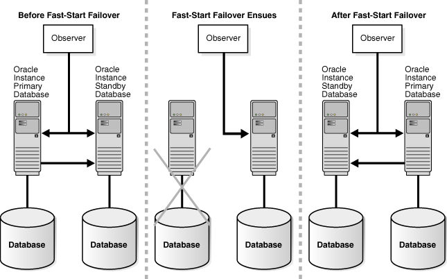
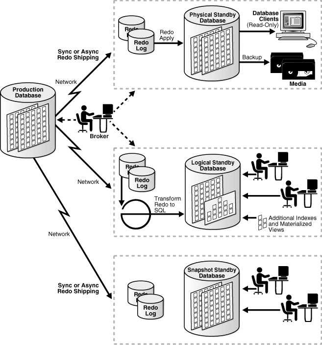
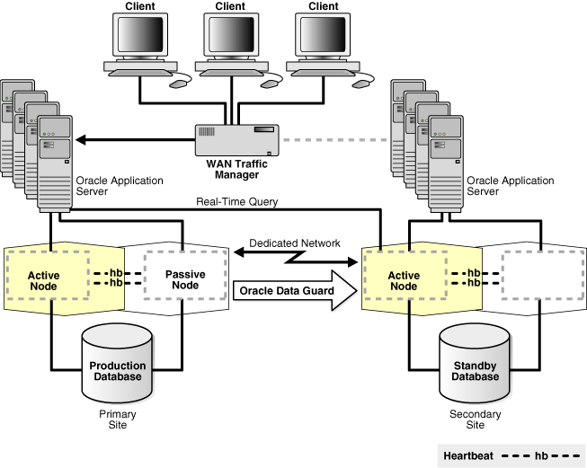
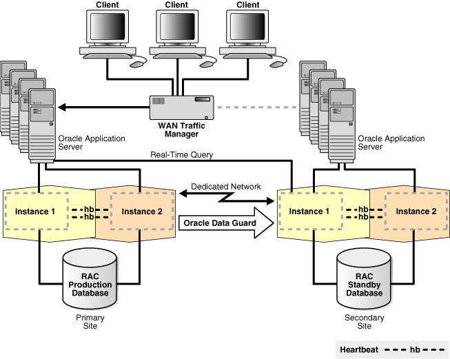

## 7 High Availability Architectures and Solutions

The Maximum Availability Architecture (MAA) is Oracle's best practices blueprint. It is based on proven Oracle high availability technologies and recommendations. The goal of the MAA is to remove the complexity in designing the optimal high availability architecture by providing configuration recommendations and tuning tips to optimize your architecture and Oracle features.

This chapter describes the various high availability architectures in an Oracle environment and helps you to choose the correct architecture for your organization.

It includes the following sections:

## 7.1 Oracle Database High Availability Architectures

The following sections provide an overview of Oracle Database high availability architectures and implement the MAA best practices:

- Oracle Database
- Oracle Database with Oracle Clusterware (Cold Cluster Failover)
- Oracle Database with Oracle RAC One Node
- Oracle Database with Oracle Real Application Clusters (Oracle RAC)
- Oracle Database with Oracle Data Guard
- Oracle Database with Oracle Clusterware and Oracle Data Guard
- Oracle Database with Oracle RAC One Node and Oracle Data Guard
- Oracle Database with Oracle RAC and Oracle Data Guard
- Oracle Database with Oracle GoldenGate

See Section 7.2 for a comparison of the different architectures and highlights of the benefits and considerations.

After you have chosen an architecture, then implement it using the operational and configuration best practices described in the MAA white papers and in Oracle Database High Availability Best Practices. These best practices are required to maximize the benefits of each architecture. See [Section 1.5, "Roadmap to Implementing the Maximum Availability Architecture (MAA)"](overview.md) for more information about the best practices documentation.

### 7.1.1 Oracle Database

Oracle Database is a single-instance, standalone (noncluster) database and it is the foundation for all high availability architectures. There are numerous high availability features that you can use in the Oracle Database single-instance database architecture.

Oracle recommends that you use the following Oracle features to make a standalone database on a single computer available for certain failures and planned maintenance activities:

- [Fast-Start Fault Recovery](unplanned.md) bounds and optimizes instance and database recovery times.
- [Oracle Restart](unplanned.md) enhances the availability of Oracle databases, listeners, and Oracle ASM instances in a single-instance environment by monitoring and automatically restarting Oracle processes.
- [Oracle Automatic Storage Management](unplanned.md) (Oracle ASM) and Oracle Automatic Storage Management Cluster File System (Oracle ACFS) tolerate storage failures and optimize storage performance and usage.
- [Oracle Flashback Technology](unplanned.md) optimizes logical failure repair. Oracle recommends that you use automatic undo management with sufficient space to attain your desired undo retention guarantee, enable Oracle Flashback Database, and allocate sufficient space and I/O bandwidth in the fast recovery area.
- [Fast Recovery Area](unplanned.md) manages local recovery-related files.
- [Recovery Manager](unplanned.md) (RMAN) optimizes local repair of data failures. Oracle recommends that you create and store the local backups in the fast recovery area.
- [Data Recovery Advisor](unplanned.md) provides intelligent advice and repair of different data failures
- [Oracle Secure Backup](unplanned.md) provides a centralized tape backup management solution
- [Oracle Security Features](unplanned.md) prevent unauthorized access and changes.
- [Corruption Prevention, Detection, and Repair](unplanned.md) detect and prevent some corruptions and lost writes.
- [Online Reorganization and Redefinition](planned.md) allows for dynamic data changes.
- [Dynamic Resource Provisioning](planned.md) allows for dynamic system changes.
- [Online Patching](planned.md) allows for dynamic database patches for diagnostic and interim patches.
- [Online Application Maintenance and Upgrades](planned.md) with Edition-based redefinition allows an application's database objects to be changed without interrupting the application's availability.
- Oracle Enterprise Manager support for patch application simplifies software maintenance

Figure 7-1 shows a basic, single-node Oracle Database that includes an Oracle ASM instance.<sup>Foot 1</sup> This architecture incorporates several high availability features, including Flashback Database, Online Redefinition, Recovery Manager, and Oracle Secure Backup.

Figure 7-1 Single-Node, Nonclustered Oracle Database with an Oracle ASM Instance



> This figure illustrates a single-instance, nonclustered Oracle Database configuration that includes an Oracle ASM instance and a pool of storage. Starting at the top of the figure, a box is labeled "Oracle Database Instance" and below that is another box labeled "ASM Instance" and to the left of these boxes is another label "Single-Instance Database (Nonclustered)." To the right of the box that represents the Oracle ASM Instance are four more boxes that are connected to each other and also to the Oracle ASM Instance box to signify that this configuration uses these particular Oracle high availability features:
>
> - Oracle Automatic Storage Management—Fault-Tolerant Storage Scale-Out
> - Flashback Technologies—Correct errors by reviewing past transactions, and changes, undoing transactions and rewinding tables and database
> - Online Redefinition—Redefine Tables Online
> - Recovery Manager and Oracle Secure Backup—Low-Cost, High-Performance Data Protection and Archiving
>
> At the bottom of the figure, directly below the "ASM Instance" box, is a picture of a single server with a line connecting the server to a row of disks with the label "Pool of Storage." The six disks in the pool of storage are contained in a dotted-line box. Within this dotted-line box, the two leftmost disks are labeled "Database Area" and the four disks to right are labeled "Fast Recovery Area."
  

### 7.1.2 Oracle Database with Oracle Clusterware (Cold Cluster Failover)

In Oracle Database 11g Release 2 (11.2), Oracle RAC One Node or Oracle RAC is the preferred solution over Oracle Clusterware (Cold Cluster Failover) because it is a more complete and feature-rich solution. See Section 7.1.3, "Oracle Database with Oracle RAC One Node" for more information.

[Section 3.4.1](unplanned.md) describes how Oracle Clusterware is software that, when installed on servers running the same operating system, enables the servers to be bound together to operate as if they are one server, and manages the availability of user applications and Oracle databases. The servers on which you want to run Oracle Clusterware must be running the same operating system.

Many high availability architectures today use clusters alone to provide some rudimentary node redundancy and automatic node failover. However, when you use Oracle Clusterware, there is no need or advantage to using third-party clusterware.

Oracle Clusterware provides a number of benefits over third-party clusterware. Oracle Clusterware:

- Enables you to use an entire software solution from Oracle, avoiding the cost and complexity of maintaining additional cluster software.
	By reducing the combinations of software that you must coordinate and support, you can increase the manageability and availability of your system software.
- Provides seamless integration with, and migration to, Oracle Real Application Clusters (Oracle RAC) and Oracle Data Guard.
	Section 7.1.8 describes how you can achieve the highest level of availability with Oracle RAC and Oracle Data Guard.
- Includes all of the features required for cluster management, including node membership, group services, global resource management, and high availability functions such as managing third-party applications, event management, and Oracle notification services that enable Oracle clients to reconnect to the new primary database after a failure.
- Uses a private network and voting disk-based communication to detect and resolve split-brain <sup>Foot 2</sup> scenarios.

With Oracle Clusterware, you can provide a cold cluster failover to protect an Oracle Database instance from a system or server failure. The basic function of a cold cluster failover is to monitor a database instance running on a server, and if a failure is detected, to restart the instance on a spare server in the cluster. Network addresses are failed over to the backup node. Clients on the network experience a period of lockout while the failover occurs and are then served by the other database instance after the instance has started. Also, you can use the Oracle Clusterware ability to relocate applications and application resources (using the `crsctl relocate resource` command) as a way to move the workload to another node so that you can perform planned system maintenance on the production server.

The cold cluster failover solution with Oracle Clusterware provides these additional advantages over a basic database architecture:

- Automatic recovery of node and instance failures in minutes
- Automatic notification and reconnection of Oracle integrated clients <sup>Foot 3</sup>
- Ability to customize the failure detection mechanism
	For example, you can use your favorite application query in the database check action. Providing application-specific failure detection means Oracle Clusterware can fail over not only during the obvious cases such as when the instance is down, but also in the cases when, for example, an application query is not meeting a particular service level.
- High availability functionality to manage third-party applications
- Rolling release upgrades of Oracle Clusterware

The operation of an Oracle Clusterware cold cluster failover is depicted in Figure 7-2 and Figure 7-3. These figures show how you can use the Oracle Clusterware framework to make both Oracle Database and your custom applications highly available.

Figure 7-2 shows a configuration that uses Oracle Clusterware to extend the basic Oracle Database architecture and provide cold cluster failover. In the figure, the configuration is operating in normal mode in which Node 1 is the active instance connected to Oracle Database that is servicing applications and users. Node 2 is connected to Node 1 and to Oracle Database, but it is currently standby mode.

Figure 7-2 Oracle Database with Oracle Clusterware (Before Cold Cluster Failover)



> This figure illustrates a clustered architecture in which both the applications and the Oracle database are managed by Oracle Clusterware for high availability.
>
> Starting at the top of the figure, two servers are in a box (outlined with a dotted line) that is labeled "Application/Web Servers.
>
> To the left of the servers is another label: "Applications and Web Servers Managed with Oracle Clusterware API." Both servers are connected to another box labeled "Oracle Net Services Client Access" and this box shows separate connections to two nodes:
>
> - Node 1 is in a yellow box and is also connected by a line to the "Pool of Storage" below, to indicate that the instance is actively servicing database requests from the applications.
> - Node 2 is not in a box and is outlined with a dotted line to indicate that this node is in standby mode. The node is not actively servicing application requests for this database.
>
> To the left of the nodes is another label: "Single-Instance Oracle Database Made Highly Available with Oracle Clusterware." A dotted line runs between Node 1 to Node 2 to indicate a heartbeat connection between the nodes.
>
> At the bottom of the figure directly below the nodes, is a single a row of disks with the label "Pool of Storage." The six disks in the pool of storage are contained in a dotted-line box. Within this dotted-line box, the two leftmost disks are labeled "Database Area" and the four disks to the right are labeled "Fast Recovery Area."
  

Figure 7-3 shows the Oracle Clusterware configuration after a cold cluster failover has occurred. In the figure, Node 2 is now the active instance connected to the Oracle database and servicing applications and users. Node 1 is connected to Node 2 and to the Oracle database, but Node 1 is currently idle, in standby mode.

To provide this transparent failover capability, Oracle Clusterware requires a virtual IP (VIP) address for each node in the cluster. With Oracle Clusterware, you also define an application VIP so that users can access the application independently of the node in the cluster where the application is running. You can define multiple application VIPs, with generally one application VIP defined for each application running. The application VIP is tied to the application by making it dependent on the application resource defined by Cluster Ready Services (CRS).

Figure 7-3 Oracle Database with Oracle Clusterware (After Cold Cluster Failover)



> This figure is similar to and is a companion of the previous cold cluster failover figure, because this figure illustrates the same multi-instance, clustered architecture after a failover has occurred.
>
> Starting at the top of the figure, two servers are in a box (outlined with a dotted line) that is labeled "Application/Web Servers."
>
> To the left of the servers is another label: "Applications and Web Servers Managed with Oracle Clusterware API." Both servers are connected to another box labeled "Oracle Net Services Client Access" and this box shows separate connections to two nodes:
>
> - Node 1 is not in a box and is outlined with a dotted line and crossed out with an X to indicate that this node and instance are in standby mode. The node is not actively servicing application requests for this database.
> - Node 2 is in an orange box and is also connected by a line to the "Pool of Storage" below, to indicate that the instance is actively servicing database requests from the applications.
>
> To the left of the nodes is another label: "Single-Instance Oracle Database Made Highly Available with Oracle Clusterware." A dotted line runs between Node 1 to Node 2 to indicate a heartbeat connection between the nodes.
>
> At the bottom of the figure, directly below the nodes is a single a row of disks with the label "Pool of Storage." The six disks in the pool of storage are contained in a dotted-line box. Within this dotted-line box, the two leftmost disks are labeled "Database Area" and the four disks to right are labeled "Fast Recovery Area."
  

Note:

Neither Oracle Enterprise Manager nor Oracle Universal Installer (OUI) provides configuration support for Oracle Clusterware. To configure an Oracle Clusterware environment, follow the step-by-step instructions in your platform-specific Oracle Clusterware installation guide.

### 7.1.3 Oracle Database with Oracle RAC One Node

Traditionally, Oracle RAC is used in a multinode architecture, with many separate database instances running on separate servers. Oracle RAC One Node allows you to run one instance of an Oracle RAC database on a single node in a cluster. Thus, this feature allows you to consolidate many databases into a single cluster for easier management, while still providing high availability by quickly relocating instances in the event of server failure.

If the node running your Oracle RAC One Node becomes overloaded, you can relocate the instance to another node in the cluster using the online database relocation utility (`srvctl relocate database`), with no downtime for application users.

You can allocate server resources to multiple instances using Oracle Database Resource Manager Instance Caging. Server scalability is unlimited, and if applications grow to require more resources than a single node can supply, you can perform an online upgrade to a traditional multinode Oracle RAC configuration.

The high availability benefits to using Oracle RAC One Node include the following:

- Offers better database availability than traditional cold failover solutions
- Provides better virtualization for databases than hypervisor-based solutions
- Enables online migration of database instances and online patching and upgrading of operating system and database software (incurring no downtime)
- Delivers a comprehensive, single-vendor solution, with no need to implement third-party products
- Is ready to scale and upgrade to multinode Oracle RAC
- Provides a standardized environment and a common toolset for both single-node and multinode Oracle database deployments
- Is less expensive than cold fail over solutions or a full Oracle RAC deployment
- Fully supports Oracle Data Guard. Any database in a Data Guard configuration, whether a primary or standby database, can be an Oracle One Node database.

For virtualization, Oracle RAC One Node with Oracle VM increases the benefit of Oracle VM with the high availability and scalability of Oracle RAC. If your VM is sized too small, you can migrate the Oracle RAC One instance to another larger Oracle VM node in the cluster (using the online database relocation utility) or move the Oracle RAC One instance to another Oracle VM node, and then resize the Oracle VM. When you move the Oracle RAC One Node instance to the newly resized Oracle VM node, you can dynamically increase any limits programmed with Resource Manager Instance Caging.

For more information, see the "Administering Oracle RAC One Node" section in the [Oracle Real Application Clusters Administration and Deployment Guide](https://docs.oracle.com/cd/E11882_01/rac.112/e41960/onenode.htm#RACAD7894).

### 7.1.4 Oracle Database with Oracle Real Application Clusters (Oracle RAC)

An architecture that combines Oracle Database with Oracle RAC is inherently a highly available system. Unlike a traditional monolithic database server that is expensive and is not flexible to changing capacity and resource demands, Oracle RAC combines the processing power of multiple interconnected computers to provide system redundancy, scalability, and high availability.

The clusters that are typical of Oracle RAC environments can provide continuous service for both planned and unplanned outages. Oracle RAC builds higher levels of availability on top of the standard Oracle Database features. All single-instance high availability features, such as the Flashback technologies and online reorganization, also apply to Oracle RAC. Applications scale in an Oracle RAC environment to meet increasing data processing demands without changing the application code. In addition, allowing maintenance operations to occur on a subset of components in the cluster while the application continues to run on the rest of the cluster can reduce planned downtime.

Oracle RAC exploits the redundancy that is provided by clustering to deliver availability with n - 1 node failures in an n-node cluster. Unlike the cold cluster model where one node is completely idle, all instances and nodes can be active to scale your application. Communication among the nodes is optimized by means of Redundant Interconnect Usage (without requiring the use of bonding or other technologies) to provide stability, reliability, and scalability.

Oracle Database with Oracle RAC architecture provides the following benefits over a traditional monolithic database server and the cold cluster failover model:

- Scalability across database instances
- Flexibility to increase processing capacity using commodity hardware without downtime or changes to the application
- Ability to tolerate and quickly recover from computer and instance failures (measured in seconds)
- Optimized communication in the cluster over redundant network interfaces, without using bonding or other technologies
	Oracle Grid Infrastructure and Oracle RAC make use of Redundant Interconnect Usage that distributes network traffic and ensures optimal communication in the cluster. This functionality is available starting with Oracle Database 11g Release 2 (11.2.0.2). In previous releases, technologies like bonding or trunking were used to make use of redundant networks for the interconnect.
- Rolling upgrades for system and hardware changes
- Rolling patch upgrades for some interim patches, security patches, CPUs, and cluster software
- Fast, automatic, and intelligent connection and service relocation and failover
- Comprehensive manageability integrating database and cluster features with Grid Plug and Play and policy-based cluster and capacity management
- Load balancing advisory and run-time connection load balancing help redirect and balance work across the appropriate resources
- Oracle Quality of Service (QoS) Management for policy-based run-time management of resource allocation to database workloads to ensure service levels are met in order of business need under dynamic conditions. This functionality is available starting with Oracle Database 11g Release 2 (11.2.0.2).
- Oracle Enterprise Management support for Oracle ASM and Oracle ACFS, Grid Plug and Play, Cluster Resource Management, Oracle Clusterware and Oracle RAC Provisioning and patching

Figure 7-4 shows Oracle Database with Oracle RAC architecture. This figure shows Oracle Database with Oracle RAC architecture for a partitioned three-node database. An Oracle RAC database is connected to three instances on different nodes. Each instance is associated with a service: HR, Sales, and Call Center. The instances monitor each other by checking "heartbeats." Oracle Net Services provide client access to the Application/Web server tier at the top of the figure

Figure 7-4 Oracle Database with Oracle RAC Architecture



> This figure is described in the preceding text.
>
> Copyright © 2005, 2013, Oracle and/or its affiliates. All rights reserved.  
> [Legal Notices](https://docs.oracle.com/cd/E11882_01/dcommon/html/cpyr.htm)
  

#### 7.1.4.1 Oracle Database with Oracle RAC on Extended Clusters

Oracle Database with Oracle RAC architecture is designed primarily as a scalability and availability solution that resides in a single data center. It is possible, under certain circumstances, to build and deploy an Oracle RAC system where the nodes in the cluster are separated by greater distances. This architecture is referred to as an extended cluster.

An Oracle RAC extended cluster is an architecture that provides extremely fast recovery from a site failure and allows for all nodes, at all sites, to actively process transactions as part of single database cluster. For example, for a business that has a corporate campus, the extended Oracle RAC configuration could consist of individual Oracle RAC nodes located in separate buildings. Oracle RAC on an extended cluster provides greater availability than a local Oracle RAC cluster, but an extended cluster may not completely fulfill the disaster recovery requirements of your organization.

When the two data centers are located relatively close to each other, extended clusters can provide great protection for some disasters, but not all. You should determine if both sites are likely to be affected by the same disaster. For example, if the extended cluster configuration is set up properly, it can protect against disasters such as a local power outage, an airplane crash, or a flooded server room. However, an extended cluster cannot protect against all data corruptions or specific data failures that impact the database, or against comprehensive disasters such as earthquakes, hurricanes, and regional floods that affect a greater geographical area. (For complete disaster recovery and data protection, use the architecture shown in Figure 7-8.)

The advantages to using Oracle RAC on extended clusters include:

- Ability to fully use all system resources without jeopardizing the overall failover times for instance and node failures
- Extremely rapid recovery if one site fails
- All of the Oracle RAC benefits listed in Section 7.1.4

Note:

Although an extended cluster architecture can be effective and has been successfully implemented, you should implement it only in the environments (involving the distance, latency, and degree of protection) recommended in this discussion.

Figure 7-5 shows an Oracle RAC extended cluster for a configuration that has multiple active instances on six nodes at two different locations: three nodes at Site A and three at Site B. The public and private interconnects, and the Storage Area Network (SAN) are all on separate dedicated channels, with each one configured redundantly. For availability reasons, the Oracle database is a single database that is mirrored at both of the sites. Also, to prevent a full cluster outage if either site fails, the configuration includes a third voting disk on an inexpensive, low-end standard network file system (NFS) mounted device.

Figure 7-5 Oracle RAC Extended Cluster



> This figure shows Oracle RAC on an extended distance cluster. The configuration shows three nodes at each of two different locations, Site A and Site B. Below each site, a double-sided arrow links a disk labeled "Oracle RAC Database" to the site above it. Below each database is another disk that contains the Oracle Cluster Registry (OCR)" and "Voting Disk." An arrow between the disk drums indicates that Oracle ASM is used to store the database files.In the center of the figure above Sites A and B is a simple box that represents a third site. The box contains this label: "Third Site for Voting Disk (Mounted by NFS or iSCSI)." All nodes are connected by a redundant public network, a redundant private network, and a redundant storage area network (SAN).
  

See Also:

- Oracle Database High Availability Best Practices for information about configuring Oracle Database 11g with Oracle RAC on extended clusters
- White papers about extended (stretch) clusters and about using standard NFS to support a third voting disk on an extended cluster configuration at `http://www.oracle.com/technetwork/database/clustering/overview/`

### 7.1.5 Oracle Database with Oracle Data Guard

Oracle Data Guard is a high availability and disaster-recovery solution that provides very fast automatic failover (referred to as fast-start failover) in database failures, node failures, corruption, and media failures. Furthermore, the standby databases can be used for read-only access and subsequently for reader farms, for reporting, and for testing and development.

Although traditional solutions (such as backup and recovery from tape, storage-based remote mirroring, and database log shipping) can deliver some level of high availability, Oracle Data Guard provides the most comprehensive high availability and disaster recovery solution for Oracle databases.

Oracle Data Guard Advantages Over Traditional Solutions

Oracle Data Guard provides a number of advantages over traditional solutions, including the following:

- Fast, automatic or automated database failover for data corruptions, lost writes, and database and site failures
- Automatic corruption repair automatically replaces a corrupted block on the primary or physical standby by copying a good block from a physical standby or primary database
- Most comprehensive protection against data corruptions and lost writes on the primary database
- Reduced downtime for storage, Oracle ASM, Oracle RAC, system migrations and some platform migrations, and changes using Data Guard switchover
- Reduced downtime with Oracle Data Guard rolling upgrade capabilities
- Ability to off-load primary database activities—such as backups, queries, or reporting—without sacrificing the RTO and RPO ability to use the standby database as a read-only resource using the real-time query apply lag capability
- Ability to integrate non-database files using Oracle Database File System (DBFS) as part of the full site failover operations
- No need for instance restart, storage remastering, or application reconnections after site failures
- Transparency to applications
- Transparent and integrated support for application failover
- Effective network utilization

For data resident in Oracle databases, Oracle Data Guard, with its built-in zero-data-loss capability, is more efficient, less expensive, and better optimized for data protection and disaster recovery than traditional remote mirroring solutions. Oracle Data Guard provides a compelling set of technical and business reasons that justify its adoption as the disaster recovery and data protection technology of choice, over traditional remote mirroring solutions.

Oracle Data Guard Advantages Compared to Remote Mirroring Solutions

The following list summarizes the advantages of using Oracle Data Guard compared to using remote mirroring solutions:

- Better network efficiency—With Oracle Data Guard, only the redo data needs to be sent to the remote site and the redo data can be compressed to provide even greater network efficiency. However, if a remote mirroring solution is used for data protection, typically you must mirror the database files, the online redo log, the archived redo logs, and the control file. If the fast recovery area is on the source volume that is remotely mirrored, then you must also remotely mirror the flashback logs. Thus, compared to Oracle Data Guard, a remote mirroring solution must transmit each change many more times to the remote site.
- Better performance—Oracle Data Guard only transmits write I/Os to the redo log files of the primary database, whereas remote mirroring solutions must transmit these writes and every write I/O to data files, additional members of online log file groups, archived redo log files, and control files.
	Oracle Data Guard is designed so that it does not affect the Oracle database writer (DBWR) process that writes to data files, because anything that slows down the DBWR process affects database performance. However, remote mirroring solutions affect DBWR process performance because they subject all DBWR process write I/O's to network and disk I/O induced delays inherent to synchronous, zero-data-loss configurations.
	Compared to mirroring, Oracle Data Guard provides better performance and is more efficient, Oracle Data Guard always verifies the state of the standby database and validates the data before applying redo data, and Oracle Data Guard enables you to use the standby database for updates while it protects the primary database.
- Better suited for WANs—Remote mirroring solutions based on storage systems often have a distance limitation due to the underlying communication technology (Fibre Channel or ESCON (Enterprise Systems Connection)) used by the storage systems. In a typical example, the maximum distance between the systems connected in a point-to-point fashion and running synchronously can be only 10 kilometers. By using specialized devices, this distance can be extended to 66 kilometers. However, when the data centers are located more than 66 kilometers apart, you must use a series of repeaters and converters from third-party vendors. These devices convert ESCON or Fibre Channel to the appropriate IP, ATM, or SONET networks.
- Better resilience and data protection—Oracle Data Guard ensures much better data protection and data resilience than remote mirroring solutions. This is because corruptions introduced on the production database probably can be mirrored by remote mirroring solutions to the standby site, but corruptions are eliminated by Oracle Data Guard.
	For example, if a stray write occurs to a disk, or there is a corruption in the file system, or the host bus adaptor corrupts a block as it is written to disk, then a remote mirroring solution may propagate this corruption to the disaster-recovery site. Because Oracle Data Guard only propagates the redo data in the logs, and the log file consistency is checked before it is applied, all such external corruptions are eliminated by Oracle Data Guard. Automatic block repair may be possible, thus eliminating any downtime in an Oracle Data Guard configuration.
- Higher flexibility—Oracle Data Guard is implemented on pure commodity hardware. It requires only a standard TCP/IP-based network link between the two computers. There is no fancy or expensive hardware required. It also allows the storage to be laid out in a different fashion from the primary computer. For example, you can put the files on different disks, volumes, file systems, and so on.
- Better functionality—Oracle Data Guard provides full suite of data protection features that provide a much more comprehensive and effective solution optimized for data protection and disaster recovery than remote mirroring solutions. For example: Active Data Guard, Redo Apply for physical standby databases, and SQL Apply for logical standby databases, multiple protection modes, push-button automated switchover and failover capabilities, automatic gap detection and resolution, GUI-driven management and monitoring framework, cascaded redo log destinations.
- Higher ROI—Businesses must obtain maximum value from their IT investments, and ensure that no IT infrastructure is sitting idle. Oracle Data Guard is designed to allow businesses get something useful out of their expensive investment in a disaster-recovery site. Typically, this is not possible with remote mirroring solutions.

The recommended high availability and disaster-recovery architectures that use Oracle Data Guard are described in the following sections:

- Overview of Single Standby Database Architectures
- Overview of Multiple Standby Database Architectures
- Oracle Data Guard (Standby) Hub

#### 7.1.5.1 Overview of Single Standby Database Architectures

A single standby database architecture consists of the following key traits and recommendations:

- Primary database resides in Site A.
- Standby database resides in Site B. If zero data loss is required with minimum performance impact on the primary database, then the best practice is to locate the secondary site within 200 miles of the primary database. Note, however, that the synchronous redo transport does not impose any physical distance limitation.
- Fast-start failover is recommended to provide automatic failover without user intervention and bounded recovery time. If the primary database uses the asynchronous redo transport, configure your maximum data loss tolerance or the Oracle Data Guard broker's `FastStartFailoverLagLimit` property to meet your business requirements. The observer (thin client watchdog) resides in the application tier and monitors the availability of the primary database. See [Oracle Data Guard Broker](https://docs.oracle.com/cd/E11882_01/server.112/e40771/toc.htm) for a detailed description of the observer.
- Use a physical standby database if read-only access is sufficient.
- Evaluate logical standby databases if additional indexes are required for reporting purposes and if your application only uses data types supported by logical standby database and SQL Apply.

Figure 7-6 shows the relationships between the primary database, target standby database, and the observer before, during, and after a fast-start failover. The figure shows the same Oracle Data Guard configuration in three different frames, as described in the following list:

1. The leftmost frame shows the configuration before fast-start failover occurs. Oracle Data Guard is operating in a steady state, with the primary database transmitting redo data to the target standby database and the observer monitoring the state of the entire configuration.
2. The center frame shows the configuration during fast-start failover. Disaster strikes the primary database, and its network connections to both the observer and the target standby database are lost. Upon detecting the break in communication, the observer attempts to reestablish a connection with the primary database for the amount of time defined by the `FastStartFailoverThreshold` property before initiating a fast-start failover. If the observer is unable to regain a connection to the primary database within the specified time, and the target standby database is ready for fast-start failover, then fast-start failover ensues.
3. The rightmost frame shows the configuration after fast-start failover has occurred. The fast-start failover has completed and the target standby database is running in the primary database role. After the former primary database has been repaired, the observer reestablishes its connection to that database and reinstates it as a new standby database. The new primary database starts transmitting redo data to the new standby database.

Figure 7-6 Primary and Standby Databases and the Observer During Fast-Start Failover



> This figure is described in the preceding text.
>
> Copyright © 2005, 2013, Oracle and/or its affiliates. All rights reserved.  
> [Legal Notices](https://docs.oracle.com/cd/E11882_01/dcommon/html/cpyr.htm)
  

The following list describes examples of Oracle Data Guard configurations using single standby databases:

- A national energy company uses a standby database located in a separate facility 10 miles away from its primary data center. Outages or data loss that could affect customer service and safety are avoided by using Oracle Data Guard synchronous transport and automatic failover (fast-start failover).
- An infrastructure services provider to the telecommunication industry uses a single standby database located over 400 miles away from the primary database configured for synchronous redo transport, enabling zero-data-loss failover for maximum data protection and high availability.
- A telecommunications provider uses asynchronous redo transport to synchronize a primary database on the West Cost of the United States, with a standby database on the East Coast, over 3,000 miles away. This scenario enables the provider to use existing data centers that are geographically isolated, offering a unique level of high availability.
- A global manufacturing company used Oracle Data Guard to replace storage-based remote mirroring and maintain a standby database at its recovery site 50 miles away from the primary site. Oracle Data Guard provides more comprehensive data protection and its more efficient network usage allows plenty of room to grow without the expense of upgrading its network.

#### 7.1.5.2 Overview of Multiple Standby Database Architectures

This architecture is identical to the single-standby database architecture that was described in Section 7.1.5.1, except that there are multiple standby databases in the same Oracle Data Guard configuration. The following list describes some implementations for a multiple standby database architecture:

- Continuous and transparent disaster or high availability protection if an outage occurs at the primary database or the targeted standby database
- Reader farms or lookup databases
- Reporting databases
- Regional reporting or reader databases for better response time
- Synchronous redo transport that transmits to a more local standby database, and asynchronous redo transport that transmits to a more remote standby database for optimum levels of performance and data protection
- Transient logical standby databases (described in [Section 3.6.3](unplanned.md)) for minimal downtime rolling upgrades
- Test and development clones using snapshot standby databases (described in [Section 3.6.4](unplanned.md))
- Scaling the configuration by creating additional logical standby databases or snapshot standby databases

Figure 7-7 shows the production database at the primary site and multiple standby databases at secondary sites. The figure shows Oracle Database with Oracle Data Guard architecture.

The production database is connected over the network to the physical standby database site and the logical standby database site (the standby databases may be at the same or different sites). The Oracle Data Guard broker communicates with the production database, the physical standby database, and the logical standby database.

The production database transmits redo data (either synchronously or asynchronously) to redo log files at the physical standby database. Then, the redo data is applied from the logs to the physical standby database, which backs up the redo data to physical media.

At the logical standby database, the redo data is transformed into SQL statements, which are applied to the logical standby database. The logical standby database may contain additional indexes and materialized views. Clients are connected to the logical standby database and can work with its data.

At the snapshot standby database redo data is received, but it is not applied until the snapshot standby database is reconverted to a physical standby database. The figure shows users making local updates to the snapshot standby database. These updates are discarded when the snapshot database is reconverted to a physical standby database.

Also, see [Figure 5-2](grid.md) for another example of a multiple standby database environment.

Figure 7-7 Oracle Database with Oracle Data Guard on Primary and Multiple Standby Sites



> The figure is described in the preceding text.
>
> Copyright © 2005, 2013, Oracle and/or its affiliates. All rights reserved.  
> [Legal Notices](https://docs.oracle.com/cd/E11882_01/dcommon/html/cpyr.htm)
  

See Also:

- [Oracle Data Guard Concepts and Administration](https://docs.oracle.com/cd/E11882_01/server.112/e41134/toc.htm) for more information about the various types of standby databases and to find out what data types are supported by logical standby databases
- Oracle Database High Availability Best Practices for configuration best practices
- The "Managing Data Guard Configurations Having Multiple Standby Databases - Best Practices" white paper, and other Oracle Data Guard white papers at
	`http://www.oracle.com/goto/maa`

The following list describes examples of Oracle Data Guard configurations using multiple standby databases:

- A world-recognized financial institution uses two remote physical standby databases for continuous data protection after failover. If the primary system should fail, the first standby database becomes the new primary database. The second standby database automatically receives data from the new primary database, insuring that data is protected at all times.
- A nationally recognized insurance provider in the U.S. maintains two standby databases in the same Oracle Data Guard configuration: one physical standby and one logical standby database. Their strategy further mitigates risk by maintaining multiple standby databases, each implemented using a different architectures—Redo Apply and SQL Apply.
- A world-recognized e-commerce site uses multiple standby databases—a mix of both physical and logical databases—both for disaster recovery and to scale out read performance by provisioning multiple logical standby databases using SQL Apply.
- A global provider of information services to legal and financial institutions uses multiple standby databases in the same Oracle Data Guard configuration to minimize downtime during major database upgrades and platform migrations.

Also, for large data centers with a need to support many applications with Oracle Data Guard requirements, you can build an Oracle Data Guard hub to reduce the total cost of ownership.

#### 7.1.5.3 Oracle Data Guard (Standby) Hub

With Database Server Grid and Database Storage Grid (described in [Section 5.2](grid.md) and [Section 5.3](grid.md)), you can build standby database and testing hubs that use a pool of system resources. The system resources can be dynamically allocated and deallocated depending on various priorities. For example, if the primary database fails over to one of the standby databases in the Data Guard hub, the new primary database acquires more system and storage resources while the testing resources may be temporarily starved. With the Oracle Grid technologies, you can enable a high level of usage and low TCO without sacrificing business requirements.

An Oracle Data Guard hub can consist of:

- Several standby databases in an Oracle RAC environment residing in a cluster of servers, called a grid server
- Using the storage grid

The premise of the Data Guard hub is that it provides higher utilization with lower cost. The probability of failing over all databases at the same time is unlikely. Thus, when a failover occurs, you can prioritize the system resources to production activity and allocate new system resources in a grid for the standby database functions. At the time of role transition, more storage and system resources can be allocated toward that application.

For example, an Oracle Data Guard hub could include multiple databases and applications that are supported in a grid server and storage architecture. This configuration consists of a central resource supporting 10 applications and databases in the grid, rather than managing 10 separate system or storage units in a nongrid infrastructure.

Another possible configuration might be a testing hub consisting of snapshot standby databases. With the snapshot standby database hub, you can use the combined storage and server resources of a grid instead of building and managing individual servers for each application.

### 7.1.6 Oracle Database with Oracle Clusterware and Oracle Data Guard

If your business does not require the scalability and additional high availability benefits provided by Oracle RAC, but you still need all the benefits of Oracle Data Guard and cold cluster failover, then Oracle Database with Oracle Clusterware and Oracle Data Guard is a good compromise architecture. Oracle Clusterware cold cluster failover combined with Oracle Data Guard makes a tightly integrated solution in which failover to the secondary node in the cold cluster failover is transparent and does not require you to reconfigure the Oracle Data Guard environment or perform additional steps.

Figure 7-8 shows an Oracle Clusterware and Oracle Data Guard architecture that consists of a primary and a secondary site. Both the primary and secondary sites contain Oracle Application Servers, two database instances, and an Oracle database.

Figure 7-8 Oracle Clusterware (Cold Cluster Failover) and Oracle Data Guard



> This figure shows an Oracle Clusterware and Oracle Data Guard architecture that consists of a primary and a secondary site. At the top of the figure are three clients sending requests through the WAN traffic manager to several application servers on the primary site.
>
> On the left side of the figure, the primary site contains an Oracle application server, two database nodes (active and passive), and an Oracle database. The secondary site on the right side of the figure contains a similar configuration, but the application servers are connected to the WAN traffic manager by a dotted line to indicate that they are not actively processing client requests at this time. A dedicated network connects the primary site and the standby site. An arrow pointing from the primary site to the standby site indicates that Oracle Data Guard is transmitting redo data from the primary database to the standby to keep the standby database synchronized transactionally. Another line goes from the primary site application servers to the active node on the standby site to indicate that real-time queries are occurring.
>
> Oracle Clusterware is not shown in the figure because the Oracle Clusterware software transparently enables servers to operate as one server and manages the availability of user applications and Oracle databases.
  

In Figure 7-8:

- The application servers on the secondary site are connected to the WAN traffic manager by a dotted line to indicate that they are not actively processing client requests at this time. (The application server on the secondary site can be active and processing client requests such as queries if the standby database is a physical standby database with the Active Data Guard option enabled, or if it is a logical standby database.)
- Oracle Data Guard transmits redo data from the primary database to the secondary site to keep the databases synchronized.
- Oracle Clusterware manages the availability of both the user applications and Oracle databases.
- Oracle Clusterware provides tolerance of node failures, whereas Oracle Data Guard provides additional protection against data corruptions, lost writes, and database and site failures. (See Section 7.1.5 for a complete description.)
- Although cold cluster failover is not shown in Figure 7-8, you can configure it by adding a passive node on the secondary site.

### 7.1.7 Oracle Database with Oracle RAC One Node and Oracle Data Guard

Oracle RAC One Node provides relocation of Oracle RAC primary and standby databases configured with Oracle Data Guard (This functionality is available starting with Oracle Database 11g Release 2 (11.2.0.2)). Any database in a Data Guard configuration, whether a primary or standby database, can be an Oracle RAC One Node database.

For more information see the MAA white paper "Rapid Oracle RAC One Node Standby Deployment" at

`http://www.oracle.com/goto/maa`

### 7.1.8 Oracle Database with Oracle RAC and Oracle Data Guard

You can achieve the highest level of availability when using Oracle RAC and Oracle Data Guard and there is no need to make application changes to use these Oracle Database features. The combination of Oracle RAC and Oracle Data Guard provide the most comprehensive architecture for reducing downtime for scheduled outages and preventing, detecting, and recovering from unscheduled outages. This architecture is the recommended configuration for Maximum Availability Architecture (MAA).

To protect against site failures, the MAA recommends that Oracle RAC and Oracle Data Guard reside on separate systems (clusters) and data centers. Figure 7-9 shows the recommended MAA configuration, with Oracle Database, Oracle RAC, and Oracle Data Guard. Configuring symmetric sites is recommended to ensure that each site can accommodate the performance and scalability requirements of the application after any role transition. Furthermore, operational practices across role transitions are simplified when the sites are symmetric.

Figure 7-9 Oracle Database with Oracle RAC and Oracle Data Guard - MAA



> This illustration shows the Maximum Availability Architecture (MAA). The MAA architecture consists of identical primary and secondary sites.
>
> The primary site contains storage on an Oracle RAC database, two Oracle RAC database instances, and an Oracle Application Server. The secondary site is identical except that it is connected to the WAN traffic manager by a dotted line to indicate that the secondary site is not actively handling application requests at this time.
>
> A dedicated network connects the primary site and the standby site. Oracle Data Guard transmits redo data from the primary site to the secondary site. A WAN traffic manager handles communication between the application servers on the primary and secondary sites. Clients send requests through the WAN traffic manager.
  

### 7.1.9 Oracle Database with Oracle GoldenGate

Similar to using Oracle Data Guard in SQL Apply mode, Oracle GoldenGate can capture database changes, propagate them to destinations, and apply the changes at these destinations. Oracle GoldenGate is optimized for replicating data. Oracle GoldenGate can capture changes at a source database, and the captured changes can be propagated asynchronously to replica databases. A logical copy configured and maintained using Oracle GoldenGate is called a replica, not a logical standby database, because it provides many capabilities that are beyond the scope of the normal definition of a standby database.

You might choose to use Oracle GoldenGate to configure and maintain a logical copy of your production database. Although using Oracle GoldenGate might require additional work, it offers increased flexibility that might be necessary to meet specific business requirements.

Oracle Database with Oracle GoldenGate provides granularity and control over what is replicated and how it is replicated. It supports bidirectional replication, data transformations, subsetting, custom apply functions, and heterogeneous platforms. It also gives users complete control over the routing of change records from the primary database to a replica database. Oracle GoldenGate can capture data changes at the primary database or downstream at a replica database, thus enabling users to build hub-and-spoke network configurations that can support hundreds of replica databases.

Consider using Oracle Database with Oracle GoldenGate if one or more of the following conditions are true:

- Updates are required on both sites or databases, and the changes must be propagated bidirectionally.
- Site configurations are on heterogeneous platforms.
- Different character sets are required between the primary database and its replicas.
- Fine control of information and data sharing are required.
- More investment and expertise to build and maintain an integrated high availability solution is available.

For more information about constructing multiple-source replication environments, see the Oracle GoldenGate documentation.

You can configure Oracle GoldenGate with Oracle Data Guard to provide protection for the individual databases in the configuration.

## 7.2 Choosing the Correct High Availability Architecture

This section summarizes the advantages of the different high availability architectures and provides guidelines for you to choose the correct high availability architecture for your business.

[Chapter 2](hadesign.md) describes how the high availability requirements for the business plus its allotted budget determine the appropriate architecture. The key factors include:

- Recovery time objective (RTO) and recovery point objective (RPO) for unplanned outages and planned maintenance
- Management overhead (MO)
- Total cost of ownership (TCO) and return on investment (ROI)

For example, Table 7-1 provides some insight into the probability of different outages during unplanned and planned activities. The data is derived from actual user experiences and from Oracle service requests.

Table 7-1 Frequency of Outages

| Activity | Outage Frequency |
| --- | --- |
| Media or disk failures | High |
| Application patches | High |
| Application failures | High |
| Logical or user failures that manipulate logical data (DMLs and DDLs) | High |
| Data corruptions and lost writes | Medium |
| Computer failures | Medium |
| Database patches | Medium |
| Hardware patches and upgrades | Low |
| Operating system patches and upgrades | Low |
| Database or application upgrades | Low |
| Database failures | Low |
| Platform migrations | Very low |
| Site failures | Very low |

Table 7-2 recommends architectures based on your business requirements for RTO, RPO, MO, scalability, and other factors.

Table 7-2 High Availability Architecture Recommendations

| Consider Using... | Business or Application Impact... |
| --- | --- |
| Oracle Database with Oracle Clusterware (Cold Cluster Failover) | - Maximum RTO for instance or node failure is in minutes. - MO is low. - ROI is low. - RPO is zero. - Rolling upgrade and patch capabilities for Oracle Clusterware with zero database downtime. |
| Oracle Database with Oracle RAC One Node | - Maximum RTO for instance or node failure is in seconds. - MO is low. - ROI is medium. - RPO is zero. - Online relocation. - All Oracle RAC nodes can be active by implementing multiple Oracle RAC One Node configurations for different databases. - Zero downtime when using the provisioning capability in Oracle Enterprise Manager Grid Control. - Rolling upgrade for system, clusterware, operating system, CPUs, and some Oracle interim patches. |
| Oracle Database with Oracle Real Application Clusters (Oracle RAC) | - Maximum RTO for instance or node failure is zero for the database <sup>Footref 1</sup>. - MO is medium. - ROI is high. - RPO is zero. - Run-time performance level management with Oracle Database Quality of Service Management (This functionality is available starting with Oracle Database 11g Release 2 (11.2.0.2)). - Zero downtime when using the provisioning capability in Oracle Enterprise Manager Grid Control. - Rolling upgrade for system, clusterware, operating system, CPUs, and some Oracle interim patches. - Database scalability beyond one instance or node. |
| Oracle Database with Oracle RAC on Extended Clusters | - All of the business benefits of Oracle RAC. - MO is high <sup>Foot 1</sup> . - ROI is medium. - RPO is zero. - Additional protection from data center failure with special considerations that are documented in Section 7.1.4.1 - Highest level of availability for server or computer room failure - High availability benefits and workload balancing outweigh performance concerns. - Willing to make additional provisions for remote data protection to protect against database, data, and cluster failures and corruptions |
| Oracle Database with Oracle Data Guard | - Maximum RTO for instance or node failure is in seconds to minutes. - Maximum RTO for data corruptions, database, or site failures is in seconds to minutes. - Choice of RPO equal to zero (SYNC) or near-zero (ASYNC). - MO is low. - ROI is high. - Rolling upgrade for system, clusterware, database, and operating system - Off-load read-only, reporting, testing and backup activities to the standby database. - Limited support for mixed platforms. For more information, see "Data Guard Support for Heterogeneous Primary and Physical Standbys in Same Data Guard Configuration" in My Oracle Support Note at 	`https://support.oracle.com/CSP/main/article?cmd=show&type=NOT&id=413484.1`  For physical standby databases, this solution:  - Supports very high primary database throughput. - Provides the simplicity of a physical replica. - Provides maximum protection from physical corruptions. - Provides read-only access to synchronized standby database and fast incremental backups to off-load production  For logical standby databases, this solution:  - Provides the simplest form of one-way logical replication - Allows for structural changes to the standby database, such as changes to local tables, adding schemas, indexes, and materialized views - Off-loads production by providing read-only access to a synchronized standby database and allows read/write access to local tables that are not being modified by the primary database |
| Oracle Database with Oracle Clusterware and Oracle Data Guard | - All of the business benefits of Oracle Clusterware (cold cluster failover) and Oracle Data Guard - MO is low. - ROI is medium. - RPO is zero for cluster failover, choice of RPO equal to zero for database failover (Data Guard SYNC), or near-zero (Data Guard ASYNC). |
| Oracle Database with Oracle RAC and Oracle Data Guard | - All of the business benefits of Oracle RAC and Oracle Data Guard - MO is medium. - ROI is high. - RPO is zero for cluster failover, choice of RPO equal to zero for database failover (Data Guard SYNC), or near-zero (Data Guard ASYNC). |
| Oracle Database with Oracle GoldenGate | - Maximum RTO for instance or node failure is in seconds to minutes. - Maximum RTO for data corruption, cluster, database, or site failures is in seconds to minutes. - RPO is near-zero (asynchronous). - MO is high <sup>Footref 1</sup>. - ROI is high. - Rolling upgrade for system, clusterware, operating system, database, and application. - Support for bidirectional replication and updating anything and anywhere. - Support for heterogeneous platforms, versions, and character sets. - Support for fine-grained, n-way multimaster, hub-and-spoke, or many-to-one replication architectures. - Flexible propagation and management of data, transactions, and events. - With Oracle RAC integration, database scalability is possible. |

<sup>Footnote 1</sup> Architectures for which the MO is high might require additional time and expertise to build and maintain, but offer increased flexibility and capabilities required to meet specific business requirements.

Table 7-3 identifies the additional capabilities provided by the architectures that build on Oracle Database and attempts to label each architecture with its greatest strengths.

Table 7-3 Additional Capabilities of High Level Oracle High Availability Architectures

| Oracle High Availability Architecture | Key Characteristics and Additional Capabilities |
| --- | --- |
| Oracle Database (Base Architecture)  The foundation for all high availability architectures | - [Fast-Start Fault Recovery](unplanned.md) bounds and optimizes instance and database recovery times to minutes. - [Oracle Restart](unplanned.md) enhances the availability of Oracle databases, listeners, and Oracle ASM instances in a single-instance environment by monitoring and automatically restarting Oracle processes. - [Oracle Automatic Storage Management](unplanned.md) and Oracle Automatic Storage Management Cluster File System (Oracle ACFS) tolerate storage failures and optimize storage performance and utilization. - [Oracle Flashback Technology](unplanned.md) optimizes logical failure repair. - [Recovery Manager](unplanned.md) optimizes local repair of data failures using local backups. - [Fast Recovery Area](unplanned.md) manages local recover-related files automatically. - [Oracle Secure Backup](unplanned.md) provides a centralized tape backup management solution. - [Oracle Security Features](unplanned.md) prevent unauthorized access and changes. - [Data Recovery Advisor](unplanned.md) diagnoses persistent (on disk) data failures, presents appropriate repair options, and runs repair operations at your request. Support is for single-instance databases only. - [Corruption Prevention, Detection, and Repair](unplanned.md) detect and prevent some corruptions and lost writes. - [Online Reorganization and Redefinition](planned.md) allows for dynamic data changes. - [Dynamic Resource Provisioning](planned.md) allows for dynamic system changes. - [Online Patching](planned.md) allows for dynamic database patching of typical diagnostic patches. - [Online Application Maintenance and Upgrades](planned.md) with Edition-based redefinition allows an application's database objects to be changed without interrupting the application's availability - Oracle Enterprise Manager support for patch application simplifies software maintenance |
| Oracle Database with Oracle Clusterware (Cold Cluster Failover) | - All of the benefits of Oracle Database - Automatic and fast failover for computer failure - Minimum rolling upgrade capabilities for system, clusterware, and operating system <sup>Footref 1</sup> |
| Oracle Database with Oracle Real Application Clusters (Oracle RAC)  High availability, scalability, and foundation of server database grids | - All of the benefits of Oracle Database - Scalability beyond a single system - Automatic recovery of failed nodes and instances - Fast application notification (FAN) with integrated Oracle client failover - FAN with integrated Oracle client failover for pooled resources and third-party vendor middle tiers - FAN with integrated Oracle client failover, including Java applications using UCP with Oracle RAC and Oracle Data Guard. Applications can easily mask failures to the end user. - Run-time performance level management with Oracle Database Quality of Service Management (This functionality is available starting with Oracle Database 11g Release 2 (11.2.0.2)) - Zero downtime with Grid Control provisioning - Rolling upgrade for system, clusterware, operating system, CPUs, and some Oracle interim patches <sup>Foot 1</sup> |
| Oracle Database with Oracle RAC on Extended Clusters  Database Grid with site failure protection | - All of the benefits of Oracle Database - Protection from site failure |
| Oracle Database with Oracle Data Guard  Simplest high availability, data protection, and disaster-recovery solution | - All of the benefits of Oracle Database - Automatic and fast failover for computer failure, storage failure, data corruption, for configured `ORA-` errors or conditions and database failures - Protection from site failure - Rolling upgrade for system, clusterware, database, and operating system <sup>Foot 2</sup> - Ability to off-load backups to the standby database - Ability to off-load read and reporting workload to the standby database - Only comprehensive lost write protection |
| Oracle Database with Oracle Clusterware and Oracle Data Guard  High availability solution with added data and disaster recovery protection. | - The sum of benefits of Oracle Clusterware with Oracle Data Guard |
| Oracle Database with Oracle RAC and Oracle Data Guard  Best high availability, data protection, and disaster-recovery solution with scalability built in | - The sum of benefits of Oracle RAC with Oracle Data Guard |
| Oracle Database with Oracle GoldenGate <sup>Foot 3</sup>  Bidirectional replication and information management | - Replica database (or databases) available for read/write use - Heterogeneous platform support - Fast failover for computer failure and storage failure - Protection from site failure - Minimum downtime for computer or site maintenance and database and application upgrades |

<sup>Footnote 1</sup> Rolling upgrades with Oracle Clusterware and Oracle RAC incur zero downtime.

<sup>Footnote 2</sup> Rolling upgrades with Oracle Data Guard incur minimal downtime.

<sup>Footnote 3</sup> The initial investment to build a robust solution is well worth the long-term flexibility and capabilities that Oracle GoldenGate delivers to meet specific business requirements.

Table 7-4 shows the recovery time (including detection and client failover time) of an integrated Oracle client, whenever relevant. You should adopt the MAA best practices to achieve the optimal recovery time and configuration. Oracle High Availability Best Practice recommendations can be found in Oracle Database High Availability Best Practices and in the white papers that can be downloaded from

```
http://www.oracle.com/goto/maa
```

Table 7-4 Attainable Recovery Times for Unplanned Outages

| Outage Type | Oracle Database | Cold Cluster | Oracle RAC and Oracle RAC on Extended Clusters | Oracle Data Guard | Oracle RAC and Oracle Data Guard | Oracle GoldenGate |
| --- | --- | --- | --- | --- | --- | --- |
| Site failure | Hours to days | Hours to days | No downtime <sup>Footref 4</sup> if the outage is limited to one building  Hours to days if the outage affects both building | Seconds to a minute <sup>Foot 1</sup> | Seconds to a minute <sup>Footref 1</sup> | No downtime <sup>Foot 2</sup> |
| Computer failure | Minutes to hours <sup>Foot 3</sup> | Minutes | No downtime <sup>Foot 4</sup> | Seconds to a minute | No downtime <sup>Footref 4</sup> | No downtime <sup>Footref 4</sup> |
| Storage failure | No downtime <sup>Foot 5</sup> | No downtime <sup>Footref 5</sup> | No downtime <sup>Footref 5</sup> | No downtime <sup><a href="#sthref552"><sup>Footref 5</sup></a></sup> | No downtime <sup><a href="#sthref553"><sup>Footref 5</sup></a></sup> | No downtime <sup>Footref 5</sup> |
| Human error | < 30 minutes <sup>Foot 6</sup> | < 30 minutes <sup>Footref 6</sup> | < 30 minutes <sup><a href="#sthref556"><sup>Footref 6</sup></a></sup> | < 30 minutes <sup>Footref 6</sup> | < 30 minutes <sup><a href="#sthref558"><sup>Footref 6</sup></a></sup> | < 30 minutes <sup><a href="#sthref559"><sup>Footref 6</sup></a></sup> |
| Data corruption | Potentially hours <sup>Foot 7</sup> | Potentially hours <sup>Footref 7</sup> | Potentially hours <sup>Footref 7</sup> | Zero downtime <sup>Foot 8</sup> | Zero downtime <sup>Footref 8</sup> | Seconds to a minute |

<sup>Footnote 1</sup> Recovery time indicated applies to database and existing connection failover. Network connection changes and other site-specific failover activities may lengthen overall recovery time.

<sup>Footnote 2</sup> The portion of any application connected to the failed system is temporarily affected. You can configure the failed application connections to fail over to the replica.

<sup>Footnote 3</sup> Recovery time consists largely of the time it takes to restore the failed system.

<sup>Footnote 4</sup> Database is still available, but a portion of the application connected to the failed system is temporarily affected.

<sup>Footnote 5</sup> Storage failures are prevented by using Oracle ASM with mirroring and its automatic rebalance capability.

<sup>Footnote 6</sup> Recovery time for human errors depend primarily on detection time. If it takes seconds to detect a malicious DML or DLL transaction, it typically only requires seconds to flash back the appropriate transactions. Longer detection time usually leads to longer recovery time required to repair the appropriate transactions. An exception is undropping a table, which is literally instantaneous regardless of detection time.

<sup>Footnote 7</sup> Recovery time depends on block media recovery and the time it takes to restore a consistent block from the flashback logs or database backups, and to recover the block by applying all the redo from archive logs and online redo logs.

<sup>Footnote 8</sup> With automatic block repair, this should be the most common block corruption repair. There are some corruptions that cannot be addressed by automatic block repair, and for those we can rely on Data Guard failover that takes seconds to minutes.

Table 7-5 compares the attainable recovery times of each Oracle high availability architecture for all types of planned downtime.

Table 7-5 Attainable Recovery Times for Planned Outages

| System Change or Data Change | Outage Type | Oracle Database | Oracle RAC | Oracle Data Guard | MAA | Oracle GoldenGate |
| --- | --- | --- | --- | --- | --- | --- |
| System change - Dynamic Resource Provisioning | \-- | No downtime | No downtime | No downtime | No downtime | No downtime |
| System change - Rolling Upgrade | System-level upgrade | Minutes to hours | No downtime | Seconds to 5 minutes | No downtime | No downtime |
| System change - Rolling Upgrade | Clusterwide or sitewide upgrade | Minutes to hours | Minutes to hours | Seconds to 5 minutes | Seconds to 5 minutes | No downtime <sup>Foot 1</sup> |
| System change - Rolling Upgrade | [Storage Migration](planned.md) | No downtime <sup>Foot 2</sup> | No downtime <sup>Footref 2</sup> | No downtime <sup><a href="#sthref568"><sup>Footref 2</sup></a></sup> | No downtime <sup>Footref 2</sup> | No downtime <sup><a href="#sthref570"><sup>Footref 2</sup></a></sup> |
| System change - Rolling Upgrade | Database one-off patch | Minutes to an hour | No downtime <sup>Foot 3</sup> | Seconds to 5 minutes | No downtime <sup><a href="#sthref571"><sup>Footref 3</sup></a></sup> | No downtime |
| System change - Rolling Upgrade | Database patch set and version upgrade | Minutes to hours | Minutes to hours | Seconds to 5 minutes | Seconds to 5 minutes | No downtime <sup><a href="#sthref572"><sup>Footref 1</sup></a></sup> |
| System change - Rolling Upgrade | Platform migration | Minutes to hours | Minutes to hours | Minutes to hours | Minutes to hours | No downtime <sup><a href="#sthref573"><sup>Footref 1</sup></a></sup> |
| Data change | [Online Reorganization and Redefinition](planned.md) | No downtime | No downtime | No downtime <sup>Foot 4</sup> | No downtime <sup>Footref 4</sup> | No downtime <sup>Footref 4</sup> |
| Application changes | Outages that are fixed by [Editions](planned.md) | No downtime | No downtime | No downtime | No downtime | No downtime |

<sup>Footnote 1</sup> Applications (or a portion of an application) connected to the system that is being maintained may be temporarily affected.

<sup>Footnote 2</sup> Oracle ASM automatically rebalances stored data when disks are added or removed while the database remains online. For storage migration, you are required to use both storage arrays by Oracle ASM temporarily.

<sup>Footnote 3</sup> For qualified one-off patches only

<sup>Footnote 4</sup> Tables can be reorganized online using the `DBMS_REDEFINITION` package. However, the online changes are not supported by SQL Apply or data capture, and therefore the effects of this subprogram are not visible on the logical standby database or replica database. For more information, see Oracle Data Guard Concepts and Administration or the Oracle Streams Replication Administrator's Guide.

## 7.3 Integrating Application Server High Availability

Flexible and automated high availability solutions ensure that applications you deploy on Oracle Application Server meet the required availability to achieve your business goals. The solutions introduced in this book are described in detail in the [Oracle Fusion Middleware High Availability Guide](http://www.oracle.com/pls/topic/lookup?ctx=db112&id=ASHIA).

This section contains the following topics:

- Oracle Application Server High Availability Architectures
- Redundant Architectures
- High Availability Services in Oracle Application Server

### 7.3.1 Oracle Application Server High Availability Architectures

Oracle Application Server provides high availability and disaster recovery solutions for maximum protection against any kind of failure with flexible installation, deployment, and security options. These solutions are categorized into local high availability solutions that provide high availability in a single data center deployment, and disaster-recovery solutions, which are usually geographically distributed deployments that protect your applications from disasters such as floods or regional network outages.

At a high level, Oracle Application Server local high availability architectures include several active-active and active-passive architectures for the OracleAS middle-tier and the OracleAS Infrastructure. Although both types of solutions provide high availability, active-active solutions generally offer higher scalability and faster failover, although they tend to be more expensive. With either the active-active or the active-passive category, multiple solutions exist that differ in ease of installation, cost, scalability, and security.

Building on top of the local high availability solutions is the Oracle Application Server disaster recovery solution. This unique solution combines the proven Oracle Data Guard technology in Oracle Database with advanced disaster recovery technologies in the application realm to create a comprehensive disaster recovery solution for the entire application system. Disaster recovery solutions typically set up two homogeneous sites, one active and one passive. Each site is a self-contained system. The active site is generally called the production site, and the passive site is called the standby site. During normal operation, the production site services requests; in the event of a site failover or switchover, the standby site takes over the production role and all requests are routed to that site. To maintain the standby site for failover, not only must the standby site contain homogeneous installations and applications, data and configurations must also be synchronized constantly from the production site to the standby site. Oracle Application Server instances can be installed in either site as long as they do not interfere with the instances in the disaster recovery setup. Configurations and data must be synchronized regularly between the two sites to maintain homogeneity.

### 7.3.2 Redundant Architectures

Oracle Application Server provides redundancy by offering support for multiple instances supporting the same workload. These redundant configurations provide increased availability either through a distributed workload, through a failover setup, or both.

From the entry point to an Oracle Application Server system (content cache) to the back-end layer (data sources), all the tiers that are crossed by a request can be configured in a redundant manner with Oracle Application Server. The configuration can be an active-active configuration using Oracle Application Server Cluster or an active-passive configuration using Oracle Application Server Cold Cluster Failover.

### 7.3.3 High Availability Services in Oracle Application Server

The Oracle Application Server High Availability Guide describes the following high availability services in Oracle Application Server in detail:

- Process death detection and automatic restart
- Configuration management
- State replication
- Server load balancing and failover
- Backup and recovery
- Disaster recovery

## 7.4 Integrating High Availability for All Applications

A highly available and resilient application requires that every component of the application must tolerate failures and changes. A highly available application must analyze every component that affects the application, including the network topology, application server, application flow and design, systems, and the database configuration and architecture. This book focuses primarily on the database high availability solutions.

See the high availability solutions and recommendations for Oracle Application Server, Oracle Enterprise Manager, and Oracle Applications on the MAA Web site at:

```
http://www.oracle.com/goto/maa
```

---

Footnote Legend

Footnote 1: Single-instance databases can use clustered Oracle ASM (Storage GRID) or nonclustered Oracle ASM.  
Footnote 2: Network splits, commonly referred to as split brains, occur when nodes on one side of the cluster cannot see the nodes on the other side of the cluster.  
Footnote 3: Oracle Clusterware sends the service events and FAN-integrated clients automatically react to those events.