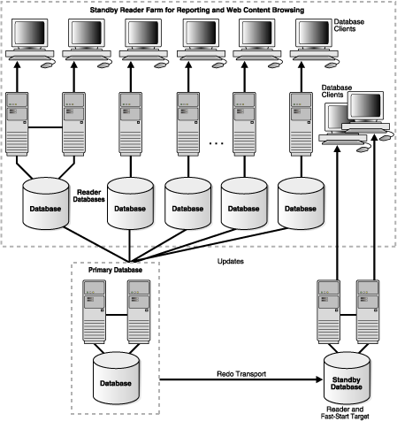

## 5 Optimizing Return on Investment (ROI)

Oracle Grid Computing, disaster-recovery solutions and advanced standby database usage, and virtualization all optimize return on investment (ROI) capabilities.

You can scale out your existing system infrastructure while achieving both high availability and disaster protection. Oracle Data Guard standby databases are an integral part of the Grid, providing data protection and availability regardless of the cause or scope of an outage. Outages can range anywhere from data corruption that can affect an individual database, to natural disasters that impact a large geographic area.

Advanced Data Guard capabilities deliver maximum ROI by enabling standby databases to be used for productive purposes—such as for read-only queries and reporting—while running in the standby role. Rather than allowing standby databases to remain idle, you can employ them to support activities that would otherwise require you to purchase additional capacity for other systems. Thus, you can defer or eliminate the need to purchase additional capacity for the primary database. This effectively reduces the cost of providing world-class disaster protection for mission critical Oracle Databases.

This chapter covers the following topics:

## 5.1 Grid Computing

Grid computing is a computing architecture that effectively pools large numbers of servers and storage into a flexible, on-demand computing resource for all enterprise computing needs.

Oracle Database captures the cost advantages of Grid enterprise computing without sacrificing performance, scalability, security, manageability, functionality, or system availability.

- A Database Server Grid is a collection of commodity servers connected to run one or more databases.
- A Database Storage Grid is a collection of low-cost modular storage arrays combined together and accessed by the computers in the Database Server Grid.

The same grid computing concepts can be used to create a standby database hub that provides data protection, minimizes planned downtime, and provides ideal test systems for quality assurance testing and all for multiple primary databases. Grid capabilities enable system resources to be dynamically provisioned and de-provisioned depending on current priorities. For example, if a primary database fails over to one of the standby databases in the Data Guard hub, it can be allocated more system and storage resources, while resources allocated to test activities are reduced. The grid enables a high level of utilization and low TCO without compromising your business requirements.

Figure 5-1 illustrates the Database Server Grid and Database Storage Grid in a grid enterprise computing environment.

Figure 5-1 Grid Computing Environment

> This figure shows the components of a grid computing environment.
>
> Several database server clusters are shown connected to one another through an interconnect to form the Database Server Grid. The Database Server Grid is then connected to the Database Storage Grid—shown as several database clusters—through storage switches.
>
> Copyright © 2005, 2013, Oracle and/or its affiliates. All rights reserved.  
> [Legal Notices](https://docs.oracle.com/cd/E11882_01/dcommon/html/cpyr.htm)
  

## 5.2 Database Server Grid

The availability of low-cost and reliable blade servers, small multiprocessor servers, and inexpensive open-source operating systems such as Linux, have made it possible to build a Database Server Grid that is highly available, scalable, flexible, and manageable.

Oracle RAC is the technology that enables a Database Server Grid. You can drive down costs by deploying a single Oracle RAC database that spans multiple low-cost servers, each running an active Oracle database instance. Alternatively, you can use a single cluster to consolidate the management in increased system utilization across multiple Oracle RAC Databases.

Oracle RAC provides the flexibility to dynamically provision resources and services in the grid as computing needs change, and to add or subtract systems from the grid as capacity demands change. In addition, Oracle RAC provides protection from system failures by automatically transitioning clients and redistributing the processing of the failed node to surviving nodes in the same Oracle RAC database. Note that the scalability and availability benefits of grid computing are not limited to lower cost servers. Any system architecture will benefit from grid computing.

## 5.3 Database Storage Grid

The availability of low-cost Advanced Technology Attachment (ATA) disk-based storage arrays and low-cost storage networks has made it possible to use a Database Storage Grid with Oracle Database at very low cost. One example solution is Oracle Exadata Storage Servers that offer excellent performance and availability characteristics. Each Exadata Cell can be viewed as a unit of I/O performance and capacity.

The Oracle Storage Grid is implemented using either Oracle Automatic Storage Management (ASM) and Oracle Exadata Storage Server Software or ASM and third-party storage. The Oracle Storage Grid with Exadata seamlessly supports MAA-related technology, improves performance, provides unlimited I/O scalability, is easy to use and manage, and delivers mission-critical availability and reliability to your enterprise. See the Oracle Database High Availability Best Practices for Oracle Storage Grid recommendations and using Exadata.

A database administrator can use the Oracle ASM interface to specify the disks in the Database Storage Grid that Oracle ASM should manage across all server and storage platforms. Oracle ASM partitions the disk space and evenly distributes the data storage throughout the entire storage array. Additionally, Oracle ASM automatically redistributes the data storage as storage arrays are added or removed from the Database Storage Grid.

Additionally, use the I/O Resource Management to manage and meet service-level requirements. The resource manager allows you manage the grid and prioritized applications within the database or in between databases.

## 5.4 Disaster Recovery Using Active Standby Databases

You can use standby databases for dynamic IT and application requirements in addition to providing disaster recovery. The [Oracle Active Data Guard option](glossary.md) in Oracle Data Guard enables you to use physical standby databases for other useful work during normal operations, in addition to providing a disaster-recovery solution.

The following sections describe the Oracle Data Guard features that help you use physical standby databases for additional business purposes:

- Oracle Active Data Guard Option for Physical Standby Databases
- Web Scale Using Standby Reader Farms

### 5.4.1 Oracle Active Data Guard Option for Physical Standby Databases

Oracle Data Guard Redo Apply (physical standby database) is a popular solution for disaster recovery due to its relative simplicity, high performance, and superior level of data protection. The [Oracle Active Data Guard option](glossary.md) Foot 1 (available with Oracle Database 11g Release 1 (11.1) and later releases) enables a physical standby database to be opened for read-only access while Redo Apply is active. This makes it possible to run queries and reports against an up-to-date physical standby database without compromising data protection or extending recovery time if a failover is required. You can offload the read-only workload from the primary database to the active standby database, improving performance and postponing the day when you need to purchase additional capacity.

To enable the Oracle Active Data Guard option, open the database in read-only mode and then issue the `ALTER DATABASE RECOVER MANAGED STANDBY` statement. Note that the `COMPATIBLE` parameter must be set to 11.0.0 or later on both the primary and physical standby databases. Using this feature is completely transparent to any application requiring read-only access to the Oracle Database.

The Oracle Active Data Guard option provides an ultimate high availability solution because it:

- Supports Oracle RAC on the primary and standby databases
	The Oracle Active Data Guard option works on both single-instance and Oracle RAC physical standby databases. Although Redo Apply can be running on only one Oracle RAC instance, any of the instances can run in read-only mode, including the apply instance.
- Returns transactionally consistent results that are very close to being up-to-date with the primary database
	Depending on any delay settings or apply rates, the standby database can be current with the primary database or lag seconds behind. The queries will always be transactionally consistent and will represent a consistent view of the last committed transaction at that time.
- Allows fast switchovers or failovers because the redo generated by the primary database while the standby database was open read-only has already been applied to the standby database, making it immediately available to assume the primary database role
- Enables you to use fast-start failover for automatic failover if the primary database fails

Note:

Transactions that attempt to modify a physical standby database running with Oracle Active Data Guard enabled will fail with an error.

For more information about using Oracle Active Data Guard, see [Oracle Data Guard Concepts and Administration](https://docs.oracle.com/cd/E11882_01/server.112/e41134/toc.htm).

### 5.4.2 Web Scale Using Standby Reader Farms

You can use multiple physical standby databases (using the [Oracle Active Data Guard option](glossary.md)) and logical standby databases to deploy a reader farm. An example of such a configuration is provided Figure 5-2, complete with the use of Oracle Data Guard fast-start failover to automatically fail over should the primary database fail. Note that all standby databases in the reader farm automatically recognize the new primary database after a failover occurs.

A reader farm enables you to boost read performance of the most demanding Web applications beyond what the underlying system and storage architecture can support. This provides a relatively low-cost method of scaling out using a Grid architecture where I/O is the driving factor.

The concept is straightforward—a single primary database that supports read/write transactions, and multiple standby databases that provide read-only access to Web users. Such an approach scales read performance linearly as additional standby databases are added. It is also an effective way to isolate faults, because problems that affect one standby database are isolated from the other standby databases in the configuration.

Creating a reader farm of physical standby databases provides the following benefits:

- Fault isolation
- High performance with physical standby databases and Redo Apply
- Seamless support for all DDL and data types using Redo Apply
- All reader databases are kept up-to-date with changes made to the primary database
- Automatic, zero or minimal data loss failover capability
- Management as a unified configuration through Grid Control
- Scale-out using single writer database and n reader databases
- Rolling upgrade capabilities

Figure 5-2 shows a good example of how you can use Oracle Data Guard, physical standby databases, and [Oracle Active Data Guard option](glossary.md) to provide the flexibility necessary to grow your business quickly, while still providing disaster recovery. In the configuration, the primary database transmits redo data to multiple standby databases, one of which is also enabled for fast-start failover for automatic, zero, or minimal data loss failover.

Figure 5-2 Standby Database Reader Farms

> This figure shows a single primary database sending redo data to multiple physical standby databases (reader farm databases). For each reader database, there is an arrow pointing up to a monitor to indicate that clients and applications are accessing the physical standby database for queries and reporting purposes. Every standby database is a reader database, and one of the standby databases is also labeled as being enabled as the target for a fast-start failover. Finally, a picture of a monitor is shown next to the primary database to indicate that updates are continuously being made to primary database.
  

If a fast-start failover is triggered in the Oracle Data Guard configuration in Figure 5-2, then:

- Automatic failover occurs to the designated standby database
- All standby databases accept data from the new primary database
- You can perform a switchover at a convenient time in the future to return all databases to their original roles

## 5.5 Oracle VM and Domain Live Migration

Grid Computing, disaster-recovery solutions with advanced standby database usage, and virtualization all encourage better ROI. Virtualization's main benefits include consolidation and using all resources efficiently.

Oracle VM enables you to deploy operating systems and application software within a supported virtualization environment. Because each virtual machine has its own virtual CPU, network interfaces, storage and operating system, Oracle VM disassociates workloads from the physical constraints of the underlying hardware. Oracle VM presents the opportunity to significantly reduce service outages associated with planned server outages or workload imbalance.You can improve availability by using the domain live migration feature of Oracle VM to migrate a domain from one physical server to another, identical computer that is running virtual machines. For example, you can:

- Migrate the domain from a failing server to a viable server on which operations can continue during repairs
- Rebalance the workload to prevent one server from becoming overloaded

During the migration, the domain continues to provide services and end users remain unaware of any change.

See Also:

- [Oracle VM Server User's Guide](http://www.oracle.com/pls/topic/lookup?ctx=db112&id=OVSUG)
- The Oracle VM Web site on OTN at `http://www.oracle.com/virtualization`

---

Footnote Legend

Footnote 1: Oracle Active Data Guard is referred to as real-time query in the Oracle Data Guard documentation.