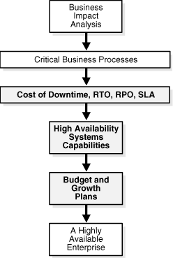

## 2 Determining Your High Availability Requirements

This chapter includes the following sections:

## 2.1 About Determining High Availability Requirements

Any enterprise that is designing and implementing a high availability strategy must begin by performing a thorough analysis of the business drivers that require high availability. Implementing high availability may involve critical tasks such as:

- Retiring legacy systems
- Investing in more capable and robust systems and facilities
- Redesigning the overall IT architecture and operations to adapt to this high availability model
- Redesigning business processes
- Hiring and training personnel

This chapter provides a framework to effectively evaluate the high availability requirements of a business. By combining your business analysis with an understanding of the level of investment required to implement different high availability solutions, you can develop a high availability architecture that will achieve both business and technical objectives.

You can use the high availability analysis framework to:

1. Complete a [business impact analysis](glossary.md)
2. Identify and categorize the critical business processes that have the high availability requirements
3. Formulate the [cost of downtime](glossary.md)
4. Establish utilization, [recovery time objective (RTO)](glossary.md), and [recovery point objective (RPO)](glossary.md) goals for these various business processes
5. Understand goals for manageability, [total cost of ownership (TCO)](glossary.md), and [return on investment (ROI)](glossary.md)

This framework enables the business to define service-level agreements (SLAs) in terms of high availability for critical aspects of its business. For example, it can categorize its business processes into several high availability tiers:

- Tier 1 processes have maximum business impact. They have the most stringent high availability requirements, with RTO and RPO close to zero, and requiring continuously available supporting systems. For a business with a high-volume e-commerce presence, this may be the Web-based customer interaction system.
- Tier 2 processes that have slightly relaxed high availability and RTO and RPO requirements. The second tier of an e-commerce business may be its supply chain and merchandising systems. For example, these systems do not need to maintain extremely high degrees of availability and may have nonzero RTO and RPO values. Thus, the high availability systems and technologies chosen to support the tier 2 processes are likely to be different from those of the tier 1 processes.
- Tier 3 processes may be related to internal development and quality assurance processes. Systems supporting these processes need not have the rigorous high availability requirements of the other tiers.

As shown in Figure 2-1, the next step for the business is to evaluate the capabilities of the various high availability systems and technologies, and to choose the ones that meet its SLA requirements, within the guidelines dictated by business performance issues, budgetary constraints, and anticipated business growth.

Figure 2-1 Planning and Implementing a Highly Available Enterprise

> The illustration shows the process of planning and implementing a highly available enterprise. Business impact analysis identifies critical business processes; then the cost of downtime, recovery time objectives (RTO), recovery point objectives (RPO), and service-level agreements (SLA) are determined.
>
> High availability system capabilities, and budget and growth plans are considered to determine and implement a highly available enterprise.
  

## 2.2 Analysis Framework for Determining High Availability Requirements

The elements of this analysis framework are:

- Business Impact Analysis
- Cost of Downtime
- Recovery Time Objective (RTO)
- Recovery Point Objective (RPO)
- Manageability Goal
- Total Cost of Ownership (TCO) and Return on Investment (ROI)

### 2.2.1 Business Impact Analysis

A rigorous business impact analysis:

- Identifies the critical business processes in an organization
- Calculates the quantifiable loss risk for unplanned and planned IT outages affecting each of these business processes
- Outlines the effects of these outages
- Considers essential business functions, people and system resources, government regulations, and internal and external business dependencies
- Is based on objective and subjective data gathered from interviews with knowledgeable and experienced personnel
- Reviews business practice histories, financial reports, IT systems logs, and so on

The business impact analysis categorizes the business processes based on the severity of the impact of IT-related outages. For example, consider a semiconductor manufacturer with chip fabrication plants located worldwide. Semiconductor manufacturing is an intensely competitive business requiring huge financial investment that is amortized over high production volumes. The human resource applications used by plant administration are unlikely to be considered as mission-critical as the applications that control the manufacturing process in the plant. Failure of the applications that support manufacturing will affect production levels and have a direct impact on the financial results of the company.

Similarly, an internal knowledge management system is likely to be considered mission-critical for a management consulting firm, because the business of a client-focused company is based on internal research accessibility for its consultants and knowledge workers. The cost of downtime of such a system is extremely high for this business. This leads us to the next element in the high availability requirements framework: cost of downtime.

### 2.2.2 Cost of Downtime

A complete business impact analysis provides the insight needed to quantify the cost of unplanned and planned downtime. Understanding this cost is essential because it helps prioritize your high availability investment and directly influences the high availability technologies that you choose to minimize the downtime risk.

Various reports have been published, documenting the costs of downtime in different industries. Examples include costs that range from millions of dollars for each hour of brokerage operations and credit card sales, to tens of thousands of dollars for each hour of package shipping services.

These numbers are staggering and the reasons are obvious. The Internet can connect the business directly to millions of customers. Application downtime can disrupt this connection, cutting off a business from its customers. In addition to lost revenue, downtime can negatively affect customer relationships, competitive advantages, legal obligations, industry reputation, and shareholder confidence.

### 2.2.3 Recovery Time Objective (RTO)

The business impact analysis will determine your [recovery time objective (RTO)](glossary.md). RTO is defined as the maximum amount of time that an IT-based business process can be down before the organization starts suffering unacceptable consequences (financial losses, customer dissatisfaction, reputation, and so on). RTO indicates the downtime tolerance of a business process or an organization in general.

The RTO requirements are driven by the mission-critical nature of the business. Thus, for a system running a stock exchange, the RTO is zero or very near to zero.

An organization is likely to have varying RTO requirements across its various business processes. Thus, for a high volume e-commerce Web site, for which there is an expectation of rapid response times and for which customer switching costs are very low, the Web-based customer interaction system that drives e-commerce sales is likely to have an RTO close to zero. However, the RTO of the systems that support back-end operations, such as shipping and billing, can be higher. If these back-end systems are down, then the business may resort to manual operations temporarily without a significant visible impact.

The ability to take orders via the e-commerce Web site immediately (the RTO) may be more important than the RPO, because lost data can be reloaded later.

### 2.2.4 Recovery Point Objective (RPO)

The business impact analysis also determines your [recovery point objective (RPO)](glossary.md). RPO is the maximum amount of data that an IT-based business process may lose without harm to the organization. RPO indicates the data-loss tolerance of a business process or an organization in general. This data loss is often measured in terms of time, for example, 5 hours or 2 days of data loss.

A stock exchange where millions of dollars worth of transactions occur every minute cannot afford to lose any data. Thus, its RPO must be zero. The Web-based sales system in the e-commerce example does not strictly require an RPO of zero, although a low RPO is essential for customer satisfaction. However, its back-end merchandising and inventory update system may have a higher RPO; as lost data can be reentered.

### 2.2.5 Manageability Goal

A manageability goal is more subjective than either the RPO or the RTO. It results from an objective evaluation of the skill sets and management resources available in an organization, and the degree to which the organization can successfully manage all elements of a high availability architecture. Just as RPO and RTO measure an organization's tolerance for downtime or data loss, your manageability goal measures the organization's tolerance for complexity in the IT environment. When less complexity is a requirement, simpler methods of achieving high availability are preferred over methods that may be more complex to manage, even if the latter could attain more aggressive RTO and RPO objectives. Understanding manageability goals helps organizations differentiate between what is possible and what is practical to implement.

### 2.2.6 Total Cost of Ownership (TCO) and Return on Investment (ROI)

Understanding [total cost of ownership (TCO)](glossary.md) and [return on investment (ROI)](glossary.md) is essential to selecting a high availability architecture that also achieves the business goals of your organization. TCO includes all costs (such as acquisition, implementation, systems, networks, facilities, staff, training, and support), over the useful life of the solution chosen. Likewise, the ROI calculation captures all of the financial benefits that accrue to a given high availability architecture.

For example, consider a high availability architecture in which IT systems and storage at a remote standby site remain idle with no other business use that can be served by the standby systems. The only return on investment for the standby site is the cost of downtime avoided by its use in a failover scenario. Contrast this with a different high availability architecture that enables IT systems and storage at the standby site to be used productively while in the standby role (for example, for reports or for off-loading the primary system of the overhead of end-user queries). The return on investment of such an architecture includes both the cost of downtime avoided and the financial benefits that accrue to its productive use while in the standby database role.

## 2.3 High Availability Architecture Requirements

The following sections provide further details about high availability system capabilities and business performance, budget and growth plans. Also, see ["Choosing the Correct High Availability Architecture"](architectures.md).

### 2.3.1 Business Performance, Budget, and Growth Plans

High availability solutions must ultimately address business requirements. For example, a business may use a zero-data-loss solution that synchronously mirrors every transaction on the primary database to a remote database. However, considering the speed-of-light limitations and the physical limitations associated with a network, there are round-trip delays in the network transmission. These delays increase with distance and vary based on network bandwidth, traffic congestion, router latencies, and so on. Thus, this synchronous mirroring, if performed over large wide area network (WAN) distances, will affect the primary site performance.

Online buyers may notice these system latencies and be frustrated with long system response times; consequently, they may go somewhere else for their purchases. This is an example where the business must make a trade-off between having a zero-data-loss solution and maximizing system performance. Conversely, if the business drivers justify the investment to avoid making this tradeoff, a multisite architecture can be implemented that places a synchronous zero-data-loss standby site in close proximity to the primary site and a second asynchronous standby site located up to thousands of miles away.

High availability solutions must also be based on financial considerations and future growth estimates. It is tempting to build redundancies throughout the IT infrastructure and claim that the infrastructure is completely failure-proof. Although you cannot always equate higher availability with higher cost, imprudent decisions may lead to budget overruns or an unmanageable and unscalable combination of solutions that is extremely complex and expensive to integrate and maintain.

A high availability solution that has impressive performance benchmark results may be enticing. However, investing in such a solution without careful analysis of how the technology capabilities match the business drivers would be unwise. The business could end up with a solution that:

- Does not integrate well with the rest of the system infrastructure
- Has annual integration and maintenance costs that easily exceed the implementation costs

Prudent and judicious decision-makers must invest only in solutions that are well-integrated, standards-based, straightforward to implement, maintain, and manage, and have a scalable architecture for accommodating future business growth.