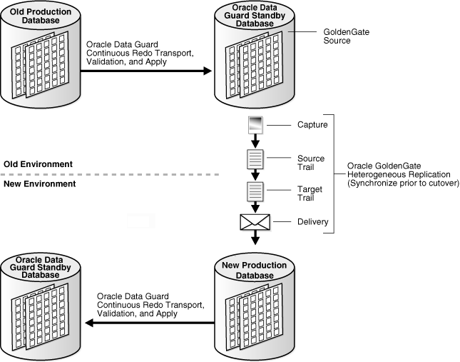

## 4 Oracle Database High Availability Solutions for Planned Downtime

Planned downtime can be just as disruptive to operations as unplanned downtime. This holds especially true for global enterprises that must support users in multiple time zones, or for those that must provide Internet access to customers 24 hours a day, 7 days a week.

In the past, planned downtime was necessary to perform the following activities:

- Periodic maintenance—such as patching or reconfiguring the system to update a database, application, operating system, middleware, or network
- New deployments—such as to perform major upgrades or new rollouts of the hardware, database, application, operating system, middleware, or network

Section 4.1 summarizes Oracle's high availability solutions that prevent, tolerate, and reduce downtime for all types of planned maintenance.

## 4.1 Oracle High Availability Solutions and Recovery Times for Planned Downtime

Oracle provides high availability solutions to prevent, tolerate, and reduce downtime for all types of planned maintenance. Table 4-1 describes the various Oracle high availability solutions for planned downtime, along with the outage time that can be attained with each solution. In all cases, Oracle recommends that you extensively test all procedures before conducting planned maintenance operations. Also, see [Table 7-5](architectures.md) for a summary of the attainable recovery times for all types of planned downtime for each Oracle high availability architecture

Table 4-1 Oracle High Availability Solutions for Planned Downtime

| Maintenance Type | Oracle Recommended Solution | Solution Description | Outage Time |
| --- | --- | --- | --- |
| Operating system and hardware upgrades | [Oracle Real Application Clusters and Oracle Clusterware](unplanned.md), or [Oracle RAC One Node](unplanned.md) (for single-instance Oracle RAC databases) | Section 4.1.1 | No downtime |
| Oracle interim patches | Oracle Real Application Clusters (Oracle RAC) | Section 4.1.3 | No downtime <sup>Foot 1</sup> |
| Oracle Clusterware upgrades and patches | Oracle Clusterware or [Oracle RAC One Node](unplanned.md) (for single-instance Oracle RAC databases) | Section 4.1.4 | No downtime |
| Oracle ASM upgrades | [Oracle Automatic Storage Management](unplanned.md) | Section 4.1.5 | No downtime |
| Storage migration <sup>Foot 2</sup> | [Oracle Automatic Storage Management](unplanned.md) | Section 4.1.6 | No downtime |
| Migrating to Exadata Storage | Oracle MAA best practices discussed in the " [Best Practices for Migrating to Oracle Exadata Storage Server](http://www.oracle.com/technology/deploy/availability/maa/xmigration_11.2.pdf) " presentation <sup>Foot 3</sup> | Section 4.1.7 | Outage time depends on solution chosen |
| Upgrading Exadata Storage | The Exadata Patch Manager | Section 4.1.8 | No downtime |
| Migrating a single-instance database to Oracle RAC | Oracle Clusterware | Section 4.1.1 | No downtime |
| Migrating to Oracle ASM or migrating a single-instance database to Oracle RAC | [Oracle Data Guard](unplanned.md) | Section 4.1.2 | Seconds to minutes |
| Patch set and database upgrades | [Oracle Data Guard](unplanned.md) using SQL Apply | Section 4.1.9 | Seconds to minutes |
| Oracle interim patches, Oracle clusterware upgrades and patches, Oracle ASM upgrades, Operating System and Hardware Upgrades | Oracle Data Guard Standby-First Patch Apply | "Oracle Patch Assurance - Data Guard Standby-First Patch Apply" in My Oracle Support note at  `https://support.oracle.com/CSP/main/article?cmd=show&type=NOT&id=1265700.1` | Seconds to minutes |
| Platform migration across Windows and Linux platforms and other select platforms <sup>Foot 4</sup> | [Oracle Data Guard](unplanned.md) | Section 4.1.9 | Seconds to minutes |
| Platform migration across the same endian format platforms | Transportable database | Section 4.1.10 | Minutes to hours |
| Platform migration across different endian format platforms | Transportable tablespace | Section 4.1.11 | Hours |
| Patch set and database upgrades, platform migration, rolling upgrades, and when different character sets are required | [Oracle GoldenGate and Oracle Streams](unplanned.md) | Section 4.1.9, Section 4.1.10, Section 4.1.11, and Section 4.5 | Seconds to minutes |
| Application upgrades | Online Application Maintenance and Upgrades | Section 4.5 | No downtime |

<sup>Footnote 1</sup> Patches that cannot be applied by performing a rolling upgrade can be applied with the `MINIMIZE_DOWNTIME` option of the OPatch utility to reduce the availability impact of the patch application.

<sup>Footnote 2</sup> An example is migration from traditional storage to low-cost storage.

<sup>Footnote 3</sup> Available on the Oracle MAA Web site at `http://www.oracle.com/goto/maa`.

<sup>Footnote 4</sup> See My Oracle Support (formerly OracleMetalink) Note 413484.1 at `http://support.oracle.com/`.

See Also:

- [Oracle Data Guard Concepts and Administration](https://docs.oracle.com/cd/E11882_01/server.112/e41134/toc.htm) for more information about using Oracle Data Guard with SQL Apply to upgrade an Oracle database
- [Oracle Database Concepts](https://docs.oracle.com/cd/E11882_01/server.112/e40540/toc.htm) and the [Oracle Database Administrator's Guide](https://docs.oracle.com/cd/E11882_01/server.112/e25494/toc.htm) for more information about transportable tablespace
- The MAA white papers about rolling upgrade best practices at
	```
	http://www.oracle.com/goto/maa
	```

### 4.1.1 Operating System Upgrades and Hardware Upgrades

Using Oracle RAC is the recommended solution for avoiding downtime during system and hardware upgrades. For a single-instance Oracle RAC database, you can use [Oracle RAC One Node](unplanned.md).

If you cannot perform the upgrade using Oracle RAC or Oracle RAC One Node, then the recommended solution is to use Oracle Data Guard and physical standby databases as described in Section 4.1.2. Alternatively, you can use cold cluster failover with Oracle Clusterware as described in Section 4.1.4.

The following list provides a high-level overview of the steps when upgrading using Oracle RAC:

1. Perform the following prerequisite checks:
	- Ensure that the planned maintenance can be performed in a rolling fashion from an operating system perspective.
		- Ensure that the database and clusterware versions are certified with the new system and hardware changes.
2. Stop the application service if the application service runs on more than one instance in the cluster. If the application service runs on only the instance being upgraded, then relocate the service to another node in the cluster.
	Stopping the application service implicitly redirects connections off of the destination instance when using fast application notification (FAN).
3. Shut down destination instance or instances with the `IMMEDIATE` option.
4. Shut down and disable Oracle Clusterware.
	Disabling Oracle Clusterware prevents it from starting automatically.
5. Perform maintenance.
6. Enable and start Oracle Clusterware.
	This step implicitly starts the database instances.
7. Start the application service.
	This step implicitly redirects connections to the destination instance when using FAN.
8. Repeat all steps on the next node.

Also, see your operating system-specific Oracle Real Application Clusters installation guide.

### 4.1.2 System and Cluster Upgrades and Migrations Using Oracle Data Guard

Oracle Data Guard and physical standby databases are the recommended solution for performing system and cluster upgrades that you cannot upgrade using Oracle RAC rolling upgrades. Oracle Data Guard is also recommended for migrations to Oracle ASM, Oracle RAC, 64-bit systems, Windows to Linux or Linux to Windows, or the same processor architecture platforms. For example:

- Use Oracle Data Guard for system upgrades that cannot be upgraded using Oracle RAC rolling upgrades due to system restrictions.
- Use Oracle Data Guard when migrating to Oracle ASM, from a noncluster environment to Oracle RAC, to a different platform with the same endian format, or to a different platform with the same processor architecture. The time required to perform the switchover is the only downtime incurred. For more information, see "Data Guard Support for Heterogeneous Primary and Physical Standbys in Same Data Guard Configuration" in My Oracle Support Note 413484.1 at
	`https://support.oracle.com/CSP/main/article?cmd=show&type=NOT&id=413484.1`

In general, you first upgrade the physical standby database and then perform an Oracle Data Guard switchover to the physical standby database.

#### 4.1.2.1 Upgrading the Physical Standby Database

To upgrade the physical standby database and perform a switchover:

1. Upgrade the system or change the physical standby database system to your destination environment.
	For example, you can convert the standby database from a single-instance database to an Oracle RAC database by using Oracle ASM, without any effect on the primary database. Then, restart the standby database, ensure that it matches your destination environment, and wait for Redo Apply to finish applying all redo data to the standby database.
2. Perform an Oracle Data Guard switchover. Optimally, the switchover should take only seconds to minutes.
3. Shut down the original primary database (now the standby database).
4. Upgrade or make system changes to the original primary database.
5. Restart the upgraded database as a standby database and allow recovery to automatically synchronize the databases.
6. Optionally, perform an Oracle Data Guard switchover to return the standby database to the primary database role.

Note:

Conversion from 32-bit to 64-bit is automatic if you are applying an Oracle Database patch set or doing an Oracle Database upgrade at the same time. If you are upgrading only the operating system, then you may need to perform the additional post-upgrade steps that are described in the My Oracle Support Note 414043.1 at `http://support.oracle.com/`. Also, see the [Oracle Database Upgrade Guide](https://docs.oracle.com/cd/E11882_01/server.112/e23633/toc.htm) for more information about upgrades.

#### 4.1.2.2 Best Practices for System and Cluster Upgrades and Migrations

Consider the following best practices and guidelines for system and cluster upgrades and migrations:

- For fastest switchover, configure the standby database to use real-time apply and, if possible, ensure there are no archive log gaps and that the databases are close to being synchronized before beginning the switchover operation.
- Use Oracle Data Guard and physical standby databases to perform system and cluster upgrades if Oracle RAC rolling upgrade or online patching is not possible. See [Oracle Data Guard Concepts and Administration](https://docs.oracle.com/cd/E11882_01/server.112/e41134/upgrades.htm#SBYDB1200) for more information.

### 4.1.3 Oracle Database Patches

Oracle patches to database software are usually applied to implement known fixes for software problems, or to apply diagnostic patches to gather information about a problem. Plan to apply patches during a scheduled maintenance outage.

To avoid downtime when applying Oracle database patches, perform rolling patch upgrades using Oracle RAC. You can apply approximately 90% of the new patches using Oracle RAC. Oracle provides the capability to perform rolling patch upgrades with Oracle RAC with little or no database downtime using the OPatch command-line utility. If it is not possible to use Oracle RAC, then use Oracle Data Guard and physical standby databases. See Section 4.1.2 for more information.

There are several types of patches including:

- Interim patch
	A single patch created to provide a specific fix between the release of patch sets.
- Bundle patch
	A collection of patches that is issued between patch sets. A patch bundle is usually cumulative. Microsoft Windows bug fixes for the Database are generally issued in a patch bundle (as opposed to an interim patch).
- Patch Set Update (PSU)
	A quarterly patch that contains the most critical fixes for the applicable product (including security fixes), allowing customers to apply one patch to avoid many problems.
- Critical Patch Update (CPU)
	A collection of high-priority fixes (usually for security issues) once a quarter. CPUs are cumulative with respect to prior security fixes but may contain other fixes in order to address patch conflicts with non-security patches (i.e. reduce the need for merge requests).
- Diagnostic patch
	A patch created specifically to diagnose a problem and not to fix a bug.

An Oracle RAC rolling upgrade enables all but one of the instances of the Oracle RAC installation to be available during the scheduled outage, further reducing the impact on the application downtime required for scheduled outages. The Oracle OPatch utility enables you to apply the patch successively to the different instances in an Oracle RAC installation.

Performing a rolling upgrade is possible only for patches that are certified for rolling upgrades.

#### 4.1.3.1 Online Patching

Online patches are a special type of interim patch or diagnostic patch that you can apply while the instance remains online. The only time an interim or diagnostic patch should be applied in an online manner is when:

- The patch README indicates that it can be applied in an online manner.
- The patch needs to be applied urgently and database instances cannot be shutdown to apply the regular (offline) version of the patch.

You can perform online patching with any Oracle database using the OPatch command-line utility.

Also, use the following considerations when performing online patching:

- Oracle provides qualified interim and diagnostic patches as combo patches, which contain both an online patch and an offline patch for the same bug fix.
	Thus, you can apply the online patch initially to avoid unplanned downtime. However, because online patches have a memory overhead, you should roll back the online patch and apply the offline patch during scheduled downtime.
- Applying an online patch increases memory consumption on the system because each Oracle process uses more memory from the Program Global Area (PGA) during the patch application. Consider memory requirements before you begin applying an online patch. Each online patch is unique, and the memory requirements are patch-specific. Apply the patch on your test system first so that you can assess the effect of the online patch on your production system and estimate any additional memory usage.

See Also:

- "RDBMS Online Patching Aka Hot Patching" in My Oracle Support Note 761111.1 at
	`https://support.oracle.com/CSP/main/article?cmd=show&type=NOT&id=761111.1`
- [Oracle Universal Installer and OPatch User's Guide for Windows and UNIX](https://docs.oracle.com/cd/E11882_01/em.112/e12255/toc.htm) for information about online patching and the OPatch utility
- [Oracle Database Upgrade Guide](https://docs.oracle.com/cd/E11882_01/server.112/e23633/toc.htm) for an overview of rolling upgrades and rolling patches

### 4.1.4 Upgrading Oracle Clusterware

Performing rolling upgrades of Oracle Clusterware is the recommended solution for avoiding downtime when upgrading Oracle Clusterware. For single-instance Oracle RAC databases, consider using Oracle RAC One Node.

You can perform all upgrades to Oracle Clusterware in a rolling fashion.

See Also:

- Your operating system-specific Oracle Clusterware installation guide
- Your operating system-specific Oracle Real Application Clusters installation guide

### 4.1.5 Upgrading Oracle Automatic Storage Management (Oracle ASM)

Performing rolling upgrades is the recommended solution for upgrading Oracle ASM. You can perform all upgrades starting with Oracle Database 11g (and later releases) in a rolling fashion.

For more information, see the [Oracle Automatic Storage Management Administrator's Guide](https://docs.oracle.com/cd/E11882_01/server.112/e18951/asminst.htm#OSTMG02400).

### 4.1.6 Storage Migration

Using Oracle ASM is the recommended solution for performing storage migrations.

Oracle ASM enables you to add all disks in one storage array and subsequently drop all disks from another array. Oracle ASM automatically rebalances and migrates data to the new storage while the database remains operational. Before removing the source storage array, ensure that the rebalancing is complete.

For more information, see the MAA white papers "Migration to Automatic Storage Management (ASM)" and "Best Practices for Creating a Low-Cost Storage Grid for Oracle Databases" at `http://www.oracle.com/goto/maa`.

### 4.1.7 Migrating Oracle Exadata Storage Server Software

The guidelines in the MAA presentation "Best Practices for Migrating to Exadata Database Machine" define best practices for pre-migration and post migration from legacy storage to Oracle Exadata Storage Server. The best practices help you determine the most appropriate migration strategy given the application service levels and attributes. The MAA presentation is available on the MAA Web site at `http://www.oracle.com/goto/maa`

### 4.1.8 Upgrading Oracle Exadata Storage Server Software

See the Oracle Exadata Storage Server Software documentation to learn about the solutions and tools used to perform upgrades.

See Also:

- My Oracle Support (formerly OracleMetalink) Note 791275.1 at `http://support.oracle.com/` that includes:
	Oracle Exadata Storage Server Software Documentation Addendum
	Oracle Exadata Storage Server Software Planning and Deployment Guide
	Oracle Exadata Storage Server Software Patch Application Example
- The Oracle Exadata Storage Server Web site at `http://www.oracle.com/exadata`

### 4.1.9 Patch Set and Database Upgrades

Oracle Data Guard using SQL Apply is the recommended solution for performing patch set and database upgrades with minimal downtime. Section 4.1.9.1 describes this solution. If the source database is using data types not natively supported by SQL Apply, you can use Extended Datatype Support (EDS) to accommodate several more advanced data types.

If the source database is using a software version not supported by SQL Apply rolling upgrade (earlier than Oracle Database release 10.1.0.3) or using EDS cannot sufficiently resolve SQL Apply data type conflicts, then consider using Database Upgrade Assistant (DBUA) <sup>Foot 1</sup> , transportable tablespace, or Oracle GoldenGate:

- DBUA provides a graphical user interface (GUI) utility that guides you through the upgrade process and is the simplest and recommended method of upgrading a database. However, if the time it takes DBUA to upgrade a database does not fit in the defined maintenance window, then consider using the transportable tablespace feature to perform a database upgrade in less than one hour.
- Transportable tablespace is the solution if you cannot use SQL Apply but the maintenance window requires downtime to be less than an hour in duration, and the database being upgraded has a small number of simple schemas and data files that do not need to be transferred as part of the transport process (such as when the data files will be used in place). Section 4.1.9.2 describes the transportable tablespace solution.
- Oracle GoldenGate provides the most flexibility when performing database upgrades and requiring additional data type support. Section 4.1.9.4 describes this solution.

Do not use Oracle RAC to perform rolling upgrades of patch sets. Also, see your operating system-specific Oracle Real Application Clusters installation guide.

See Oracle Database High Availability Best Practices for more information and for help choosing the database upgrade method appropriate for your configuration.

#### 4.1.9.1 Performing Database Upgrades Using Oracle Data Guard and SQL Apply

The following list describes the high-level upgrade steps:

1. Upgrade logical standby database to the new release and evaluate the change.
2. Ensure that SQL Apply has applied all redo data to the logical standby database.
3. Disconnect applications.
4. Perform an Oracle Data Guard switchover.
5. Reconnect applications to the new primary database.
6. Shut down the original primary database (now the logical standby database).
7. Execute database software upgrade steps on the new standby database.
8. Restart the standby database and allow recovery to synchronize.
9. Optionally, perform an Oracle Data Guard switchover to return to the original database.

Consider the following information when performing patch set and database upgrades.

- SQL Apply rolling upgrades are only supported for Oracle Database release 10.1.0.3 and later. For complete information, see the chapter about using SQL Apply to upgrade Oracle Database in [Oracle Data Guard Concepts and Administration](https://docs.oracle.com/cd/E11882_01/server.112/e41134/rollup.htm#SBYDB00830).
- SQL Apply has some data type restrictions (see [Oracle Data Guard Concepts and Administration](https://docs.oracle.com/cd/E11882_01/server.112/e41134/data_support.htm#SBYDB00305) for a list of the restrictions). If there are data type restrictions, consider implementing Extended Datatype Support (EDS).
	EDS enables SQL Apply to replicate changes to tables that contain some data types not natively supported from one database to another. Beginning with Oracle Database 10g Release 2 (10.2.0.4) Patch Set 3, SQL Apply supports the ability for triggers to fire on the logical standby database, which provides the basis of EDS. For an overview of EDS, see the MAA white paper "Extended Datatype Support Using SQL Apply and Oracle Streams" available at `http://www.oracle.com/goto/maa`.
	For examples using EDS to support data types that are not natively supported by SQL Apply, see support note 559353.1 at `http://support.oracle.com/`.
- Beginning with Oracle Database 11g release 11.1, you can use a physical standby database to execute a rolling database upgrade using the `KEEP IDENTITY` clause and a transient logical standby database.
- Oracle Data Guard is the best approach if performing an Oracle RAC rolling upgrade is not possible and there are no data type restrictions.

See Also:

- [Oracle Data Guard Concepts and Administration](https://docs.oracle.com/cd/E11882_01/server.112/e41134/toc.htm)
- The following MAA white papers available at `http://www.oracle.com/goto/maa`
	"Database Rolling Upgrades Made Easy by Using a Data Guard Physical Standby Database"
	"Database Rolling Upgrades Using Transient Logical Standby"

#### 4.1.9.2 Performing Database Upgrades Using Transportable Tablespace

If you cannot use SQL Apply because of data type conflicts, and testing shows that upgrading with DBUA cannot meet uptime requirements, then consider using the transportable tablespace solution to upgrade your database.

To use the transportable tablespace feature to upgrade an Oracle database:

1. Install Oracle Database software on the destination system and perform the initial steps on the source database to prepare for the transport process.
2. Prepare the source and destination databases:
	1. Gather information from the source database.
		2. Create the destination database with Database Configuration Assistant (DBCA).
		3. Prepare the destination database for Oracle Data Pump usage and to accept the tablespaces being transported.
3. Transport the user tablespaces:
	1. Ready the source database for transport by disconnecting users and restricting access to the source database, making all user tablespaces `READ ONLY`, and capturing sequence starting values from the source database.
		2. Transport the user tablespaces.
4. Verify that the destination database is complete and functional, and then back up the destination database.

Consider the following information when using transportable tablespace:

- The transportable tablespace feature is an option for performing a database upgrade in less than one hour for databases that have simple schemas and where the data files do not need to be transferred as part of the transport process (such as when the data files will be used in place). See the MAA white paper "Database Upgrade Using Transportable Tablespace" available on the MAA Web site at
	`http://www.oracle.com/goto/maa`
- Using the transportable tablespace feature reduces database upgrade time by moving all user tablespaces from a database running an earlier software release to an empty destination database running a current software release. With transportable tablespace, tablespace data files are plugged in to the database by copying the data files to the destination database, then importing the object metadata into the destination database.

#### 4.1.9.3 Performing Database Upgrades Using Oracle GoldenGate

The configuration in Figure 4-1 shows how to configure Oracle GoldenGate and Oracle Data Guard to minimize downtime and risk for planned outages, such as for any upgrades and migrations that are not supported by an Oracle Data Guard database rolling upgrade. For example, this might include migrating to a different hardware architecture and operating system, or performing application upgrades that modify database objects. In this configuration, the physical standby databases provide disaster protection to prevent downtime or data loss before, during, and after the migration. This configuration also avoids any performance impact or operational risk by isolating the production database from any work required to perform the migration.

Figure 4-1 Oracle GoldenGate Configuration for Minimizing Planned Downtime



> This figure shows two parallel configurations (old and new), both of which are running Oracle Data Guard with a production (primary) database and a standby database. Both configurations also show the Oracle Data Guard redo transport mechanism continuously shipping, validating, and applying redo data from the primary database to the standby database.
>
> On the standby site in the old environment, the Oracle Data Guard standby database is protecting the primary database while at the same time the standby is hosting the GoldenGate capture process such that changes are captured from redo logs on the standby database and replicated over multiple parallel streams to a GoldenGate target in the new environment. Replication is shown using a layer of processing for each of thee processes: capture, source trail, target trail, and delivery
  

Oracle GoldenGate replication from the standby database (in the top right of Figure 4-1), to the new production database (bottom right), requires Oracle GoldenGate Archive Log Mode. If the requirements for Archive Log Mode cannot be met, then replicate directly from the original production database (represented by the database in the top left corner).

These requirements are achieved by creating a parallel environment on the new platform. Depending upon the type of migration planned, instantiating the new primary database may be as simple as restoring a backup of the existing standby database. For more complex migrations it may be necessary to use other Oracle technologies to instantiate the new primary database, such as Oracle Transportable Technologies or Oracle Data Pump. Once instantiated, any additional changes are then implemented on what will become the new production system. When all changes have been implemented, a new physical standby database is created to provide continuos data protection after cutover. Oracle GoldenGate heterogeneous replication (previously configured), is then used to synchronize the new production system with all transactions that had occurred on the old system while the new environment was being implemented. When synchronization is complete, production is ready for cutover to the new environment. There is also the option of using Oracle GoldenGate heterogeneous replication after the cutover to keep the old environment synchronized with the new production system for a period of time - to provide a fast fall back option should any unanticipated problems arise.

#### 4.1.9.4 Performing Database Upgrades Using Oracle GoldenGate

Oracle Goldengate is similar in function to Oracle Data Guard SQL Apply. Like SQL Apply, Oracle GoldenGate can use Extended Datatype Support (EDS) to replicate changes to tables that contain some data types not natively supported from one database to another.

To perform a database upgrade using Oracle GoldenGate:

1. Before you begin the upgrade process, see the Oracle GoldenGate documentation for information about how to perform a database upgrade on a database that has user-defined types.
2. Configure Oracle Goldengate using the `PRE_INSTANTIATION` procedure.
3. Create a duplicate database. (The ideal replica will begin as a physical standby database that is up-to-date.)
4. Activate and upgrade the database to the later version.
5. Perform additional configuration, as appropriate, using the `POST_INSTANTIATION` procedure.
6. Enable Oracle Goldengate replication.
7. During the upgrade of the replica, the source database continues ahead. After the replica is caught up, perform a switchover.

See Also:

- Oracle GoldenGate documentation for complete information about performing an online database upgrade
- [Oracle Database Backup and Recovery User's Guide](https://docs.oracle.com/cd/E11882_01/backup.112/e10642/rcmdupdb.htm#BRADV010) to learn about duplicating a database

### 4.1.10 Platform Migration Across the Same Endian Format Platforms

Consider the following approaches when you perform platform migrations across the same endian format platforms:

- Oracle Data Guard (physical standby database) is the recommended solution for performing platform migration across Linux and Windows platforms. Section 4.1.2 describes this solution.
- If cross-platform physical standby database is not available for the platform combination to be migrated, then use the transportable database feature. Section 4.1.10.1 describes this solution.
- If the transportable database feature cannot perform the migration quickly enough, then use Oracle GoldenGate. Section 4.1.10.2 describes this solution.

#### 4.1.10.1 Platform Migration Using Transportable Database

Use transportable database for platform migration only when cross-platform physical standby database or logical standby database is not supported for the platform combination in question <sup>Foot 2</sup> .

For example, to move from Windows x86-64 to Linux x86-64, it is best to use a cross-platform standby database instead of transportable database. There is less downtime (only the time it takes to switch over) and it is possible to run the standby database on the new platform temporarily to ensure that everything is working as planned.

The high-level steps to perform a platform migration using transportable database (with destination system conversion) are as follows:

1. Place the source database in read-only mode.
2. Run the RMAN `CONVERT DATABASE` command.
3. Move files to the destination system.
4. Run the RMAN-generated script to convert data files with undo data to destination platform format.
5. Run the RMAN-generated script to complete the migration.

When using the transportable database solution, the downtime required for a platform migration is determined by the time needed to:

- Place the source database in read-only mode
- Convert data files that contain `UNDO` to the new platform format (data files without `UNDO` do not require conversion)
- Transfer all data files from the source system to the destination system
	You can significantly minimize this time by using a storage infrastructure that can make the data files available to the destination system without physically moving the files.
- Invalidate and recompile all PL/SQL using SQL scripts `utlirp.sql` and `utlrp.sql`

For more information, see the "Platform Migration Using Transportable Database" white paper available at `http://www.oracle.com/goto/maa`.

#### 4.1.10.2 Platform Migration Using Oracle GoldenGate

Oracle GoldenGate enable replication of updates between multiple databases, independent of Oracle platform or database release. Therefore, Oracle GoldenGate may provide the fastest approach for database upgrades and platform migration.

Oracle GoldenGate provide database support for a wide variety of datatypes, but does not provide native support for data movement of some datatypes. However, you can work around datatype restrictions by using Extended Datatype Support (EDS), you can take advantage of the flexibility of Oracle GoldenGate to accommodate several more advanced datatypes

A PL/SQL package, `EXTENDED_DATATYPE_SUPPORT` (EDS), is available to generate the appropriate database objects to accomplish this workaround. The `EXTENDED_DATATYPE_SUPPORT` package is available for download as an attachment to this article. The downloaded file (available from My Oracle Support Note 556742.1:1) contains a Readme file and SQL files to load in the database.

The EDS package generates workaround scripts to enable Oracle GoldenGate support on tables with the following data types:

- Object column with simple object types
- Object column with nested object types
- Varray
- Spatial type `SDO_GEOMETRY`
- XMLType

After installing the EDS package, you can query the `EDS_SUPPORTED` view to identify the list of tables with datatypes unsupported natively by Oracle GoldenGate that can be supported with EDS.

Oracle GoldenGate implementations are very flexible and can be customized, and thus may require additional effort for configuration, testing, and administration.

To perform a platform migration with Oracle GoldenGate:

1. Set up the Oracle GoldenGate environment on the source database.
2. Instantiate the replica database by copying data from the source database to the new destination database.
3. Set up the Oracle GoldenGate environment on the destination database.
4. Enable Oracle GoldenGate to propagate all changes made on the source database to the destination database to completely synchronize the destination database with the source.
5. Connect users to the destination database and shut down the source database.
6. Remove the Oracle GoldenGate configuration.

See Also:

- The MAA white paper "Extended Datatype Support: SQL Apply and Streams" at `http://www.oracle.com/goto/maa`
- My Oracle Support Note 556742.1:1 at `http://support.oracle.com`
- Oracle GoldenGate Administration Guide

### 4.1.11 Platform Migration Across Different Endian Format Platforms

Consider the following approaches when performing platform migrations on different endian format platforms:

- For significantly reduced downtime, the transportable tablespace feature is the recommended solution for performing platform migration across different endian format platforms. Migration using transportable tablespace is described after this list.
	The transportable tablespace solution has limitations and restrictions regarding character sets, opaque types, and system tablespace objects. Unlike previous solutions, the steps are not automated.
	Perform a platform migration using transportable tablespace if all of the following are true:
	- The source and destination platforms have different endian formats.
		- The time required to perform a full Data Pump Export and Import does not fit in the maintenance window.
- For the simplest of all the approaches, consider using Oracle Data Pump. See [Oracle Database Utilities](https://docs.oracle.com/cd/E11882_01/server.112/e22490/dp_overview.htm#SUTIL100) for complete information about using Oracle Data Pump.
- For planned downtime that potentially requires only seconds, consider using Oracle GoldenGate, as described in Section 4.1.10.2.

The following high-level steps describe how to migrate a database to a new platform using transportable tablespace:

1. Create a new, empty database on the destination platform.
2. Import objects required for transport operations from the source database into the destination database.
3. Export transportable metadata for all user tablespaces from the source database.
4. Transfer data files for user tablespaces to the destination system.
5. Use RMAN to convert the data files to the endian format of the destination system.
6. Import transportable metadata for all user tablespaces into the destination database.
7. Import the remaining database objects and metadata (that were not moved by the transport operation) from the source database into the destination database.

Tip:

If the destination database is being moved to a new location (for example, to a new data center) during the migration, then create a physical standby database from the original primary database co-located with the destination database. After an Oracle Data Guard switchover, transport the tablespaces from the source to the destination without incurring the file transfer time as part of the downtime.

See Also:

- The MAA white paper "Platform Migration Using Transportable Tablespace" available at `http://www.oracle.com/goto/maa`
- [Oracle Database Backup and Recovery User's Guide](https://docs.oracle.com/cd/E11882_01/backup.112/e10642/rcmxplat.htm#BRADV05432) for information about data file conversion

## 4.2 Dynamic Resource Provisioning

For system and database changes, use the dynamic resource provisioning features that are discussed in the following sections:

- Dynamic Reconfiguration of the Database
- Automatic Tuning of Memory Management
- Automated Distribution of Data Files, Control Files, and Log Files

### 4.2.1 Dynamic Reconfiguration of the Database

Oracle continues to broaden support for dynamic reconfiguration of the database, enabling it to adapt to changes in hardware demands without any service interruptions. Oracle Database dynamically accommodates various changes to hardware and database configurations by providing the ability to:

- Add and remove processors from a symmetric multiprocessing (SMP) server
- Add and remove nodes and instances in an Oracle RAC environment
- Dynamically grow and shrink its shared memory allocation and automatically tune memory online using automatic shared memory management
- Add and remove database disks online without disturbing database activities using Oracle ASM
- Add and remove storage arrays or Exadata Cells online without disturbing database activities using Oracle ASM <sup>Foot 3</sup>
- Automatically rebalance the I/O load across the database storage using Oracle ASM
- Move data files online when adding or dropping disks using Oracle ASM, which automatically rebalances database storage whenever the storage configuration is changed
- Change almost all initialization parameters without shutting down the instance, by using either of the following SQL\*Plus statements:
	- The `ALTER SESSION` statement changes the value of a parameter during a session.
		- The `ALTER SYSTEM` statement changes the value of a parameter in all sessions of an instance for the duration of the instance.

These capabilities provide no-cost system changes and capacity on-demand provisioning, both of which are fundamental requirements of enterprise grid computing.

### 4.2.2 Automatic Tuning of Memory Management

Two memory management initialization parameters, `MEMORY_TARGET` and `MEMORY_MAX_TARGET`, enable automatic management of the System Global Area (SGA), Program Global Area (PGA), and other memory required to run Oracle Database.

`MEMORY_MAX_TARGET` specifies the maximum value to which `MEMORY_TARGET` can grow dynamically.

Table 4-2 MEMORY\_MAX\_TARGET and MEMORY\_TARGET

| if... | And... | Then... |
| --- | --- | --- |
| You omit `MEMORY_MAX_TARGET` | You omit `MEMORY_TARGET` | The initialization parameters are left at their default values (0) and Oracle Database does not automatically tune memory |
| You omit `MEMORY_MAX_TARGET` | Include a value for `MEMORY_TARGET` | The database automatically sets `MEMORY_MAX_TARGET` to the value of `MEMORY_TARGET` |
| You omit `MEMORY_TARGET` | Include a value for `MEMORY_MAX_TARGET` | The `MEMORY_TARGET` parameter defaults to zero |

Oracle Database uses a noncentralized policy to free and acquire memory in each subcomponent of the SGA and the PGA. Oracle Database automatically tunes memory by prompting the operating system to transfer granules of memory from less needy to more needy components. The granularity of the memory transfer is dependent on the current free memory and the amount of memory the operating system requires to maintain a basic level of service.

Note:

Automatic memory management with the `MEMORY_TARGET` and `MEMORY_MAX_TARGET` initialization parameters is supported on Linux, Windows, Solaris, HP-UX, and AIX. See [Oracle Database Concepts](https://docs.oracle.com/cd/E11882_01/server.112/e40540/toc.htm) and the [Oracle Database Administrator's Guide](https://docs.oracle.com/cd/E11882_01/server.112/e25494/toc.htm) for more information about all supported platforms.

### 4.2.3 Automated Distribution of Data Files, Control Files, and Log Files

Oracle ASM automatically distributes data files, control files, and log files across all available disks. Database storage is rebalanced whenever the storage configuration changes, including adding and removing disks, Exadata Cells, or storage arrays. Oracle ASM provides redundancy through the mirroring of database files, and provides optimal performance by automatically striping database files across available disks.

See Also:

For more information about Oracle ASM:
- [Oracle Database Concepts](https://docs.oracle.com/cd/E11882_01/server.112/e40540/toc.htm)
- [Oracle Automatic Storage Management Administrator's Guide](https://docs.oracle.com/cd/E11882_01/server.112/e18951/toc.htm)

## 4.3 Online Reorganization and Redefinition

One way to enhance availability and manageability is to allow user access to the database during a data reorganization operation. The Online Reorganization and Redefinition feature in Oracle Database offers administrators significant flexibility to modify the physical attributes of a table and transform both data and table structure while allowing user access to the database. This capability improves data availability, query performance, response time, and disk space usage. All of these are important in a mission-critical environment and make the application upgrade process easier, safer, and faster.

The Online Reorganization and Redefinition architecture provides the following benefits:

- Online table reorganization and redefinition:
	- Change any physical attribute of the table online, including moving the table to a new location, partitioning the table, and converting the table from one organization (such as heap-organized) to another (such as index-organized).
		- Change many logical attributes such as column names, types, and sizes. Columns can be added, deleted, or merged. However, you cannot modify the primary key of the table.
- Online index operations:
	- Create indexes online and analyze them simultaneously. You can also use online repair of the physical guess component of logical rowids (used in secondary indexes and in the mapping table for index-organized tables).
		- Reorganize an index-organized table and secondary indexes online to eliminate the reorganization maintenance window. Secondary indexes support efficient use of block hints (physical guesses). You can also perform online repair of invalid physical guesses of logical rowids stored in secondary indexes on an index-organized table.
		- Reorganize an index-organized table or table partition without rebuilding its secondary indexes, resulting in a short reorganization maintenance window.
- Online moves of partitioned tables
- Online reorganization support for advanced queues, clustered tables, materialized views, and abstract data types (objects)
- Fast `ADD COLUMN` operations with default value (does not need to update all rows to a default value)
- Speedier application migration and testing with Invisible Indexes:
	- Speeds up migration with explicit hints, then drops when finished
		- Prevents premature use of newly created indexes
		- Tests effects of `DROP INDEX`, making the index visible if needed, thus there is no need for an index rebuild
- Online index builds with no pause to perform DML operations (no exclusive DML locks are required)
- No recompilation of dependent objects when online redefinition does not logically affect objects (for example, when columns are added to tables, or when procedures are added to packages)
- Easier table DDL operations online (there is an option to wait for active DML operations instead of stopping)
- Support for redefinition of tables that have materialized views or materialized view logs

The ability to modify table physical attributes and transform both data and table structure has been available since the Oracle8i release. Table 4-3 provides a comprehensive table of data reorganization capabilities.

Table 4-3 New Data Reorganization Capabilities by Release

| Action | Oracle 9i | Oracle Database 10g Release 1 | Oracle Database 10g Release 2 | Oracle Database 11g |
| --- | --- | --- | --- | --- |
| Online Reorganization using the package `DBMS_REDEFINITION` | Modify table storage parameters      Move the table to a different tablespace      Add support for parallel queries      Add or drop partitioning support      Re-create the table to avoid fragmentation      Change from a table to an Index-Organized Table, or vice-versa      Add or drop a column      Transform a column using a function | Clones grants, constraints, and triggers      Convert a `LONG` to a `LOB`      Reorganize using a unique key      Specify columns to order table by | Reorganize a single partition      Advanced queue and clustered tables      Table containing an ADT      Retain and clone statistics      Clone check and not null constraints      Copies dependent objects for nested tables | Table with materialized view logs or materialized views      No recompilation of dependent objects when redefinition does not logically affect objects |
| Reclaiming Unused Space | Not applicable | Use the `SHRINK SPACE` clause on the following statements:     `ALTER TABLE`      `ALTER INDEX`      `ALTER MATERIALIZED VIEW`      `ALTER MATERIALIZED VIEW LOG` | Not applicable | Not applicable |
| Index Create Online | `CREATE INDEX emp.ename.idx ON emp(ename) ONLINE;`  - Parallel operations supported - Partitions supported - All index types except cluster | Not applicable | Not applicable | DML lock-free online index creation, allowing transparent creation with no dependency on workload |
| Index Coalesce Online | `ALTER INDEX emp.ename_idx COALESCE;`  - Parallel operations supported - Partitions supported - All index types | Not applicable | Not applicable | Not applicable |
| Index-Organized Table Move Online | `ALTER TABLE emp MOVE ONLINE;`  - Parallel operations not supported - Partitions supported - Index-Organized Table only | Not applicable | Not applicable | Not applicable |

See Also:

[Oracle Database Administrator's Guide](https://docs.oracle.com/cd/E11882_01/server.112/e25494/toc.htm)

## 4.4 Transportable Technologies

For database migration to a new platform, use the transportable technology features. Transportable technologies provides transportable database and transportable tablespace:

- The transportable database feature moves an entire database (user data and the Oracle dictionary) to a new platform with the same endian format. Transportable database permits a minimal downtime migration to a new platform by avoiding the time-consuming method of unloading all user data from the source database and loading it into the destination database.
- The transportable tablespace feature moves a subset of one database into another, even among platforms that differ in endian format:
	- You can use the cross-platform capability of the transportable tablespace feature to migrate all user data in a database to a new platform with a different endian format. Using the transportable tablespace feature in this manner permits a minimal downtime migration to a new platform by avoiding the time-consuming method of unloading all user data from the source database and loading it into the destination database.
		- You can use the transportable tablespace feature to reduce downtime for database upgrades in circumstances where the database has simple schemas and when the data files do not have to be copied during the transport process (for example, when the data files are used in place.

See Also:

- Section 4.1.9.2, "Performing Database Upgrades Using Transportable Tablespace" and Section 4.1.10.1, "Platform Migration Using Transportable Database"
- [Oracle Database Administrator's Guide](https://docs.oracle.com/cd/E11882_01/server.112/e25494/tspaces.htm#ADMIN01101) for details about how to move or copy tablespaces to another database, including details about transporting tablespaces across platforms

## 4.5 Online Application Maintenance and Upgrades

For application changes, use the features described in the following list that can significantly reduce (or eliminate) the application downtime required to make changes to an application's database objects:

- Edition-Based Redefinition
- Oracle GoldenGate for Rolling Upgrades
- DDL with the WAIT Option
- ENABLE, DISABLE, and FOLLOWS Clauses for CREATE TRIGGER
- Enhanced ADD COLUMN Functionality
- Finer-Grained Dependencies
- Invisible Indexes
- Dependent PL/SQL Recompilation After Online Table Redefinition

### 4.5.1 Edition-Based Redefinition

Edition-based redefinition allows you to upgrade the database component of an application while the application is in use, thereby minimizing or eliminating down time. Your changes do not affect users of the application who continue to run the unchanged application until you make the upgraded application available to all users.

In favorable cases, rollover is possible. The pre-upgrade and the post-upgrade editions can be used concurrently so that sessions that were started before the post-upgrade edition was published can continue to use the pre-upgrade edition until they are terminated naturally while new sessions use the post-upgrade edition. In less favorable cases, all pre-upgrade sessions must be terminated before new sessions can be allowed to use the post-upgrade edition. In such cases, the application suffers a small amount of downtime.

The following sections describe the Editions, Editioning Views, and Crossedition Triggers features of edition-based redefinition. For more information, see the [Oracle Database Development Guide](https://docs.oracle.com/cd/E11882_01/appdev.112/e41502/adfns_editions.htm#ADFNS020).

#### 4.5.1.1 Editions

Editions are nonschema objects; as such, they do not have owners. Editions are created in a single namespace, and multiple editions can coexist in the database. The edition feature allows you to copy database objects and redefine the copied objects in isolation.

Editions provide a privacy mechanism for installing new code and for making data changes so that the running production application does not see the changes. When all the required changes have been made in private, they are published in a single atomic operation.

#### 4.5.1.2 Editioning Views

If you change the structure of one or more tables, you must also use the editioning view feature to insulate application code from changes made to the underlying table during online application upgrade. Tables are not editionable.

Columns are added to the underlying table and a new editioning view is created in the post-upgrade edition to expose and to populate them. (Editions do not allow versions of the underlying table.)

Triggers may be created on an editioning view and its columns may be used in SQL hints. The defining `SELECT` statement for an editioning view has exactly one table in its `FROM` list and `NO WHERE` clause. The `SELECT` list is used to project a subset of the table's columns and, typically, to rename them. It therefore defines a mapping of physical columns to logical columns.

#### 4.5.1.3 Crossedition Triggers

Crossedition triggers are used as part of edition-based redefinition to keep the data in the pre-upgrade and post-upgrade editions in step with each other. The pre-upgrade application remains in use concurrently while changes are applied, redefining the pre-upgrade edition to a post-upgrade edition.

If users must be able to change data in the tables while you are changing the table structure, you also use forward crossedition triggers. If you make the upgraded application available to some users while others continue to use the older version of the application, you also use reverse crossedition triggers. Crossedition triggers are not a permanent part of the application because you drop or disable them after you have made the upgraded application available to all users.

### 4.5.2 Oracle GoldenGate for Rolling Upgrades

Consider using Oracle GoldenGate for fast rolling upgrades. However, although Oracle GoldenGate upgrades might incur little or no database downtime, your ability to configure this solution will require some operational investment. See [Section 3.7](unplanned.md) and the Oracle GoldenGate documentation, as appropriate.

### 4.5.3 DDL with the WAIT Option

Data definition language (DDL) commands require exclusive locks on internal structures. If DDL commands are issued, then these locks may not be available causing the statement to immediately fail even though the DDL might have succeeded less than a second later. Specifying DDL commands with the `WAIT` option (the new default) resolves this issue. You specify the wait time instance-wide (in the initialization parameter file) and modify the wait time on a session level.

Specifying DDL commands with the `WAIT` option provides more flexibility to define grace periods for such commands to succeed instead of raising an error right away, thus requiring additional application logic to handle such errors. For more information, see the [Oracle Database Administrator's Guide](https://docs.oracle.com/cd/E11882_01/server.112/e25494/toc.htm).

### 4.5.4 ENABLE, DISABLE, and FOLLOWS Clauses for CREATE TRIGGER

The states (`ENABLE` and `DISABLE`) and ordering (`FOLLOWS`) are triggers to control the firing of triggers. These additional states allow greater administrative control for triggers. You can use the `CREATE TRIGGER` statement in a disabled state to validate successful compilation before enabling. In addition, the trigger order can be controlled with the `FOLLOWS` clause. For more information, see the [Oracle Database Development Guide](https://docs.oracle.com/cd/E11882_01/appdev.112/e41502/toc.htm).

### 4.5.5 Enhanced ADD COLUMN Functionality

Default values of columns are maintained in the data dictionary for columns specified as `NOT NULL`.

Adding new columns with `DEFAULT` values and the `NOT NULL` constraint no longer requires the default value to be stored in all existing records. This enhancement not only enables a schema modification in less than a second and works independently of the existing data volume, but it also consumes no space. For more information, see the [Oracle Database Administrator's Guide](https://docs.oracle.com/cd/E11882_01/server.112/e25494/toc.htm).

### 4.5.6 Finer-Grained Dependencies

Prior to Oracle Database 11g, metadata recorded mutual dependencies between objects with the granularity of the whole object. (For example, PL/SQL unit P depends on PL/SQL unit Q, or view V depends on table T.) In such cases, the dependent objects were sometimes needlessly invalidated. For example, if view V depends only on columns C1, C2, and C3 in table T and a new column, C99, is added, the validity of view V is not logically affected. Nevertheless, in earlier releases, V was invalidated by the addition of column C99.

Beginning with Oracle Database 11g release 1 (11.1), dependency metadata is recorded at a finer level of granularity, so that the addition of C99 does not invalidate view V. Similarly, if procedure P depends only on elements E1 and E2 in package PKG, then if element E99 is added to PKG, procedure P is not invalidated. (In Oracle Database 10g, this change to PKG would invalidate procedure P.)

By reducing the consequential invalidation of dependent objects in response to changes in the objects they depend upon, you can increase application availability. The benefit occurs both in the development environment and when a live application is parsed or upgraded. The benefit occurs when an Oracle Database patch set is applied because changes to schema objects must be compatible. For more information, see the [Oracle Database Development Guide](https://docs.oracle.com/cd/E11882_01/appdev.112/e41502/toc.htm).

### 4.5.7 Invisible Indexes

An invisible index provides an alternative to making an index unusable or even to dropping the index. An invisible index is maintained for any DML operation but is not used by the optimizer unless you explicitly specify the index with a hint.

Applications often require modification even when the complete application cannot be taken offline. Invisible indexes enable you to use temporary index structures for certain operations or modules of an application without affecting the overall application. Furthermore, you can use invisible indexes to test the removal of an index without dropping it right away, thus enabling a grace period for testing in production environments. For more information, see the [Oracle Database Administrator's Guide](https://docs.oracle.com/cd/E11882_01/server.112/e25494/toc.htm).

### 4.5.8 Dependent PL/SQL Recompilation After Online Table Redefinition

This feature minimizes the need to recompile dependent PL/SQL packages after an online table redefinition. If the redefinition does not logically affect the PL/SQL packages, recompilation is not needed. This optimization is turned on by default.

If recompilation is needed, this feature reduces the time and effort to manually recompile dependent PL/SQL package after an online table redefinition. The recompilation also includes views, synonyms, and other table-dependent objects (with the exception of triggers) that are not logically affected by the redefinition. For more information about redefining tables online, see the [Oracle Database Administrator's Guide](https://docs.oracle.com/cd/E11882_01/server.112/e25494/tables.htm#ADMIN01514).

---

Footnote Legend

Footnote 1: DBUA incurs downtime. The amount of downtime is dependent on a number of factors. See Oracle Database High Availability Best Practices for additional considerations when choosing DBUA as an upgrade option. See Oracle Database Upgrade Guide for instructions on using DBUA to upgrade Oracle Database software.  
Footnote 2: Beginning with Oracle Database 11g, the primary and standby systems in an Oracle Data Guard configuration can have different CPU architectures, operating systems (for example, Windows and Linux), operating system binaries (32-bit and 64-bit), and Oracle Database binaries (32-bit and 64-bit). For the latest capabilities and restrictions, see My Oracle Support note 413484.1 at `http://support.oracle.com/`.  
Footnote 3: See the Exadata white paper "Best Practices for Migrating to Oracle Exadata Storage Server" at `http://www.oracle.com/technetwork/database/exadata/index.html`.