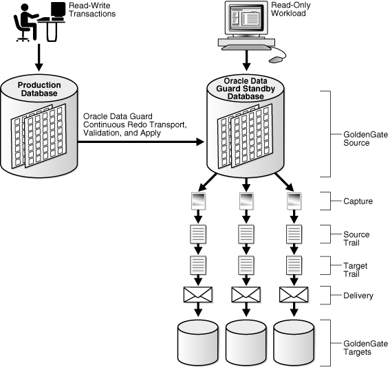

## 3 Oracle Database High Availability Solutions for Unplanned Downtime

Oracle Database offers an integrated suite of high availability solutions that increase availability and eliminate or minimize both planned and unplanned downtime. These solutions help enterprises maintain business continuity 24 hours a day, seven days a week. However, the Oracle high availability solutions go beyond reducing downtime by providing solutions to increase system utilization on the primary and secondary systems and to help improve overall performance, scalability, and manageability.

Oracle provides the following features for high availability for unplanned downtime:

Also, [Chapter 4, "Oracle Database High Availability Solutions for Planned Downtime"](planned.md) provides a summary of the key high availability solutions that address different types of planned downtime along with the recovery time for each solution.

See Also:

- The overview of high availability in [Oracle Database Concepts](http://www.oracle.com/pls/topic/lookup?ctx=db112&id=CNCPT1489)
- The list of new high availability features in [Oracle Database New Features Guide](https://docs.oracle.com/cd/E11882_01/server.112/e41360/toc.htm)

## 3.1 Oracle High Availability Solutions and Recovery for Unplanned Downtime

Oracle Database provides high availability solutions to prevent and reduce downtime for all types of unplanned failures.

Table 3-1 describes the various Oracle high availability solutions for unplanned downtime. The table shows how the features discussed in Section 3.2 through Section 3.21 can be used to address various causes of unplanned downtime. Where several Oracle solutions are listed, the MAA recommended solution is indicated in the Oracle Solution column.

Also, see [Table 7-4](architectures.md) for a summary of the attainable recovery times for all types of unplanned downtime for each Oracle high availability architecture.

Table 3-1 Outage Types and Oracle High Availability Solutions for Unplanned Downtime

| Outage Scope | Oracle Solution | Benefits |
| --- | --- | --- |
| Site Failures | Oracle Data Guard (MAA recommended) | - Fast-start failover and FAN with integrated Oracle clients - Physical replica, high performance, supports all data types |
| Site Failures | Oracle GoldenGate and Oracle Streams | - Flexible active-active high availability solution Foot 1 |
| Site Failures | Recovery Manager | - Fully managed database recovery and integration with Oracle Secure Backup |
| Computer Failures | Oracle Real Application Clusters and Oracle Clusterware (MAA recommended) | - Automatic recovery of failed nodes and instances - Fast application notification (FAN) with integrated Oracle client failover |
| Computer Failures | Oracle RAC One Node | - Always-on single-instance database services - Better database availability than traditional cold failover solutions - Consolidation of database servers |
| Computer Failures | Fast-Start Fault Recovery | - Tunable and predictable cache recovery from computer failures |
| Computer Failures | Oracle Data Guard | - Fast-start failover and FAN with integrated Oracle clients |
| Computer Failures | Oracle GoldenGate and Oracle Streams | - Facilitates creation of a local or remote copy of a production database that can be used to resume processing upon failure |
| Storage Failures | Oracle Automatic Storage Management (MAA recommended) | - Mirroring and online automatic rebalancing places redundant copies of the data in separate failure groups. |
| Storage Failures | Oracle Data Guard (MAA recommended) | - Fast-start failover and FAN with integrated Oracle clients |
| Storage Failures | Recovery Manager with Fast Recovery Area and Oracle Secure Backup | - Fully managed database recovery and managed disk and tape backups |
| Storage Failures | Oracle GoldenGate and Oracle Streams | - Processing resumes on the (local or remote) online replica copy of the production database |
| Data Corruption | Oracle Exadata Storage Server Software (Exadata Cell) and Oracle Automatic Storage Management (MAA recommended) | - If Oracle ASM detects a corruption and has a good mirror, Oracle ASM returns the good block and repairs the corruption during a subsequent write I/O - Exadata Cell is the most comprehensive solution, to prevent corruptions from being written to disk |
| Data Corruption | Corruption Prevention, Detection, and Repair (MAA recommended)  Database initialization settings such as `DB_BLOCK_CHECKING`, `DB_BLOCK_CHECKSUM`, and `DB_LOST_WRITE_PROTECT` | - Different levels of block corruption prevention and detection at the database level |
| Data Corruption | Data Recovery Advisor and Recovery Manager with Fast Recovery Area (MAA recommended) | - Data Recovery Advisor automatically detects data corruptions and recommends the best recovery plan. - RMAN online block-media recovery time is faster because RMAN can use flashback logs to restore a more current copy of the data block for recovery. |
| Data Corruption | Oracle Data Guard (MAA recommended) | - Repair primary data blocks in real time by fetching a good version from a physical standby database - Fast-start failover and FAN with integrated Oracle clients |
| Data Corruption | Oracle GoldenGate and Oracle Streams | - Processing resumes on the (local or remote) online replica copy of the production database |
| Human Errors | Oracle Security Features | - Restrict access as prevention |
| Human Errors | Oracle Flashback Technology | - Fine-grained and database-wide rewind capability |
| Human Errors | LogMiner | - Redo log analysis |
| Lost writes | Oracle Data Guard, Recovery Manager, and the `DB_LOST_WRITE_PROTECT` initialization parameter | - `DB_LOST_WRITE_PROTECT` initialization parameter provides lost write detection. - If a lost write that occurred on the primary database is detected either by the physical standby database or during media recovery of the primary database, recovery is stopped to preserve the consistency of the database. However, failing over to the standby database using Oracle Data Guard will result in some data loss. - If a lost write is detected on the standby database, you can restore the affected file and restart Redo Apply if the lost write is isolated and the hardware problem is corrected. 	Note: Lost writes can corrupt the entire database, which may require that you rebuild the affected database after resolving the hardware issue. |
| Lost writes | Oracle Data Guard  Oracle Exadata Storage Server Software (Exadata Cell) | - Detection and prevention of stray or misdirected writes to another data file. - For the most comprehensive lost write protection, use Oracle Data Guard and set the `DB_LOST_WRITE_PROTECT` parameter (to `TYPICAL` or `FULL`) on both the primary and standby databases |
| Hangs or slow down | Oracle Database and Oracle Enterprise Manager | - Oracle Database automatically monitors for database hangs and attempts to resolve them. - Oracle Enterprise Manager or a customized application heartbeat can be configured to detect application or response time slowdown and react to these SLA breaches. 	For example, you can configure the Enterprise Manager Beacon to monitor and detect application response times. Then, after a certain threshold expires, Enterprise Manager can call the Oracle Data Guard `DBMS_DG.INITIATE_FS_FAILOVER` PL/SQL procedure to initiate a failover. See the section about "Application Initiated Fast-Start Failover" in [Oracle Data Guard Broker](https://docs.oracle.com/cd/E11882_01/server.112/e40771/dbresource.htm#DGBKR00677). |

Footnote 1 Effective when conflicts can be avoided or managed by applications. Active-active configurations usually require data conflicts to be avoided or at least managed by the application. Thus, active-active architecture for real-time replication is more suitable for custom applications.

## 3.2 Fast-Start Fault Recovery

Oracle Database provides fast and predictable recovery from system faults and database failures. The Fast-Start Fault Recovery technology included in Oracle Database automatically bounds instance recovery time at startup by using self-tuned checkpoint processing. This makes recovery time fast and predictable, and improves the ability to meet service-level objectives. The Oracle Fast-Start Fault Recovery feature can reduce recovery time on a heavily laden database from tens of minutes to a few seconds.

Fast-Start Fault Recovery features include:

- Predictable, bounded recovery from instance, database, and computer failures
- Database checkpointing that is self-tuning to maintain a desired recovery time objective

See Also:

[Oracle Database Performance Tuning Guide](https://docs.oracle.com/cd/E11882_01/server.112/e41573/instance_tune.htm#PFGRF13009)

## 3.3 Oracle Restart

Oracle Restart is a new feature in Oracle 11g Release 2 (11.2) that enhances the availability of a single-instance (nonclustered) Oracle database and its components. Oracle Restart is used in single-instance environments only. For Oracle Real Application Clusters (Oracle RAC) environments, the functionality to automatically restart components is provided by Oracle Clusterware.

If you install Oracle Restart, it automatically restarts the database, the listener, and other Oracle components after a hardware or software failure or whenever the database's host computer restarts. It also ensures that the Oracle components are restarted in the proper order, in accordance with component dependencies.

Oracle Restart periodically monitors the health of components—such as SQL\*Plus, the Listener Control utility (LSNRCTL), ASMCMD, and Oracle Data Guard—that are integrated with Oracle Restart. If the health check fails for a component, Oracle Restart shuts down and restarts the component.

Oracle Restart runs out of the Oracle Grid Infrastructure home, which you install separately from Oracle Database homes.

See Also:

- [Oracle Database Administrator's Guide](https://docs.oracle.com/cd/E11882_01/server.112/e25494/restart.htm#ADMIN12708) for information about installing and configuring the Oracle Restart feature
- Oracle Grid Infrastructure Installation Guide for your platform

## 3.4 Oracle Real Application Clusters and Oracle Clusterware

Oracle RAC and Oracle Clusterware allow Oracle Database to run any packaged or custom application across a set of clustered servers. This capability provides the highest levels of availability and the most flexible scalability. If a clustered server fails, then Oracle Database continues running on the surviving servers. When more processing power is needed, you can add another server without interrupting access to data.

Oracle RAC enables multiple instances that are linked by an interconnect to share access to an Oracle database. In an Oracle RAC environment, Oracle Database runs on two or more systems in a cluster while concurrently accessing a single shared database. The result is a single database system that spans multiple hardware systems, enabling Oracle RAC to provide high availability and redundancy during failures in the cluster. Oracle RAC accommodates all system types, from read-only data warehouse systems to update-intensive online transaction processing (OLTP) systems.

Oracle Clusterware is software that, when installed on servers running the same operating system, enables the servers to be bound together to operate as if they are one server, and manages the availability of user applications and Oracle databases. Oracle Clusterware also provides all of the features required for cluster management, including node membership, group services, global resource management, and high availability functions:

- For high availability, you can place Oracle databases (single-instance or Oracle RAC databases), and user applications (Oracle and non-Oracle) under the management and protection of Oracle Clusterware so that the databases and applications restart when a process fails or so that a failover to another node occurs after a node failure.
- For cluster management, Oracle Clusterware presents multiple independent servers as if they are a single-system image or one virtual server. This single virtual server is preserved across the cluster for all management operations, enabling administrators to perform installations, configurations, backups, upgrades, and monitoring functions. Then, Oracle Clusterware automatically distributes the execution of these management functions to the appropriate nodes in the cluster.

Oracle Clusterware is a requirement for using Oracle RAC. Oracle Clusterware is the only clusterware that you need for most platforms on which Oracle RAC operates. Although Oracle Database continues to support third-party clusterware products on specified platforms, using Oracle Clusterware provides these main benefits:

- Dispenses with proprietary vendor clusterware
- Uses an integrated software stack from Oracle that provides disk management with Oracle Automatic Storage Management (Oracle ASM) to data management with Oracle Database and Oracle RAC

In addition, Oracle Database features, such as Oracle Service, use the underlying Oracle Clusterware mechanisms to provide their capabilities.

Oracle Clusterware requires two clusterware components: a voting disk to record node membership information and the Oracle Cluster Registry (OCR) to record cluster configuration information. The voting disk and the OCR must reside on shared storage. Oracle Clusterware requires that each node be connected to a private network over a private interconnect.

For more information, see [Oracle Real Application Clusters Administration and Deployment Guide](https://docs.oracle.com/cd/E11882_01/rac.112/e41960/toc.htm).

### 3.4.1 Benefits of Using Oracle Clusterware

Oracle Clusterware provides the following benefits:

- Tolerates and quickly recovers from computer and instance failures.
- Simplifies management and support by means of using Oracle Clusterware together with Oracle Database. By using fewer vendors and an all Oracle stack you gain better integration compared to using third-party clusterware.
- Performs rolling upgrades for system and hardware changes. For example, you can apply Oracle Clusterware upgrades, patch sets, and interim patches in a rolling fashion, as follows:
	- Upgrade Oracle Clusterware from Oracle Database 10g to Oracle Database 11g
		- Upgrade Oracle Clusterware from Oracle Database release 11.1 to release 11.2
		- Patch Oracle Clusterware from Oracle Database 11.1.0.6 to 11.1.0.7
		- Patch Oracle Clusterware from Oracle Database 10.2.0.2 Bundle 1 to Oracle Database 10.2.0.2 Bundle 2
- Automatically restarts failed Oracle processes.
- Automatically manages the virtual IP (VIP) address so when a node fails then the node's VIP address fails over to another node on which the VIP address can accept connections.
- Automatically restarts resources from failed nodes on surviving nodes.
- Controls Oracle processes as follows:
	- For Oracle RAC databases, Oracle Clusterware controls all Oracle processes by default.
		- For Oracle single-instance databases, Oracle Clusterware allows you to configure the Oracle processes into a resource group that is under the control of Oracle Clusterware.
- Provides an application programming interface (API) for Oracle and non-Oracle applications that enables you to control other Oracle processes with Oracle Clusterware, such as restart or react to failures and certain rules.
- Manages node membership and prevents split-brain syndrome in which two or more instances attempt to control the database.
- Provides the ability to perform rolling release upgrades of Oracle Clusterware, with no downtime for applications.

For more information, see [Oracle Clusterware Administration and Deployment Guide](https://docs.oracle.com/cd/E11882_01/rac.112/e41959/toc.htm).

### 3.4.2 Benefits of Using Oracle Real Application Clusters and Oracle Clusterware

Together, Oracle RAC and Oracle Clusterware provide all of the Oracle Clusterware benefits listed in Section 3.4.1 plus the following benefits:

- Provides better integration and support of Oracle Database by using an all Oracle software stack compared to using third-party clusterware.
- Relocate Oracle Service automatically. Plus, when you perform additional fast application notification (FAN) and client configuration, distribute FAN events so that applications can react immediately to achieve fast, automatic, and intelligent connection and failover.
- Detect connection failures fast and automatically, and remove terminated connections for any Java application using Oracle Universal Connection Pool (UCP) Fast Connection Failover and FAN events.
- Balance work requests using Oracle UCP run-time connection load balancing.
- Use run-time connection load balancing with Oracle UCP, Oracle Call Interface (OCI), and Oracle Data Provider for.NET (ODP.NET).
- Distribute work across all available instances using load balancing advisory.
- Allow the flexibility to increase processing capacity using commodity hardware without downtime or changes to the application.
- Provide comprehensive manageability integrating database and cluster features.
- Provide scalability across database instances.
- Implement Fast Connection Failover for nonpooled connections.

## 3.5 Oracle RAC One Node

Oracle Real Application Clusters One Node (Oracle RAC One Node) is a single instance of an Oracle RAC database that runs on one node in a cluster. This feature allows you to consolidate many databases into one cluster with minimal overhead, protecting them from both planned and unplanned downtime. The consolidated databases reap the high availability benefits of failover protection, online rolling patch application, and rolling upgrades for the operating system and Oracle Clusterware.

Oracle RAC One Node enables better availability than cold failover for single-instance databases because of the Oracle technology called online database relocation, which intelligently migrates database instances and connections to other cluster nodes for high availability and load balancing. Online database relocation is performed using the Server Control Utility (SRVCTL).

Oracle RAC One Node provides the following:

- Always available single-instance database services
- Built-in cluster failover for high availability
- Live migration of instances across servers
- Online rolling patches and rolling upgrades for single-instance databases
- Online upgrade from single-instance to multi-instance Oracle RAC
- Better consolidation for database servers
- Enhanced server virtualization
- Lower cost development and test platform for full Oracle RAC
- Relocation of Oracle RAC primary and standby databases configured with Oracle Data Guard (This functionality is available starting with Oracle Database 11g Release 2 (11.2.0.2))

It also facilitates the consolidation of database storage, standardizes your database environment, and, when necessary, enables you to transition to a full, multiple-instance Oracle RAC database without downtime or disruption.

For more information, see [Section 7.1.3](architectures.md).

## 3.6 Oracle Data Guard

Oracle Data Guard ensures high availability, data protection, and disaster recovery for enterprise data. Oracle Data Guard provides a comprehensive set of services that create, maintain, manage, and monitor one or more standby databases to enable Oracle databases to survive disasters and data corruptions. Oracle Data Guard maintains standby databases as transactionally consistent copies of the primary (production) database. Then, if the primary database becomes unavailable because of a planned or an unplanned outage, Oracle Data Guard can switch any standby database to the primary role, minimizing the downtime associated with the outage. Oracle Data Guard can be used with traditional backup, restoration, and cluster techniques to provide a high level of data protection and data availability.With Oracle Data Guard, administrators can optionally improve primary database performance by off-loading resource-intensive backup and reporting operations to standby systems.

A Oracle Data Guard configuration consists of one primary database and one or more standby databases. A primary database can be either a single-instance Oracle database or an Oracle RAC database. Using a backup copy of the primary database, you can create up to 30 standby databases and incorporate them in a Oracle Data Guard configuration. After the database is created, Oracle Data Guard automatically maintains each standby database by transmitting redo data from the primary database and then applying the redo data to the standby database.

Similar to a primary database, a standby database can be either a single-instance Oracle database or an Oracle RAC database.

A standby database can be a physical standby database, a snapshot standby database, a logical standby database, a transient logical standby database, or Oracle Active Data Guard. An Oracle Data Guard configuration can include any combination of these types of standby databases.

Benefits of Using Oracle Data Guard

Oracle Data Guard provides the following overall benefits:

- Maintenance of real-time, transactionally consistent database copies to provide protection against unplanned downtime and disaster.
- Data protection against and fast repair of computer failures, human errors, data corruption, lost writes, and site failures.
- Automatic failover with flexible data protection levels to support all network configurations and business requirements.
- Faster redo application, redo transport, and role transitions with various enhancements.
- Reduction of planned downtime for system changes, some platform migrations, hardware and system upgrades, and Oracle patch set and database upgrades (see also [Table 4-1](planned.md)).
- Multiple levels of data protection and performance to balance data availability against system performance requirements.
- Support for configuring a scalable and highly available reader farm that provides more efficient use of system resources by diverting querying and reporting functions from the primary database to standby databases.
- Support for the snapshot standby database for reporting or testing (cloning) purposes and automatic resynchronization with the primary database after reporting or testing has completed.
- Support for automatic application notification so that application connections are seamless and fail over transparently.
- Automatic or automated resynchronization of a failed primary database following a failover.
- Management of all systems as a single configuration for simplified administration.
- Increased flexibility for Oracle Data Guard configurations where the primary and standby systems may have different CPU architectures, operating systems (for example, Windows and Linux), operating system binaries (32-bit and 64-bit), and Oracle database binaries (32-bit and 64-bit); this is subject to restrictions that are defined in support note 413484.1 at `http://support.oracle.com/`.

### 3.6.1 Physical Standby Databases

A physical standby database provides a physically identical copy of the primary database, with data files that are identical to the primary database. The database schemas, including indexes, are the same. A physical standby database is kept synchronized with the primary database, through Redo Apply, which recovers the redo data received from the primary database and applies the redo data to the physical standby database.

You can employ a physical standby database for business purposes other than disaster recovery. For example, you can:

- Open a physical standby database for read-only access while redo data is being applied to the standby database. This mode is referred to as the Oracle Active Data Guard option or real-time query, and allows users access to an up-to-date physical standby database while still providing disaster recovery and data protection for the Oracle Database. See Section 3.6.2.
- Use Oracle Active Data Guard to offload fast incremental backups to the standby database.
- Use a physical standby database to offload the overhead of performing backups from the primary database. This is possible because a physical standby is an exact copy of the primary database.
- Convert a physical standby database to a transient logical standby database temporarily, to perform a rolling upgrade. See Section 3.6.3.
- Convert a physical standby database to a snapshot standby database temporarily, to be used as a clone or a test database. See Section 3.6.4.
- Convert a physical standby database to a logical standby database.

Benefits of Physical Standby Databases

Physical standby databases provide the following overall benefits:

- Guarantees a physical, block-for-block copy of the primary database
- Can be open for read-only queries while Redo Apply is active for real-time reporting (requires the Active Data Guard option that is described in Section 3.6.2)
- At role transition, offers assurance that the standby database is an exact replica of the old primary database
- Can be used to offload backups from primary database
- Provides very high performance, completely transparent to workload profile
- Has no data type restrictions
- Can be useful for minimizing downtime for many planned maintenance events

### 3.6.2 Oracle Active Data Guard

Oracle Active Data Guard is Oracle's strategic feature for data protection and disaster recovery for the Oracle database.

Oracle Active Data Guard, which is an option built on the infrastructure of Oracle Data Guard, allows a physical standby database to be open read-only while changes are applied to it from the primary database. This enables read-only applications to use the physical standby with minimal latency between the data on the standby database and that on the primary database, even while processing very high transaction volumes at the primary database. This is sometimes referred to as real-time query.

Note:

The "real-time query" feature of Oracle Active Data Guard enables a physical standby database to be opened read-only while Redo Apply is active. Oracle Active Data Guard is packaged as a separate database option for Oracle Enterprise Edition. It requires a license for production database and all of the physical standby databases that are used for the Oracle Active Data Guard option.

An Oracle Active Data Guard standby database is used for automatic repair of data corruptions detected by the primary database, transparent to the application. In the event of an unplanned outage on the primary database, high availability is maintained by quickly failing over to the standby database. An Active Data Guard standby database can also be used to off-load fast incremental backups from the primary database given that it is a block-for-block physical replica of the primary.

Benefits of Oracle Active Data Guard

Oracle Active Data Guard provides the following overall benefits:

- Makes productive use of existing physical standby databases
- Improves primary database performance by offloading processing to the standby database
- Improves backup performance by offloading fast incremental backups from the primary database to an active standby
- Allows the active standby to automatically repair block corruptions detected at the primary database, transparent to the user and application (and vice versa)
- Provides real-time data access for reporting
- Provides real-time data for Business Intelligence, EPM, and Oracle Exadata
- Offers flexible options to scale read performance while still maintaining disaster recovery, through Reader Farms (see

### 3.6.3 Transient Logical Standby Databases

A transient logical standby database allows you to reuse your current physical standby database by temporarily converting it to a logical standby on which to perform a rolling database upgrade, incurring minimal downtime.

The MAA recommended best practice for performing rolling database upgrades is to use a transient logical standby database and a Bourne shell script (developed by Oracle) that automates database rolling upgrades to new Oracle patch sets or full database releases. The database rolling upgrade is performed using an existing Data Guard physical standby database and the transient logical standby rolling upgrade process.

The Bourne shell script, named physru, greatly reduces the complexity of executing a rolling database upgrade by automating most of the upgrade steps. The script provides many benefits including the ability to handle upgrades for both Oracle RAC and single-instance database. Although the physru script automates upgrade tasks, it is subject to the same prerequisites and limitations as the manual process for executing a transient logical database rolling upgrade. For example, you may need to implement Extended Data Type Support (EDS) to accommodate advanced data types.

See Also:

The following MAA best practices white papers:
- "Database Rolling Upgrades Made Easy by Using a Data Guard Physical Standby Database" for step-by-step instructions to perform a rolling upgrade with a transient logical standby database and the physru script
- "Database Rolling Upgrades Using Transient Logical Standby: Oracle Data Guard 11g" and in particular see the "General Restrictions" and "Confirm Data Type Support" sections for a complete understanding of the prerequisites, limitations, and requirements
- "Extended Datatype Support (EDS) for Oracle Data Guard SQL Apply and Oracle Streams" to learn how to accommodate data types that are not natively supported by logical standby databases

These white papers are available on the MAA Web site at

`http://www.oracle.com/goto/maa`

Benefits of a Transient Logical Standby Database

Transient logical standby databases provide the following overall benefits:

- It allows you to apply and test changes on a completely separate system and database prior to switching the production application and clients over to the upgraded system.
- It greatly improves availability by eliminating planned downtime required for many of the usual tasks associated with a conventional database upgrade, including PL/SQL recompilation.
- It employs existing physical standby databases for database rolling upgrades; there is no additional storage or effort required to deploy a separate logical standby database for the sole purpose of a rolling upgrade.
- It requires executing only a single catalog upgrade to migrate both primary and standby databases to a new Oracle release.
- It allows for additional validation of the upgrade and the system before switching applications and clients to the new environment.
- When the upgrade process is complete, the primary database and physical standby database are both running the new Oracle release.

See Also:

- [Section 4.1, "Oracle High Availability Solutions and Recovery Times for Planned Downtime"](planned.md) for various rolling upgrade strategies for different scenarios
- [Section 7.1.5.2](architectures.md) for more information about multiple standby database architectures

### 3.6.4 Snapshot Standby Databases

A snapshot standby database is a physical standby database that you temporarily convert into an updatable standby database. You can use snapshot standby databases as clones or test databases to validate new functionality and new releases, and when finished you then convert the database back into a physical standby. While running in the snapshot standby database role, it continues to receive and queue redo data so that data protection and the RPO are not sacrificed.

A snapshot standby database receives and archives redo data from the primary database—protecting data on the primary database at all times—but the snapshot standby database does not apply redo data from the primary database while the standby is open for read/write access. Thus, the snapshot standby typically diverges from the primary database over time. Redo Apply does not apply the redo data until you convert the snapshot standby database back into a physical standby database, and all local updates that were made to the snapshot standby database are discarded. Although the local updates to the snapshot standby database cause additional divergence, the data in the primary database is fully protected by the redo log that is located at the standby site.

With a single command, you can revert a snapshot standby to a physical standby database, at which time the changes made to the snapshot standby state are discarded, and Redo Apply automatically resynchronizes the physical standby database with the primary database using the redo data that was archived.

Benefits of Snapshot Standby Databases

Snapshot standby databases provide the following overall benefits:

- Inherit all the attributes of a physical standby database
- Can be open for read/write I/O and can process transactions independent of the primary database
- Protect the primary database the entire time it is open for read-write I/O
- Allow you to issue a single command to convert a snapshot standby back to a synchronized physical standby database
- Provide an ideal test system, especially when combined with Oracle Real Application Testing

### 3.6.5 Logical Standby Databases

A logical standby database contains the same logical information as the primary database, although the physical organization and structure of the data can be different. The logical standby database is kept synchronized with the primary database through SQL Apply, which transforms the redo data received from the primary database into SQL statements and then executes the SQL statements on the standby database.

Benefits of Logical Standby Databases

Logical standby databases provide the following overall benefits:

- A key benefit of a logical standby database is that you can create significant auxiliary structures to optimize the reporting workload, including structures that could have a prohibitive effect on the transactional response time of the primary database. A logical standby database:
	- Can have its data physically reorganized into a different storage type with different partitioning having many different indexes, and having on-demand refresh materialized views created and maintained. See [Oracle Database Concepts](https://docs.oracle.com/cd/E11882_01/server.112/e40540/toc.htm) for an overview of materialized views.
		- Can be used to drive the creation of data cubes and other OLAP data views. See [Oracle OLAP Java API Developer's Guide](https://docs.oracle.com/cd/E11882_01/olap.112/e10795/toc.htm) for more information.
		- Can be used for other business purposes in addition to satisfying disaster recovery requirements, allowing users to access a logical standby database for queries and reporting purposes at any time.
		- Can be used to upgrade Oracle Database software and patch sets with almost no downtime.
	Thus, you can use a logical standby database concurrently for data protection, reporting, and database upgrades.
- Provides a logical, transaction-for-transaction copy of the primary database
- Allows creation of additional objects, modification of objects
- Provides the ability to skip apply on certain objects
- Supports real-time reporting
- Is open for read/write I/O (the data in tables that is maintained by SQL Apply cannot be changed)
- Minimizes downtime for software upgrades (see Oracle Data Guard Concepts and Administration for information about using SQL Apply to perform a rolling upgrade of Oracle Database software.)

## 3.7 Oracle GoldenGate and Oracle Streams

Oracle GoldenGate is Oracle's strategic product for data distribution and data integration. It is a high-performance software application that uses log-based bidirectional data replication for real-time capture, transformation, routing, and delivery of database transactions across heterogeneous systems. Oracle GoldenGate helps you achieve continuous availability and real-time integration for your mission-critical data. It is described in more detail in Section 3.7.1.

Oracle Streams is also a very flexible and powerful database replication feature that Oracle will continue to support but will not make major enhancements in future releases. You can continue to use an existing Oracle Streams deployment to maximize your return on investment. However, you should consider Oracle GoldenGate as the long-term replication strategy for your organization. See the [Oracle Database 2 Day + Data Replication and Integration Guide](https://docs.oracle.com/cd/E11882_01/server.112/e17516/tdpii_repcont.htm#TDPII065), [Oracle Streams Concepts and Administration](https://docs.oracle.com/cd/E11882_01/server.112/e17069/toc.htm), and the [Oracle Streams Replication Administrator's Guide](https://docs.oracle.com/cd/E11882_01/server.112/e10705/config_simple.htm#STREP604) for more information about Oracle Streams data replication and integration.

Oracle GoldenGate will be enhanced with many of the best capabilities of Oracle Streams to create a best-of-both worlds information distribution solution.

### 3.7.1 About Oracle GoldenGate

Oracle GoldenGate is an asynchronous, log-based, real-time data replication product that moves high volumes of transactional data in real-time across heterogeneous database, hardware, and operating system environments with minimal impact.

A typical environment includes a capture, pump and delivery process. Each of these processes can run on most of the popular operating systems and databases, including Oracle Database and non-Oracle databases. All or a portion of the data may be replicated, and the data within any of these processes may be manipulated for not only heterogeneous environments but also different database schemas. Oracle GoldenGate supports multimaster replication, hub-and-spoke deployment, and data transformation. Thus, Oracle GoldenGate enables you to ensure that your critical systems are operational 24/7, and the associated data is distributed across the enterprise to optimize decision making.

Oracle GoldenGate is also an excellent method to minimize downtime during planned maintenance, including application and database upgrades, in addition to platform migrations.

Benefits of Oracle GoldenGate

Oracle GoldenGate optimizes real-time information access and availability because it:

- Supports replication involving a heterogeneous mix of Oracle Database and non-Oracle databases
- Maintains continuous availability to mission-critical systems:
	- Disaster recovery and data protection
		Creates and maintains an immediate failover site with up-to-the-minute data to minimize recovery time for mission-critical systems.
		- Zero downtime operations
		Enables uninterrupted business operations during system upgrades, migration, and maintenance activities.
		- Data distribution
		Synchronizes data for distributed applications in real time for improved availability and scalability.
		- Query offloading
		Ensures high performance for production systems while still supporting necessary read-only activities by replicating data between heterogeneous sources and targets.
- Enables real-time data integration across the enterprise:
	- Real-time data warehousing
		Provides continuous, real-time capture and delivery of the most recent change data between OLTP systems and the data warehouse.
		- Operational reporting
		Off loads reporting activity from the production database to lower-cost secondary systems that have current data for real-time reporting.
		- Operational data integration
		Integrates operational data between OLTP systems in real time.

### 3.7.2 Using Oracle GoldenGate with Oracle Active Data Guard

Oracle Golden Gate and Oracle Active Data Guard are strategic capabilities within Oracle's software portfolio and are complementary to each other. When used together, Oracle GoldenGate and Oracle Active Data Guard offer a unique data protection and information distribution solution not offered by any other product.

Note:

Oracle GoldenGate is an Oracle product sold independently of the Oracle Database for Oracle and third-party database management systems. It is available for both Oracle Database Enterprise Edition and Oracle Database Standard Edition. A license for Oracle GoldenGate includes a license for Oracle Active Data Guard.

While these features generally fall into the category of replication technologies, each has a very different area of focus:

- Oracle Active Data Guard is Oracle's strategic product for data protection and disaster recovery for Oracle Database.
	Oracle Active Data Guard is a superset of standard Data Guard functionality included in Oracle Database Enterprise Edition, thus Active Data Guard also inherits all Data Guard functionality:
	- Transparent operation across all data types, storage attributes, DML and DDL
		- Management simplicity; simple one-way replication of the entire database
		- Superior corruption protection
		- Choice of asynchronous or synchronous (zero data loss) protection
		- High availability during unplanned events via automatic database and client failover
		- Minimized downtime by implementing database upgrades, system and site maintenance, or technology refresh, in rolling fashion across primary and standby databases
	Oracle Active Data Guard requires a separate license and can only be used with Oracle Database Enterprise Edition. It can be purchased as the Active Data Guard Option for Oracle Database Enterprise Edition. It is also included with Oracle GoldenGate. Basic Data Guard functionality does not require a separate license, and it is included with Oracle Enterprise Edition. Oracle Active Data Guard is described in Section 3.6.2.
- Oracle GoldenGate is Oracle's strategic product for data distribution and data integration.
	Oracle GoldenGate supplements Active Data Guard with its heterogeneous and bidirectional replication capabilities to enable enterprise-wide information distribution, zero-downtime upgrades and migrations, query offloading to heterogeneous systems, and multimaster database solutions.

Depending on the business situation:

- Choose Oracle Active Data Guard for a simple, high-performance, drop-in solution for disaster recovery, data protection, and high availability for the entire Oracle database.
- Choose Oracle GoldenGate to set up a data distribution and data synchronization solution through this Oracle-Oracle replication configuration, or a more flexible multimaster HA solution.

Figure 3-1 shows a configuration in which an Oracle Data Guard physical standby database provides optimal data protection and offloads read-only workload from the primary database. It also provides for heterogeneous replication of various subsets of the production database to multiple target databases. Rather than host Oracle GoldenGate replication on the production database, the Oracle GoldenGate capture process is offloaded to the physical standby database where changes are captured from archived redo logs and replicated, without necessitating overhead for Oracle GoldenGate processing on the production system.

Figure 3-1 Oracle GoldenGate and Oracle Data Guard for Unplanned Outages

> This figure is described in the preceding text.
>
> Copyright © 2005, 2013, Oracle and/or its affiliates. All rights reserved.  
> [Legal Notices](https://docs.oracle.com/cd/E11882_01/dcommon/html/cpyr.htm)
  

Oracle GoldenGate is also an excellent method to minimize downtime during planned maintenance, including application and database upgrades and platform migrations.

See Also:

- [Section 4.1.9.3](planned.md) for information about using Oracle GoldenGate to perform database upgrades
- [Section 4.1.10.2](planned.md) for information about using Oracle GoldenGate to perform platform migrations

## 3.8 Oracle Flashback Technology

Flashback technology provides a set of features to switch between views of the data as it existed at different points in time. Using flashback features, you can query past versions of schema objects and historical data. You can also perform change analysis and self-service repair to recover from logical corruption while the database is online.

Flashback technology provides a SQL interface to quickly analyze and repair human errors. Flashback technology provides fine-grained analysis and repair for localized damage such as deleting the wrong customer order. Flashback technology also enables correction of more widespread damage, yet does it quickly to avoid long downtime. Flashback technology is unique to Oracle Database and supports recovery at all levels including row, transaction, table, tablespace, and database.

Most of the flashback features use undo data, whereas other features (such as Flashback Database and Block Media Recovery) use flashback logs:

- Undo tablespace—A dedicated tablespace that stores only undo information when the database is run in automatic undo management mode.
- Flashback Data Archive—An archive that is stored in a tablespace and contains transactional changes to every record in a table for the duration of the record's lifetime. The archived data can be retained for much longer duration than the retention period offered by an undo tablespace.
- Flashback logs—Oracle-generated logs used to perform Flashback Database or block media recovery operations. The database can only write flashback logs to the fast recovery area. Flashback logs are written sequentially and are not archived. They cannot be backed up to disk.

The following sections describes the Flashback features:

### 3.8.1 Oracle Flashback Query

Oracle Flashback Query provides the ability to view the data as it existed in the past by using the Automatic Undo Management system to obtain metadata and historical data for transactions. Undo data is persistent and survives a database malfunction or shutdown. The unique features of Flashback Query not only provide the ability to query previous versions of tables, they also provide a powerful mechanism to recover from erroneous operations.

Uses of Flashback Query include:

- Recovering lost data or undoing incorrect, committed changes. For example, rows that have been deleted or updated can be immediately repaired even after they have been committed.
- Comparing current data with the corresponding data at some time in the past. For example, by using a daily report that shows the changes in data from yesterday, it is possible to compare individual rows of table data, or find intersections or unions of sets of rows.
- Checking the state of transactional data at a particular time, such as verifying the account balance on a certain day.
- Simplifying application design by removing the need to store certain types of temporal data. By using a Flashback Query, it is possible to retrieve past data directly from the database.
- Applying packaged applications, such as report generation tools, to past data.
- Providing self-service error correction for an application, enabling users to undo and correct their errors.

For more information, see the [Oracle Database Development Guide](https://docs.oracle.com/cd/E11882_01/appdev.112/e41502/adfns_flashback.htm#ADFNS01003).

### 3.8.2 Oracle Flashback Version Query

Oracle Flashback Version Query is an extension to SQL that you can use to retrieve the versions of rows in a given table that existed in a specific time interval. Oracle Flashback Version Query returns a row for each version of the row that existed in the specified time interval. For any given table, a new row version is created each time the `COMMIT` statement is executed.

Oracle Flashback Version Query is a powerful tool that database administrators (DBAs) can use to run analysis to determine the source of problems. Additionally, application developers can use Oracle Flashback Version Query to build customized applications for auditing purposes.

For more information, see the [Oracle Database Development Guide](https://docs.oracle.com/cd/E11882_01/appdev.112/e41502/adfns_flashback.htm#ADFNS01004).

### 3.8.3 Oracle Flashback Transaction

Oracle Flashback Transaction backs out a transaction and its dependent transactions. The `DBMS_FLASHBACK.TRANSACTION_BACKOUT()` procedure rolls back a transaction and its dependent transactions while the database remains online. This recovery operation uses undo data to create and execute the compensating transactions that return the affected data to its original state. You can query the `DBA_FLASHBACK_TRANSACTION_STATE` view to see whether the transaction has been backed out using dependency rules or forced out by either:

- Backing out nonconflicting rows
- Applying undo SQL

Oracle Flashback Transaction increases availability during logical recovery by quickly backing out a specific transaction or set of transactions and their dependent transactions. You use one command to back out transactions while the database remains online.

### 3.8.4 Oracle Flashback Transaction Query

Oracle Flashback Transaction Query provides a mechanism to view all changes made to the database at the transaction level. When used in conjunction with Oracle Flashback Version Query, it offers a fast and efficient means to recover from a human or application error. Oracle Flashback Transaction Query increases the ability to perform online diagnosis of problems in the database by returning the database user that changed the row, and performs analysis and audits on transactions.

For more information, see the [Oracle Database Development Guide](https://docs.oracle.com/cd/E11882_01/appdev.112/e41502/adfns_flashback.htm#ADFNS01005).

### 3.8.5 Oracle Flashback Table

Oracle Flashback Table recovers a table to a previous point in time. It provides a fast, online solution for recovering a table or set of tables that has been modified by a human or application error. In most cases, Oracle Flashback Table alleviates the need for administrators to perform more complicated point-in-time recovery operations. The data in the original table is not lost when you use Oracle Flashback Table because you can return the table to its original state.

For more information, see the [Oracle Database Backup and Recovery User's Guide](https://docs.oracle.com/cd/E11882_01/backup.112/e10642/rcmflash.htm#BRADV81517).

### 3.8.6 Oracle Flashback Drop

Dropping objects by accident is a problem for database users and database administrators alike. Although there is no easy way to recover dropped tables, indexes, constraints, or triggers, Oracle Flashback Drop provides a safety net when you are dropping objects. When you drop a table, it is automatically placed into the Recycle Bin. The Recycle Bin is a virtual container where all dropped objects reside. You can continue to query data in a dropped table.

For more information, see the [Oracle Database Backup and Recovery User's Guide](https://docs.oracle.com/cd/E11882_01/backup.112/e10642/rcmflash.htm#BRADV81511).

### 3.8.7 Oracle Flashback Restore Points

When an Oracle Flashback recovery operation is performed on the database, the DBA must determine the point in time—identified by the system change number (SCN) or time stamp—to which you can later flash back the data. Oracle Flashback restore points are labels that you can define to substitute for the SCN or transaction time used in Flashback Database, Flashback Table, and Oracle Recovery Manager (RMAN) operations. Furthermore, a database can be flashed back through a previous database recovery and opened as with an `OPEN RESETLOGS` command by using guaranteed restore points. Guaranteed restore points allow major database changes—such as database batch jobs, upgrades, or patches—to be quickly undone by ensuring that the undo required to rewind the database is retained.

Using the Oracle Flashback restore points feature provides the following benefits:

- The ability to quickly restore to a consistent state, to a time before a planned operation that has gone awry (for example, a failed batch job, an Oracle software upgrade, or an application upgrade).
- The ability to resynchronized the snapshot standby database with the primary database.
- A quick mechanism to restore a test or cloned database to its original state.

For more information, see the [Oracle Database Backup and Recovery User's Guide](https://docs.oracle.com/cd/E11882_01/backup.112/e10642/flashdb.htm#BRADV71000).

### 3.8.8 Oracle Flashback Database

Oracle Flashback Database provides a more efficient alternative to database point-in-time recovery. With Oracle Flashback Database, you can revert current data files to their contents at a past time. The result is much like restoring data from data file backups and executing point-in-time database recovery. However, Flashback Database skips the data file restoration and most of the application of redo data.

Enabling Oracle Flashback Database provides the following benefits:

- The ability to eliminate the time to restore a backup when fixing human error that has a database-wide impact.
- The ability to quickly undo human errors by using real-time apply to synchronize the standby database with the primary database.
- The ability to quickly reinstantiate the standby database after a database failover.

### 3.8.9 Block Media Recovery Using Flashback Logs

After attempting to automatically repair corrupted blocks, block media recovery can optionally retrieve a more recent copy of a data block from the flashback logs to reduce recovery time. Automatic block repair allows corrupt blocks on the primary database to be automatically repaired as soon as they are detected, by using good blocks from a physical standby database.

Furthermore, a corrupted block encountered during instance recovery does not result in instance recovery failure. The block is automatically marked as corrupt and added to the RMAN corruption list in the `V$DATABASE_BLOCK_CORRUPTION` table. You can subsequently issue the RMAN `RECOVER BLOCK` command to fix the associated block. In addition, the RMAN `RECOVER BLOCK` command restores blocks from a physical standby database, if it is available.

See Also:

- [Oracle Database Backup and Recovery User's Guide](https://docs.oracle.com/cd/E11882_01/backup.112/e10642/rcmblock.htm#BRADV89781) for block media repair
- [Oracle Database Backup and Recovery Reference](https://docs.oracle.com/cd/E11882_01/backup.112/e10643/rcmsynta2001.htm#RCMRF140) for the RMAN `RECOVER BLOCK` command
- Section 3.20, "Automatic Block Repair"

### 3.8.10 Flashback Data Archive

The Flashback Data Archive is stored in a tablespace and contains transactional changes to every record in a table for the duration of the record's lifetime. The archived data can be retained for a much longer duration than the retention period offered by an undo tablespace.

For more information, see [Oracle Database Development Guide](https://docs.oracle.com/cd/E11882_01/appdev.112/e41502/adfns_flashback.htm#ADFNS01011).

## 3.9 Oracle Automatic Storage Management

Oracle ASM provides a vertically integrated file system and volume manager directly in the Oracle Database kernel, resulting in:

- Significantly less work to provision database storage
- Higher level of availability
- Elimination of the expense, installation, and maintenance of specialized storage products
- Unique capabilities for database applications

For optimal performance, Oracle ASM spreads files across all available storage. To protect against data loss, Oracle ASM extends the concept of SAME (stripe and mirror everything) and adds more flexibility as it can mirror at the database file level rather than at the entire disk level.

More importantly, Oracle ASM simplifies the processes of setting up mirroring, adding disks, and removing disks. Instead of managing hundreds or possibly thousands of files (as in a large data warehouse), DBAs using Oracle ASM create and administer a larger-grained object called a disk group. The disk group identifies the set of disks that are managed as a logical unit. Automation of file naming and placement of the underlying database files save administrators time and ensure adherence to standard best practices.

The Oracle ASM native mirroring mechanism (two-way or three-way) protects against storage failures. With Oracle ASM mirroring, you can provide an additional level of data protection with the use of failure groups. A failure group is a set of disks sharing a common resource (disk controller or an entire disk array) whose failure can be tolerated. After it is defined, an Oracle ASM failure group intelligently places redundant copies of the data in separate failure groups. This ensures that the data is available and transparently protected against the failure of any component in the storage subsystem.

By using Oracle ASM, you can:

- Mirror and stripe across drives and storage arrays
- Automatically remirror from a failed drive to remaining drives
- Automatically rebalance stored data when disks are added or removed while the database remains online
- Support Oracle database files and nondatabase files using Oracle Automatic Storage Management Cluster File System (Oracle ACFS).
- Allow for operational simplicity in managing database storage
- Manage the Oracle Cluster Registry (OCR) and voting disks
- Provide preferred read capability on disks that are local to the instance, which gives better performance for an extended cluster
- Support very large databases
- Support Oracle ASM rolling upgrades
- Support finer granularity in tuning and security
- Provide fast repair after a temporary disk failure through Oracle ASM Fast Mirror Resync and automatic repair of block corruptions if good copy exists in one of the mirrors
- Provide disaster recovery capability for the file system by enabling replication of Oracle ACFS file systems across the network to a remote site

For more information about ACFS, see the [Oracle Automatic Storage Management Administrator's Guide](https://docs.oracle.com/cd/E11882_01/server.112/e18951/asmfilesystem.htm#OSTMG30000).

## 3.10 Fast Recovery Area

The fast recovery area is a unified storage location for all recovery-related files and activities in Oracle Database. After this feature is enabled, all RMAN backups, archived redo log files, control file autobackups, flashback logs, and data file copies are automatically written to a specified file system or Oracle ASM disk group, and the management of this disk space is handled by RMAN and the database server.

Performing a backup to disk is faster because using the fast recovery area eliminates the bottleneck of writing to tape. More importantly, if database media recovery is required, then data file backups are readily available. Restoration and recovery time is reduced because you do not need to find a tape and a free tape device to restore the needed data files and archived redo log files.

The fast recovery area provides the following benefits:

- Unified storage location of related recovery files
- Management of the disk space allocated for recovery files, which simplifies database administration tasks
- Fast, reliable, disk-based backup and restoration
- Ability to back up and restore the entire fast recovery area

For more information, see the [Oracle Database Backup and Recovery User's Guide](https://docs.oracle.com/cd/E11882_01/backup.112/e10642/rcmconfb.htm#BRADV89418).

## 3.11 Recovery Manager

Oracle Recovery Manager (RMAN) is an Oracle Database utility to manage database backup and, more importantly, the recovery of the database. RMAN eliminates operational complexity while providing superior performance and availability of the database.

RMAN determines the most efficient method of executing the requested backup, restoration, or recovery operation and then submits these operations to the Oracle Database server for processing. RMAN and the server automatically identify modifications to the structure of the database and dynamically adjust the required operation to adapt to the changes.

RMAN provides the following benefits:

- Automatic channel failover on backup and restore operations
- Automatic failover to a previous backup when the restore operation discovers a missing or corrupt backup
- Automatic creation of new database files and temporary files during recovery
- Automatic recovery through a previous point-in-time recovery—recovery through resetlogs
- Block media recovery, which enables the data file to remain online while fixing the block corruption
- Fast incremental backups using block change tracking
- Fast backup and restore operations with intrafile and interfile parallelism
- Enhanced security with virtual private catalog
- Lower space consumption when creating a database over the network by eliminating staging areas
- Merger of incremental backups into image copies in the background, providing up-to-date recoverability
- Optimized backup and restore of required files only
- Retention policy to ensure that relevant backups are retained
- Ability to resume backup and restore of previously failed operations
- Automatic backup of the control file and the server parameter file, ensuring that backup metadata is available in times of database structural changes and media failure and disasters
- Online backup that does not require you to place the database into hot backup mode

For more information, see the [Oracle Database Backup and Recovery User's Guide](https://docs.oracle.com/cd/E11882_01/backup.112/e10642/toc.htm).

## 3.12 Data Recovery Advisor

Data Recovery Advisor automatically diagnoses persistent (on-disk) data failures, presents appropriate repair options, and runs repair operations at your request.

You can use Data Recovery Advisor to troubleshoot primary databases, logical standby databases, and snapshot standby databases.

Data Recovery Advisor includes the following functionality:

- Failure diagnosis
	The first symptoms of database failure are usually error messages, alarms, trace files and dumps, and failed health checks. Assessing these symptoms can be complicated, error-prone, and time-consuming. Data Recovery Advisor automatically diagnoses data failures and informs you about them.
- Failure impact assessment
	After a failure is diagnosed, you must understand its extent and assess its impact on applications before devising a repair strategy. Data Recovery Advisor automatically assesses the impact of a failure and displays it in an easily understood format.
- Repair generation
	Even if a failure has been diagnosed correctly, selecting the right repair strategy can be error-prone and stressful. Moreover, there is often a high penalty for making poor decisions in terms of increased downtime and loss of data. Data Recovery Advisor automatically determines the best repair for a set of failures and presents it to you.
- Repair feasibility checks
	Before presenting repair options, Data Recovery Advisor validates them with respect to the specific environment and availability of media components required to complete the proposed repair.
- Repair automation
	If you accept the suggested repair option, Data Recovery Advisor automatically performs the repair, verifies that the repair was successful, and closes the appropriate failures.
- Validation of data consistency and database recoverability
	Data Recovery Advisor can validate the consistency of your data, and backups and redo stream, whenever you choose.
- Early detection of corruption
	Through Health Monitor, you can schedule periodic runs of Data Recovery Advisor diagnostic checks to detect data failures before a database process executing a transaction discovers the corruption and signals an error. Early warnings can limit the damage caused by corruption.
- Integration of data validation and repair
	Data Recovery Advisor is a single tool for data validation and repair.

Note:

Data Recovery Advisor only supports single-instance databases. Oracle RAC databases are not supported. See [Oracle Database Backup and Recovery User's Guide](https://docs.oracle.com/cd/E11882_01/backup.112/e10642/rcmrepai.htm#BRADV89724) for more information on Data Recovery Advisor supported database configurations.

For more information, see the "Diagnosing and Repairing Failures with the Data Recovery Advisor" section in [Oracle Database Backup and Recovery User's Guide](https://docs.oracle.com/cd/E11882_01/backup.112/e10642/rcmrepai.htm#BRADV246).

## 3.13 Oracle Secure Backup

Oracle Secure Backup is a centralized tape backup management solution providing heterogeneous data protection in distributed UNIX, Linux, Windows, and Network Attached Storage (NAS) Environments. By protecting file system and Oracle Database data, Oracle Secure Backup provides a complete tape backup solution for your IT environment.

Oracle Secure Backup is tightly integrated with RMAN to provide the media management layer for RMAN, supporting releases since Oracle9i. With optimized integration points, Oracle Secure Backup and RMAN provide the fastest and most efficient tape backup capability for Oracle Database.

You can back up distributed servers to local and remote tape devices from a central Oracle Secure Backup administrative server using backup policies, calendar-based scheduling for lights out operations, or on-demand backup for immediate requirements. With its highly scalable client/server architecture, Oracle Secure Backup provides local and remote data protection, using Secure Sockets layer (SSL) for secure intradomain communication and two-way server authentication.

Oracle Secure Backup provides the following benefits:

- Optimized tape backup for Oracle Database by backing up only the currently used blocks and increasing backup performance by 10% to 25%
- Policy-based management that allows backup administrators to exercise precise control over the backup domain
- Dynamic drive sharing for increased tape resource use
- Heterogeneous Storage Area Network (SAN) support allowing NAS, UNIX, Windows, and Linux to share tape drives and media
- File system backup at the file, directory, file system or raw partition level with full, incremental, and offsite backup scheduling
- Integration with Oracle Enterprise Manager, providing an intuitive, familiar interface
- Backup encryption to tape
- Broad tape-device support for new and legacy tape devices in SAN and SCSI environments
- Network Data Management Protocol (NDMP) support for highly efficient backup of NAS files
- Scalable, low-cost licensing model that reduces IT costs and operational considerations

For more information, see the [Oracle Secure Backup Administrator's Guide](http://www.oracle.com/pls/topic/lookup?ctx=db112&id=OBADM).

## 3.14 Oracle Security Features

The best protection against human errors is to prevent their occurrence. The best way to prevent human errors is to restrict user access to only those data and services truly needed to perform business functions. Oracle Database provides a wide range of security tools to control access to application data by authenticating database users and then enabling administrators to grant them only those privileges required to perform their duties.

In addition, the Oracle Database security model provides the ability to restrict data access at a row level using Virtual Private Database, thereby further isolating database users from data that they do not need to access.

Oracle Database provides the following security benefits:

- Authentication control to validate the identities of entities using networks, databases, and applications. Network sessions between databases, such as redo transport sessions, are also authenticated.
- Authorization control to provide limits to access and actions linked by database user identities and roles.
- Access control to objects, providing protection regardless of the entity seeking to access or alter them.
- Auditing control to monitor and gather data about specific database activities, investigate suspicious activity, deter users (or others) from inappropriate activities, and detect problems with authorization or access control implementation.
- Security policy management using profiles.
- Encryption of data residing in the database and backups, or transferred to and from databases.

See Also:

- [Oracle Database Security Guide](https://docs.oracle.com/cd/E11882_01/network.112/e36292/toc.htm)
- [Oracle Data Guard Concepts and Administration](https://docs.oracle.com/cd/E11882_01/server.112/e41134/toc.htm)

## 3.15 LogMiner

Oracle log files contain useful information about the activities and history of Oracle Database. Log files contain all data necessary to perform database recovery, and also record all changes made to the data and metadata in the database.

LogMiner is a fully relational tool that allows redo log files to be read, analyzed, and interpreted using SQL. Using LogMiner, you can analyze log files to:

- Track or audit changes to data
- Provide supplemental information for tuning and capacity planning
- Retrieve critical information for debugging complex applications
- Recover deleted data
- Provide additional browser-based simplification to help troubleshoot and resolve logical failures

LogMiner features include:

- Pinpointing when a logical corruption to the database—such as errors made at the application level—may have occurred
- Determining the necessary actions to perform fine-grained recovery at the transaction level
- Providing performance tuning and capacity planning through trend analysis
- Analyzing system behavior and auditing database use through the LogMiner comprehensive relational interface to redo log files

For more information, see the LogMiner chapter in [Oracle Database Utilities](https://docs.oracle.com/cd/E11882_01/server.112/e22490/logminer.htm#SUTIL019).

## 3.16 Oracle Exadata Storage Server Software (Exadata Cell)

Oracle Exadata Storage Server Software is a storage product that is highly optimized for use with Oracle Database. Oracle Exadata Storage Server Software, also referred to as Exadata Cell, is used to store and access Oracle Database. It runs the Exadata Cell software. It can be used in addition to traditional storage arrays and products. Exadata Cell provides database-aware storage services, such as the ability to offload database processing from the database server, while remaining transparent to SQL processing and database applications.

The Oracle Storage Grid is implemented using either Oracle ASM and Oracle Exadata Storage Server Software or Oracle ASM and third-party storage. The Oracle Storage Grid with Exadata provides seamless support for MAA-related technology, improves performance, provides unlimited I/O scalability, is straightforward to use and manage, and delivers mission-critical availability and reliability to your enterprise. Also, Exadata Cell is the most comprehensive solution, to prevent corruptions from being written to disk. With the `DB_BLOCK_CHECKSUM` initialization parameter enabled, Exadata evaluates block checksums.

See Also:

- Oracle Database High Availability Best Practices to learn about the best practice recommendations for Oracle Storage Grid
- The Oracle Exadata Storage Server Web site at `http://www.oracle.com/exadata`

## 3.17 Oracle Exadata Database Machine

The Oracle Exadata Database Machine is a complete preoptimized and preconfigured package of software, servers, and storage that provides an optimal solution for all database workloads, ranging from scan-intensive data warehouse applications to highly concurrent OLTP applications. It combines Oracle Exadata Storage Server Software, Oracle Database software, and Sun hardware components to deliver extreme performance in a highly available and highly secure environment. Along with Oracle's unique clustering and workload management capabilities, the Database Machine is also well-suited for consolidating multiple databases onto a single grid.

Exadata Database Machine is designed for high performance, scalability and availability for OLTP and Data Warehouse applications.

For unplanned outages, Exadata Database Machine is fault-tolerant and integrated with the MAA best practices to provide the following benefits:

- Tolerates node and instance failures by Oracle RAC
- Tolerates disk and cell failures by Oracle ASM and Oracle Exadata Storage Server Grid
- Prevents and automatically repairs corruptions using the Oracle ASM automatic repair mechanism, the Exadata storage built-in corruption checks, and the Oracle generic block corruption parameters
- Provides redundant and fault tolerant ports, cables, host channel adapters, and bonded networks
- Provides the ability to quickly repair full cluster or Database Machine failures by using Oracle Data Guard and another Exadata Database Machine

For planned maintenance, Exadata Database Machine provides the following benefits:

- Supports Oracle ASM, Oracle Clusterware, and Oracle RAC rolling upgrade or software changes
- Supports Oracle Exadata Storage Server Software rolling upgrade for patches
- Allows application and system changes with Oracle Data Guard and Oracle GoldenGate
- Supports all of the online maintenance capabilities that are generic to the database

For backup and recovery operations, some of the key performance differentiations specific to a single Exadata Database machine include the ability to achieve:

- RMAN tape-based and disk-based complete backups of 7 TB/hour
- RMAN effective backups rates with RMAN incremental backups of 10 to 48 TB/hour
- RMAN restore rates of 23 TB/hour
- Redo Apply and recovery rates of 200 to 637 MB/sec, depending on the workload
- Data Guard deployments for high-end OLTP and Data Warehouse applications

The MAA configuration best practices will continue to be integrated and incorporated during the initial installation and deployment of the Exadata Database Machine and Exadata Cell.

See the MAA OTN Web site for Exadata Database Machine MAA best practices.

## 3.18 Oracle Database File System (DBFS)

Oracle Database File System (DBFS) creates a standard file system interface on top of files and directories that are stored in database tables. Oracle DBFS is similar to the Network File System (NFS) protocol in that it provides a shared network file system that looks like a local file system.

Similar to NFS, there is a server component and a client component. The server is Oracle Database and files are stored as SecureFile LOBs in a database table. Because the files are stored in the database you inherit the high availability and disaster-recovery protection Oracle Database offers, providing a full stack disaster-recovery solution. The implementation of the file system in the database is called the DBFS Content Store and allows each database user to create one or more file systems that can be mounted by clients. Each file system has its own dedicated tables that hold the file system content. A set of PL/SQL procedures implement file system access (such as `CREATE`, `OPEN`, `READ`, `WRITE`, and `LIST` `DIRECTORY)` to the database.

Oracle DBFS provides the following benefits:

- The ability to store both non-structured and structured data in the same database.
	This allows you to perform backups and synchronous point-in-time recovery of both types of data.
	Oracle DBFS provides the ability to store unstructured content in the database by presenting an NFS-like file system to the client. The file system itself is stored in a tablespace in Oracle Database. The database storage aspect is transparent to the client because it appears as a traditional NFS mounted file system with the same functionality, but DBFS provides the ability to store any type of file directly in the database—such as logs or generated reports—that you would normally store in a file system.
- Clustered file system capability with a lightweight process.
	You can mount Oracle DBFS on multiple client machines (database servers, mid-tiers) and therefore the file system can also be available for use as a clustered file system. A lightweight process is started on each client machine to make the file system accessible. This process uses the FUSE (Filesystem in Userspace) API to implement the file system access.
- Fast and transparent client failover of both file system and database operations (full stack disaster recovery).
	The process on the client systems is OCI based. Thus, clients can take advantage of FAN and Fast Connection Failover capabilities using the same service-based connection methods.

For more information, see the [Oracle Database SecureFiles and Large Objects Developer's Guide](https://docs.oracle.com/cd/E11882_01/appdev.112/e18294/toc.htm).

## 3.19 Client Failover

A highly available architecture requires the ability of the application tier to transparently fail over to a surviving instance or database advertising the required service. This ensures that applications are generally available or minimally impacted in the event of node failure, instance failure, data corruption, or database failures. Transparent client failover allows applications to fail over to another available Oracle RAC instance or to another database (such as in the case of an Oracle Data Guard role transition).

Client failover encompasses failure notification, connection cleanup, automatic reconnection and retries of database service residing in another Oracle RAC instance or database and possibly query retry.

For client failover best practices and network best practices, see the MAA white paper "Client Failover Best Practices for Data Guard 11g Release 2" from the MAA Best Practices area for Oracle Database at

`http://www.oracle.com/goto/maa`

## 3.20 Automatic Block Repair

Automatic block repair allows corrupt data blocks to be automatically repaired as soon as the corruption is detected. This feature reduces the amount of time that data is inaccessible due to block corruption. This reduces block recovery time by using up-to-date good blocks in real-time, as opposed to retrieving blocks from disk or tape backups, or from Flashback logs.

Automatic block repair requires the use of the Oracle Active Data Guard option so that you can open a physical standby database for read-write I/O. Also, note that this feature requires that Oracle Data Guard is running in maximum availability mode and has the `LOG_ARCHIVE_DEST_n` initialization parameter set to the `SYNC` redo transport mode.

Note:

The "real-time query" feature of Oracle Active Data Guard enables a physical standby database to be opened read-only while Redo Apply is active. Oracle Active Data Guard is packaged as a separate database option for Oracle Enterprise Edition. It requires a license for production database and all of the physical standby databases that are used for the Oracle Active Data Guard option.

Table 3-2 Automatic Detection and Repair of Corrupt Data Blocks

| If... | Then... |
| --- | --- |
| A corrupt data block is discovered on a primary database | A physical standby database operating in real-time query mode can be used to repair corrupt data blocks in a primary database. If possible, any corrupt data block encountered when a primary database is accessed will be automatically replaced with an uncorrupted copy of that block from a physical standby database operating in real-time query mode. An `ORA-1578` error is returned when automatic repair is not possible. |
| A corrupt data block is discovered on a physical standby database | The server attempts to automatically repair the corruption by obtaining a copy of the block from the primary database if the following database initialization parameters are configured on the standby database:  - Configure the `LOG_ARCHIVE_CONFIG` parameter with a `DG_CONFIG` list - Configure a `LOG_ARCHIVE_DEST_` `n` parameter for the primary database |

You can also manually repair a corrupted data block by using the RMAN `RECOVER BLOCK` command. This command searches several locations for an uncorrupted copy of the data block. By default, one of the locations is any available physical standby database that is operating in real-time query mode. You can use the `EXCLUDE STANDBY` option of the RMAN `RECOVER BLOCK` command to exclude physical standby databases as a source for replacement blocks.

See Also:

- [Oracle Database Backup and Recovery User's Guide](https://docs.oracle.com/cd/E11882_01/backup.112/e10642/rcmvalid.htm#BRADV994) for information about block media recovery
- [Oracle Database Backup and Recovery Reference](https://docs.oracle.com/cd/E11882_01/backup.112/e10643/rcmsynta2001.htm#RCMRF140) for the RMAN `RECOVER BLOCK` command
- [Oracle Data Guard Concepts and Administration](https://docs.oracle.com/cd/E11882_01/server.112/e41134/manage_ps.htm#SBYDB4782) for a description of automatic block repair using real-time query standby database

## 3.21 Corruption Prevention, Detection, and Repair

The MAA recommended way to achieve the most comprehensive data corruption prevention and detection is to use Oracle Data Guard and configure the `DB_BLOCK_CHECKING`, `DB_BLOCK_CHECKSUM`, and `DB_LOST_WRITE_PROTECT` database initialization parameters on the Data Guard primary and standby databases.

Oracle Data Guard is the best solution for protecting Oracle data against data loss and corruption, and lost writes. It is the only Oracle feature that maintains one or more standby databases to protect enterprise data against failures, disasters, errors, and data corruptions. With Data Guard, you can deploy and manage one or more standby copies of the primary (production) database in the local data center or in a remote data center. All the advantages of data protection derive from this fact.

For example, you can use Data Guard to maintain another copy of your data on a standby database that is continuously updated with changes from the production database. Data Guard validates all changes before they are applied to the standby database, preventing physical corruptions from propagating and corrupting the physical standby database. The standby database can be activated if the production database should become unavailable due to site disasters, data corruption, or human error.

Starting in Oracle Database 11g Release 2 (11.2), the primary database automatically attempts to repair the corrupted block in real time by fetching a good version of the same block from a physical standby database. Moreover, the Oracle Active Data Guard option, a feature that enables a physical standby database to be opened read-only while Redo Apply is active, is required for automatic block repair. This feature allows corrupt data blocks to be automatically repaired as soon as the corruption is detected. For more information, see the "Automatic Block Repair" section in this white paper.

Note:

Exadata Cell is another comprehensive solution to prevent corruptions from being written to disk. It can detect corruption early and prevent corrupted data from being written to disk. See Section 3.16 for more information about Exadata Cell.

Before Oracle Database 11g, block corruptions detected by RMAN were recorded in `V$DATABASE_BLOCK_CORRUPTION`. Beginning with Oracle Database 11g, several database components and utilities in addition to RMAN can detect a corrupt block and record it in that view. Oracle Database automatically updates this view when block corruptions are detected or repaired (for example, using block media recovery or data file recovery). Block corruptions are now discovered sooner.

By making it possible to detect data corruptions in a timely manner, these features provide critical high availability benefits for Oracle Database.

See the [Oracle Database High Availability Best Practices](https://docs.oracle.com/cd/E11882_01/server.112/e10803/config_db.htm#HABPT4827) for more information about preventing, detecting, and repairing data corruption. For more information about these views and initialization parameters, see the [Oracle Database Reference](https://docs.oracle.com/cd/E11882_01/server.112/e40402/toc.htm).