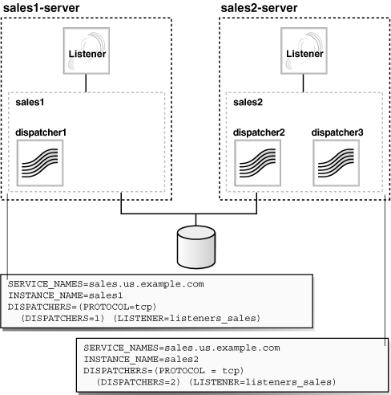
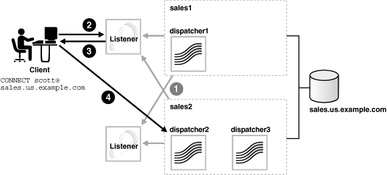
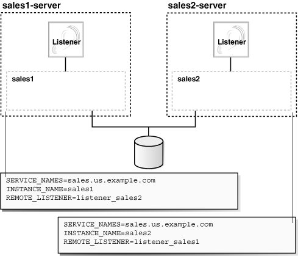
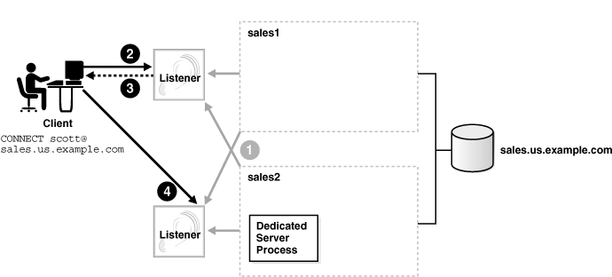

## 13 Enabling Advanced Features of Oracle Net Services

This chapter describes how to configure the advanced features of Oracle Net Services, including advanced connect data parameters, [load balancing](glossary.md), [failover](glossary.md), and connections to non-database services.

This chapter contains the following topics:

## Configuring Advanced Network Address and Connect Data Information

A database service can be accessed by several routes and protocol addresses. You configure which routes to use by setting the list of protocol addresses. You configure the order addresses are used by specifying the address parameters. This section contains the following topics:

- Creating a List of Listener Protocol Addresses
- Configuring Address List Parameters
- Configuring Advanced Connect Data Parameters

### Creating a List of Listener Protocol Addresses

A database service may be accessed by more than one network route, or protocol address. In the following example, `sales.us.example.com` can connect to `sales.us.example.com` using listeners on either `sales1-server` or `sales2-server`.

```
sales.us.example.com=
 (DESCRIPTION=
  (ADDRESS_LIST=
    (ADDRESS=(PROTOCOL=tcp)(HOST=sales1-server)(PORT=1521))
    (ADDRESS=(PROTOCOL=tcp)(HOST=sales2-server)(PORT=1521)))
  (CONNECT_DATA=
    (SERVICE_NAME=sales.us.example.com)))
```

To add a network protocol address to an existing net service name or database service, use either Oracle Enterprise Manager or Oracle Net Manager.

- Using Oracle Enterprise Manager to Add a Network Protocol
- Using Oracle Net Manager to Add a Network Protocol

Using Oracle Enterprise Manager to Add a Network Protocol

The following procedure describes how to add a network protocol to an existing net service name or database service using Oracle Enterprise Manager:

1. Access the Directory Naming or Local Naming page in Oracle Enterprise Manager:
	1. Access the Net Services Administration page in Oracle Enterprise Manager.
		See Also:
		["Using Oracle Enterprise Manager to Configure Oracle Net Services"](admintools.md)
		2. Select Local Naming or Directory Naming from the Administer list, and then select the Oracle home for the directory server or the location of the local configuration files.
		3. Click Go.
		The Directory Naming or Local Naming pages appear.
2. Select the directory service or net service name.
	For Directory Naming, perform a search of the net service name in the Simple Search section, select the net service or database service from the Results list, and then click Edit. For Local Naming, select a net service from the list, and then click Edit.
3. In the Addresses section, click Add.
	The Add Address page appears.
4. From the Protocol list, select the protocol on which the listener is configured to listen. This protocol must also be installed on the client.
5. Enter the appropriate parameter information for the selected protocol in the fields provided.
	See Also:
	[Oracle Database Net Services Reference](https://docs.oracle.com/cd/E11882_01/network.112/e10835/protocoladd.htm#NETRF004) for protocol parameter settings
6. Optionally, in the Advanced Parameters section, specify the I/O buffer space limit for send and receive operations of sessions in the Total Send Buffer Size and Total Receive Buffer Size fields.
	See Also:
	["Configuring I/O Buffer Space"](performance.md) for additional information about buffer space
7. Click OK.
	The protocol address is added to the Addresses section.
8. Click OK to update the address information.

Using Oracle Net Manager to Add a Network Protocol

The following procedure describes how to add a network protocol to an existing net service name or database service using Oracle Net Manager:

1. Start Oracle Net Manager.
	See Also:
	["Using Oracle Net Manager to Configure Oracle Net Services"](admintools.md)
2. In the navigator pane, select Service Naming from the Directory or Local menus.
3. Select either the net service name or a database service.
	The right pane displays the current destination service and address list.
4. In the Address Configuration box, click the plus sign (+) to add a new address.
	A new Address tab appears:
	1. Select the protocol and enter appropriate address information.
		See Also:
		[Oracle Database Net Services Reference](https://docs.oracle.com/cd/E11882_01/network.112/e10835/protocoladd.htm#NETRF0041) for details about protocol address parameters
		2. Optionally, on the Address tab, click Advanced to specify the I/O buffer space limit for send and receive operations of sessions in the Total Send Buffer Size and Total Receive Buffer Size fields.
		See Also:
		["Configuring I/O Buffer Space"](performance.md) for additional information about buffer space
		3. Order the protocol addresses according to where they should be in the protocol address list with the left-arrow and right-arrow buttons. Unless multiple address options are configured, the first address in the list is contacted.
5. Select Save Network Configuration from the File menu.

### Configuring Address List Parameters

When a database service is accessible by multiple listener protocol addresses, specify the order in which the addresses are to be used, such as chosen randomly or tried sequentially. Table 13-1 lists the parameters used with multiple protocol addresses.

Table 13-1 Address List Parameters

| Parameter | Description |
| --- | --- |
| FAILOVER | At connect time, instructs Oracle Net to fail over to a different listener if the first listener fails when set to `on`. The number of addresses in the list determines how many addresses are tried. When set to `off`, instructs Oracle Net to try one address.  Connect-time failover is turned `on` by default for multiple address lists (`ADDRESS_LIST`), connect descriptors (`DESCRIPTION`), and multiple connect descriptors (`DESCRIPTION_LIST`).  When using a connect descriptor with a `SERVICE_NAME`, ensure that the value is not a `GLOBAL_DBNAME` in any `SID_DESC` entry, or a `SID_NAME` in any `SID_DESC` entry without a `GLOBAL_DBNAME` set. |
| LOAD\_BALANCE | When set to `on`, instructs Oracle Net to progress through the list of protocol addresses in a random sequence, balancing the load on the various listeners. When set to `off`, instructs Oracle Net to try the addresses sequentially until one succeeds.  Client load balancing is turned `on` by default for multiple connect descriptors (`DESCRIPTION_LIST`). |
| SOURCE\_ROUTE | When set to `on`, instructs Oracle Net to use each address in the order presented until the destination is reached. This parameter is required for reaching the destination using a specific route, that is, by specific computers. This parameter is used to enable connections to [Oracle Connection Manager](glossary.md). |

Note:

You cannot set source routing with connect-time failover or client load balancing. Source routing connects to each address in the list sequentially whereas connect-time failover and client load balancing select a single address from a list.

See Also:

["Configuring Clients for Oracle Connection Manager"](cman.md) for additional information about configuring clients for source routing

The following procedure describes how to configure address list parameters:

1. Perform the procedure in "Creating a List of Listener Protocol Addresses".
2. Use Oracle Enterprise Manager or Oracle Net Manager to configure address list options.
	- For Oracle Enterprise Manager, select the appropriate option in the Connect-time Failover and Client Load Balancing section.
		- For Oracle Net Manager, click Advanced in the Address Configuration box. The Address List Options dialog box appears. Select the appropriate option.
	Table 13-2 describes the address list options.
	Table 13-2 Address List Options Dialog Box
	| Option | Parameter Setting |
	| --- | --- |
	| Try each address, in order, until one succeeds. | FAILOVER=on |
	| Try each address, randomly, until one succeeds. | LOAD\_BALANCE=on  FAILOVER=on |
	| Try one address, selected at random. | LOAD\_BALANCE=on |
	| Use each address in order until destination reached. | SOURCE\_ROUTE=on |
	| Use only the first address. | LOAD\_BALANCE=off  FAILOVER=off  SOURCE\_ROUTE=off |

The following example shows a `tnsnames.ora` file configured for client load balancing:

```
sales.us.example.com=
 (DESCRIPTION=
  (ADDRESS_LIST=
  (LOAD_BALANCE=on)
   (ADDRESS=(PROTOCOL=tcp)(HOST=sales1-server)(PORT=1521)) 
   (ADDRESS=(PROTOCOL=tcp)(HOST=sales2-server)(PORT=1521)))
  (CONNECT_DATA=
    (SERVICE_NAME=sales.us.example.com)))
```

The following example shows a `tnsnames.ora` file configured for connect-time failover:

```
sales.us.example.com=
 (DESCRIPTION=
  (ADDRESS_LIST=
   (LOAD_BALANCE=off)
   (FAILOVER=ON)
   (ADDRESS=(PROTOCOL=tcp)(HOST=sales1-server)(PORT=1521)) 
   (ADDRESS=(PROTOCOL=tcp)(HOST=sales2-server)(PORT=1521)))
  (CONNECT_DATA=(SERVICE_NAME=sales.us.example.com)))
```

### Configuring Advanced Connect Data Parameters

The `CONNECT_DATA` section of a connect descriptor defines the destination database service. In the following example, `SERVICE_NAME` defines a service called `sales.us.example.com`:

```
sales.us.example.com=
 (DESCRIPTION=
   (ADDRESS=(PROTOCOL=tcp)(HOST=sales-server)(PORT=1521))
   (CONNECT_DATA=
    (SERVICE_NAME=sales.us.example.com)))
```

In addition to the service name, you can optionally configure the connect data information with the parameters described in Table 13-3.

Table 13-3 Advanced Connect Data Settings

| Oracle Enterprise Manager/Oracle Net Manager Option | tnsnames.ora File Parameter | Description |
| --- | --- | --- |
| Instance Name | INSTANCE\_NAME | The database instance to access. The instance name can be obtained from the `INSTANCE_NAME` parameter in the initialization parameter file. |
| Session Data Unit Size | SDU | The transfer rate of data packets being sent across the network. You can specify the [session data unit (SDU)](glossary.md) size to change the performance characteristics having to do with the packets sent across the network. |
| Use for Heterogeneous Services | HS | If you want an Oracle database server to access a third-party system through [Heterogeneous Services](glossary.md), then set this option to `on`. |
| Oracle RDB Database | RDB\_DATABASE | The file name of the Oracle Rdb database. |
| Type of Service | TYPE\_OF\_SERVICE | The type of service to use for the Oracle Rdb database. |
| Global Database Name | GLOBAL\_NAME | Oracle Rdb database identifier. |

In the following example, the transfer rate for data packets is set:

```
sales.us.example.com=
 (DESCRIPTION=
   (ADDRESS=(PROTOCOL=tcp)(HOST=sales-server)(PORT=1521))
   (CONNECT_DATA=
    (SERVICE_NAME=sales.us.example.com)
    (SDU=8192)
))
```

Use Oracle Enterprise Manager or Oracle Net Manager to configure advanced `CONNECT_DATA` parameters for either a net service name or a database service.

Using Oracle Enterprise Manager to Configure Advanced Connect Descriptor Parameters

The following procedure describes how to configure advanced connect descriptor parameters using Oracle Enterprise Manager:

1. Access the Directory Naming or Local Naming page in Oracle Enterprise Manager, as follows:
	1. Access the Net Services Administration page in Oracle Enterprise Manager.
		See Also:
		["Using Oracle Enterprise Manager to Configure Oracle Net Services"](admintools.md)
		2. Select Local Naming or Directory Naming from the Administer list, and then select the Oracle home for the directory server or the location of the local configuration files.
		3. Click Go.
		The Directory Naming or Local Naming pages appear.
2. Select the directory service or net service name.
	For Directory Naming, search the net service name in the Simple Search section by selecting the net service or database service from the Results list, and then clicking Edit. For Local Naming, select a net service from the list, and then click Edit.
3. Click the Advanced tab.
4. Enter fields or select options as appropriate, and then click OK.
5. Click OK to update the connect data information.

Using Oracle Net Manager to Configure Advanced Connect Descriptor Parameters

The following procedure describes how to configure advanced connect descriptor parameters using Oracle Net Manager:

1. Start Oracle Net Manager.
	See Also:
	["Using Oracle Net Manager to Configure Oracle Net Services"](admintools.md)
2. In the navigator pane, select Service Naming from Directory or Local menus.
3. Select either the net service name or a database service.
	The right pane displays the current destination service and address list.
4. In the Service Identification box, click Advanced.
	The Advanced Service Options dialog box appears.
5. Enter fields or select options as appropriate, and then click OK.
6. If you are making these changes to the Local folder, then select Save Network Configuration from the File menu. Changes to the Directory folder are saved automatically.

## Configuring Connection Load Balancing

The [connection load balancing](glossary.md) feature improves connection performance by balancing the number of active connections among multiple [dispatcher](glossary.md) s. In an [Oracle Real Application Clusters (Oracle RAC)](glossary.md) environment, connection pool load balancing also can balance the number of active connections among multiple instances.

Because the [PMON process](glossary.md) can register with remote listeners, a listener can always be aware of all instances and dispatchers, regardless of their location. Depending on the load information, a listener decides which instance and, if shared server is configured, which dispatcher to send the incoming client request.

In a [shared server](glossary.md) configuration, a listener selects a dispatcher in the following order:

1. Least loaded node.
2. Least loaded instance.
3. Least loaded dispatcher for that instance.

In a [dedicated server](glossary.md) configuration, a listener selects an instance in the following order:

1. Least loaded node.
2. Least loaded instance.

If a database service has multiple instances on multiple nodes, then the listener selects the least loaded instance on the least loaded node. If shared server is configured, then the least loaded dispatcher of the selected instance is chosen.

An Oracle Real Application Clusters environment requires that the dispatchers on each instance be cross-registered with the other listeners on the other nodes. This is achieved by the use of the `LISTENER` attribute of the `DISPATCHERS` parameter.

Note:

For optimum connection pool load balancing results, the instances that belong to the same database service should be on equivalent hardware and software configurations.

See Also:

- ["Registering Information with a Remote Listener"](listenercfg.md) for complete information about cross-registration
- [Oracle Database Reference](https://docs.oracle.com/cd/E11882_01/server.112/e40402/initparams_part.htm#REFRN001) for complete information about the `SERVICE_NAMES` and `INSTANCE_NAME` parameters
- [Chapter 11, "Configuring Dispatchers"](dispatcher.md) for complete information about the `LISTENER` attribute

### Example of Connection Load Balancing for Shared Server Configuration

Figure 13-1 shows an Oracle Real Application Clusters shared server database with two instances, `sales1` and `sales2`, of the same service, `sales.us.example.com`. The instances `sales1` and `sales2` reside on computers `sales1-server` and `sales2-server`, respectively. `sales1` has one dispatcher and `sales2` has two dispatchers. Listeners named `listener` run on nodes 1 and 2. The `listener` attribute in the `DISPATCHERS` parameter has been configured to allow for service registration of information to both listeners.

In this example, the following load information is registered:

- The one minute load average for each instance is 600 for `sales1` and 400 for `sales2`.
- The number of connections to each instance is 200 for `sales1` and 300 for `sales2`.
- The number of dispatcher connections to each instance is 200 for `dispatcher1`, 100 for `dispatcher2`, and 200 for `dispatcher3`.
- The load average on `sales2-server` (400) is less than the load average on `sales1-server` (600). This can happen if more processing is required on `sales1-server`. The number of connections to `sales1` (200) is the same as that of its only dispatcher, `dispatcher1`.
- The number of connections on `sales2` (300) is the sum of the connections on its two dispatchers, `dispatcher2` (100) and `dispatcher3` (200). Therefore, `sales2` has more connections than `sales1`. In this example, `sales2-server` is the least loaded node, `sales2` is the least loaded instance, and `dispatcher2` is the least loaded dispatcher.

Figure 13-1 Load Balancing Environment for a Shared Server Configuration



> This illustration depicts two instances. The general description of the instance is described in the surrounding text. sales1 is configured with the following parameter settings in its initialization parameter file:
>
> ```
> SERVICE=NAME=sales.us.example.com
> INSTANCE_NAME=sales1
> DISPATCHERS=(PROTOCOL=tcp)(DISPATCHERS=1)(LISTENER=listeners_sales)
> ```
>
> sales2 is configured with the following parameter settings in its initialization parameter file:
>
> ```
> SERVICE=NAME=sales.us.example.com
> INSTANCE_NAME=sales2
> DISPATCHERS=(PROTOCOL=tcp)(DISPATCHERS=2)(LISTENER=listeners_sales)
> ```
>
> [Copyright © 2002, 2015, Oracle and/or its affiliates. All rights reserved.](https://docs.oracle.com/cd/E11882_01/dcommon/html/cpyr.htm)
  

The `listeners_sales` value in `(LISTENER=listeners_sales)` can be then resolved through a local `tnsnames.ora` file on both servers as follows:

```
listeners_sales= 
 (DESCRIPTION= 
   (ADDRESS=(PROTOCOL=tcp)(HOST=sales1-server)(PORT=1521))
   (ADDRESS=(PROTOCOL=tcp)(HOST=sales2-server)(PORT=1521)))
```

Based on the environment, the following actions occur. The numbered actions correspond to the arrows shown in Figure 13-2:

1. PMON processes for instances `sales1` and `sales2` register with both listeners. The listeners are updated on the load of the instances and dispatchers dynamically.
2. The client sends a connect request. A connect descriptor is configured to try each protocol address randomly until one succeeds:
	```
	sales.us.example.com= 
	 (DESCRIPTION= 
	  (LOAD_BALANCE=on
	)
	  (FAILOVER=on
	)
	  (ADDRESS=(PROTOCOL=tcp)(HOST=sales1-server)(PORT=1521))
	  (ADDRESS=(PROTOCOL=tcp)(HOST=sales2-server)(PORT=1521))
	  (CONNECT_DATA=(SERVICE_NAME=sales.us.example.com)))
	```
	The listener on `sales1-server` was randomly chosen to receive the client connect request.
	The listener on `sales1-server` compares the load of the instances `sales1` and `sales2`. The comparison takes into account the load on nodes `sales1-server` and `sales2-server`, respectively. Because `sales2-server` is less loaded than `sales1-server`, the listener selects `sales2-server` over `sales1-server`.
3. The listener compares the load on dispatchers `dispatcher2` and `dispatcher3`. Because `dispatcher2` is less loaded than `dispatcher3`, the listener redirects the client connect request to `dispatcher2`.
4. The client connects directly to `dispatcher2`.

Figure 13-2 Load Balancing Example for a Shared Server Configuration



> This illustration is described in the surrounding text.
>
> [Copyright © 2002, 2015, Oracle and/or its affiliates. All rights reserved.](https://docs.oracle.com/cd/E11882_01/dcommon/html/cpyr.htm)
  

### Example of Connection Load Balancing for Dedicated Server Configuration

Figure 13-3 shows an Oracle Real Application Clusters dedicated server database with two instances, `sales1` and `sales2`, of the same service, `sales.us.example.com`. The instances `sales1` and `sales2` reside on computers `sales1-server` and `sales2-server`, respectively. Listeners named `listener` run on nodes 1 and 2. The `REMOTE_LISTENER` initialization parameter has been configured to allow for service registration of information to both listeners.

In this example, the following load information is registered:

- `sales1-server` has a node load average of 450 per minute.
- `sales2-server` has a node load average of 200 per minute.
- `sales1` has 200 connections.
- `sales2` has 150 connections.

Figure 13-3 Load Balancing Environment for a Dedicated Server Configuration



> This illustration shows the two instances described in the surrounding text. The instance called sales1 is configured with the following parameter settings in its initialization parameter file:
>
> ```
> SERVICE=NAME=sales.us.example.com
> INSTANCE_NAME=sales1
> REMOTE_LISTENER=listener_sales2
> ```
>
> The instance called sales2 is configured with the following parameter settings in its initialization parameter file:
>
> ```
> SERVICE=NAME=sales.us.example.com
> INSTANCE_NAME=sales2
> REMOTE_LISTENER=listener_sales1
> ```
>
> [Copyright © 2002, 2015, Oracle and/or its affiliates. All rights reserved.](https://docs.oracle.com/cd/E11882_01/dcommon/html/cpyr.htm)
  

The `listener_sales1` value in `(REMOTE_LISTENER=listener_sales1)` can then be resolved through a local `tnsnames.ora` file on the `sales2-server` as follows:

```
listener_sales1= 
 (DESCRIPTION= 
   (ADDRESS=(PROTOCOL=tcp)(HOST=sales1-server)(PORT=1521)))
```

The `listener_sales2` value in `(REMOTE_LISTENER=listener_sales2)` can then be resolved through a local `tnsnames.ora` file on the `sales1-server` as follows:

```
listener_sales2= 
 (DESCRIPTION= 
   (ADDRESS=(PROTOCOL=tcp)(HOST=sales2-server)(PORT=1521)))
```

Based on the environment, the following actions occur. The numbered actions correspond to the arrows shown in Figure 13-4:

1. PMON processes for instances `sales1` and `sales2` register with both listeners. The listeners are updated on the load of the instances dynamically.
	Based on the preceding information, `sales2-server` is the least loaded node and `sales2` is the least loaded instance.
2. The client sends a connect request.
	A connect descriptor is configured to try each protocol address randomly until one succeeds:
	```
	sales.us.example.com= 
	 (DESCRIPTION= 
	  (LOAD_BALANCE=on)
	  (FAILOVER=on)
	  (ADDRESS=(PROTOCOL=tcp)(HOST=sales1-server)(PORT=1521))
	  (ADDRESS=(PROTOCOL=tcp)(HOST=sales2-server)(PORT=1521))
	  (CONNECT_DATA=(SERVICE_NAME=sales.us.example.com)))
	```
	The listener on `sales1-server` was randomly chosen to receive the client connect request.
	The listener on `sales1-server` compares the load of the instances `sales1` and `sales2`. The comparison takes into account the load on nodes `sales1-server` and `sales2-server`, respectively. Because `sales2-server` is less loaded than `sales1-server`, the listener selects `sales2-server` over `sales1-server`.
3. The listener on `sales1-server` redirects the client connect request to the listener on `sales2-server`.
4. The client connects to the listener on `sale2-server`. The listener starts a dedicated server process, and the dedicated server process inherits the connection request from the listener.

Figure 13-4 Load Balancing Example for a Dedicated Server Configuration



> This illustration is described in the surrounding text.
>
> [Copyright © 2002, 2015, Oracle and/or its affiliates. All rights reserved.](https://docs.oracle.com/cd/E11882_01/dcommon/html/cpyr.htm)
  

## Configuring Transparent Application Failover

Transparent Application Failover (TAF) instructs Oracle Net to fail over a failed connection to a different listener. This enables the user to continue to work using the new connection as if the original connection had never failed.

TAF involves manual configuration of a net service name that includes the `FAILOVER_MODE` parameter included in the `CONNECT_DATA` section of the connect descriptor.

This sections contains the following topics:

- About Transparent Application Failover
- What Transparent Application Failover Restores
- About FAILOVER\_MODE Parameters
- Implementing Transparent Application Failover
- Verifying Transparent Application Failover

### About Transparent Application Failover

TAF is a client-side feature that allows clients to reconnect to surviving databases in the event of a failure of a database instance. Notifications are used by the server to trigger TAF callbacks on the client-side.

TAF is configured using either client-side specified Transparent Network Substrate (TNS) connect string or using server-side service attributes. If both methods are used to configure TAF, then the server-side service attributes supersede the client-side settings. Server-side service attributes are the preferred way to set up TAF.

TAF can operate in one of two modes, Session Failover and Select Failover. Session Failover re-creates lost connections and sessions. Select Failover replays queries that were in progress.

When there is a failure, callback functions are initiated on the client-side using Oracle Call Interface (OCI) callbacks. This works with standard OCI connections as well as Connection Pool and Session Pool connections.

TAF operates with Oracle Data Guard to provide automatic failover. TAF works with the following database configurations to effectively mask a database failure:

- Oracle Real Application Clusters
- Replicated systems
- Standby databases
- Single instance Oracle database

See Also:

- Oracle Real Application Clusters Installation and Configuration Guide
- [Oracle Real Application Clusters Administration and Deployment Guide](https://docs.oracle.com/cd/E11882_01/rac.112/e41960/toc.htm)
- [Oracle Call Interface Programmer's Guide](https://docs.oracle.com/cd/E11882_01/appdev.112/e10646/toc.htm) for more details on callbacks, connection pools, and session pools

### What Transparent Application Failover Restores

TAF automatically restores some or all of the following elements associated with active database connections. Other elements may need to be embedded in the application code to enable TAF to recover the connection.

- Client-server database connections: TAF automatically reestablishes the connection using the same connect string or an alternate connect string that you specify when configuring failover.
- Users' database sessions: TAF automatically logs a user in with the same user ID as was used before the failure. If multiple users were using the connection, then TAF automatically logs them in as they attempt to process database commands. Unfortunately, TAF cannot automatically restore other session properties. These properties can be restored by invoking a callback function.
- Completed commands: If a command was completed at the time of connection failure, and it changed the state of the database, then TAF does not resend the command. If TAF reconnects in response to a command that may have changed the database, then TAF issues an error message to the application.
- Open cursors used for fetching: TAF allows applications that began fetching rows from a cursor before failover to continue fetching rows after failover. This is called select failover. It is accomplished by re-running a `SELECT` statement using the same snapshot, discarding those rows already fetched and retrieving those rows that were not fetched initially. TAF verifies that the discarded rows are those that were returned initially, or it returns an error message.
- Active transactions: Any active transactions are rolled back at the time of failure because TAF cannot preserve active transactions after failover. The application instead receives an error message until a `ROLLBACK` is submitted.
- Server-side program variables: Server-side program variables, such as PL/SQL package states, are lost during failures, and TAF cannot recover them. They can be initialized by making a call from the failover callback.

See Also:

[Oracle Call Interface Programmer's Guide](https://docs.oracle.com/cd/E11882_01/appdev.112/e10646/oci09adv.htm#LNOCI090)

### About FAILOVER\_MODE Parameters

The `FAILOVER_MODE` parameter must be included in the `CONNECT_DATA` section of a connect descriptor. `FAILOVER_MODE` can contain the parameters described in Table 13-4.

Table 13-4 Additional Parameters of the FAILOVER\_MODE Parameter

| FAILOVER\_MODE Parameters | Description |
| --- | --- |
| BACKUP | A different net service name for backup connections. A backup should be specified when using `preconnect` to pre-establish connections. |
| DELAY | The amount of time in seconds to wait between connect attempts. If `RETRIES` is specified, then `DELAY` defaults to one second.  If a callback function is registered, then this parameter is ignored. |
| METHOD | Setting for fast failover from the primary node to the backup node:  - `basic`: Set to establish connections at failover time. This option requires almost no work on the backup server until failover time. - `preconnect`: Set to pre-established connections. This provides faster failover but requires that the backup instance be able to support all connections from every supported instance. |
| RETRIES | The number of times to attempt to connect after a failover. If `DELAY` is specified, then `RETRIES` defaults to five retry attempts.  If a callback function is registered, then this parameter is ignored. |
| TYPE | The type of failover. Three types of Oracle Net failover functionality are available by default to Oracle Call Interface (OCI) applications:  - `session`: Set to failover the session. If a user's connection is lost, then a new session is automatically created for the user on the backup. This type of failover does not attempt to recover select operations. - `select`: Set to enable users with open cursors to continue fetching on them after failure. However, this mode involves overhead on the client side in normal select operations. - `none`: This is the default. No failover functionality is used. This can also be explicitly specified to prevent failover from happening. |

Note:

Oracle Net Manager does not provide support for TAF parameters. These parameters must be set manually.

### Implementing Transparent Application Failover

Important:

Do not set the `GLOBAL_DBNAME` parameter in the `SID_LIST_` `listener_name` section of the `listener.ora` file. A statically configured global database name disables TAF.

Depending on the `FAILOVER_MODE` parameters, you can implement TAF in several ways. Oracle recommends the following methods:

- TAF with Connect-Time Failover and Client Load Balancing
- TAF Retrying a Connection
- TAF Pre-establishing a Connection

#### TAF with Connect-Time Failover and Client Load Balancing

Implement TAF with connect-time failover and client load balancing for multiple addresses. In the following example, Oracle Net connects randomly to one of the protocol addresses on `sales1-server` or `sales2-server`. If the instance fails after the connection, then the TAF application fails over to the other node's listener, reserving any `SELECT` statements in progress.

```
sales.us.example.com=
 (DESCRIPTION=
  (LOAD_BALANCE=on) 
  (FAILOVER=on) 
  (ADDRESS=
       (PROTOCOL=tcp)  
       (HOST=sales1-server)  
       (PORT=1521)) 
  (ADDRESS=
       (PROTOCOL=tcp)  
       (HOST=sales2-server)  
       (PORT=1521)) 
  (CONNECT_DATA=
     (SERVICE_NAME=sales.us.example.com) 
     (FAILOVER_MODE=
       (TYPE=select) 
       (METHOD=basic))))
```

#### TAF Retrying a Connection

TAF also provides the ability to automatically retry connecting if the first connection attempt fails with the `RETRIES` and `DELAY` parameters. In the following example, Oracle Net tries to reconnect to the listener on `sales1-server`. If the failover connection fails, then Oracle Net waits 15 seconds before trying to reconnect again. Oracle Net attempts to reconnect up to 20 times.

```
sales.us.example.com=
 (DESCRIPTION=
  (ADDRESS=
       (PROTOCOL=tcp)  
       (HOST=sales1-server)  
       (PORT=1521)) 
  (CONNECT_DATA=
     (SERVICE_NAME=sales.us.example.com) 
     (FAILOVER_MODE=
       (TYPE=select) 
       (METHOD=basic)
       (RETRIES=20)
       (DELAY=15))))
```

#### TAF Pre-establishing a Connection

A backup connection can be pre-established. The initial and backup connections must be explicitly specified. In the following example, clients that use net service name `sales1.us.example.com` to connect to the listener on `sales1-server` are also preconnected to `sales2-server`. If `sales1-server` fails after the connection, then Oracle Net fails over to `sales2-server`, preserving any `SELECT` statements in progress. Similarly, Oracle Net preconnects to `sales1-server` for those clients that use `sales2.us.example.com` to connect to the listener on `sales2-server`.

```
sales1.us.example.com=
 (DESCRIPTION=
  (ADDRESS=
       (PROTOCOL=tcp)  
       (HOST=sales1-server)  
       (PORT=1521)) 
  (CONNECT_DATA=
     (SERVICE_NAME=sales.us.example.com) 
     (INSTANCE_NAME=sales1) 
     (FAILOVER_MODE=
       (BACKUP=sales2.us.example.com) 
       (TYPE=select) 
       (METHOD=preconnect))))
sales2.us.example.com=
 (DESCRIPTION=
  (ADDRESS=
       (PROTOCOL=tcp)  
       (HOST=sales2-server)  
       (PORT=1521)) 
  (CONNECT_DATA=
     (SERVICE_NAME=sales.us.example.com) 
     (INSTANCE_NAME=sales2)
     (FAILOVER_MODE=
       (BACKUP=sales1.us.example.com) 
       (TYPE=select) 
       (METHOD=preconnect))))
```

### Verifying Transparent Application Failover

You can query the `FAILOVER_TYPE`, `FAILOVER_METHOD`, and `FAILED_OVER` columns in the `V$SESSION` view to verify that TAF is correctly configured. To view the columns, use a query similar to the following:

```
SELECT MACHINE, FAILOVER_TYPE, FAILOVER_METHOD, FAILED_OVER, COUNT(*)
FROM V$SESSION
GROUP BY MACHINE, FAILOVER_TYPE, FAILOVER_METHOD, FAILED_OVER;
```

The output before failover looks similar to the following:

```
MACHINE              FAILOVER_TYPE FAILOVER_M FAI   COUNT(*)
-------------------- ------------- ---------- --- ----------
sales1               NONE          NONE       NO          11
sales2               SELECT        PRECONNECT NO           1
```

The output after failover looks similar to the following:

```
MACHINE              FAILOVER_TYPE FAILOVER_M FAI   COUNT(*)
-------------------- ------------- ---------- --- ----------
sales2               NONE          NONE       NO          10
sales2               SELECT        PRECONNECT YES          1
```

Note:

You can monitor each step of TAF using an appropriately configured `OCI TAF CALLBACK` function.

See Also:

- [Oracle Call Interface Programmer's Guide](https://docs.oracle.com/cd/E11882_01/appdev.112/e10646/oci09adv.htm#LNOCI16679)
- [Oracle Database Reference](https://docs.oracle.com/cd/E11882_01/server.112/e40402/dynviews_3016.htm#REFRN30223) for additional information about the `V$SESSION` view

## Specifying the Instance Role for Primary and Secondary Instance Configurations

The `INSTANCE_ROLE` parameter is an optional parameter for the `CONNECT_DATA` section of a connect descriptor. It enables you to specify a connection to the primary or secondary instance of Oracle Real Application Clusters configurations.

This parameter is useful when:

- You want to explicitly connect to a primary or secondary instance. The default is the primary instance.
- You want to use TAF to preconnect to a secondary instance.

The `INSTANCE_ROLE` parameter supports the following values:

- `primary`: Specifies a connection to the primary instance.
- `secondary`: Specifies a connection to the secondary instance.
- `any`: Specifies a connection to whichever instance has the lowest load, regardless of primary or secondary instance role.

Connection to Instance Role Type

In the following example of the `tnsnames.ora` file, net service name `sales_primary` enables connections to the primary instance, and net service name `sales_secondary` enables connections to the secondary instance.

```
sales_primary=
 (DESCRIPTION=
  (ADDRESS=
       (PROTOCOL=tcp)  
       (HOST=sales1-server)  
       (PORT=1521)) 
  (ADDRESS=
       (PROTOCOL=tcp)  
       (HOST=sales2-server)  
       (PORT=1521)) 
  (CONNECT_DATA=
     (SERVICE_NAME=sales.us.example.com) 
     (INSTANCE_ROLE=primary)))
sales_secondary=
 (DESCRIPTION=
  (ADDRESS=
       (PROTOCOL=tcp)  
       (HOST=sales1-server)  
       (PORT=1521)) 
  (ADDRESS=
       (PROTOCOL=tcp)  
       (HOST=sales2-server)  
       (PORT=1521)) 
  (CONNECT_DATA=
     (SERVICE_NAME=sales.us.example.com) 
     (INSTANCE_ROLE=secondary)))
```

Connection To a Specific Instance

There are times when Oracle Enterprise Manager and other system management products need to connect to a specific instance regardless of its role to perform administrative tasks. For these types of connections, configure (`INSTANCE_NAME=` `instance_name``)` and (`INSTANCE_ROLE=any)` to connect to the instance regardless of its role.

In the following example, net service name `sales1` enables connections to the instance on `sales1-server` and `sales2` enables connections to the instance on `sales2-server`. `(SERVER=dedicated)` is specified to force a dedicated server connection.

```
sales1=
 (DESCRIPTION=
  (ADDRESS=
       (PROTOCOL=tcp)  
       (HOST=sales1-server)  
       (PORT=1521)) 
  (CONNECT_DATA=
     (SERVICE_NAME=sales.us.example.com) 
     (INSTANCE_ROLE=any)
     (INSTANCE_NAME=sales1)
     (SERVER=dedicated)))
sales2=
 (DESCRIPTION=
  (ADDRESS=
       (PROTOCOL=tcp)  
       (HOST=sales2-server)  
       (PORT=1521)) 
  (CONNECT_DATA=
     (SERVICE_NAME=sales.us.example.com) 
     (INSTANCE_ROLE=any)
     (INSTANCE_NAME=sales2)
     (SERVER=dedicated)))
```

Note:

Failover is incompatible with the preceding settings.

TAF Pre-Establishing a Connection

If TAF is configured, then a backup connection can be pre-established to the secondary instance. The initial and backup connections must be explicitly specified. In the following example, Oracle Net connects to the listener on `sales1-server` and preconnects to `sales2-server`, the secondary instance. If `sales1-server` fails after the connection, then the TAF application fails over to `sales2-server`, the secondary instance, preserving any `SELECT` statements in progress.

```
sales1.example.com=
 (DESCRIPTION=
  (ADDRESS=
       (PROTOCOL=tcp)  
       (HOST=sales1-server)  
       (PORT=1521)) 
  (CONNECT_DATA=
     (SERVICE_NAME=sales.us.example.com) 
     (INSTANCE_ROLE=primary) 
     (FAILOVER_MODE=

       (BACKUP=sales2.example.com) 

       (TYPE=select)

       (METHOD=preconnect))
))
sales2.example.com=
 (DESCRIPTION=
  (ADDRESS=
       (PROTOCOL=tcp)  
       (HOST=sales2-server)  
       (PORT=1521)) 
  (CONNECT_DATA=
     (SERVICE_NAME=sales.us.example.com) 
     (INSTANCE_ROLE=secondary)))
```

## Configuring Connections to Third-party Database Services

The following topics describe how to configure connections to third-party database services:

- Default Configuration for External Procedures
- Configuring Oracle Net Services for Oracle Heterogeneous Services
- Configuring Oracle Net Services for an Oracle Rdb Database

### Default Configuration for External Procedures

An [external procedure](glossary.md) is a procedure called from another program, written in a different language. An example would be a PL/SQL program calling one or more C routines that are required to perform special-purpose processing.

When an application calls an external procedure, Oracle Database starts an external procedure agent named `extproc`. Using the network connection established by Oracle Database, the application passes the following information to the agent:

- DLL or shared library name
- External procedure name
- Any parameters

The agent then loads the DLL or the shared library, and runs the external procedure and passes back to the application any values returned by the external procedure. The agent must reside on the same computer as the application making the external procedure call.

When you use the default configuration for external procedures, the `extproc` agent is spawned directly by Oracle Database. There are no configuration changes required for either `listener.ora` or `tnsnames.ora`. However, you must define the environment variables to be used by external procedures in the `extproc.ora` file located in the `ORACLE_HOME/hs/admin` directory. If the default configuration for external procedures is not used, then the parameters listed in Table 13-5 must be set.

Table 13-5 External Procedures Settings in listener.ora

| Oracle Enterprise Manager Field | listener.ora Parameter | Description |
| --- | --- | --- |
| Program Name | PROGRAM | The name of the external procedure agent executable.  Note: On Microsoft Windows, the executable must reside in the `ORACLE_HOME\bin` directory. |
| Environment Variables | ENVS | The environment variables to be used by external procedures in the `extproc.ora` file located in the `ORACLE_HOME/hs/admin` directory.  Note: When `extproc.ora` is in use, it precedes the same environment variables of `ENVS` in `listener.ora`.  Syntax: `SET` `name=` `value`  Example: `SET EXTPROC_DLLS=ANY`  Specify the `EXTPROC_DLLS` environment variable to restrict the DLLs that `extproc` is allowed to load. Without the `EXTPROC_DLLS` environment variable, `extproc` loads DLLs from `ORACLE_HOME/lib` on UNIX operating systems and `ORACLE_HOME\bin` on Microsoft Windows.  Set `EXTPROC_DLLS` to one of the following values:  - Colon-separated list of DLLs 	Syntax: `"` `DLL``:``DLL` `"` 	This value allows `extproc` to load the specified DLLs and the DLLs from `ORACLE_HOME/lib` on UNIX operating systems and `ORACLE_HOME\bin` on Microsoft Windows. You must enter the complete directory path and file name of the DLLs. - `ONLY` (Recommended for maximum security) 	Syntax: `"ONLY:``DLL``:``DLL` `"` 	This value allows `extproc` to load only the specified DLLs. You must enter the complete directory path and file name of the DLLs. - `ANY` 	Syntax: `"ANY"` 	Description: This value allows `extproc` to load any DLL. `ANY` disables DLL checking.  Examples:  ``` "EXTPROC_DLLS=/home/xyz/mylib.so:/home/abc/urlib.so, LD_LIBRARY_PATH=/private/xpm/lib:/private/mylibs,  MYPATH=/usr/ucb:/usr/local/packages,APL_ENV_FILE=/apl/conf/env.txt"  "EXTPROC_DLLS=ONLY:/home/xyz/mylib.so:/home/abc/urlib.so, LD_LIBRARY_PATH=/private/xpm/lib:/private/mylibs,  MYPATH=/usr/ucb:/usr/local/packages,APL_ENV_FILE=/apl/conf/env.txt"  "EXTPROC_DLLS=ANY,LD_LIBRARY_PATH=/private/xpm/lib:/private/mylibs,  MYPATH=/usr/ucb:/usr/local/packages,APL_ENV_FILE=/apl/conf/env.txt" ``` |
| Oracle Home Directory | ORACLE\_HOME | The Oracle home location of the agent. |
| SID | SID\_NAME | A system identifier for the external procedure agent by any name. |

Note:

The default configuration for external procedures does not require a network listener to work with Oracle Database and the `extproc` agent. The `extproc` agent is spawned directly by Oracle Database and eliminates the risks that `extproc` might be spawned by Oracle Listener unexpectedly. This default configuration is recommended for maximum security.

You can change the default configuration for external procedures and have the `extproc` agent spawned by Oracle Listener. To do this, you must perform additional network configuration steps.

Having the `extproc` agent spawned by Oracle Listener is necessary if you use:

- Multi-threaded Agent
- Oracle Database in MTS mode on Microsoft Windows
- The `AGENT` clause of the `LIBRARY` specification or the `AGENT IN` clause of the `PROCEDURE` specification such that you can redirect external procedures to a different `extproc` agent.

#### Configuring Oracle Net Services for External Procedures

You can change the default configuration for external procedures and have the `extproc` agent spawned by the listener similar to earlier releases of Oracle Database.

Example 13-1 shows a sample configuration in the `listener.ora` file.

Example 13-1 listener.ora File with an External Procedure

```
LISTENER=
  (DESCRIPTION=
    (ADDRESS_LIST=
      (ADDRESS=(PROTOCOL=tcp)(HOST=sale-server)(PORT=1521))
      (ADDRESS=(PROTOCOL=ipc)(KEY=extproc))))
SID_LIST_LISTENER=
  (SID_LIST=
    (SID_DESC=
      (GLOBAL_DBNAME=sales.us.example.com)
      (ORACLE_HOME=/oracle)
      (SID_NAME=sales))
    (SID_DESC=
      (SID_NAME=plsextproc)
      (ORACLE_HOME=/oracle)
      (PROGRAM=extproc)))
```

Example 13-2 shows a sample configuration in the `tnsnames.ora` file.

Example 13-2 tnsnames.ora File with an External Procedure

```
EXTPROC_CONNECTION_DATA=            
 (DESCRIPTION=                     
   (ADDRESS=(PROTOCOL=ipc)(KEY=extproc)
)                      
   (CONNECT_DATA=
    (SID=plsextproc)
))
```

##### Modifying the Default Configuration for External Procedures:

To modify the default configuration for external procedures, configure and run a separate or existing listener to serve external procedures. The following procedure describes how to modify the default configuration:

1. Configure an existing listener to serve external procedures using Oracle Net Configuration Assistant. For most installation types, this listener is named `LISTENER`, as follows:
	1. Access the Oracle Net Administration page in Oracle Enterprise Manager.
		2. Select Listeners from the Administer list, and then select the Oracle home that contains the location of the configuration files.
		3. Click Go.
		The Listeners page appears.
		4. Select the existing listener created by Oracle Net Configuration Assistant, and then click Edit.
		The Edit Listeners page appears.
		5. In the Addresses section, select the protocol address for external procedures, and then click Add.
		6. Click the Other Services tab.
		7. Select the row representing the service information for external procedures, and then click Add.
2. Add service information about `extproc` in the `listener.ora` file, including the parameters described in Table 13-5.

##### Creating a New Listener to Run External Procedures:

To configure and run a separate listener to serve external procedures, remove the external procedure entries for a different listener using Oracle Net Configuration Assistant. The following procedure describes how to create a new listener:

1. Create a listener to exclusively handle external procedures, as follows:
	1. Navigate to the Listeners page.
		2. Click Create.
		The Create Listener page appears.
		3. In the Listener Name field, enter a unique listener name, such as `LISTENEREXTPROC`, in the Listener Name field.
2. In the Addresses section, configure an IPC protocol address, as follows:
	1. Click Add.
		The Add Address page appears.
		2. From the Protocol list, select IPC.
		3. In the Key field, enter a key value of `extproc`.
		4. Click OK.
		See Also:
		["Configuring Listening Protocol Addresses"](listenercfg.md) for additional information about configuring listener protocol addresses
3. Add service information about `extproc` in the `listener.ora` file, including the parameters described in Table 13-5, as follows:
	1. Click the Other Services tab.
		2. Click Add.
		The Create Other Service page appears.
		3. Enter the following values in the fields:
		- `extproc` in the Program Name field.
				- The Oracle home where the `extproc` executable resides in the Oracle Home Directory field.
				- System identifier, such as `extproc`, in the SID field.
		4. In the Environment Variables section, click Add Another Row.
		5. Enter the `EXTPROC_DLLS` environment variable in the Name field and the directory path and file name of the DLLs in the Value field.
		6. Click OK.
		The Create Listener page appears.
		7. Click OK to add the listener.
		The listener is added to the Listeners page.
		The `listener.ora` file updates with information for external procedures, as shown in the following output:
		```
		LISTENEREXTPROC=
		 (DESCRIPTION=
		  (ADDRESS=
		     (PROTOCOL=ipc)(KEY=extproc)))
		SID_LIST_LISTENEREXTPROC=
		  (SID_LIST=
		    (SID_DESC=
		     (PROGRAM=extproc)
		     (ENVS="EXTPROC_DLLS=ONLY:/home/xyz/mylib.so:/home/abc/urlib.so,
		      LD_LIBRARY_PATH=/private/xpm/lib:/private/mylibs,
		      MYPATH=/usr/ucb:/usr/local/packages,APL_ENV_FILE=/apl/conf/env.txt")
		     (SID_NAME=extproc)
		     (ORACLE_HOME=/oracle)))
		```
4. Start the listener for external procedures from a user account with lower privileges than the `oracle` user.
	Ensure that this user account does not have general access to the files owned by the `oracle` user. Specifically, this user should not have permission to read or write to database files or to the Oracle server address space. In addition, this user should have read access to the `listener.ora` file, but must not have write access to it.
	Running the listener with lower privileges also prevents using the Listener Control `SET` commands to alter the configuration of this listener in the `listener.ora` file. For this reason, Oracle recommends that you complete `listener.ora` file configuration before running the listener.

See Also:

- ["Starting Oracle Net Listener and the Oracle Database Server"](gettingstart.md) for instructions on using the Listener Control utility `START` command to start the listener
- [Oracle Database Application Developer's Guide - Fundamentals](https://docs.oracle.com/cd/E11882_01/appdev.112/e41502/adfns_externproc.htm#ADFNS010) for instruction on enabling external procedure calls

### Configuring Oracle Net Services for Oracle Heterogeneous Services

Heterogeneous Services is an integrated component within the Oracle database server, and provides the generic technology for accessing third-party systems from the Oracle database server. Heterogeneous Services enables you to:

- Use Oracle SQL to transparently access data stored in third-party systems as if the data resides within an Oracle database server.
- Use Oracle procedure calls to transparently access third-party systems, services, or application programming interfaces (APIs), from your Oracle distributed environment.

While Heterogeneous Services provides the generic technology in the Oracle database server, a Heterogeneous Services agent is required to access a particular third-party system.

To initiate a connection to the third-party system, the Oracle database server starts an agent process through the listener on the gateway. The following procedure describes how to configure the Oracle database server to be able to connect to the agents:

1. Configure the listener on the gateway to listen for incoming requests from the Oracle database server and spawn Heterogeneous Services agents by configuring the following parameters in the `listener.ora` file:
	- `PROGRAM`: The name of the agent executable
		- `ORACLE_HOME`: The Oracle home location of the agent executable
		- `SID_NAME`: The Oracle System Identifier (SID)
2. Configure the `PROGRAM`, `ORACLE_HOME`, and `SID` parameters in Oracle Enterprise Manager.
	Access the Oracle Net Administration page in Oracle Enterprise Manager.
	See Also:
	["Using Oracle Enterprise Manager to Configure Oracle Net Services"](admintools.md)
3. Select Listeners from the Administer list, and then select the Oracle home that contains the location of the configuration files.
4. Click Go.
	The Listeners page appears.
5. Select the listener created by Oracle Net Configuration Assistant, and then click Edit.
	The Edit Listeners page appears.
6. In the Addresses section, select the protocol address for external procedures, and then click Remove.
7. Click the Other Services tab.
8. Click Add.
	The Create Other Service page appears.
9. Enter the program name in the Program Name field that will be run to create a gateway, the Oracle home where the agent executable resides in the Oracle Home Directory field, and the SID or service name of the third-party system in the SID field.
10. Click OK.
	The Edit Listener page appears.
11. Click OK to modify the listener.
	The Listeners page appears.
	The `listener.ora` file updates information about the Heterogeneous Services, as shown in the following:
	```
	SID_LIST_LISTENER=
	 (SID_LIST=
	  (SID_DESC=
	   (SID_NAME=sybasegw)
	   (ORACLE_HOME=/oracle11g)
	   (PROGRAM=tg4sybs)))
	```
12. On the computer where the Oracle database resides, set up a net service name to connect to the listener on the gateway. The connect descriptor must include the `HS=ok` clause to make sure the connection uses Heterogeneous Services, as follows:
	1. Create a net service name that can be used for connections from the Oracle database server to a third-party system.
		See Also:
		[Task 1, "Configure Net Services Names"](naming.md) for local naming instructions and [Task 2, "Create Net Service Names in the Directory"](naming.md) for directory naming instructions
		2. Use either Oracle Enterprise Manager or Oracle Net Manager to configure `HS=ok`.
		- For Oracle Enterprise Manager, click the Advanced tab in the Create Net Service Name page, and then click the Use for Heterogeneous Services.
				- For Oracle Net Manager, click Advanced in the Service Identification box. The Advanced Service Options dialog box appears. Click Use for Heterogeneous Services.
		3. Click OK to confirm the change.
		The `tnsnames.ora` file updates with the new net service name configured for Heterogeneous Services, as shown in the following:
		```
		sybase_gtw=
		 (DESCRIPTION=
		  (ADDRESS=(PROTOCOL=tcp)(HOST=gate-server)(PORT=1521))
		  (CONNECT_DATA=
		    (SERVICE_NAME=sybasegw)
		  )
		    (HS=ok)))
		 )
		```

See Also:

[Oracle Database Heterogeneous Connectivity Administrator's Guide](https://docs.oracle.com/cd/E11882_01/server.112/e11050/toc.htm)

### Configuring Oracle Net Services for an Oracle Rdb Database

Oracle Rdb is a database for Digital 64-bit operating systems. Because Oracle Rdb has its own listener, the client interacts with Rdb in the same manner as it does with an Oracle database.

To initiate a connection to an Oracle Rdb, set up a net service name to connect to the Oracle Rdb database using the parameters described in Table 13-6.

Table 13-6 Oracle RDB Database Settings in a Connect Descriptor

| Oracle Enterprise Manager Field | tnsnames.ora Parameter | Description |
| --- | --- | --- |
| Rdb Database | RDB\_DATABASE | The file name of an Oracle Rdb database. |
| Type of Service | TYPE\_OF\_SERVICE | The type of service to use for an Oracle Rdb database. It is used by Rdb interface tools. This feature should only be used if the application supports both Oracle Rdb and Oracle database services, and you want the application to load balance between the two. |
| Global Database Name | GLOBAL\_NAME | The Oracle Rdb database. Optional. |

The following procedure describes how to configure a client for an Oracle Rdb database:

1. Create a net service name that can be used for connections from the Oracle server to a third-party system.
	See Also:
	[Task 1, "Configure Net Services Names"](naming.md) for local naming instructions and [Task 2, "Create Net Service Names in the Directory"](naming.md) for directory naming instructions
2. Use either Oracle Enterprise Manager or Oracle Net Manager to set the Oracle Rdb parameters.
	- For Oracle Enterprise Manager, select Local Naming from the Oracle Net Services administration page, then CREATE LIKE, and then click the Advanced tab on the Create Net Service Name page.
		- For Oracle Net Manager, click Advanced in the Service Identification section. The Advanced Service Options dialog box appears.
3. Enter the file name of an Oracle Rdb database in the Rdb Database field.
4. Optionally, enter the global database name in the Global Database Name field, and, if needed, specify the type of service in the Type of Service field, and then click OK.
	The `tnsnames.ora` file updates with the new net service name configured for the Oracle Rdb database, similar to the following:
	```
	alpha5=
	  (DESCRIPTION=
	    (ADDRESS=...)
	    (CONNECT_DATA=
	      (SERVICE_NAME=generic)
	      (RDB_DATABASE=[.mf]mf_personnel.rdb)
	     (GLOBAL_NAME=alpha5)))
	```
	In the following example, `TYPE_OF_SERVICE` is used to load balance between an Oracle Rdb database service and an Oracle database service:
	```
	alpha5=
	 (DESCRIPTION_LIST=
	  (DESCRIPTION=
	    (ADDRESS=...)
	    (CONNECT_DATA=
	     (SERVICE_NAME=generic)
	     (RDB_DATABASE=[.mf]mf_personnel.rdb)
	     (GLOBAL_NAME=alpha5)))
	  (DESCRIPTION=
	   (ADDRESS=...)
	    (CONNECT_DATA=
	     (SERVICE_NAME=sales.us.example.com))
	   (TYPE_OF_SERVICE=oracle_database))
	```