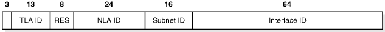

## 10 Configuring Oracle Connection Manager

Oracle Connection Manager is a [proxy server](glossary.md) that forwards connection requests to databases or other proxy servers. It operates on the session level. It usually resides on a computer separate from the database server and client computers. Oracle Connection Manager is available for installation with Oracle Database 11g Enterprise Edition. It is a custom installation option on the Client disk.

The primary functions of Oracle Connection Manager are:

- Access control: To use rule-based configuration to filter out user-specified client requests and accept others.
- Session multiplexing: To funnel multiple client sessions through a network connection to a [shared server](glossary.md) destination.

This chapter describes how to configure [Oracle Connection Manager](glossary.md) features. This chapter contains the following topics:

See Also:

- [Chapter 1, "Introducing Oracle Net Services"](intro.md) for an introduction to Oracle Connection Manager concepts
- [Chapter 4, "Understanding the Communication Layers"](layers.md) for an architectural overview of Oracle Connection Manager

## Configuring Oracle Connection Manager

In order to configure Oracle Connection Manager you must configure the proxy server, database, and clients. The following tasks describe the general procedure:

Task 1 Configure the cman.ora file on the Oracle Connection Manager computer

The `cman.ora` file specifies the listening endpoint for the server, access control rules, and Oracle Connection Manager performance parameters.

"Configuring the cman.ora file for the Oracle Connection Manager Host" explains how to perform this task.

Task 2 Configure the clients with the protocol address of the Oracle Connection Manager listener

"Configuring Clients for Oracle Connection Manager" explains how to perform this task.

Task 3 Configure the database server for session multiplexing. This task is optional

"Configuring the Oracle Database Server for Oracle Connection Manager" explains how to perform this task.

### Configuring the cman.ora file for the Oracle Connection Manager Host

You configure the computer that hosts Oracle Connection Manager by setting parameters in the `cman.ora` file. This file resides on the computer that hosts Oracle Connection Manager, and is located in the `ORACLE_HOME/network/admin` directory. Oracle Connection Manager will not start if the `cman.ora` file does not exist. This file includes the following components:

- Listening endpoint
- Access control rule list
- Parameter list

Each Oracle Connection Manager configuration is encapsulated within a single name-value (NV) string, which consists of the preceding components.

One computer can host any number of Oracle Connection Managers, each with its own entry in the `cman.ora` file. When defining more than one Oracle Connection Manager in the file, you can assign a default by giving only one a fully qualified host name.

You make changes to the `cman.ora` file manually. You can specify multiple rules for both client and Oracle Connection Manager Control utility (CMCTL) connections. The following guidelines apply when making changes:

- You must enter at least one rule for client connections and one rule for CMCTL connections. Omitting a rule results in the rejection of all connections for the rule type omitted.
- Oracle Connection Manager does not support wildcards for partial IP addresses. If you use a wildcard, then use it in place of a full IP address. The IP address of the client may be, for example, (`SRC=*`).
- Oracle Connection Manager supports only the `/nn` notation for subnet addresses. In Example 10-1, in the first rule, `/27` represents a subnet mask that comprises 27 left-most bits. Only the first 27 bits in the client's IP address are compared with the IP address in the rule.

Note:

Oracle Connection Manager supports IPv6 addressing. See "Configuring Oracle Connection Manager as a Bridge for IPv4 and IPv6".

To set parameters in the `cman.ora` file, do the following:

1. Navigate to the `cman.ora` file in the `ORACLE_HOME/network/admin` directory.
2. Open the `cman.ora` file with a text editor.
	Example 10-1 shows a `cman.ora` file that contains a configuration entry for an Oracle Connection Manager called `CMAN1`.
	Example 10-1 Sample cman.ora File
	```
	CMAN1=
	  (CONFIGURATION=
	    (ADDRESS=(PROTOCOL=tcp)(HOST=proxysvr)(PORT=1521))
	    (RULE_LIST=
	      (RULE=(SRC=192.168.2.32/27)(DST=sales-server)(SRV=*)(ACT=accept)
	        (ACTION_LIST=(AUT=on)(MCT=120)(MIT=30)))
	      (RULE=(SRC=192.168.2.32)(DST=proxysvr)(SRV=cmon)(ACT=accept)))
	    (PARAMETER_LIST=
	      (MAX_GATEWAY_PROCESSES=8)
	      (MIN_GATEWAY_PROCESSSES=3)))
	```
3. Configure the listening endpoint (`ADDRESS`).
	The listening endpoint specifies the protocol address for the Oracle Connection Manager listener. CMON, the Oracle Connection Manager monitoring process, uses this address to register information about gateway processes with the listener. The database uses the address to register service information at the Oracle Connection Manager node.
	The Oracle Connection Manager listener always listens on the TCP/IP protocol.
	```
	(ADDRESS=(PROTOCOL=tcp)(HOST=proxysvr)(PORT=1521))
	```
	Note:
	Oracle Connection Manager can connect to the database using protocols such as TCP/IP (version 4 and version 6). The protocol TCPS is not supported.
4. Configure the access control rule list (`RULE_LIST`).
	The access control rule list specifies which connections are accepted, rejected, or dropped by the listener. Example 10-1 shows the following rules:
	- In the first rule in the example, the following parameters are set:
		- `src=192.168.2.32/27` is for client connections. It designates the IP address of the client, or source.
				- `DST=sales-server` designates the destination host name. The parameter `ACT` specifies the action, that is, accept, reject, or drop. The parameter `ACTION_LIST` sets attributes for a connection if it is accepted, enabling you to override default parameter settings on a connection-by-connection basis.
		- In the second rule, the following parameters are set:
		- `SRC=192.168.2.32` and `DST=proxysvr` represent the same server, indicating that Oracle Connection Manager and CMCTL must reside on the same computer.
		See Also:
		"Enabling Access Control"
5. Configure the parameter list (`PARAMETER_LIST`).
	The parameter list sets attributes for an Oracle Connection Manager. Parameters take the following forms:
	- If global, then it applies to all Oracle Connection Manager connections unless a rule-level parameter overrides it. To change a global parameter default setting, enter it into the `PARAMETER_LIST` with an allowable value.
		- If a rule-level parameter is enabled in the `ACTION_LIST` section of the `RULE_LIST`, then it applies only to connections specified by the rule. It overrides its global counterpart.

#### Enabling Access Control

Use the `RULE_LIST` parameter to control client access to designated database servers in a TCP/IP environment. By entering filtering rules under this parameter, you can allow or restrict specific clients access to a database server.

To configure access control, do the following:

1. Open the `cman.ora` file with a text editor.
2. Update the `RULE_LIST` parameter using the following format:
	```
	(RULE_LIST=
	        (RULE=(SRC=source_host
	) 
	              (DST=destination_host
	) 
	              (SRV=service
	) 
	              (ACT=accept | reject | drop)))
	```
	Table 10-1 describes the parameters.
	Table 10-1 Rule-Level Parameters
	| Parameter | Description |
	| --- | --- |
	| SRC | The source host name or IP address of the client. The IP address can be a subnet, such as `192.168.2.62/24`. |
	| DST | The destination host name or IP address of the database server. The IP address can be a subnet, such as `192.168.2.62/24`. |
	| SRV | The service name of the Oracle Database obtained from the `SERVICE_NAME` parameter in the initialization parameter file (`init.ora`). |
	| ACT | To accept, reject, or drop incoming requests based on the preceding three parameters. |

You can define multiple rules in the `RULE_LIST`. The action (`ACT`) in the first matched `RULE` is applied to the connection request. If no rules are defined, then all connections are rejected.

In the following example, client computer `client1-pc` is denied access to the service `sales.us.example.com`, but client `192.168.2.45` is granted access to the service `db1`.

```
(RULE_LIST=
  (RULE=(SRC=client1-pc)(DST=sales-server)(SRV=sales.us.example.com)(ACT=reject))
  (RULE=(SRC=192.168.2.45)(DST=192.168.2.200)(SRV=db1)(ACT=accept)))
```

See Also:

[Oracle Database Net Services Reference](https://docs.oracle.com/cd/E11882_01/network.112/e10835/protocoladd.htm#NETRF004) for additional information about Oracle Connection Manager parameters

### Configuring Clients for Oracle Connection Manager

To route clients to the database server through Oracle Connection Manager, configure the `tnsnames.ora` file with a [connect descriptor](glossary.md) that specifies the protocol address of Oracle Connection Manager. This address enables clients to connect to the Oracle Connection Manager computer. The connect descriptor looks similar to the following:

```
sales=
  (DESCRIPTION=
    (ADDRESS=
      (PROTOCOL=tcp)
      (HOST=cman-pc)
      (PORT=1521))
    (CONNECT_DATA=
      (SERVICE_NAME=example.com)))
```

To configure a protocol address for Oracle Connection Manager, do the following:

1. Start Oracle Net Manager.
	See Also:
	["Using Oracle Net Manager to Configure Oracle Net Services"](admintools.md)
2. In the navigator pane, select Service Naming from Directory or Local menus.
3. Click the plus sign (+) on the toolbar, or select Create from the Edit menu.
	The Welcome page of the Net Service Name wizard appears.
4. Enter a name in the Net Service Name field.
5. Click Next.
	The Protocol page appears.
6. Select the TCP/IP protocol for Oracle Connection Manager.
7. Click Next.
	The Protocol Settings page appears.
8. Specify the Oracle Connection Manager port and protocol. The default port number for Oracle Connection Manager is 1521, and the protocol is TCP/IP.
	See Also:
	[Oracle Database Net Services Reference](https://docs.oracle.com/cd/E11882_01/network.112/e10835/protocoladd.htm#NETRF004) for protocol parameter settings
9. Click Next.
	The Service page appears.
10. Enter a service name in the Service Name field, and then select the connection type.
	See Also:
	["About Connect Descriptors"](concepts.md) for additional information about setting the service name string
11. Click Next.
	Note:
	Do not click Test, because a connection cannot be tested at this point.
12. Click Finish to save your configuration and dismiss the Net Service Name wizard.
	The new net service name and the Oracle Connection Manager protocol address is added to the Service Naming folder.

### Configuring the Oracle Database Server for Oracle Connection Manager

Configuring the database server is a two-part process that involves registering database information remotely with Oracle Connection Manager and, optionally, configuring the server for multiplexing.

This section contains the following topics:

- Configuring Service Registration
- Enabling Session Multiplexing

#### Configuring Service Registration

To enable the database server to communicate with Oracle Connection Manager, the initialization parameter file `(init.ora)` must contain a descriptor that specifies the listening address of Oracle Connection Manager, and the `tnsnames.ora` file must include the service name entry. The following procedure describes how to configure service registration:

1. Resolve the alias to a service name entry in the `tnsnames.ora` file as follows:
	```
	cman_listener_address
	 =
	  (DESCRIPTION=
	    (ADDRESS_LIST=
	      (ADDRESS=(PROTOCOL=tcp) (HOST=proxy_server_name
	)( PORT=1521))))
	```
	For example, the alias `listeners_cman` would be resolved to the following entry in the `tnsnames.ora` file:
	```
	listener_cman=
	 (DESCRIPTION=
	  (ADDRESS_LIST=
	   (ADDRESS=(PROTOCOL=tcp)(HOST=proxyserver1)(PORT=1521))))
	```
2. Specify an alias for Oracle Connection Manager in the `init.ora` file as follows. This alias is the one specified in the `tnsnames.ora` file in step 1.
	```
	REMOTE_LISTENER=cman_listener_address
	```
	The alias must be specified because this address is TCP, port 1521 but it is not the default local listening address of TCP, port 1521 of the database server.
	For example, the alias for the Oracle Connection Manager listener running on host, `proxyserver1`, specified in step 1, might look like the following in the `init.ora` file:
	```
	REMOTE_LISTENER=listener_cman
	```
3. After the initialization parameter file is configured with the listening address of Oracle Connection Manager, the [PMON process](glossary.md) can register database information with the Oracle Connection Manager listener. Use the following command to register the change:
	```
	SQL> ALTER SYSTEM REGISTER
	```

See Also:

["Registering Information with a Remote Listener"](listenercfg.md)

#### Enabling Session Multiplexing

To enable Oracle Connection Manager to take advantage of session multiplexing, set the `DISPATCHERS` parameter in the initialization parameter file (`init.ora`) with the attributes `PROTOCOL` and `MULTIPLEX`, similar to the following:

```
DISPATCHERS="(PROTOCOL=tcp)(MULTIPLEX=on)"
```

Table 10-2 lists the parameters to set different levels of multiplexing.

Table 10-2 Session Multiplexing Parameters

| Attribute | Description |
| --- | --- |
| PROTOCOL | The network protocol for which the dispatcher generates a listening endpoint. |
| MULTIPLEX | Used to enable session multiplexing  If `1`, `on`, `yes`, `true`, or `both` is specified, then multiplexing is enabled for both incoming and outgoing network sessions.  If `in` is specified, then multiplexing is enabled for incoming network sessions from the client.  If `out` is specified, then multiplexing is enabled for outgoing network sessions.  If `0`, `off`, `no`, or `false` is specified, then multiplexing is disabled for both incoming and outgoing network sessions. |

Note:

You can configure the `DISPATCHERS` parameter using the [Database Configuration Assistant](glossary.md).

See Also:

- [Chapter 11, "Configuring Dispatchers"](dispatcher.md) for additional information about configuring shared servers
- [Oracle Database Net Services Reference](https://docs.oracle.com/cd/E11882_01/network.112/e10835/cman.htm#NETRF009) for a complete list of parameters and their default and allowed values

## Configuring Oracle Connection Manager as a Bridge for IPv4 and IPv6

In some database connection environments, a client and database may use different versions of the IP protocol so that complete connectivity does not exist. In this case at least two hops in the connection use different versions of the IP protocol. For example, a request passes from an IPv4 source to an IPv6 destination, from an IPv6 source to an IPv4 destination, or from IPv6 to IPv6 through an IPv4 network.

You can use Oracle Connection Manager as a network bridge between [IPv4](glossary.md) and [IPv6](glossary.md). To serve as a bridge, Oracle Connection Manager must run on a dual-stack host configured with at least one IPv4 interface and at least one IPv6 interface.

Use the Oracle Connection Manager filtering feature to filter based on an IPv6 address. You can base rules on complete or partial IP addresses. Figure 10-1 shows the format of an IPv6 address.

Figure 10-1 IPv6 Address Format



> The illustration shows a rectangle with 6 segments. Segment 1 is 3 bits. Segment 2 is 13 bits and contains TLA ID. Segment 3 is 8 bits and contains RES. Segment 4 is 24 bits and contains NLA ID. Segment 5 is 16 bits and contains Subnet ID. Segment 6 is 64 bits and contains Interface ID.
  

The numbers at the top of the diagram indicate the number of bits in the address. Each hexadecimal character in an IPv6 address represents 4 bits. Bits 4-16 are the Top-Level Aggregation Identifier (TLA ID) portion of the address. Bits 25-49 are the Next-Level Aggregation Identifiers (NLA ID).

For example, in the address `2001:0DB8::203:BAFF:FE0F:C74B`, the binary representation of the first four hexademical characters (`2001`) is as follows:

```
0010000000000001
```

Thus, the first 3 bits in the address are `001`. The TLA ID portion of the address is `0000000000001`.

To create a rules filter for IPv6 address, do the following:

1. Navigate to the `cman.ora` file located in the `ORACLE_HOME/network/admin` directory.
2. Open the `cman.ora` file with a text editor.
3. Create a `RULE` in the `RULE_LIST` based on IPv6 address format.
	For example, assume that the source host is an IPv6-only host with address `2001:0DB8::203:BAFF:FE0F:C74B`, whereas the destination is an IPv4-only host named `SALESL1593`. You configure Oracle Connection Manager as an IPv6-to-IPv4 bridge by creating one of the following rules:
	| Type of Rule | Description | Example |
	| --- | --- | --- |
	| Filter based on subnet ID | Filtering is based on the 64 bits up to and including the subnet ID | ``` (RULE = (SRC = 2001:0DB8::203:BAFF:FE0F:C74B/64 )   (DST = SALESL1593)   (SRV = SALES)   (ACT = ACCEPT)   (ACTION_LIST = (AUT=ON)(MOCT=10)(MIT=30)(CONN_STATE=YES)) ) ``` |
	| Filter based on NLA ID | Filtering is based on the 48 bits up to and including the NLA ID | ``` (RULE = (SRC = 2001:0DB8::203:BAFF:FE0F:C74B/48 )   (DST = SALESL1593)   (SRV = SALES)   (ACT = ACCEPT)   (ACTION_LIST = (AUT=ON)(MOCT=10)(MIT=30)(CONN_STATE=YES)) ) ``` |
	| Filter based on TLA ID | Filtering is based on the 16 bits up to and including the TLA ID | ``` (RULE = (SRC = 2001:0DB8::203:BAFF:FE0F:C74B/16 )   (DST = SALESL1593)   (SRV = SALES)   (ACT = ACCEPT)   (ACTION_LIST = (AUT=ON)(MOCT=10)(MIT=30)(CONN_STATE=YES)) ) ``` |
	| Filter based on number of bits | Filtering is based on the first 60 bits of the address | ``` (RULE = (SRC = 2001:0DB8::203:BAFF:FE0F:C74B/60 )   (DST = SALESL1593)   (SRV = SALES)   (ACT = ACCEPT)   (ACTION_LIST = (AUT=ON)(MOCT=10)(MIT=30)(CONN_STATE=YES)) ) ``` |

See Also:

- ["TCP/IP Protocol"](layers.md) to learn more about IPv6
- ["About IPv6 Addresses in Connect Descriptors"](concepts.md)
- ["Configuring Listening Protocol Addresses"](listenercfg.md)

## Using the Oracle Connection Manager Control Utility to Administer Oracle Connection Manager

The Oracle Connection Manager Control utility enables you to administer an Oracle Connection Manager. When you issue commands from the operating system, the basic syntax for this utility is as follows:

```
cmctl [command] [argument1 . . . argumentN] [-c instance_name]
```

In the preceding command, `-c` specifies the Oracle Connection Manager instance. You are prompted for the password if one has been set.

Caution:

There is an option to specify the password on the command line. However, this exposes the password on the screen, and is a potential security risk. Oracle recommends not using the password option (`-p`) on the command line.

For example, the following command starts the listener, Connection Manager Administration (CMADMIN), and gateway processes for an instance named `cman1`:

```
cmctl STARTUP -c cman1
```

You can also issue Oracle Connection Manager utility commands at the `CMCTL` program prompt. To obtain the prompt, enter `cmctl` with no arguments at the operating system command line. When you run `CMCTL`, the utility is started, and you can enter the necessary commands from the program prompt. The following is an example of the program prompt:

```
cmctl
CMCTL> STARTUP
```

Note:

Before issuing the `STARTUP` command, do the following:
- Create the `cman.ora` file. A sample file is located in the `ORACLE_HOME/network/admin/samples` directory after installation of Oracle Connection Manager.
- Run the `ADMINISTER` command to choose an instance to start.

See Also:

- ["Understanding Oracle Connection Manager Architecture"](net_arch.md) for an overview of the Oracle Connection Manager processes
- [Oracle Database Net Services Reference](https://docs.oracle.com/cd/E11882_01/network.112/e10835/cmctl.htm#NETRF170) for a complete description of Oracle Connection Manager Control utility commands