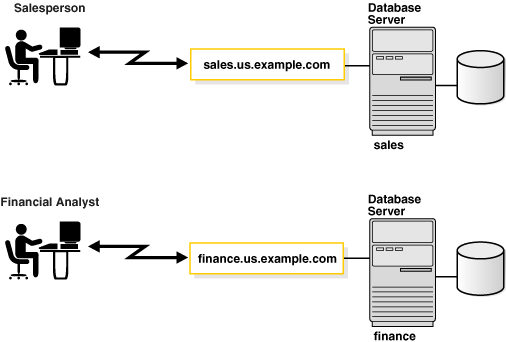
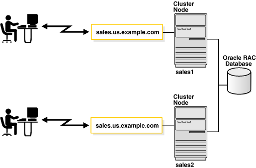
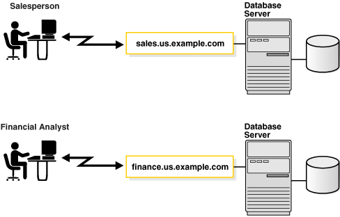
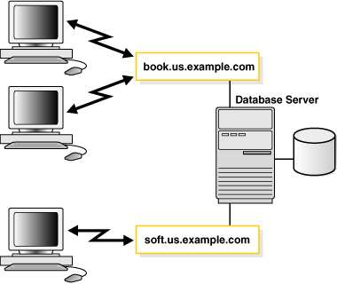
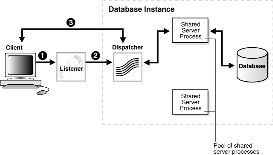
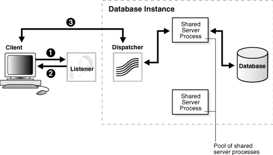
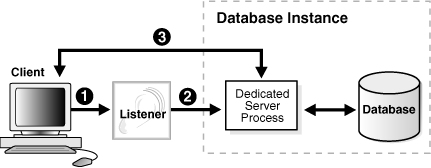
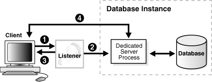
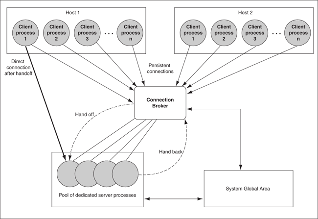

## 2 Identifying and Accessing the Database

This chapter explains how databases are identified and how clients access them. This chapter contains the following topics:

## Understanding Database Instances

A database has at least one [instance](glossary.md). An instance is comprised of a memory area called the [System Global Area (SGA)](glossary.md) and Oracle background processes. The memory and processes of an instance efficiently manage the associated database's data and serve the database users.

Note:

An instance also manages other services, such as [Oracle XML DB](glossary.md).

Figure 2-1 shows two database instances, `sales` and `finance`, associated with their respective databases and service names.

Figure 2-1 One Instance for Each Database



> This illustration shows two sample database server connections, and shows the associated instances.
>
> The first is a salesperson connecting to a database server named sales.us.example.com and an instance named sales. The second is a financial analyst connecting to a database service named finance.us.example.com and an instance named finance.
>
> [Copyright © 2002, 2015, Oracle and/or its affiliates. All rights reserved.](https://docs.oracle.com/cd/E11882_01/dcommon/html/cpyr.htm)
  

Instances are identified by an [instance name](glossary.md), `sales` and `finance` in this example. The instance name is specified by the `INSTANCE_NAME` initialization parameter. The instance name defaults to the [Oracle system identifier (SID)](glossary.md) of the database instance.

Some hardware architectures allow multiple computers to share access to data, software, or peripheral devices. [Oracle Real Application Clusters (Oracle RAC)](glossary.md) (Oracle RAC) can take advantage of such architecture by running multiple instances on different computers that share a single physical database.

Figure 2-2 shows an Oracle RAC configuration. In this example, two instances, `sales1` and `sales2`, are associated with one database service, `sales.us.example.com`.

Figure 2-2 Multiple Instances Associated with an Oracle RAC Database



> This illustration shows two users connecting to a database server named sales.us.example.com. One user connects to instance sales1, and the other user connects to instance sales2. The instances reside on different nodes.
>
> [Copyright © 2002, 2015, Oracle and/or its affiliates. All rights reserved.](https://docs.oracle.com/cd/E11882_01/dcommon/html/cpyr.htm)
  

## Understanding Database Services

An Oracle database is represented to clients as a [service](glossary.md). A database can have one or more services associated with it.

Figure 2-3 shows two databases, each with its own database service for clients. One service, `sales.us.example.com`, enables salespersons to access the sales database. Another service, `finance.us.example.com`, enables financial analysts to access the finance database.

Figure 2-3 One Service for Each Database



> This illustration shows two sample database server connections. The first is a salesperson connecting to a database server with a server name of sales.us.example.com. The second is a financial analyst connecting to a database server with a service name of finance.us.example.com.
>
> [Copyright © 2002, 2015, Oracle and/or its affiliates. All rights reserved.](https://docs.oracle.com/cd/E11882_01/dcommon/html/cpyr.htm)
  

The sales and finance databases are each identified by a [service name](glossary.md), `sales.us.example.com` and `finance.us.example.com`, respectively. A service name is a logical representation of a database. When an instance starts, it registers itself with a listener using one or more service names. When a client program or database connects to a listener, it requests a connection to a service.

A service name can identify multiple database instances, and an instance can belong to multiple services. For this reason, the listener acts as a mediator between the client and instances and routes the connection request to the appropriate instance. Clients connecting to a service need not specify which instance they require.

The service name is specified by the `SERVICE_NAMES` initialization parameter in the [server parameter file](glossary.md). The server parameter file enables you to change initialization parameters with `ALTER SYSTEM` commands, and to carry the changes across a shutdown and startup. The DBMS\_SERVICE package can also be used to create services. The service name defaults to the [global database name](glossary.md), a name comprising the database name (`DB_NAME` initialization parameter) and domain name (`DB_DOMAIN` initialization parameter). In the case of `sales.us.example.com`, the database name is `sales` and the domain name is `us.example.com`.

Figure 2-4 shows clients connecting to multiple services associated with one database.

Figure 2-4 Multiple Services Associated with One Database



> This illustration shows three Web browsers connecting to the same database server. While two Web browsers are connecting to the book.us.example.com service, the other Web browser is connecting to the soft.us.example.com service. Both services are associated with the same database.
>
> [Copyright © 2002, 2015, Oracle and/or its affiliates. All rights reserved.](https://docs.oracle.com/cd/E11882_01/dcommon/html/cpyr.htm)
  

Associating multiple services with one database enables the following functionality:

- A single database can be identified different ways by different clients.
- A database administrator can limit or reserve system resources. This level of control enables better allocation of resources to clients requesting one of these services.

See Also:

- [Oracle Database Administrator's Guide](https://docs.oracle.com/cd/E11882_01/server.112/e25494/create.htm#ADMIN12541) for additional information about initialization parameters
- [Oracle Database SQL Reference](https://docs.oracle.com/cd/E11882_01/server.112/e41084/statements_2.htm#SQLRF009) for additional information about the `ALTER SYSTEM` statement
- [Oracle Database Reference](https://docs.oracle.com/cd/E11882_01/server.112/e40402/initparams231.htm#REFRN10194) for additional information about the `SERVICE_NAMES` parameter
- [Oracle Database PL/SQL Packages and Types Reference](https://docs.oracle.com/cd/E11882_01/appdev.112/e40758/d_serv.htm#ARPLS092) for additional information about the DBMS\_SERVICE package.

## Connecting to a Database Service

To connect to a database service, clients use a [connect descriptor](glossary.md) that provides the location of the database and the name of the database service. The following example is an Easy Connect descriptor that connects to a database service named `sales.us.example.com`, and the host `sales-server` (the port is 1521 by default):

```
sales-server/sales.us.example.com
```

The following example shows the `tnsnames.ora` entry for the preceding Easy Connect connect descriptor and database service:

```
(DESCRIPTION=
  (ADDRESS=(PROTOCOL=tcp)(HOST=sales-server
)(PORT=1521))
  (CONNECT_DATA=
    (SERVICE_NAME=sales.us.example.com
)))
```

This section contains the following topics:

- About Connect Descriptors
- About the Protocol Address
- About Service Registration

See Also:

"Understanding Naming Methods"

### About Connect Descriptors

A connect descriptor is comprised of one or more protocol addresses of the listener and the connect information for the destination service in the `tnsnames.ora` file. Example 2-1 shows a connect descriptor mapped to the `sales` database.

Example 2-1 Connect Descriptor

```
sales=
 (DESCRIPTION= 
  (ADDRESS=(PROTOCOL=tcp)(HOST=sales-server)(PORT=1521)) 
  (CONNECT_DATA= 
     (SID=sales)
     (SERVICE_NAME=sales.us.example.com)
     (INSTANCE_NAME=sales)))
```

As shown in Example 2-1, the connect descriptor contains the following parameters:

- The `ADDRESS` section contains the following:
	- `PROTOCOL` parameter, which identifies the listener protocol address. The protocol is `tcp` for TCP/IP.
		- `HOST` parameter, which identifies the host name. The host is `sales-server`.
		- `PORT` parameter, which identifies the port. The port is `1521`, the default port number.
- The `CONNECT_DATA` section contains the following:
	- `SID` parameter, which identifies the SID of the Oracle database. The SID is `sales`.
		- `SERVICE_NAME` parameter, which identifies the service. The destination service name is a database service named `sales.us.example.com`.
		The value for this connect descriptor parameter comes from the `SERVICE_NAMES` initialization parameter (`SERVICE_NAMES` uses a final `S`) in the initialization parameter file. The `SERVICE_NAMES` initialization parameter is typically the [global database name](glossary.md), which includes the database name and domain name. In the example, `sales.us.example.com` has a database name of `sales` and a domain of `us.example.com`.
		- `INSTANCE_NAME` parameter, which identifies the database instance. The instance name is optional.
		The `INSTANCE_NAME` parameter in the initialization parameter file defaults to the SID entered during installation or database creation.

See Also:

"Understanding Database Instances", and "Understanding Database Services"

#### About IPv6 Addresses in Connect Descriptors

A host can use IP version 4 (IPv4) and IP version 6 (IPv6) interfaces. IPv6 addresses and host names that resolve to IPv6 addresses are usable in the `HOST` parameter of a TNS connect address, which can be obtained through any of the supported Net naming methods listed in Table 2-1.

End-to-end connectivity using IPv6 in Oracle Database 11g requires the following configuration:

- The client TNS connect address must connect to the Oracle Net Listener on the IPv6 endpoint.
- The database instance configured for Oracle Net Listener must listen for connection requests on IPv6 endpoints.

For a given host name, Oracle Net attempts to connect to all IP addresses returned by Domain Name System (DNS) name resolution until a successful connection is established or all addresses have been attempted. Suppose that in Example 2-1 the `sales-server` host is an IPv4-only host that is accepting client connections. DNS maps `sales-server` to the following IP addresses:

1. IPv6 address `2001:0DB8:0:0::200C:417A`
2. IPv4 address `192.168.2.213`

In this case, Oracle Net first tries to connect on the IPv6 address because it is first in the DNS list. In this example `sales-server` does not support IPv6 connectivity, so this attempt fails. Oracle Net proceeds to connect to the IPv4 address, which succeeds.

### About the Protocol Address

The address portion of the connect descriptor is the protocol address of the [listener](glossary.md). To connect to a database service, clients first contact a listener process that typically resides on the database server. The listener receives incoming client connection requests and sends these requests to the database server. After the connection is established, the client and database server communicate directly.

The listener is configured to accept requests from clients at a [protocol address](glossary.md). This address defines the protocol the listener is listening on and any other protocol-specific information. For example, the listener could be configured to listen at the following protocol address:

```
(DESCRIPTION=
   (ADDRESS=(PROTOCOL=tcp)(HOST=sales-server)(PORT=1521)))
```

The preceding example shows a TCP/IP protocol address that specifies the host of the listener and a port number. Client connect descriptors configured with this same protocol address can send connection requests to this listener.

### About Service Registration

The connect descriptor specifies the database service name with which clients seek to establish a connection. The listener knows which services can handle connection requests because an Oracle database dynamically registers this information with the listener. This process of registration is called [service registration](glossary.md). Registration also provides the listener with information about the database instances and the service handlers available for each instance. A service handler can be a [dispatcher](glossary.md) or [dedicated server](glossary.md).

#### Specifying an Instance Name

If connecting to a specific instance of the database is required, then clients can specify the `INSTANCE_NAME` of a particular instance in the connect descriptor. This feature can be useful if you have an Oracle Real Application Clusters configuration. For example, the following connect descriptor specifies the instance name `sales1` that is associated with `sales.us.example.com`.

```
(DESCRIPTION=
  (ADDRESS=(PROTOCOL=tcp)(HOST=sales-server)(PORT=1521))
  (CONNECT_DATA=
    (SERVICE_NAME=sales.us.example.com)
    (INSTANCE_NAME=sales1)))
```

#### Specifying a Service Handler

Clients that always want to use a particular service handler type can use a connect descriptor to specify the service handler type. In the following example, a connect descriptor is configured to use a dispatcher for a shared server configuration, as indicated by `(SERVER=shared)`.

```
(DESCRIPTION=
  (ADDRESS=(PROTOCOL=tcp)(HOST=sales-server)(PORT=1521))
  (CONNECT_DATA=
    (SERVICE_NAME=sales.us.example.com)
     (SERVER=shared)))
```

When the listener receives the client request, it selects one of the registered service handlers. Depending on the type of handler selected, the communication protocol used, and the operating system of the database server, the listener performs one of the following actions:

- Hands the connect request directly off to a dispatcher.
- Sends a redirect message back to the client with the location of the dispatcher or dedicated server process. The client then connects directly to the dispatcher or dedicated server process.
- Spawns a dedicated server process and passes the client connection to the dedicated server process.

After the listener has completed the connection operation for the client, the client communicates directly with the Oracle database without the listener's involvement. The listener resumes listening for incoming network sessions.

The following are considerations when specifying service handlers:

- If you want the client to use a dedicated server, then specify `(SERVER=dedicated)`. If the `SERVER` parameter is not set, then shared server configuration is assumed. However, the client will use a dedicated server if no dispatchers are available.
- If database resident connection pooling is enabled on the server, then specify `(SERVER=pooled)` to get a connection from the pool. If database resident connection pooling is not enabled on the server, then the client request is rejected, and the user receives an error message.

See Also:

- "Understanding Service Handlers" for a description about these service handler types
- ["About the Listener and Connection Requests"](net_arch.md) for a discussion about how the listener works with service handlers
- "About Database Resident Connection Pooling"
- [Oracle Call Interface Programmer's Guide](https://docs.oracle.com/cd/E11882_01/appdev.112/e10646/oci09adv.htm#LNOCI090) and [Oracle Database Administrator's Guide](https://docs.oracle.com/cd/E11882_01/server.112/e25494/manproc.htm#ADMIN12349) for additional information about enabling and configuring database resident connection pooling

## Understanding Service Handlers

Service handlers act as connection points to an Oracle database. A service handler can be a [shared server process](glossary.md) or a [dedicated server](glossary.md) process, or pooled.

This section contains the following topics:

- About Dispatchers
- About Dedicated Server Processes
- About Database Resident Connection Pooling

### About Dispatchers

The shared server architecture uses a dispatcher process to direct client connections to a common request queue. An idle shared server process from a shared pool of server processes picks up a request from the common queue. This approach enables a small pool of server processes to serve a large number of clients. A significant advantage of the shared server model over the dedicated server model is reduced system resources, enabling support of an increased number of users.

The listener uses the dispatcher as a type of [service handler](glossary.md) to which it can direct client requests. When a client request arrives, the listener performs one of the following actions:

- Hands the connection request directly to a dispatcher.
- Issues a redirect message to the client, containing the protocol address of a dispatcher. The client then terminates the network session to the listener and establishes a network session to the dispatcher, using the network address provided in the redirect message.

The listener uses direct hand off whenever possible. Redirect messages are used, for example, when dispatchers are remote to the listener.

Figure 2-5 shows the listener handing a connection request directly to a dispatcher.

1. The listener receives a client connection request.
2. The listener hands the connect request directly to the dispatcher.
3. The client is now connected to the dispatcher.

Figure 2-5 Direct Hand-Off to a Dispatcher



> This illustration shows the direct hand-off sequence described in the preceding text. It also shows a database instance that contains a dispatcher and two shared server processes. One of the shared server processes picks up the connection request from the dispatcher, enabling a connection to an Oracle database.
>
> [Copyright © 2002, 2015, Oracle and/or its affiliates. All rights reserved.](https://docs.oracle.com/cd/E11882_01/dcommon/html/cpyr.htm)
  

Figure 2-6 shows the role of a dispatcher in a redirected connection.

1. The listener receives a client connection request.
2. The listener provides the location of the dispatcher to the client in a redirect message.
3. The client connects directly to the dispatcher.

Figure 2-6 Redirected Connection to a Dispatcher



> This illustration shows the redirected connection sequence described in the preceding text. It also shows a database instance that containing a dispatcher and two shared server processes. One of the shared server processes picks up the connection request from the dispatcher, enabling a connection to an Oracle database.
>
> [Copyright © 2002, 2015, Oracle and/or its affiliates. All rights reserved.](https://docs.oracle.com/cd/E11882_01/dcommon/html/cpyr.htm)
  

### About Dedicated Server Processes

In a dedicated server configuration, the listener starts a separate dedicated server process for each incoming client connection request dedicated to servicing the client. After the session is complete, the dedicated server process terminates. Because a dedicated server process has to be started for each connection, this configuration may require more system resources than shared server configurations.

A dedicated server process is a type of service handler that the listener starts when it receives a client request. To complete a client/server connection, one of the following actions occurs:

- The dedicated server inherits the connection request from the listener.
- The dedicated server informs the listener of its listening protocol address. The listener passes the protocol address to the client in a redirect message and terminates the connection. The client connects to the dedicated server directly using the protocol address.

One of the preceding actions is selected based on the operating system and the transport protocol.

If the client and database exist on the same computer, then a client connection can be passed directly to a dedicated server process without going through the listener. This is known as a bequeath protocol. The application initiating the session spawns a dedicated server process for the connection request. This happens automatically if the application used to start the database is on the same computer as the database.

Note:

In order for remote clients to connect to dedicated servers, the listener and the database instance must be running on the same computer.

Figure 2-7 shows the listener passing a client connection request to a dedicated server process.

1. The listener receives a client connection request.
2. The listener starts a dedicated server process, and the dedicated server inherits the connection request from the listener.
3. The client is now connected directly to the dedicated server.

Figure 2-7 Connection to a Dedicated Server Process



> This illustration shows the connection sequence described in the preceding text. It also shows a database instance that contains a dedicated server process, which provides the client a connection to an Oracle database.
>
> [Copyright © 2002, 2015, Oracle and/or its affiliates. All rights reserved.](https://docs.oracle.com/cd/E11882_01/dcommon/html/cpyr.htm)
  

Figure 2-8 shows the role of a dedicated server in a redirected connection.

1. The listener receives a client connection request.
2. The listener starts a dedicated server process.
3. The listener provides the location of the dedicated server process to the client in a redirect message.
4. The client connects directly to the dedicated server.

Figure 2-8 Redirected Connection to a Dedicated Server Process



> This illustration shows the redirected connection sequence described in the preceding text. It also shows a database instance that contains a dedicated server process, which provides the client a connection to an Oracle database.
>
> [Copyright © 2002, 2015, Oracle and/or its affiliates. All rights reserved.](https://docs.oracle.com/cd/E11882_01/dcommon/html/cpyr.htm)
  

### About Database Resident Connection Pooling

Database resident connection pooling provides a connection pool in the database server for typical Web application usage scenarios in which an application acquires a database connection, works on it for a relatively short duration, and then releases it. Database resident connection pooling pools "dedicated" servers. A pooled server is the equivalent of a server foreground process and a database session combined.

Database resident connection pooling complements middle-tier connection pools that share connections between threads in a middle-tier process. In addition, it enables sharing of database connections across middle-tier processes on the same middle-tier host and even across middle-tier hosts. This results in significant reduction in key database resources needed to support a large number of client connections, thereby reducing the database tier memory footprint and boosting the scalability of both middle-tier and database tiers. Having a pool of readily available servers has the additional benefit of reducing the cost of creating and closing client connections.

Database resident connection pooling provides pooling for [dedicated connection](glossary.md) s across client applications and processes. This feature is useful for applications that must maintain persistent connections to the database and optimize server resources (such as memory).

Clients obtaining connections out of the database resident connection pool are persistently connected to a background process, the connection broker, instead of the dedicated servers. The connection broker implements the pool functionality and performs the multiplexing of inbound connections from the clients to a pool of dedicated servers with sessions.

When a client must perform database work, the connection broker picks up a dedicated server from the pool and assigns it to the client. Subsequently, the client is directly connected to the dedicated server until the request is served. After the server finishes processing the client request, the server goes back into the pool and the connection from the client is restored to the connection broker.

Figure 2-9 shows the process.

Figure 2-9 Dedicated Server Processes Handling Connections Through the Connection Broker Process



> This image shows multiple clients from two different hosts with persistent connections to the connection broker. One client is shown directly connected to a pool of dedicated server processes that connect to the system global area of the database, implying that the client is doing database work. When the work is done, The connection broker hands back the connection to the pool of dedicated server processes.
  

## Understanding Naming Methods

A naming method is a resolution method used by a client application to resolve a connect identifier to a connect descriptor when attempting to connect to a database service. Users initiate a connection request by providing a [connect string](glossary.md). A connect string includes a user name and password, along with a [connect identifier](glossary.md). A connect identifier can be the connect descriptor or a name that resolves to a connect descriptor. The connect descriptor contains:

- Network route to the service, including the location of the listener through a protocol address
- A database [service name](glossary.md) or [Oracle system identifier (SID)](glossary.md)

The following `CONNECT` command uses a connect string that has a complete connect descriptor as the connect identifier instead of a net service name. The string should be entered on a single line. It is shown on two lines because of page width.

```
SQL> CONNECT hr@(DESCRIPTION=(ADDRESS=(PROTOCOL=tcp)(HOST=sales-server1)
(PORT=1521))(CONNECT_DATA=(SERVICE_NAME=sales.us.example.com)))
```

One of the most common connect identifiers is a [net service name](glossary.md), a simple name for a service. The following `CONNECT` command uses a connect string that uses net service name `sales` as the connect identifier:

```
SQL> CONNECT hr@sales

Enter password: password
```

When net service name `sales` is used, connection processing takes place by first mapping `sales` to the connect descriptor. This mapped information is accessed by [naming method](glossary.md) s. The following naming methods are available:

- Local naming
- Directory naming
- Easy Connect naming
- External naming

### Choosing a Naming Method

Selecting the appropriate naming method for mapping names to connect descriptors depends upon the size of the organization.

- For a small organization with only a few databases, use Easy Connect naming to make TCP/IP connections with the host name of the database server or local naming to store names in `tnsnames.ora` file on the clients.
- For large organizations with several databases, use directory naming to store names in a centralized directory server.
- For an Internet network, configure the application Web servers needed to connect to the databases with the local naming method.

Table 2-1 summarizes the relative advantages and disadvantages of each naming method and provides recommendations for using them in the network.

Table 2-1 Naming Methods: Advantages and Disadvantages

| Naming Method | Description | Advantages/Disadvantages | Recommended for: |
| --- | --- | --- | --- |
| Local Naming | Stores net service names and their connect descriptors in a localized configuration file named `tnsnames.ora`, which by default is located in the `network/admin` subdirectory under the Oracle Database home. | Advantages:  - Provides a straightforward method for resolving net service name addresses. - Resolves net service names across networks running different protocols.  Disadvantage: Requires local configuration of all net service name and address changes. | Simple distributed networks with a small number of services that change infrequently. |
| Directory Naming | Stores connect identifiers in a centralized LDAP-compliant [directory server](glossary.md) to access a database service. | Advantages:  - Centralizes network names and addresses in a single place, facilitating administration of name changes and updates. This eliminates the need for an administrator to make changes to what potentially could be hundreds or even thousands of clients. - Directory stores names for other services. - Tools provide simple configuration.  Disadvantage: Requires access to a directory server. | Large, complex networks (over 20 databases) that change on a frequent basis. |
| Easy Connect Naming | Enables clients to connect to an Oracle database server by using a TCP/IP connect string consisting of a host name and optional port and service name. | Advantages:  - Requires minimal user configuration. The user can provide only the name of the database host to establish a connection. - The easy naming method requires no client-side configuration. - Eliminates the need to create and maintain a local names configuration file (`tnsnames.ora`).  Disadvantage: Available only in a limited environment, as indicated in the Recommended for column. | Simple TCP/IP networks that meet the criteria listed:  - Your client and server are connecting using TCP/IP. - No features requiring a more advanced connect descriptor are required. |
| External Naming | Stores net service names in a supported third-party naming service, such as [Network Information Service (NIS)](glossary.md) External Naming. | Advantage: Enables administrators to load Oracle net service name into their native name service using tools and utilities with which they are already familiar.  Disadvantage: Requires a third-party naming services that cannot be administered using Oracle Net products. | Networks with existing name services. |

A naming method configuration consists of the following steps:

1. Select a naming method.
2. Map connect descriptors to the names.
3. Configure clients to use the naming method.

### Establishing a Client Session using a Naming Method

A typical process for establishing a client session using a naming method is as follows:

1. The client initiates a connect request by providing a connect identifier.
2. The connect identifier is resolved to a connect descriptor by a naming method.
3. The client makes the connection request to the address provided in the connect descriptor.
4. A listener receives the request and directs it to the appropriate database server.
5. The connection is accepted by the database server.

Note:

Besides connect descriptors, you can use naming methods to map a connect name to a protocol address or protocol address list.

### Entering a Connect String

After the network components are started you should be able to make a connection across the network. How you make a connection depends upon the [naming method](glossary.md), and the tool used for the connection.

The [connect string](glossary.md) takes the following format:

```
CONNECT username
@connect_identifier
```

On most operating systems, you can define a default [connect identifier](glossary.md). When using the default, a connect identifier does not need to be specified in the connect string. To define a default connect identifier, use the `TWO_TASK` environment variable on Linux and UNIX platforms or the `LOCAL` environment variable or registry entry on Microsoft Windows.

For example, if the `TWO_TASK` environment variable is set to `sales`, then you can connect to a database from SQL\*Plus with `CONNECT` `username` rather than `CONNECT` `username` `@sales`. Oracle Net checks the `TWO_TASK` variable, and uses the value `sales` as the connect identifier.

See Also:

Oracle operating system-specific documentation for instructions on setting `TWO_TASK` and `LOCAL`

#### Connect Identifier and Connect Descriptor Syntax Characteristics

Connect identifiers used in a connect string cannot contain spaces, unless enclosed within single quotation marks (') or double quotation marks ("). In the following examples, a connect identifier and a connect descriptor that contain spaces are enclosed within single quotation marks:

```
CONNECT scott@'(DESCRIPTION=(ADDRESS=(PROTOCOL=tcp)(HOST=sales-server)
(PORT=1521))(CONNECT_DATA=(SERVICE_NAME=sales.us.example.com)))'
Enter password: password

CONNECT scott@'cn=sales, cn=OracleContext, dc=us, dc=example, dc=com'
Enter password: password
```

Single quotation marks are required if double quotation marks are used in a connect identifier. For example:

```
CONNECT scott@'sales@"good"example.com'
Enter password: password
```

Similarly, double quotation marks are required if a single quotation marks are used in a connect identifier. For example:

```
CONNECT scott@"cn=sales, cn=OracleContext, ou=Mary's Dept, o=example"
Enter password: password
```

## Enhancing Service Accessibility using Multiple Listeners

For some configurations, such as Oracle Real Application Clusters, multiple listeners on multiple nodes can be configured to handle client connection requests for the same database service. In the following example, `sales.us.example.com` can connect using listeners on either `sales1-server` or `sales2-server`.

```
(DESCRIPTION=
  (ADDRESS_LIST=
    (ADDRESS=(PROTOCOL=tcp)(HOST=sales1-server)(PORT=1521))
    (ADDRESS=(PROTOCOL=tcp)(HOST=sales2-server)(PORT=1521)))
  (CONNECT_DATA=
    (SERVICE_NAME=sales.us.example.com)))
```

A multiple-listener configuration also enables you to leverage the failover and load balancing features, either individually or in combination with each other. The following topics describe the features:

- About Connect-time Failover
- About Transparent Application Failover
- About Client Load Balancing
- About Connection Load Balancing

### About Connect-time Failover

The [connect-time failover](glossary.md) feature enables clients to connect to another listener if the initial connection to the first listener fails. The number of listener protocol addresses determines how many listeners are tried. Without connect-time failover, Oracle Net attempts a connection with only one listener.

### About Transparent Application Failover

The [Transparent Application Failover (TAF)](glossary.md) feature is a run-time failover for high availability environments, such as Oracle Real Application Clusters. TAF fails over and reestablishes application-to-service connections. It enables client applications to automatically reconnect to the database if the connection fails and, optionally, resume a `SELECT` statement that was in progress. The reconnection happens automatically from within the [Oracle Call Interface (OCI)](glossary.md) library.

### About Client Load Balancing

The [client load balancing](glossary.md) feature enables clients to randomize connection requests among the listeners. Oracle Net progresses through the list of protocol addresses in a random sequence, balancing the load on the various listeners. Without client load balancing, Oracle Net progresses through the list of protocol addresses sequentially until one succeeds.

### About Connection Load Balancing

The [connection load balancing](glossary.md) feature improves connection performance by balancing the number of active connections among multiple dispatchers. In a single-instance environment, the listener selects the least-loaded dispatcher to handle the incoming client requests. In an Oracle Real Application Clusters environment, connection load balancing can balance the number of active connections among multiple instances.

Due to dynamic service registration, a listener is always aware of all instances and dispatchers regardless of their location. Depending on the load information, a listener decides which instance and, if shared server is configured, to which dispatcher to send the incoming client request.

In a shared server configuration, a listener selects a dispatcher in the following order:

1. Least-loaded node
2. Least-loaded instance
3. Least-loaded dispatcher for that instance

In a dedicated server configuration, a listener selects an instance in the following order:

1. Least-loaded node
2. Least-loaded instance

If a database service has multiple instances on multiple nodes, then the listener chooses the least-loaded instance on the least-loaded node. If shared server is configured, then the least-loaded dispatcher of the selected instance is chosen.