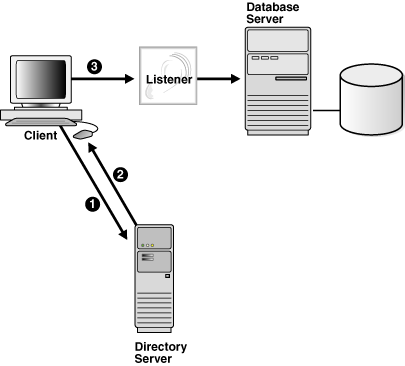
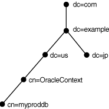
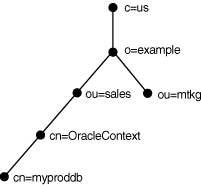
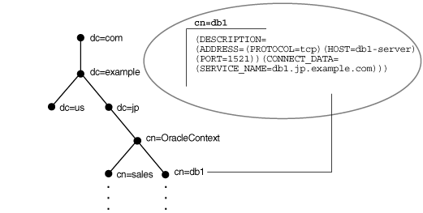
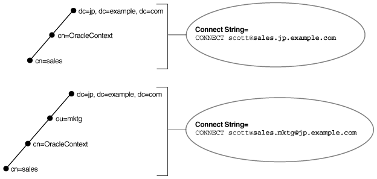
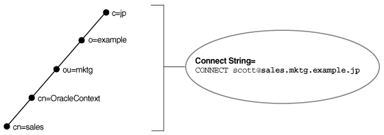
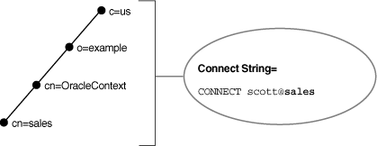
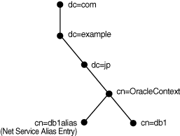
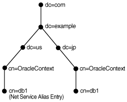

## 3 Managing Network Address Information

This chapter describes how network address information for Oracle Net Services can be stored in local files or in a centralized directory server. Using localized management, network address information is stored in `tnsnames.ora` files on each computer in the network. Using centralized management, network address information is stored in centralized [directory server](glossary.md).

The chapter contains the following topics:

- Using Localized Management
- Using a Directory Server for Centralized Management

## Using Localized Management

When localized management is used, network computers are configured with the files described in Table 3-1. The files are stored locally on the computers.

Table 3-1 Oracle Net Configuration Files Used with Localized Management

| Configuration File | Description |
| --- | --- |
| `tnsnames.ora ` | Located primarily on the clients, this file contains [net service name](glossary.md) s mapped to [connect descriptor](glossary.md) s. This file is used for the [local naming](glossary.md) method. |
| `sqlnet.ora` | Located on client and database server computers, this file may include:  - Client domain to append to unqualified service names or net service names - Order of naming methods the client should use when resolving a name - Logging and tracing features to use - Route of connections - External naming parameters - Oracle Advanced Security parameters - Database access control parameters |
| `listener.ora` | Located on the database server, this configuration file for the [listener](glossary.md) may include:  - Protocol addresses it is accepting connection requests on - Database and nondatabase services it is listening for - Control parameters used by the listener |
| `cman.ora` | Located on the computer where Oracle Connection Manager runs, this configuration file includes the following components:  - A listening endpoint - Access control rule list - Parameter list  Each Oracle Connection Manager configuration is encapsulated within a single name-value (NV) string, which consists of the preceding components. |

Configuration files are typically created in the `ORACLE_HOME/network/admin` directory. However, configuration files can be created in other directories. Oracle Net will check the other directories for the configuration files. For example, the order checking the `tnsnames.ora` file is as follows:

1. The directory specified by the `TNS_ADMIN` environment variable. If the file is not found in the directory specified, then it is assumed that the file does not exist.
2. If the `TNS_ADMIN` environment variable is not set, then Oracle Net will check the `ORACLE_HOME/network/admin` directory.

Note:

On Microsoft Windows, the `TNS_ADMIN` environment variable is used if it is set in the environment of the process. If the `TNS_ADMIN` environment variable is not defined in the environment, or the process is a service which does not have an environment, then Microsoft Windows scans the registry for a `TNS_ADMIN` parameter.

See Also:

Oracle operating system-specific documentation

## Using a Directory Server for Centralized Management

When an Oracle network uses a directory server, the directory server manages global database links as net service names for the Oracle databases in the network. Users and programs can use a global link to access objects in the corresponding database.

Oracle Net Services uses a centralized directory server as one of the primary methods for storing [connect identifier](glossary.md) s. Clients use the connect identifiers in their connect string, and the directory server resolves the connect identifier to a connect descriptor that is passed back to the client. This feature is called [directory naming](glossary.md). This type of infrastructure reduces the cost of managing and configuring resources in a network.

[Oracle Internet Directory](glossary.md) provides a centralized mechanism for managing and configuring a distributed Oracle network. The directory server can replace client-side and server-side localized `tnsnames.ora` files.

Figure 3-1 shows a client resolving a connect identifier through a directory server.

1. The client contacts to the directory server to resolve a connect identifier to a connect descriptor.
2. The directory server resolves the connect identifier and retrieves the connect descriptor for the client.
3. The client sends the connection request to the listener, using the connect descriptor.

Figure 3-1 Client Using a Directory Server to Resolve a Connect Identifier



> This illustration depicts the connect identifier resolution described in the surrounding text.
>
> [Copyright © 2002, 2015, Oracle and/or its affiliates. All rights reserved.](https://docs.oracle.com/cd/E11882_01/dcommon/html/cpyr.htm)
  

Note:

[Java Database Connectivity (JDBC) Driver](glossary.md) s support directory naming. See the [Oracle Database JDBC Developer's Guide and Reference](https://docs.oracle.com/cd/E11882_01/java.112/e16548/toc.htm) for additional information.

This section contains the following topics:

### Understanding the Directory Information Tree

Directory servers store information in a hierarchical namespace structure called a [directory information tree (DIT)](glossary.md). Each node in the tree is called an [entry](glossary.md). Oracle Net Services uses both the tree structure and specific entries in the tree. DITs are commonly aligned with an existing domain structure such as a Domain Name System (DNS) structure or a geographic and organization structure.

Figure 3-2 shows a DIT structured according to DNS domain components.

Figure 3-2 DNS Domain Component DIT



> This illustration depicts a directory information tree organized by domain components. At the top is dc=com, followed by dc=example, from which two branches extend. The branch on the left continues with dc=us, to cn=OracleContext, and ends with cn=myproddb. The branch on the right continues with only dc=jp.
>
> [Copyright © 2002, 2015, Oracle and/or its affiliates. All rights reserved.](https://docs.oracle.com/cd/E11882_01/dcommon/html/cpyr.htm)
  

Figure 3-3 shows a DIT structured according to country, organization, and organizational units. This structure is commonly referred to as an X.500 DIT.

Figure 3-3 X.500 DIT



> This illustration shows a directory information tree in the X.500 style. At the top is c=us, followed by o=example, from which two branches extend. The branch on the left continues with ou=sales, cn=OracleContext, and then ends with cn=myproddb. The branch on the right continues and ends with ou=mktg.
>
> [Copyright © 2002, 2015, Oracle and/or its affiliates. All rights reserved.](https://docs.oracle.com/cd/E11882_01/dcommon/html/cpyr.htm)
  

For example, consider Figure 3-4. The `cn=sales` and `cn=db1` entries represent a net service name and a database service, respectively. Additional entries under `cn=sales` and `cn=db1` contain the connect descriptor information. These entries are not represented in the graphic. The `cn=sales` and `cn=db1` entries enable clients to connect to the database using connect strings `CONNECT` `username` `@sales` and `CONNECT` `username` `@db1`.

Figure 3-4 Database Service and Net Service Entries in a DIT



> This illustration shows a directory information tree. The tree has two branches.
>
> The branch on the right, from the top down, includes the following nodes: dc=com, to dc=example, to dc=jp, to cn=OracleContext, and finally, to cn=sales, and cn=db1.
>
> The left branch is similar, and includes the following nodes: dc=com, to dc=example, and finally, dc=us.
>
> The entry cn=db1 contains the following connect descriptor information:
>
> ```
> (DESCRIPTION=
> (ADDRESS= (PROTOCOL=tcp) (HOST=db1-server) (PORT=1521)) (CONNECT_DATA= (SERVICE_NAME=db1.jp.example.com)))
> ```
  

Each entry is uniquely identified by a [distinguished name (DN)](glossary.md). The DN indicates exactly where the entry resides in the directory server hierarchy. The DN for `db1` is `dn:cn=db1,cn=OracleContext,dc=jp,dc=example,dc=com`. The DN for `sales` is `dn:cn=sales,cn=OracleContext,dc=jp,dc=example,dc=com`. The format of a DN places the lowest component of the DIT to the left, then moves progressively up the DIT.

Each DN is made up of a sequence of relative distinguished names (RDNs). The RDN consists of an [attribute](glossary.md), such as `cn`, and a value, such as `db1` or `sales`. The RDN for db1 is `cn=db1`, and the RDN for sales is `cn=sales`. The attribute and its value uniquely identify the entry.

#### Fully-qualified Names for Domain Component Namespaces

For domain component namespaces, the default directory entry defined for the client must be in one of the following formats:

`dc[,dc][...]`

`ou,dc[,dc][...]`

In the preceding syntax, \[dc\] represents an optional domain component and \[...\] represents additional domain component entries.

The fully-qualified name used in the connect identifier by the client must be in one of the following formats:

`cn.dc[.dc][...]`

`cn[.ou]@dc[.dc][...]`

In the preceding syntax, \[cn\] represents the Oracle Net entry.

Example 3-1 Using a Fully-qualified Name with an Organizational Unit

Consider a directory server that contains an entry for database object `sales` with a DN of `cn=sales,cn=OracleContext,dc=jp,dc=example,dc=com`. In this example, the client requires a connect identifier of `sales.jp.example.com`.

Consider a similar entry that contains database object `sales` with a DN of `cn=sales,cn=OracleContext,``ou=mktg``,dc=jp,dc=example,dc=com`.

Because domain components must be separated from organization units, the client must use the format `cn.ou@dc.dc.dc`. The client requires the connect identifier to be `sales.mktg@jp.example.com`.

Figure 3-5 illustrates the preceding example.

Figure 3-5 Fully-qualified Name for Domain Component Namespaces



> This illustration shows two directory information trees.
>
> At the top of the first tree is dc=jp, dc=example, dc=com, followed by cn=OracleContext, and ending at cn=sales. The connect string CONNECT scott@sales.jp.example.com is used to refer to the cn=sales entry.
>
> At the top of the second tree is dc=jp, dc=example, dc=com, followed by ou=mktg, followed by cn=OracleContext, and ending at cn=sales. The connect string CONNECT scott@sales.mktg@jp.example.com is used to refer to the cn=sales entry.
  

#### Fully-qualified Names for X.500 Namespaces

For X.500 namespaces, the default directory entry defined for the client must be in one of the following formats:

`[ou],o`

`[ou],o,c`

In the preceding formats, `[ou]` represents an optional organizational unit name.

The fully-qualified name the client uses as the connect identifier must be in one of the following formats:

`cn[.ou].o`

`cn[.ou].o.c`

In the preceding formats, `[cn]` represents the Oracle Net entry.

For example, if the directory contains database object `sales` with a DN of `cn=sales,cn=OracleContext,ou=mktg,o=example,c=jp`, then the client requires a connect identifier of `sales.mktg.example.jp`. Figure 3-6 illustrates this example.

Figure 3-6 Fully-qualified Name for X.500 Namespaces



> This illustration shows a directory information tree. At the top is c=jp, followed by o=example, followed by ou=mktg, followed by cn=OracleContext, and ending at cn=sales. The connect string CONNECT scott@sales.mktg.example.jp is used to refer to the cn=sales entry.
>
> [Copyright © 2002, 2015, Oracle and/or its affiliates. All rights reserved.](https://docs.oracle.com/cd/E11882_01/dcommon/html/cpyr.htm)
  

#### Using an Entry's Relative Name

If a client is configured with a default realm Oracle Context, then an entry can be identified by its relative name, and the service can be referred to by its common name. A relative name can be used if the entry is in the same Oracle Context that was configured to be the default Oracle Context for the client's Oracle home.

Consider a directory server that contains an entry for a database called `sales` with a DN of `dn:cn=sales,cn=OracleContext,o=example,c=us`, as shown in Figure 3-7. If the client is configured with a default realm Oracle Context of `cn=OracleContext,o=example,c=us`, then the connect identifier can simply be `sales`.

Figure 3-7 Relative Naming



> This figure depicts a directory information tree. At the top is c=us, followed by o=example, followed by cn=OracleContext, and ending at cn=sales. The connect string `CONNECT scott@sales` is used to refer to the cn=sales entry.
>
> [Copyright © 2002, 2015, Oracle and/or its affiliates. All rights reserved.](https://docs.oracle.com/cd/E11882_01/dcommon/html/cpyr.htm)
  

Note:

The [JDBC OCI Driver](glossary.md) supports both relative and full-qualified naming. The [JDBC Thin Driver](glossary.md) supports fully-qualified naming only when the complete DN is used.

See Also:

- [Oracle Internet Directory Administrator's Guide](http://www.oracle.com/pls/topic/lookup?ctx=db112&id=OIDAG) for additional information about how clients locate a directory
- [Oracle Database JDBC Developer's Guide and Reference](https://docs.oracle.com/cd/E11882_01/java.112/e16548/toc.htm) for additional information about JDBC drivers

#### Using an Entry's Fully-qualified Name

Consider the same directory structure as shown Figure 3-7, but with the client's Oracle home configured with a default realm Oracle Context of `cn=OracleContext,o=example,c=jp`.

Because the client is configured with a default Oracle Context that does not match the location of `sales` in the directory server, a connect string that uses `sales` does not work. Instead, the client must specifically identify the location of `sales`, which can be done in one of the following ways:

- The entry's complete DN can be used in the connect string, for example:
	```
	CONNECT username
	@"cn=sales,cn=OracleContext,o=example,c=us"
	Enter password: password
	```
	JDBC Thin drivers support fully-qualified naming only when the complete DN is used. However, many applications do not support the use of a DN.
- The entry can be referred to by a fully-qualified DNS-style name which is mapped by the Directory Naming adapter to the full x.500 DN of the database object in the LDAP directory, for example:
	```
	CONNECT username
	@sales.example.us
	Enter password: password
	```

Note:

[JDBC OCI Driver](glossary.md) s support fully-qualified naming. [JDBC Thin Driver](glossary.md) s support fully-qualified naming only when the complete DN is used. See the [Oracle Database JDBC Developer's Guide and Reference](https://docs.oracle.com/cd/E11882_01/java.112/e16548/toc.htm) for additional information.

### Understanding Oracle Context

In Figure 3-8, the entries `db1` and `sales` reside under `cn=OracleContext`. This entry is a special RDN called an [Oracle Context](glossary.md). The entries under Oracle Context support various directory-enabled features, including directory naming.

Figure 3-8 Oracle Context in the DIT


> This illustration shows a directory information tree. The tree has two branches.
>
> The branch on the right, from the top down, includes the following nodes: dc=com, to dc=example, to dc=jp, to cn=OracleContext, and finally, to cn=sales, and cn=db1.
>
> The left branch is similar, and includes the following nodes: dc=com, to dc=example, and finally, dc=us.
>
> The entry cn=db1 contains the following connect descriptor information:
>
> ```
> (DESCRIPTION=
> (ADDRESS= (PROTOCOL=tcp) (HOST=db1-server) (PORT=1521)) (CONNECT_DATA= (SERVICE_NAME=db1.jp.example.com)))
> ```
  

During directory configuration, you set the default Oracle Context. Clients use this Oracle Context as the default location to look up connect identifiers in the directory server. With Oracle Internet Directory, an Oracle Context located at the root of the DIT, with DN of `dn:cn=OracleContext`, points to a default Oracle Context in an [identity management realm](glossary.md). An identity management realm is a collection of identities governed by the same administrative policies. This Oracle Context is referred to as a [realm Oracle Context](glossary.md). Unless configured to use another Oracle Context, clients use this realm-specific Oracle Context.

The default Oracle Context affects the connect string. For example, if a client must access the `db1` and `sales` entry frequently, then a reasonable default Oracle Context would be `dc=jp,dc=example,dc=com`. If a client directory entry does not match the directory entry where a service is located, then the client must specify an entry's fully-qualified name in the connect string, as described in "Client Connections Using Directory Naming".

Note:

The RDN `cn=OracleContext` does not have to be explicitly specified in the connect string.

See Also:

[Oracle Internet Directory Administrator's Guide](http://www.oracle.com/pls/topic/lookup?ctx=db112&id=OIDAG) for additional information about an identity management realm

### Understanding Net Service Alias Entries

Directory naming enables you to create [net service alias](glossary.md) entries in addition to database service and net service name entries. A net service alias is an alternative name for a net service name or database service. A net service alias entry does not have connect descriptor information. Instead, it references the location of the entry for which it is an alias. When a client requests a directory lookup of a net service alias, the directory determines that the entry is a net service alias and completes the lookup as if it is the referenced entry. For example, in Figure 3-9, a net service alias of `db1alias` is created for a database service of `db1`. When `db1alias` is used to connect to a database service, as in `CONNECT` `username` `@db1alias`, it will actually resolve to and use the connect descriptor information for `db1`.

Figure 3-9 Net Service Alias db1alias in a Directory Server



> This illustration shows a directory information tree. At the top is dc=com, followed by dc=example, dc=jp, and then cn=OracleContext. The last entry, cn=OracleContext, contains the entries cn=db1alias and cn=db1.
>
> [Copyright © 2002, 2015, Oracle and/or its affiliates. All rights reserved.](https://docs.oracle.com/cd/E11882_01/dcommon/html/cpyr.htm)
  

There are several uses for using net service aliases. As shown in Figure 3-9, a net service alias can be useful as a way for clients to refer to a net service name by another name. Another use is to have a net service alias in one Oracle Context for a database service or net service name in a different Oracle Context. This enables a database service or net service name to be defined once in the directory server, but referred to by clients that use other Oracle Contexts.

In Figure 3-10, database service `db1` resides in `dc=jp,dc=example,dc=com`. A net service alias named `db1` is created in `dc=us,dc=example,dc=com`. This enables clients in both Japan and the United States to use the connect string `CONNECT` `username` `@db1` as opposed to clients in the Unites States needing to specify `CONNECT` `username` `@db1.jp.example.com`.

Figure 3-10 Net Service Alias db1 in a Directory Server



> This illustration shows a directory information tree. At the top is dc=com, followed by dc=example, from which two other branches extend. The branch on the left continues with dc=us, cn=OracleContext, and ends with net service alias cn=db1. The branch on the right continues with dc=jp, cn=OracleContext, and ends with database service cn=db1.
  

### Who Can Add or Modify Entries in the Directory Server

[Database Configuration Assistant](glossary.md) creates database service entries during or after installation. You can then use [Oracle Enterprise Manager](glossary.md) or [Oracle Net Manager](glossary.md) to modify the Oracle Net attributes of the database service entries. You can also use these tools to create net service name and net service alias entries.

To use these configuration tools, a DIT structure containing a [root Oracle Context](glossary.md) and identity management realm must exist. The directory administrator creates this structure with Oracle Internet Directory Configuration Assistant. For some deployments, the directory administrator may need to create additional Oracle Contexts. Additional Oracle Contexts are usually used to subdivide large sites, or separate a production environment from a test environment.

Certain tools are used by certain groups, and you must be a member of the group to use the tools, as shown in the following:

- To create a database service entry with Database Configuration Assistant:
	- `OracleDBCreators` group (`cn=OracleDBCreators,cn=OracleContext...`)
		- `OracleContextAdmins` group (`cn=OracleContextAdmins,cn=Groups,cn=OracleContext...`)
- To create net service names or net service aliases with Oracle Net Manager:
	- `OracleNetAdmins` group (`cn=OracleNetAdmins,cn=OracleContext...`)
		- `OracleContextAdmins` group

The `OracleContextAdmins` group is a super-user group for Oracle Context. Members of the `OracleContextAdmins` group can add all supported types of entries to Oracle Context.

The directory user that created Oracle Context is automatically added to these groups. Other users can be added to these groups by the directory administrator.

See Also:

- ["Configuring the Directory Naming Method"](naming.md) for additional information about using Oracle Net Manager
- [Oracle Database Administrator's Guide](https://docs.oracle.com/cd/E11882_01/server.112/e25494/toc.htm) for additional information about how to register a database service with Database Configuration Assistant

### Client Connections Using Directory Naming

Most clients need to perform name lookups in the directory server. To perform a lookup, the directory server must allow anonymous authentication. Directory servers usually do this by default.

To look up entries, a client must be able to find the directory server in which that entry resides. Clients locate a directory server in one of two ways:

- Dynamically using DNS. In this case, the directory server location information is stored and managed in a central domain name server. The client, at request processing time, retrieves this information from DNS.
- Statically in the directory server usage file, `ldap.ora`, created by Oracle Internet Directory Configuration Assistant and stored on the client host.

After a directory is found, clients are directed to the realm Oracle Context from the root Oracle Context.

Clients make connections to a database using connect identifiers in the same way they might use other naming methods. A connect identifier can be a database service, net service name, or net service alias. These can be referred to by their common names, or they can require additional directory location information. The default Oracle Context determines how the connect identifier must be specified, either by the entry's relative name or its fully-qualified name.

### Considerations When Using Directory Servers

The following considerations should be reviewed when using directory servers:

- Performance Considerations
- Security Considerations
- Object Classes

#### Performance Considerations

Connect identifiers are stored in a directory server for all clients to access. Depending on the number of clients, there can be a significant load on a directory server.

During a connect identifier lookup, a name is searched under a specific Oracle Context. Users expect relatively quick performance so the database connect time is not affected. Because of the scope of the lookup, users may begin to notice slow connect times if lookups takes more than one second.

You can resolve performance problems by changing the network topology or implementing replication.

See Also:

Directory server vendor documentation for details on resolving performance issues

#### Security Considerations

Administrative clients can create and modify entries in the directory server, so security is essential. This section contains the following security-related topics:

- Authentication Methods
- Access Control Lists

##### Authentication Methods

Clients use different methods of authentication depending upon the task that is to be performed.

- Clients that perform lookups for information in the directory server typically use anonymous authentication. In Oracle Database 11g, it is possible to configure clients to authenticate their LDAP bind during name lookup. Sites that need to protect their net service data or disable anonymous binds to the directory must configure their clients to use wallets to authenticate during name lookup. These clients require setting the following two parameters in the `sqlnet.ora` file:
	```
	names.ldap_authenticate_bind = TRUE
	wallet_location = location_value
	```
- Clients that administer the directory server entries authenticate with the directory server. Database Configuration Assistant or Oracle Net Manager may be used to add or modify the entries. Only authenticated users with proper privileges can modify entries. Use one of the following authentication methods:
	- Simple Authentication
		The client identifies itself to the directory server by means of a DN and a password. The server verifies that the DN and password sent by the client matches the DN and password stored in the directory server.
		- Strong Authentication
		The client identifies itself to the directory server by means of a public-key encryption available with Secure Sockets Layer (SSL). In public-key encryption, the sender of a message encrypts the message with the public key of the recipient. Upon delivery, the recipient decrypts the message using the recipient's private key.

##### Access Control Lists

Authentication is used with access control lists (ACLs) to determine whether clients can read, modify, or add information in the directory server.

ACLs specify the following:

- The entries that the user can access.
- The authentication method used to access the entry.
- The access rights, or what the user can do with the object, such as read/write.

ACLs are established for a group of users. During Oracle Context creation, the `OracleDBCreators`, `OracleNetAdmins`, and `OracleContextAdmins` groups are created.

The user who creates Oracle Context using Oracle Net Configuration Assistant is automatically added as the first member of these groups.

Table 3-2 describes ACL requirements for these groups, anonymous users, and their relation to Oracle Net entries in the directory server.

Table 3-2 ACL Requirements for User Groups

| Group | ACL Requirements |
| --- | --- |
| Anonymous users | All Oracle Net attributes and objects in the directory server have read access for the anonymous user. Read access of these objects for anonymous is also applied to Oracle Context. This enables anonymous users to browse directory naming entries contained within the `cn=OracleContext` RDN. This does not include objects used for enterprise user security.  Oracle Net Configuration Assistant sets up this access during client installation. |
| `OracleContextAdmins` group users | Members of `OracleContextAdmins` (`cn=OracleContextAdmins,cn=Groups,cn=OracleContext,...`) have create, modify, and read access to all directory naming objects. Oracle Net Configuration Assistant establishes these access rights for this group during Oracle Context creation.  In addition to the Oracle Context creator, other users can be added to this group by the directory administrator using Oracle Enterprise Manager. |
| `OracleDBCreators` group users | Members of `OracleDBCreators` (`cn=OracleDBCreators,cn=OracleContext,...`) have create and read access to database service objects and attributes. Oracle Net Configuration Assistant establishes the access rights for this group during Oracle Context creation.  In addition to the Oracle Context creator, other users can be added to this group by the directory administrator with Oracle Enterprise Manager. |
| `OracleNetAdmins` group users | Members of `OracleNetAdmins` (`cn=OracleNetAdmins,cn=OracleContext,...`) have create, modify, and read access to directory naming objects and attributes. Oracle Net Configuration Assistant establishes these access rights for this group during Oracle Context creation.  In addition to the Oracle Context creator, other users can be added to this group by the directory administrator. |

Situations in which a high degree of security is desired for lookup or read-access to Oracle Net Services name and related data, administrators can define additional read-access control for some or all of the data. Such ACL definitions can prevent anonymous users from reading the Oracle Net Services data. If read-access to Oracle Net Services data is restricted, then clients must use authenticated binds to do name lookup.

There are no predefined groups or procedures for the Oracle configuration tools for defining read-access restrictions on this data, so administrators must use standard object management tools from their directory system to manually create any necessary groups and ACLs.

ACLs can be added to Oracle Net Services objects using `ldapmodify` and an LDIF-format file. The following example restricts all access for user, `cn=user1`:

```
dn: cn=sales,cn=oraclecontext,dc=example,dc=com
replace: orclentrylevelaci
orclentrylevelaci: access to attr=(*)
 by dn="cn=user1" (noread,nosearch,nowrite,nocompare)
```

The preceding example illustrates the basic form of an ACL for a single object. This approach is not necessarily the best way to define access because access definitions for objects are complex and may involve security properties which are inherited from parent nodes in the DIT. Oracle recommends that administrators refer to the documentation for their directory systems, and integrate access management for Oracle Net Services objects into a directory-wide policy and security implementation.

For Oracle Internet Directory directories, `oidadmin` has functionality to create users, groups, and also define ACLs for objects and general directory security.

See Also:

- Documentation from your directory server vendor for information about how to set ACLs on directory entry
- "Authentication Methods" for information about configuring clients to use authenticated binds for name lookup
- [Oracle Database Advanced Security Administrator's Guide](https://docs.oracle.com/cd/E11882_01/network.112/e40393/toc.htm) for additional information about the `OracleDBCreators` group
- ["About the OracleNetAdmins Group"](admintools.md) for information about adding users to the `OracleNetAdmins` group
- [Oracle Internet Directory Administrator's Guide](http://www.oracle.com/pls/topic/lookup?ctx=db112&id=OIDAG)

#### Object Classes

Directories must be populated with the correct version of the Oracle schema before Oracle Context, a database service or net service name entry can be created. The Oracle schema defines the type of objects, called [object class](glossary.md) es, that can be stored in the directory server and their attributes. Table 3-3 lists the object classes for database service, net service name, and net service alias entries.

Table 3-3 Oracle Net Services LDAP Main Object Classes

| Object Class | Description |
| --- | --- |
| `orclDbServer` | Defines the attributes for database service entries |
| `orclNetService` | Defines the attributes for net service name entries |
| `orclNetServiceAlias` | Defines the attributes for net service alias entries |

Table 3-4 lists the object classes used by `orclDbServer`, `orclNetService`, and `orclNetServiceAlias`.

Table 3-4 Oracle Net Services LDAP Derived Object Classes

| Object Class | Description |
| --- | --- |
| `orclNetAddress` | Defines a listener protocol address |
| `orclNetAddressList` | Defines a list of addresses |
| `orclNetDescription` | Specifies a connect descriptor containing the protocol address of the database and the connect information to the service |
| `orclNetDescriptionList` | Defines a list of connect descriptors |

These object classes use attributes that specify the contents of connect descriptors.

See Also:

[Oracle Database Net Services Reference](https://docs.oracle.com/cd/E11882_01/network.112/e10835/schema.htm#NETRF012) for additional information about these object classes and their attributes

### Limitations of Directory Naming Support with Microsoft Active Directory

In addition to Oracle Internet Directory, directory naming support is also provided with [Microsoft Active Directory](glossary.md) with the following limitations:

- Clients running Microsoft Windows operating system can use Microsoft Active Directory to resolve net services names, even when the database is running on an operating system that is not Microsoft Windows.
- Oracle Database can use Microsoft Active Directory for name resolution for outbound network connections, such as database links or Oracle Data Guard, only if the database is running on a Microsoft Windows platform.
- Configuration of net services names can only be done using Oracle Net Manager running from a Microsoft Windows platform.
- Client computers and the database server must run on Microsoft Windows operating systems to access or create entries in Microsoft Active Directory.
- The following features are not supported by Microsoft Active Directory:
	- Multiple Oracle Contexts
		Microsoft Active Directory can support only one Oracle Context.
		- Net service aliases
		You cannot create net service aliases in Microsoft Active Directory. However, you can create net service names.
		- Automatic client discovery of directory servers for clients
		You must statically configure directory server usage on the clients. The Oracle Internet Directory Configuration will not provide directory server usage for Microsoft Active Directory. You must use [Oracle Net Configuration Assistant](glossary.md).

See Also:

Microsoft Active Directory documentation for Microsoft-specific information