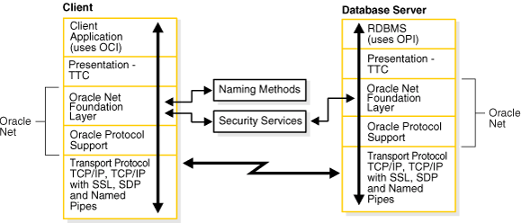
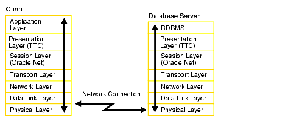
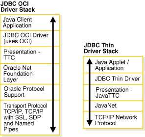
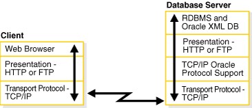
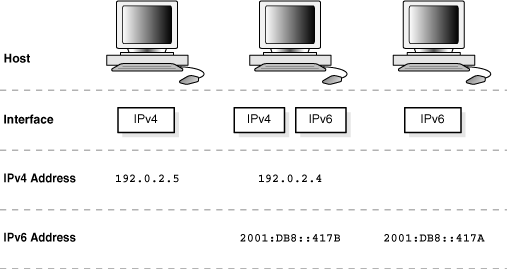
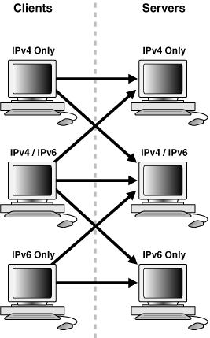

## 4 Understanding the Communication Layers

The primary function of Oracle Net is to establish and maintain connections between a client application and an Oracle database server. Oracle Net is comprised of several communication layers that enable clients and database servers to share, modify, and manipulate data.

This chapter contains the following topics:

See Also:

[Chapter 1, "Introducing Oracle Net Services"](intro.md) for an introductory level overview of Oracle Net architecture

## Understanding Oracle Net Stack Communication for Client/Server Applications

A database server is the Oracle software managing a database, and a client is an application that requests information from a server. The way the client and server communicate is known as the client/server stack.

Information passed from a client application sent by the client communication stack across a network protocol is received by a similar communications stack on the database server side. The process flow on the database server side is the reverse of the process flow on the client side, with information ascending through the communication layers.

Figure 4-1 illustrates the various layers on the client and on the database server after a connection has been established.

Figure 4-1 Layers Used in a Client/Server Application Connection



> This illustration depicts the various layers of stack communication used in a client/server application connection. On the client side, from the top down, the stack includes the following layers:
>
> - Client Application (uses OCI)
> - Presentation - TTC
> - Oracle Net Foundation Layer
> - Oracle Protocol Support
> - Network Protocol (TCP/IP, TCP/IP with SSL, SDP, and Named Pipes
>
> On the server side, from the top down, the stack includes the following layers:
>
> - RDBMS (uses OPI)
> - Presentation - TTC
> - Oracle Net Foundation Layer
> - Oracle Protocol Support
> - Transport Protocol (TCP/IP, TCP/IP with SSL, SDP, and Named Pipes.
>
> The Oracle Net Foundation Layer and Oracle Protocol Support make up Oracle Net. On the client side, Oracle Net Foundation Layer is associated with naming methods. On both the client and server sides, Oracle Net Foundation Layer is associated with security services.
  

This communication architecture is based on the [Open Systems Interconnection (OSI)](glossary.md) model. In the OSI model, communication between separate computers occurs in a stack-like fashion with information passing from one node to the other through several layers of code, including:

1. Physical layer
2. Data link layer
3. Network layer
4. Transport layer
5. Session layer
6. Presentation layer
7. Application layer

Figure 4-2 shows how Oracle Net software consisting of the Oracle Net Foundation layer and Oracle Protocol Support fits into the session layer of the OSI model.

Figure 4-2 OSI Communication Layers



> This illustration depicts the Open Systems Interconnection (OSI) communication layers and where Oracle Net software fits into those layers. On the client side, from the top down, the stack includes the following layers:
>
> - Application Layer
> - Presentation Layer (TTC)
> - Session Layer (Oracle Net)
> - Transport Layer
> - Network Layer
> - Data Link Layer
> - Physical Layer
>
> On the server side, from the top down, the stack includes the following layers:
>
> - RDBMS
> - Presentation Layer (TTC)
> - Session Layer (Oracle Net)
> - Transport Layer
> - Network Layer
> - Data Link Layer
> - Physical Layer
  

See Also:

The following URL to learn about the OSI stack:

`http://www.ietf.org`

This section contains the following topics:

- About the Client Communication Stack
- About the Server Communication Stack

### About the Client Communication Stack

The client communication stack includes the following:

- Client Application Layer
- Presentation Layer
- Oracle Net Foundation Layer
- Oracle Protocol Support Layer
- About the Server Communication Stack

#### Client Application Layer

During a session with the database, the client uses [Oracle Call Interface (OCI)](glossary.md) to interact with the database server. OCI is a software component that provides an interface between the application and SQL.

See Also:

[Oracle Call Interface Programmer's Guide](https://docs.oracle.com/cd/E11882_01/appdev.112/e10646/toc.htm)

#### Presentation Layer

Character set differences can occur if the client and database server run on different operating systems. The presentation layer resolves any differences. It is optimized for each connection to perform conversion when required.

The presentation layer used by client/server applications is [Two-Task Common (TTC)](glossary.md). TTC provides character set and data type conversion between different character sets or formats on the client and database server. At the time of initial connection, TTC is responsible for evaluating differences in internal data and character set representations and determining whether conversions are required for the two computers to communicate.

#### Oracle Net Foundation Layer

The Oracle Net foundation layer is responsible for establishing and maintaining the connection between the client application and database server, as well as exchanging messages between them. The Oracle Net foundation layer can perform these tasks because of [Transparent Network Substrate (TNS)](glossary.md) technology. TNS provides a single, common interface for all industry-standard OSI transport and network layer protocols. TNS enables peer-to-peer application connectivity, where two or more computers can communicate with each other directly, without the need for any intermediary devices.

On the client side, the Oracle Net foundation layer receives client application requests and resolves all generic computer-level connectivity issues, such as:

- The location of the database server or destination
- How many protocols are involved in the connection
- How to handle interrupts between client and database server based on the capabilities of each

On the server side, the Oracle Net foundation layer performs the same tasks as it does on the client side. It also works with the listener to receive incoming connection requests.

In addition to establishing and maintaining connections, the Oracle Net foundation layer communicates with naming methods to resolve names and uses security services to ensure secure connections.

#### Oracle Protocol Support Layer

Oracle protocol support layer is positioned at the lowest layer of the Oracle Net foundation layer. It is responsible for mapping TNS functionality to industry-standard protocols used in the client/server connection. This layer supports the following network protocols:

- TCP/IP ([IPv4](glossary.md) and [IPv6](glossary.md))
- TCP/IP with SSL
- Named Pipes
- Sockets Direct Protocol (SDP)

All Oracle software in the client/server connection process requires an existing network protocol stack to establish the computer-level connection between the two computers for the transport layer. The network protocol is responsible for transporting data from the client computer to the database server computer, at which point the data is passed to the server-side Oracle protocol support layer.

See Also:

"Understanding Oracle Protocol Support Layer" for descriptions of the protocols

### About the Server Communication Stack

The server communication stack uses the same layers as the client stack with the exception that the database uses [Oracle Program Interface (OPI)](glossary.md). For each statement sent from OCI, OPI provides a response. For example, an OCI request to fetch 25 rows would elicit an OPI response to return the 25 rows after they have been fetched.

## Using Oracle Net Stack Communication for Java Applications

The Oracle [Java Database Connectivity (JDBC) Driver](glossary.md) s provide Java applications access to an Oracle database. Oracle offers two JDBC drivers.

- [JDBC OCI Driver](glossary.md) driver is a type 2 JDBC driver which is used by client/server Java applications. The JDBC OCI driver uses a communication stack similar to a standard client/server communication stack. The JDBC OCI driver converts JDBC invocations to calls to OCI which are then sent over Oracle Net to the Oracle database server.
- [JDBC Thin Driver](glossary.md) is a type 4 driver which is used by Java applets. The JDBC Thin Driver establishes a direct connection to the Oracle database server over Java sockets. The JDBC Thin driver uses a Java implementation of the Oracle Net foundation layer called JavaNet and a Java implementation of TTC called JavaTTC to access the database.

Figure 4-3 shows the stack communication layers used by JDBC drivers.

Figure 4-3 Layers Used for Java-Client Applications



> This illustration depicts stack communication layers used by JDBC Drivers. The JDBC OCI driver stack, from the top down, includes the following layers:
>
> - Java Client Application
> - JDBC OCI Driver (uses OCI)
> - Presentation - TTC
> - Oracle Net Foundation Layer
> - Oracle Protocol Support
> - Transport Protocol (TCP/IP, TCP/IP with SSL, SDP, and Named Pipes)
>
> The JDBC Thin Driver stack, from the top down, includes the following layers:
>
> - Java Applet/Application
> - JDBC Thin Driver
> - Presentation - Java TTC
> - JavaNet
> - TCP/IP Network Protocol
  

See Also:

[Oracle Database JDBC Developer's Guide and Reference](https://docs.oracle.com/cd/E11882_01/java.112/e16548/toc.htm)

## Using Oracle Net Stack Communication for Web Clients

The Oracle database server supports many other implementations for the presentation layer that can be used for Web clients accessing features inside the database in addition to TTC. The listener facilitates this by supporting any presentation implementation requested by the database.

Figure 4-4 shows the stack communication layers used in an HTTP or FTP connection to [Oracle XML DB](glossary.md) in the Oracle database instance. WebDAV connections use the same stack communication layers as HTTP and FTP.

Figure 4-4 Layers Used in Web Client Connections



> This illustration depicts the various layers of stack communication used in a Web client connection. On the client side, from the top down, the stack includes the following layers:
>
> - Web Browser
> - Presentation - HTTP or FTP
> - Network Protocol - TCP/IP
>
> On the server side, from the top down, the stack includes the following layers:
>
> - RDBMS and Oracle XML DB
> - Presentation -- HTTP or FTP
> - TCP/IP Oracle Protocol Support
> - Transport Protocol - TCP/IP
  

See Also:

[Oracle XML DB Developer's Guide](https://docs.oracle.com/cd/E11882_01/appdev.112/e23094/toc.htm)

## Understanding Oracle Protocol Support Layer

A network protocol is responsible for transporting data from the client computer to the database server computer. This section describes the protocols used by the Oracle Protocol Support layer of the Oracle Net communication stack. It contains the following topics:

- TCP/IP Protocol
- TCP/IP with SSL Protocol
- Named Pipes Protocol
- Sockets Direct Protocol (SDP)

See Also:

[Oracle Database Net Services Reference](https://docs.oracle.com/cd/E11882_01/network.112/e10835/protocoladd.htm#NETRF1043) for information about the settings for each protocol

### TCP/IP Protocol

Transmission Control Protocol/Internet Protocol (TCP/IP) is the standard communication protocol suite used for client/server communication over a network. TCP is the transport protocol that manages the exchange of data between hosts. IP is a network layer protocol for packet-switched networks.

Oracle Net supports IP in two versions: IP version 4 (IPv4) and IP version 6 (IPv6). IPv6 addresses the shortcomings of the currently used IPv4. The primary benefit of IPv6 is a large address space derived from the use of 128-bit addresses.

See Also:

`http://tools.ietf.org/html/rfc2460` for the IPv6 specification

#### IPv6 Address Notation

Oracle Database supports the standard IPv6 address notations specified by RFC 2732. A 128-bit IP address is generally represented as 8 groups of 4 hexadecimal digits, with the colon (`:`) symbol as the group separator. For example, the following address is in a valid IPv6 format:

```
2001:0DB8:0000:0000:0000:0000:200C:417A
```

Each hexadecimal digit in the address represents 4 bits, so each group in the address represents 16 bits. The following addresses represent the first and last hosts in the `2001:0DB8:0000:0000` subnet:

```
2001:0DB8:0000:0000
:0000:0000:0000:0000
2001:0DB8:0000:0000
:FFFF:FFFF:FFFF:FFFF
```

In shorthand notation, consecutive zero fields can be compressed with a double colon (`::`) separator, as shown in the following equivalent notations:

```
2001:0DB8:0:0::200C:417A
2001:0DB8::200C:417A
2001:DB8::200C:417A
```

See Also:

- `http://www.ietf.org/rfc/rfc2732.txt` for RFC 2732, and information about notational representation
- `http://www.ietf.org/rfc/rfc3513.txt` for RFC 3513, and information about proper IPv6 addressing

##### CIDR Notation

Classless Inter-Domain Routing (CIDR) is a method of grouping IP addresses into subnets that are independent of the value of the addresses. Classless routing was designed to overcome the exhaustion of address space in the IP class system and the unmanageable growth in the size of routing tables.

CIDR denotes a network by the first address in the network and the size in bits of the network prefix in decimal, separated with a slash (`/`). For example, `2001:0DB8::/32` indicates that the first 32 bits of the address identify the network, whereas the remaining bits identify the hosts in the network.

CIDR uses an analogous notation for IPv4 address. For example, in the notation `192.168.2.1/24` the first 24 bits of the address represent the network prefix. The `DBMS_NETWORK_ACL_ADMIN` package, which provides an API to manage access control lists, supports CIDR notation for both IPv6 and IPv4 addresses and subnets.

See Also:

- [Oracle Database PL/SQL Packages and Types Reference](https://docs.oracle.com/cd/E11882_01/appdev.112/e40758/d_networkacl_adm.htm#ARPLS148) to learn about `DBMS_NETWORK_ACL_ADMIN`
- `http://tools.ietf.org/html/rfc4632` for RFC 4632

##### IPv6 Addresses in URLs

In URLs, IPv6 addresses are enclosed by the left bracket (`[`) and right bracket (`]`) characters. For example, the IPv6 address `[2001:0DB8:0:0:8:800:200C:417A]` forms part of the following URLs:

```
http://[2001:0DB8:0:0:8:800:200C:417A]
http://[2001:0DB8:0:0:8:800:200C:417A]:80/index.html
```

##### IPv4-Mapped Addresses

IPv4-mapped addresses are a subclass of IPv6 addresses in which the following conditions are true:

- The first 80 bits are set to 0 in the standard IPv6 notation
- The second 16 bits are set to 1 in the standard IPv6 notation
- The last 32 bits are in IPv4 notation

An IPv4-mapped address can represent the addresses of IPv4-only nodes as IPv6 addresses.

Example 4-1 shows the same IP address in different notations. The first address uses standard IPv6 notation. The second address is an IPv4-mapped address in which the last 32 bits use dotted-decimal IPv4 notation. The last address uses a shorthand notation to compress the consecutive zero fields.

Example 4-1 IPv4-Mapped Address

```
0000:0000:0000:0000:0000:FFFF:C0A8:0226
0000:0000:0000:0000:0000:FFFF:192.168.2.38
::FFFF:192.168.2.38
```

See Also:

`http://tools.ietf.org/html/rfc4942` for security consideration relating to the use of IPv4-mapped addresses

#### IPv6 Interface and Address Configurations

A host may have different IPv4 and IPv6 interface configurations. The following configurations are possible for a host:

- Only an IPv4 interface, in which case the host is an IP4-only host.
- Only an IPv6 interface, in which case the host is an IPv6-only host.
- Both an IPv4 and IPv6 interface, in which case the host is a dual-stack host.

A single host may also use different types of IP address. For example, a domain name server may associate a dual-stack host both an IPv4 and an IPv6 address or only an IPv6 address. The IP address configurations that are not supported are the following:

- An IPv4-only host cannot use an IPv6 address.
- An IPv6-only host cannot use an IPv4 address.

Figure 4-5 shows possible host and interface configurations. The dual-stack host in the center of the diagram can communicate with IPv4 hosts over IPv4 and with IPv6 hosts over IPv6.

Figure 4-5 Supported Host and Interface Configurations



> This figure illustrates supported hosts with IPv4 and IPv6 protocols. In the figure, there are three host computers. The first host has only IPv4 with address 192.0.2.5. The second host computer has IPv4 with address 192.0.2.4, and IPv6 with 2001:DB8::417B. The third host computer has IPv6 with address 2001:DB8::417A.
>
> [Copyright © 2002, 2015, Oracle and/or its affiliates. All rights reserved.](https://docs.oracle.com/cd/E11882_01/dcommon/html/cpyr.htm)
  

#### IPv6 Network Connectivity

The network connectivity of a host refers to its ability to communicate with another host over a network. For example, if a dual-stack client must communicate with an IPv6-only server, then the network and router must make end-to-end communication between these hosts possible.

A client or server host is IPv6-capable if it meets the following criteria:

- It has a configured IPv6 interface.
- It can connect to other hosts using the IPv6 protocol.

The IPv6 capability of a host is partially dependent on the network and partially dependent on its interface and address configuration. Figure 4-6 shows the possibilities for connectivity in a client/server network. For example, an IPv4-only host can connect to either an IPv4-only or dual-stack server, but not an IPv6-only server. Both dedicated and shared server modes are supported.

Figure 4-6 Client/Server Connectivity



> This figure illustrates how clients and servers connect when some have IPv4, IPv6 or both protocols. The IPv4 only client can connect to the IPv4 only host and the IPv4/IPv6 host. The IPv4/IPv6 client can connect to any host. The IPv6 only client can connect to the IPv6 only host and the IPv4/IPv6 host.
  

Table 4-1 summarizes the IP protocols used for client/server connectivity with different host and network configurations.

Table 4-1 Supported Host and Network Configurations

| Client | IPv4-Only Server | Dual-Stack Server | IPv6-Only Server |
| --- | --- | --- | --- |
| IPv4-Only Client | Supported (v4) | Supported (v4) | Not Supported |
| Dual-Stack Client | Supported (v4) | Supported (v4, v6) | Supported (v6) |
| IPv6-Only Client | Not Supported | Supported (v6) | Supported |

#### IPv6 Support in Oracle Database 11g

Components in this release of Oracle Database 11g support IPv6 in the configurations described in "IPv6 Network Connectivity", with the following exceptions:

- Oracle Real Application Clusters (Oracle RAC) and Oracle Clusterware
- Oracle Fail Safe

See Also:

The documentation for each Oracle Database component for specific information about its support for IPv6

### TCP/IP with SSL Protocol

The TCP/IP with [Secure Sockets Layer (SSL)](glossary.md) protocol enables an Oracle application on a client to communicate with remote databases through TCP/IP and SSL. [Oracle Advanced Security](glossary.md) is required to use TCP/IP with SSL.

SSL stores authentication data, such as certificates and private keys, in an Oracle Wallet. When the client initiates a connection to the database server, SSL performs a handshake between the two using the certificate. During the handshake, the following processes occur:

- The client and database server negotiate a cipher suite made up a set of authentication, encryption, and data integrity types to apply to the messages they exchange.
- Depending on its configuration, the database server sends its certificate to the client in a message encrypted with the client's public key. The database server may also send a request for the client's certificate in the same message. The client decrypts this message by using its own private key, then verifies that the database server's certificate bears the certificate authority's signature.
- If required, the client may send the user's certificate to the database server. The certificate ensures that the user's information is correct and that the public key actually belongs to that user.

The database checks the user certificate to verify that it bears the signature of the certificate authority.

See Also:

[Oracle Database Advanced Security Administrator's Guide](https://docs.oracle.com/cd/E11882_01/network.112/e40393/toc.htm)

### Named Pipes Protocol

Named Pipes is specifically designed for Microsoft Windows LAN environments. The [Named Pipes protocol](glossary.md) is a high-level interface providing interprocess communications between clients and database servers using distributed applications. One server-side process creates a named pipe, and the client-side process opens it by name. What one side writes, the other can read.

If a remote Oracle database is running on a host system that supports network communication using Named Pipes, then Oracle Net enables applications on a client to communicate with the Oracle database using Named Pipes.

### Sockets Direct Protocol (SDP)

The Sockets Direct Protocol (SDP) is an industry-standard wire protocol between InfiniBand network peers. When used over an InfiniBand network, SDP reduces TCP/IP overhead by eliminating intermediate replication of data and transferring most of the messaging burden away from the CPU and onto the network hardware.