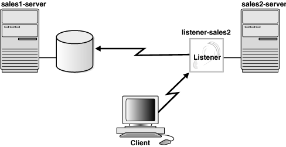

## 9 Configuring and Administering Oracle Net Listener

Oracle Net Listener is a separate process that runs on the database server computer. It receives incoming client connection requests and manages the traffic of these requests to the database server. This chapter describes how to configure the listener to accept client connections.

This chapter contains the following topics:

Note:

In Oracle Database 11g Release 2 (11.2), the password feature is being deprecated. This does not cause a loss of security because authentication is enforced through local operating system authentication. Refer to [Oracle Database Net Services Reference](https://docs.oracle.com/cd/E11882_01/network.112/e10835/mignet.htm#NETRF1971) for more information.

See Also:

- [Chapter 2, "Identifying and Accessing the Database"](concepts.md) for a description of how the listener is used during an initial connection request
- [Chapter 4, "Understanding the Communication Layers"](layers.md) for an architectural overview of the listener

## Overview of Oracle Net Listener

Note:

The release of the listener must be the same as or later than the latest release of all Oracle databases being serviced through the listener.

A listener is configured with one or more listening protocol addresses, information about supported services, and parameters that control its run-time behavior. The listener configuration is stored in a configuration file named `listener.ora`.

Because all of the configuration parameters have default values, it is possible to start and use a listener with no configuration. This default listener has a name of `LISTENER`, supports no services on startup, and listens on the following TCP/IP protocol address:

```
(ADDRESS=(PROTOCOL=tcp)(HOST=host_name
)(PORT=1521))
```

The listener forwards client requests to supported services. These services can be configured statically in the `listener.ora` file or they can be dynamically registered with the listener. This dynamic registration feature is called [service registration](glossary.md). The registration is performed by the [PMON process](glossary.md), an instance background process of each database instance that is configured in the database initialization parameter file. Dynamic service registration does not require any manual configuration in the `listener.ora` file.

Service registration offers the following benefits:

- Simplified configuration
	Service registration reduces the need for the `SID_LIST_` `listener_name` parameter setting, which specifies information about the databases served by the listener, in the `listener.ora` file.
	Note:
	The `SID_LIST_` `listener_name` parameter is required if you are using Oracle Enterprise Manager to manage the database.
- Connect-time failover
	Because the listener always monitors the state of the instances, service registration facilitates automatic failover of a client connect request to a different instance if one instance is down.
	Note:
	When services are configured statically, a listener starts a dedicated server when it receives a client request. If the instance is not up, then the server returns an `Oracle not available` error message.
- Connection load balancing
	Service registration enables the listener to forward client connect requests to the least-loaded instance and [dispatcher](glossary.md) or [dedicated server](glossary.md). Service registration balances the load across the [service handler](glossary.md) s and nodes.
- High-availability for Oracle Real Application Clusters and Oracle Data Guard

## Configuring Oracle Net Listener During Installation

Oracle Universal Installer launches [Oracle Net Configuration Assistant](glossary.md) during installation. Oracle Net Configuration Assistant configures the listening protocol address and service information for Oracle Database.

During an Enterprise Edition or Standard Edition installation on the database server, Oracle Net Configuration Assistant automatically configures a listener with a name of `LISTENER` that has a TCP/IP listening protocol address for Oracle Database. During a Custom installation, Oracle Net Configuration Assistant prompts for the listener name and protocol address.

A listening IPC protocol address for [external procedure](glossary.md) calls is automatically configured, regardless of the installation type. Oracle Net Configuration Assistant also automatically configures service information for the external procedures in the `listener.ora` file.

If you are using the IPC protocol, then you can improve performance by specifying the maximum number of concurrent IPC connection requests to match your expected connection requests.

Example 9-1 shows a sample `listener.ora` file. The `LISTENER` entry defines the listening protocol address for a listener named `LISTENER`, and the `SID_LIST_LISTENER` entry provides information about the external services statically supported by the listener `LISTENER`.

Example 9-1 Example listener.ora File

```
LISTENER=
  (DESCRIPTION=
    (ADDRESS_LIST=
      (ADDRESS=(PROTOCOL=tcp)(HOST=sales-server)(PORT=1521))
      (ADDRESS=(PROTOCOL=ipc)(KEY=extproc) (queuesize=50))))
SID_LIST_LISTENER=
  (SID_LIST=
    (SID_DESC=
      (SID_NAME=plsextproc)
      (ORACLE_HOME=/oracle11g)
      (PROGRAM=extproc)))
```

See Also:

[Oracle Database Net Services Reference](https://docs.oracle.com/cd/E11882_01/network.112/e10835/listener.htm#NETRF008) for additional information about identifying listeners by unique names and creating multiple listener entries in the `listener.ora` file

## Customizing Oracle Net Listener Configuration

If the default or installed configuration is not adequate for a particular environment, then you can use [Oracle Net Manager](glossary.md) to customize the `listener.ora` configuration.

This section contains the following configuration topics:

- Configuring Listening Protocol Addresses
- Handling Large Volumes of Concurrent Connection Requests
- Configuring Static Service Information
- Managing Oracle Net Listener Security

### Configuring Listening Protocol Addresses

Oracle Enterprise Manager and Oracle Net Manager can be used to configure protocol support for the listener.

The Oracle Net Listener endpoint address configuration accepts both IPv6 addresses and host names that resolve to IPv6 addresses, as explained in ["IPv6 Interface and Address Configurations"](layers.md). This technique can create listening endpoints that service IPv6 clients.

#### Using Oracle Enterprise Manager to Configure Listening Protocol Addresses

To configure protocol addresses for the listener using Oracle Enterprise Manager, do the following:

1. In the General section of the Database Home page, click the link next to Listener.
	The Listener page appears.
2. Click Edit.
	The Edit Listener page appears. You may be prompted to log in to the database server.
3. In the Addresses section, configure protocol support:
	1. Click Add.
		The Add Address page appears.
		2. From the Protocol list, select the protocol on which the listener is configured to listen.
		For TCP/IP, if the computer has more than one IP address and you want the listener to listen on all available IP addresses, then select TCP/IP or TCP/IP with SSL and enter the host name of the computer in the Host field.
		3. In Port, enter the port number.
		When configuring the listener to listen on TCP/IP, enter the default port of 1521. Otherwise, you must configure the `LOCAL_LISTENER` parameter in the initialization parameter file and the non-default port number must be specified for use by any naming method.
		4. In Host, enter the host address.
		5. Optionally, in the Advanced Parameters section, specify the I/O buffer space limit for send and receive operations of sessions in the Total Send Buffer Size and Total Receive Buffer Size fields.
		6. Click OK.
		The protocol address is added to the Addresses section.
4. Repeat Step 3 for additional protocols.

#### Using Oracle Net Manager to Configure Listening Protocol Addresses

To configure protocol addresses for the listener using Oracle Net Manager, do the following:

1. Start Oracle Net Manager.
	See Also:
	["Using Oracle Net Manager to Configure Oracle Net Services"](admintools.md)
2. In the navigator pane, expand Local, and then select Listeners.
3. Select the listener.
4. From the list in the right pane, select Listener Locations.
5. Select the protocol from the Protocol list.
6. Enter the host name for the listener in the Host field.
7. Enter the port number in the Port field.
8. If you want to set send and receive buffer sizes, then click Show Advanced, and then enter the sizes in the appropriate fields.
9. Select Save Network Configuration from the File menu to save the changes.

### Handling Large Volumes of Concurrent Connection Requests

If you expect the listener to handle large volumes of concurrent connection requests, then you can specify a listener queue size for its TCP/IP or IPC listening endpoints.

To specify the listener queue size, do the following:

- Specify the `QUEUESIZE` parameter at the end of the protocol address with its value set to the expected number of concurrent requests.
	The following example sets the queue size to 20:
	```
	LISTENER=
	 (DESCRIPTION=
	  (ADDRESS=(PROTOCOL=tcp)(HOST=sales-server)(PORT=1521)(QUEUESIZE=20)))
	```
	Note:
	The default number of concurrent connection requests is operating system-specific. The defaults for TCP/IP on the Linux operating system and Microsoft Windows follow:
	- Linux operating system: 128
	- Microsoft Windows XP Professional SP2: 10
	- Microsoft Windows 2003 Server Enterprise Edition: 200

### Configuring Static Service Information

The listener uses the dynamic service information about the database and instance before using statically configured information in the `listener.ora` file. Configuration of static service information is necessary if you require remote database startup from a tool other than Oracle Enterprise Manager, or you have Oracle Database releases earlier than Oracle8i.

Table 9-1 describes static service settings in the `listener.ora` file.

Table 9-1 Static Service Settings in listener.ora

| Oracle Net Manager Field | listener.ora File Parameter | Description |
| --- | --- | --- |
| SID | SID\_NAME | The [Oracle system identifier (SID)](glossary.md) of the instance. You can obtain the SID value from the `INSTANCE_NAME` parameter in the initialization parameter file. |
| Service Name | GLOBAL\_DBNAME | The database service.  While processing a client connection request, the listener tries to match the value of this parameter with the value of the `SERVICE_NAME` parameter in the client connect descriptor. If the client connect descriptor uses the `SID` parameter, then the listener does not attempt to map the values. This parameter is primarily intended for configurations with Oracle8 databases (where dynamic service registration is not supported for dedicated servers). This parameter may also be required for use with Oracle8i and later database services by some configurations.  The value for this parameter is typically obtained from the combination of the `DB_NAME` and `DB_DOMAIN` parameters (`DB_NAME`.`DB_DOMAIN`) in the initialization parameter file, but the value can also contain any valid name used by clients to identify the service. |
| Oracle Home Directory | ORACLE\_HOME | The Oracle home location of the instance. Without this setting, the listener assumes its Oracle home for the instance.  On Linux and UNIX, this setting is optional.  On Microsoft Windows, this setting is ignored. The Oracle home specified by the `ORACLE_HOME` parameter in `HKEY_LOCAL_MACHINE\SOFTWARE\ORACLE\HOME` `ID` of the Microsoft Windows registry is used. |

Important:

If you are using [connect-time failover](glossary.md) or [Transparent Application Failover (TAF)](glossary.md), such as in an Oracle Real Application Clusters environment, then do not set the `GLOBAL_DBNAME` parameter.

To statically configure the listener, do the following:

1. Access the Net Services Administration page in Oracle Enterprise Manager.
	See Also:
	["Using Oracle Enterprise Manager to Configure Oracle Net Services"](admintools.md)
2. Select Listeners from the Administer list, and then select the Oracle home that contains the configuration files.
3. Click Go. You may be prompted to log in to the database server.
	The Listeners page appears.
4. Select a listener, and then click Edit.
	The Edit Listener page appears.
5. Click the Static Database Registration tab, and then click Add.
	The Add Database Service page appears. Enter the required information in the fields.
6. Click OK.
	Note:
	You can also configure static service information with Oracle Net Manager. See Statically Configure Database Service Information in the online Help for additional information.
	The following example shows an excerpt of a `listener.ora` file statically configured for a database service called `sales.us.example.com`:
	```
	SID_LIST_listener=
	(SID_LIST=
	 (SID_DESC=
	  (GLOBAL_DBNAME=sales.us.example.com)
	  (SID_NAME=sales)
	  (ORACLE_HOME=/u01/app/oracle/11g)))
	```

See Also:

- "Configuring Service Registration" for additional information about configuring dynamic service registration Oracle Databases
- [Chapter 13, "Enabling Advanced Features of Oracle Net Services"](advcfg.md) for additional information about statically configuring the listener for external procedures and Heterogeneous Services
- [Oracle Enterprise Manager Advanced Configuration](http://www.oracle.com/pls/topic/lookup?ctx=db112&id=OEMCG) for additional information about Oracle Enterprise Manager

### Managing Oracle Net Listener Security

By default, Oracle Net Listener permits only local administration for security reasons. As a policy, the listener can be administered only by the user who started it. This is enforced through local operating system authentication. For example, if `user1` starts the listener, then only `user1` can administer it. Any other user trying to administer the listener gets an error. The super user is the only exception.

Oracle recommends that you perform listener administration in the default mode (secure by means of local operating system authentication), and access the system remotely using a remote login. Oracle Enterprise Manager can also be used for remote administration.

#### Configuring and Changing the Oracle Net Listener Password

Local administration of the listener is secure by default through the local operating system. Therefore configuring a password is neither required nor recommended for secure local administration. However, a password can be configured for the listener to provide security for administrative operations, such as starting or stopping the listener, viewing a list of supported services, or saving changes to the Listener Control configuration.

Note:

If the `PASSWORDS_` `listener_name` parameter is set to an unencrypted password, then you must manually remove it from the `listener.ora` file before changing it. If the unencrypted password is not removed, then you are unable to set an encrypted password.

You can use the Listener Control utility (`lsnrctl)` or Oracle Enterprise Manager to configure or change the Oracle Net Listener password.

- To set a new encrypted password using `lsnrctl`, do the following:
	```
	LSNRCTL> SET PASSWORD
	Password: password
	The command completed successfully
	```
- To change an encrypted password using `lsnrctl`, do the following:
	```
	LSNRCTL> CHANGE_PASSWORD
	Old password: old_password
	New password: new_secure_password
	Reenter new password: new_secure_password
	Connecting to (DESCRIPTION=(ADDRESS=(PROTOCOL=tpc)(HOST=sales-server)(PORT=1521)))
	Password changed for LISTENER
	The command completed successfully
	LSNRCTL> SAVE_CONFIG
	Connecting to (DESCRIPTION=(ADDRESS=(PROTOCOL=TCP)(HOST=sales-server)(PORT=1521)))
	Saved LISTENER configuration parameters.
	Listener Parameter File   /oracle/network/admin/listener.ora
	Old Parameter File   /oracle/network/admin/listener.bak
	The command completed successfully
	```
- To set or change an encrypted password with Oracle Enterprise Manager, do the following:
	1. Access the Net Services Administration page in Oracle Enterprise Manager.
		See Also:
		["Using Oracle Enterprise Manager to Configure Oracle Net Services"](admintools.md)
		2. Select Listeners from the Administer list, and then select the Oracle home that contains the location of the configuration files.
		3. Click Go. You may be prompted to log in to the database server.
		The Listeners page appears.
		4. Select a listener, and then click Edit.
		The Edit Listeners page appears.
		5. Click the Authentication tab.
		6. Click Require a password for listener operations.
		7. Click OK.
		8. Restart the listener.

See Also:

- [Oracle Database Security Guide](https://docs.oracle.com/cd/E11882_01/network.112/e36292/authentication.htm#DBSEG33223) for additional information about minimum requirements for passwords
- [Oracle Database Net Services Reference](https://docs.oracle.com/cd/E11882_01/network.112/e10835/lsnrctl.htm#NETRF001) for additional information about the `CHANGE_PASSWORD` command
- "Configure Password Authentication for the Listener" in the online Help for additional information.

## Configuring Service Registration

Service registration allows processes, such as an Oracle database, to identify their available services to the listener, which then acts as a port mapper for those services. The listener uses the dynamic service information about the database and instance received through service registration before using statically configured information in the `listener.ora` file.

Dynamic service registration is configured in the database initialization file. It does not require any configuration in the `listener.ora` file. However, listener configuration must be set to listen on the ports named in the database initialization file, and must not have parameters set that prevent automatic registration, such as COST parameters.

This section contains the following configuration topics related to service registration:

- Setting Initialization Parameters for Service Registration
- Registering Information with a Local Listener
- Registering Information with a Remote Listener
- Registering Information with All Listeners in a Network
- Configuring a Naming Method

### Setting Initialization Parameters for Service Registration

To ensure service registration works properly, the initialization parameter file should contain the following parameters:

- `SERVICE_NAMES` for the database service name
- `INSTANCE_NAME` for the instance name
- `LOCAL_LISTENER` for the local listener
- `REMOTE_LISTENER` for the remote listener, if any

For example:

```
SERVICE_NAMES=sales.us.example.com
INSTANCE_NAME=sales
```

The value for the `SERVICE_NAMES` parameter defaults to the [global database name](glossary.md), a name comprising the `DB_NAME` and `DB_DOMAIN` parameters in the initialization parameter file. The value for the `INSTANCE_NAME` parameter defaults to the SID.

See Also:

[Oracle Database Reference](https://docs.oracle.com/cd/E11882_01/server.112/e40402/toc.htm) for additional information about the `SERVICE_NAMES` and `INSTANCE_NAME` parameters

### Registering Information with a Local Listener

By default, the PMON process registers service information with its local listener on the default local address of TCP/IP, port 1521. If the listener configuration is synchronized with the database configuration, then PMON can register service information with a nondefault local listener or a remote listener on another node. Synchronization occurs when the protocol address of the listener is specified in the `listener.ora` file and the location of the listener is specified in the initialization parameter file.

To have PMON register with a local listener that does not use TCP/IP, port 1521, configure the `LOCAL_LISTENER` parameter in the initialization parameter file to locate the local listener.

For a shared server environment, you can use the `LISTENER` attribute of the `DISPATCHERS` parameter in the initialization parameter file to register the dispatchers with a nondefault local listener. Because the `LOCAL_LISTENER` parameter and the `LISTENER` attribute enable PMON to register dispatcher information with the listener, it is not necessary to specify both the parameter and the attribute if the listener values are the same.

`LOCAL_LISTENER` is a comma-delimited list parameter. If a comma appears in the string, then the entire string must be enclosed in double quotation marks. Set the `LOCAL_LISTENER` parameter as follows:

```
ALTER SYSTEM SET LOCAL LISTENER=["]listener_address["][,...];
```

For example, if the listener address `"ab,cd"` is entered, then it resolves to one listener address. If the address is entered as `ab,cd`, then it resolves to two listener addresses, `ab` and `cd`.

For shared server connections, set the `LISTENER` attribute as follows:

```
ALTER SYSTEM SET DISPATCHERS="(PROTOCOL=tcp)(LISTENER=listener_address)";
```

In the preceding command, listener\_address is resolved to the listener protocol addresses through a naming method, such as a `tnsnames.ora` file on the database server.

Notes:

- To dynamically update the `LOCAL_LISTENER` parameter, use the SQL statement `ALTER SYSTEM`, as follows:
	```
	ALTER SYSTEM SET LOCAL_LISTENER=["]listener_address["][,...]
	```
	If you set the parameter to null using the following statement, then the default local address of TCP/IP, port 1521 is assumed:
	```
	ALTER SYSTEM SET LOCAL_LISTENER=''
	```
- The `LISTENER` attribute overrides the `LOCAL_LISTENER` parameter. As a result, the SQL statement `ALTER SYSTEM SET LOCAL_LISTENER` does not affect the setting of this attribute.

In Example 9-2, a database resides on host `sales1-server`. The listener on this host is named `listener_sales1` and is configured to listen on port 1421 instead of port 1521.

Example 9-2 Registering a Local Listener in a Dedicated Server Environment

1. On the host where the local listener resides, configure the `listener.ora` file with the protocol address of the listener using Oracle Net Manager.
2. On the database, set the `LOCAL_LISTENER` parameter in the database initialization parameter file to the alias of the local listener. For example:
	```
	ALTER SYSTEM SET LOCAL_LISTENER=listener_sales1;
	```
	If the database is configured for shared server connections, then you could set the `LISTENER` attribute as follows:
	```
	ALTER SYSTEM SET DISPATCHERS="(PROTOCOL=tcp)(LISTENER=listener_sales1)";
	```
3. Resolve the listener name alias for the `LOCAL_LISTENER` setting through a `tnsnames.ora` file on the database host using a text editor, as follows:
	```
	listener_sales1= 
	 (DESCRIPTION = 
	  (ADDRESS = (PROTOCOL=tcp)(HOST=sales-server)(PORT=1421)))
	```
	Notes:
	- If you are registering a local listener and use Oracle Connection Manager, then do not include `(DESCRIPTION =` or its closing parenthesis.
	- A net service name entry can be created for the protocol address without the `CONNECT_DATA` section of the connect descriptor.

See Also:

- See the [Oracle Database SQL Reference](https://docs.oracle.com/cd/E11882_01/server.112/e41084/statements_2014.htm#SQLRF00902) for additional information about the `ALTER SYSTEM` statement.
- "Configuring Listening Protocol Addresses"
- "Configuring a Naming Method"

### Registering Information with a Remote Listener

A remote listener is a listener residing on one computer that redirects connections to a database instance on another computer. Remote listeners are typically used in an Oracle Real Application Clusters (Oracle RAC) environment. You can configure registration to remote listeners, such as with Oracle RAC, for dedicated or shared server environments.

In a dedicated server environment, you must enable the PMON background process to register with a remote listener. You do this by configuring the `REMOTE_LISTENER` parameter, which is a comma-delimited list parameter, in the initialization parameter file. The syntax of `REMOTE_LISTENER` is as follows:

```
ALTER SYSTEM SET REMOTE_LISTENER=["]listener_address["][,...];
```

In the preceding command, listener\_address is resolved to the listener protocol addresses through a naming method such as a `tnsnames.ora` file on the database host. If a comma appears in the listener address, then the entire string must be enclosed in quotation marks.

In a shared server environment, you can use the same registration technique as for a dedicated server environment. Alternatively, you can set the `LISTENER` attribute of the `DISPATCHERS` parameter in the initialization parameter file to register the dispatchers with any listener. The syntax of the `LISTENER` attribute is as follows:

```
ALTER SYSTEM SET DISPATCHERS="(PROTOCOL=tcp)(LISTENER=listener_address)";
```

Note:

The `LISTENER` attribute overrides the `REMOTE_LISTENER` initialization parameter. Because the `REMOTE_LISTENER` initialization parameter and the `LISTENER` attribute enable PMON to register dispatcher information with the listener, you do not need specify both the parameter and the attribute if the listener values are the same.

For example, assume that a remote listener named `listener-sales2` listens on port 1521 on host `sales2-server`, and a database resides on host `sales1-server`. You want the listener on `sales2-server` to redirect connection requests to this database. Figure 9-1 illustrates this scenario.

Figure 9-1 Remote Listener



> This illustration shows sales1-server and sales2-server. A client directs a request to a listener-sales2, which resides on sales2-server. The listener routes the request to a database on sales1-server.
>
> [Copyright © 2002, 2015, Oracle and/or its affiliates. All rights reserved.](https://docs.oracle.com/cd/E11882_01/dcommon/html/cpyr.htm)
  

See Also:

[Oracle Database SQL Reference](https://docs.oracle.com/cd/E11882_01/server.112/e41084/toc.htm) for additional information about the `ALTER SYSTEM SET` statement

Example 9-3 shows how to register a remote listener in a dedicated server environment. In the example, the remote listener is `sales2-server`.

Example 9-3 Registering a Remote Listener in a Dedicated Server Environment

1. On the host where the remote listener resides, use Oracle Net Manager to configure the `listener.ora` file with the protocol addresses of the remote listener.
2. On the database to which you want requests to be redirected, set the `REMOTE_LISTENER` parameter in the database initialization parameter file to the alias of the remote listener, for example:
	```
	ALTER SYSTEM SET REMOTE_LISTENER=listener_sales2;
	```
	For shared server connections, set the `DISPATCHER` parameter in the initialization file for the database on host `sales1-server` as follows:
	```
	ALTER SYSTEM SET DISPATCHERS="(PROTOCOL=tcp)(LISTENER=listeners_sales2)";
	```
	Note:
	To statically update the `REMOTE_LISTENER` initialization parameter, use a text editor to de-register the information with the remote listener which it had previously registered information.
3. Resolve the listener name alias for the `REMOTE_LISTENER` setting through a `tnsnames.ora` file on the database host. For example:
	```
	listener_sales2= 
	 (DESCRIPTION= 
	   (ADDRESS=(PROTOCOL=tcp)(HOST=sales2-server)(PORT=1521)))
	```

See Also:

- "Configuring a Naming Method"
- "Configuring Listening Protocol Addresses"
- [Oracle Database Reference](https://docs.oracle.com/cd/E11882_01/server.112/e40402/initparams211.htm#REFRN10183) to learn about the `REMOTE_LISTENER` initialization parameter
- [Oracle Real Application Clusters Administration and Deployment Guide](https://docs.oracle.com/cd/E11882_01/rac.112/e41960/toc.htm) to learn how to configure remote listeners (also called SCAN listeners) in an Oracle RAC environment

### Registering Information with All Listeners in a Network

A network may contain multiple local and remote listeners. By default, all listeners are cross-registered with each other. By specifying a set of listeners in the `LISTENER_NETWORKS` initialization parameter, you can designate a subset of local listeners with a subset of remote listeners. Listeners specified by the `LISTENER_NETWORKS` parameter should not be specified by the `LOCAL_LISTENER` and `REMOTE_LISTENER` parameters.

The syntax of `LISTENER_NETWORKS` is as follows:

```
LISTENER_NETWORKS = '((NAME=network_name)
                      (LOCAL_LISTENER=["]listener_address[,...]["])
                      [(REMOTE_LISTENER=["]listener_address[,...]["])])'
```

In the preceding syntax, listener\_address is resolved according to the rules of `LOCAL_LISTENER` and `REMOTE_LISTENER`.

Example 9-4 Using Two Networks on a Subnet

Assume there are two distinct networks, `network1` and `network2`. On `network1`, there is a local listener named `local1`, and a remote listener named `remote1`. On `network2`, there is a local listener named `local2`, and a remote listener named `remote2`. The following syntax sets up registration so that the listeners only redirect connections to listeners on the same network.

```
LISTENER_NETWORKS = 
           '((NAME=network1) (LOCAL_LISTENER=local1) (REMOTE_LISTENER=remote1))',
           '((NAME=network2) (LOCAL_LISTENER=local2) (REMOTE_LISTENER=remote2))'
```

In the preceding example, `local1` is registered only with `remote1`, and `remote1` only redirects connections to `local1`. The listener `local2` is registered only with `remote2`, and `remote2` only redirects connections to `local2`.

Example 9-5 Configuring Multiple Listeners

Assume that multiple listeners are listening on a network named `sales-network`. The following conditions are true:

- A database configured for dedicated server connections resides on host `sales1-server`. It is the only database in the network.
- A local listener resides on `sales1-server` and listens on nondefault port 1421.
- A remote listener named resides on host `sales2-server` and listens on port 1521.
- Another remote listener resides on host `sales3-server` and listens on port 1521.

To register information with all listeners in a dedicated server environment, do the following:

1. On the hosts where the remote listeners reside (in this example, `sales2-server` and `sales3-server`), configure the `listener.ora` file with the protocol addresses of the remote listener.
2. On the database to which you want requests to be redirected, set the `REMOTE_LISTENER` parameter in the database initialization parameter file to the alias of the remote listeners, and the `LOCAL_LISTENER` parameter to the alias of the local listener.
	Set the parameters in the initialization file for the database on host `sales1-server` as follows:
	```
	REMOTE_LISTENER="listener_sales2,listener_sales3"
	LOCAL_LISTENER=listener_sales1
	```
3. Resolve the listener name alias for the `LOCAL_LISTENER` and `REMOTE_LISTENER` setting through a `tnsnames.ora` file on the database host.
	In the `tnsnames.ora` on `sales1-server`, resolve the local listener alias and remote listener aliases `listener_sales1`, `listener_sales2`, and `listener_sales3` as follows:
	```
	listener_sales1=
	 (DESCRIPTION=
	  (ADDRESS=(PROTOCOL=TCP)(HOST=sales1-server)(PORT=1421)))
	listener_sales2=
	 (DESCRIPTION=
	  (ADDRESS=(PROTOCOL=TCP)(HOST=sales2-server)(PORT=1521)))
	listener_sales3=
	 (DESCRIPTION=
	  (ADDRESS=(PROTOCOL=TCP)(HOST=sales3-server)(PORT=1521)))
	listener_sales_local= 
	 (DESCRIPTION= 
	  (ADDRESS=(PROTOCOL=tcp)(HOST=salesl-server)(PORT=1421)))
	listener_sales_remote= 
	(DESCRIPTION_LIST=
	  (DESCRIPTION=(ADDRESS=(PROTOCOL=tcp)(HOST=sales2-server)(PORT=1521))) 
	  (DESCRIPTION=(ADDRESS=(PROTOCOL=tcp)(HOST=sales3-server)(PORT=1521))))
	```

See Also:

- "Configuring a Naming Method"
- "Configuring Listening Protocol Addresses"
- [Oracle Database Reference](https://docs.oracle.com/cd/E11882_01/server.112/e40402/initparams211.htm#REFRN10183) for additional information about the `REMOTE_LISTENER` initialization parameter

### Configuring a Naming Method

The listener name alias specified for the `LOCAL_LISTENER` initialization parameter, `REMOTE_LISTENER` initialization parameter, or `LISTENER` attribute can be resolved through a `tnsnames.ora` file. A net service name entry can be created for the protocol address without the `CONNECT_DATA` section of the connect descriptor. Oracle Enterprise Manager and Oracle Net Manager cannot configure a `tnsnames.ora` file without the `CONNECT_DATA` information. To use listener name aliases, Oracle recommends you modify the `tnsnames.ora` file using a text editor.

For example, if `LOCAL_LISTENER` is set to `listener_sales1` and `listener_sales1` uses TCP/IP on port 1421, then the entry in the `tnsnames.ora` file would be:

```
listener_sales1= 
  (ADDRESS=(PROTOCOL=tcp)(HOST=sales-server)(PORT=1421))
```

Notes:

- Multiple addresses are supported, but connect-time failover and client load balancing features are not supported.
- If the listener alias specified in the `LOCAL_LISTENER` parameter is invalid or not resolved, then the PMON process does not allow the database to start. The following errors occur:
	```
	ORA-00119: invalid specification for system parameter 
	           LOCAL_LISTENER
	ORA-00132: syntax error or unresolved network name '%s'
	```

See Also:

[Chapter 13, "Enabling Advanced Features of Oracle Net Services"](advcfg.md) for additional information about multiple address configuration

## Administering the Listener

After the listener is configured, you can administer it with the Listener Control utility, Oracle Enterprise Manager, and the Server Control utility (SRVCTL). This section describes some of the following administrative tasks for the listener. It contains the following topics:

- Starting and Stopping a Listener
- Managing a Listener in an Oracle Restart Configuration
- Determining the Current Status of a Listener
- Monitoring Services of a Listener
- Monitoring Listener Log Files

See Also:

- [Oracle Database Net Services Reference](https://docs.oracle.com/cd/E11882_01/network.112/e10835/lsnrctl.htm#NETRF001) for a complete list of the Listener Control utility commands
- Oracle Enterprise Manager online Help

### Starting and Stopping a Listener

To stop or start a listener, use one of the following methods:

- Using the Listener Control Utility to Start or Stop a Listener
- Using Oracle Enterprise Manager to Start or Stop a Listener

Note:

You can configure the listener to start automatically whenever the computer it is running or is restarted. See your operating system-specific documentation for details about establishing auto-restart.

#### Using the Listener Control Utility to Start or Stop a Listener

To start the listener from the command line, enter:

```
lsnrctl START [listener_name]
```

In the preceding command, listener\_name is the name of the listener defined in the `listener.ora` file. It is not necessary to identify the listener if you are using the default listener, named `LISTENER`.

In addition to starting the listener, the Listener Control utility verifies connectivity to the listener.

To stop a listener from the command line, enter:

```
lsnrctl STOP [listener_name]
```

In the preceding command, listener\_name is the name of the listener defined in the `listener.ora` file. It is not necessary to identify the listener if you are using the default listener, named `LISTENER`.

#### Using Oracle Enterprise Manager to Start or Stop a Listener

To start or stop a listener from Oracle Enterprise Manager, do the following:

1. Access the Net Services Administration page in Oracle Enterprise Manager.
	See Also:
	["Using Oracle Enterprise Manager to Configure Oracle Net Services"](admintools.md)
2. Select Listeners from the Administer list, and then select the Oracle home that contains the location of the configuration files.
3. Click Go.
	The Listeners page appears.
4. Select a listener.
5. From the Actions list, select Start/Stop.
	The Start/Stop page appears.
6. Depending upon the current status of the selected listener, select either Stop or Start, and then click OK.

### Managing a Listener in an Oracle Restart Configuration

The Oracle Restart feature enhances availability for the processes and applications in a single-instance database environment. You can add selected components to the Oracle Restart configuration. The Oracle Restart agents monitor the health of added components by periodically running check operations and restarting the components when necessary.

You can add the listener as a component to the Oracle Restart configuration. The listener is automatically started by Oracle Restart when it fails or is not running. For example, if you restart the database instance after a planned restart of the computer, then Oracle Restart restarts the listener. Server Control (SRVCTL) is a command-line interface that you can use to manage listeners in an Oracle Restart configuration.

To view all configured listeners, use the following command:

```
srvctl config listener
```

See Also:

[Oracle Database Administrator's Guide](https://docs.oracle.com/cd/E11882_01/server.112/e25494/restart.htm#ADMIN12708) to learn how to configure Oracle Restart and for SRVCTL syntax and semantics

#### Adding or Removing a Listener Using SRVCTL

Adding a listener means to add an entry for the listener to the grid infrastructure, enabling the agent to monitor this component. Similarly, removing a listener means removing an entry for a listener. In both cases you enter the command `srvctl` at the operating system command line.

- Enter `srvctl add listener` to add the listener.
	For example, the following command adds an entry for `listener_sales1` to the grid infrastructure:
	```
	% srvctl add listener -l listener_sales1
	```
- Enter `srvctl remove listener` to remove the listener.
	For example, the following command removes the entry for `listener_sales1` from the grid infrastructure:
	```
	% srvctl remove listener -l listener_sales1
	```

#### Starting or Stopping a Listener Using SRVCTL

The SRVCTL utility enables you to stop and start the listener. If you do not specify the `-l` parameter, then SRVCTL starts and stops the default listener.

- Enter `srvctl start listener` to start a listener.
	For example, the first command starts the default listener, and the second command starts `listener1` and `listener2`:
	```
	% srvctl start listener
	% srvctl start listener -l listener1,listener2
	```
- Enter `srvctl stop listener` to stop a listener.
	For example, the first command stops the default listener, and the second command stops `listener1` and `listener2`:
	```
	% srvctl stop listener
	% srvctl stop listener -l listener1,listener2
	```

### Determining the Current Status of a Listener

To show the current status of a listener, use either the `STATUS` command of the Listener Control utility or Oracle Enterprise Manager. The status output provides basic status information about a listener, a summary of listener configuration settings, the listening protocol addresses, and a summary of services registered with the listener.

#### Using Listener Control to Show Status

To show the status the listener from the command line, enter:

```
lsnrctl STATUS [listener_name]
```

In the preceding command, listener\_name is the name of the listener defined in the `listener.ora` file. It is not necessary to identify the listener if you are using the default listener, named `LISTENER`.

Example 9-6 shows example output of the `STATUS` command.

Example 9-6 Listener Control Utility's STATUS Command Output

```
Connecting to (DESCRIPTION=(ADDRESS=(PROTOCOL=ipc)(KEY=net)))
STATUS of the LISTENER
------------------------
Alias                     LISTENER
Version                   TNSLSNR for Linux: Version 11.2.0.0.2
Start Date                15-NOV-2009 20:22:00
Uptime                    0 days 0 hr. 5 min. 22 sec
Trace Level               support
Security                  OFF
SNMP                      OFF
Listener Parameter File   /oracle/admin/listener.ora
Listener Log File         /oracle/network/log/listener.log
Listener Trace File       /oracle/network/trace/listener.trc
Listening Endpoints Summary...
  (DESCRIPTION=(ADDRESS=(PROTOCOL=ipc)(KEY=net)))
  (DESCRIPTION=(ADDRESS=(PROTOCOL=tcp)(HOST=sales-server)(PORT=1521)))
  (DESCRIPTION=(ADDRESS=(PROTOCOL=tcps)(HOST=sales-server)(PORT=2484)))
 
Services Summary...
Service "sales.us.example.com" has 1 instance(s).
  Instance "sales", status READY, has 3 handler(s) for this service...
Service "hr.us.example.com" has 1 instance(s).
  Instance "hr", status READY, has 2 handler(s) for this service...
The command completed successfully
```

The `STATUS` command generates output with the sections described in Table 9-2.

Table 9-2 Listener Control Utility STATUS Command

| Output Section | Description |
| --- | --- |
| STATUS of the LISTENER | Status of the listener, which can be one of the following:  - Alias of the listener - Version of listener - Start time and up time - Trace level - Whether the listener can respond to queries from an SNMP-based network management system - `listener.ora` file being used - Logging and tracing configuration settings - Whether a password is set in `listener.ora` file |
| Listening Endpoints Summary | The protocol addresses the listener is configured to listen on |
| Services Summary | A summary of the services registered with the listener and the service handlers allocated to each service |
| Service | The registered service |
| Instance | The name of the instance associated with the service along with its status and number of service handlers associated with the service  Status can be one of the following:  - A `READY` status means that the instance can accept connections. - A `BLOCKED` status means that the instance cannot accept connections. - A `READY/SECONDARY` status means that this is a secondary instance in an Oracle Real Application Clusters primary/secondary configuration and is ready to accept connections. - An `UNKNOWN` status means that the instance is registered statically in the `listener.ora` file rather than dynamically with service registration. Therefore, the status is not known. |

#### Using Oracle Enterprise Manager to Show Status

To show the status of a listener from Oracle Enterprise Manager, do the following:

1. Access the Net Services Administration page in Oracle Enterprise Manager.
	See Also:
	["Using Oracle Enterprise Manager to Configure Oracle Net Services"](admintools.md)
2. Select Listeners from the Administer list, and then select the Oracle home that contains the location of the configuration files.
3. Click Go. You may be prompted to log in to the database server.
	The Listeners page appears.
4. Select a listener.
5. From the Actions list, select Show Listener Control Status.
6. Click Go.
	The Listener Control Status page appears.
7. After viewing the content, click the listener link at the top of the page.

### Monitoring Services of a Listener

The `SERVICES` command of the Listener Control utility provides detailed information about the services and instances registered with a listener and the service handlers allocated to each instance. To show information about the services and instances from the command line, enter:

```
lsnrctl SERVICES [listener_name]
```

Example 9-7 shows example output of the `SERVICES` command.

Example 9-7 Listener Control Utility's SERVICES Command Output

```
Connecting to (DESCRIPTION=(ADDRESS=(PROTOCOL=ipc)(KEY=net)))
Services Summary...
Service "sales.us.example.com" has 1 instance(s).
  Instance "sales", status READY, has 3 handler(s) for this service...
    Handler(s):
      "DEDICATED" established:0 refused:0 state:ready
         LOCAL SERVER
      "D000" established:0 refused:0 current:0 max:10000 state:ready
         DISPATCHER <machine: sales-server, pid: 1689>
         (ADDRESS=(PROTOCOL=tcp)(HOST=sales-server)(PORT=52414))
      "D001" established:0 refused:0 current:0 max:10000 state:ready
         DISPATCHER <machine: sales-server, pid: 1691>
         (ADDRESS=(PROTOCOL=tcp)(HOST=sales-server)(PORT=52415))
Service "hr.us.example.com" has 1 instance(s).
  Instance "hr", status READY, has 2 handler(s) for this service...
    Handler(s):
      "DEDICATED" established:0 refused:0 state:ready
         LOCAL SERVER
      "D000" established:0 refused:0 current:0 max:10000 state:ready
         DISPATCHER <machine: sales-server, pid: 11326>
         (ADDRESS=(PROTOCOL=tcp)(HOST=sales-server)(PORT=58361))
The command completed successfully
```

This output shows that two database services, `sales.us.example.com` and `hr.us.example.com`, are registered with the listener.

Client connection requests to `sales.us.example.com` are handled by two dispatchers named `D000` and `D001` and one dedicated server. All handlers have a status of `ready`, indicating that they are ready to receive connections.

Client connection requests to `hr.us.example.com` are handled by one dispatcher named `D001` and one dedicated server.

The `SERVICES` command generates output with the following information as described in Table 9-3.

Table 9-3 Listener Control Utility SERVICES Command

| Output Section | Description |
| --- | --- |
| Services | The registered service. |
| Instance | The name of the instance associated with the service  The status field indicates if the instance can accept connections.  - A `READY` status means that the instance can accept connections. - A `BLOCKED` status means that the instance cannot accept connections. - A `READY/SECONDARY` status means that the is a secondary instance in an Oracle Real Application Clusters primary/secondary configuration and is ready to accept connections. - A `RESTRICTED` status means that the instance is in restricted mode. The listener blocks all connections to this instance. - An `UNKNOWN` status means that the instance is registered statically in the `listener.ora` file rather than dynamically with service registration. Therefore, the status is non known. |
| Handlers | The name of the service handler. Dispatchers are named `D000` through `D999`. Dedicated servers have the name of `DEDICATED`.  This section also identifies the following about the service handler:  - `established`: The number of client connections this service handler has established. - `refused`: The number of client connections it has refused. - `current`: The number of client connections it is handling, that is, its current load. - `max`: The maximum number of connections for the service handler, that is, its maximum load. - `state`: The state of the handler: 	\- A `READY` state means that the service handler can accept new connections. 	\- A `BLOCKED` state means that the service handler cannot accept new connections. |

### Monitoring Listener Log Files

When you notice any of the following conditions, review the listener log file for error information:

- Long connection establishment times
- Connectivity problems and refusals
- Unexpected shutdown of the listener that could indicate a denial-of-service attack

See Also:

["Analyzing Listener Log Files"](trouble.md)