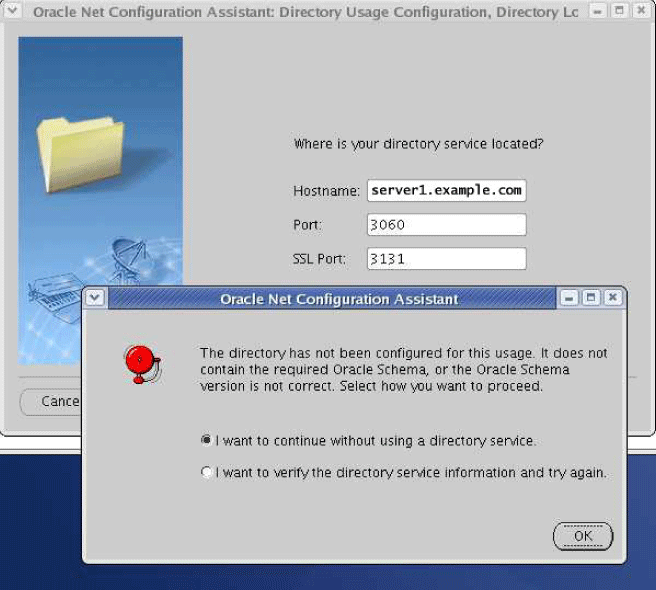
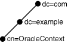

## 8 Configuring Naming Methods

This chapter describes how to configure connectivity information for client connections to the database server.

This chapter contains the following topics:

See Also:

["Understanding Naming Methods"](concepts.md) for an overview of naming methods

## Using the Easy Connect Naming Method

The Easy Connect naming method eliminates the need for service name lookup in the `tnsnames.ora` files for TCP/IP environments. In fact, no naming or directory system is required if you use this method.

This naming method provides out-of-the-box TCP/IP connectivity to databases. It extends the functionality of the [host naming](glossary.md) method by enabling clients to connect to a database server with an optional port and service name in addition to the host name of the database:

```
CONNECT username
@[//]host
[:port
][/[service_name
][:server
]][/instance_name
]]
Enter password: password
```

The connect identifier converts to the following connect descriptor:

```
(DESCRIPTION= 
  (ADDRESS=(PROTOCOL=tcp)(HOST=host
)(PORT=port
))
  (CONNECT_DATA=
    (SERVICE_NAME=service_name
)
    (SERVER=server
)
    (INSTANCE_NAME=instance_name
)))
```

If you installed Oracle Database in Typical mode, then the default service name used by the `oracle` instance is `ORCL`, and the following Easy Connect syntax can be used to connect to that instance:

```
CONNECT username
@"host
//ORCL"
Enter password: password
```

Table 8-1 lists the Easy Connect syntax elements and descriptions for each.

Table 8-1 Connect Identifier for Easy Connection Naming Method

| Syntax Element | Description |
| --- | --- |
| // | Specify `//` for a URL.  For URL or JDBC connections, it is required that the connect identifier is preceded by a double-slash (`//`). For example:  ``` scott@//sales-server Enter password: password ```  For SQL connections, it is optional that the connect identifier is preceded by a double-slash (`//`). For example, the following connect strings are semantically equivalent:  ``` SQL> CONNECT scott@sales-server Enter password: password ``` ``` SQL> CONNECT scott@//sales-server Enter password: password ``` |
| host | Required. Specify the host name or IP address of the database host computer.  The host can be a simple host name, or a fully-qualified host name. If a simple hostname is given, then it may be domain-qualified during lookup if the local operating system configuration specifies a domain.  You may use an IPv4 or IPv6 address as a value. IPv6 addresses must be enclosed in square brackets, as in \[2001:0DB8:0:0::200C:417A\]. |
| port | Optional. Specify the listening port.  The default is 1521. |
| service\_name | Optional. Specify the service name of the database.  If a user specifies a service name, then the listener connects the user to that specific database. Otherwise, the listener connects to the database specified by the `DEFAULT_SERVICE_` `listener_name` parameter in the `listener.ora` file. If `DEFAULT_SERVICE_` `listener_name` is not configured for the listener and a service name is not explicitly specified by the user as part of the Easy Connect syntax, then the listener returns an error. |
| server | Optional. Specify the database server type to use.  This parameter instructs the listener to connect the client to a specific type of service handler.  The values for the server parameter are `dedicated`, `shared`, and `pooled`. If server is not specified in the Easy Connect syntax, then the type of server is chosen by the listener (shared server if configured, otherwise a dedicated server is used).  Note: In Oracle Call Interface documentation, server is referred to as `connect_type`. |
| instance\_name | Optional. Used to identify the database instance to access.  The instance name can be obtained from the `INSTANCE_NAME` parameter in the initialization parameter file. |

See Also:

Oracle Database Net Services Reference for additional information about configuring the [`DEFAULT_SERVICE_` `listener_name`](https://docs.oracle.com/cd/E11882_01/network.112/e10835/listener.htm#NETRF311) parameter, and the [`INSTANCE_NAME`](https://docs.oracle.com/cd/E11882_01/network.112/e10835/tnsnames.htm#NETRF284) initialization parameter

The connect strings in Example 8-1 connect the client to database service `sales.us.example.com` with a listening endpoint of 1521 on database server `sales-server`.

Example 8-1 Easy Connect Strings

```
CONNECT scott@sales-server:1521/sales.us.example.com
CONNECT scott@//sales-server/sales.us.example.com
CONNECT scott@//sales-server.us.example.com/sales.us.example.com
```

After each of the connect strings in Example 8-1, you must enter a password to connect to the database service.

The connect strings in Example 8-1 convert into the following connect descriptor:

```
(DESCRIPTION= 
  (ADDRESS=(PROTOCOL=tcp)(HOST=sales-server)(PORT=1521))
  (CONNECT_DATA=
    (SERVICE_NAME=sales.us.example.com)))
```

### Configuring Easy Connect Naming on the Client

Clients can connect to Oracle Database using Easy Connect naming if the following conditions are met:

- Oracle Net Services software is installed on the client.
- Oracle TCP/IP protocol is supported on both the client and database server.
- No features require a more advanced connect descriptor are required.

Easy Connect naming is not suitable for large or complex environments with advanced features, such as [connection pooling](glossary.md), [external procedure](glossary.md) calls, or [Heterogeneous Services](glossary.md), that require additional connect information. In these cases, another naming method is recommended.

Easy Connect naming is automatically configured at installation. Before using it, you may want to ensure that `EZCONNECT` is specified by the `NAMES.DIRECTORY_PATH` parameter in the `sqlnet.ora` file. This parameter specifies the order of naming methods Oracle Net can use to resolve connect identifiers to connect descriptors.

To verify that the Easy Connect naming method is configured:

1. Start Oracle Net Manager.
	See Also:
	["Using Oracle Net Manager to Configure Oracle Net Services"](admintools.md)
2. In the navigator pane, expand Local, and then select Profile.
3. From the list in the right pane, select Naming.
4. Click the Methods tab.
	Verify that `EZCONNECT` is listed in the Selected Methods list. If it is not, then proceed to Step [^1]. If it is listed, then proceed to Step [^2].
5. From the Available Methods list, select EZCONNECT, and then click the right-arrow button.
6. In the Selected Methods list, select EZCONNECT, and then use the Promote button to move the selection to the top of the list.
7. Select Save Network Configuration from the File menu.
	The `sqlnet.ora` file updates the `NAMES.DIRECTORY_PATH` parameter, listing `hostname` first:
	```
	NAMES.DIRECTORY_PATH=(ezconnect, tnsnames)
	```

### Configuring Easy Connect Naming to Use a DNS Alias

You can optionally configure a DNS alias for the host name, as provided with the host naming method in Oracle Database 11g. With host naming, clients use a connect string that uses the following pattern:

```
CONNECT username@DNSalias

Enter password: password
```

To configure a DNS alias:

1. Ensure the database service is registered with the listener.
	If the database can find the listener, then information about the database service is dynamically registered with the listener during [service registration](glossary.md), including the service name. The listener is found if the following conditions are met:
	- The default listener named `LISTENER` on TCP/IP, port 1521 is running.
		- The `LOCAL_LISTENER` parameter is set in the initialization file.
	If the database cannot find the listener, then configure the `listener.ora` file with the `GLOBAL_DBNAME` parameter, as shown in the following example
	```
	SID_LIST_listener=
	(SID_LIST=
	 (SID_DESC=
	  (GLOBAL_DBNAME=sales.us.example.com)
	  (SID_NAME=sales)
	  (ORACLE_HOME=/u01/app/oracle))
	DEFAULT_SERVICE_listener=sales.us.example.com
	```
2. Establish a host name resolution environment.
	You can configure a mechanism such as DNS, NIS, or a centrally-maintained TCP/IP host file, `/etc/hosts`. For example, if a service name of `sales-server` for a database exists on a computer named `sales.us.example.com`, then the entry in the `/etc/hosts` file would look like the following:
	```
	#IP address of server     host name                alias
	192.168.2.35              sales.us.example.com     sales-server
	```
	The domain section of the service name must match the network domain.
3. Connect to the database using the DNS alias.
	Using the example in the previous step, the client can use `sales.example.com` in the connect string:
	```
	CONNECT username
	@sales.us.example.com
	Enter password: password
	```
	If the client and server are in the same domain such as `us.example.com`, then the client must enter only `sales` in the connect string.

See Also:

["Configuring Static Service Information"](listenercfg.md)

### Examples of Easy Connect Naming Method

Table 8-2 shows examples of Easy Connect naming syntax and how each string converts into a connect descriptor.

Table 8-2 Examples of Easy Connect Naming

| Naming Option | Connect String | Connect Descriptor |
| --- | --- | --- |
| Easy Connect string with host.  The host name is `sales-server`. | ``` sales-server ``` | ``` (DESCRIPTION=    (CONNECT_DATA=        (SERVICE_NAME=))    (ADDRESS=        (PROTOCOL=TCP)        (HOST=sales-server)        (PORT=1521))) ``` |
| Easy Connect string with host and port.  The host name is `sales-server`, and the port is `3456`. | ``` sales-server:3456 ``` | ``` (DESCRIPTION=    (CONNECT_DATA=        (SERVICE_NAME=))    (ADDRESS=        (PROTOCOL=TCP)        (HOST=sales-server)        (PORT=3456))) ``` |
| Easy Connect string with host and service name.  The host name is `sales-server` and the service name is `sales`. | ``` sales-server/sales ``` | ``` (DESCRIPTION=   (CONNECT_DATA=      (SERVICE_NAME=sales))   (ADDRESS=      (PROTOCOL=TCP)      (HOST=sales-server)      (PORT=1521))) ``` |
| Easy Connect string with IPv6 address.  The IPv6 address of the host is `2001:0DB8:0:0::200C:417A`, the port is `80`, and the service name is `sales`. | ``` [2001:0DB8:0:0::200C:417A]:80/sales ```  Square brackets are required around IPv6 host names. | ``` (DESCRIPTION=   (CONNECT_DATA=       (SERVICE_NAME=sales)   (ADDRESS=       (PROTOCOL=TCP)       (HOST=2001:0DB8:0:0::200C:417A)       (PORT=80))) ``` |
| Easy Connect string with IPv6 host address.  The IPv6 address of the host is `sales-server`, the port is `80`, and the service name is `sales`. | ``` sales-server:80/sales ``` | ``` (DESCRIPTION=   (CONNECT_DATA=       (SERVICE_NAME=sales)   (ADDRESS=       (PROTOCOL=TCP)       (HOST=2001:0DB8:0:0::200C:417A)       (PORT=80))) ``` |
| Easy Connect string with host, service name, and server.  The host name is `sales-server`, the service name is `sales`, the server is `dedicated`, and the instance name is `inst1` | ``` sales-server/sales:dedicated/inst1 ``` | ``` (DESCRIPTION=   (CONNECT_DATA=       (SERVICE_NAME=sales)       (INSTANCE_NAME=inst1)       (SERVER=dedicated))   (ADDRESS=       (PROTOCOL=TCP)       (HOST=sales-server)       (PORT=1521))) ``` |
| Easy Connect with host and instance name.  The host name is `sales-server` and the instance name is `inst1`. The `//` indicate that the server name and type are null, and that the word that follows is the instance name, in this case `inst1`. | ``` sales-server//inst1 ``` | ``` (DESCRIPTION=    (CONNECT_DATA=       (SERVICE_NAME=)       (INSTANCE_NAME=inst1))    (ADDRESS=       (PROTOCOL=TCP)       (HOST=sales-server)       (PORT=1521))) ``` |

## Configuring the Local Naming Method

The local naming method adds net service names to the `tnsnames.ora` file. Each net service name maps to a connect descriptor.

Example 8-2 shows the net service name `sales` mapped to the connect descriptor contained in `DESCRIPTION`. The `DESCRIPTION` section contains the protocol address and identifies the destination database service. In this example, the protocol is TCP/IP and the port is 1521.

Example 8-2 Connector Descriptor

```
sales=
(DESCRIPTION= 
  (ADDRESS=(PROTOCOL=tcp)(HOST=sales-server)(PORT=1521))
  (CONNECT_DATA= 
     (SERVICE_NAME=sales.us.example.com)))
```

Example 8-3 shows a valid `tnsnames.ora` entry to connect to a host identified with an IPv6 address and a port number of 1522.

Example 8-3 Connect Descriptor for IPv6 Connection

```
salesdb =
  ( DESCRIPTION =
    ( ADDRESS=(PROTOCOL=tcp)(HOST=2001:0DB8:1:1::200C:417A)(PORT=1522) )
    ( CONNECT_DATA = 
        (SERVICES_NAME=sales.example.com) )
  )
```

You can configure local naming during or after installation, as described in the following sections:

- Configuring the tnsnames.ora File During Installation
- Configuring the tnsnames.ora File After Installation

See Also:

["IPv6 Network Connectivity"](layers.md)

### Configuring the tnsnames.ora File During Installation

[Oracle Net Configuration Assistant](glossary.md) enables you to configure net service names for clients. Oracle Universal Installer launches Oracle Net Configuration Assistant after software installation. The configuration varies depending on the installation mode.

- Administrator or run-time installation: Oracle Net Configuration Assistant prompts you to configure net service names in the `tnsnames.ora` file to connect to an Oracle Database service.
- Custom installation: Oracle Net Configuration Assistant prompts you to select naming methods to use. If local is selected, then Oracle Net Configuration Assistant prompts you to configure net service names in the `tnsnames.ora` file to connect to an Oracle Database service.

### Configuring the tnsnames.ora File After Installation

You can add net service names to the `tnsnames.ora` file at any time after installation. To configure the local naming method, perform the following tasks:

- Task 1, "Configure Net Services Names"
- Task 2, "Configure Local Naming as the First Naming Method"
- Task 3, "Copy the Configuration to the Other Clients"
- Task 4, "Configure the Listener"
- Task 5, "Connect to the Database"

Note:

The underlying network connection must be operational before attempting to configure connectivity with Oracle Net.

Task 1 Configure Net Services Names

To configure the net services names, use one of the following methods:

- Configuration using Oracle Enterprise Manager
- Configuration using Oracle Net Manager
- Configuration using Oracle Net Configuration Assistant

Each method provides similar functionality. However, Oracle Net Manager has more configuration options for the `sqlnet.ora` file.

- Configuration using Oracle Enterprise Manager
	To configure net service names in the `tnsnames.ora` file with Oracle Enterprise Manager, do the following
	1. Access the Net Services Administration page in Oracle Enterprise Manager.
		See Also:
		["Accessing the Net Services Administration Page"](admintools.md)
		2. Select Local Naming from the Administer list, and then select the Oracle home that contains the location of the configuration files.
		3. Click Go.
		The Local Naming page appears. You may be prompted to log in to the database server.
		4. Click Create Like.
		The Create Net Service Name page appears.
		5. Enter any name in the Net Service Name field.
		You can qualify the net service name with the client's domain. The net service name is automatically domain qualified if the s `qlnet.ora` file parameter `NAMES.DEFAULT_DOMAIN` is set.
		See Also:
		["Specifying a Default Domain for Clients"](profile.md)
		6. In the Database Information section, configure service support:
		1. Enter a destination service name.
			See Also:
			["About Connect Descriptors"](concepts.md) for additional information about the service name string to use
				2. Select a database connection type.
			The default setting of Database Default is recommended for the connection type. If [shared server](glossary.md) is configured in the initialization parameter file, then you can select Dedicated Server to force the listener to spawn a dedicated server, bypassing shared server configuration. If shared server is configured in the initialization parameter file and you want to guarantee the connection always uses shared server, then select Shared Server.
			See Also:
			[Chapter 11, "Configuring Dispatchers"](dispatcher.md) for additional information about shared server configuration
		7. In the Addresses section, configure protocol support, as follows:
		1. Click Add.
			The Add Address page appears.
				2. From the Protocol list, select the protocol on which the listener is configured to listen. This protocol must also be installed on the client.
				3. Enter the appropriate parameter information for the selected protocol in the fields provided.
			See Also:
			[Oracle Database Net Services Reference](https://docs.oracle.com/cd/E11882_01/network.112/e10835/protocoladd.htm#NETRF004) for additional information about protocol parameter settings
				4. Optionally, in the Advanced Parameters section, specify the I/O buffer space limit for send and receive operations of sessions in the Total Send Buffer Size and Total Receive Buffer Size fields.
			See Also:
			["Configuring I/O Buffer Space"](performance.md) for additional information about buffer space
				5. Click OK.
			The protocol address is added to the Addresses section.
		8. Click OK to add the net service name.
		The net service name is added to the Local Naming page.
		9. Select connect-time failover and client load balancing option for the addresses.
		10. Click OK.
	See Also:
	- ["Creating a List of Listener Protocol Addresses"](advcfg.md) to configure multiple protocol addresses
	- ["Configuring Advanced Connect Data Parameters"](advcfg.md) to configure additional `CONNECT_DATA` options
- Configuration using Oracle Net Manager
	To configure net service names in the `tnsnames.ora` file with Oracle Net Manager, do the following:
	1. Start Oracle Net Manager.
		See Also:
		["Using Oracle Net Manager to Configure Oracle Net Services"](admintools.md)
		2. In the navigator pane, select Service Naming from Local.
		3. Click the plus sign (+) from the toolbar, or select Create from the Edit menu.
		The Welcome page of the Net Service Name wizard appears.
		4. Enter a name in the Net Service Name field.
		You can qualify the net service name with the client's domain. The net service name is automatically domain qualified if the s `qlnet.ora` file parameter `NAMES.DEFAULT_DOMAIN` is set.
		See Also:
		["Specifying a Default Domain for Clients"](profile.md)
		5. Click Next.
		The Protocol page appears.
		6. Select the protocol on which the listener is configured to listen. Note that this protocol must also be installed on the client.
		7. Click Next.
		The Protocol Settings page appears.
		8. Enter the appropriate parameter information for the selected protocol in the fields provided.
		See Also:
		[Oracle Database Net Services Reference](https://docs.oracle.com/cd/E11882_01/network.112/e10835/protocoladd.htm#NETRF004) for additional information about protocol parameter settings
		9. Click Next.
		The Service page appears.
		10. Select a release, enter a destination service name, and optionally, select a database connection type.
		Oracle recommends that you use the default setting of Database Default for the connection type. If [shared server](glossary.md) is configured in the initialization parameter file, then you can select Dedicated Server to force the listener to spawn a dedicated server, bypassing shared server configuration. If shared server is configured in the initialization parameter file and you want to guarantee the connection always uses shared server, then select Shared Server.
		See Also:
		- [Chapter 11, "Configuring Dispatchers"](dispatcher.md) for additional information about shared server configuration
		- ["About Connect Descriptors"](concepts.md) for additional information about the service name string to use
		11. Click Next.
		The Test page appears.
		12. Click Test to verify that the net service name works, or click Finish to dismiss the Net Service Name wizard.
		If you click Test, then Oracle Net connects to the database server by using the connect descriptor information you configured. Therefore, the listener and database must be running for a successful test. If they are not, then see ["Starting Oracle Net Listener and the Oracle Database Server"](gettingstart.md) to start components before testing. During testing, a Connection Test dialog box appears, providing status and test results. A successful test results in the following message:
		```
		The connection test was successful.
		```
		If the test was successful, then click Close to close the Connect Test dialog box, and proceed to Step 13.
		If the test was not successful, then do the following:
		1. Ensure that the database and listener are running, and then click Test.
				2. Click Change Login to change the user name and password for the connection, and then click Test.
		13. Click Finish to close the Net Service Name wizard.
		14. Select Save Network Configuration from the File menu.
		See Also:
		- ["Creating a List of Listener Protocol Addresses"](advcfg.md) to configure multiple protocol addresses
		- ["Configuring Advanced Connect Data Parameters"](advcfg.md) to configure additional `CONNECT_DATA` options
- Configuration using Oracle Net Configuration Assistant
	To configure net service names in the `tnsnames.ora` file with Oracle Net Configuration Assistant, do the following:
	1. Start Oracle Net Configuration Assistant.
		See Also:
		["Using Oracle Net Configuration Assistant to Configure Network Components"](admintools.md)
		The Welcome page appears.
		2. Select Local Net Service Name Configuration, and then click Next.
		The Net Service Name Configuration page appears.
		3. Click Add, and then click Next.
		The Service Name Configuration page appears.
		4. Enter a service name in the Service Name field.
		5. Click Next.
		6. Follow the prompts in the wizard and online help to complete net service name creation.

Task 2 Configure Local Naming as the First Naming Method

Configure local naming as the first method specified in the `NAMES.DIRECTORY_PATH` parameter in the `sqlnet.ora` file. This parameter specifies the order of naming methods Oracle Net uses to resolve connect identifiers to connect descriptors.

To configure the local naming method as the first naming method, use one of the following methods:

- Configuration using Oracle Enterprise Manager
- Configuration using Oracle Net Manager

Each method provides the same functionality.

Configuration using Oracle Enterprise Manager

To specify local naming as the first naming method using Oracle Enterprise Manager, do the following:

1. Access the Net Services Administration page in Oracle Enterprise Manager.
	See Also:
	["Accessing the Net Services Administration Page"](admintools.md)
2. Select Network Profile from the Administer list.
3. Select Naming Methods.
4. Select TNSNAMES from the Available Methods list.
5. Click Move to move the selection to the Selected Methods list.
6. Use the promote button (^) to move TNSNAMES to the top of the list.
7. Click OK.

Configuration using Oracle Net Manager

To specify local naming as the first naming method using Oracle Net Manager, do the following:

1. Start Oracle Net Manager.
	See Also:
	["Using Oracle Net Manager to Configure Oracle Net Services"](admintools.md)
2. In the navigator pane, select Profile from the Local menu.
3. From the list in the right pane, select Naming.
4. Click the Methods tab.
5. From the Available Methods list, select TNSNAMES, and then click the right-arrow button.
6. From the Selected Methods list, select TNSNAMES, and then use the Promote button to move the selection to the top of the list.
7. Choose Save Network Configuration from the File menu.
	The `sqlnet.ora` file updates with the `NAMES.DIRECTORY_PATH` parameter, listing `tnsnames` first:
	```
	NAMES.DIRECTORY_PATH=(tnsnames, EZCONNECT)
	```

Task 3 Copy the Configuration to the Other Clients

After one client is configured, it is best to simply copy the `tnsnames.ora` and `sqlnet.ora` configuration files to the same location on the other clients. This ensures that the files are consistent. Alternatively, you can use Oracle Net Assistant on every client.

Task 4 Configure the Listener

Ensure that the listener located on the server is configured to listen on the same protocol address configured for the net service name. By default, the listener is configured for the TCP/IP protocol on port 1521.

See Also:

[Chapter 9, "Configuring and Administering Oracle Net Listener"](listenercfg.md) for listener configuration details

Task 5 Connect to the Database

Clients can connect to the database using the following syntax:

```
CONNECT username
@net_service_name

Enter password: password
```

## Configuring the Directory Naming Method

With the directory naming method, connect identifiers are mapped to connect descriptors contained in an LDAP-compliant directory server, such as Oracle Internet Directory and Microsoft Active Directory. A directory provides central administration of database services and net service names, making it easier to add or relocate services.

A database service entry is created with [Database Configuration Assistant](glossary.md) during installation. Oracle Enterprise Manager and Oracle Net Manager are used to create and modify net service names and [net service alias](glossary.md) entries, and to modify the database service entry. Clients can use these entries to connect to the database.

To configure the directory naming method, perform the following tasks:

- Task 1, "Verify Directory Compatibility"
- Task 2, "Create Net Service Names in the Directory"
- Task 3, "Modify Connectivity Information for Database Service Entries"
- Task 4, "Create Net Services Aliases"
- Task 5, "Configure LDAP as the First Naming Method for Client Lookups"
- Task 6, "Configure the Listener"
- Task 7, "Connect to the Database"

Task 1 Verify Directory Compatibility

On the computer from which you plan to create net service names, do the following verification steps:

1. Ensure that computer has the latest release of Oracle Net Services software. The release information is located in the About Net Manager option on the Help menu.
2. Run Oracle Internet Directory Configuration Assistant to verify directory server, Oracle Context, and Oracle schema releases.
	See Also:
	[Oracle Internet Directory Administrator's Guide](http://www.oracle.com/pls/topic/lookup?ctx=db112&id=OIDAG) for additional information about configuring directory server usage

When Oracle Net Configuration Assistant checks the directory for the Oracle schema release, and Oracle Context during configuration, the following error may occur:



> This graphic shows an error message that states the following:
>
> ```
> The directory has not been configured for this usage. It does not contain the
> required Oracle Schema, or the Oracle Schema version is not correct. Select how
> you want to proceed.
> ```
>
> There are two options. One option is "I want to continue without using a directory service." The other option is "I want to verify the directory service information and try again."
>
> An OK button also appears on the error message.
>
> The Oracle Net Configuration Assistant: Directory Usage Configuration, Directory Lookup window is shown behind the error message. The window has three fields which the user must supply information. The fields are Hostname, Port, and SSL Port.
  
  

In addition, if the error occurs, then the following message will be added to the error log:

```
Configuration exception: Could not check for the Oracle Schema: 
oracle.net.config.ConfigException: TNS-04409: Directory Service Error
```

This error usually occurs in the following situations:

- No Oracle Context exists in the directory. The Oracle Internet Directory installer or other Oracle Internet Directory tool should be used to create an Oracle Context.
- If the Oracle Internet Directory directory is release 11, then, by default, it will not allow anonymous binds, and may prevent Oracle Net Configuration Assistant from accessing the Oracle Context. Check the configuration of the Oracle Internet Directory server for the following parameter. If the parameter is set to 0, then change it to 1.
	```
	dn: cn=oid,cn=osdldapd,cn=subconfigsubentry
	orlanonymousbindsflag: 1
	```

Task 2 Create Net Service Names in the Directory

You can configure clients to use a net service name rather than the database service entry. To create net service names, do the following:

Notes:

- Only users that are members of either the `OracleNetAdmins` or `OracleContextAdmins` group can create net service name entries in a directory. To add or remove users from the `OracleNetAdmins` group, see ["Adding Users To the OracleNetAdmins Group"](admintools.md).
- You can export existing net service names from a `tnsnames.ora` file. See "Exporting Local Naming Entries to a Directory Naming Server".

1. Access the Net Services Administration page in Oracle Enterprise Manager.
	See Also:
	["Accessing the Net Services Administration Page"](admintools.md)
2. Select Directory Naming from the Administer list, and then select the Oracle home that contains the location of the directory server.
3. Click Go.
	The Directory Naming page appears.
4. Click the Net Service Names tab.
5. In the Results section, click Create.
	The Create Net Service Name page with the General tab appears.
6. Enter any name in the Net Service Name field.
7. In the Database Information section, configure service support, as follows:
	1. Enter a destination service name.
		If the destination service name is for an Oracle9i database or later, then select Use Service Name, and enter a service name in the Service Name field.
		See Also:
		["About Connect Descriptors"](concepts.md) for additional information about the service name string to use
		2. Select a database connection type. Oracle recommends that you use the Database Default for the connection type. If [shared server](glossary.md) is configured in the initialization parameter file, then the following options are available:
		- Select Dedicated Server to force the listener to spawn a dedicated server, and bypass shared server configuration.
				- Select Shared Server to guarantee the connection always uses shared server.
		See Also:
		[Chapter 11, "Configuring Dispatchers"](dispatcher.md) for additional information about shared server configuration
8. In the Addresses section, configure protocol support, as follows:
	1. Click Add.
		The Add Address page appears.
		2. From the Protocol list, select the protocol on which the listener is configured to listen. This protocol must also be installed on the client.
		3. Enter the appropriate parameter information for the selected protocol in the fields provided.
		See Also:
		[Oracle Database Net Services Reference](https://docs.oracle.com/cd/E11882_01/network.112/e10835/protocoladd.htm#NETRF004) for additional information about protocol parameter settings
		4. (Optional) In the Advanced Parameters section, specify the I/O buffer space limit for send and receive operations of sessions in the Total Send Buffer Size and Total Receive Buffer Size fields.
		See Also:
		["Configuring I/O Buffer Space"](performance.md) for additional information
		5. Click OK.
		The protocol address is added to the Addresses section.
9. Click OK to add the net service name.
	The net service name is added to the Results section of the Net Service Names tab.
	See Also:
	- ["Creating a List of Listener Protocol Addresses"](advcfg.md) to configure multiple protocol addresses
	- ["Configuring Advanced Connect Data Parameters"](advcfg.md) to configure additional `CONNECT_DATA` options

Task 3 Modify Connectivity Information for Database Service Entries

When database registration with the directory naming completes, Database Configuration Assistant creates a database service entry in the directory. By default, this entry contains network route information with the location of the listener through a protocol address. You can re-create this information or modify the existing network route information.

Note:

Only users that are members of the `OracleNetAdmins` or `OracleContextAdmins` group can modify network information for a database service in a directory. To add or remove users from these groups, see ["Adding Users To the OracleNetAdmins Group"](admintools.md).

To create or modify network route information for a database service, do the following:

1. Access the Net Services Administration page in Oracle Enterprise Manager.
	See Also:
	["Accessing the Net Services Administration Page"](admintools.md)
2. Select Directory Naming from the Administer list, and then select the Oracle home that contains the location of the directory server.
3. Click Go. You may be prompted to log in to the database server and the directory server.
	The Directory Naming page appears.
4. Click the Database Services tab.
5. In the Simple Search section, select Oracle Context and search criteria to see the net service names for Oracle Context.
	The database service names display in the Results section.
6. In the Results section, select a database service, and then click Edit.

Task 4 Create Net Services Aliases

Net service aliases in a directory server enable clients to refer to a database service or a net service name by an alternative name. For example, a net service alias of `salesalias` can be created for a net service name of `sales`. When `salesalias` is used to connect to a database, as in `CONNECT scott@salesalias`, it resolves to and use the connect descriptor information for `sales`.

There are two main uses of net service aliases:

- Use a net service alias as a way for clients to refer to a database service or net service name by another name.
- Use a net service alias in one Oracle Context for a database service or net service name in a different Oracle Context. This enables a database service or net service name to be defined once in the directory server, and referred to by clients that use other Oracle Contexts.
	See Also:
	["Understanding Net Service Alias Entries"](config_concepts.md) for an overview of net service aliases

Notes:

- Only users that are members of either the `OracleNetAdmins` or `OracleContextAdmins` group can create or modify net service alias entries in a directory. To add or remove users from the `OracleNetAdmins` group, see ["Adding Users To the OracleNetAdmins Group"](admintools.md).
- To create or access net service aliases, ensure that the Oracle home is at least release 9.2.0.4.
- Net service aliases are not supported by Microsoft Active Directory.
- Ensure the NLS\_LANG environment variable is set for the clients when using net service aliases.

To create a net service alias, use one of the following methods:

- Configuration using Oracle Enterprise Manager
- Configuration using Oracle Net Manager

Each method provides similar functionality.

Configuration using Oracle Enterprise Manager

To configure a net service alias using Oracle Enterprise Manager, do the following:

1. Access the Net Services Administration page in Oracle Enterprise Manager.
	See Also:
	["Accessing the Net Services Administration Page"](admintools.md)
2. Select Directory Naming from the Administer list, and then select the Oracle home that contains the location of the directory server.
3. Click Go.
	The Directory Naming page appears.
4. Click the Net Service Aliases tab.
5. In the Results section, click Create.
	The Create Net Service Alias page appears.
6. Enter a name for the alias in the Net Service Alias Name field.
7. In the Referenced Service Detail section, enter the following information in the fields:
	- Oracle Context: Select the Oracle Context of the database service or net service name from the list or enter one in the field.
		- Referenced Service Name: Select the DN of the database service or net service name.
8. Click OK to add the net service alias.
	The net service alias is added to the Directory Naming page.

Configuration using Oracle Net Manager

To configure a net service alias using Oracle Net Manager, do the following:

1. Start Oracle Net Manager.
	See Also:
	["Using Oracle Net Manager to Configure Oracle Net Services"](admintools.md)
2. In the navigator pane, select Service Naming from Directory.
3. Select Aliases.
4. Select Create from the Edit menu.
5. Enter the net service alias in the Net Service Alias field.
6. Select Oracle Context and name.
7. Click Create.
8. Select Save Network Configuration from the File menu.

Task 5 Configure LDAP as the First Naming Method for Client Lookups

Configure directory naming as the first method to be used in the `NAMES.DIRECTORY_PATH` parameter in the `sqlnet.ora` file. This parameter specifies the order of naming methods Oracle Net uses to resolve connect identifiers to connect descriptors. To configure LDAP as the first naming method you can use one of the following methods:

- Configuration using Oracle Enterprise Manager
- Configuration using Oracle Net Manager

Configuration using Oracle Enterprise Manager

To specify directory naming as the first naming method using Oracle Enterprise Manager, do the following

1. Access the Net Services Administration page in Oracle Enterprise Manager.
	See Also:
	["Accessing the Net Services Administration Page"](admintools.md)
2. Select Network Profile from the Administer list.
3. Select Naming Methods.
4. Select LDAP from the Available Methods list.
5. Click Move to move the selection to the Selected Methods list.
6. Use the promote button (^) to move LDAP to the top of the list.
7. Click OK.

Configuration using Oracle Net Manager

To specify directory naming as the first naming method using Oracle Net Manager, do the following:

1. Start Oracle Net Manager.
	See Also:
	["Using Oracle Net Manager to Configure Oracle Net Services"](admintools.md)
2. In the navigator pane, select Profile from the Local menu.
3. From the list in the right pane, select Naming.
4. Click the Methods tab.
5. From the Available Methods list, select LDAP, and then click the right-arrow button.
6. From the Selected Methods list, select LDAP, and then use the Promote button to move the selection to the top of the list.
7. Select Save Network Configuration from the File menu.
	The `sqlnet.ora` file updates with the `NAMES.DIRECTORY_PATH` parameter, listing `ldap` first, such as the following:
	```
	NAMES.DIRECTORY_PATH=(ldap, tnsnames, hostname)
	```

Task 6 Configure the Listener

Ensure that the listener located on the server is configured to listen on the same protocol address configured for the net service name. By default, the listener is configured to listen on the TCP/IP protocol, port 1521.

See Also:

[Chapter 9, "Configuring and Administering Oracle Net Listener"](listenercfg.md) for listener configuration details

Task 7 Connect to the Database

Clients that are configured with a default directory entry that matches the directory location of the database service or net service name can connect to the database using the following syntax:

```
CONNECT username
@connect_identifier

Enter password: password
```

Clients that are configured with a default directory entry that does not match the entry's directory location must use the entry's distinguished name or its fully-qualified name.

See Also:

- ["Connect Identifier and Connect Descriptor Syntax Characteristics"](concepts.md) for connect identifier syntax rules
- ["Understanding the Directory Information Tree"](config_concepts.md) for fully-qualified name usage

## Creating Multiple Default Contexts in a Directory Naming Server

If you want clients to use discovery in directories which have more than one Oracle Context, then you can define the `orclCommonContextMap` attribute in the base `admin` context; this overrides the `orclDefaultSubscriber` attribute. During name lookup the discovery operation returns both values, and the client decides based on these which Oracle Context to use.

If the `orclCommonContextMap` attribute is not defined, then the `orclDefaultSubscriber` will be used as the default. If `orclCommonContextMap` is defined, then the client finds the default Oracle Context which is associated with its DNS domain in the `orclCommonContextMap`. To enable multiple default contexts, define the `orclCommonContextMap` with a list of associations between a domain and a DN to be used as the default `oracleContext`. A sample LDIF file entry is shown here:

```
$ ldapmodify -v -h sales-server -p 1389 -D cn=orcladmin -q
 dn: cn=Common,cn=Products,cn=OracleContext
 replace: orclCommonContextMap
 orclCommonContextMap:
 (contextMap=
   (domain_map=(domain=us.example.com)(DN="dc=example,dc=com"))
   (domain_map=(domain=uk.example.com)(DN="dc=sales,dc=com"))
  )
```

The `contextMap` entry must be entered without line breaks.

See Also:

[Oracle Internet Directory Administrator's Guide](http://www.oracle.com/pls/topic/lookup?ctx=db112&id=OIDAG) for additional information about how to configure the directory for context mapping

## Exporting Local Naming Entries to a Directory Naming Server

This section explains how to export data stored in a `tnsnames.ora` file to a directory server. It includes the following tasks:

If a `tnsnames.ora` file already exists, then its net service names can be exported to a directory server. The export procedure is performed for one domain at a time.

The tasks to export data from a `tnsnames.ora` file are as follows:

- Task 1, "Create Structure in the Directory Server"
- Task 2, "Create Oracle Contexts"
- Task 3, "Configure Directory Server Usage"
- Task 4, "Export Objects to a Directory Server"

Note:

These tasks assume the directory server has been installed and is running.

Task 1 Create Structure in the Directory Server

In the directory server, create the [directory information tree (DIT)](glossary.md) with the structure in which you want to import net service names. Create the structure leading to the top of the [Oracle Context](glossary.md).

For example, if the `tnsnames.ora` file supports a domain structure `example.com` and you want to replicate this domain in the directory, then create domain component entries of `dc=com` and `dc=example` in the directory, as shown in Figure 8-1.

Figure 8-1 example.com in Directory Server


> This illustration shows a directory information tree. At the top is dc=com, followed by dc=example.
>
> [Copyright © 2002, 2015, Oracle and/or its affiliates. All rights reserved.](https://docs.oracle.com/cd/E11882_01/dcommon/html/cpyr.htm)
  

You can replicate the domain structure you currently use with `tnsnames.ora`, or you can develop an entirely different structure. Introducing an entirely different structure can change the way clients enter the net service name in the connect string. Oracle recommends considering relative and fully-qualified naming issues before changing the structure.

See Also:

- Directory server vendor documentation for directory entry configuration instructions
- ["Client Connections Using Directory Naming"](config_concepts.md)

Task 2 Create Oracle Contexts

Create an Oracle Context under each DIT location that you created in Task 1 using Oracle Internet Directory Configuration Assistant. Oracle Context has a [relative distinguished name (RDN)](glossary.md) of `cn=OracleContext`. Oracle Context stores network object entries, as well as other entries for other Oracle components. In Figure 8-2, `cn=OracleContext` is created under `dc=example,dc=com`.

Figure 8-2 Oracle Context



> This illustration shows a directory information tree. At the top is dc=com, followed by dc=example, and ending at cn=OracleContext.
>
> [Copyright © 2002, 2015, Oracle and/or its affiliates. All rights reserved.](https://docs.oracle.com/cd/E11882_01/dcommon/html/cpyr.htm)
  

See Also:

- [Chapter 3, "Managing Network Address Information"](config_concepts.md) for additional information about Oracle Context
- [Oracle Internet Directory Administrator's Guide](http://www.oracle.com/pls/topic/lookup?ctx=db112&id=OIDAG) for instructions on creating an Oracle Context

Task 3 Configure Directory Server Usage

If not done as a part of creating Oracle Contexts, then configure the Oracle home for directory server use. The Oracle home you configure should be the one that performs the export.

See Also:

[Oracle Internet Directory Administrator's Guide](http://www.oracle.com/pls/topic/lookup?ctx=db112&id=OIDAG) for additional information about configuring directory server usage

Task 4 Export Objects to a Directory Server

To export net service names contained in a `tnsnames.ora` file to a directory, use either Oracle Enterprise Manager or Oracle Net Manager.

- To export objects using Oracle Enterprise Manager, do the following:
	1. Access the Net Services Administration page in Oracle Enterprise Manager.
		See Also:
		["Accessing the Net Services Administration Page"](admintools.md)
		2. Select Directory Naming from the Administer list, and then select the Oracle home that contains the location of the directory server.
		3. Click Go.
		The Directory Naming page appears.
		4. Click the Net Service Names tab.
		5. In the Related Links section, click Import Net Service Names To Directory Server.
		The Import Net Service Names To Directory Server page appears.
		6. From the Oracle Context list in the Oracle Internet Directory Server Destination section, select Oracle Context to which you want to export the selected net service names.
		7. In the Net Service Names to Import section, select the net service names.
		8. Click Add to add the net service names to the directory.
		The net service name is added to the Directory Naming page.
- To export objects using Oracle Net Manager, do the following:
	1. Start Oracle Net Manager.
		See Also:
		["Using Oracle Net Manager to Configure Oracle Net Services"](admintools.md)
		2. If the `tnsnames.ora` file you want to export is not loaded in Oracle Net Manager, then select Open Network Configuration from the File menu to select the `tnsnames.ora` file to export to the directory.
		3. Select Directory from the Command menu, and then select Export Net Service Names.
		The Directory Server Migration wizard starts.
		4. Click Next.
		If net service names with multiple domain were detected in the `tnsnames.ora` file, then the Select Domain page appears. Continue to Step 5.
		If the net service names are not domain qualified, then the Select Net Service Names page appears. Skip to Step 6.
		5. Select the network domain whose net service names you want to export, and then click Next.
		The Select Net Service Names page appears.
		6. Select the net service names from the list to export, and then click Next.
		The Select Destination Context page appears.
		7. In the Select Destination Context page, perform the following:
		1. From the Directory Naming Context list, select the directory entry that contains the Oracle Context. The directory naming context is part of a directory subtree that contains one or more Oracle Contexts.
				2. From the Oracle Context list, select the Oracle Context to which you want to export the selected net service names.
				3. Click Next.
		The Directory Server Update page appears with the status of the export operation.
		8. Click Finish to dismiss the Directory Server Migration wizard.

## Exporting Directory Naming Entries to a tnsnames.ora File

After you create the directory naming entries, consider exporting the entries to a local `tnsnames.ora` file, and distributing that file to clients. Clients can use the locally saved file when a directory server is temporarily unavailable.

To export directory naming entries to a local `tnsnames.ora` file, do the following:

1. Access the Oracle Net Administration page in Oracle Enterprise Manager.
	See Also:
	["Accessing the Net Services Administration Page"](admintools.md)
2. Select Directory Naming from the Administer list, and then select the Oracle home that contains the location of the directory server.
3. Click Go.
	The Directory Naming page appears.
4. Click the Net Service Names tab.
5. In the Simple Search section, select Oracle Context and search criteria to see the net service names for a particular Oracle Context.
	The net service names display in the Results section.
6. In the Results section, click Save to tnsnames.ora.
	The Processing: Create tnsnames.ora File page appears, informing you of the creation process.

## Configuring External Naming Methods

External naming refers to the method of resolving a net service name, stored in a third-party naming service, to a network address, such as network information services (NIS). Organizations and corporations using NIS as part of their systems infrastructure have the option to store net service names and addresses in NIS, using NIS external naming.

For example, when a user gives a command such as the following and `payroll` is a net service name:

```
sqlplus scott@payroll
Enter password: password
```

NIS external naming on the node running the client program or database server acting as a client program contacts an NIS server located on the network, and passes the net service name to the NIS server. The NIS server resolves the net service name into an Oracle Net address and returns this address to the client program or server. The client program then uses this address to connect to Oracle Database.

An NIS server runs a program called `ypserv`, which handles name requests. The `ypserv` program stores different types of data in special files called [map](glossary.md) s. For example, passwords are stored in a map called `passwd.byname`. Oracle Database service names are stored in a map called `tnsnames`.

When a user uses a connect string, NIS external naming uses an RPC call to contact the `ypserv` program, and passes the Oracle net service name and the name of the map. The `ypserv` program looks in the `tnsnames` map for the name, such as `payroll`, and its address for the net service name. The address is returned to the client, and the client program uses the address to contact the database server.

Note:

The NIS external naming method is not available on all platforms. Use the `adapters` command to check availability of NIS external naming on your system. If available, then it is listed under Oracle Net naming methods, as follows:
```
$ adapters

Installed Oracle Net naming methods are:

Local Naming (tnsnames.ora)
Oracle Directory Naming
Oracle Host Naming
NIS Naming
```

See Oracle platform-specific documentation for additional information.

This section contains the following tasks:

- Task 1, "Configure NIS Servers to Support NIS External Naming"
- Task 2, "Configure the Clients"

Task 1 Configure NIS Servers to Support NIS External Naming

Before configuring servers to support NIS external naming, ensure that NIS is configured and running on the NIS servers that need to resolve Oracle Database net service names. Consult your NIS documentation for specifics. To complete this task, add the tnsnames map to the existing NIS maps, and then verify that the tnsnames map has been installed properly.

1. Create a `tnsnames.ora` file, as specified in "Configuring the Local Naming Method".
	Note:
	Keep a copy of the `tnsnames.ora` file, preferably in `ORACLE_HOME/network/admin` directory. You may need to use this file again later to load net service names into the NIS map.
2. Convert the contents of the `tnsnames.ora` file to a `tnsnames` map using the `tns2nis` program similar to the following:
	```
	tns2nis tnsnames.ora
	```
	The `tns2nis` program reads the `tnsnames.ora` file from the current directory. If `tnsnames.ora` file is not located in the current directory, then you can use a full path name to specify its location, such as `/etc/tnsnames.ora` or `ORACLE_HOME/network/admin/tnsnames.ora`.
	The `tnsnames` map is then written into the current working directory.
	Note:
	The `tns2nis` program is supplied with NIS external naming.
3. Copy `tnsnames` to the NIS server.
4. Install the `tnsnames` map using `makedbm`, which is an NIS program.
	Note:
	This step should be performed by the person in charge of NIS administration.
	The `makedbm` program converts the `tnsnames` map into two files that the NIS server can read. The location of these files is operating system specific.
	See Also:
	Oracle operating system-specific documentation for details
	For example, to generate and install a `tnsnames` map on Linux, as the `root` user, enter the following at the command line:
	```
	# makedbm tnsnames /var/yp/'domainname'/tnsnames
	```
5. Verify `tnsnames` has been installed properly using the following command:
	```
	ypmatch net_service_name 
	tnsnames
	```
	For example, you might enter the following command:
	```
	ypmatch example.com tnsnames
	```
	This returns the length of the address in characters, followed by the address such as the following:
	```
	99 (description=(address=(protocol=tcp) (host=sales)(port=1999)))
	   (connect_data=(service_name=dirprod)))
	```

Task 2 Configure the Clients

To configure clients, configure NIS as the first method specified in the `NAMES.DIRECTORY_PATH` parameter in the `sqlnet.ora` file. This parameter specifies the order of naming methods Oracle Net can use to resolve connect identifiers to connect descriptors.

1. Start Oracle Net Manager.
	See Also:
	["Using Oracle Net Manager to Configure Oracle Net Services"](admintools.md)
2. In the navigator pane, select Profile from the Local menu.
3. From the list in the right pane, select Naming.
4. Click the Methods tab.
5. From the Available Methods list, select NIS, and then click the right-arrow button.
6. In the Selected Methods list, select NIS, and then use the Promote button to move the selection to the top of the list.
7. Select Save Network Configuration from the File menu.
	The `sqlnet.ora` file updates with the `NAMES.DIRECTORY_PATH` parameter, listing `nis` first:
	```
	NAMES.DIRECTORY_PATH=(nis, hostname, tnsnames)
	```

[^1]: From the Available Methods list, select EZCONNECT, and then click the right-arrow button.

[^undefined]: In the Selected Methods list, select EZCONNECT, and then use the Promote button to move the selection to the top of the list.

[^2]: Select Save Network Configuration from the File menu.

The `sqlnet.ora` file updates the `NAMES.DIRECTORY_PATH` parameter, listing `hostname` first:

```
NAMES.DIRECTORY_PATH=(ezconnect, tnsnames)
```