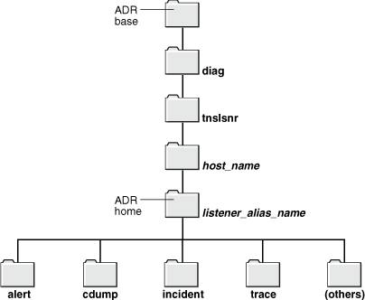
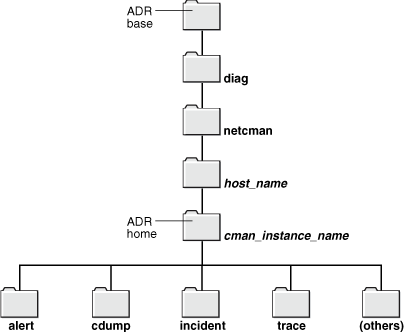

## 16 Troubleshooting Oracle Net Services

Oracle Net Services provides methods for understanding, testing and resolving network problems. Oracle Database includes utilities, and log and trace files for testing and diagnosing network connection and problems. The TNSPING and TRCROUTE utilities test connectivity. The log and trace files keep track of the interaction between network components as errors occur. Evaluating this information will help you to diagnose and troubleshoot network problems.

This chapter describes common testing procedures and network errors, and outlines procedures for resolving problems. It also describes methods for logging and tracing error information to diagnose and troubleshoot more complex network problems. This chapter contains the following topics:

## Understanding Automatic Diagnostic Repository

The [automatic diagnostic repository](glossary.md) (ADR) is a systemwide tracing and logging central repository. The repository is a file-based hierarchical data store for depositing diagnostic information, including network tracing and logging information.

The ADR home is the unit of the ADR directory that is assigned to an instance of an Oracle product. Each database instance has its own ADR home. Similarly, each listener, Oracle Connection Manager, and client instance has its own ADR home.

The location of an ADR home is given by the following path, which starts at the ADR base directory:

```
diag/product_type
/product_id
/instance_id
```

Table 16-1 lists the values of the path components for an Oracle Net Listener instance.

Table 16-1 ADR Home Path Components for an Oracle Net Listener Instance

| Path Component | Value for Oracle Net Listener |
| --- | --- |
| product\_type | tnslsnr |
| product\_id | host name |
| instance\_id | listener alias name |

Figure 16-1 illustrates the directory hierarchy of the ADR for an Oracle Net Listener instance. Other ADR homes for other Oracle products or components (such as Oracle Automatic Storage Management (Oracle ASM) or Oracle Database) can exist within this hierarchy, under the same ADR base.

Figure 16-1 Directory Structure for an Oracle Net Listener Instance



> This illustration shows the directory structure of the ADR for a single Oracle Net Listener instance, where each directory is represented by a folder. At the top is a folder labeled as ADR base. Beneath ADR base is a directory named diag, beneath which is a directory named tnslsnr. Beneath the tnslsnr directory is a directory whose name is the host name. Beneath that directory is a directory whose name is the listener alias name. This directory is flagged by a label as the ADR home for the Oracle Net Listener instance. Beneath the ADR home directory (the directory whose name is the listener alias name) are the following subdirectories: alert, cdump, incident, trace, and one named "(others)", which indicates a number of other ADR home subdirectories.
  

Table 16-2 lists the values of the path components for an Oracle Connection Manager instance.

Table 16-2 ADR Home Path Components for a Oracle Connection Manager Instance

| Path Component | Value for Oracle Connection Manager |
| --- | --- |
| product\_type | netcman |
| product\_id | host name |
| instance\_id | Oracle Connection Manager instance name |

Figure 16-2 illustrates the directory hierarchy of the ADR for an Oracle Connection Manager instance. Other ADR homes for other Oracle products or components (such as Oracle ASM or Oracle Database) can exist within this hierarchy, under the same ADR base.

Figure 16-2 Directory Structure for a Oracle Connection Manager Instance



> This illustration shows the directory structure of the ADR for a single CMAN instance, where each directory is represented by a folder. At the top is a folder labeled as ADR base. Beneath ADR base is a directory named diag, beneath which is a directory named netcman. Beneath the netcman directory is a directory whose name is the host name. Beneath that directory is a directory whose name is the CMAN instance name. This directory is flagged by a label as the ADR home for the CMAN instance. Beneath the ADR home directory (the directory whose name is the CMAN instance name) are the following subdirectories: alert, cdump, incident, trace, and one named "(others)", which indicates a number of other ADR home subdirectories.
  

Within the ADR home directory are subdirectories where each instance, such as the database, listener, Oracle Connection Manager, or client, stores diagnostic data. Table 16-3 lists some of these subdirectories and their contents.

Table 16-3 ADR Home Subdirectories

| Subdirectory Name | Contents |
| --- | --- |
| alert | The XML-formatted log named log.xml |
| cdump | Core files |
| incident | Multiple subdirectories, where each subdirectory is named for a particular incident, and where each contains dumps pertaining only to that incident |
| trace | Background and server process trace files, SQL trace files, and text version of the log.xml file in the alert directory |
| (others) | Other subdirectories of ADR home, which store incident packages, health monitor reports, and other information |

The `ADR_BASE` is the physical location in which one or more ADR homes are placed. Conceptually, it is the root directory of ADR.

Non-ADR (meaning that the `DIAG_ADR_ENABLED` parameter is set to `OFF`) diagnostic and tracing methods are still current and applicable but the parameters are ignored if ADR is enabled. ADR is enabled by default.

Diagnostic parameters are found in the following configuration files:

- `sqlnet.ora` for clients.
- `listener.ora` for listeners.
- `cman.ora` for connection managers.

Table 16-4 compares usage of diagnostic parameters found in the `sqlnet.ora` file used in both ADR and non-ADR-based diagnostics.

Table 16-4 sqlnet.ora File Diagnostic Parameter Comparison

| Parameter | DIAG\_ADR\_ENABLED=OFF | DIAG\_ADR\_ENABLED=ON |
| --- | --- | --- |
| ADR\_BASE | Disabled | Enabled |
| TRACE\_LEVEL\_CLIENT | Enabled | Enabled |
| TRACE\_LEVEL\_SERVER | Enabled | Enabled |
| TRACE\_DIRECTORY\_CLIENT | Enabled | Disabled |
| TRACE\_FILE\_CLIENT | Enabled | Disabled |
| TRACE\_UNIQUE\_CLIENT | Enabled | Disabled |
| LOG\_DIRECTORY\_CLIENT | Enabled | Disabled |
| LOG\_FILE\_CLIENT | Enabled | Disabled |
| LOG\_DIRECTORY\_SERVER | Enabled | Disabled |
| TRACE\_DIRECTORY\_SERVER | Enabled | Disabled |
| TRACE\_FILE\_SERVER | Enabled | Disabled |

Table 16-5 compares usage of diagnostic parameters found in the `listener.ora` file used in both non-ADR and ADR-based diagnostics.

Table 16-5 listener.ora File Diagnostic Parameter Comparison

| Parameter | DIAG\_ADR\_ENABLED=OFF | DIAG\_ADR\_ENABLED=ON |
| --- | --- | --- |
| ADR\_BASE\_listener\_name | Disabled | Enabled |
| LOGGING\_listener\_name | Enabled | Enabled |
| TRACE\_LEVEL\_listener\_name | Enabled | Enabled |
| TRACE\_TIMESTAMP\_listener\_name | Enabled | Enabled |
| LOG\_DIRECTORY\_CLIENT\_listener\_name | Enabled | Disabled |
| LOG\_FILE\_CLIENT\_listener\_name | Enabled | Disabled |
| TRACE\_DIRECTORY\_CLIENT\_listener\_name | Enabled | Disabled |
| TRACE\_FILELEN\_listener\_name | Enabled | Disabled |
| TRACE\_FILENO\_listener\_name | Enabled | Disabled |

Table 16-6 compares usage of diagnostic parameters found in the `cman.ora` file used in both non-ADR and ADR-based diagnostics.

Table 16-6 cman.ora File Diagnostic Parameter Comparison

| Parameter | DIAG\_ADR\_ENABLED=OFF | DIAG\_ADR\_ENABLED=ON |
| --- | --- | --- |
| ADR\_BASE | Disabled | Enabled |
| LOG\_LEVEL | Enabled | Enabled |
| TRACE\_LEVEL | Enabled | Enabled |
| TRACE\_TIMESTAMP | Enabled | Enabled |
| LOG\_DIRECTORY | Enabled | Disabled |
| TRACE\_DIRECTORY | Enabled | Disabled |
| TRACE\_FILELEN | Enabled | Disabled |
| TRACE\_FILENO | Enabled | Disabled |

See Also:

- [Oracle Call Interface Programmer's Guide](https://docs.oracle.com/cd/E11882_01/appdev.112/e10646/oci10new.htm#LNOCI1020) for information about the location of the client ADR Home
- [Oracle Database Administrator's Guide](https://docs.oracle.com/cd/E11882_01/server.112/e25494/diag.htm#ADMIN11261) for additional information about ADR
- [Oracle Database Net Services Reference](https://docs.oracle.com/cd/E11882_01/network.112/e10835/toc.htm) for descriptions of the following diagnostic parameters

### ADRCI: ADR Command Interpreter

ADRCI is a command-line tool that is part of the fault diagnosability infrastructure introduced in Oracle Database 11g. ADRCI enables you to:

- View diagnostic data within ADR
- Package incident and problem information into a zip file for transmission to Oracle Support Services

Diagnostic data includes incident and problem descriptions, trace files, dumps, health monitor reports, alert log entries, and so on.

ADRCI has a rich command set, and can be used in interactive mode or within scripts. In addition, ADRCI can run scripts of ADRCI commands in the same way that SQL\*Plus runs scripts with SQL and PL/SQL commands.

To view trace files using ADRCI, enter `ADRCI` at a command line. The following are common ADRCI commands to check a server:

Server Side

```
adrci>> SHOW BASE
adrci>> SHOW TRACEFILE
adrci>> SHOW TRACE trace_file
.trc
```

The following are common ADRCI commands to check a client:

Client Side

```
adrci>> SHOW ALERT
adrci>> SHOW BASE -product client
adrci>> SET BASE -product client

adrci>> SHOW TRACEFILE
adrci>> SHOW TRACE trace_file
.trc
adrci>> SHOW SPOOL
```

In the preceding commands, `SHOW ALERT` will show the `log.xml` file in a text editor, such as VI. `SHOW BASE -product client` displays the value of `ADR_BASE` for the client. Use that value for client in the `SET BASE` command.

Other ADRCI command options are available for a more targeted Oracle Net trace file analysis. Type `HELP` at the `adrci` prompt for help documentation.

See Also:

[Oracle Database Utilities](https://docs.oracle.com/cd/E11882_01/server.112/e22490/adrci.htm#SUTIL700) for additional information about ADRCI

## Diagnosing Oracle Net Services

Any underlying fault, noticeable or not, is reported by Oracle Net Services with an error number or message. The error number and message provide useful information for diagnosing the problem, but may not always identify the actual problem. This section helps you determine which parts of Oracle Net Services do function properly rather than the parts which do not work. It also helps you to decide in which of the following categories the fault belongs:

- Oracle software
- Operating system layer
- Other network layers

Testing the various network layers progressively should, in most cases, uncover any problem.

This section contains the following topics:

- Diagnosing Server Problems
- Diagnosing Client Problems

### Diagnosing Server Problems

To start diagnosing server problems, you should answer the following questions:

- Is any other system (workstation/server) able to connect to the server using Oracle Net?
- Has the server, database, or listener configuration remained the same for some time?

If you answered yes to any of the preceding questions, then go to "Diagnosing Client Problems".

If you are unsure, or answered no to any of the preceding questions, then continue. Diagnosing Oracle Net Services on the server involves the following tasks:

- Task 1, "Verify the Database is Running"
- Task 2, "Perform a Loopback Test"

Task 1 Verify the Database is Running

To check that the database is up, log in to the database and connect with a valid username and password. For example:

```
SQLPLUS system
Enter password: password
```

A message appears, confirming that you are connected with the database. If you receive the following errors, then ask your Database Administrator to assist you:

- `ORA-1017: invalid U/P`
- `ORA-1034: Oracle not available`

Task 2 Perform a Loopback Test

A loopback test uses Oracle Net to go from the database server back to itself, bypassing the Interprocess Communication (IPC). Performing a successful loopback verifies that Oracle Net is functioning on the database server.

To perform a [loopback test](glossary.md) from the server to the database:

1. Ensure that the `listener.ora`, `tnsnames.ora`, and `sqlnet.ora` files exist in the correct locations, as described in ["Using Localized Management"](config_concepts.md).
2. Start Oracle Net Manager.
	See Also:
	["Using Oracle Net Manager to Configure Oracle Net Services"](admintools.md)
3. In the navigator, expand Directory or Local > Service Naming.
4. Select the net service name or database service.
5. Choose Command > Test Net Service.
	Testing assumes the listener and database are running. If they are not, then see ["Starting Oracle Net Listener and the Oracle Database Server"](gettingstart.md) to start components.
	During testing, a Connection Test dialog box appears, providing status and test results. A successful test results in the following message:
	```
	The connection test was successful.
	```
	If the test was successful, then proceed to Step 6.
	If the test was not successful, then do the following:
	1. Ensure the database and listener are running, and then click Test.
		2. Click Change Login to change the username and password for the connection, and then click Test.
	- If the loopback test passes, then go to "Diagnosing Client Problems".
		- If the loopback test continues to fail, then contact Oracle Support Services.
6. Click Close to close the Connect Test dialog box.

### Diagnosing Client Problems

Verify at least one of the following statements. This will help you decide if it is a client problem.

- The database server passed a loopback test, showing that the connection worked.
- Other computers connect also using Oracle Net Services to this same database.
- Connections from this workstation worked before making changes on this computer, such as the installation of a new product or modification to the network configuration.

The following procedure describes how to perform diagnostics on the client:

1. Check that you have installed the same protocol support that was installed on the database server.
	On Linux and UNIX platforms you can use the `ADAPTERS` utility to verify protocol support. On the database server, run the following command from the `ORACLE_HOME/bin` directory to display the protocol support, naming methods, and security options linked with the `oracle` executable:
	```
	adapters ./oracle
	```
	The `adapters` utility displays output similar to the following:
	```
	Installed Oracle Net transport protocols are:
	    IPC
	    BEQ
	    TCP/IP
	    SSL
	    RAW
	    SDP/IB
	Installed Oracle Net naming methods are:
	    Local Naming (tnsnames.ora)
	    Oracle Directory Naming
	    Oracle Host Naming
	    NIS Naming
	Installed Oracle Advanced Security options are:
	    RC4 40-bit encryption
	    RC4 56-bit encryption
	    RC4 128-bit encryption
	    RC4 256-bit encryption
	    DES40 40-bit encryption
	    DES 56-bit encryption
	    3DES 112-bit encryption
	    3DES 168-bit encryption
	    AES 128-bit encryption
	    AES 192-bit encryption
	    AES 256-bit encryption
	    MD5 crypto-checksumming
	    SHA crypto-checksumming (for FIPS)
	    SHA-1 crypto-checksumming
	    Kerberos v5 authentication
	    RADIUS authentication
	```
	On the client, run the `adapters` command from the `ORACLE_HOME/bin` directory to display the configured Oracle protocol support, naming methods, and security options. The `ADAPTERS` utility displays output similar to the following:
	```
	Installed Oracle Net transport protocols are:
	    IPC
	    BEQ
	    TCP/IP
	    SSL
	    RAW
	    SDP/IB
	Installed Oracle Net naming methods are:
	    Local Naming (tnsnames.ora)
	    Oracle Directory Naming
	    Oracle Host Naming
	    NIS Naming
	Installed Oracle Advanced Security options are:
	    RC4 40-bit encryption
	    RC4 56-bit encryption
	    RC4 128-bit encryption
	    RC4 256-bit encryption
	    DES40 40-bit encryption
	    DES 56-bit encryption
	    3DES 112-bit encryption
	    3DES 168-bit encryption
	    AES 128-bit encryption
	    AES 192-bit encryption
	    AES 256-bit encryption
	    MD5 crypto-checksumming
	    SHA-1 crypto-checksumming
	    Kerberos v5 authentication
	    RADIUS authentication
	```
	Note:
	RAW is an internal protocol used by Oracle Net.
	See Also:
	Oracle Database Administrator's Guide for additional information about the `adapters` utility
2. Check base connectivity for underlying network transport. Oracle Net technology depends on the underlying network for a successful connection.
	| Protocol | Verify that you can... |
	| --- | --- |
	| TCP/IP | Use terminal emulation or file transfer utilities, (PING, FTP, TELNET) from the client to the database server. |
	| Named Pipes | - See other computers or servers on the Microsoft network. - Ensure that you are able to share drives within the network. |
3. Ensure that the Oracle Net foundation layer and the appropriate Oracle protocol support are present by verifying that all Oracle Net Services software has been installed for the client.
4. Ensure that the client computer has the `tnsnames.ora` and the `sqlnet.ora` files in the correct locations.
	See Also:
	["Using Localized Management"](config_concepts.md)
	If you have any other working client computers connecting to the selected Oracle Database, then back up your existing files and copy both the working `tnsnames.ora` and `sqlnet.ora` files from the working client computer to the non-working clients. This eliminates the possibility of errors in the files.
5. Test the Oracle Net foundation layer. You can test using the following command to connect to SQL\*Plus:
	```
	sqlplus user
	/password
	@connect_string
	```
	Note:
	Do not use the TNSPING utility. The TNSPING utility works like the TCP/IP PING utility and does not create and open a socket, nor does it connect with the listener. It ensures that the listener is present on the database server.
6. If the connection still fails, then do the following:
	1. Use tracing, as described in section "Troubleshooting Network Problems Using Log and Trace Files"
		2. Check the Oracle Support Web site for a specific diagnostics bulletin on the error received
		3. Contact Oracle Support Services

## Resolving the Most Common Error Messages for Oracle Net Services

Due to the complexity of network communications, network errors may originate from a variety of sources, and for a variety of reasons. If an error occurs, then applications such as SQL\*Plus, that depend on network services from Oracle Net Services, normally generate an error message.

A list of the most common network error messages follows:

- ORA-03113: TNS:end-of-file on communication channel
- ORA-12154: TNS:could not resolve the connect identifier specified
- ORA-12170: TNS:Connect timeout occurred
- TNS-12500/ORA-12500: TNS: listener failed to start a dedicated server process
- ORA-12514: TNS:listener does not currently know of service requested in connect descriptor
- ORA-12520: TNS:listener could not find available handler for requested type of server
- ORA-12521: TNS:listener does not currently know of instance requested in connect descriptor
- ORA-12525: TNS:listener has not received client's request in time allowed
- ORA-12533: TNS:illegal ADDRESS parameters
- TNS-12540/ORA-12540: TNS:internal limit restriction exceeded and TNS-00510: Internal limit restriction exceeded
- TNS-12541/ORA-12541: TNS:no listener
- TNS-12549/ORA-12549: TNS:operating system resource quota exceeded and TNS-00519: Operating system resource quota exceeded
- TNS-12560/ORA-12560: TNS:protocol adapter error occurred

For information about the specific error messages, use the Oracle error tool `oerr`, by entering the following at any command line:

```
oerr code
 error_number
```

In the preceding command, code is the type of message, such as ORA and TNS, and error\_number is the number associated with the error message.

See Also:

[Oracle Database Error Messages](https://docs.oracle.com/cd/E11882_01/server.112/e17766/toc.htm) for a complete listing of error messages

ORA-03113: TNS:end-of-file on communication channel

Cause: An error has occurred on the database server.

Action: Check the `alert_sid.log` file on the server. An unexpected end of file was processed on the communication channel. This may be an indication that the communications link may have gone down at least temporarily, or it may indicate that the server has gone down.You may need to modify your retransmission count.

ORA-12154: TNS:could not resolve the connect identifier specified

Cause: A connection to a database or other service was requested using a connect identifier, and the connect identifier specified could not be resolved into a connect descriptor using one of the naming methods configured. For example, if the type of connect identifier used was a net service name then the net service name could not be found in a naming method repository, or the repository could not be located or reached.

Action: Perform the following steps:
1. Check the type of naming adapters listed in the `names.directory_path` parameter in the `sqlnet.ora` file. If none are configured, then use the `adapters` command to determine which adapters are in use. The following example shows the adapters:
	```
	$ adapters
	             ...
	     Installed Oracle Net naming methods are:
	 
	         Local Naming (tnsnames.ora)
	         Oracle Directory Naming
	         Oracle Host Naming
	         NIS Naming
	```
	The net service name given in the connect string should be defined for at least one of the naming methods.
2. Check the resolution path for each adapter for possible problems. For example, ensure that the name given in the connect string is correct and complete, using the full name of the net service if necessary.

When using the local naming method, do the following:

1. Verify that the `tnsnames.ora` file exists and is in the correct location. The location is either the `ORACLE_HOME/network/admin` directory or the directory specified by the TNS\_ADMIN environment variable.
2. Verify there is an entry in the `tnsnames.ora` file for the name given in the connect string. This net service name should match the name in the `tnsnames.ora` file exactly if the name is simple and there is not NAMES\_DEFAULT\_DOMAIN in the `sqlnet.ora` file, or the net service name is a fully-qualified name. If the net service name in the connect string is simple, then check the NAMES\_DEFAULT\_DIRECTORY parameter in the `sqlnet.ora` file. Its value is appended to the net service name given in the connect string. This fully-qualified name should be the entry in the `tnsnames.ora` file.
3. If you are connecting from a login dialog box, then verify that you are not placing an at sign (@) before your connect net service name.
4. Activate client tracing and repeat the operation.

When using the directory naming method, do the following:

1. Verify the `ldap.ora` file exists and is in the correct location. The following directories are searched for `ldap.ora` file in the order given. The `ldap.ora` file found will be used.
	- The directory specified by the TNS\_ADMIN environment variable.
		- The `ORACLE_HOME/network/admin` directory.
		- The directory specified by the LDAP\_ADMIN environment variable.
		- The `ORACLE_HOME/ldap/admin` directory.
2. Verify that the parameters defined in the `ldap.ora` file are correct, as follows:
	- The DIRECTORY\_SERVERS parameter defines the correct host and port for one or more valid LDAP servers.
		- The DEFAULT\_ADMIN\_CONTEXT parameter defines the location of the Oracle Context in this directory which should include the net service entry.
	If the `ldap.ora` file does not exist, then these parameters will be resolved using automatic discovery.
3. Verify that the LDAP server host and port are defined in DNS.
4. Verify that the directory has the default Oracle Context defined.
5. Use the ldapsearch utility or a directory administration tool to verify that the net service object exists in the Oracle Context at the location given by the value of the DEFAULT\_ADMIN\_CONTEXT parameter.

When using the Easy Connect naming method, do the following:

1. Verify that the host name give is correct, and is defined in the local host name resolution service, such as local hosts file, DNS, and so on.

When using the external naming method, do the following:

1. Verify that the NIS file for tnsnames is properly set up.
2. Check that the net service name matches the tnsnames entry as described in the preceding local naming section.

See Also:

- "Example of Troubleshooting a TNS-12154 Error" for additional information about troubleshooting the error
- ["Using Localized Management"](config_concepts.md) for configuration file location information
- [Chapter 8, "Configuring Naming Methods"](naming.md) for naming information

ORA-12170: TNS:Connect timeout occurred

Cause: The client failed to establish a connection and complete authentication in the time specified by the `SQLNET.INBOUND_CONNECT_TIMEOUT` parameter in the `sqlnet.ora` file. This error may be a result of network or system delays, or it may indicate that a malicious client is trying to cause a denial-of-service attack on the database server.

If the error occurred due to system or network delays that are normal for the particular environment, then perform the following steps:
1. Turn on tracing to determine which clients are timing out.
	See Also:
	"Tracing Error Information for Oracle Net Services"
2. Reconfigure the `SQLNET.INBOUND_CONNECT_TIMEOUT`, `SQLNET.SEND_TIMEOUT`, or `SQLNET.RECV_TIMEOUT` parameters in `sqlnet.ora` to a larger value.

If you suspect a malicious client, then perform the following steps:

1. Restrict access to the client. For example, you can configure parameters for access rights in the `sqlnet.ora` file.
	See Also:
	["Configuring Database Access Control"](profile.md)
2. Locate the IP address of the client in the `sqlnet.log` file on the database server to identify the source. Remember that an IP address can be forged.
	For example, the following `sqlnet.log` excerpt shows a client IP address of `192.168.2.35`.
	```
	Fatal NI connect error 12170.
	  VERSION INFORMATION:
	TNS for Linux: Version 11.2.0.0.0
	Oracle Bequeath NT Protocol Adapter for Linux: Version 11.2.0.0.0
	TCP/IP NT Protocol Adapter for Linux: Version 11.2.0.0.0
	  Time: 03-MAY-2009 13:51:12
	  Tracing to file: /ora/trace/svr_13279.trc
	  Tns error struct:
	    nr err code: 0
	    ns main err code: 12637
	    TNS-12637: Packet receive failed
	    ns secondary err code: 12604
	    nt main err code: 0
	    nt secondary err code: 0
	    nt OS err code: 0
	  Client address: (ADDRESS=(PROTOCOL=tcp)(HOST=192.168.2.35)(PORT=52996))
	```
	If the time out occurs before the IP address can be retrieved by the database server, then enable listener tracing to determine the client that made the request.

See Also:

- ["Limiting Resource Consumption by Unauthorized Users"](performance.md) additional information about setting the `SQLNET.INBOUND_CONNECT_TIMEOUT` parameter
- ["Configuring Database Access Control"](profile.md)
- Tracing Error Information for Oracle Net Services

TNS-12500/ORA-12500: TNS: listener failed to start a dedicated server process

Cause: The listener failed to start the Oracle program. Possible reasons include:
- The maximum number of processes allowed for a single user was exceeded
- The listener does not have execute permission on the Oracle program
- The associated Microsoft Windows service is not started

In some cases, these errors can be caused by the same conditions which cause the following errors:

- TNS-12549/ORA-12549
- TNS-00519
- TNS-12540/ORA-12540
- TNS-00510
- TNS-12560/ORA-12560

Action: Perform the appropriate action:
- Increase the number of processes by setting the `PROCESSES` parameter in the database initialization file to a larger value.
- Check the `listener.log` file for detailed error stack information.

ORA-12514: TNS:listener does not currently know of service requested in connect descriptor

Cause: The listener received a request to establish a connection to a database or other service. The connect descriptor received by the listener specified a service name for a service (usually a database service) that has either not yet dynamically registered with the listener or has not been statically configured for the listener. This may be a temporary condition such as after the listener has started, but before the database instance has registered with the listener.

Action: Perform the following steps:
1. Wait a moment, and then try to connect a second time.
2. Check which services are currently known by the listener by running the Listener Control utility `STATUS` or `SERVICES` command.
3. Check that the `SERVICE_NAME` parameter in the connect descriptor specifies a service name known by the listener.
4. Check for an event in the `listener.log` file.
	See Also:
	"Analyzing Listener Log Files"

ORA-12520: TNS:listener could not find available handler for requested type of server

Cause: The type of service handler requested by the client is incorrect or not registered for the requested `SERVICE_NAME` / `INSTANCE_NAME`, or the database instance is not registered with the listener.

Action: If you suspect the problem is the wrong type of service handler, then perform the following steps:
1. If `(``server` `=` `value``)` is set in the connect descriptor, then ensure that the value is set to the appropriate service handler type for the database, that is, `dedicated` for dedicated server or `shared` for dispatchers. You can use the Listener Control utility `SERVICES` command to see what service handlers are currently registered with the listener.
2. If `USE_DEDICATED_SERVER` is set to `ON` in the `sqlnet.ora` file, then ensure the database is configured to use dedicated servers. If it is not, then set this parameter to `OFF`.
3. Ensure that the database instance is running. If the instance not running, then start it so that it can register with the listener.

See Also:

["Monitoring Services of a Listener"](listenercfg.md) for additional information about service handlers

ORA-12521: TNS:listener does not currently know of instance requested in connect descriptor

Cause: The instance name in the connect descriptor is incorrect, or the database instance is not registered with the listener.

Action: Perform the following steps:
1. Ensure that the service name specified in the connect descriptor is correct.
2. Ensure that the database instance is running. If the instance not running, then start it so that it can register with the listener. You can use the Listener Control utility `SERVICES` command to see what instances are currently registered with the listener.
	See Also:
	["Monitoring Services of a Listener"](listenercfg.md) for additional information about `SERVICES` command

ORA-12525: TNS:listener has not received client's request in time allowed

Cause: The client failed to complete its connect request in the time specified by the `INBOUND_CONNECT_TIMEOUT_` `listener_name` parameter in the `listener.ora` file. This error may be a result of network or system delays, or it may indicate that a malicious client is trying to cause a denial-of-service attack on the listener.

See Also:

["Limiting Resource Consumption by Unauthorized Users"](performance.md) for additional information about setting the `INBOUND_CONNECT_TIMEOUT_` `listener_name` parameter

Action: If the error occurred due to system or network delays that are normal for the particular environment, then reconfigure the `INBOUND_CONNECT_TIMEOUT_` `listener_name` parameter in `listener.ora` to a larger value.

If you suspect a malicious client, then perform the following steps:

1. Locate the IP address of the client in the `listener.log` file to identify the source. Remember that an IP address can be forged.
	For example, the following `listener.log` excerpt shows a client IP address of `192.168.2.35`.
	```
	03-MAY-2009 16:42:35 * <unknown connect data> *
	(ADDRESS=(PROTOCOL=tcp)(HOST=192.168.2.35)(PORT=53208)) * establish *
	<unknown sid> * 12525
	TNS-12525: TNS:listener has not received client's request in time
	allowed
	TNS-12604: TNS: Application timeout occurred
	```
2. Restrict access to the client. For example, you can configure parameters for access rights in the `sqlnet.ora` file.
	See Also:
	["Configuring Database Access Control"](profile.md)

ORA-12533: TNS:illegal ADDRESS parameters

Cause: The protocol specific parameters in the `ADDRESS` section of the designated connect descriptor are incorrect.

Action: Correct the protocol address.

Note:

This error is often caused by hand-editing of the `tnsnames.ora` file.

See Also:

[Oracle Database Net Services Reference](https://docs.oracle.com/cd/E11882_01/network.112/e10835/toc.htm) for correct protocol syntax

TNS-12540/ORA-12540: TNS:internal limit restriction exceeded and TNS-00510: Internal limit restriction exceeded

Cause: An internal limit has been exceeded. Possible limits include:
- Number of open connections that Oracle Net can process simultaneously
- Number of memory buffers which can be used simultaneously
- Number of processes a particular database instance is allowed

The first two are examples of hard limits. The third is an example of a limit which can be increased by setting `PROCESSES` parameter in the database initialization file to a larger value. In this case, a TNS-12500/ORA-12500 error is also returned. In some cases, these errors can be caused by the same conditions which cause TNS-12549/ORA-12549 and TNS-00519 errors.

Action: Wait for the open connections to close and retry. If the error persists, then check the `sqlnet.log` or `listener.log` file for detailed error stack information.

TNS-12541/ORA-12541: TNS:no listener

Cause: The connection request could not be completed because the listener is not running.

Action: Perform the following actions:
- Ensure that the supplied destination address matches one of the addresses used by the listener.
- Verify that the listener is running at the address specified by the request.
- Ensure the listener is listening on the host and port specified by the request.
- Verify the client is pointing to the listener.

TNS-12549/ORA-12549: TNS:operating system resource quota exceeded and TNS-00519: Operating system resource quota exceeded

Cause: A quota or hard limit imposed by the operating system has been exceeded.

Possible limits include:

- The maximum number of processes allowed for a single user
- The operating system is running low on paging space

Action: Perform the appropriate action:
- Increase the number of processes by setting the `PROCESSES` parameter in the database initialization file to a larger value.
- Check the `sqlnet.log` or `listener.log` file for detailed error stack information, such as an operating system error code to help identify which quota has been exceeded.

TNS-12560/ORA-12560: TNS:protocol adapter error occurred

Cause: There was an error when using a particular protocol. This error may be due to incorrect configuration of an `ADDRESS` parameter or may occur due to errors returned from the underlying protocol or operating system interface.

In some cases, these errors are caused by the same conditions which cause TNS-00510, TNS-00519, TNS-12540/ORA-12540, TNS-12549/ORA-12549 errors.

Action: This error occurs on Microsoft Windows systems only. Perform the following actions:
1. Select Run from the Microsoft Windows Start menu.
2. Enter `MSCONFIG` in the Open field.
3. Go to the Services tab.
4. Enable `OracleService` `sid` if it is disabled.
5. Restart the computer.
6. Check that Oracle Services has started.

### Troubleshooting Directory Naming Errors

Directory naming issues associated with connectivity errors for database service or net service name entries in a directory server require analysis of the data. You can analyze the data contained within a directory server with the `ldifwrite` command line tool. The `ldifwrite` tool is an Oracle Internet Directory tool.

The `ldifwrite` tool can be used to convert all or part of the information residing in a directory server to [Lightweight Directory Interchange Format (LDIF)](glossary.md). The `ldifwrite` tool performs a subtree search, including all entries following the specified [distinguished name (DN)](glossary.md), including the DN itself.

The `ldifwrite` tool syntax is as follows:

```
ldifwrite -c net_service_name/database_service
 -b base_DN
 -f ldif_file
```

Table 16-7 lists `ldifwrite` tool arguments and descriptions for each.

Table 16-7 ldifwrite Arguments

| Argument | Description |
| --- | --- |
| \-c net\_service\_name/database\_service | The net service name or database service name that connects to the directory server. |
| \-b base\_DN | The base of the subtree to be written out in LDIF format. |
| \-f ldif\_file | The input file name. |

The following example writes all the directory naming entries under `dc=us,dc=example,dc=com` to the `output1.ldi` file:

`ldifwrite -c ldap -b "dc=us,dc=example,dc=com" -f output.ldif`

Note:

Check the `ldap.ora` file to determine the base\_DN value. It is the same as the `DEFAULT_ADMIN_CONTEXT` entry in the `ldap.ora` file.

## Troubleshooting Tips for Oracle Net Services

The following suggestions may be useful when diagnosing network problems:

- Use the node or network address during configuration instead of the name of the server computer.
	This eliminates any internal lookup problems and make the connection slightly faster.
- If you are using TCP/IP addresses, then use the IP address rather than the host name.
	For example, change the (`HOST=` `server_name`) line in the `tnsnames.ora` file with the IP address, for example (`HOST=192.168.2.5`).
- Perform a loopback test.
	Perform a loopback test on the server as described in Task 2, "Perform a Loopback Test". If the test passes, then use FTP to send the `tnsnames.ora` and `sqlnet.ora` files to the client.
- Check the systems between the client and the server.
	If it is a wide area network (WAN), then identify any intermediate systems that may not work correctly. If all computers are fine, then the problem may be a timing issue.
- Verify whether there is a timing issue.
	Timing issues are associated with an `ORA-12535` error in the client log files.
	To resolve this, try speeding up the connection by using exact addresses instead of names and increase the `INBOUND_CONNECT_TIMEOUT_` `listener_name` parameter in the `listener.ora` file. The default value for this parameter is 60 seconds.
- Determine which Oracle applications are failing.
	SQL\*Plus may work, but CASE tools may not. If you determine the problem is a data volume issue, then try to transfer a large (5 MB) file with the base connectivity.

### Questions to Consider When Troubleshooting Oracle Net Services

The following questions can help diagnose a problem:

- Do all computers have a problem, or is it just one?
	If one computer works and another does not, and the same software (Oracle and third-party products) is installed on each computer, then, if possible, swap out the network cables to see if the problem occurs on the second client. If it does occur, then it indicates that the problem has something to do with the client/server connection and is not local to the client.
- What kind of connections exist between the client and the server, for example, X.25, ISDN, or leased line?
	Sniffers and LAN analyzers are useful for locating intermittent connection failures, and detecting time outs and re-sent packets. You can also see which side is waiting for a response.

## Example of Troubleshooting a TNS-12154 Error

This section offers some solutions to the TNS-12154 error. The TNS-12154 error is encountered when SQL\*Net cannot find the alias specified for a connection in the `tnsnames.ora` file or other naming adapter.

Before attempting to resolve the problem, it may be helpful to have a printout or view the `tnsnames.ora` file and the `sqlnet.ora` file. Looking at these files at the same time is helpful because references are made to both.

The `tnsnames.ora` and `sqlnet.ora` files are located in the default network administration directory on the client system.

Be sure that the `tnsnames.ora` file and the `sqlnet.ora` file resemble the following examples.

Example 16-1 shows an example of a `tnsnames.ora` file.

Example 16-1 tnsnames.ora Sample

```
DEV1.WORLD =
     (DESCRIPTION =
           (ADDRESS =
             (PROTOCOL = TCP)
             (HOST = 192.168.2.56)
             (PORT = 1521)
           )
       (CONNECT_DATA = 
         (SERVICE_NAME = sales.example.com)
       )
     )
```

Example 16-2 shows an example of a `sqlnet.ora` file.

Example 16-2 sqlnet.ora Sample

```
TRACE_LEVEL_CLIENT = OFF
SQLNET.AUTHENTICATION_SERVICES = (NONE)
NAMES.DIRECTORY_PATH = (TNSNAMES)
AUTOMATIC_IPC = OFF
```

To begin the diagnostic process, determine which section of this document applies to the problem. In the sample files shown in Example 16-1 and Example 16-2, the alias in Example 16-1 is `DEV1.WORLD`. However, the `NAMES.DEFAULT_DOMAIN=WORLD` parameter does not exist in Example 16-2. To fix this problem, add the `NAMES.DEFAULT_DOMAIN=WORLD` parameter anywhere in the `sqlnet.ora` file. Save the file, and try the connection again.

If the TNS-12154 error still persists, then determine whether the files were transferred from the client to the server and check the configuration files to ensure that CTRL-M (`^M`) or CTRL-R (`^R`) characters were not inserted at the ends of any lines. Remove any such characters you may find.

If the characters do not exist, then verify whether the `NAMES.DIRECTORY_PATH` parameter exists in the `sqlnet.ora` file and make sure the value in parentheses is `TNSNAMES`, as follows:

```
NAMES.DIRECTORY_PATH=(TNSNAMES)
NAMES.DIRECTORY_PATH=(TNSNAMES, EZCONNECT, HOSTNAME)
```

This parameter is not necessary but if it exists in the `sqlnet.ora` file and appears as shown in the preceding example, then the configuration files are technically accurate.

At the Linux prompt, echo the `TNS_ADMIN` environment variable, as follows:

```
% echo $TNS_ADMIN
```

If nothing is returned, then set the `TNS_ADMIN` environment variable to explicitly point to the location of the `tnsnames.ora` file.

- In C shell:
	```
	% setenv TNS_ADMIN full_path_to_tnsnames.ora_file
	```
- In Korn shell:
	```
	% TNS_ADMIN=full_path_to_tnsnames.ora_file
	; export TNS_ADMIN
	```

Try the connection again.

If the error persists, then add the `AUTOMATIC_IPC=OFF` parameter to the `sqlnet.ora` file. If `AUTOMATIC_IPC` is already set to `ON`, then change the value to `OFF`. Try the connection again.

If the error persists, then check the permissions of the `tnsnames.ora` and `sqlnet.ora` files and parent directories. Usually the `.ora` files are either `-rwxrwxrwx` or `-rwxrwx---`. Change the permissions of the configuration files to `777` to set the permissions to fully open and try the connection again.

If the error persists, then remove all line feeds and carriage returns so that the net alias is on one line, and try again.

Note:

Setting permissions to `777` enables anyone on the system to access the configuration files. Do this only as a temporary test and reset the permissions after the test.

If the error persists, then redo the configuration as follows:

1. Set the `TNS_ADMIN` environment variable to `/tmp`.
2. Go to the `/tmp` directory and create a new `tnsnames.ora` file using a text editor.
3. Copy the sample `tnsnames.ora` file from Example 16-1 into the text editor and save the new `tnsnames.ora` file.
4. Exit the text editor and at the command line, type:
	```
	% sqlplus scott@dev1.world
	Enter password: password
	```

## Troubleshooting Network Problems Using Log and Trace Files

Oracle Net Services logs provide detailed information about the source and context of problems. The process of logging and tracing error information helps you to diagnose and resolve network problems.

## Logging Error Information for Oracle Net Services

All errors encountered by Oracle Net Services are appended to a log file for evaluation by a network or database administrator. The log file provides additional information for an administrator about on-screen error messages. The error stack in the log file shows the state of the software at various layers.

To ensure that all errors are recorded, logging cannot be disabled on clients or name servers. Furthermore, only an administrator may replace or erase log files. The log file for the listener includes audit trail information about every client connection request, and most listener control commands.

This section contains the following topics:

- Oracle Net Error Stacks
- Oracle Net Services Log File Names
- Setting Logging Parameters
- Setting Logging During Control Utilities Run Time
- Using Log Files
- Analyzing Listener Log Files
- Analyzing Oracle Connection Manager Logs

### Oracle Net Error Stacks

Log files provide information contained in an error stack. An error stack refers to the information that is produced by each layer in an Oracle communications stack as the result of a network error.

The error stack components are described in Table 16-8.

Table 16-8 Error Stack Components

| Error Stack Component | Description |
| --- | --- |
| NI | Network Interface. This layer provides a generic interface for Oracle clients, servers, or external processes to access Oracle Net functions. The NI layer handles the "break" and "reset" requests for a connection. |
| NS | Network Session (main and secondary layers). These layers receive requests from NI, and settle all generic computer-level connectivity issues, such as:  - The location of the server or destination (open, close functions). - Whether one or more protocols are involved in the connection (open, close functions). - How to handle interrupts between client and server based on the capabilities of each (send, receive functions). |
| NA | Network Authentication. This layer negotiates authentication and encryption requirements. |
| NT | Network Transport (main, secondary, and operating system layers). This layer maps Oracle Net foundation layer functionality to industry-standard protocols. |

#### Understanding Error Stack Messages

Suppose that a user of a client application tries to establish a connection with a database server using Oracle Net and TCP/IP, by entering the following commands:

```
sqlplus scott@example.com
Enter password: password
```

When the commands are entered, the following error displays:

```
ORA-12543: TNS:Unable to connect to destination
```

This message indicates that the connection to the server failed because the database could not be contacted. Although the application displays only a one-line error message, an error stack that is much more informative is recorded in the log file by the network layer.

On the client side, the `sqlnet.log` file as shown in Example 16-3 contains an error stack corresponding to the `ORA-12543` error.

Example 16-3 sqlnet.log File

```
Fatal OSN connect error 12543, connecting to:
 (DESCRIPTION=(CONNECT_DATA=(SID=trace)(CID=(PROGRAM=)
   (HOST=lala)(USER=stiger)))(ADDRESS_LIST=(ADDRESS=
   (PROTOCOL=ipc)(KEY=trace))(ADDRESS=(PROTOCOL=tcp)
   (HOST=lala)(PORT=1521))))

VERSION INFORMATION:
TNS for Linux:
Oracle Bequeath NT Protocol Adapter for Linux:
Unix Domain Socket IPC NT Protocol Adaptor for Linux: 
TCP/IP NT Protocol Adapter for Linux:
  Tracing to file: /home/db_tracefiles/trace_admin.trc
  Tns error struct:
    TNS-12543: TNS:unable to connect to destination
    ns main err code: 12541
    TNS-12541: TNS:no listener
    ns secondary err code: 12560
    nt main err code: 511
    TNS-00511: No listener
    nt secondary err code: 61
    nt OS err code: 0
```

### Oracle Net Services Log File Names

Each Oracle Net Services component produces its own log file. When using ADR, the default, the log file names are `log.xml` in the appropriate alert directory. Table 16-9 lists the default log file names and lists the components that generate the log files that appear in the `ADR/diag/` `instance_name` `/trace` directory.

Table 16-9 Log Files

| Component | Log File |
| --- | --- |
| Listener | listener.log |
| Client or Database Server | sqlnet.log |
| Oracle Connection Manager listener | instance-name\_pid.log |
| Oracle Connection Manager [CMGW (Oracle Connection Manager gateway)](glossary.md) process | instance-name\_cmgw\_pid.log |
| Oracle Connection Manager [CMADMIN (Oracle Connection Manager Administration)](glossary.md) process | instance-name\_cmadmin\_pid.log |
| Oracle Connection Manager alert log | instance-name\_alert.log |

### Setting Logging Parameters

Parameters that control logging, including the type and amount of information logged, and the location where the files are stored, are set in the configuration file of each network component as described in Table 16-10.

Table 16-10 Location of Log Parameters

| Network Component | Configuration File |
| --- | --- |
| Oracle Connection Manager Processes | cman.ora |
| Listener | listener.ora |
| Client | sqlnet.ora |
| Database Server | sqlnet.ora |

Note:

If `DIAG_ADR_ENABLED` is set to `ON`, then all logging parameters are set by ADR. Using Oracle Net Manager to change the parameters will not work.

This section contains the following topics:

- sqlnet.ora Log Parameters
- listener.ora Log Parameters
- cman.ora Log Parameters
- Setting Logging Parameters in Configuration Files

See Also:

[Oracle Database Net Services Reference](https://docs.oracle.com/cd/E11882_01/network.112/e10835/toc.htm) for additional information about the parameters

#### sqlnet.ora Log Parameters

Table 16-11 describes the log parameters settings that can be set in the `sqlnet.ora` file.

Table 16-11 sqlnet.ora Log Parameters

| sqlnet.ora Parameter | Oracle Net Manager Field | Description |
| --- | --- | --- |
| ADR\_BASE | You must set this parameter manually. | The `ADR_BASE` parameter specifies the base directory for storing tracing and logging incidents.  Use this parameter when `DIAG_ADR_ENABLED` is set to `ON`. |
| DIAG\_ADR\_ENABLED | You must set this parameter manually. | The `DIAG_ADR_ENABLED` parameter indicates whether ADR tracing is enabled.  When the `DIAG_ADR_ENABLED` parameter is set to `OFF`, non-ADR file tracing is used. |
| LOG\_DIRECTORY\_CLIENT | Client Information: Log Directory | The destination directory for the client log file. By default, the client directory is the current working directory. This parameter is disabled when `DIAG_ADR_ENABLED` is `ON`. |
| LOG\_DIRECTORY\_SERVER | Server Information: Log Directory | The destination directory for the database server log files. By default the server directory is `ORACLE_HOME/network/log`. This parameter is disabled when `DIAG_ADR_ENABLED` is `ON`. |
| LOG\_FILE\_CLIENT | Client Information: Log File | The name of the log file for the client. By default the log name is `sqlnet.log`. |
| LOG\_FILE\_SERVER | You must set this parameter manually. | The name of the log file for the database server. By default the log name is `sqlnet.log`. |

#### listener.ora Log Parameters

Table 16-12 describes the log parameters settings that can be set in the `listener.ora` file.

Table 16-12 listener.ora Log Parameters

| listener.ora Parameter | Oracle Net Manager Field | Description |
| --- | --- | --- |
| ADR\_BASE\_listener\_name | You must set this parameter manually. | The `ADR_BASE_` `listener_name` parameter specifies the base directory for storing which tracing and logging incidents.  Use when `DIAG_ADR_ENABLED_` `listener_name` is set to `ON`. |
| DIAG\_ADR\_ENABLED\_listener\_name | You must set this parameter manually. | The `DIAG_ADR_ENABLED_` `listener_name` parameter indicates whether ADR tracing is enabled.  When `DIAG_ADR_ENABLED_` `listener_name` is set to `OFF`, non-ADR file tracing is used. |
| LOG\_DIRECTORY\_listener\_name  LOG\_FILE\_listener\_name | Log File | The destination directory and file for the log file that is automatically generated for listener events. By default, the directory is `ORACLE_HOME/network/log`, and the file name is `listener.log`. These parameters are disabled when `DIAG_ADR_ENABLED` is `ON`. |

#### cman.ora Log Parameters

Table 16-13 describes the log parameters settings that can be set in the `cman.ora` file.

Table 16-13 cman.ora Log Parameters

| cman.ora Parameter | Description |
| --- | --- |
| ADR\_BASE | The `ADR_BASE` parameter specifies the base directory for storing tracing and logging incidents.  Use this parameter when `DIAG_ADR_ENABLED` is set to `ON`. |
| DIAG\_ADR\_ENABLED | The `DIAG_ADR_ENABLED` parameter indicates whether ADR tracing is enabled.  When the `DIAG_ADR_ENABLED` parameter is set to `OFF`, non-ADR file tracing is used. |
| EVENT\_GROUP | The event groups that are logged. Multiple events may be designated using a comma-delimited list. This parameter accepts the following values:  - `INIT_AND_TERM`: initialization and termination - `MEMORY_OPS`: memory operations - `CONN_HDLG`: connection handling - `PROC_MGMT`: process management - `REG_AND_LOAD`: registration and load update - `WAKE_UP`: events related to CMADMIN wakeup queue - `TIMER`: gateway time outs - `CMD_PROC`: command processing - `RELAY`: events associated with connection control blocks |
| LOG\_DIRECTORY | The destination directory for log files.  By default, the directory is `ORACLE_HOME/network/log`.  This parameter is disabled when `DIAG_ADR_ENABLED` is `ON`. |
| LOG\_LEVEL | The level of logging. Four levels are supported:  - `off` (default): no logging - `user`: user log information - `admin`: administrative log information - `support`: Oracle Support Services information |

#### Setting Logging Parameters in Configuration Files

You configure logging parameters for the `sqlnet.ora` file with Oracle Net Manager and for the `listener.ora` file with either Oracle Enterprise Manager or Oracle Net Manager. You must manually configure `cman.ora` file logging parameters.

This section contains the following topics:

- Setting Parameters for the sqlnet.ora File
- Setting Parameters for the listener.ora File Using Oracle Enterprise Manager
- Setting Parameters for the listener.ora File Using Oracle Net Manager

##### Setting Parameters for the sqlnet.ora File

The following procedure describes how to set the logging parameters in the `sqlnet.ora` file.

1. Start Oracle Net Manager.
	See Also:
	["Using Oracle Net Manager to Configure Oracle Net Services"](admintools.md)
2. In the navigator pane, expand Profile under the Local heading.
3. From the list in the right pane, select General.
4. Click the Logging tab.
5. Specify the settings.
6. Select Save Network Configuration from the File menu.

The name of the log file is `sqlnet.log`.

##### Setting Parameters for the listener.ora File Using Oracle Enterprise Manager

The following procedure describes how to set the logging parameters in the `listener.ora` file using Oracle Enterprise Manager:

1. Access the Oracle Net Administration page in Oracle Enterprise Manager.
	See Also:
	["Using Oracle Enterprise Manager to Configure Oracle Net Services"](admintools.md)
2. Select Listeners from the Administer list, and then select the Oracle home that contains the location of the configuration files.
3. Click Go to display the Listeners page.
4. Select a listener, and then click Edit to display the Edit Listeners page.
5. Click the Logging & Tracing tab.
6. Specify the settings.
7. Click OK.

The name of the log file is `listener.log`.

##### Setting Parameters for the listener.ora File Using Oracle Net Manager

The following procedure describes how to set the logging parameters in the `listener.ora` file using Oracle Net Manager:

1. Start Oracle Net Manager.
	See Also:
	["Using Oracle Net Manager to Configure Oracle Net Services"](admintools.md)
2. In the navigator pane, expand Listeners under the Local heading.
3. Select a listener.
4. From the list in the right pane, select General.
5. Click the Logging and Tracing tab.
6. Specify the settings.
7. Choose Save Network Configuration from the File menu.

The name of the log file is `listener.log`.

See Also:

[Oracle Database Net Services Reference](https://docs.oracle.com/cd/E11882_01/network.112/e10835/toc.htm)

### Setting Logging During Control Utilities Run Time

You can set logging during control utility run time. Setting logging with a control utility does not set parameters in the `*.ora` files, and the setting is only valid for the control utility session.

The following settings can be set for a control utility:

- For a listener, use the `SET LOG_FILE` and `SET LOG_DIRECTORY` commands from the Listener Control utility.
- For an Oracle Connection Manager, use the `SET LOG_DIRECTORY`, `SET LOG_LEVEL`, and `SET EVENT` commands from the Oracle Connection Manager control utility.

Note:

If `DIAG_ADR_ENABLED` is set to `ON`, then all logging parameters are set by ADR. Using Oracle Net Manager to change the parameters will not work.

See Also:

[Oracle Database Net Services Reference](https://docs.oracle.com/cd/E11882_01/network.112/e10835/toc.htm)

### Using Log Files

The following steps describe how to use a log file to diagnose a network error:

1. Review the log file for the most recent error number received from the application. This is usually the last entry in the log file.
2. Starting from the bottom of the file, locate the first nonzero entry in the error report. This is usually the actual cause.
3. If that error does not provide the information, then review the next error in the log until you locate the correct error information.
4. If the cause of the error is still not clear, then turn on tracing and repeat the command that produced the error message.

### Analyzing Listener Log Files

This section describes what is recorded in the listener log file. This section contains the following topics:

- Listener Log Audit Trail Information
- Listener Service Registration Event Information
- Listener Direct Hand-Off Information
- Listener Subscription for ONS Node Down Event Information
- Listener Oracle Clusterware Notification Information

#### Listener Log Audit Trail Information

The listener log file contains audit trail information that enables you to collect and analyze network usage statistics, as well as information indicating the following:

- A client connection request
- A `RELOAD`, `START`, `STOP`, `STATUS`, or `SERVICES` command issued by the Listener Control utility

You can use audit trail information to view trends and user activity by first storing it in a table and then collating it in a report format. To import the data into a table, use an import utility such as SQL\*Loader.

##### Format of the Listener Log Audit Trail

The audit trail formats text into the following fields:

```
Timestamp * Connect Data [* Protocol Info] * Event [* SID | Service] * Return Code
```

Properties of the audit trail are as follows:

- Each field is delimited by an asterisk (`*`).
- Protocol address information and service name or SID information appear only when a connection is attempted.
- A successful connection or command returns a code of zero.
- A failure produces a code that maps to an error message.

Example 16-4 shows a log file excerpt with `RELOAD` command request.

Example 16-4 Listener Log Event for Successful Reload Request

```
14-MAY-2009 00:29:54 *
(connect_data=(cid=(program=)(host=sales-server)(user=jdoe))(command=reload)
(arguments=64)(service=listener)(version=135290880))
* reload * 0
```

Example 16-5 shows a log file excerpt with a successful connection request.

Example 16-5 Listener Log Events for a Successful Connection Request

```
14-MAY-2009 15:28:58 * 
(connect_data=(service_name=sales.us.example.com)(cid=(program=)(host=sales-server)
(user=jdoe))) 
* (address=(protocol=tcp)(host=192.168.2.35)(port=41349)) * establish 
* sales.us.example.com * 0
```

Example 16-6 shows a log file excerpt with a successful execution of the `STATUS` command by host `sales-server`. It is followed by an unsuccessful connection attempt by a client with an IP address of `192.168.2.35`. This connection attempt resulted in an ORA-12525: TNS:listener has not received client's request in time allowed error message. This error occurs when a client fails to complete its connection request in the time specified by the `INBOUND_CONNECT_TIMEOUT_` `listener_name` parameter in the `listener.ora` file. This client could be attempting a denial-of-service attack on the listener.

Example 16-6 Listener Log Events for an Unsuccessful Connection Request

```
03-MAY-2009 16:41:57 * 
(CONNECT_DATA=(CID=(PROGRAM=)(HOST=sales-server)(USER=jdoe))(COMMAND=status)
(ARGUMENTS=64)(SERVICE=LISTENER)(VERSION=153092352)) * status * 0
03-MAY-2009 16:42:35 * <unknown connect data> *
(ADDRESS=(PROTOCOL=tcp)(HOST=192.168.2.35)(PORT=53208)) * establish * 
<unknown sid> * 12525
TNS-12525: TNS:listener has not received client's request in time allowed
TNS-12604: TNS: Application timeout occurred
```

See Also:

[Oracle Database Error Messages](https://docs.oracle.com/cd/E11882_01/server.112/e17766/toc.htm) for a complete listing of error messages

#### Listener Service Registration Event Information

The listener records service registration events. During service registration, the [PMON process](glossary.md) provides the listener with information about the following:

- Service names for each running instance of the database
- Instance names of the database
- Service handlers (dispatchers or dedicated servers) available
- Dispatcher, instance, and node load information
- Dynamic listening endpoints

The recorded service registration-related events listed in Table 16-14 are listed in the `listener.log` file.

Table 16-14 Service Registration Event Log Information

| Event | Description |
| --- | --- |
| service\_register | The listener received registration information for an instance. |
| service\_update | The listener received updated registration information for a particular instance, such as dispatcher or instance load information. |
| service\_died | The listener lost its connection to PMON. All registration information for the instance is discarded. Clients will be unable to connect to the instance until PMON registers it again. |

##### Format of the Listener Service Registration Information

The service registration events are formatted into the following fields:

```
Timestamp * Event *  Instance Name * Return Code
```

Properties of service registration fields are as follows:

- Each field is delimited by an asterisk (`*`).
- It is normal for the events to appear multiple times in a row for one instance.
- A successful registration returns a code of zero, meaning the client can connect to the instance.
- A failure produces a code that maps to an error message.

Example 16-7 shows a log file with service registration events. The listener is able to receive a client request after a successful `service_register` event, but is unable to receive client requests after a `service_died` event.

Example 16-7 Listener Log with Service Registration Events

```
------------------------------- 
14-MAY-2009 15:28:43 * service_register * sales * 0 
14-MAY-2009 15:28:43 * service_register * sales * 0 
14-MAY-2009 15:28:58 * 
(connect_data=(service_name=sales.us.example.com)
(cid=(program=)(host=sales-server)(user=jdoe))) 
* (address=(protocol=tcp)(host=192.168.2.35)(port=41349)) * establish 
* sales.us.example.com * 0 
14-MAY-2009 15:38:44 * service_update * sales * 0 
14-MAY-2009 15:38:44 * service_update * sales * 0 
14-MAY-2009 15:48:45 * service_update * sales * 0 
14-MAY-2009 15:48:45 * service_update * sales * 0 
14-MAY-2009 15:50:57 * 
(connect_data=(service_name=sales.us.example.com)(cid=(program=)
(host=sales-server)(user=jdoe))) 
* (address=(protocol=tcp)(host=192.168.2.35)(port=41365)) * establish 
* sales.us.example.com * 0 
14-MAY-2009 15:51:26 * service_died * sales * 12537 
14-MAY-2009 15:51:26 * service_died * sales * 12537 
14-MAY-2009 15:52:06 * 
(connect_data=(service_name=sales.us.example.com)
(cid=(program=)(host=sales-server)(user=jdoe))) 
* (address=(protocol=tcp)(host=192.168.2.35)(port=41406)) * establish 
* sales.us.example.com * 12514 
TNS-12514: TNS:listener could not resolve SERVICE_NAME given in connect descriptor  
--------------------------------
```

See Also:

[Oracle Database Error Messages](https://docs.oracle.com/cd/E11882_01/server.112/e17766/toc.htm) for a complete listing of error messages

#### Listener Direct Hand-Off Information

The listener records direct hand-off events to [dispatcher](glossary.md) s. These events are formatted into the following fields:

```
Timestamp * Presentation * Handoff  * Error Code
```

Properties of direct hand-off fields are as follows:

- Each field is delimited by an asterisk (`*`).
- A successful connection or command returns a code of zero.
- A failure produces a code that maps to an error message.

Example 16-8 shows a direct hand-off event in the log file.

Example 16-8 Listener Log Event for Direct Hand-Off

```
21-MAY-2009 10:54:55 * oracle.aurora.net.SALESHttp2 * handoff * 0
```

#### Listener Subscription for ONS Node Down Event Information

Listener subscribes to the Oracle Notification Service (ONS) node down event on startup if the ONS configuration file is available. This subscription enables the listener to remove the affected service when it receives node down event notification from ONS. The listener uses asynchronous subscription for the event notification.

The following warning message is recorded to the listener log file on each `STATUS` command if the subscription has not completed; for example if the ONS daemon is not running on the host.

```
WARNING: Subscription for node down event still pending
```

The listener cannot receive the ONS event while subscription is pending. Other than that, no other listener functionality is affected.

#### Listener Oracle Clusterware Notification Information

If the required Oracle Clusterware (CRS in the following log messages) libraries are installed and Oracle Clusterware is started on the host, then Oracle Listener will notify Oracle Clusterware about its status during start and stop processes. After successful notification, listeners record the event in the log. No message is recorded if the notification fails.

```
Listener completed notification to CRS on start
Listener completed notification to CRS on stop
```

### Analyzing Oracle Connection Manager Logs

Oracle Connection Manager generates four types of log files: one each for its listener, gateway, CMADMIN processes and one for alerts. The last is a chronological record of all critical errors. In addition to logging critical errors, the alert log captures information about instance startup and shutdown. It also records the value of all configuration parameters at the beginning and end of a session.

The CMADMIN and gateway log files are reproduced here. Table 16-15, "CMADMIN and Gateway Log Entries" explains log entries. Each entry consists of a timestamp and an event. You can configure `cman.ora` to log events for the following categories:

- Initialization and termination
- Memory operations
- Connection handling
- Process management
- Registration and load update
- Events related to CMADMIN wakeup queue
- Gateway timeouts
- Command processing
- Events associated with connection control blocks

Use the `SET EVENT` command to specify which events to log.

Example 16-9 shows a typical CMADMIN log.

Example 16-9 CMADMIN Log File

```
-------------------------------
(LOG_RECORD=(TIMESTAMP=08-MAY-2009 08:46:40)(EVENT=Parameter list)
    (listener_address=(address=(protocol=tcp)(host=sales1)(port=1574)))
    (aso_authentication_filter=OFF)
    (connection_statistics=ON)
    (log_directory=/home/user/network/admin/log)
    (log_level=support)
    (max_connections=256)
    (idle_timeout=5)
    (inbound_connect_timeout=0)
    (session_timeout=20)
    (outbound_connect_timeout=0)
    (max_gateway_processes=1)
    (min_gateway_processes=1)
    (password=OFF)
    (trace_directory=/home/user/network/admin/log)
    (trace_level=off)
    (trace_timestamp=OFF)
    (trace_filelen=0)
    (trace_fileno=0)
)
(LOG_RECORD=(TIMESTAMP=08-MAY-2009 08:46:40)(EVENT=Shared Memory Size)
(BYTES=82524))
(LOG_RECORD=(TIMESTAMP=08-MAY-2009 08:46:40)(EVENT=GMON Attributes validated)
(Type=Information))
(LOG_RECORD=(TIMESTAMP=08-MAY-2009 08:46:40)(EVENT=NS Listen Successful)
((ADDRESS=(PROTOCOL=tcp)(HOST=usunnae16)(PORT=55878))))
(LOG_RECORD=(TIMESTAMP=08-MAY-2009 08:46:44)(EVENT=Received command)(CMD=verify
password))
(LOG_RECORD=(TIMESTAMP=08-MAY-2009 08:46:44)(EVENT=Received command)
(CMD=version))
(LOG_RECORD=(TIMESTAMP=08-MAY-2009 08:46:44)(EVENT=Received command)
(CMD=show status))
(LOG_RECORD=(TIMESTAMP=08-MAY-2009 08:46:44)(EVENT=Failed to get procedure id))
(LOG_RECORD=(TIMESTAMP=08-MAY-2009 08:49:12)(EVENT=Received command)(CMD=verify
password))
(LOG_RECORD=(TIMESTAMP=08-MAY-2009 08:49:15)(EVENT=Failed to get procedure id))
(LOG_RECORD=(TIMESTAMP=08-MAY-2009 08:49:29)(EVENT=Received command)(CMD=verify
password))
(LOG_RECORD=(TIMESTAMP=08-MAY-2009 08:49:46)(EVENT=Failed to get procedure id))
(LOG_RECORD=(TIMESTAMP=08-MAY-2009 08:49:50)(EVENT=Received command)(CMD=verify
password))
(LOG_RECORD=(TIMESTAMP=08-MAY-2009 08:49:50)(EVENT=Received command)
(CMD=probe monitor))
(LOG_RECORD=(TIMESTAMP=08-MAY-2009 08:49:50)(EVENT=Received command)
(CMD=shutdown normal))
-------------------------------
```

Example 16-10 shows a typical gateway log file.

Example 16-10 Gateway Log File

```
-------------------------------
(LOG_RECORD=(TIMESTAMP=08-MAY-2009 08:46:41)(EVENT=NS Initialised))
(LOG_RECORD=(TIMESTAMP=08-MAY-2009 08:46:41)(EVENT=Memory Allocated)
(BYTES=1024))
(LOG_RECORD=(TIMESTAMP=08-MAY-2009 08:46:41)(EVENT=NCR Initialised))
(LOG_RECORD=(TIMESTAMP=08-MAY-2009 08:46:41)(EVENT=Connected to Monitor))
(LOG_RECORD=(TIMESTAMP=08-MAY-2009 08:46:41)(EVENT=State Change from Empty to 
Init))
(LOG_RECORD=(TIMESTAMP=08-MAY-2009 08:46:41)(EVENT=Memory Allocated)
(BYTES=251904))
(LOG_RECORD=(TIMESTAMP=08-MAY-2009 08:46:41)(EVENT=Memory Allocated)
(BYTES=2048))
(LOG_RECORD=(TIMESTAMP=08-MAY-2009 08:46:41)(EVENT=CCB Initialised))
(LOG_RECORD=(TIMESTAMP=08-MAY-2009 08:46:41)(EVENT=Started Listening))
(LOG_RECORD=(TIMESTAMP=08-MAY-2009 08:46:41)(EVENT=State Change from Init to 
Ready))
(LOG_RECORD=(TIMESTAMP=08-MAY-2009 08:46:47)(EVENT=Housekeeping))
(LOG_RECORD=(TIMESTAMP=08-MAY-2009 08:48:06)(EVENT=Ready)(CONN NO=0))
(LOG_RECORD=(TIMESTAMP=08-MAY-2009 08:48:06)(EVENT=Ready)(CONN NO=0))
(LOG_RECORD=(TIMESTAMP=08-MAY-2009 08:48:07)(EVENT=Housekeeping))
(LOG_RECORD=(TIMESTAMP=08-MAY-2009 08:48:12)(EVENT=Housekeeping))
(LOG_RECORD=(TIMESTAMP=08-MAY-2009 08:48:13)(EVENT=Idle Timeout)(CONN NO=0))
(LOG_RECORD=(TIMESTAMP=08-MAY-2009 08:48:17)(EVENT=Housekeeping))
(LOG_RECORD=(TIMESTAMP=08-MAY-2009 08:48:22)(EVENT=Housekeeping))
(LOG_RECORD=(TIMESTAMP=08-MAY-2009 08:48:25)(EVENT=Ready)(CONN NO=0))
(LOG_RECORD=(TIMESTAMP=08-MAY-2009 08:48:25)(EVENT=Ready)(CONN NO=0))
(LOG_RECORD=(TIMESTAMP=08-MAY-2009 08:48:27)(EVENT=Housekeeping))
(LOG_RECORD=(TIMESTAMP=08-MAY-2009 08:48:30)(EVENT=Idle Timeout)(CONN NO=0))
(LOG_RECORD=(TIMESTAMP=08-MAY-2009 08:48:32)(EVENT=Housekeeping))
(LOG_RECORD=(TIMESTAMP=08-MAY-2009 08:48:37)(EVENT=Housekeeping))
(LOG_RECORD=(TIMESTAMP=08-MAY-2009 08:48:42)(EVENT=Ready)(CONN NO=0))
(LOG_RECORD=(TIMESTAMP=08-MAY-2009 08:48:42)(EVENT=Ready)(CONN NO=0))
(LOG_RECORD=(TIMESTAMP=08-MAY-2009 08:48:42)(EVENT=Housekeeping))
(LOG_RECORD=(TIMESTAMP=08-MAY-2009 08:48:47)(EVENT=Housekeeping))
(LOG_RECORD=(TIMESTAMP=08-MAY-2009 08:48:52)(EVENT=Housekeeping))
(LOG_RECORD=(TIMESTAMP=08-MAY-2009 08:48:57)(EVENT=Housekeeping))
(LOG_RECORD=(TIMESTAMP=08-MAY-2009 08:49:02)(EVENT=Session Timeout)(CONN NO=0))
(LOG_RECORD=(TIMESTAMP=08-MAY-2009 08:49:02)(EVENT=Housekeeping))
-------------------------------
```

Table 16-15 shows the log file entries and their descriptions.

Table 16-15 CMADMIN and Gateway Log Entries

| Log File | Event | Description |
| --- | --- | --- |
| CMADMIN | Failed to get procedure ID | The CMCTL session connected to CMADMIN has disconnected. |
| CMADMIN | GMON Attributes validated | Informational message. The parameters needed for CMADMIN to come up are specified correctly. |
| CMADMIN | Invalid connect data | An unknown client is trying to connect to CMADMIN. This is most likely a denial of service attack. |
| CMADMIN | No connect data | An unknown client is trying to connect to CMADMIN. This is most likely a denial of service attack. |
| Gateway | Connected to Monitor | The gateway has connected to CMADMIN. |
| Gateway | Housekeeping | Informational message. Internal housekeeping for the gateway process is in order. The gateway process is properly connected to the CMADMIN process. |
| Gateway | Idle Timeout | The connection was disconnected because it was idle longer than the time specified in `cman.ora`. |
| Gateway | Out of connection control block (CCB) | CMADMIN cannot process a connection request. There could be two reasons:  - Faulty load update between CMADMIN and listener. - Someone is trying to connect to CMADMIN directly (possibly a denial of service attack). |
| Gateway | Session Timeout | The connection was disconnected because it exceeded the session timeout specified in `cman.ora`. |
| Gateway | State change from Empty to Init | State change message from the gateway. After it reaches a ready state, the gateway begins accepting connections from the client. |
| Gateway | State change from Init to Ready | State change message from the gateway. After it reaches a ready state, the gateway begins accepting connections from the client. |

## Tracing Error Information for Oracle Net Services

Tracing produces a detailed sequence of statements that describe network events as they are run. Tracing an operation enables you to obtain more information about the internal operations of the components of Oracle Net Services than is provided in a log file. This information is output to files that can be evaluated to identify the events that led to an error.

Note:

Tracing uses a large amount of disk space and may have a significant impact upon system performance. Therefore, you should enable tracing only when necessary.

This section contains the following topics:

- Oracle Net Services Trace File Names
- Setting Tracing Parameters
- Setting Tracing During Control Utilities Run Time
- Evaluating Oracle Net Services Trace Files
- Using the Trace Assistant to Examine Trace Files

### Oracle Net Services Trace File Names

Each Oracle Net Services component produces its own trace file. Table 16-16 provides the default trace file names and lists the components that generate the trace files.

Table 16-16 Trace Files Names

| Trace File | Component |
| --- | --- |
| instance-name\_pid.trc | Oracle Connection Manager listener |
| instance-name\_cmgw\_pid.trc | Oracle Connection Manager [CMGW (Oracle Connection Manager gateway)](glossary.md) process |
| instance-name\_cmadmin\_pid.trc | Oracle Connection Manager [CMADMIN (Oracle Connection Manager Administration)](glossary.md) process |
| listener.trc | Listener |
| sqlnet.trc | Client |
| svr\_pid.trc | Database server |
| tnsping.trc | TNSPING utility |

### Setting Tracing Parameters

Parameters that control tracing, including the type and amount of information trace, and the location where the files are stored, are set in the configuration file of each network component as described in Table 16-17.

Table 16-17 Location of Trace Parameters

| Configuration File | Component |
| --- | --- |
| cman.ora | Oracle Connection Manager Processes |
| listener.ora | Listener |
| sqlnet.ora | Client  Database server  TNSPING utility |

This section contains the following topics:

- cman.ora Trace Parameters
- listener.ora Trace Parameters
- sqlnet.ora Trace Parameters
- Setting Tracing Parameters in Configuration Files
	See Also:
	Oracle Database Net Services Reference for additional information about these parameters

#### cman.ora Trace Parameters

Table 16-18 describes the trace parameters settings for Oracle Connection Manager that can be set in the `cman.ora` file.

Table 16-18 cman.ora Trace Parameters

| cman.ora Parameter | Description |
| --- | --- |
| TRACE\_DIRECTORY | The destination directory for trace files.  By default, the directory is `ORACLE_HOME/network/trace`. |
| TRACE\_FILELEN | The size of the trace file in KB. When the size is reached, the trace information is written to the next file. The number of files is specified with the `TRACE_FILENO` parameter. |
| TRACE\_FILENO | The number of trace files for tracing. When this parameter is set along with the `TRACE_FILELEN` parameter, trace files are used in a cyclical fashion. The first file is filled, then the second file, and so on. When the last file has been filled, the first file is reused, and so on.  The trace file names are distinguished from one another by their sequence number. For example, if this parameter is set to 3, then the Oracle Connection Manager trace files for the gateway processes would be named `instance-name_` `cmgw1_` `pid``.trc`, `instance-name_` `cmgw2_` `pid``.trc` and `instance-name` `_cmgw3_` `pid``.trc`.  In addition, trace events in the trace files are preceded by the sequence number of the file. |
| TRACE\_LEVEL | The level of detail the trace facility records for the listener. The trace level value can either be a value within the range of 0 (zero) to 16 where 0 is no tracing and 16 represents the maximum amount of tracing, or one of the following values:  - `off` (equivalent to 0) provides no tracing. - `user` (equivalent to 4) traces to identify user-induced error conditions. - `admin` (equivalent to 6) traces to identify installation-specific problems. - `support` (equivalent to 16) provides trace information for troubleshooting information for Oracle Support Services.  The Oracle Connection Manager listener, gateway, and CMADMIN processes create trace files on both Linux and Microsoft Windows. |
| TRACE\_TIMESTAMP | If the `TRACING` parameter is enabled, then a time stamp in the form of `dd-mon-yyyy hh:mi:ss:mil` is created for every trace event in the listener trace file. |

#### listener.ora Trace Parameters

Table 16-19 describes the trace parameters settings for the listener that can be set in the `listener.ora` file.

Table 16-19 listener.ora Trace Parameters

| listener.ora Parameter | Oracle Enterprise Manager/Oracle Net Manager Field | Description |
| --- | --- | --- |
| TRACE\_LEVEL\_listener\_name | Select a trace level/Trace Level | The level of detail the trace facility records for the listener. The trace level value can either be a value within the range of 0 (zero) to 16 where 0 is no tracing and 16 represents the maximum amount of tracing, or one of the following values:  - `off` (equivalent to 0) provides no tracing. - `user` (equivalent to 4) traces to identify user-induced error conditions. - `admin` (equivalent to 6) traces to identify installation-specific problems. - `support` (equivalent to 16) provides trace information for troubleshooting information for Oracle Support Services. |
| TRACE\_DIRECTORY\_listener\_name  TRACE\_FILE\_listener\_name | Trace File | The destination directory and file for the trace file. By default the directory is `ORACLE_HOME/network/trace`, and the file name is `listener.trc`. |
| TRACE\_FILELEN\_listener\_name | You must set this parameter manually. | The size of the listener trace files in KB. When the size is reached, the trace information is written to the next file. The number of files is specified with the `TRACE_FILENO_` `listener_name` parameter |
| TRACE\_FILENO\_listener\_name | You must set this parameter manually. | The number of trace files for listener tracing. When this parameter is set along with the `TRACE_FILELEN_` `listener_name` parameter, trace files are used in a cyclical fashion. The first file is filled, then the second file, and so on. When the last file has been filled, the first file is re-used, and so on.  The trace file names are distinguished from one another by their sequence number. For example, if the default trace file of `listener.trc` is used, and this parameter is set to 3, then the trace files would be named `listener1.trc`, `listener2.trc` and `listener3.trc`.  In addition, trace events in the trace files are preceded by the sequence number of the file. |
| TRACE\_TIMESTAMP\_listener\_name | You must set this parameter manually. | A time stamp in the form of `dd-mon-yyyy hh:mi:ss:mil` for every trace event in the listener trace file. |

#### sqlnet.ora Trace Parameters

Table 16-20 describes the trace parameters settings that can be set in the `sqlnet.ora` file.

Table 16-20 sqlnet.ora Trace Parameters

| sqlnet.ora Parameter | Oracle Net Manager Field | Description |
| --- | --- | --- |
| TRACE\_DIRECTORY\_CLIENT | Client Information: Trace Directory | The destination directory for the client trace output. By default, the client directory is `ORACLE_HOME/network/trace`. |
| TRACE\_DIRECTORY\_SERVER | Server Information: Trace Directory | The destination directory for the database server trace output. By default, the server directory is `ORACLE_HOME/network/trace`. |
| TRACE\_FILE\_CLIENT | Client Information: Trace File | The name of the trace file for the client. By default, the trace file name is `sqlnet.trc`. |
| TRACE\_FILE\_SERVER | Server Information: Trace File | The name of the trace file for the database server. By default the trace file name is `svr_` `pid``.trc`. |
| TRACE\_FILELEN\_CLIENT | You must set this parameter manually. | The size of the client trace files in KB. When the size is reached, the trace information is written to the next file. The number of files is specified with the `TRACE_FILENO_CLIENT` parameter. |
| TRACE\_FILELEN\_SERVER | You must set this parameter manually. | The size of the database server trace files in KB. When the size is reached, the trace information is written to the next file. The number of files is specified with the `TRACE_FILENO_SERVER` parameter. |
| TRACE\_FILENO\_CLIENT | You must set this parameter manually. | The number of trace files for client tracing. When this parameter is set along with the `TRACE_FILELEN_CLIENT` parameter, trace files are used in a cyclical fashion. The first file is filled, then the second file, and so on. When the last file has been filled, the first file is re-used, and so on.  The trace file names are distinguished from one another by their sequence number. For example, if the default trace file of `sqlnet.trc` is used, and this parameter is set to 3, then the trace files would be named `sqlnet1_` `pid``.trc`, `sqlnet2_` `pid``.trc` and `sqlnet3_` `pid``.trc`.  In addition, trace events in the trace files are preceded by the sequence number of the file. |
| TRACE\_FILENO\_SERVER | You must set this parameter manually. | The number of trace files for database server tracing. When this parameter is set along with the `TRACE_FILELEN_SERVER` parameter, trace files are used in a cyclical fashion. The first file is filled, then the second file, and so on. When the last file has been filled, the first file is re-used, and so on.  The trace file names are distinguished from one another by their sequence number. For example, if the default trace file of `svr_` `pid``.trc` is used, and this parameter is set to 3, then the trace files would be named `svr1_` `pid``.trc`, `svr2_` `pid``.trc` and `svr3_` `pid``.trc`.  In addition, trace events in the trace files are preceded by the sequence number of the file. |
| TRACE\_LEVEL\_CLIENT | Client Information: Trace Level | The level of detail the trace facility records for the client.  The trace level value can either be a value within the range of 0 (zero) to 16 where 0 is no tracing and 16 represents the maximum amount of tracing, or one of the following values:  - `off` (equivalent to 0) provides no tracing. - `user` (equivalent to 4) traces to identify user-induced error conditions. - `admin` (equivalent to 6) traces to identify installation-specific problems. - `support` (equivalent to 16) provides trace information for troubleshooting information for Oracle Support Services. |
| TRACE\_LEVEL\_SERVER | Server Information: Trace Level | The level of detail the trace facility records for the database server. The trace level value can either be a value within the range of 0 (zero) to 16 where 0 is no tracing and 16 represents the maximum amount of tracing, or one of the following values:  - `off` (equivalent to 0) provides no tracing. - `user` (equivalent to 4) traces to identify user-induced error conditions. - `admin` (equivalent to 6) traces to identify installation-specific problems. - `support` (equivalent to 16) provides trace information for troubleshooting information for Oracle Support Services. |
| TRACE\_TIMESTAMP\_CLIENT | You must set this parameter manually. | A time stamp in the form of `dd-mon-yyyy hh:mi:ss:mil` for every trace event in the client trace file, `sqlnet.trc`. |
| TRACE\_TIMESTAMP\_SERVER | You must set this parameter manually. | A time stamp in the form of `dd-mon-yyyy hh:mi:ss:mil` for every trace event in the client trace file, `sqlnet.trc`. |
| TRACE\_UNIQUE\_CLIENT | Client Information: Unique Trace File Name | The value is set to `on`, Oracle Net creates a unique file name for each trace session by appending a process identifier to the name of each trace file generated, and enabling several files to coexist. For example, trace files named `sqlnet` `pid``.trc` are created if default trace file name `sqlnet.trc` is used. When the value is set to `off`, data from a new client trace session overwrites the existing file. |

You can manually add the TNSPING utility tracing parameters described in Table 16-21 to the `sqlnet.ora` file. The TNSPING utility determines whether a service, such as a database or other TNS services, on a Oracle Net network can be successfully reached.

Table 16-21 TNSPING Trace Parameters

| sqlnet.ora Parameter | Description |
| --- | --- |
| TNSPING.TRACE\_DIRECTORY | The destination directory for TNSPING trace file, `tnsping.trc`. By default, the directory is `ORACLE_HOME/network/trace`. |
| TNSPING.TRACE\_LEVEL | The level of detail the trace facility records for the TNSPING utility. The trace level value can either be a value within the range of 0 (zero) to 16 where 0 is no tracing and 16 represents the maximum amount of tracing, or one of the following values:  - `off` (equivalent to 0) provides no tracing. - `user` (equivalent to 4) traces to identify user-induced error conditions. - `admin` (equivalent to 6) traces to identify installation-specific problems. - `support` (equivalent to 16) provides trace information for troubleshooting information for Oracle Support Services. |

#### Setting Tracing Parameters in Configuration Files

Configure tracing parameters for the `sqlnet.ora` file with Oracle Net Manager and `listener.ora` file with either Oracle Enterprise Manager or Oracle Net Manager. You must manually configure `cman.ora` file tracing parameters.

This section contains the following topics:

- Setting Tracing Parameters for sqlnet.ora File Using Oracle Net Manager
- Setting Tracing Parameters for the Listener Using Oracle Enterprise Manager
- Setting Tracing Parameters for the Listener Using Oracle Net Manager

##### Setting Tracing Parameters for sqlnet.ora File Using Oracle Net Manager

The following procedure describes how to set the tracing parameters for the `sqlnet.ora` file using Oracle Net Manager:

1. Start Oracle Net Manager.
	See Also:
	["Using Oracle Net Manager to Configure Oracle Net Services"](admintools.md)
2. In the navigator pane, expand Profile under the Local heading.
3. From the list in the right pane, select General.
4. Click the Tracing tab.
5. Specify the settings.
6. Choose Save Network Configuration from the File menu.

The name of the trace file for the client is `sqlnet.trc`. The name of the trace file for the server is `svr_` `pid``.trc`.

##### Setting Tracing Parameters for the Listener Using Oracle Enterprise Manager

The following procedure describes how to set the tracing parameters for the listener using Oracle Enterprise Manager:

1. Access the Oracle Net Administration page in Oracle Enterprise Manager.
	See Also:
	["Using Oracle Enterprise Manager to Configure Oracle Net Services"](admintools.md)
2. Select Listeners from the Administer list, and then select the Oracle home that contains the location of the configuration files.
3. Click Go to display the Listeners page.
4. Select a listener, and then click Edit to display the Edit Listeners page.
5. Click the Logging & Tracing tab.
6. Specify the settings.
7. Click OK.

The name of the trace file is `listener.trc`.

##### Setting Tracing Parameters for the Listener Using Oracle Net Manager

The following procedure describes how to set the tracing parameters for the listener using Oracle Net Manager:

1. Start Oracle Net Manager.
	See Also:
	["Using Oracle Net Manager to Configure Oracle Net Services"](admintools.md)
2. In the navigator pane, expand Listeners from the Local heading.
3. Select a listener.
4. From the list in the right pane, select General.
5. Click the Logging and Tracing tab.
6. Specify the settings.
7. Choose Save Network Configuration from the File menu.

### Setting Tracing During Control Utilities Run Time

You can set tracing during control utility run time. Setting tracing with a control utility does not set parameters in the `*.ora` files. The setting is only valid for the session of the control utility:

- For the listener, use the `SET TRC_DIRECTORY`, `SET TRC_FILE`, and `SET TRC_LEVEL` commands from the Listener Control utility.
- For an Oracle Connection Manager, use the `SET` `TRACE_DIRECTORY` and `SET TRACE_LEVEL`, and `SET TRACE_TIMESTAMP` commands from the Oracle Connection Manager control utility.

### Evaluating Oracle Net Services Trace Files

Trace files can help Oracle Support Services diagnose and troubleshoot network problems. This section explains how to perform basic analysis of trace files. It contains the following topics:

- Flow of Data Packets Between Network Nodes
- Oracle Net Data Packet Formats
- Pertinent Oracle Net Trace Error Output

#### Flow of Data Packets Between Network Nodes

Oracle Net performs its functions by sending and receiving data packets. You can view the actual contents of the Oracle Net packet in your trace file by specifying a trace level of `support`. The order of the packet types sent and received will help you to determine how the connection was established.

#### Oracle Net Data Packet Formats

Each line in the trace file begins with a procedure followed by a message. Following each procedure is a line of hexadecimal data representing actual data. The actual data that flows inside the packet is sometimes viewable to the right of the hexadecimal data.

Each packet has a keyword that denotes the packet type. All packet types begin with the prefix " `nsp` ". This is helpful when reviewing trace files for specific packet information. The following keywords are used in a trace file:

- NSPTCN: Used with Connect packet types.
- NSPTAC: Used with Accept packet types.
- NSPTRF: Used with Refuse packet types.
- NSPTRS: Used with Resend packet types.
- NSPTDA: Used with Data packet types.
- NSPCNL: Used with Control packet types.
- NSPTMK: Used with Marker packet types.

Example 16-11 provides typical packet information. In the example, the `nscon` procedure sends an NSPTCN packet over the network.

Example 16-11 Packet Information

```
nscon: entry
nscon: doing connect handshake...
nscon: sending NSPTCN packet

nspsend: entry
nspsend: plen=187, type=1
nspsend: 187 bytes to transport
nspsend:packet dump
nspsend:00 BB 00 00 01 00 00 00  |........|
nspsend:01 33 01 2C 0C 01 08 00  |.3.,....|
nspsend:7F FF 7F 08 00 00 00 01  |........|
nspsend:00 99 00 22 00 00 08 00  |..."....|
nspsend:01 01 28 44 45 53 43 52  |..(DESCR|
nspsend:49 50 54 49 4F 4E 3D 28  |IPTION=(|
nspsend:43 4F 4E 4E 45 43 54 5F  |CONNECT_|
nspsend:44 41 54 41 3D 28 53 49  |DATA=(SI|
nspsend:44 3D 61 70 33 34 37 64  |D=ap347d|
nspsend:62 31 29 28 43 49 44 3D  |b1)(CID=|
nspsend:28 50 52 4F 47 52 41 4D  |(PROGRAM|
nspsend:3D 29 28 48 4F 53 54 3D  |=)(HOST=|
nspsend:61 70 32 30 37 73 75 6E  |sales-12|
nspsend:29 28 55 53 45 52 3D 6D  |)(USER=m|
nspsend:77 61 72 72 65 6E 29 29  |stiger))|
nspsend:29 28 41 44 44 52 45 53  |)(ADDRES|
nspsend:53 5F 4C 49 53 54 3D 28  |S_LIST=(|
nspsend:41 44 44 52 45 53 53 3D  |ADDRESS=|
nspsend:28 50 52 4F 54 4F 43 4F  |(PROTOCO|
nspsend:4C 3D 74 63 70 29 28 48  |L=tcp)(H|
nspsend:4F 53 54 3D 61 70 33 34  |OST=sale|
nspsend:37 73 75 6E 29 28 50 4F  |s-12)(PO|
nspsend:52 54 3D 31 35 32 31 29  |RT=1521)|
nspsend:29 29 29 00 00 00 00 00  |))).....|
nspsend: normal exit
nscon: exit (0)
```

#### Pertinent Oracle Net Trace Error Output

When there is a problem, the error code is logged in the trace file. Example 16-12 illustrates typical trace file output for a failed SQL\*Plus connection to a database server. The error message and error stack are shown in bold.

Example 16-12 Trace Example

```
[22-MAY-2009 13:34:07:687] nsprecv: entry
[22-MAY-2009 13:34:07:687] nsbal: entry
[22-MAY-2009 13:34:07:687] nsbgetfl: entry
[22-MAY-2009 13:34:07:687] nsbgetfl: normal exit
[22-MAY-2009 13:34:07:687] nsmal: entry
[22-MAY-2009 13:34:07:687] nsmal: 44 bytes at 0x132d90
[22-MAY-2009 13:34:07:687] nsmal: normal exit
[22-MAY-2009 13:34:07:687] nsbal: normal exit
[22-MAY-2009 13:34:07:687] nsprecv: reading from transport...
[22-MAY-2009 13:34:07:687] nttrd: entry
[22-MAY-2009 13:35:09:625] nttrd: exit
[22-MAY-2009 13:35:09:625] ntt2err: entry
[22-MAY-2009 13:35:09:625] ntt2err: Read unexpected EOF ERROR on 10
[22-MAY-2009 13:35:09:625] ntt2err: exit
[22-MAY-2009 13:35:09:625] nsprecv: transport read error
[22-MAY-2009 13:35:09:625] nsprecv: error exit
[22-MAY-2009 13:35:09:625] nserror: entry
[22-MAY-2009 13:35:09:625] nserror: nsres: id=0, op=68, ns=12537, ns2=12560;

nt[0]=507, nt[1]=0, nt[2]=0; ora[0]=0, ora[1]=0, ora[2]=0

[22-MAY-2009 13:35:09:625] nscon: error exit
[22-MAY-2009 13:35:09:625] nsdo: nsctxrnk=0
[22-MAY-2009 13:35:09:625] nsdo: error exit
[22-MAY-2009 13:35:09:625] nscall: unexpected response
[22-MAY-2009 13:35:09:625] nsclose: entry
[22-MAY-2009 13:35:09:625] nstimarmed: entry
[22-MAY-2009 13:35:09:625] nstimarmed: no timer allocated
[22-MAY-2009 13:35:09:625] nstimarmed: normal exit
[22-MAY-2009 13:35:09:625] nsdo: entry
[22-MAY-2009 13:35:09:625] nsdo: cid=0, opcode=98, *bl=0, *what=0,
uflgs=0x440, cflgs=0x2
[22-MAY-2009 13:35:09:625] nsdo: rank=64, nsctxrnk=0
[22-MAY-2009 13:35:09:625] nsdo: nsctx: state=1, flg=0x4201, mvd=0
[22-MAY-2009 13:35:09:625] nsbfr: entry
[22-MAY-2009 13:35:09:625] nsbaddfl: entry
[22-MAY-2009 13:35:09:625] nsbaddfl: normal exit
[22-MAY-2009 13:35:09:625] nsbfr: normal exit
[22-MAY-2009 13:35:09:625] nsbfr: entry
[22-MAY-2009 13:35:09:625] nsbaddfl: entry
[22-MAY-2009 13:35:09:625] nsbaddfl: normal exit
[22-MAY-2009 13:35:09:625] nsbfr: normal exit
[22-MAY-2009 13:35:09:625] nsdo: nsctxrnk=0
[22-MAY-2009 13:35:09:625] nsdo: normal exit
[22-MAY-2009 13:35:09:625] nsclose: closing transport
[22-MAY-2009 13:35:09:625] nttdisc: entry
[22-MAY-2009 13:35:09:625] nttdisc: Closed socket 10
[22-MAY-2009 13:35:09:625] nttdisc: exit
[22-MAY-2009 13:35:09:625] nsclose: global context check-out (from slot 0)
complete
[22-MAY-2009 13:35:09:703] nsnadisc: entry
[22-MAY-2009 13:35:09:703] nadisc: entry
[22-MAY-2009 13:35:09:703] nacomtm: entry
[22-MAY-2009 13:35:09:703] nacompd: entry
[22-MAY-2009 13:35:09:703] nacompd: exit
[22-MAY-2009 13:35:09:703] nacompd: entry
[22-MAY-2009 13:35:09:703] nacompd: exit
[22-MAY-2009 13:35:09:703] nacomtm: exit
[22-MAY-2009 13:35:09:703] nas_dis: entry
[22-MAY-2009 13:35:09:703] nas_dis: exit
[22-MAY-2009 13:35:09:703] nau_dis: entry
[22-MAY-2009 13:35:09:703] nau_dis: exit
[22-MAY-2009 13:35:09:703] naeetrm: entry
[22-MAY-2009 13:35:09:703] naeetrm: exit
[22-MAY-2009 13:35:09:703] naectrm: entry
[22-MAY-2009 13:35:09:703] naectrm: exit
[22-MAY-2009 13:35:09:703] nagbltrm: entry
[22-MAY-2009 13:35:09:703] nau_gtm: entry
[22-MAY-2009 13:35:09:703] nau_gtm: exit
[22-MAY-2009 13:35:09:703] nagbltrm: exit
[22-MAY-2009 13:35:09:703] nadisc: exit
[22-MAY-2009 13:35:09:703] nsnadisc: normal exit
[22-MAY-2009 13:35:09:703] nsbfr: entry
[22-MAY-2009 13:35:09:703] nsbaddfl: entry
[22-MAY-2009 13:35:09:703] nsbaddfl: normal exit
[22-MAY-2009 13:35:09:703] nsbfr: normal exit
[22-MAY-2009 13:35:09:703] nsmfr: entry
[22-MAY-2009 13:35:09:703] nsmfr: 2256 bytes at 0x130508
[22-MAY-2009 13:35:09:703] nsmfr: normal exit
[22-MAY-2009 13:35:09:703] nsmfr: entry
[22-MAY-2009 13:35:09:703] nsmfr: 484 bytes at 0x1398a8
[22-MAY-2009 13:35:09:703] nsmfr: normal exit
[22-MAY-2009 13:35:09:703] nsclose: normal exit
[22-MAY-2009 13:35:09:703] nscall: connecting...
[22-MAY-2009 13:35:09:703] nsclose: entry
[22-MAY-2009 13:35:09:703] nsclose: normal exit
[22-MAY-2009 13:35:09:703] nladget: entry
[22-MAY-2009 13:35:09:734] nladget: exit
[22-MAY-2009 13:35:09:734] nsmfr: entry
[22-MAY-2009 13:35:09:734] nsmfr: 144 bytes at 0x132cf8
[22-MAY-2009 13:35:09:734] nsmfr: normal exit
[22-MAY-2009 13:35:09:734] nsmfr: entry
[22-MAY-2009 13:35:09:734] nsmfr: 156 bytes at 0x138e70
[22-MAY-2009 13:35:09:734] nsmfr: normal exit
[22-MAY-2009 13:35:09:734] nladtrm: entry
[22-MAY-2009 13:35:09:734] nladtrm: exit
[22-MAY-2009 13:35:09:734] nscall: error exit
[22-MAY-2009 13:35:09:734] nioqper:  error from nscall
[22-MAY-2009 13:35:09:734] nioqper:    ns main err code: 12537

[22-MAY-2009 13:35:09:734] nioqper:    ns (2)  err code: 12560

[22-MAY-2009 13:35:09:734] nioqper:    nt main err code: 507

[22-MAY-2009 13:35:09:734] nioqper:    nt (2)  err code: 0

[22-MAY-2009 13:35:09:734] nioqper:    nt OS   err code: 0

[22-MAY-2009 13:35:09:734] niomapnserror: entry
[22-MAY-2009 13:35:09:734] niqme: entry
[22-MAY-2009 13:35:09:734] niqme: reporting NS-12537 error as ORA-12537
[22-MAY-2009 13:35:09:734] niqme: exit
[22-MAY-2009 13:35:09:734] niomapnserror: returning error 12537
[22-MAY-2009 13:35:09:734] niomapnserror: exit
[22-MAY-2009 13:35:09:734] niotns: Couldn't connect, returning 12537
[22-MAY-2009 13:35:10:734] niotns: exit
[22-MAY-2009 13:35:10:734] nsbfrfl: entry
[22-MAY-2009 13:35:10:734] nsbrfr: entry
[22-MAY-2009 13:35:10:734] nsbrfr: nsbfs at 0x132d90, data at 0x132dc8.
[22-MAY-2009 13:35:10:734] nsbrfr: normal exit
[22-MAY-2009 13:35:10:734] nsbrfr: entry
[22-MAY-2009 13:35:10:734] nsbrfr: nsbfs at 0x1248d8, data at 0x132210.
[22-MAY-2009 13:35:10:734] nsbrfr: normal exit
[22-MAY-2009 13:35:10:734] nsbrfr: entry
[22-MAY-2009 13:35:10:734] nsbrfr: nsbfs at 0x12d820, data at 0x1319f0.
[22-MAY-2009 13:35:10:734] nsbrfr: normal exit
[22-MAY-2009 13:35:10:734] nsbfrfl: normal exit
[22-MAY-2009 13:35:10:734] nigtrm: Count in the NI global area is now 1
[22-MAY-2009 13:35:10:734] nigtrm: Count in the NL global area is now 1
```

Note:

In the error stack in the preceding example, an operating system error code is shown. Each operating system has its own error codes, refer to your system documentation for information about the operating system error codes for your operating system.

The most efficient way to evaluate error codes is to find the most recent `nserror` entry logged, as the session layer controls the connection. The most important error messages are the ones at the bottom of the file. They are the most recent errors and the source of the problem with the connection.

For information about the specific return codes, use the Oracle error tool `oerr`, by entering the following at any command line:

```
oerr tns error_number
```

As an example, consider the following `nserror` entry logged in the trace file shown in Example 16-12:

```
[22-MAY-2009 13:35:09:625] nserror: nsres: id=0, op=68, ns=12537, ns2=12560
;
nt[0]=507, nt[1]=0, nt[2]=0; ora[0]=0, ora[1]=0, ora[2]=0
```

In the preceding entry, the main TNS error is 12537, and its secondary error is 12560. The protocol adapter error is 507. Using `oerr`, you can find out more information about return codes 12537, 12560, and 507. User input is shown in bold in the following examples.

```
oerr tns 12537
12537, 00000, "TNS:connection closed"
// *Cause: "End of file" condition has been reached; partner has disconnected.
// *Action: None needed; this is an information message.

oerr tns 12560

12560, 00000, "TNS:protocol adapter error"
// *Cause: A generic protocol adapter error occurred.
// *Action: Check addresses used for proper protocol specification. Before
// reporting this error, look at the error stack and check for lower level
// transport errors. For further details, turn on tracing and reexecute the
// operation. Turn off tracing when the operation is complete.

oerr tns 507
00507, 00000, "Connection closed"
// *Cause: Normal "end of file" condition has been reached; partner has
//  disconnected.
// *Action: None needed; this is an information message.
```

### Using the Trace Assistant to Examine Trace Files

Oracle Net Services provides a tool called the Trace Assistant to help you understand the information provided in trace files by converting existing lines of trace file text into a more readable paragraph. The Trace Assistant works only with level 16 (support) Oracle Net Services trace files. The Trace Assistant can work with ADR tracing files and non-ADR tracing files.

This section contains the following topics:

- Trace Assistant Syntax
- Packet Examples
- Two-Task Common Packet Examples
- Connection Example
- Statistics Example

#### Trace Assistant Syntax

To run the Trace Assistant, enter the following command at any command line prompt:

```
trcasst [options
] filename
```

The options are described in Table 16-22.

Table 16-22 Trace Assistant Syntax

| Option | Description |
| --- | --- |
| \-elevel | Displays error information. After the `-e`, use `0`, `1`, or `2` to specify the error decoding level. The levels are as follows:  - `0` or nothing translates the NS error numbers dumped from the `nserror` function plus lists all other errors - `1` displays only the NS error translation from the `nserror` function - `2` displays error numbers without translation |
| \-la | If a connection ID exists in the NS connect packet, then the output displays the connection IDs. Connection IDs are displayed as hexadecimal, eight-byte IDs. A generated ID is created by Trace Assistant if the packet is not associated with any connection, that is, the connect packet is overwritten in the trace file. This can occur with cyclic trace files.  For each ID, the output lists the following:  - Socket ID, if the connection has one. - Connect packet send or receive operation. - Current setting of the `MULTIPLEX` attribute of the `DISPATCHERS` parameter in the initialization parameter file. When `MULTIPLEX` is set to `ON`, [session multiplexing](glossary.md) is enabled. - Session ID, if `MULTIPLEX` is set to `ON`. - Connect data information.  Notes:  - Do not use this option with other options. - The IDs generated by the Trace Assistant do not correlate with client/server trace files. |
| \-li ID | Displays the trace for a particular ID from the `-la` output  Note: Only use this option with output from the `-la` option. |
| \-otype | Displays the amount and type of information to be output. After the `-o` the following options can be used:  - c to display summary connectivity information. - d to display detailed connectivity information. - u to display summary [Two-Task Common (TTC)](glossary.md) information. - t to display detailed TTC information. - q to display SQL commands enhancing summary TTC information. Use this option with `u`, such as `-ouq`.  Note: As output for `d` contains the same information as displayed for `c`, do not submit both `c` and `d`. If you submit both, then only output `d` is processed. |
| \-s | Displays the following statistical information:  - Total number of bytes sent and received. - Maximum open cursors. - Currently open cursors. - Count and ratio of operations. - Parsing and execution count for PL/SQL. - Total calls sent and received. - Total, average, and maximum number of bytes sent and received. - Total number of transports and sessions present. - Timestamp information, if any. - Sequence numbers, if any. |

If no options are provided, then the default is `-odt -e0 -s`, which provides detailed connectivity and TTC events, error level zero (`0`), and statistics in the trace file.

Example 16-13 shows how the Trace Assistant converts the trace file information into a more readable format using the `-e1` option.

Example 16-13 trcasst -e1 Output

```
************************************************************************* 
    *                        Trace Assistant                                * 
    ************************************************************************* 

ntus2err: exit 
ntuscni: exit 
ntusconn: exit 
nserror: entry 
-<ERROR>- nserror: nsres: id=0, op=65, ns=12541, ns2=12560; nt[0]=511, nt[1]=2, nt[2]=0 
/////////////////////////////////////////////////////////////// 
Error found. Error Stack follows: 
              id:0 
  Operation code:65 
      NS Error 1:12541 
      NS Error 2:12560 
NT Generic Error:511 
  Protocol Error:2 
        OS Error:0 
 NS & NT Errors Translation 
12541, 00000 "TNS:no listener" 
 // *Cause: The connection request could not be completed because the listener 
 // is not running. 
 // *Action: Ensure that the supplied destination address matches one of 
 // the addresses used by the listener - compare the TNSNAMES.ORA entry with 
 // the appropriate LISTENER.ORA file (or TNSNAV.ORA if the connection is to 
 // go by way of an Interchange). Start the listener on the remote machine. 
/ 
12560, 00000 "TNS:protocol adapter error" 
 // *Cause: A generic protocol adapter error occurred. 
 // *Action: Check addresses used for proper protocol specification. Before 
 // reporting this error, look at the error stack and check for lower level 
 // transport errors.For further details, turn on tracing and reexecute the 
 // operation. Turn off tracing when the operation is complete. 
/ 
00511, 00000 "No listener" 
 // *Cause: The connect request could not be completed because no application 
 // is listening on the address specified, or the application is unable to 
 // service the connect request in a sufficiently timely manner. 
 // *Action: Ensure that the supplied destination address matches one of 
 // the addresses used by the listener - compare the TNSNAMES.ORA entry with 
 // appropriate LISTENER.ORA file (or TNSNAV.ORA if the connection is to go 
 // by way of an Interchange. Start the listener on the remote machine. 
/ 
/////////////////////////////////////////////////////////////// 
    ************************************************************************* 
    *                    Trace Assistant has completed                      * 
    *************************************************************************
```

However, other errors may also exist within the trace file that were not logged from the `nserror` function.

#### Packet Examples

Trace Assistant also enables you to view data packets from both the Oracle Net and TTC communication layers. Trace Assistant offers two options to view these packets:

- Summary connectivity (using option `-oc`)
- Detailed connectivity (using option `-od`)

Example 16-14 shows summary information from the `-oc` option.

Example 16-14 Summary Information from trcasst -oc Output

```
************************************************************************* 
    *                        Trace Assistant                                * 
    ************************************************************************* 

---> Send 198 bytes - Connect packet 
Connect data length: 140 
Connect Data: 
    (DESCRIPTION=(ADDRESS=(PROTOCOL=TCP)(HOST=sales-server)(PORT=1521))
    (CONNECT_DATA=(SERVICE_NAME=sales.us.example.com)(CID=(PROGRAM=)
    (HOST=sales-server)(USER=joe)))) 
  
<--- Received 76 bytes - Redirect packet 
Redirect data length: 66 
Redirect Data: 
    (ADDRESS=(PROTOCOL=tcp)(HOST=sales-server)(PORT=1521)) 

---> Send 198 bytes - Connect packet 
Connect data length: 140 
Connect Data: 
    (DESCRIPTION=(ADDRESS=(PROTOCOL=TCP)(HOST=sales-server)(PORT=1521))
    (CONNECT_DATA=(SERVICE_NAME=sales.us.example.com)(CID=(PROGRAM=)
    (HOST=sales-server)(USER=joe)))) 
  
<--- Received 32 bytes - Accept packet 
Connect data length: 0 
---> Send 153 bytes - Data packet 
        Native Services negotiation packet 

<--- Received 127 bytes - Data packet 
        Native Services negotiation packet 

---> Send 32 bytes - Data packet 

<--- Received 140 bytes - Data packet 

    ************************************************************************* 
    *                    Trace Assistant has completed                      * 
    *************************************************************************
```

The packets being sent or received have a prefix of `---> Send` `nnn` `bytes` or `<--- Received` `nnn` `bytes` showing that this node is sending or receiving a packet of a certain type and with `nnn` number of bytes. This prefix enables you to determine if the node is the client or the database server. The connection request is always sent by the client, and received by the database server or listener.

Example 16-15 shows detailed information from the `-od` option. The output shows all of the details sent along with the connect data in negotiating a connection.

Example 16-15 Detailed Information from trcasst -od Output

```
************************************************************************* 
    *                        Trace Assistant                                * 
    ************************************************************************* 
--->  Send   241 bytes - Connect packet
Current NS version number is: 311.
Lowest NS version number can accommodate is: 300.
Global options for the connection:
      can receive attention
      no attention processing
      Don't care
      Maximum SDU size:8192
      Maximum TDU size:32767
      NT protocol characteristics:
            Test for more data
            Test operation
            Full duplex I/O
            Urgent data support
            Generate SIGURG signal
            Generate SIGPIPE signal
            Generate SIGIO signal
            Handoff connection to another
      Line turnaround value :0
      Connect data length :183
      Connect data offset :58
      Connect data maximum size :512
            Native Services wanted
            NAU doing O3LOGON - DH key foldedin
            Native Services wanted
            NAU doing O3LOGON - DH key foldedin
      Cross facility item 1: 0
      Cross facility item 2: 0
      Connection id : Ox000059F70000004C
(DESCRIPTION=(ADDRESS=(PROTOCOL=TCP)(HOST=sales-server)(PORT=1521))
(CONNECT_DATA=(SERVICE_NAME=sales.us.example.com)(SRVR=SHARED)(CID=(PROGRAM=)
(HOST=sales-server)(USER=joe))))

<--- Received 76 bytes - Redirect packet
     Redirect data length: 66
(ADDRESS=(PROTOCOL=tcp)(HOST=sales-server)(PORT=1521))

--->  Send   241 bytes - Connect packet
Current NS version number is: 311.
Lowest NS version number can accommodate is: 300.
Global options for the connection:
      can receive attention
      no attention processing
      Don't care
      Maximum SDU size:8192
      Maximum TDU size:32767
      NT protocol characteristics:
      Test for more data
      Test operation
      Full duplex I/O
      Urgent data support
      Generate SIGURG signal
      Generate SIGPIPE signal
      Generate SIGIO signal
      Handoff connection to another
Line turnaround value :0
Connect data length :183
Connect data offset :58
Connect data maximum size :512
      Native Services wanted
      NAU doing O3LOGON - DH key foldedin
      Native Services wanted
      NAU doing O3LOGON - DH key foldedin
Cross facility item 1: 0
Cross facility item 2: 0
Connection id : Ox000059F70000007A
(DESCRIPTION=(ADDRESS=(PROTOCOL=TCP)(HOST=sales-server)(PORT=1521))
(CONNECT_DATA=(SERVICE_NAME=sales.us.example.com)(SRVR=SHARED)(CID=(PROGRAM=)
(HOST=sales-server)(USER=joe))))
<--- Received 32 bytes - Accept packet
      Accepted NS version number is: 310.
Global options for the connection: 
      no attention processing
      Don't care
      Accepted maximum SDU size: 8192 
      Accepted maximum TDU size: 32767 
      Connect data length: 0
            Native Services wanted
            NAU doing O3LOGON - DH key foldedin
            Native Services wanted
            NAU doing O3LOGON - DH key foldedin

--->  Send   153 bytes - Data packet
      Native Services negotiation packet version#: 150999040
           Service data packet #0 for Supervisor has 3 subpackets
              Subpacket #0:  Version #150999040
              Subpacket #1: 0000000000000000
              Subpacket #2: DEADBEEF0003000000040004000100010002
            Service data packet #1 for Authentication has 3 subpackets
               Subpacket #0:  Version #150999040
               Subpacket #1: UB2: 57569
               Subpacket #2: FCFF
            Service data packet #2 for Encryption has 2 subpackets
               Subpacket #0:  Version #150999040
               Subpacket #1: 000000000000000000
            Service data packet #3 for Data Integrity has 2 subpackets
               Subpacket #0:  Version #150999040
               Subpacket #1: 000000

<--- Received 127 bytes - Data packet
     Native Services negotiation packet version#: 135290880
            Service data packet #0 for Supervisor has 3 subpackets
               Subpacket #0:  Version #135290880
               Subpacket #1: 0000
               Subpacket #2: DEADBEEF00030000000200040001
            Service data packet #1 for Authentication has 2 subpackets
               Subpacket #0:  Version #135290880
               Subpacket #1: FBFF
            Service data packet #2 for Encryption has 2 subpackets
               Subpacket #0:  Version #135290880
               Subpacket #1: UB1: 0
            Service data packet #3 for Data Integrity has 2 subpackets
               Subpacket #0:  Version #135290880
               Subpacket #1: UB1: 0
....

--->  Send   11 bytes - Marker packet
      One data byte. 
      Hex character sent over to the server: 2

<--- Received 11 bytes - Marker packet
     One data byte. 
     Hex character sent over to the server: 2

<--- Received 155 bytes - Data packet

--->  Send   25 bytes - Data packet

<--- Received 11 bytes - Data packet

--->  Send   13 bytes - Data packet

<--- Received 11 bytes - Data packet

--->  Send   10 bytes - Data packet
      Data Packet flags:
      End of file
    ************************************************************************* 
    *                    Trace Assistant has completed                      * 
    *************************************************************************
```

#### Two-Task Common Packet Examples

TTC handles requests such as open cursor, select rows, and update rows that are directed to the database server. All requests are answered by the database server. If you request to log in, then a response is returned from the database server that the request was completed.

Summary information for TTC from the `-ou` option is different from other displays in that it shows two packets on each line, rather than one. This is done to mirror the request/response pairings process by which TTC operates.

Output is displayed in the following format:

```
description
 TTC_message
 cursor_number
 SQL_statement
 bytes_sent
 bytes_received
```

Example 16-16 shows all of the details sent along with the connect data in negotiating a connection.

Example 16-16 trcasst -ou Output

```
************************************************************************* 
    *                        Trace Assistant                                * 
    ************************************************************************* 

                                                                    Bytes  Bytes 
                                                                     Sent   Rcvd 

Send operation(TTIPRO)                                                 32    140 
Send operation(TTIDTY)                                                 33     22 
Get the session key (OSESSKEY)                                        229    145 
Generic authentication call (OAUTH)                                   368   1001 
Send operation(TTIPFN)                                                 44    144 
Send operation(TTIPFN)                                                 36     16 
Parse a statement (OSQL)                 # 1  SELECT USER FROM ...     47    100 
Fast upi calls to opial7 (OALL7)         # 1                          130    111 
Fetch row (OFETCH)                       # 1                           21    137 
Close cursor (OCLOSE)                    # 1                           17     11 
New v8 bundled call (OALL8)              # 0  !Keep Parse  BEGI...    156    145 
Send operation(TTIPFN)                                                 51     16 
Parse a statement (OSQL)                 # 1  SELECT ATTRIBUTE,...    186    100 
Fast upi calls to opial7 (OALL7)         # 1                          246    111 
Fetch row (OFETCH)                       # 1                           21    126 
Close cursor (OCLOSE)                    # 1                           17     11 
Send operation(TTIPFN)                                                 36     16 
Parse a statement (OSQL)                 # 1  SELECT CHAR_VALUE...    208    100 
Fast upi calls to opial7 (OALL7)         # 1                          130    111 
Fetch row (OFETCH)                       # 1                           21    126 
Close cursor (OCLOSE)                    # 1                           17     11 
Send operation(TTIPFN)                                                 36     16 
Fast upi calls to opial7 (OALL7)         # 1  !Keep Parse  BEGI...    183     41 
Send operation(TTIRXD)                                                 20    111 
Close cursor (OCLOSE)                    # 1                           17     11 
New v8 bundled call (OALL8)              # 0  Parse Fetch  SELE...    165    278 
Send operation(TTIPFN)                                                 51     16 
Parse a statement (OSQL)                 # 1  commit                   31    100 
Execute statement (OEXEC)                # 1  number of rows: 1        25    100 
Close cursor (OCLOSE)                    # 1                           17     11 
Send operation(TTIPFN)                                                 36     16 
Fast upi calls to opial7 (OALL7)         # 1  !Keep Parse  BEGI...    183     41 
Send operation(TTIRXD)                                                 60    111 
Close cursor (OCLOSE)                    # 1                           17     11 
Send operation(TTIPFN)                                                 36     16 
Fast upi calls to opial7 (OALL7)         # 1  !Keep Parse  BEGI...    183     41 
Send operation(TTIRXD)                                                 20    111 
Close cursor (OCLOSE)                    # 1                           17     11 
New v8 bundled call (OALL8)              # 0  Parse Fetch  sele...    144    383 
New v8 bundled call (OALL8)              # 1  !Keep Fetch             121    315 
Logoff off of Oracle (OLOGOFF)                                         13     11

    ************************************************************************* 
    *                    Trace Assistant has completed                      * 
    *************************************************************************
```

Example 16-17 shows detailed TTC information from the `-ot` option.

Example 16-17 Detailed TTC Information from trcasst -ot Output

```
*************************************************************************
    *                        Trace  Assistant                                  *            
    *************************************************************************

Set protocol (TTIPRO)
      Operation 01 (con) Send protocol version=6
      Originating platform: SVR4-be-8.1.0

Set protocol (TTIPRO)
      Operation 01 (con) Receive protocol version=6
      Destination platform: SVR4-be-8.1.0

Set datatypes (TTIDTY)

Set datatypes (TTIDTY)

Start of user function (TTIFUN)
      (OSESSKEY)

Return opi parameter (TTIRPA)

Start of user function (TTIFUN)
      (OAUTH)

Return opi parameter (TTIRPA)

Start of user function (TTIFUN)
      session operations 71 (O71SESOPN) (switch session)

Return opi parameter (TTIRPA)

Start of user function (TTIFUN)
      Get Oracle version/date string in new format (OVERSION)

Return opi parameter (TTIRPA)
Oracle Enterprise Edition Release 11.2.0.0.0
With the Partitioning option
JServer Release 11.2.0.0.0

Start of user function (TTIFUN)
      session operations 71 (O71SESOPN) (switch session)

Return opi parameter (TTIRPA)

Start of user function (TTIFUN)
      Open a cursor (OOPEN)

Return opi parameter (TTIRPA)
      Cursor #: 1

Start of user function (TTIFUN)
      Parse a statement (OSQL) Cursor # 1
SELECT USER FROM DUAL
    ************************************************************************* 
    *                    Trace Assistant has completed                      * 
    *************************************************************************
```

Example 16-18 shows detailed SQL information from the `-ouq` option. On each line of the output, the first item displayed is the actual request made. The second item shows on what cursor that operation has been performed. The third item is either a listing of the SQL command or flag that is being answered. The number of bytes sent and received are displayed at the far right. A flag can be one of the following:

- !PL/SQL = Not a PL/SQL request
- COM = Commit
- IOV = Get I/O Vector
- DEFN = Define
- EXEC = Execute
- FETCH = Fetch
- CAN = Cancel
- DESCSEL = Describe select
- DESCBND = Describe Bind
- BND = Bind
- PARSE = Parse
- EXACT = Exact

Example 16-18 Detailed SQL Information from trcasst -ouq Output

```
************************************************************************* 
    *                        Trace Assistant                                * 
    ************************************************************************* 
                                                                    Bytes  Bytes 
                                                                     Sent   Rcvd 

Send operation(TTIPRO)                                                 32    140 
Send operation(TTIDTY)                                                 33     22 
Get the session key (OSESSKEY)                                        229    145 
Generic authentication call (OAUTH)                                   368   1001 
Send operation(TTIPFN)                                                 44    144 
Send operation(TTIPFN)                                                 36     16 
Parse a statement (OSQL)                 # 1                           47    100 
          SELECT USER FROM DUAL 

Fast upi calls to opial7 (OALL7)         # 1                          130    111 
Fetch row (OFETCH)                       # 1                           21    137 
Close cursor (OCLOSE)                    # 1                           17     11 
New v8 bundled call (OALL8)              # 0  !Keep Parse             156    145 
          BEGIN DBMS_OUTPUT.DISABLE; END; 

Send operation(TTIPFN)                                                 51     16 
Parse a statement (OSQL)                 # 1                          186    100 
          SELECT ATTRIBUTE,SCOPE,NUMERIC_VALUE,CHAR_VALUE,DA 
          TE_VALUE FROM SYSTEM.PRODUCT_PRIVS WHERE (UPPER('S 
          QL*Plus') LIKE UPPER(PRODUCT)) AND (UPPER(USER) LI 
          KE USERID) 

Fast upi calls to opial7 (OALL7)         # 1                          246    111 
Fetch row (OFETCH)                       # 1                           21    126 
Close cursor (OCLOSE)                    # 1                           17     11 
Send operation(TTIPFN)                                                 36     16 
Parse a statement (OSQL)                 # 1                          208    100 
          SELECT CHAR_VALUE FROM SYSTEM.PRODUCT_PRIVS WHERE 
          (UPPER('SQL*Plus') LIKE UPPER(PRODUCT)) AND ((UPPE 
          R(USER) LIKE USERID) OR (USERID = 'PUBLIC')) AND ( 
          UPPER(ATTRIBUTE) = 'ROLES') 

Fast upi calls to opial7 (OALL7)         # 1                          130    111 
Fetch row (OFETCH)                       # 1                           21    126 
Close cursor (OCLOSE)                    # 1                           17     11 
Send operation(TTIPFN)                                                 36     16 
Fast upi calls to opial7 (OALL7)         # 1  !Keep Parse             183     41 
          BEGIN DBMS_APPLICATION_INFO.SET_MODULE(:1,NULL); E 
          ND; 

Send operation(TTIRXD)                                                 20    111 
Close cursor (OCLOSE)                    # 1                           17     11 
New v8 bundled call (OALL8)              # 0  Parse Fetch             165    278 
          SELECT DECODE('A','A','1','2') FROM DUAL 

Send operation(TTIPFN)                                                 51     16 
Parse a statement (OSQL)                 # 1                           31    100 
          commit 

Execute statement (OEXEC)                # 1  number of rows: 1        25    100 
Close cursor (OCLOSE)                    # 1                           17     11 
Send operation(TTIPFN)                                                 36     16 
Fast upi calls to opial7 (OALL7)         # 1  !Keep Parse             183     41 
          BEGIN DBMS_APPLICATION_INFO.SET_MODULE(:1,NULL); E 
          ND; 

Send operation(TTIRXD)                                                 60    111 
Close cursor (OCLOSE)                    # 1                           17     11 
Send operation(TTIPFN)                                                 36     16 
Fast upi calls to opial7 (OALL7)         # 1  !Keep Parse             183     41 
          BEGIN DBMS_APPLICATION_INFO.SET_MODULE(:1,NULL); E 
          ND; 

Send operation(TTIRXD)                                                 20    111 
Close cursor (OCLOSE)                    # 1                           17     11 
New v8 bundled call (OALL8)              # 0  Parse Fetch             144    383 
          select * from dept 

New v8 bundled call (OALL8)              # 1  !Keep Fetch             121    315 
Logoff off of Oracle (OLOGOFF)                                         13     11 
  
    ************************************************************************* 
    *                    Trace Assistant has completed                      * 
    *************************************************************************
```

#### Connection Example

Example 16-19 shows output from the `-la` option. The output shows the following information:

- Connect IDs received
- Socket ID on which this connection has come
- Operation
	- `Receive` identifies the trace as a database server trace. In this example, `Receive` is the operation.
		- `Send` identifies the trace as a client trace.
	`Receive` identifies the trace as a database server trace; `Send` identifies the trace as a client trace. In this output, `Receive` is the operation.
- `MULTIPLEX` attribute of the `DISPATCHERS` parameter is set to `ON`
- 32-bit session ID
- Connect data information received

Example 16-19 trcasst -la Output

```
************************************************************************* 
    *                        Trace Assistant                                * 
    ************************************************************************* 

Connection ID: 00000B270000000B 
        Socket Id: 15 
        Operation: Receive 
        Multiplex: ON 
        Session Id: 8362785DE4FC0B19E034080020F793E1 
        Connect Data: 
        (DESCRIPTION=(ADDRESS=(PROTOCOL=TCP)(HOST=sales-server)(PORT=1521))
        (CONNECT_DATA=(SERVER=shared)
        (SERVICE_NAME=sales.us.example.com)(CID=(PROGRAM=)(HOST=sales-server)
        (USER=oracle)))) 
Connection ID: 00000B240000000B 
        Socket Id: 15 
        Operation: Receive 
        Multiplex: ON 
        Session Id: 8362785DE4FB0B19E034080020F793E1 
        Connect Data: 
        (DESCRIPTION=(ADDRESS=(PROTOCOL=TCP)(HOST=sales-server)(PORT=1521))
        (CONNECT_DATA=(SERVER=shared)
        (SERVICE_NAME=sales.us.example.com)(CID=(PROGRAM=)(HOST=sales-server)
        (USER=oracle)))) 
Connection ID: 00000B1F00000008 
        Socket Id: 15 
        Operation: Receive 
        Multiplex: ON 
        Session Id: 8362785DE4F90B19E034080020F793E1 
        Connect Data: 
        (DESCRIPTION=(ADDRESS=(PROTOCOL=TCP)(HOST=sales-server)(PORT=1521))
        (CONNECT_DATA=(SERVER=shared)
        (SERVICE_NAME=sales.us.example.com)(CID=(PROGRAM=)(HOST=sales-server)
        (USER=oracle)))) 
    ************************************************************************* 
    *                    Trace Assistant has completed                      * 
    *************************************************************************
```

Example 16-20 shows output for connection ID `00000B1F00000008` from the `-li 00000B1F00000008` option.

Example 16-20 trcasst -li Output

```
************************************************************************* 
    *                               Trace Assistant                         * 
    ************************************************************************* 
<--- Received 246 bytes - Connect packet
Current NS version number is: 310.
Lowest NS version number can accommodate is: 300.
Global options for the connection:
        Can receive attention
        No attention processing
        Don't care
        Maximum SDU size: 8192
        Maximum TDU size: 32767
        NT protocol characteristics:
                Test for more data
                Test operation
                Full duplex I/O
                Urgent data support
                Generate SIGURG signal
                Generate SIGPIPE signal
                Generate SIGIO signal
                Handoff connection to another
        Line turnaround value: 0
        Connect data length: 188
        Connect data offset: 58
        Connect data maximum size: 512
                Native Services wanted
                NAU doing O3LOGON - DH key foldedin
                Native Services wanted
                NAU doing O3LOGON - DH key foldedin
        Cross facility item 1: 0
        Cross facility item 2: 0
        Connection id: Ox00000B1F00000008
    (DESCRIPTION=(ADDRESS=(PROTOCOL=TCP)(HOST=sales-server)(PORT=1521))
    (CONNECT_DATA=(SERVER=shared)(SERVICE_NAME=sales.us.example.com)
    (CID=(PROGRAM=)(HOST=sales-server)(USER=oracle)))) 

---> Send 114 bytes - Accept packet
Accepted NS version number is: 310.
Global options for the connection:
        No attention processing
        Don't care
        Accepted maximum SDU size: 8192
        Accepted maximum TDU size: 32767
        Connect data length: 0
                Native Services wanted
                NAU doing O3LOGON - DH key foldedin
                Native Services wanted
                NAU doing O3LOGON - DH key foldedin
        Connection Time out: 1000
        Tick Size: 100
        Reconnect Data: (ADDRESS=(PROTOCOL=tcp)(HOST=sales-server)(PORT=34454))
        Session Id: 8362785DE4F90B19E034080020F793E1
<--- Received 164 bytes - Data packet
        Native Services negotiation packet version#: 135290880
                 Service data packet #0 for Supervisor has 3 subpackets
                        Subpacket #0:  Version #135290880
                        Subpacket #1: 0000000000000000
                        Subpacket #2: DEADBEEF0003000000040004000100010002
                 Service data packet #1 for Authentication has 3 subpackets
                        Subpacket #0:  Version #135290880
                        Subpacket #1: UB2: 57569
                        Subpacket #2: FCFF
                 Service data packet #2 for Encryption has 2 subpackets
                        Subpacket #0:  Version #135290880
                        Subpacket #1: 0000000000
                 Service data packet #3 for Data Integrity has 2 subpackets
                        Subpacket #0:  Version #135290880
                        Subpacket #1: 0000
---> Send 143 bytes - Data packet
        Native Services negotiation packet version#: 135290880
                 Service data packet #0 for Supervisor has 3 subpackets
                        Subpacket #0:  Version #135290880
                        Subpacket #1: 0000
                        Subpacket #2: DEADBEEF00030000000200040001
                 Service data packet #1 for Authentication has 2 subpackets
                        Subpacket #0:  Version #135290880
                        Subpacket #1: FBFF
                 Service data packet #2 for Encryption has 2 subpackets
                        Subpacket #0:  Version #135290880
                        Subpacket #1: UB1: 0
                 Service data packet #3 for Data Integrity has 2 subpackets
                        Subpacket #0:  Version #135290880
                        Subpacket #1: UB1: 0
<--- Received 48 bytes - Data packet
Set protocol (TTIPRO)
        Operation 01 (con) Receive protocol version=6
        Destination platform: SVR4-be-8.1.0
---> Send 156 bytes - Data packet
Set protocol (TTIPRO)
        Operation 01 (con) Send protocol version=6
        Originating platform: SVR4-be-8.1.0
<--- Received 49 bytes - Data packet
Set datatypes (TTIDTY)
---> Send 38 bytes - Data packet
Set datatypes (TTIDTY)
<--- Received 245 bytes - Data packet
Start of user function (TTIFUN)
        Get the session key (OSESSKEY)
---> Send 161 bytes - Data packet
Return opi parameter (TTIRPA)
... 
    ************************************************************************* 
    *                    Trace Assistant has completed                      * 
    *************************************************************************
```

#### Statistics Example

The type of statistics gathered is approximately the number of TTC calls, packets, and bytes were sent and received between the network partners. Example 16-21 shows typical trace file statistics from the `-s` option.

Example 16-21 trcasst -s Output

```
************************************************************************* 
    *                               Trace Assistant                         * 
    ************************************************************************* 
---------------------- 
Trace File Statistics: 
---------------------- 
Total number of Sessions: 3 

DATABASE: 
  Operation Count:    0 OPENS,    21 PARSES,    21 EXECUTES,     9 FETCHES 
    Parse Counts: 
       9 PL/SQL,     9 SELECT,      0 INSERT,     0 UPDATE,     0 DELETE, 
       0 LOCK,       3 TRANSACT,    0 DEFINE,     0 SECURE,     0 OTHER 
    Execute counts with SQL data: 
       9 PL/SQL,     0 SELECT,      0 INSERT,     0 UPDATE,     0 DELETE, 
       0 LOCK,       0 TRANSACT,    0 DEFINE,     0 SECURE,     0 OTHER 

  Packet Ratio: 6.142857142857143 packets sent per operation 
  Currently opened Cursors: 0 
  Maximum opened Cursors  : 0 

ORACLE NET SERVICES: 
  Total Calls  :       129 sent,        132 received,          83 oci 
  Total Bytes  :     15796 sent,      13551 received 
    Average Bytes:       122 sent per packet,        102 received per packet 
    Maximum Bytes:      1018 sent,        384 received 

  Grand Total Packets:    129  sent,     132 received 
  
    ************************************************************************* 
    *                    Trace Assistant has completed                      * 
    *************************************************************************
```

## Contacting Oracle Support Services

Some messages recommend contacting Oracle Support Services to report a problem. When you contact Oracle Support Services, have the following information available:

- The hardware, operating system, and release number of the operating system running Oracle Database.
- The complete release number of Oracle Database, such as release 11.2.0.1.0.
- All Oracle programs (with release numbers) in use when the error occurred, such as SQL\*Plus release 11.2.0.1.0.
- If you encountered one or more error codes or messages, then the exact code numbers and message text, in the order in which they appeared.
- The problem severity, according to the following codes:
	- 1: Program not usable. Critical effect on operations.
		- 2: Program usable. Operations severely restricted.
		- 3: Program usable with limited functions. Not critical to overall operations.
		- 4: Problem circumvented by customer. Minimal effect, if any, on operations.

You will also be expected to provide the following:

- Your name
- The name of your organization
- Your Oracle Support ID number
- Your telephone number