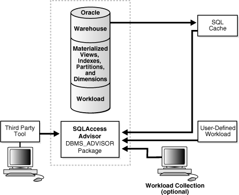
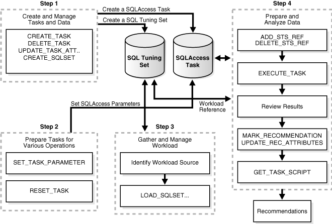

## 18 SQL Access Advisor

This chapter illustrates how to use SQL Access Advisor, which is a tuning tool that provides advice on improving the performance of a database through partitioning, materialized views, indexes, and materialized view logs. The chapter contains the following sections:

## 18.1 Overview of SQL Access Advisor

Materialized views, partitions, and indexes are essential when tuning a database to achieve optimum performance for complex, data-intensive queries. SQL Access Advisor helps you achieve your performance goals by recommending the proper set of materialized views, materialized view logs, partitions, and indexes for a given workload. Understanding and using these structures is essential when optimizing SQL as they can result in significant performance improvements in data retrieval. The advantages, however, do not come without a cost. Creation and maintenance of these objects can be time consuming, and space requirements can be significant. In particular, partitioning of an unpartitioned base table is a complex operation that must be planned carefully.

SQL Access Advisor index recommendations include bitmap, function-based, and B-tree indexes. A bitmap index offers a reduced response time for many types of ad hoc queries and reduced storage requirements compared to other indexing techniques. Bitmap indexes are most commonly used in a data warehouse to index unique or near-unique keys. SQL Access Advisor materialized view recommendations include fast refreshable and full refreshable MVs, for either general rewrite or exact text match rewrite.

SQL Access Advisor, using the `TUNE_MVIEW` procedure, also recommends how to optimize materialized views so that they can be fast refreshable and take advantage of general query rewrite.

In addition, SQL Access Advisor can recommend partitioning on an existing unpartitioned base table to improve performance. Furthermore, it may recommend new indexes and materialized views that are themselves partitioned. While creating new partitioned indexes and materialized view is no different from the unpartitioned case, partitioning existing base tables should be executed with care. This is especially true when indexes, views, constraints, or triggers are defined on the table. See "Special Considerations when Script Includes Partitioning Recommendations" for a list of issues involving base table partitioning for performing this task online.

You can run SQL Access Advisor from Oracle Enterprise Manager (accessible from the Advisor Central page) using SQL Access Advisor Wizard or by invoking the `DBMS_ADVISOR` package. The `DBMS_ADVISOR` package consists of a collection of analysis and advisory functions and procedures callable from any PL/SQL program.

Figure 18-1 illustrates how SQL Access Advisor recommends access structures for a given workload obtained from a user-defined table or the SQL cache. If a workload is not provided, then it can generate and use a hypothetical workload also, provided the user schema contains dimensions defined by the `CREATE` `DIMENSION` keyword.

Figure 18-1 Materialized Views and SQL Access Advisor



> This figure illustrates how materialized views work with the SQL Access Advisor:
>
> - First, data is in a warehouse. The warehouse includes materialized views and workloads.
> - From the warehouse, data goes to the trace log and the SQL cache.
> - From the trace log, to Oracle Trace Manager, then to the SQL Access Advisor.
> - From the SQL cache, to the SQL Access Advisor.
> - In addition, workload collection can go to the SQL Access Advisor.
> - Also, a third-party tool can go to the SQL Access Advisor.
  

Using SQL Access Advisor in Enterprise Manager or API, you can do the following:

- Recommend materialized views and indexes based on collected, user-supplied, or hypothetical workload information.
- Recommend partitioning of tables, indexes, and materialized views.
- Mark, update, and remove recommendations.

In addition, you can use SQL Access Advisor API to do the following:

- Perform a quick tune using a single SQL statement.
- Show how to make a materialized view fast refreshable.
- Show how to change a materialized view so that general query rewrite is possible.

To make recommendations, SQL Access Advisor relies on structural statistics about table and index cardinalities of dimension level columns, `JOIN` `KEY` columns, and fact table key columns. You can gather either exact or estimated statistics with the `DBMS_STATS` package. Because gathering statistics is time-consuming and full statistical accuracy is not required, it is generally preferable to estimate statistics. Without gathering statistics on a given table, queries referencing this table are marked as invalid in the workload, resulting in no recommendations being made for those queries. It is also recommended that all existing indexes and materialized views have been analyzed. See [Oracle Database PL/SQL Packages and Types Reference](https://docs.oracle.com/cd/E11882_01/appdev.112/e40758/toc.htm) for more information about the `DBMS_STATS` package.

### 18.1.1 Overview of Using SQL Access Advisor

An easy way to use SQL Access Advisor is to invoke its wizard, which is available in Enterprise Manager from the Advisor Central page. If you prefer to use SQL Access Advisor through the `DBMS_ADVISOR` package, then this section describes the basic components and the sequence in which you must call the procedures.

This section describes the four steps in generating a set of recommendations:

- Create a task
- Define the workload
- Generate the recommendations
- View and implement the recommendations

Step 1 Create a task

An advisor task is a container in the data dictionary that stores the inputs to and the results of an intelligent advisor analysis run. All information relating to the recommendation operation, including the results, resides in the task.

Before SQL Access Advisor can make recommendations, you must create a task using either of the following:

- The wizard in Oracle Enterprise Manager or the `DBMS_ADVISOR.QUICK_TUNE` procedure, which creates the task automatically
- The `DBMS_ADVISOR.CREATE_TASK` procedure

You can control what a task does by defining parameters for the task using the `DBMS_ADVISOR`.`SET_TASK_PARAMETER` procedure.

See Also:

"Creating Tasks"

Step 2 Define the workload

A workload consists of one or more SQL statements, plus statistics and attributes that fully describe each statement. A full workload contains all SQL statements from a target business application. A partial workload contains a subset of SQL statements. The difference is that for full workloads SQL Access Advisor may recommend dropping unused materialized views and indexes.

You cannot use SQL Access Advisor without a workload. A workload may contain a variety of statements. SQL Access Advisor ranks the entries according to a specific statistic, business importance, or combination of the two, which enables the advisor to process the most important SQL statements first.

SQL Access Advisor may require particular attributes to be present in a valid workload. Although the advisor can perform analysis when items are missing, the quality of the recommendations may be lower. For example, SQL Access Advisor requires a workload to contain a SQL query and the user who ran the query, with other attributes as optional. However, if the workload also contains I/O and CPU data, then SQL Access Advisor can better evaluate statement efficiency.

The database stores a workload as a SQL tuning set. You can access the workload with the `DBMS_SQLTUNE` package and share it among many Advisor tasks. Because the workload is independent, you must link it to a task using the `DBMS_ADVISOR.ADD_STS_REF` procedure. After this link has been established, you cannot delete or modify the workload until all advisor tasks have removed their dependency on the workload. A workload reference is removed when a user deletes a parent advisor task or manually removes the workload reference from the task by using the `DBMS_ADVISOR.DELETE_STS_REF` procedure.

You can create a hypothetical workload from a schema by analyzing dimensions and constraints. For best results, provide a workload as a SQL tuning set. The `DBMS_SQLTUNE` package provides several helper functions that can create SQL tuning sets from common workload sources, such as the SQL cache, a user-defined workload stored in a table, and a hypothetical workload.

At the time the recommendations are generated, you can apply a filter to the workload to restrict what is analyzed. This restriction provides the ability to generate different sets of recommendations based on different workload scenarios. SQL Access Advisor parameters control the recommendation process and customization of the workload. These parameters control various aspects of the process, such as the type of recommendation required and the naming conventions for what it recommends.

To set these parameters, use the `SET_TASK_PARAMETER` procedure. Parameters are persistent in that they remain set for the life span of the task. When a parameter value is set using `SET_TASK_PARAMETER`, it does not change until you make another call to this procedure.

Step 3 Generate the recommendations

After a task exists and a workload is linked to the task and the appropriate parameters are set, you can generate recommendations using the `DBMS_ADVISOR.EXECUTE_TASK` procedure. These recommendations are stored in SQL Access Advisor Repository.

The recommendation process generates several recommendations. Each recommendation specifies one or more actions. For example, a recommendation could be to create several materialized view logs, create a materialized view, and then analyze it to gather statistics.

A task recommendation can range from a simple suggestion to a complex solution that requires partitioning a set of existing base tables and implementing a set of database objects such as indexes, materialized views, and materialized view logs. When an advisor task is executed, SQL Access Advisor carefully analyzes collected data and user-adjusted task parameters. It then forms a structured recommendation that the user can view and implement.

See "Generating Recommendations" for more information about generating recommendations.

Step 4 View and implement the recommendations

You can view the recommendations from SQL Access Advisor in either of the following ways:

- Using the catalog views
- Generating a script using the `DBMS_ADVISOR.GET_TASK_SCRIPT` procedure

In Enterprise Manager, you may display the recommendations after SQL Access Advisor process has completed. See "Viewing Recommendations" for a description of using the catalog views to view the recommendations. See "Generating SQL Scripts" to see how to create a script.

You need not accept all recommendations. You can mark the ones to be included in the recommendation script. However, when base table partitioning is recommended, some recommendations depend on others. For example, you cannot implement a local index if you do not also implement the partitioning recommendation on the index base table.

The final step is then implementing the recommendations and verifying that query performance has improved.

#### 18.1.1.1 SQL Access Advisor Repository

All the information needed and generated by SQL Access Advisor resides in the Advisor repository, which is a part of the database dictionary. The benefits of using the repository are that it:

- Collects a complete workload for SQL Access Advisor.
- Supports historical data.
- Is managed by the server.

## 18.2 Using SQL Access Advisor

This section discusses general information about, and the steps needed to use, SQL Access Advisor, and includes:

- Steps for Using SQL Access Advisor
- Privileges Needed to Use SQL Access Advisor
- Setting Up Tasks and Templates
- SQL Access Advisor Workloads
- Working with Recommendations
- Performing a Quick Tune
- Managing Tasks
- Using SQL Access Advisor Constants

See Also:

[Oracle Database 2 Day + Performance Tuning Guide](https://docs.oracle.com/cd/E11882_01/server.112/e10822/tdppt_sqlopt.htm#TDPPT171) for information about using SQL Access Advisor with Oracle Enterprise Manager

### 18.2.1 Steps for Using SQL Access Advisor

Figure 18-2 illustrates the steps in using SQL Access Advisor and an overview of all parameters in SQL Access Advisor and when it is appropriate to use them.

Figure 18-2 SQL Access Advisor Flowchart



> This figure illustrates the following steps:
>
> - Step 1: Create and Manage Tasks and Data
> 	This step uses a SQL Workload Object and SQL Access Task
> - Step 2: Prepare Tasks for Various Operations
> 	This step uses Workload and Access parameters
> - Step 3: Gather and Manage Workload
> 	This step uses a SQL Workload Object
> - Step 4: Prepare and Analyze Data
> 	This step uses SQL Workload Objects and SQL Access Tasks
  

### 18.2.2 Privileges Needed to Use SQL Access Advisor

You must have the `ADVISOR` privilege to manage or use SQL Access Advisor. When processing a workload, SQL Access Advisor attempts to validate each statement to identify table and column references. The database achieves validation by processing each statement as if it were being executed by the statement's original user.

If the user does not have `SELECT` privileges to a particular table, then SQL Access Advisor bypasses the statement referencing the table. This behavior can cause many statements to be excluded from analysis. If SQL Access Advisor excludes all statements in a workload, then the workload is invalid. SQL Access Advisor returns the following message:

```
QSM-00774, there are no SQL statements to process for task TASK_NAME
```

To avoid missing critical workload queries, the current database user must have `SELECT` privileges on the tables targeted for materialized view analysis. For these tables, these `SELECT` privileges cannot be obtained through a role.

Additionally, you must have the `ADMINISTER SQL TUNING SET` privilege to create and manage workloads in SQL tuning set objects. To run the Advisor on SQL tuning sets owned by other users, you must have the `ADMINISTER ANY SQL TUNING SET` privilege.

### 18.2.3 Setting Up Tasks and Templates

This section discusses the following aspects of setting up tasks and templates:

- Creating Tasks
- Using Templates
- Creating Templates

#### 18.2.3.1 Creating Tasks

In the task, you define what the advisor must analyze and the location of the analysis results. A user can create any number of tasks, each with its own specialization. All are based on the same Advisor task model and share the same repository.

You create a task using the `CREATE_TASK` procedure. The syntax is as follows:

```
DBMS_ADVISOR.CREATE_TASK (
   advisor_name          IN VARCHAR2,
   task_id               OUT NUMBER,
   task_name             IN OUT VARCHAR2,
   task_desc             IN VARCHAR2 := NULL,
   template              IN VARCHAR2 := NULL,
   is_template           IN VARCHAR2 := 'FALSE',
   how_created           IN VARCHAR2 := NULL);
```

The following illustrates an example of using this procedure:

```
VARIABLE task_id NUMBER;
VARIABLE task_name VARCHAR2(255);
EXECUTE :task_name := 'MYTASK';
EXECUTE DBMS_ADVISOR.CREATE_TASK ('SQL Access Advisor', :task_id, :task_name);
```

See [Oracle Database PL/SQL Packages and Types Reference](https://docs.oracle.com/cd/E11882_01/appdev.112/e40758/d_advis.htm#ARPLS350) for more information regarding the `CREATE_TASK` procedure and its parameters.

#### 18.2.3.2 Using Templates

When an ideal configuration for a task or workload has been identified, you can save this configuration as a template on which to base future tasks and workloads.

A template enables you to set up any number of tasks or workloads that can serve as intelligent starting points or templates for future task creation. By setting up a template, you can save time when performing tuning analysis. This approach also enables you to custom fit a tuning analysis to the business operation.

To create a task from a template, you specify the template to be used when a new task is created. At that time, SQL Access Advisor copies the data and parameter settings from the template into the newly created task. You can also set an existing task to be a template by setting the template attribute when creating the task or later using the `UPDATE_TASK_ATTRIBUTE` procedure.

To use a task as a template, you tell SQL Access Advisor to use a task when a new task is created. At that time, SQL Access Advisor copies the task template's data and parameter settings into the newly created task. You can also set an existing task to be a template by setting the template attribute at the command line or in Enterprise Manager.

#### 18.2.3.3 Creating Templates

You can create a template as in the following example.

1. Create a template called `MY_TEMPLATE`.
	```
	VARIABLE template_id NUMBER;
	VARIABLE template_name VARCHAR2(255);
	EXECUTE :template_name := 'MY_TEMPLATE';
	EXECUTE DBMS_ADVISOR.CREATE_TASK('SQL Access Advisor',:template_id, -
	                                 :template_name, is_template => 'TRUE');
	```
2. Set template parameters. For example, the following sets the naming conventions for recommended indexes and materialized views and the default tablespaces:
	```
	-- set naming conventions for recommended indexes/mvs
	EXECUTE DBMS_ADVISOR.SET_TASK_PARAMETER ( -
	   :template_name, 'INDEX_NAME_TEMPLATE', 'SH_IDX$$_<SEQ>');
	EXECUTE DBMS_ADVISOR.SET_TASK_PARAMETER ( -
	   :template_name, 'MVIEW_NAME_TEMPLATE', 'SH_MV$$_<SEQ>');
	-- set default tablespace for recommended indexes/mvs
	EXECUTE DBMS_ADVISOR.SET_TASK_PARAMETER ( -
	   :template_name, 'DEF_INDEX_TABLESPACE', 'SH_INDEXES');
	EXECUTE DBMS_ADVISOR.SET_TASK_PARAMETER ( -
	   :template_name, 'DEF_MVIEW_TABLESPACE', 'SH_MVIEWS');
	```
3. This template can now be used as a starting point to create a task as follows:
	```
	VARIABLE task_id NUMBER;
	VARIABLE task_name VARCHAR2(255);
	EXECUTE :task_name := 'MYTASK';
	EXECUTE DBMS_ADVISOR.CREATE_TASK('SQL Access Advisor', :task_id, -
	                                 :task_name, template=>'MY_TEMPLATE');
	```
	The following example uses a pre-defined template `SQLACCESS_WAREHOUSE`. See Table 18-3 for more information.
	```
	EXECUTE DBMS_ADVISOR.CREATE_TASK('SQL Access Advisor', -
	   :task_id, :task_name,  template=>'SQLACCESS_WAREHOUSE');
	```

### 18.2.4 SQL Access Advisor Workloads

SQL Access Advisor supports different types of workloads, and this section discusses the following aspects of managing workloads:

- SQL Tuning Set Workloads
- Using SQL Tuning Sets
- Linking Tasks and Workloads

#### 18.2.4.1 SQL Tuning Set Workloads

The input workload source for SQL Access Advisor is the SQL tuning set. An important benefit of using a SQL tuning set is that because it is stored as a separate entity, it can easily be shared among many Advisor tasks. After a SQL tuning set object has been referenced by an Advisor task, it cannot be deleted or modified until all Advisor tasks have removed their dependency on the data. A workload reference is removed when a parent Advisor task is deleted or when the workload reference is manually removed from the Advisor task by the user.

SQL Access Advisor performs best when a workload based on actual usage is available. You can store multiple workloads in the form of SQL tuning sets, so that you can view the different uses of a real-world data warehousing or transaction-processing environment over a long period and across the life cycle of database instance startup and shutdown.

#### 18.2.4.2 Using SQL Tuning Sets

The SQL tuning set workload is implemented using the `DBMS_SQLTUNE` package. See [Oracle Database PL/SQL Packages and Types Reference](toc.md) for a description on creating and managing SQL tuning sets.

To transition existing SQL Workload objects to a SQL tuning set, the `DBMS_ADVISOR` package provides a procedure to copy SQL Workload data to a user-designated SQL tuning set. Note that, to use this procedure, the user must have the required SQL tuning set privileges and the required `ADVISOR` privilege.

The syntax is as follows:

```
DBMS_ADVISOR.COPY_SQLWKLD_TO_STS (
   workload_name        IN VARCHAR2,
   sts_name             IN VARCHAR2,
   import_mode          IN VARCHAR2 := 'NEW');
```

The following example illustrates its usage:

```
EXECUTE DBMS_ADVISOR.COPY_SQLWKLD_TO_STS('MYWORKLOAD','MYSTS','NEW');
```

See [Oracle Database PL/SQL Packages and Types Reference](https://docs.oracle.com/cd/E11882_01/appdev.112/e40758/toc.htm) for more information regarding the `COPY_SQLWKLD_TO_STS` procedure and its parameters.

#### 18.2.4.3 Linking Tasks and Workloads

Before the recommendation process can begin, you must link the task to a SQL tuning set. You achieve this goal by using the `ADD_STS_REF` procedure and using their respective names to link the task and a Tuning Set. This procedure establishes a link between the Advisor task and a Tuning Set. And, after a connection has been defined, the SQL tuning set is protected from removal or update. The syntax is as follows:

```
DBMS_ADVISOR.ADD_STS_REF (task_name IN VARCHAR2,
 
sts_owner IN VARCHAR2,
sts_name  IN VARCHAR2);
```

The `sts_owner` parameter may be null, in which case the STS is assumed to be owned by the current user.

The following example links the `MYTASK` task created to the current user's `MYWORKLOAD` SQL tuning set:

```
EXECUTE DBMS_ADVISOR.ADD_STS_REF('MYTASK', null, 'MYWORKLOAD');
```

See [Oracle Database PL/SQL Packages and Types Reference](https://docs.oracle.com/cd/E11882_01/appdev.112/e40758/toc.htm) for more information regarding the `ADD_STS_REF` procedure and its parameters.

##### 18.2.4.3.1 Removing a Link Between a SQL Tuning Set Workload and a Task

Before you can delete a task or a SQL tuning set workload, if it is linked to a workload or task respectively, then the link between the task and the workload must be removed using the `DELETE_STS_REF` procedure. The following example deletes the link between task `MYTASK` and the current user's SQL tuning set `MYWORKLOAD`:

```
EXECUTE DBMS_ADVISOR.DELETE_STS_REF('MYTASK', null, 'MYWORKLOAD');
```

### 18.2.5 Working with Recommendations

This section discusses the following aspects of working with recommendations:

- Recommendations and Actions
- Recommendation Options
- Evaluation Mode
- View Intermediate Results During Recommendation Analysis
- Generating Recommendations
- Viewing Recommendations
- Stopping the Recommendation Process
- Marking Recommendations
- Modifying Recommendations
- Generating SQL Scripts
- Special Considerations when Script Includes Partitioning Recommendations
- When Recommendations are no Longer Required

#### 18.2.5.1 Recommendations and Actions

SQL Access Advisor makes several recommendations, each of which contains one or more individual actions. In general, each recommendation provides a benefit for one query or a set of queries. All individual actions in a recommendation must be implemented together to achieve the full benefit. Recommendations can share actions.

For example, a `CREATE` `INDEX` statement could provide a benefit for several queries, but some of those queries might benefit from an additional `CREATE` `MATERIALIZED` `VIEW` statement. In that case, the advisor would generate two recommendations: one for the set of queries that require only the index, and another one for the set of queries that require both the index and the materialized view to run optimally.

The partition recommendation is a special type of recommendation. When SQL Access Advisor determines that partitioning a specified base table would improve workload performance, the advisor adds a partition action to every recommendation containing a query referencing the base table. This technique ensures that index and materialized view recommendations are implemented on the correctly partitioned tables.

#### 18.2.5.2 Recommendation Options

Before the advisor can generate recommendations, you must first define the parameters for the task using the `SET_TASK_PARAMETER` procedure. If parameters are not defined, then the database uses the defaults.

You can set task parameters by using the `SET_TASK_PARAMETER` procedure. The syntax is as follows.

```
DBMS_ADVISOR.SET_TASK_PARAMETER (
   task_name           IN VARCHAR2,
   parameter           IN VARCHAR2,
   value               IN [VARCHAR2 | NUMBER]);
```

There are many task parameters and, to help identify the relevant ones, they have been grouped into categories in Table 18-1. Note that all task parameters for workload filtering have been deprecated.

Table 18-1 Types of Advisor Task Parameters And Their Uses

| Workload Filtering | Task Configuration | Schema Attributes | Recommendation Options |
| --- | --- | --- | --- |
| `END_TIME` | `DAYS_TO_EXPIRE` | `DEF_INDEX_OWNER` | `ANALYSIS_SCOPE` |
| `INVALID_ACTION_LIST` | `JOURNALING` | `DEF_INDEX_TABLESPACE` | `COMPATIBILITY` |
| `INVALID_MODULE_LIST` | `REPORT_DATE_FORMAT` | `DEF_MVIEW_OWNER` | `CREATION_COST` |
| `INVALID_SQLSTRING_LIMIT` |  | `DEF_MVIEW_TABLESPACE` | `DML_VOLATILITY` |
| `INVALID_TABLE_LIST` |  | `DEF_MVLOG_TABLESPACE` | `LIMIT_PARTITION_SCHEMES` |
| `INVALID_USERNAME_LIST` |  | `DEF_PARTITION_TABLESPACE` | `MODE` |
| `RANKING_MEASURE` |  | `INDEX_NAME_TEMPLATE` | `PARTITIONING_TYPES` |
| `SQL_LIMIT` |  | `MVIEW_NAME_TEMPLATE` | `REFRESH_MODE` |
| `START_TIME` |  |  | `STORAGE_CHANGE` |
| `TIME_LIMIT` |  |  | `USE_SEPARATE_TABLESPACES` |
| `VALID_ACTION_LIST` |  |  | `WORKLOAD_SCOPE` |
| `VALID_MODULE_LIST` |  |  |  |
| `VALID_SQLSTRING_LIST` |  |  |  |
| `VALID_TABLE_LIST` |  |  |  |
| `VALID_USERNAME_LIST` |  |  |  |

In the following example, set the storage change of task `MYTASK` to 100 MB. This indicates 100 MB of additional space for recommendations. A zero value indicates that no additional space can be allocated. A negative value indicates that the advisor must attempt to trim the current space utilization by the specified amount.

```
EXECUTE DBMS_ADVISOR.SET_TASK_PARAMETER('MYTASK','STORAGE_CHANGE', 100000000);
```

In the following example, set the `VALID_TABLE_LIST` parameter to filter out all queries that do no consist of tables `SH.SALES` and `SH.CUSTOMERS`.

```
EXECUTE DBMS_ADVISOR.SET_TASK_PARAMETER ( -
   'MYTASK', 'VALID_TABLE_LIST', 'SH.SALES, SH.CUSTOMERS');
```

See [Oracle Database PL/SQL Packages and Types Reference](https://docs.oracle.com/cd/E11882_01/appdev.112/e40758/d_advis.htm#ARPLS350) for more information regarding the `SET_TASK_PARAMETER` procedure and its parameters.

#### 18.2.5.3 Evaluation Mode

SQL Access Advisor operates in two modes: problem-solving and evaluation. By default, SQL Access Advisor attempts to solve access method problems by looking for enhancements to index structures, partitions, materialized views, and materialized view logs. For example, a problem-solving run may recommend creating a new index, adding a new column to a materialized view log, and so on.

When performing evaluation only, SQL Access Advisor comments only on which access structures the supplied workload will use. An evaluation-only run may only produce recommendations such as retaining an index, retaining a materialized view, and so on. The evaluation mode can be useful to see exactly which indexes and materialized views a workload is using. SQL Access Advisor does not evaluate the performance impact of existing base table partitioning.

#### 18.2.5.4 View Intermediate Results During Recommendation Analysis

SQL Access Advisor now can see intermediate results during the analysis operation. Previously, results of an analysis operation were unavailable until the processing had completed or was interrupted by the user. Now, the user may access results in the corresponding recommendation and action tables even while SQL Access Advisor task is still executing. The benefit is that long running tasks can provide evidence that may allow the user to accept the current results by interrupting the task rather than waiting for a lengthy execution to complete.

To accept the current set of recommendations, the user must interrupt the task. This interruption signals SQL Access Advisor to stop processing and marks the task as `INTERRUPTED`. At that point, the user may update recommendation attributes and generate scripts. Alternatively, the user can allow SQL Access Advisor to complete the recommendation process.

Note that intermediate results represent recommendations for the workload contents up to that point in time. If it is critical that the recommendations be sensitive to the entire workload, then Oracle recommends that you allow the task execution to complete normally. Additionally, recommendations made by the advisor early in the recommendation process do not contain any base table partitioning recommendations. The partitioning analysis requires a substantial part of the workload to be processed before it can determine whether partitioning would be beneficial. Therefore, if SQL Access Advisor detects a benefit, then only later intermediate results contain base table partitioning recommendations.

#### 18.2.5.5 Generating Recommendations

You can generate recommendations by using the `EXECUTE_TASK` procedure with your task name. After the procedure finishes, you can check the `DBA_ADVISOR_LOG` table for the actual execution status and the number of recommendations and actions that have been produced. You can query recommendations by task name in `{DBA, USER}_ADVISOR_RECOMMENDATIONS`. You can view the actions for these recommendations by task in `{DBA, USER}_ADVISOR_ACTIONS.`

##### 18.2.5.5.1 EXECUTE\_TASK Procedure

This procedure performs SQL Access Advisor analysis or evaluation for the specified task. Task execution is a synchronous operation, so control is not returned to the user until the operation has completed, or a user-interrupt was detected. Upon return or execution of the task, you can check the `DBA_ADVISOR_LOG` table for the actual execution status.

Running `EXECUTE_TASK` generates recommendations, where a recommendation comprises one or more actions, such as creating a materialized view log and a materialized view. The syntax is as follows:

```
DBMS_ADVISOR.EXECUTE_TASK (task_name   IN VARCHAR2);
```

The following illustrates an example of using this procedure:

```
EXECUTE DBMS_ADVISOR.EXECUTE_TASK('MYTASK');
```

See [Oracle Database PL/SQL Packages and Types Reference](https://docs.oracle.com/cd/E11882_01/appdev.112/e40758/d_advis.htm#ARPLS350) for more information regarding the `EXECUTE_TASK` procedure and its parameters.

#### 18.2.5.6 Viewing Recommendations

You can view each recommendation generated by SQL Access Advisor using several catalog views, such as `(``DBA`, `USER)_ADVISOR_RECOMMENDATIONS`. However, it is easier to use the `GET_TASK_SCRIPT` procedure or use SQL Access Advisor in Enterprise Manager, which graphically displays the recommendations and provides hyperlinks to quickly see which SQL statements benefit from a recommendation. Each recommendation produced by SQL Access Advisor is linked to the SQL statement it benefits.

The following shows the recommendation (`rec_id`) produced by an Advisor run, with their rank and total benefit. The rank is a measure of the importance of the queries that the recommendation helps. The benefit is the total improvement in execution cost (in terms of optimizer cost) of all the queries using the recommendation.

```
VARIABLE workload_name VARCHAR2(255); 
VARIABLE task_name VARCHAR2(255);
EXECUTE :task_name := 'MYTASK';
EXECUTE :workload_name := 'MYWORKLOAD'; 

SELECT REC_ID, RANK, BENEFIT
FROM USER_ADVISOR_RECOMMENDATIONS WHERE TASK_NAME = :task_name;

    REC_ID       RANK    BENEFIT
---------- ---------- ----------
         1          2       2754
         2          3       1222
         3          1       5499
         4          4        594
```

To identify which query benefits from which recommendation, you can use the views `DBA_*` and `USER_ADVISOR_SQLA_WK_STMTS`. The precost and postcost numbers are in terms of the estimated optimizer cost (shown in `EXPLAIN` `PLAN`) without and with the recommended access structure changes, respectively. To see recommendations for each query, issue the following statement:

```
SELECT sql_id, rec_id, precost, postcost,
       (precost-postcost)*100/precost AS percent_benefit
FROM USER_ADVISOR_SQLA_WK_STMTS
WHERE TASK_NAME = :task_name AND workload_name = :workload_name;

    SQL_ID     REC_ID    PRECOST   POSTCOST PERCENT_BENEFIT
---------- ---------- ---------- ---------- ---------------
       121          1       3003        249      91.7082917
       122          2       1404        182       87.037037
       123          3       5503          4      99.9273124
       124          4        730        136       81.369863
```

Each recommendation consists of one or more actions, which must be implemented together to realize the benefit provided by the recommendation. SQL Access Advisor produces the following types of actions:

- `PARTITION` `BASE` `TABLE`
- `CREATE|DROP|RETAIN MATERIALIZED VIEW`
- `CREATE|ALTER|RETAIN MATERIALIZED VIEW LOG`
- `CREATE|DROP|RETAIN INDEX`
- `GATHER STATS`

The `PARTITION` `BASE` `TABLE` action partitions an existing unpartitioned base table. The `CREATE` actions corresponds to new access structures. `RETAIN` recommendations indicate that existing access structures must be kept. `DROP` recommendations are only produced if the `WORKLOAD_SCOPE` parameter is set to `FULL`. The `GATHER` `STATS` action generates a call to `DBMS_STATS` procedure to gather statistics on a newly generated access structure. Note that multiple recommendations may refer to the same action. However, when generating a script for the recommendation, you only see each action once.

In the following example, you can see how many distinct actions there are for this set of recommendations.

```
SELECT 'Action Count', COUNT(DISTINCT action_id) cnt
FROM USER_ADVISOR_ACTIONS WHERE task_name = :task_name;

'ACTIONCOUNT        CNT
------------   --------
Action Count         20

-- see the actions for each recommendations
SELECT rec_id, action_id, SUBSTR(command,1,30) AS command
FROM user_advisor_actions WHERE task_name = :task_name
ORDER BY rec_id, action_id;

    REC_ID  ACTION_ID COMMAND
---------- ---------- ------------------------------
         1          5 CREATE MATERIALIZED VIEW LOG
         1          6 ALTER MATERIALIZED VIEW LOG
         1          7 CREATE MATERIALIZED VIEW LOG
         1          8 ALTER MATERIALIZED VIEW LOG
         1          9 CREATE MATERIALIZED VIEW LOG
         1         10 ALTER MATERIALIZED VIEW LOG
         1         11 CREATE MATERIALIZED VIEW
         1         12 GATHER TABLE STATISTICS
         1         19 CREATE INDEX
         1         20 GATHER INDEX STATISTICS
         2          5 CREATE MATERIALIZED VIEW LOG
         2          6 ALTER MATERIALIZED VIEW LOG
         2          9 CREATE MATERIALIZED VIEW LOG
         ...
```

Each action has several attributes that pertain to the properties of the access structure. The name and tablespace for each access structure when applicable are placed in `attr1` and `attr2` respectively. The space occupied by each new access structure is in `num_attr1`. All other attributes are different for each action.

Table 18-2 maps SQL Access Advisor action information to the corresponding column in `DBA_ADVISOR_ACTIONS`. In the table, "MV" refers to a materialized view.

Table 18-2 SQL Access Advisor Action Attributes

|  | ATTR1 | ATTR2 | ATTR3 | ATTR4 | ATTR5 | ATTR6 | NUM\_ATTR1 |
| --- | --- | --- | --- | --- | --- | --- | --- |
| `CREATE` `INDEX` | Index name | Index tablespace | Target table | `BITMAP` or `BTREE` | Index column list / expression | Unused | Storage size in bytes for the index |
| `CREATE` `MATERIALIZED` `VIEW` | MV name | MV tablespace | `REFRESH` `COMPLETE` `REFRESH` `FAST`, `REFRESH` `FORCE`, `NEVER` `REFRESH` | `ENABLE` `QUERY` `REWRITE`, `DISABLE QUERY` `REWRITE` | SQL `SELECT` statement | Unused | Storage size in bytes for the MV |
| `CREATE` `MATERIALIZED` `VIEW` `LOG` | Target table name | MV log tablespace | `ROWID` `PRIMARY` `KEY`, `SEQUENCE` `OBJECT` `ID` | `INCLUDING` `NEW` `VALUES`, `EXCLUDING` `NEW` `VALUES` | Table column list | Partitioning subclauses | Unused |
| `CREATE` `REWRITE` `EQUIVALENCE` | Name of equivalence | Checksum value | Unused | Unused | Source SQL statement | Equivalent SQL statement | Unused |
| `DROP` `INDEX` | Index name | Unused | Unused | Unused | Index columns | Unused | Storage size in bytes for the index |
| `DROP` `MATERIALIZED` `VIEW` | MV name | Unused | Unused | Unused | Unused | Unused | Storage size in bytes for the MV |
| `DROP` `MATERIALIZED` `VIEW` `LOG` | Target table name | Unused | Unused | Unused | Unused | Unused | Unused |
| `PARTITION` `TABLE` | Table name | `RANGE`, `INTERVAL`, `LIST`, `HASH`, `RANGE-HASH`, `RANGE-LIST` | Partition key for partitioning (column name or list of column names) | Partition key for subpartitioning (column name or list of column names) | SQL `PARTITION` clause | SQL `SUBPARTITION` clause | Unused |
| `PARTITION` `INDEX` | Index name | `LOCAL`, `RANGE`, `HASH` | Partition key for partitioning (list of column names) | Unused | SQL `PARTITION` clause | Unused | Unused |
| `PARTITION` `ON` `MATERIALIZED` `VIEW` | MV name | `RANGE`, `INTERVAL`, `LIST`, `HASH`, `RANGE-HASH`, `RANGE-LIST` | Partition key for partitioning (column name or list of column names) | Partition key for subpartitioning (column name or list of column names) | SQL `SUBPARTITION` clause | SQL `SUBPARTITION` clause | Unused |
| `RETAIN` `INDEX` | Index name | Unused | Target table | `BITMAP` or `BTREE` | Index columns | Unused | Storage size in bytes for the index |
| `RETAIN` `MATERIALIZED` `VIEW` | MV name | Unused | `REFRESH` `COMPLETE` or `REFRESH` `FAST` | Unused | SQL `SELECT` statement | Unused | Storage size in bytes for the MV |
| `RETAIN` `MATERIALIZED` `VIEW` `LOG` | Target table name | Unused | Unused | Unused | Unused | Unused | Unused |

The following PL/SQL procedure can print some of the attributes of the recommendations.

```
CONNECT SH/SH;
CREATE OR REPLACE PROCEDURE show_recm (in_task_name IN VARCHAR2) IS 
CURSOR curs IS
  SELECT DISTINCT action_id, command, attr1, attr2, attr3, attr4
  FROM user_advisor_actions
  WHERE task_name = in_task_name
  ORDER BY action_id;
  v_action        number;
  v_command     VARCHAR2(32);
  v_attr1       VARCHAR2(4000);
  v_attr2       VARCHAR2(4000);
  v_attr3       VARCHAR2(4000);
  v_attr4       VARCHAR2(4000);
  v_attr5       VARCHAR2(4000);
BEGIN
  OPEN curs;
  DBMS_OUTPUT.PUT_LINE('=========================================');
  DBMS_OUTPUT.PUT_LINE('Task_name = ' || in_task_name);
  LOOP
     FETCH curs INTO  
       v_action, v_command, v_attr1, v_attr2, v_attr3, v_attr4 ;
   EXIT when curs%NOTFOUND;
   DBMS_OUTPUT.PUT_LINE('Action ID: ' || v_action);
   DBMS_OUTPUT.PUT_LINE('Command : ' || v_command);
   DBMS_OUTPUT.PUT_LINE('Attr1 (name)      : ' || SUBSTR(v_attr1,1,30));
   DBMS_OUTPUT.PUT_LINE('Attr2 (tablespace): ' || SUBSTR(v_attr2,1,30));
   DBMS_OUTPUT.PUT_LINE('Attr3             : ' || SUBSTR(v_attr3,1,30));
   DBMS_OUTPUT.PUT_LINE('Attr4             : ' || v_attr4);
   DBMS_OUTPUT.PUT_LINE('Attr5             : ' || v_attr5);
   DBMS_OUTPUT.PUT_LINE('----------------------------------------');  
   END LOOP;   
   CLOSE curs;      
   DBMS_OUTPUT.PUT_LINE('=========END RECOMMENDATIONS============');
END show_recm;
/
-- see what the actions are using sample procedure
set serveroutput on size 99999
EXECUTE show_recm(:task_name);
A fragment of a sample output from this procedure is as follows:
Task_name = MYTASK
Action ID: 1
Command : CREATE MATERIALIZED VIEW LOG 
Attr1 (name)      : "SH"."CUSTOMERS"
Attr2 (tablespace):
Attr3             : ROWID, SEQUENCE
Attr4             :  INCLUDING NEW VALUES
Attr5             :
----------------------------------------
..
----------------------------------------
Action ID: 15
Command : CREATE MATERIALIZED VIEW
Attr1 (name)      : "SH"."SH_MV$$_0004"
Attr2 (tablespace): "SH_MVIEWS"
Attr3             : REFRESH FAST WITH ROWID
Attr4             : ENABLE QUERY REWRITE
Attr5             :
----------------------------------------
..
----------------------------------------
Action ID: 19
Command : CREATE INDEX
Attr1 (name)      : "SH"."SH_IDX$$_0013"
Attr2 (tablespace): "SH_INDEXES"
Attr3             : "SH"."SH_MV$$_0002"
Attr4             : BITMAP
Attr5             :
```

See [Oracle Database PL/SQL Packages and Types Reference](https://docs.oracle.com/cd/E11882_01/appdev.112/e40758/d_lob.htm#ARPLS020) for details regarding `Attr5` and `Attr6`.

#### 18.2.5.7 Stopping the Recommendation Process

If SQL Access Advisor takes too long to make its recommendations using the procedure `EXECUTE_TASK`, then you can stop it by calling the `CANCEL_TASK` procedure and passing in the `task_name` for this recommendation process. If you use `CANCEL_TASK`, then SQL Access Advisor makes no recommendations. Therefore, if recommendations are required, consider using the `INTERRUPT_TASK` procedure.

##### 18.2.5.7.1 Interrupting Tasks

The `INTERRUPT_TASK` procedure causes an Advisor operation to terminate as if it has reached its normal end. As a result, the user can see any recommendations that have been formed up to the point of the interrupt.

An interrupted task cannot be restarted. The syntax is as follows:

```
DBMS_ADVISOR.INTERRUPT_TASK (task_name IN VARCHAR2);
```

The following illustrates an example of using this procedure:

```
EXECUTE DBMS_ADVISOR.INTERRUPT_TASK ('MY_TASK');
```

##### 18.2.5.7.2 Canceling Tasks

The `CANCEL_TASK` procedure causes a currently executing operation to terminate. An Advisor operation may take a few seconds to respond to this request. Because all Advisor task procedures are synchronous, to cancel an operation, you must use a separate database session.

A cancel command effective restores the task to its condition before the start of the canceled operation. Therefore, a canceled task or data object cannot be restarted (but you can reset the task using `DBMS_ADVISOR.RESET_TASK` and then executing it again). Its syntax is as follows:

```
DBMS_ADVISOR.CANCEL_TASK (task_name   IN  VARCHAR2);
```

The following illustrates an example of using this procedure:

```
EXECUTE DBMS_ADVISOR.CANCEL_TASK('MYTASK');
```

See [Oracle Database PL/SQL Packages and Types Reference](https://docs.oracle.com/cd/E11882_01/appdev.112/e40758/d_advis.htm#ARPLS350) for more information regarding the `CANCEL_TASK` procedure and its parameters.

#### 18.2.5.8 Marking Recommendations

By default, all SQL Access Advisor recommendations are ready to be implemented, however, the user can choose to skip or exclude selected recommendations by using the `MARK_RECOMMENDATION` procedure. `MARK_RECOMMENDATION` allows the user to annotate a recommendation with a `REJECT` or `IGNORE` setting, which causes the `GET_TASK_SCRIPT` to skip it when producing the implementation procedure. The syntax is as follows:

```
DBMS_ADVISOR.MARK_RECOMMENDATION (
   task_name          IN VARCHAR2
   id                 IN NUMBER,
   action             IN VARCHAR2);
```

The following example marks a recommendation with ID 2 as `REJECT`. This recommendation and any dependent recommendations do not appear in the script.

```
EXECUTE DBMS_ADVISOR.MARK_RECOMMENDATION('MYTASK', 2, 'REJECT');
```

If the Advisor makes a recommendation to partition one or multiple previously unpartitioned base tables, then consider carefully before skipping this recommendation. Changing a table's partitioning scheme affects the cost of all queries, indexes, and materialized views defined on that table. Therefore, if you skip the partitioning recommendation, then the Advisor's remaining recommendations on this table are no longer optimal. To see recommendations on your workload that do not contain partitioning, reset the advisor task and rerun it with the `ANALYSIS_SCOPE` parameter changed to exclude partitioning recommendations.

See [Oracle Database PL/SQL Packages and Types Reference](https://docs.oracle.com/cd/E11882_01/appdev.112/e40758/d_advis.htm#ARPLS350) for more information regarding the `MARK_RECOMMENDATIONS` procedure and its parameters.

#### 18.2.5.9 Modifying Recommendations

Using the `UPDATE_REC_ATTRIBUTES` procedure, SQL Access Advisor names and assigns ownership to new objects such as indexes and materialized views during the analysis operation. However, it does not necessarily choose appropriate names, so you may manually set the owner, name, and tablespace values for new objects. For recommendations referencing existing database objects, owner and name values cannot be changed. The syntax is as follows:

```
DBMS_ADVISOR.UPDATE_REC_ATTRIBUTES (
   task_name            IN VARCHAR2
   rec_id               IN NUMBER,
   action_id            IN NUMBER,
   attribute_name       IN VARCHAR2,
   value                IN VARCHAR2);
```

The `attribute_name` parameter can take the following values:

- `OWNER`
	Specifies the owner name of the recommended object.
- `NAME`
	Specifies the name of the recommended object.
- `TABLESPACE`
	Specifies the tablespace of the recommended object.

The following example modifies the attribute `TABLESPACE` for recommendation ID 1, action ID 1 to `SH_MVIEWS`.

```
EXECUTE DBMS_ADVISOR.UPDATE_REC_ATTRIBUTES('MYTASK', 1, 1, - 
                                           'TABLESPACE', 'SH_MVIEWS');
```

See [Oracle Database PL/SQL Packages and Types Reference](https://docs.oracle.com/cd/E11882_01/appdev.112/e40758/d_advis.htm#ARPLS65163) for more information regarding the `UPDATE_REC_ATTRIBUTES` procedure and its parameters.

#### 18.2.5.10 Generating SQL Scripts

An alternative to querying the metadata to see the recommendations is to create a script of the SQL statements for the recommendations, using the procedure `GET_TASK_SCRIPT`. The resulting script is an executable SQL file that can contain `DROP`, `CREATE`, and `ALTER` statements. For new objects, the names of the materialized views, materialized view logs, and indexes are auto-generated by using the user-specified name template. You should review the generated SQL script before attempting to execute it.

There are several task parameters that control the naming conventions (`MVIEW_NAME_TEMPLATE` and `INDEX_NAME_TEMPLATE`), the owner for these new objects (`DEF_INDEX_OWNER` and `DEF_MVIEW_OWNER`), and the tablespaces (`DEF_MVIEW_TABLESPACE` and `DEF_INDEX_TABLESPACE`).

The following example shows how to generate a CLOB containing the script for the recommendations:

```
EXECUTE DBMS_ADVISOR.CREATE_FILE(DBMS_ADVISOR.GET_TASK_SCRIPT('MYTASK'),
               'ADVISOR_RESULTS', 'advscript.sql');
```

To save the script to a file, a directory path must be supplied so that the procedure `CREATE_FILE` knows where to store the script. In addition, read and write privileges must be granted on this directory. The following example shows how to save an advisor script `CLOB` to a file:

```
-- create a directory and grant permissions to read/write to it
CONNECT SH/SH;
CREATE DIRECTORY ADVISOR_RESULTS AS '/mydir';
GRANT READ ON DIRECTORY ADVISOR_RESULTS TO PUBLIC;
GRANT WRITE ON DIRECTORY ADVISOR_RESULTS TO PUBLIC;
```

The following is a fragment of a script generated by this procedure. The script also includes PL/SQL calls to gather statistics on the recommended access structures and marks the recommendations as `IMPLEMENTED` at the end:

```
Rem  Access Advisor V11.1.0.0.0 - Production
Rem  
Rem  Username:        SH
Rem  Task:            MYTASK
Rem  Execution date:  15/08/2006 11:35
Rem  
set feedback 1
set linesize 80
set trimspool on
set tab off
set pagesize 60
whenever sqlerror CONTINUE

CREATE MATERIALIZED VIEW LOG ON "SH"."PRODUCTS"
    WITH ROWID, SEQUENCE("PROD_ID","PROD_SUBCATEGORY")
    INCLUDING NEW VALUES;
ALTER MATERIALIZED VIEW LOG FORCE ON "SH"."PRODUCTS"
    ADD ROWID, SEQUENCE("PROD_ID","PROD_SUBCATEGORY")
    INCLUDING NEW VALUES;
..
CREATE MATERIALIZED VIEW "SH"."MV$$_00510002"
    REFRESH FAST WITH ROWID
    ENABLE QUERY REWRITE
    AS SELECT SH.CUSTOMERS.CUST_STATE_PROVINCE C1, COUNT(*) M1 FROM
SH.CUSTOMERS WHERE (SH.CUSTOMERS.CUST_STATE_PROVINCE = 'CA') GROUP
BY SH.CUSTOMERS.CUST_STATE_PROVINCE;
BEGIN
  DBMS_STATS.GATHER_TABLE_STATS('"SH"', '"MV$$_00510002"', NULL, 
     DBMS_STATS.AUTO_SAMPLE_SIZE);
END;
/
..
CREATE BITMAP INDEX "SH"."MV$$_00510004_IDX$$_00510013"
    ON "SH"."MV$$_00510004" ("C4");
whenever sqlerror EXIT SQL.SQLCODE
BEGIN
  DBMS_ADVISOR.MARK_RECOMMENDATION('"MYTASK"',1,'IMPLEMENTED');
  DBMS_ADVISOR.MARK_RECOMMENDATION('"MYTASK"',2,'IMPLEMENTED');
  DBMS_ADVISOR.MARK_RECOMMENDATION('"MYTASK"',3,'IMPLEMENTED');
  DBMS_ADVISOR.MARK_RECOMMENDATION('"MYTASK"',4,'IMPLEMENTED');
END;
/
```

See Also:

[Oracle Database SQL Language Reference](https://docs.oracle.com/cd/E11882_01/server.112/e41084/toc.htm) for `CREATE` `DIRECTORY` syntax and [Oracle Database PL/SQL Packages and Types Reference](https://docs.oracle.com/cd/E11882_01/appdev.112/e40758/d_advis.htm#ARPLS350) for detailed information about the `GET_TASK_SCRIPT` procedure

#### 18.2.5.11 Special Considerations when Script Includes Partitioning Recommendations

The Advisor may recommend partitioning an existing unpartitioned base table to improve query performance. When the Advisor implementation script contains partition recommendations, you must take note of the following issues:

- Partitioning an existing table is a complex and extensive operation, which may take considerably longer than implementing a new index or materialized view. Sufficient time should be reserved for implementing this recommendation.
- While index and materialized view recommendations are easy to reverse by deleting the index or view, a table, after being partitioned, cannot easily be restored to its original state. Therefore, ensure that you back up the database before executing a script containing partition recommendations.
- While repartitioning a base table, SQL Access Advisor scripts make a temporary copy of the original table, which occupies the same amount of space as the original table. Therefore, the repartitioning process requires sufficient free disk space for another copy of the largest table to be repartitioned. You must ensure that such space is available before running the implementation script.
	The partition implementation script attempts to migrate dependent objects such as indexes, materialized views, and constraints. However, some object cannot be automatically migrated. For example, PL/SQL stored procedures defined against a repartitioned base table typically become invalid and must be recompiled.
- If you decide not to implement a partition recommendation that the advisor has made, then note that all other recommendations on the same table in the same script (such as `CREATE` `INDEX` and `CREATE` `MATERIALIZED` `VIEW` recommendations) are dependent on the partitioning recommendation. To obtain accurate recommendations, you should not simply remove the partition recommendation from the script. Rather, rerun the advisor with partitioning disabled (for example, by setting parameter `ANALYSIS_SCOPE` to a value that does not include the keyword `TABLE`).

See Also:

[Oracle Database SQL Language Reference](https://docs.oracle.com/cd/E11882_01/server.112/e41084/toc.htm) for `CREATE` `DIRECTORY` syntax and [Oracle Database PL/SQL Packages and Types Reference](https://docs.oracle.com/cd/E11882_01/appdev.112/e40758/toc.htm) for detailed information about the `GET_TASK_SCRIPT` procedure.

#### 18.2.5.12 When Recommendations are no Longer Required

The `RESET_TASK` procedure resets a task to its initial starting point. This has the effect of removing all recommendations, and intermediate data from the task. The actual task status is set to `INITIAL`. The syntax is as follows:

```
DBMS_ADVISOR.RESET_TASK (task_name     IN VARCHAR2);
```

The following illustrates an example of using this procedure:

```
EXECUTE DBMS_ADVISOR.RESET_TASK('MYTASK');
```

See [Oracle Database PL/SQL Packages and Types Reference](https://docs.oracle.com/cd/E11882_01/appdev.112/e40758/d_advis.htm#ARPLS65143) for more information regarding the `RESET_TASK` procedure and its parameters.

### 18.2.6 Performing a Quick Tune

To tune a single SQL statement, the `QUICK_TUNE` procedure accepts as its input a `task_name` and a SQL statement. The procedure creates a task and workload and executes this task. There is no difference in the results from using `QUICK_TUNE`. They are exactly the same as those from using `EXECUTE_TASK`, but this approach is easier to use when there is only a single SQL statement to be tuned. The syntax is as follows:

```
DBMS_ADVISOR.QUICK_TUNE (
   advisor_name           IN VARCHAR2,
   task_name              IN VARCHAR2,
   attr1                  IN CLOB,
   attr2                  IN VARCHAR2 := NULL,
   attr3                  IN NUMBER := NULL,
   task_or_template       IN VARCHAR2 := NULL);
```

The following example shows how to quick tune a single SQL statement:

```
VARIABLE task_name VARCHAR2(255);
VARIABLE sql_stmt VARCHAR2(4000);
EXECUTE :sql_stmt := 'SELECT COUNT(*) FROM customers 
                      WHERE cust_state_province =''CA''';
EXECUTE :task_name  := 'MY_QUICKTUNE_TASK';
EXECUTE DBMS_ADVISOR.QUICK_TUNE(DBMS_ADVISOR.SQLACCESS_ADVISOR,
              :task_name, :sql_stmt);
```

See [Oracle Database PL/SQL Packages and Types Reference](https://docs.oracle.com/cd/E11882_01/appdev.112/e40758/d_advis.htm#ARPLS350) for more information regarding the `QUICK_TUNE` procedure and its parameters.

### 18.2.7 Managing Tasks

Every time recommendations are generated, tasks are created. Unless you perform maintenance on these tasks, they grow over time and occupy storage space. You may want to keep some tasks and prevent their accidental deletion. Therefore, you can perform several management operations on tasks:

- Updating Task Attributes
- Deleting Tasks
- Setting the DAYS\_TO\_EXPIRE Parameter

#### 18.2.7.1 Updating Task Attributes

Using the `UPDATE_TASK_ATTRIBUTES` procedure, you can:

- Change the name of a task.
- Give a task a description.
- Set the task to be read-only so it cannot be changed.
- Make the task a template upon which you can define other tasks.
- Changes various attributes of a task or a task template.

The syntax is as follows:

```
DBMS_ADVISOR.UPDATE_TASK_ATTRIBUTES (
   task_name          IN VARCHAR2
   new_name           IN VARCHAR2 := NULL,
   description        IN VARCHAR2 := NULL,
   read_only          IN VARCHAR2 := NULL,
   is_template        IN VARCHAR2 := NULL,
   how_created        IN VARCHAR2 := NULL);
```

The following example updates the name of an task `MYTASK` to `TUNING1`:

```
EXECUTE DBMS_ADVISOR.UPDATE_TASK_ATTRIBUTES('MYTASK', 'TUNING1');
```

The following example marks the task `TUNING1` to read-only

```
EXECUTE DBMS_ADVISOR.UPDATE_TASK_ATTRIBUTES('TUNING1', read_only => 'TRUE');
```

The following example marks the task `MYTASK` as a template.

```
EXECUTE DBMS_ADVISOR.UPDATE_TASK_ATTRIBUTES('TUNING1', is_template=>'TRUE');
```

See [Oracle Database PL/SQL Packages and Types Reference](https://docs.oracle.com/cd/E11882_01/appdev.112/e40758/d_advis.htm#ARPLS350) for more information regarding the `UPDATE_TASK_ATTRIBUTES` procedure and its parameters.

#### 18.2.7.2 Deleting Tasks

The `DELETE_TASK` procedure deletes existing Advisor tasks from the repository. The syntax is as follows:

```
DBMS_ADVISOR.DELETE_TASK (task_name  IN VARCHAR2);
```

The following illustrates an example of using this procedure:

```
EXECUTE DBMS_ADVISOR.DELETE_TASK('MYTASK');
```

See [Oracle Database PL/SQL Packages and Types Reference](https://docs.oracle.com/cd/E11882_01/appdev.112/e40758/d_advis.htm#ARPLS350) for more information regarding the `DELETE_TASK` procedure and its parameters.

#### 18.2.7.3 Setting the DAYS\_TO\_EXPIRE Parameter

When a task or workload object is created, the parameter `DAYS_TO_EXPIRE` is set to 30. The value indicates the number of days until the task or object is automatically deleted by the system. To save a task or workload indefinitely, set the `DAYS_TO_EXPIRE` parameter to `ADVISOR_UNLIMITED`.

### 18.2.8 Using SQL Access Advisor Constants

You can use the constants shown in Table 18-3 with SQL Access Advisor.

Table 18-3 SQL Access Advisor Constants

| Constant | Description |
| --- | --- |
| ``` ADVISOR_ALL ``` | A value that indicates all possible values. For string parameters, this value is equivalent to the wildcard `%` character. |
| ``` ADVISOR_CURRENT ``` | Indicates the current time or active set of elements. Typically, this is used in time parameters. |
| ``` ADVISOR_DEFAULT ``` | Indicates the default value. Typically used when setting task or workload parameters. |
| ``` ADVISOR_UNLIMITED ``` | A value that represents an unlimited numeric value. |
| ``` ADVISOR_UNUSED ``` | A value that represents an unused entity. When a parameter is set to `ADVISOR_UNUSED`, it has no effect on the current operation. A typical use for this constant is to set a parameter as unused for its dependent operations. |
| ``` SQLACCESS_GENERAL ``` | Specifies the name of a default SQL Access general-purpose task template. This template sets the `DML_VOLATILITY` task parameter to `TRUE` and `ANALYSIS_SCOPE` to `INDEX`, `MVIEW`. |
| ``` SQLACCESS_OLTP ``` | Specifies the name of a default SQL Access OLTP task template. This template sets the `DML_VOLATILITY` task parameter to `TRUE` and `ANALYSIS_SCOPE` to `INDEX`. |
| ``` SQLACCESS_WAREHOUSE ``` | Specifies the name of a default SQL Access warehouse task template. This template sets the `DML_VOLATILITY` task parameter to `FALSE` and `EXECUTION_TYPE` to `INDEX`, `MVIEW`. |
| ``` SQLACCESS_ADVISOR ``` | Contains the formal name of SQL Access Advisor. You can specify this name when procedures require the Advisor name as an argument. |

### 18.2.9 Examples of Using SQL Access Advisor

This section illustrates some typical scenarios for using SQL Access Advisor. Oracle Database provides a script that contains this chapter's examples, `aadvdemo.sql`.

#### 18.2.9.1 Recommendations From a User-Defined Workload

The following example imports workload from a user-defined table, `SH.USER_WORKLOAD`. It then creates a task called `MYTASK`, sets the storage budget to 100 MB, and runs the task. A PL/SQL procedure prints the recommendations. Finally, the example generates a script that you can use to implement the recommendations.

Step 1 Prepare the USER\_WORKLOAD table

Load the `USER_WORKLOAD` table with SQL statements as follows:

```
CONNECT SH/SH;
-- aggregation with selection
INSERT INTO user_workload (username, module, action, priority, sql_text)
VALUES ('SH', 'Example1', 'Action', 2, 
'SELECT   t.week_ending_day, p.prod_subcategory, 
          SUM(s.amount_sold) AS dollars, s.channel_id, s.promo_id
 FROM sales s, times t, products p WHERE s.time_id = t.time_id
 AND s.prod_id = p.prod_id AND s.prod_id > 10 AND s.prod_id < 50
 GROUP BY t.week_ending_day, p.prod_subcategory, 
          s.channel_id, s.promo_id')
/

-- aggregation with selection
INSERT INTO user_workload (username, module, action, priority, sql_text)
VALUES ('SH', 'Example1', 'Action', 2, 
 'SELECT   t.calendar_month_desc, SUM(s.amount_sold) AS dollars
  FROM     sales s , times t
  WHERE    s.time_id = t.time_id
  AND    s.time_id between TO_DATE(''01-JAN-2000'', ''DD-MON-YYYY'')
                       AND TO_DATE(''01-JUL-2000'', ''DD-MON-YYYY'')
GROUP BY t.calendar_month_desc')
/

--Load all SQL queries.
INSERT INTO user_workload (username, module, action, priority, sql_text)
VALUES ('SH', 'Example1', 'Action', 2, 
'SELECT ch.channel_class, c.cust_city, t.calendar_quarter_desc,
   SUM(s.amount_sold) sales_amount
FROM sales s, times t, customers c, channels ch
WHERE s.time_id = t.time_id AND s.cust_id = c.cust_id
AND s.channel_id = ch.channel_id AND c.cust_state_province = ''CA''
AND   ch.channel_desc IN (''Internet'',''Catalog'')
AND   t.calendar_quarter_desc IN (''1999-Q1'',''1999-Q2'')
GROUP BY ch.channel_class, c.cust_city, t.calendar_quarter_desc')
/

-- order by
INSERT INTO user_workload (username, module, action, priority, sql_text)
VALUES ('SH', 'Example1', 'Action', 2, 
  'SELECT c.country_id, c.cust_city, c.cust_last_name
FROM customers c WHERE c.country_id IN (52790, 52789)
ORDER BY c.country_id, c.cust_city, c.cust_last_name')
/
COMMIT;

CONNECT SH/SH;
set serveroutput on;

VARIABLE task_id NUMBER;
VARIABLE task_name VARCHAR2(255);
VARIABLE workload_name VARCHAR2(255);
```

Step 2 Create a SQL tuning set named MYWORKLOAD

```
EXECUTE :workload_name := 'MYWORKLOAD';
EXECUTE DBMS_SQLTUNE.CREATE_SQLSET(:workload_name, 'test purposeV);
```

Step 3 Load the SQL tuning set from the user-defined table SH.USER\_WORKLOAD

```
DECLARE
  sqlset_cur DBMS_SQLTUNE.SQLSET_CURSOR;    /*a sqlset cursor variable*/
BEGIN
OPEN  sqlset_cur FOR
  SELECT
    SQLSET_ROW(null, sql_text, null, null, username, null,
     null, 0,0,0,0,0,0,0,0,0,null, 0,0,0,0)
   AS ROW
  FROM USER_WORKLOAD;
DBMS_SQLTUNE.LOAD_SQLSET(:workload_name, sqlset_cur);
END;
```

Step 4 Create a task named MYTASK

```
EXECUTE :task_name := 'MYTASK';
```
```
EXECUTE DBMS_ADVISOR.CREATE_TASK('SQL Access Advisor', :task_id, :task_name);
```

Step 5 Set task parameters

```
EXECUTE DBMS_ADVISOR.SET_TASK_PARAMETER(:task_name, 'STORAGE_CHANGE', 100);
```
```
EXECUTE DBMS_ADVISOR.SET_TASK_PARAMETER(:task_name, 'ANALYSIS_SCOPE, INDEX');
```

Step 6 Create a link between the SQL tuning set and the task

```
EXECUTE DBMS_ADVISOR.ADD_STS_REF(:task_name, :workload_name);
```

Step 7 Execute the task

```
EXECUTE DBMS_ADVISOR.EXECUTE_TASK(:task_name);
```

Step 8 View the recommendations

```
-- See the number of recommendations and the status of the task.
```
```
SELECT rec_id, rank, benefit
FROM user_advisor_recommendations WHERE task_name = :task_name;
```

See "Viewing Recommendations" or "Generating SQL Scripts" for further details.

```
-- See recommendation for each query.
SELECT sql_id, rec_id, precost, postcost,
      (precost-postcost)*100/precost AS percent_benefit
FROM user_advisor_sqla_wk_stmts
WHERE task_name = :task_name AND workload_name = :workload_name;

-- See the actions for each recommendations.
SELECT rec_id, action_id, SUBSTR(command,1,30) AS command
FROM user_advisor_actions
WHERE task_name = :task_name
ORDER BY rec_id, action_id;

-- See what the actions are using sample procedure.
SET SERVEROUTPUT ON SIZE 99999
EXECUTE show_recm(:task_name);
```

Step 9 Generate a script to Implement the recommendations

```
EXECUTE DBMS_ADVISOR.CREATE_FILE(DBMS_ADVISOR.GET_TASK_SCRIPT(:task_name),
                                 'ADVISOR_RESULTS', 'Example1_script.sql');
```

#### 18.2.9.2 Generate Recommendations Using a Task Template

The following example creates a template and then uses it to create a task. It then uses this task to generate recommendations from a user-defined table, similar to "Recommendations From a User-Defined Workload".

```
CONNECT SH/SH;
VARIABLE template_id NUMBER;
VARIABLE template_name VARCHAR2(255);
```

Step 1 Create a template called MY\_TEMPLATE

```
EXECUTE :template_name := 'MY_TEMPLATE';
```
```
EXECUTE DBMS_ADVISOR.CREATE_TASK ( -
   'SQL Access Advisor',:template_id, :template_name, is_template=>'TRUE');
```

Step 2 Set template parameters

Set naming conventions for recommended indexes and materialized views.

```
EXECUTE DBMS_ADVISOR.SET_TASK_PARAMETER ( -
   :template_name,  'INDEX_NAME_TEMPLATE', 'SH_IDX$$_<SEQ>');
EXECUTE DBMS_ADVISOR.SET_TASK_PARAMETER ( -
   :template_name, 'MVIEW_NAME_TEMPLATE', 'SH_MV$$_<SEQ>');

--Set default owners for recommended indexes/materialized views.
EXECUTE DBMS_ADVISOR.SET_TASK_PARAMETER ( -
   :template_name, 'DEF_INDEX_OWNER', 'SH');
EXECUTE DBMS_ADVISOR.SET_TASK_PARAMETER ( -
   :template_name, 'DEF_MVIEW_OWNER', 'SH');

--Set default tablespace for recommended indexes/materialized views.
EXECUTE DBMS_ADVISOR.SET_TASK_PARAMETER ( -
   :template_name, 'DEF_INDEX_TABLESPACE', 'SH_INDEXES');
EXECUTE DBMS_ADVISOR.SET_TASK_PARAMETER ( -
   :template_name, 'DEF_MVIEW_TABLESPACE', 'SH_MVIEWS');
```

Step 3 Create a task using the template

```
VARIABLE task_id NUMBER;
```
```
VARIABLE task_name VARCHAR2(255);
EXECUTE :task_name := 'MYTASK';
EXECUTE DBMS_ADVISOR.CREATE_TASK ( -
   'SQL Access Advisor', :task_id, :task_name, template => 'MY_TEMPLATE');

--See the parameter settings for task
SELECT parameter_name, parameter_value
FROM user_advisor_parameters
WHERE task_name = :task_name AND (parameter_name LIKE '%MVIEW%' 
   OR parameter_name LIKE '%INDEX%');
```

Step 4 Create a SQL tuning set named MYWORKLOAD

```
EXECUTE :workload_name := 'MYWORKLOAD';
EXECUTE DBMS_SQLTUNE.CREATE_SQLSET(:workload_name, 'test_purpose');
```

Step 5 Load the SQL tuning set from the user-defined table SH.USER\_WORKLOAD

```
DECLARE
   sqlset_cur DBMS_SQLTUNE.SQLSET_CURSOR;  /*a sqlset cursor variable*/
BEGIN
OPEN sqlset_cur FOR
   SELECT
   SQLSET_ROW(null,sql_text,null,null,username, null, null, 0,0,0,0,0,0,0,0,0,
      null,0,0,00) AS row
   FROM user_workload;
DBMS_SQLTUNE.LOAD_SQLSET(:workload_name, sqlsetcur);
END;
```

Step 6 Create a link between the workload and the task

```
EXECUTE DBMS_ADVISOR.ADD_STS_REF(:task_name, :workload_name);
```

Step 7 Execute the task

```
EXECUTE DBMS_ADVISOR.EXECUTE_TASK(:task_name);
```

Step 8 Generate a script

```
EXECUTE DBMS_ADVISOR.CREATE_FILE(DBMS_ADVISOR.GET_TASK_SCRIPT(:task_name),-
```
```
'ADVISOR_RESULTS', 'Example2_script.sql');
```

#### 18.2.9.3 Evaluate Current Usage of Indexes and Materialized Views

This example illustrates how you can use SQL Access Advisor to evaluate the utilization of existing indexes and materialized views. We assume the workload is loaded into `USER_WORKLOAD` table as in "Recommendations From a User-Defined Workload". The indexes and materialized views that the given workload are using appear as `RETAIN` actions in SQL Access Advisor recommendations.

```
VARIABLE task_id NUMBER;
VARIABLE task_name VARCHAR2(255);
VARIABLE workload_name VARCHAR2(255);
```

Step 1 Create a SQL tuning set named WORKLOAD

```
EXECUTE :workload_name := 'MYWORKLOAD';
```
```
EXECUTE DBMS_SQLTUNE.CREATE_SQLSET(:workload_name, 'test_purpose');
```

Step 2 Load the SQL tuning set from the user-defined table SH.USER\_WORKLOAD

```
DECLARE
  sqlset_cur DBMS_SQLTUNE.SQLSET_CURSOR;  /*a sqlset cursor variable*/
BEGIN
OPEN sqlset_cur FOR
SELECT
  SQLSET_ROW(null,sql_text,null,null,username, null, null, 0,0,0,0,0,0,0,0,0,
   null, 0,0,0,0)
    AS ROW
  FROM user_workload;
DBMS_SQLTUNE.LOAD_SQLSET(:workload_name, :sqlsetcur);
END;
```

Step 3 Create a task named MY\_EVAL\_TASK

```
EXECUTE :task_name := 'MY_EVAL_TASK';
```
```
EXECUTE DBMS_ADVISOR.CREATE_TASK ('SQL Access Advisor', :task_id, :task_name);
```

Step 4 Create a link between workload and task

```
EXECUTE DBMS_ADVISOR.ADD_STS_REF(:task_name, :workload_name);
```

Step 5 Set task parameters to indicate EVALUATION ONLY task

```
EXECUTE DBMS_ADVISOR.SET_TASK_PARAMETER (:task_name, 'EVALUATION_ONLY', 'TRUE');
```

Step 6 Execute the task

```
EXECUTE DBMS_ADVISOR.EXECUTE_TASK(:task_name);
```

Step 7 View evaluation results

```
--See the number of recommendations and the status of the task.
```
```
SELECT rec_id, rank, benefit
FROM user_advisor_recommendations WHERE task_name = :task_name;

--See the actions for each recommendation.
SELECT rec_id, action_id, SUBSTR(command,1,30) AS command, attr1 AS name
FROM user_advisor_actions WHERE task_name = :task_name
ORDER BY rec_id, action_id;
```

## 18.3 Tuning Materialized Views for Fast Refresh and Query Rewrite

Several `DBMS_MVIEW` procedures can help you create materialized views that are optimized for fast refresh and query rewrite. The `EXPLAIN_MVIEW` procedure can tell you whether a materialized view is fast refreshable or eligible for general query rewrite. `EXPLAIN_REWRITE` tells you whether query rewrite will occur. However, neither procedure tells you how to achieve fast refresh or query rewrite.

To further facilitate the use of materialized views, the `TUNE_MVIEW` procedure shows you how to optimize your `CREATE` `MATERIALIZED` `VIEW` statement and to meet other requirements such as materialized view log and rewrite equivalence relationship for fast refresh and general query rewrite. `TUNE_MVIEW` analyzes and processes the `CREATE` `MATERIALIZED` `VIEW` statement and generates two sets of output results: one for the materialized view implementation and the other for undoing the `CREATE` `MATERIALIZED` `VIEW` operations. You can access the two sets of output results through views or the external script files created by SQL Access Advisor. These external script files are ready to execute to implement the materialized view.

With the `TUNE_MVIEW` procedure, you no longer require a detailed understanding of materialized views to create a materialized view in an application because the materialized view and its required components (such as a materialized view log) are created correctly through the procedure.

See Also:

[Oracle Database PL/SQL Packages and Types Reference](https://docs.oracle.com/cd/E11882_01/appdev.112/e40758/toc.htm) for detailed information about the `TUNE_MVIEW` procedure

### 18.3.1 DBMS\_ADVISOR.TUNE\_MVIEW Procedure

This section discusses the following information:

- TUNE\_MVIEW Syntax and Operations
- Accessing TUNE\_MVIEW Output Results

#### 18.3.1.1 TUNE\_MVIEW Syntax and Operations

The syntax for `TUNE_MVIEW` is as follows:

```
DBMS_ADVISOR.TUNE_MVIEW (
  task_name IN OUT VARCHAR2, mv_create_stmt IN [CLOB | VARCHAR2])
```

The `TUNE_MVIEW` procedure takes two input parameters: `task_name` and `mv_create_stmt`. `task_name` is a user-provided task identifier used to access the output results. `mv_create_stmt` is a complete `CREATE` `MATERIALIZED` `VIEW` statement that is to be tuned. If the input `CREATE` `MATERIALIZED` `VIEW` statement does not have the clauses of `REFRESH` `FAST` or `ENABLE` `QUERY` `REWRITE`, or both, then `TUNE_MVIEW` uses the default clauses `REFRESH` `FORCE` and `DISABLE` `QUERY` `REWRITE` to tune the statement to be fast refreshable if possible or only complete refreshable otherwise.

The `TUNE_MVIEW` procedure handles a broad range of `CREATE` `MATERIALIZED` `VIEW` statements that can have arbitrary defining queries in them. The defining query could be a simple `SELECT` statement or a complex query with set operators or inline views. When the defining query of the materialized view contains the clause `REFRESH` `FAST`, `TUNE_MVIEW` analyzes the query and checks to see if it is fast refreshable. If it is fast refreshable, the procedure returns a message saying "the materialized view is optimal and cannot be further tuned." Otherwise, the `TUNE_MVIEW` procedure starts the tuning work on the given statement.

The `TUNE_MVIEW` procedure can generate the output statements that correct the defining query by adding extra columns such as required aggregate columns or fix the materialized view logs so that `FAST` `REFRESH` is possible. In the case of a complex defining query, the `TUNE_MVIEW` procedure may decompose the query and generates two or more fast refreshable materialized views or restate the materialized view in a way to fulfill fast refresh requirements as much as possible. The `TUNE_MVIEW` procedure supports defining queries with the following complex query constructs:

- Set operators (`UNION`, `UNION` `ALL`, `MINUS`, and `INTERSECT`)
- `COUNT` `DISTINCT`
- `SELECT` `DISTINCT`
- Inline views

When the `ENABLE` `QUERY` `REWRITE` clause is specified, `TUNE_MVIEW` also fixes the statement using a process similar to `REFRESH` `FAST`. The procedure redefines the materialized view so that as many of the advanced forms of query rewrite are possible.

The `TUNE_MVIEW` procedure generates two sets of output results as executable statements. One set of the output (`IMPLEMENTATION`) is for implementing materialized views and required components such as materialized view logs or rewrite equivalences to achieve fast refreshability and query rewritablity as much as possible. The other set of the output (`UNDO`) is for dropping the materialized views and the rewrite equivalences in case you decide they are not required.

The output statements for the `IMPLEMENTATION` process include:

- `CREATE` `MATERIALIZED` `VIEW` `LOG` statements: creates any missing materialized view logs required for fast refresh.
- `ALTER` `MATERIALIZED` `VIEW` `LOG` `FORCE` statements: fixes any materialized view log related requirements such as missing filter columns, sequence, and so on, required for fast refresh.
- One or more `CREATE` `MATERIALIZED` `VIEW` statements: In the case of one output statement, the original defining query is directly restated and transformed. Simple query transformation could be just adding required columns. For example, add rowid column for materialized join view and add aggregate column for materialized aggregate view. In the case of decomposition, multiple `CREATE` `MATERIALIZED` `VIEW` statements are generated and form a nested materialized view hierarchy in which one or more submaterialized views are referenced by a new top-level materialized view modified from the original statement. This is to achieve fast refresh and query rewrite as much as possible. Submaterialized views are often fast refreshable.
- `BUILD_SAFE_REWRITE_EQUIVALENCE` statement: enables the rewrite of top-level materialized views using submaterialized views. It is required to enable query rewrite when a composition occurs.

Note that the decomposition result implies no sharing of submaterialized views. That is, in the case of decomposition, the `TUNE_MVIEW` output always contains new submaterialized view. It does not reference existing materialized views.

The output statements for the `UNDO` process include:

- `DROP` `MATERIALIZED` `VIEW` statements to reverse the materialized view creations (including submaterialized views) in the `IMPLEMENTATION` process.
- `DROP_REWRITE_EQUIVALENCE` statement to remove the rewrite equivalence relationship built in the `IMPLEMENTATION` process if needed.

Note that the `UNDO` process does not include the statement to drop materialized view logs. Many different materialized views can share materialized view logs. Some of these logs may reside on remote Oracle database instances.

#### 18.3.1.2 Accessing TUNE\_MVIEW Output Results

There are two ways to access `TUNE_MVIEW` output results:

- Script generation using `DBMS_ADVISOR.GET_TASK_SCRIPT` function and `DBMS_ADVISOR.CREATE_FILE` procedure.
- Use `USER_TUNE_MVIEW` or `DBA_TUNE_MVIEW` views.

##### 18.3.1.2.1 USER\_TUNE\_MVIEW and DBA\_TUNE\_MVIEW Views

After executing `TUNE_MVIEW`, the results are output into SQL Access Advisor repository tables and are accessible through the data dictionary views `USER_TUNE_MVIEW` and `DBA_TUNE_MVIEW`. See [Oracle Database Reference](https://docs.oracle.com/cd/E11882_01/server.112/e40402/toc.htm) for further details.

##### 18.3.1.2.2 Script Generation DBMS\_ADVISOR Function and Procedure

The most straightforward method for generating the execution scripts for a recommendation is to use the procedure `DBMS_ADVISOR.GET_TASK_SCRIPT`. The following is a simple example. First, you must define a directory in which to store the results:

```
CREATE DIRECTORY TUNE_RESULTS AS  '/tmp/script_dir';
GRANT READ, WRITE ON DIRECTORY TUNE_RESULTS TO PUBLIC;
```

Now generate both the implementation and undo scripts and place them in `/tmp/script_dir/mv_create.sql` and `/tmp/script_dir/mv_undo.sql`, respectively.

```
EXECUTE DBMS_ADVISOR.CREATE_FILE(DBMS_ADVISOR.GET_TASK_SCRIPT(:task_name),- 
      'TUNE_RESULTS', 'mv_create.sql'); 
EXECUTE DBMS_ADVISOR.CREATE_FILE(DBMS_ADVISOR.GET_TASK_SCRIPT(:task_name, - 
      'UNDO'), 'TUNE_RESULTS', 'mv_undo.sql');
```

Now let us review some examples using the `TUNE_MVIEW` procedure.

Example 18-1 Optimizing the Defining Query for Fast Refresh

This example shows how `TUNE_MVIEW` changes the defining query to be fast refreshable. A `CREATE` `MATERIALIZED` `VIEW` statement is defined in variable `create_mv_ddl`, which includes a `FAST` `REFRESH` clause. Its defining query contains a single query block in which an aggregate column, `SUM(s.amount_sold)`, does not have the required aggregate columns to support fast refresh. If you execute the `TUNE_MVIEW` statement with this `MATERIALIZED` `VIEW` `CREATE` statement, then the resulting materialized view recommendation is fast refreshable:

```
VARIABLE task_cust_mv VARCHAR2(30);
VARIABLE create_mv_ddl VARCHAR2(4000);
EXECUTE :task_cust_mv := 'cust_mv';

EXECUTE :create_mv_ddl := '
CREATE MATERIALIZED VIEW cust_mv
REFRESH FAST
DISABLE QUERY REWRITE AS
SELECT s.prod_id, s.cust_id, SUM(s.amount_sold) sum_amount
FROM sales s, customers cs
WHERE s.cust_id = cs.cust_id
GROUP BY s.prod_id, s.cust_id';

EXECUTE DBMS_ADVISOR.TUNE_MVIEW(:task_cust_mv, :create_mv_ddl);
```

The original defining query of `cust_mv` has been modified by adding aggregate columns to be fast refreshable.

The output from `TUNE_MVIEW` includes an optimized materialized view defining query as follows:

```
CREATE MATERIALIZED VIEW SH.CUST_MV
REFRESH FAST WITH ROWID
DISABLE QUERY REWRITE AS
SELECT SH.SALES.PROD_ID C1, SH.CUSTOMERS.CUST_ID C2,
          SUM("SH"."SALES"."AMOUNT_SOLD") M1,
          COUNT("SH"."SALES"."AMOUNT_SOLD") M2,
          COUNT(*) M3
     FROM SH.SALES, SH.CUSTOMERS
     WHERE SH.CUSTOMERS.CUST_ID = SH.SALES.CUST_ID
     GROUP BY SH.SALES.PROD_ID, SH.CUSTOMERS.CUST_ID;
```

The `UNDO` output is as follows:

```
DROP MATERIALIZED VIEW SH.CUST_MV;
```

Example 18-2 Access IMPLEMENTATION Output Through USER\_TUNE\_MVIEW View

```
SELECT STATEMENT FROM USER_TUNE_MVIEW
WHERE TASK_NAME= :task_cust_mv AND SCRIPT_TYPE='IMPLEMENTATION';
```

Example 18-3 Save IMPLEMENTATION Output in a Script File

```
CREATE DIRECTORY TUNE_RESULTS AS '/myscript'
GRANT READ, WRITE ON DIRECTORY TUNE_RESULTS TO PUBLIC;

EXECUTE DBMS_ADVISOR.CREATE_FILE(DBMS_ADVISOR.GET_TASK_SCRIPT(:task_cust_mv), -
   'TUNE_RESULTS', 'mv_create.sql');
```

Example 18-4 Enable Query Rewrite by Creating Multiple Materialized Views

This example decomposes a materialized view's defining query with set operators `UNION`, which is not supported by query rewrite, into several submaterialized views, making query rewrite possible. The input detail tables are `sales`, `customers`, and `countries`. These tables do not have materialized view logs.First, you must execute the `TUNE_MVIEW` statement with the `CREATE` `MATERIALIZED` `VIEW` statement defined in the variable `create_mv_ddl`.

```
EXECUTE :task_cust_mv := 'cust_mv2';

EXECUTE :create_mv_ddl := '
CREATE MATERIALIZED VIEW cust_mv
ENABLE QUERY REWRITE AS
SELECT s.prod_id, s.cust_id, COUNT(*) cnt, SUM(s.amount_sold) sum_amount
FROM sales s, customers cs, countries cn
WHERE s.cust_id = cs.cust_id AND cs.country_id = cn.country_id
AND cn.country_name IN (''USA'',''Canada'')
GROUP BY s.prod_id, s.cust_id
UNION
SELECT s.prod_id, s.cust_id, COUNT(*) cnt, SUM(s.amount_sold) sum_amount
FROM sales s, customers cs
WHERE s.cust_id = cs.cust_id AND s.cust_id IN (1005,1010,1012)
GROUP BY s.prod_id, s.cust_id';
```

The materialized view defining query contains a `UNION` set operator that does not support general query rewrite. If it is decomposed into multiple materialized views, however, then query rewrite is possible. To support general query rewrite, the database decomposes the `MATERIALIZED` `VIEW` defining query.

```
EXECUTE DBMS_ADVISOR.TUNE_MVIEW(:task_cust_mv, :create_mv_ddl);
```

The following recommendation from `TUNE_MVIEW` contains the materialized view logs and multiple materialized view:

```
CREATE MATERIALIZED VIEW LOG ON "SH"."CUSTOMERS" 
WITH ROWID, SEQUENCE("CUST_ID")
    INCLUDING NEW VALUES;

ALTER MATERIALIZED VIEW LOG FORCE ON
    "SH"."CUSTOMERS"
    ADD ROWID, SEQUENCE("CUST_ID")
    INCLUDING NEW VALUES;

CREATE MATERIALIZED VIEW LOG ON
    "SH"."SALES"
    WITH ROWID, SEQUENCE("PROD_ID","CUST_ID","AMOUNT_SOLD")
    INCLUDING NEW VALUES;

ALTER MATERIALIZED VIEW LOG FORCE ON
    "SH"."SALES"
    ADD ROWID, SEQUENCE("PROD_ID","CUST_ID","AMOUNT_SOLD")
    INCLUDING NEW VALUES;

CREATE MATERIALIZED VIEW LOG ON
    "SH"."COUNTRIES"
    WITH ROWID, SEQUENCE("COUNTRY_ID","COUNTRY_NAME")
    INCLUDING NEW VALUES;

ALTER MATERIALIZED VIEW LOG FORCE ON
    "SH"."COUNTRIES"
    ADD ROWID, SEQUENCE("COUNTRY_ID","COUNTRY_NAME")
    INCLUDING NEW VALUES;

ALTER MATERIALIZED VIEW LOG FORCE ON
    "SH"."CUSTOMERS"
    ADD ROWID, SEQUENCE("CUST_ID","COUNTRY_ID")
    INCLUDING NEW VALUES;

ALTER MATERIALIZED VIEW LOG FORCE ON
    "SH"."SALES"
    ADD ROWID, SEQUENCE("PROD_ID","CUST_ID","AMOUNT_SOLD")
    INCLUDING NEW VALUES;

CREATE MATERIALIZED VIEW SH.CUST_MV$SUB1
    REFRESH FAST WITH ROWID ON COMMIT
    ENABLE QUERY REWRITE
    AS SELECT SH.SALES.PROD_ID C1, SH.CUSTOMERS.CUST_ID C2,
 SUM("SH"."SALES"."AMOUNT_SOLD")
        M1, COUNT("SH"."SALES"."AMOUNT_SOLD") M2, COUNT(*) M3 FROM SH.SALES,
        SH.CUSTOMERS WHERE SH.CUSTOMERS.CUST_ID = SH.SALES.CUST_ID AND
 (SH.SALES.CUST_ID IN (1012, 1010, 1005)) 
GROUP BY SH.SALES.PROD_ID, SH.CUSTOMERS.CUST_ID;

CREATE MATERIALIZED VIEW SH.CUST_MV$SUB2
    REFRESH FAST WITH ROWID ON COMMIT
    ENABLE QUERY REWRITE
    AS SELECT SH.SALES.PROD_ID C1, SH.CUSTOMERS.CUST_ID C2,
      SH.COUNTRIES.COUNTRY_NAME  C3, SUM("SH"."SALES"."AMOUNT_SOLD") M1, COUNT("SH"."SALES".
"AMOUNT_SOLD")
        M2, COUNT(*) M3 FROM SH.SALES, SH.CUSTOMERS, SH.COUNTRIES WHERE
 SH.CUSTOMERS.CUST_ID        = SH.SALES.CUST_ID AND SH.COUNTRIES.COUNTRY_ID = SH.CUSTOMERS.COUNTRY_ID
        AND (SH.COUNTRIES.COUNTRY_NAME IN ('USA', 'Canada')) GROUP BY
 SH.SALES.PROD_ID,
        SH.CUSTOMERS.CUST_ID, SH.COUNTRIES.COUNTRY_NAME;

CREATE MATERIALIZED VIEW SH.CUST_MV
    REFRESH FORCE WITH ROWID
    ENABLE QUERY REWRITE
    AS  (SELECT "CUST_MV$SUB2"."C1" "PROD_ID","CUST_MV$SUB2"."C2" 
"CUST_ID",SUM("CUST_MV$SUB2"."M3")
        "CNT",SUM("CUST_MV$SUB2"."M1") "SUM_AMOUNT" FROM "SH"."CUST_MV$SUB2"
        "CUST_MV$SUB2" GROUP BY "CUST_MV$SUB2"."C1","CUST_MV$SUB2"."C2")UNION
        (SELECT "CUST_MV$SUB1"."C1" "PROD_ID","CUST_MV$SUB1"."C2" 
"CUST_ID",SUM("CUST_MV$SUB1"."M3")
        "CNT",SUM("CUST_MV$SUB1"."M1") "SUM_AMOUNT" FROM "SH"."CUST_MV$SUB1"
        "CUST_MV$SUB1" GROUP BY "CUST_MV$SUB1"."C1","CUST_MV$SUB1"."C2");

BEGIN
DBMS_ADVANCED_REWRITE.BUILD_SAFE_REWRITE_EQUIVALENCE ('SH.CUST_MV$RWEQ',
  'SELECT s.prod_id, s.cust_id, COUNT(*) cnt,
          SUM(s.amount_sold) sum_amount
   FROM sales s, customers cs, countries cn
   WHERE s.cust_id = cs.cust_id AND cs.country_id = cn.country_id
         AND cn.country_name IN (''USA'',''Canada'')
   GROUP BY s.prod_id, s.cust_id
   UNION
   SELECT s.prod_id, s.cust_id, COUNT(*) cnt,
          SUM(s.amount_sold) sum_amount
   FROM sales s, customers cs
   WHERE s.cust_id = cs.cust_id AND s.cust_id IN (1005,1010,1012)
   GROUP BY s.prod_id, s.cust_id',
  '(SELECT "CUST_MV$SUB2"."C3" "PROD_ID","CUST_MV$SUB2"."C2" "CUST_ID",
           SUM("CUST_MV$SUB2"."M3") "CNT",
           SUM("CUST_MV$SUB2"."M1") "SUM_AMOUNT" 
    FROM "SH"."CUST_MV$SUB2" "CUST_MV$SUB2"
    GROUP BY "CUST_MV$SUB2"."C3","CUST_MV$SUB2"."C2")
   UNION
   (SELECT "CUST_MV$SUB1"."C2" "PROD_ID","CUST_MV$SUB1"."C1" "CUST_ID",
           "CUST_MV$SUB1"."M3" "CNT","CUST_MV$SUB1"."M1" "SUM_AMOUNT"
    FROM "SH"."CUST_MV$SUB1" "CUST_MV$SUB1")',-1553577441)
END;
/;
```

The `DROP` output is as follows:

```
DROP MATERIALIZED VIEW SH.CUST_MV$SUB1
DROP MATERIALIZED VIEW SH.CUST_MV$SUB2
DROP MATERIALIZED VIEW SH.CUST_MV
DBMS_ADVANCED_REWRITE.DROP_REWRITE_EQUIVALENCE('SH.CUST_MV$RWEQ')
```

The original defining query of `cust_mv` has been decomposed into two submaterialized views seen as `cust_mv$SUB1` and `cust_mv$SUB2`. One additional column `COUNT(amount_sold)` has been added in `cust_mv$SUB1` to make that materialized view fast refreshable.

The original defining query of `cust_mv` has been modified to query the two submaterialized views instead where both submaterialized views are fast refreshable and support general query rewrite.

The required materialized view logs are added to enable fast refresh of the submaterialized views. Note that, for each detail table, two materialized view log statements are generated: one is the `CREATE` `MATERIALIZED` `VIEW` statement and the other is an `ALTER` `MATERIALIZED` `VIEW` `FORCE` statement. The statements ensure that you can run the `CREATE` script multiple times.

The `BUILD_SAFE_REWRITE_EQUIVALENCE` statement is to connect the old defining query to the defining query of the new top-level materialized view. It ensures that query rewrite uses the new top-level materialized view to answer the query.

Example 18-5 Access IMPLEMENTATION Output Through USER\_TUNE\_MVIEW View

```
SELECT * FROM USER_TUNE_MVIEW
WHERE TASK_NAME='cust_mv2'
AND SCRIPT_TYPE='IMPLEMENTATION';
```

Example 18-6 Save IMPLEMENTATION Output in a Script File

The following statements save the `IMPLEMENTATION` output in a script file located at `/myscript/mv_create2.sql`:

```
CREATE DIRECTORY TUNE_RESULTS AS '/myscript'
GRANT READ, WRITE ON DIRECTRY TUNE_RESULTS TO PUBLIC;
EXECUTE DBMS_ADVISOR.CREATE_FILE(DBMS_ADVISOR.GET_TASK_SCRIPT('cust_mv2'),
   'TUNE_RESULTS', 'mv_create2.sql');
```

#### 18.3.1.3 Fast Refreshable with Optimized Sub-Materialized View

The example illustrates how `TUNE_MVIEW` can optimize the materialized view so that fast refresh is possible. In the example, the materialized view's defining query with set operators is transformed into one sub-materialized view and one top-level materialized view. The subselect queries in the original defining query are of similar shape and their predicate expressions are combined.

The materialized view defining query contains a `UNION` set-operator so that the materialized view itself is not fast-refreshable. However, you can combine two subselect queries in the materialized view defining query into one single query.

Example 18-7 Optimized Sub-Materialized View for Fast Refresh

```
EXECUTE :task_cust_mv := 'cust_mv3';
```

```
EXECUTE :create_mv_ddl := '

CREATE MATERIALIZED VIEW cust_mv
REFRESH FAST ON DEMAND
ENABLE QUERY REWRITE AS
SELECT s.prod_id, s.cust_id, COUNT(*) cnt, SUM(s.amount_sold) sum_amount
FROM sales s, customers cs
WHERE s.cust_id = cs.cust_id AND s.cust_id IN (2005,1020)
GROUP BY s.prod_id, s.cust_id UNION
SELECT s.prod_id, s.cust_id, COUNT(*) cnt, SUM(s.amount_sold) sum_amount
FROM sales s, customers cs -
WHERE s.cust_id = cs.cust_id AND s.cust_id IN (1005,1010,1012)
GROUP BY s.prod_id, s.cust_id';

EXECUTE DBMS_ADVISOR.TUNE_MVIEW(:task_cust_mv, :create_mv_ddl);
```

The following recommendation will be made by `TUNE_MVIEW` with an optimized submaterialized view combining the two subselect queries. The submaterialized view is referenced by a new top-level materialized view as follows:

```
CREATE MATERIALIZED VIEW LOG ON "SH"."SALES" 
  WITH ROWID, SEQUENCE ("PROD_ID","CUST_ID","AMOUNT_SOLD")
  INCLUDING NEW VALUES

ALTER MATERIALIZED VIEW LOG FORCE ON "SH"."SALES"
  ADD ROWID, SEQUENCE ("PROD_ID","CUST_ID","AMOUNT_SOLD")
  INCLUDING NEW VALUES

CREATE MATERIALIZED VIEW LOG ON "SH"."CUSTOMERS" 
  WITH ROWID, SEQUENCE ("CUST_ID")  INCLUDING NEW VALUES

ALTER MATERIALIZED VIEW LOG FORCE ON "SH"."CUSTOMERS"
  ADD ROWID, SEQUENCE ("CUST_ID")  INCLUDING NEW VALUES

CREATE MATERIALIZED VIEW SH.CUST_MV$SUB1
  REFRESH FAST WITH ROWID
  ENABLE QUERY REWRITE AS
  SELECT SH.SALES.CUST_ID C1, SH.SALES.PROD_ID C2, 
    SUM("SH"."SALES"."AMOUNT_SOLD") M1, 
    COUNT("SH"."SALES"."AMOUNT_SOLD")M2, COUNT(*) M3 
    FROM SH.CUSTOMERS, SH.SALES
    WHERE SH.SALES.CUST_ID = SH.CUSTOMERS.CUST_ID AND
    (SH.SALES.CUST_ID IN (2005, 1020, 1012, 1010, 1005))
    GROUP BY SH.SALES.CUST_ID, SH.SALES.PROD_ID

CREATE MATERIALIZED VIEW SH.CUST_MV 
  REFRESH FORCE WITH ROWID ENABLE QUERY REWRITE AS
  (SELECT "CUST_MV$SUB1"."C2" "PROD_ID","CUST_MV$SUB1"."C1" "CUST_ID",
    "CUST_MV$SUB1"."M3" "CNT","CUST_MV$SUB1"."M1" "SUM_AMOUNT" 
    FROM "SH"."CUST_MV$SUB1" "CUST_MV$SUB1" 
    WHERE "CUST_MV$SUB1"."C1"=2005 OR "CUST_MV$SUB1"."C1"=1020)
    UNION 
    (SELECT "CUST_MV$SUB1"."C2" "PROD_ID","CUST_MV$SUB1"."C1" "CUST_ID",
      "CUST_MV$SUB1"."M3" "CNT","CUST_MV$SUB1"."M1" "SUM_AMOUNT" 
      FROM "SH"."CUST_MV$SUB1" "CUST_MV$SUB1" 
      WHERE "CUST_MV$SUB1"."C1"=1012 OR "CUST_MV$SUB1"."C1"=1010 OR 
            "CUST_MV$SUB1"."C1"=1005)
      
DBMS_ADVANCED_REWRITE.BUILD_SAFE_REWRITE_EQUIVALENCE ('SH.CUST_MV$RWEQ',
      'SELECT s.prod_id, s.cust_id, COUNT(*) cnt, 
       SUM(s.amount_sold) sum_amount
       FROM sales s, customers cs
       WHERE s.cust_id = cs.cust_id AND s.cust_id IN (2005,1020)
       GROUP BY s.prod_id, s.cust_id UNION
       SELECT s.prod_id, s.cust_id, COUNT(*) cnt,
       SUM(s.amount_sold) sum_amount
       FROM sales s, customers cs
       WHERE s.cust_id = cs.cust_id AND s.cust_id IN (1005,1010,1012)
       GROUP BY s.prod_id, s.cust_id',
      '(SELECT "CUST_MV$SUB1"."C2" "PROD_ID",
        "CUST_MV$SUB1"."C1" "CUST_ID",
        "CUST_MV$SUB1"."M3" "CNT","CUST_MV$SUB1"."M1" "SUM_AMOUNT" 
        FROM "SH"."CUST_MV$SUB1" "CUST_MV$SUB1" 
        WHERE "CUST_MV$SUB1"."C1"=2005OR "CUST_MV$SUB1"."C1"=1020)
       UNION
       (SELECT "CUST_MV$SUB1"."C2" "PROD_ID",
        "CUST_MV$SUB1"."C1" "CUST_ID",
        "CUST_MV$SUB1"."M3" "CNT","CUST_MV$SUB1"."M1" "SUM_AMOUNT"
        FROM "SH"."CUST_MV$SUB1" "CUST_MV$SUB1" 
        WHERE "CUST_MV$SUB1"."C1"=1012 OR "CUST_MV$SUB1"."C1"=1010 OR
              "CUST_MV$SUB1"."C1"=1005)',
      1811223110);
```

The original defining query of `cust_mv` has been optimized by combining the predicate of the two subselect queries in the sub-materialized view `CUST_MV$SUB1`. The required materialized view logs are also added to enable fast refresh of the submaterialized views.

The `DROP` output is as follows:

```
DROP MATERIALIZED VIEW SH.CUST_MV$SUB1
DROP MATERIALIZED VIEW SH.CUST_MV
DBMS_ADVANCED_REWRITE.DROP_REWRITE_EQUIVALENCE('SH.CUST_MV$RWEQ');
```

The following statements save the `IMPLEMENTATION` output in a script file located at `/myscript/mv_create3.sql`:

```
CREATE DIRECTORY TUNE_RESULTS AS '/myscript'
GRANT READ, WRITE ON DIRECTORY TUNE_RESULTS TO PUBLIC;
EXECUTE DBMS_ADVISOR.CREATE_FILE(DBMS_ADVISOR.GET_TASK_SCRIPT('cust_mv3'),
   'TUNE_RESULTS', 'mv_create3.sql');
```