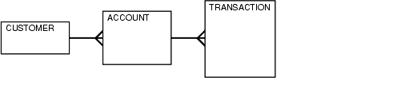

## 12 Using EXPLAIN PLAN

This chapter introduces execution plans, describes the SQL statement `EXPLAIN` `PLAN`, and explains how to interpret its output. This chapter also provides procedures for managing outlines to control application performance characteristics.

This chapter contains the following sections:

- Understanding EXPLAIN PLAN
- The PLAN\_TABLE Output Table
- Running EXPLAIN PLAN
- Displaying PLAN\_TABLE Output
- Reading EXPLAIN PLAN Output
- Viewing Parallel Execution with EXPLAIN PLAN
- Viewing Bitmap Indexes with EXPLAIN PLAN
- Viewing Result Cache with EXPLAIN PLAN
- Viewing Partitioned Objects with EXPLAIN PLAN
- PLAN\_TABLE Columns
	See Also:
	- [Oracle Database SQL Language Reference](https://docs.oracle.com/cd/E11882_01/server.112/e41084/toc.htm) for the syntax of the `EXPLAIN` `PLAN` statement
	- [Chapter 11, "The Query Optimizer"](optimops.md)

## 12.1 Understanding EXPLAIN PLAN

The `EXPLAIN` `PLAN` statement displays execution plans chosen by the optimizer for `SELECT`, `UPDATE`, `INSERT`, and `DELETE` statements. A statement execution plan is the sequence of operations that the database performs to run the statement.

The row source tree is the core of the execution plan. The tree shows the following information:

- An ordering of the tables referenced by the statement
- An access method for each table mentioned in the statement
- A join method for tables affected by join operations in the statement
- Data operations like filter, sort, or aggregation

In addition to the row source tree, the plan table contains information about the following:

- Optimization, such as the cost and cardinality of each operation
- Partitioning, such as the set of accessed partitions
- Parallel execution, such as the distribution method of join inputs

The `EXPLAIN` `PLAN` results let you determine whether the optimizer selects a particular execution plan, such as, nested loops join. The results also help you to understand the optimizer decisions, such as why the optimizer chose a nested loops join instead of a hash join, and lets you understand the performance of a query.

### 12.1.1 How Execution Plans Can Change

With the query optimizer, execution plans can and do change as the underlying optimizer inputs change. `EXPLAIN` `PLAN` output shows how Oracle Database would run the SQL statement when the statement was explained. This plan can differ from the actual execution plan a SQL statement because of differences in the execution environment and explain plan environment.

Note:

To avoid possible SQL performance regression that may result from execution plan changes, consider using SQL plan management.

Execution plans can differ due to the following:

- Different Schemas
- Different Costs

See Also:

[Chapter 15, "Using SQL Plan Management"](optplanmgmt.md).

#### 12.1.1.1 Different Schemas

- The execution and explain plan occur on different databases.
- The user explaining the statement is different from the user running the statement. Two users might be pointing to different objects in the same database, resulting in different execution plans.
- Schema changes (usually changes in indexes) between the two operations.

#### 12.1.1.2 Different Costs

Even if the schemas are the same, the optimizer can choose different execution plans when the costs are different. Some factors that affect the costs include the following:

- Data volume and statistics
- Bind variable types and values
- Initialization parameters set globally or at session level

### 12.1.2 Minimizing Throw-Away

Examining an explain plan lets you look for throw-away in cases such as the following:

- Full scans
- Unselective range scans
- Late predicate filters
- Wrong join order
- Late filter operations

For example, in the following explain plan, the last step is a very unselective range scan that is executed 76563 times, accesses 11432983 rows, throws away 99% of them, and retains 76563 rows. Why access 11432983 rows to realize that only 76563 rows are needed?

Example 12-1 Looking for Throw-Away in an Explain Plan

```
Rows      Execution Plan
--------  ----------------------------------------------------
      12  SORT AGGREGATE
       2   SORT GROUP BY
   76563    NESTED LOOPS
   76575     NESTED LOOPS
      19      TABLE ACCESS FULL CN_PAYRUNS_ALL
   76570      TABLE ACCESS BY INDEX ROWID CN_POSTING_DETAILS_ALL
   76570       INDEX RANGE SCAN (object id 178321)
   76563     TABLE ACCESS BY INDEX ROWID CN_PAYMENT_WORKSHEETS_ALL
11432983      INDEX RANGE SCAN (object id 186024)
```

### 12.1.3 Looking Beyond Execution Plans

The execution plan operation alone cannot differentiate between well-tuned statements and those that perform poorly. For example, an `EXPLAIN` `PLAN` output that shows that a statement uses an index does not necessarily mean that the statement runs efficiently. Sometimes indexes are extremely inefficient. In this case, you should examine the following:

- The columns of the index being used
- Their selectivity (fraction of table being accessed)

It is best to use `EXPLAIN` `PLAN` to determine an access plan, and then later prove that it is the optimal plan through testing. When evaluating a plan, examine the statement's actual resource consumption.

#### 12.1.3.1 Using V$SQL\_PLAN Views

In addition to running the `EXPLAIN` `PLAN` command and displaying the plan, you can use the `V$SQL_PLAN` views to display the execution plan of a SQL statement:

After the statement has executed, you can display the plan by querying the `V$SQL_PLAN` view. `V$SQL_PLAN` contains the execution plan for every statement stored in the shared SQL area. Its definition is similar to the `PLAN_TABLE`. See "PLAN\_TABLE Columns".

The advantage of `V$SQL_PLAN` over `EXPLAIN` `PLAN` is that you do not need to know the compilation environment that was used to execute a particular statement. For `EXPLAIN` `PLAN`, you would need to set up an identical environment to get the same plan when executing the statement.

The `V$SQL_PLAN_STATISTICS` view provides the actual execution statistics for every operation in the plan, such as the number of output rows and elapsed time. All statistics, except the number of output rows, are cumulative. For example, the statistics for a join operation also includes the statistics for its two inputs. The statistics in `V$SQL_PLAN_STATISTICS` are available for cursors that have been compiled with the `STATISTICS_LEVEL` initialization parameter set to `ALL`.

The `V$SQL_PLAN_STATISTICS_ALL` view enables side by side comparisons of the estimates that the optimizer provides for the number of rows and elapsed time. This view combines both `V$SQL_PLAN` and `V$SQL_PLAN_STATISTICS` information for every cursor.

See Also:

- ["Real-Time SQL Monitoring"](instance_tune.md) for information about the `V$SQL_PLAN_MONITOR` view
- [Oracle Database Reference](https://docs.oracle.com/cd/E11882_01/server.112/e40402/dynviews_3054.htm#REFRN30250) for more information about `V$SQL_PLAN` views
- [Oracle Database Reference](https://docs.oracle.com/cd/E11882_01/server.112/e40402/initparams254.htm#REFRN10214) for information about the `STATISTICS_LEVEL` initialization parameter

### 12.1.4 EXPLAIN PLAN Restrictions

Oracle Database does not support `EXPLAIN` `PLAN` for statements performing implicit type conversion of date bind variables. With bind variables in general, the `EXPLAIN` `PLAN` output might not represent the real execution plan.

From the text of a SQL statement, `TKPROF` cannot determine the types of the bind variables. It assumes that the type is `CHARACTER`, and gives an error message if this is not the case. You can avoid this limitation by putting appropriate type conversions in the SQL statement.

See Also:

[Chapter 21, "Using Application Tracing Tools"](sqltrace.md)

## 12.2 The PLAN\_TABLE Output Table

The `PLAN_TABLE` is automatically created as a public synonym to a global temporary table. This temporary table holds the output of `EXPLAIN` `PLAN` statements for all users. `PLAN_TABLE` is the default sample output table into which the `EXPLAIN` `PLAN` statement inserts rows describing execution plans. See "PLAN\_TABLE Columns" for a description of the columns in the table.

While a `PLAN_TABLE` table is automatically set up for each user, you can use the SQL script `catplan.sql` to manually create the global temporary table and the `PLAN_TABLE` synonym. The name and location of this script depends on your operating system. On UNIX and Linux, the script is located in the `$ORACLE_HOME/rdbms/admin` directory.

For example, start a SQL\*Plus session, connect with `SYSDBA` privileges, and run the script as follows:

```
@$ORACLE_HOME/rdbms/admin/catplan.sql
```

Oracle recommends that you drop and rebuild your local `PLAN_TABLE` table after upgrading the version of the database because the columns might change. This can cause scripts to fail or cause `TKPROF` to fail, if you are specifying the table.

If you do not want to use the name `PLAN_TABLE`, create a new synonym after running the `catplan.sql` script. For example:

```
CREATE OR REPLACE PUBLIC SYNONYM my_plan_table for plan_table$
```

## 12.3 Running EXPLAIN PLAN

To explain a SQL statement, use the `EXPLAIN` `PLAN` `FOR` clause immediately before the statement. For example:

```
EXPLAIN PLAN FOR
  SELECT last_name FROM employees;
```

This explains the plan into the `PLAN_TABLE` table. You can then select the execution plan from `PLAN_TABLE`. See "Displaying PLAN\_TABLE Output".

### 12.3.1 Identifying Statements for EXPLAIN PLAN

With multiple statements, you can specify a statement identifier and use that to identify your specific execution plan. Before using `SET` `STATEMENT` `ID`, remove any existing rows for that statement ID.

In Example 12-2, `st1` is specified as the statement identifier:

Example 12-2 Using EXPLAIN PLAN with the STATEMENT ID Clause

```
EXPLAIN PLAN
  SET STATEMENT_ID = 'st1' FOR
SELECT last_name FROM employees;
```

### 12.3.2 Specifying Different Tables for EXPLAIN PLAN

You can specify the `INTO` clause to specify a different table.

Example 12-3 Using EXPLAIN PLAN with the INTO Clause

```
EXPLAIN PLAN
  INTO my_plan_table
 FOR
SELECT last_name FROM employees;
```

You can specify a statement ID when using the `INTO` clause.

```
EXPLAIN PLAN
   SET STATEMENT_ID = 'st1'
   INTO my_plan_table
 FOR
SELECT last_name FROM employees;
```

See Also:

[Oracle Database SQL Language Reference](https://docs.oracle.com/cd/E11882_01/server.112/e41084/toc.htm) for a complete description of `EXPLAIN` `PLAN` syntax.

## 12.4 Displaying PLAN\_TABLE Output

After you have explained the plan, use the following SQL scripts or PL/SQL package provided by Oracle Database to display the most recent plan table output:

- `UTLXPLS`.`SQL`
	This script displays the plan table output for serial processing. [Example 11-14, "EXPLAIN PLAN Output"](optimops.md) is an example of the plan table output when using the `UTLXPLS`.`SQL` script.
- `UTLXPLP`.`SQL`
	This script displays the plan table output including parallel execution columns.
- `DBMS_XPLAN.DISPLAY` table function
	This function accepts options for displaying the plan table output. You can specify:
	- A plan table name if you are using a table different than `PLAN_TABLE`
		- A statement ID if you have set a statement ID with the `EXPLAIN` `PLAN`
		- A format option that determines the level of detail: `BASIC`, `SERIAL`, and `TYPICAL`, `ALL`,
	Some examples of the use of `DBMS_XPLAN` to display `PLAN_TABLE` output are:
	```
	SELECT PLAN_TABLE_OUTPUT FROM TABLE(DBMS_XPLAN.DISPLAY());
	SELECT PLAN_TABLE_OUTPUT 
	  FROM TABLE(DBMS_XPLAN.DISPLAY('MY_PLAN_TABLE', 'st1','TYPICAL'));
	```
	See Also:
	[Oracle Database PL/SQL Packages and Types Reference](https://docs.oracle.com/cd/E11882_01/appdev.112/e40758/d_xplan.htm#ARPLS378) for more information on the `DBMS_XPLAN` package

### 12.4.1 Customizing PLAN\_TABLE Output

If you have specified a statement identifier, then you can write your own script to query the `PLAN_TABLE`. For example:

- Start with ID = 0 and given `STATEMENT_ID`.
- Use the `CONNECT` `BY` clause to walk the tree from parent to child, the join keys being `STATEMENT_ID` = `PRIOR` `STATEMENT_ID` and `PARENT_ID` = `PRIOR` `ID`.
- Use the pseudo-column `LEVEL` (associated with `CONNECT` `BY`) to indent the children.
	```
	SELECT cardinality "Rows",
	   lpad(' ',level-1)||operation||' '||options||' '||object_name "Plan"
	  FROM PLAN_TABLE
	CONNECT BY prior id = parent_id
	        AND prior statement_id = statement_id
	  START WITH id = 0
	        AND statement_id = 'st1'
	  ORDER BY id;
	   Rows Plan
	------- ----------------------------------------
	        SELECT STATEMENT
	         TABLE ACCESS FULL EMPLOYEES
	```
	The `NULL` in the `Rows` column indicates that the optimizer does not have any statistics on the table. Analyzing the table shows the following:
	```
	Rows Plan
	------- ----------------------------------------
	  16957 SELECT STATEMENT
	  16957  TABLE ACCESS FULL EMPLOYEES
	```
	You can also select the `COST`. This is useful for comparing execution plans or for understanding why the optimizer chooses one execution plan over another.
	Note:
	These simplified examples are not valid for recursive SQL.

## 12.5 Reading EXPLAIN PLAN Output

This section uses `EXPLAIN` `PLAN` examples to illustrate execution plans. The statement in Example 12-4 displays the execution plans.

Example 12-4 Statement to display the EXPLAIN PLAN

```
SELECT PLAN_TABLE_OUTPUT 
  FROM TABLE(DBMS_XPLAN.DISPLAY(NULL, 'statement_id','BASIC'));
```

Examples of the output from this statement are shown in Example 12-5 and Example 12-6.

Example 12-5 EXPLAIN PLAN for Statement ID ex\_plan1

```
EXPLAIN PLAN 
  SET statement_id = 'ex_plan1' FOR
SELECT phone_number FROM employees
 WHERE phone_number LIKE '650%';

---------------------------------------
| Id  | Operation         | Name      |
---------------------------------------
|   0 | SELECT STATEMENT  |           |
|   1 |  TABLE ACCESS FULL| EMPLOYEES |
---------------------------------------
```

This plan shows execution of a `SELECT` statement. The table `employees` is accessed using a full table scan.

- Every row in the table `employees` is accessed, and the `WHERE` clause criteria is evaluated for every row.
- The `SELECT` statement returns the rows meeting the `WHERE` clause criteria.

Example 12-6 EXPLAIN PLAN for Statement ID ex\_plan2

```
EXPLAIN PLAN 
  SET statement_id = 'ex_plan2' FOR
SELECT last_name FROM employees
 WHERE last_name LIKE 'Pe%';

SELECT PLAN_TABLE_OUTPUT 
  FROM TABLE(DBMS_XPLAN.DISPLAY(NULL, 'ex_plan2','BASIC'));

----------------------------------------
| Id  | Operation        | Name        |
----------------------------------------
|   0 | SELECT STATEMENT |             |
|   1 |  INDEX RANGE SCAN| EMP_NAME_IX |
----------------------------------------
```

This plan shows execution of a `SELECT` statement.

- The database range scans `EMP_NAME_IX` to evaluate the `WHERE` clause criteria.
- The `SELECT` statement returns rows satisfying the `WHERE` clause conditions.

## 12.6 Viewing Parallel Execution with EXPLAIN PLAN

Tuning a parallel query begins much like a non-parallel query tuning exercise by choosing the driving table. However, the rules governing the choice are different. In the non-parallel case, the best driving table is typically the one that produces fewest number of rows after limiting conditions are applied. The small number of rows are joined to larger tables using non-unique indexes. For example, consider a table hierarchy consisting of `CUSTOMER`, `ACCOUNT`, and `TRANSACTION`.

Figure 12-1 A Table Hierarchy



> This illustration shows a table hierarchy with three tables—Customer, Account, and Transaction—in order of smallest to largest.
>
> End of image description.
>
> Copyright © 2000, 2014, Oracle and/or its affiliates. All rights reserved.  
> [Legal Notices](https://docs.oracle.com/cd/E11882_01/dcommon/html/cpyr.htm)
  

`CUSTOMER` is the smallest table while `TRANSACTION` is the largest. A typical OLTP query might retrieve transaction information about a specific customer's account. The query would drive from the `CUSTOMER` table. The goal in this case is to minimize logical I/O, which typically minimizes other critical resources including physical I/O and CPU time.

For parallel queries, the choice of the driving table is usually the largest table because the database can use parallel query. It would not be efficient to use parallel query in this case because only a few rows from each table are ultimately accessed. However, what if it were necessary to identify all customers that had transactions of a certain type last month? It would be more efficient to drive from the `TRANSACTION` table because there are no limiting conditions on the customer table. The database would join rows from the `TRANSACTION` table to the `ACCOUNT` table, and finally to the `CUSTOMER` table. In this case, the indexes used on the `ACCOUNT` and `CUSTOMER` table are probably highly selective primary key or unique indexes, rather than non-unique indexes used in the first query. Because the `TRANSACTION` table is large and the column is un-selective, it would be beneficial to utilize parallel query driving from the `TRANSACTION` table.

Parallel operations include:

- `PARALLEL_TO_PARALLEL`
- `PARALLEL_TO_SERIAL`
	A `PARALLEL_TO_SERIAL` operation which is always the step that occurs when rows from a parallel operation are consumed by the query coordinator. Another type of operation that does not occur in this query is a `SERIAL` operation. If these types of operations occur, then consider making them parallel operations to improve performance because they too are potential bottlenecks.
- `PARALLEL_FROM_SERIAL`
- `PARALLEL_TO_PARALLEL`
	`PARALLEL_TO_PARALLEL` operations generally produce the best performance as long as the workloads in each step are relatively equivalent.
- `PARALLEL_COMBINED_WITH_CHILD`
- `PARALLEL_COMBINED_WITH_PARENT`
	A `PARALLEL_COMBINED_WITH_PARENT` operation occurs when the database performs the step simultaneously with the parent step.

If a parallel step produces many rows, then the QC may not be able to consume the rows as fast as they are produced. Little can be done to improve this situation.

See Also:

See the `OTHER_TAG` column in Table 12-1, "PLAN\_TABLE Columns"

### 12.6.1 Viewing Parallel Queries with EXPLAIN PLAN

When using `EXPLAIN` `PLAN` with parallel queries, the database compiles and executes one parallel plan. This plan is derived from the serial plan by allocating row sources specific to the parallel support in the QC plan. The table queue row sources (`PX` `Send` and `PX` `Receive`), the granule iterator, and buffer sorts, required by the two slave set PQ model, are directly inserted into the parallel plan. This plan is the exact same plan for all the slaves if executed in parallel or for the QC if executed in serial.

Example 12-7 is a simple query for illustrating an `EXPLAIN` `PLAN` for a parallel query.

Example 12-7 Parallel Query Explain Plan

```
CREATE TABLE emp2 AS SELECT * FROM employees;
ALTER TABLE emp2 PARALLEL 2;

EXPLAIN PLAN FOR
  SELECT SUM(salary) FROM emp2 GROUP BY department_id;
SELECT PLAN_TABLE_OUTPUT FROM TABLE(DBMS_XPLAN.DISPLAY());
```
```
--------------------------------------------------------------------------------------------------------
| Id  | Operation                | Name     | Rows  | Bytes | Cost (%CPU) |    TQ  |IN-OUT| PQ Distrib |
--------------------------------------------------------------------------------------------------------
|   0 | SELECT STATEMENT         |          |   107 |  2782 |     3 (34)  |        |      |            |
|   1 |  PX COORDINATOR          |          |       |       |             |        |      |            |
|   2 |   PX SEND QC (RANDOM)    | :TQ10001 |   107 |  2782 |     3 (34)  |  Q1,01 | P->S | QC (RAND)  |
|   3 |    HASH GROUP BY         |          |   107 |  2782 |     3 (34)  |  Q1,01 | PCWP |            |
|   4 |     PX RECEIVE           |          |   107 |  2782 |     3 (34)  |  Q1,01 | PCWP |            |
|   5 |      PX SEND HASH        | :TQ10000 |   107 |  2782 |     3 (34)  |  Q1,00 | P->P | HASH       |
|   6 |       HASH GROUP BY      |          |   107 |  2782 |     3 (34)  |  Q1,00 | PCWP |            |
|   7 |        PX BLOCK ITERATOR |          |   107 |  2782 |     2 (0)   |  Q1,00 | PCWP |            |
|   8 |         TABLE ACCESS FULL| EMP2     |   107 |  2782 |     2 (0)   |  Q1,00 | PCWP |            |
--------------------------------------------------------------------------------------------------------
```

The table `EMP2` is scanned in parallel by one set of slaves while the aggregation for the `GROUP` `BY` is done by the second set. The `PX` `BLOCK` `ITERATOR` row source represents the splitting up of the table `EMP2` into pieces so as to divide the scan workload between the parallel scan slaves. The `PX` `SEND` and `PX` `RECEIVE` row sources represent the pipe that connects the two slave sets as rows flow up from the parallel scan, get repartitioned through the `HASH` table queue, and then read by and aggregated on the top slave set. The `PX` `SEND` `QC` row source represents the aggregated values being sent to the QC in random (RAND) order. The `PX` `COORDINATOR` row source represents the QC or Query Coordinator which controls and schedules the parallel plan appearing below it in the plan tree.

## 12.7 Viewing Bitmap Indexes with EXPLAIN PLAN

Index row sources using bitmap indexes appear in the `EXPLAIN` `PLAN` output with the word `BITMAP` indicating the type of the index. Consider the sample query and plan in Example 12-8.

Example 12-8 EXPLAIN PLAN with Bitmap Indexes

```
EXPLAIN PLAN FOR
```
```
SELECT * FROM t
WHERE c1 = 2 
AND c2 <> 6 
OR c3 BETWEEN 10 AND 20;
```
```
SELECT STATEMENT
   TABLE ACCESS T BY INDEX ROWID
      BITMAP CONVERSION TO ROWID
         BITMAP OR
            BITMAP MINUS
               BITMAP MINUS
                  BITMAP INDEX C1_IND SINGLE VALUE
                  BITMAP INDEX C2_IND SINGLE VALUE
               BITMAP INDEX C2_IND SINGLE VALUE
            BITMAP MERGE
               BITMAP INDEX C3_IND RANGE SCAN
```

In this example, the predicate `c1` = `2` yields a bitmap from which a subtraction can take place. From this bitmap, the bits in the bitmap for `c2` = `6` are subtracted. Also, the bits in the bitmap for `c2` `IS` `NULL` are subtracted, explaining why there are two `MINUS` row sources in the plan. The `NULL` subtraction is necessary for semantic correctness unless the column has a `NOT` `NULL` constraint. The `TO` `ROWIDS` option generates the rowids necessary for the table access.

Note:

Queries using bitmap join index indicate the bitmap join index access path. The operation for bitmap join index is the same as bitmap index.

## 12.8 Viewing Result Cache with EXPLAIN PLAN

When your query contains the `result_cache` hint, the `ResultCache` operator is inserted into the execution plan.

For example, consider the query:

```
select /*+ result_cache */ deptno, avg(sal) 
from emp 
group by deptno;
```

To view the `EXPLAIN PLAN` for this query, use the command:

```
EXPLAIN PLAN FOR 
select /*+ result_cache */ deptno, avg(sal) 
from emp 
group by deptno;
```
```
select PLAN_TABLE_OUTPUT from TABLE (DBMS_XPLAN.DISPLAY());
```

The `EXPLAIN PLAN` output for this query should look similar to the following:

```
---------------------------------------------------------------------------------------------
| Id  | Operation           | Name                        |Rows |Bytes |Cost(%CPU)|Time     |
---------------------------------------------------------------------------------------------
|   0 | SELECT STATEMENT    |                             | 11  | 77   |  4 (25)  | 00:00:01|
|   1 |  RESULT CACHE       |b06ppfz9pxzstbttpbqyqnfbmy   |     |      |          |         |
|   2 |   HASH GROUP BY     |                             | 11  | 77   |  4 (25)  | 00:00:01|
|   3 |    TABLE ACCESS FULL| EMP                         |107  | 749  |  3 (0)   | 00:00:01|
---------------------------------------------------------------------------------------------
```

In this `EXPLAIN PLAN`, the `ResultCache` operator is identified by its `CacheId`, which is `b06ppfz9pxzstbttpbqyqnfbmy`. You can now run a query on the `V$RESULT_CACHE_OBJECTS` view by using this `CacheId`.

## 12.9 Viewing Partitioned Objects with EXPLAIN PLAN

Use `EXPLAIN` `PLAN` to see how Oracle Database accesses partitioned objects for specific queries.

Partitions accessed after pruning are shown in the `PARTITION` `START` and `PARTITION` `STOP` columns. The row source name for the range partition is `PARTITION` `RANGE`. For hash partitions, the row source name is `PARTITION` `HASH`.

A join is implemented using partial partition-wise join if the `DISTRIBUTION` column of the plan table of one of the joined tables contains `PARTITION` (`KEY`). Partial partition-wise join is possible if one of the joined tables is partitioned on its join column and the table is parallelized.

A join is implemented using full partition-wise join if the partition row source appears before the join row source in the `EXPLAIN` `PLAN` output. Full partition-wise joins are possible only if both joined tables are equi-partitioned on their respective join columns. Examples of execution plans for several types of partitioning follow.

### 12.9.1 Examples of Displaying Range and Hash Partitioning with EXPLAIN PLAN

Consider the following table, `emp_range`, partitioned by range on `hire_date` to illustrate how pruning is displayed. Assume that the tables `employees` and `departments` from the Oracle Database sample schema exist.

```
CREATE TABLE emp_range 
PARTITION BY RANGE(hire_date) 
( 
PARTITION emp_p1 VALUES LESS THAN (TO_DATE('1-JAN-1992','DD-MON-YYYY')),
PARTITION emp_p2 VALUES LESS THAN (TO_DATE('1-JAN-1994','DD-MON-YYYY')),
PARTITION emp_p3 VALUES LESS THAN (TO_DATE('1-JAN-1996','DD-MON-YYYY')),
PARTITION emp_p4 VALUES LESS THAN (TO_DATE('1-JAN-1998','DD-MON-YYYY')),
PARTITION emp_p5 VALUES LESS THAN (TO_DATE('1-JAN-2001','DD-MON-YYYY')) 
) 
AS SELECT * FROM employees;
```

For the first example, consider the following statement:

```
EXPLAIN PLAN FOR 
  SELECT * FROM emp_range;
```

Oracle Database displays something similar to the following:

```
---------------------------------------------------------------------------------
| Id  | Operation           | Name      | Rows  | Bytes | Cost  | Pstart| Pstop |
---------------------------------------------------------------------------------
|   0 | SELECT STATEMENT    |           |   105 | 13965 |     2 |       |       |
|   1 |  PARTITION RANGE ALL|           |   105 | 13965 |     2 |     1 |     5 |
|   2 |   TABLE ACCESS FULL | EMP_RANGE |   105 | 13965 |     2 |     1 |     5 |
---------------------------------------------------------------------------------
```

The database creates a partition row source on top of the table access row source. It iterates over the set of partitions to be accessed. In this example, the partition iterator covers all partitions (option `ALL`), because a predicate was not used for pruning. The `PARTITION_START` and `PARTITION` \_ `STOP` columns of the `PLAN_TABLE` show access to all partitions from 1 to 5.

For the next example, consider the following statement:

```
EXPLAIN PLAN FOR 
  SELECT * FROM emp_range 
  WHERE hire_date >= TO_DATE('1-JAN-1996','DD-MON-YYYY');

--------------------------------------------------------------------------------------
| Id  | Operation                | Name      | Rows  | Bytes | Cost  | Pstart| Pstop |
--------------------------------------------------------------------------------------
|   0 | SELECT STATEMENT         |           |     3 |   399 |     2 |       |       |
|   1 |  PARTITION RANGE ITERATOR|           |     3 |   399 |     2 |     4 |     5 |
|*  2 |   TABLE ACCESS FULL      | EMP_RANGE |     3 |   399 |     2 |     4 |     5 |
--------------------------------------------------------------------------------------
```

In the previous example, the partition row source iterates from partition 4 to 5 because the database prunes the other partitions using a predicate on `hire_date`.

Finally, consider the following statement:

```
EXPLAIN PLAN FOR 
  SELECT * FROM emp_range 
  WHERE hire_date < TO_DATE('1-JAN-1992','DD-MON-YYYY'); 

------------------------------------------------------------------------------------
| Id  | Operation              | Name      | Rows  | Bytes | Cost  | Pstart| Pstop |
------------------------------------------------------------------------------------
|   0 | SELECT STATEMENT       |           |     1 |   133 |     2 |       |       |
|   1 |  PARTITION RANGE SINGLE|           |     1 |   133 |     2 |     1 |     1 |
|*  2 |   TABLE ACCESS FULL    | EMP_RANGE |     1 |   133 |     2 |     1 |     1 |
------------------------------------------------------------------------------------
```

In the previous example, only partition 1 is accessed and known at compile time; thus, there is no need for a partition row source.

#### 12.9.1.1 Plans for Hash Partitioning

Oracle Database displays the same information for hash partitioned objects, except the partition row source name is `PARTITION` `HASH` instead of `PARTITION` `RANGE`. Also, with hash partitioning, pruning is only possible using equality or `IN` -list predicates.

### 12.9.2 Examples of Pruning Information with Composite Partitioned Objects

To illustrate how Oracle Database displays pruning information for composite partitioned objects, consider the table `emp_comp` that is range partitioned on `hiredate` and subpartitioned by hash on `deptno`.

```
CREATE TABLE emp_comp PARTITION BY RANGE(hire_date) 
      SUBPARTITION BY HASH(department_id) SUBPARTITIONS 3 
( 
PARTITION emp_p1 VALUES LESS THAN (TO_DATE('1-JAN-1992','DD-MON-YYYY')),
PARTITION emp_p2 VALUES LESS THAN (TO_DATE('1-JAN-1994','DD-MON-YYYY')),
PARTITION emp_p3 VALUES LESS THAN (TO_DATE('1-JAN-1996','DD-MON-YYYY')),
PARTITION emp_p4 VALUES LESS THAN (TO_DATE('1-JAN-1998','DD-MON-YYYY')),
PARTITION emp_p5 VALUES LESS THAN (TO_DATE('1-JAN-2001','DD-MON-YYYY')) 
) 
AS SELECT * FROM employees;
```

For the first example, consider the following statement:

```
EXPLAIN PLAN FOR 
  SELECT * FROM emp_comp; 

--------------------------------------------------------------------------------
| Id  | Operation           | Name     | Rows  | Bytes | Cost  | Pstart| Pstop |
--------------------------------------------------------------------------------
|   0 | SELECT STATEMENT    |          | 10120 |  1314K|    78 |       |       |
|   1 |  PARTITION RANGE ALL|          | 10120 |  1314K|    78 |     1 |     5 |
|   2 |   PARTITION HASH ALL|          | 10120 |  1314K|    78 |     1 |     3 |
|   3 |    TABLE ACCESS FULL| EMP_COMP | 10120 |  1314K|    78 |     1 |    15 |
--------------------------------------------------------------------------------
```

This example shows the plan when Oracle Database accesses all subpartitions of all partitions of a composite object. The database uses two partition row sources for this purpose: a range partition row source to iterate over the partitions and a hash partition row source to iterate over the subpartitions of each accessed partition.

In the following example, the range partition row source iterates from partition 1 to 5, because the database performs no pruning. Within each partition, the hash partition row source iterates over subpartitions 1 to 3 of the current partition. As a result, the table access row source accesses subpartitions 1 to 15. In other words, it accesses all subpartitions of the composite object.

```
EXPLAIN PLAN FOR 
  SELECT * FROM emp_comp 
  WHERE hire_date = TO_DATE('15-FEB-1998', 'DD-MON-YYYY'); 

-----------------------------------------------------------------------------------
| Id  | Operation              | Name     | Rows  | Bytes | Cost  | Pstart| Pstop |
-----------------------------------------------------------------------------------
|   0 | SELECT STATEMENT       |          |    20 |  2660 |    17 |       |       |
|   1 |  PARTITION RANGE SINGLE|          |    20 |  2660 |    17 |     5 |     5 |
|   2 |   PARTITION HASH ALL   |          |    20 |  2660 |    17 |     1 |     3 |
|*  3 |    TABLE ACCESS FULL   | EMP_COMP |    20 |  2660 |    17 |    13 |    15 |
-----------------------------------------------------------------------------------
```

In the previous example, only the last partition, partition 5, is accessed. This partition is known at compile time, so the database does not need to show it in the plan. The hash partition row source shows accessing of all subpartitions within that partition; that is, subpartitions 1 to 3, which translates into subpartitions 13 to 15 of the `emp_comp` table.

Now consider the following statement:

```
EXPLAIN PLAN FOR 
  SELECT * FROM emp_comp WHERE department_id = 20; 

-----------------------------------------------------------------------------------
| Id  | Operation              | Name     | Rows  | Bytes | Cost  | Pstart| Pstop |
-----------------------------------------------------------------------------------
|   0 | SELECT STATEMENT       |          |   101 | 13433 |    78 |       |       |
|   1 |  PARTITION RANGE ALL   |          |   101 | 13433 |    78 |     1 |     5 |
|   2 |   PARTITION HASH SINGLE|          |   101 | 13433 |    78 |     3 |     3 |
|*  3 |    TABLE ACCESS FULL   | EMP_COMP |   101 | 13433 |    78 |       |       |
-----------------------------------------------------------------------------------
```

In the previous example, the predicate `deptno` = 20 enables pruning on the hash dimension within each partition, so Oracle Database only needs to access a single subpartition. The number of that subpartition is known at compile time, so the hash partition row source is not needed.

Finally, consider the following statement:

```
VARIABLE dno NUMBER; 
EXPLAIN PLAN FOR 
  SELECT * FROM emp_comp WHERE department_id = :dno; 

-----------------------------------------------------------------------------------
| Id  | Operation              | Name     | Rows  | Bytes | Cost  | Pstart| Pstop |
-----------------------------------------------------------------------------------
|   0 | SELECT STATEMENT       |          |   101 | 13433 |    78 |       |       |
|   1 |  PARTITION RANGE ALL   |          |   101 | 13433 |    78 |     1 |     5 |
|   2 |   PARTITION HASH SINGLE|          |   101 | 13433 |    78 |   KEY |   KEY |
|*  3 |    TABLE ACCESS FULL   | EMP_COMP |   101 | 13433 |    78 |       |       |
-----------------------------------------------------------------------------------
```

The last two examples are the same, except that `deptno` = 20 has been replaced by `department_id` =:`dno`. In this last case, the subpartition number is unknown at compile time, and a hash partition row source is allocated. The option is `SINGLE` for that row source, because Oracle Database accesses only one subpartition within each partition. The `PARTITION` \_ `START` and `PARTITION` \_ `STOP` is set to `KEY`, which means that Oracle Database determines the number of subpartitions at run time.

### 12.9.3 Examples of Partial Partition-Wise Joins

In the following example, `emp_range_did` is joined on the partitioning column `department_id` and is parallelized. This enables use of partial partition-wise join, because the `dept2` table is not partitioned. Oracle Database dynamically partitions the dept2 table before the join.

Example 12-9 Partial Partition-Wise Join with Range Partition

```
CREATE TABLE dept2 AS SELECT * FROM departments;
ALTER TABLE dept2 PARALLEL 2;

CREATE TABLE emp_range_did PARTITION BY RANGE(department_id)
   (PARTITION emp_p1 VALUES LESS THAN (150),
    PARTITION emp_p5 VALUES LESS THAN (MAXVALUE) )
  AS SELECT * FROM employees;

ALTER TABLE emp_range_did PARALLEL 2;

EXPLAIN PLAN FOR 
SELECT /*+ PQ_DISTRIBUTE(d NONE PARTITION) ORDERED */ e.last_name, 
                     d.department_name 
   FROM emp_range_did e , dept2 d 
   WHERE e.department_id = d.department_id ;
```
```
-------------------------------------------------------------------------------------------------------------
| Id| Operation                    |Name         |Rows | Bytes |Cost|Pstart|Pstop|   TQ  |IN-OUT|PQ Distrib |
-------------------------------------------------------------------------------------------------------------
|  0| SELECT STATEMENT             |             | 284 | 16188 |  6 |      |     |       |      |            
|  1|  PX COORDINATOR              |             |     |       |    |      |     |       |      |           |
|  2|   PX SEND QC (RANDOM)        |:TQ10001     | 284 | 16188 |  6 |      |     | Q1,01 | P->S | QC (RAND) |
|* 3|    HASH JOIN                 |             | 284 | 16188 |  6 |      |     | Q1,01 | PCWP |           |
|  4|     PX PARTITION RANGE ALL   |             | 284 |  7668 |  2 |    1 |   2 | Q1,01 | PCWC |           |
|  5|      TABLE ACCESS FULL       |EMP_RANGE_DID| 284 |  7668 |  2 |    1 |   2 | Q1,01 | PCWP |           |
|  6|     BUFFER SORT              |             |     |       |    |      |     | Q1,01 | PCWC |           |
|  7|      PX RECEIVE              |             |  21 |   630 |  2 |      |     | Q1,01 | PCWP |           |
|  8|       PX SEND PARTITION (KEY)|:TQ10000     |  21 |   630 |  2 |      |     |       | S->P |PART (KEY) |
|  9|        TABLE ACCESS FULL     |DEPT2        |  21 |   630 |  2 |      |     |       |      |           |
------------------------------------------------------------------------------------------------------------
```

The execution plan shows that the table `dept2` is scanned serially and all rows with the same partitioning column value of `emp_range_did` (`department_id`) are sent through a `PART` (`KEY`), or partition key, table queue to the same slave doing the partial partition-wise join.

In the following example, `emp_comp` is joined on the partitioning column and is parallelized. This enables use of partial partition-wise join, because the `dept2` table is not partitioned. The database dynamically partitions the `dept2` table before the join.

Example 12-10 Partial Partition-Wise Join with Composite Partition

```
ALTER TABLE emp_comp PARALLEL 2; 

EXPLAIN PLAN FOR 
SELECT /*+ PQ_DISTRIBUTE(d NONE PARTITION) ORDERED */ e.last_name, 
         d.department_name 
  FROM emp_comp e, dept2 d 
 WHERE e.department_id = d.department_id;
SELECT PLAN_TABLE_OUTPUT FROM TABLE(DBMS_XPLAN.DISPLAY());
```
```
-------------------------------------------------------------------------------------------------------------
| Id | Operation                   | Name    | Rows | Bytes | Cost |Pstart|Pstop|    TQ  |IN-OUT| PQ Distrib |
-------------------------------------------------------------------------------------------------------------
|  0 | SELECT STATEMENT            |         |  445 | 17800 |    5 |      |     |        |      |           |
|  1 |  PX COORDINATOR             |         |      |       |      |      |     |        |      |           |
|  2 |   PX SEND QC (RANDOM)       |:TQ10001 |  445 | 17800 |    5 |      |     |  Q1,01 | P->S | QC (RAND) |
|* 3 |    HASH JOIN                |         |  445 | 17800 |    5 |      |     |  Q1,01 | PCWP |           |
|  4 |     PX PARTITION RANGE ALL  |         |  107 |  1070 |    3 |    1 |   5 |  Q1,01 | PCWC |           |
|  5 |      PX PARTITION HASH ALL  |         |  107 |  1070 |    3 |    1 |   3 |  Q1,01 | PCWC |           |
|  6 |       TABLE ACCESS FULL     |EMP_COMP |  107 |  1070 |    3 |    1 |  15 |  Q1,01 | PCWP |           |
|  7 |     PX RECEIVE              |         |   21 |   630 |    1 |      |     |  Q1,01 | PCWP |           |
|  8 |      PX SEND PARTITION (KEY)|:TQ10000 |   21 |   630 |    1 |      |     |  Q1,00 | P->P |PART (KEY) |
|  9 |       PX BLOCK ITERATOR     |         |   21 |   630 |    1 |      |     |  Q1,00 | PCWC |           |
| 10 |        TABLE ACCESS FULL    |DEPT2    |   21 |   630 |    1 |      |     |  Q1,00 | PCWP |           |
-------------------------------------------------------------------------------------------------------------
```

The plan shows that the optimizer selects partial partition-wise join from one of two columns. The `PX` `SEND` node type is `PARTITION` (`KEY`) and the PQ Distrib column contains the text `PART` (`KEY`), or partition key. This implies that the table `dept2` is re-partitioned based on the join column `department_id` to be sent to the parallel slaves executing the scan of `EMP_COMP` and the join.

Note that in both Example 12-9 and Example 12-10 the `PQ_DISTRIBUTE` hint explicitly forces a partial partition-wise join because the query optimizer could have chosen a different plan based on cost in this query.

### 12.9.4 Examples of Full Partition-wise Joins

In the following example, `emp_comp` and `dept_hash` are joined on their hash partitioning columns. This enables use of full partition-wise join. The `PARTITION` `HASH` row source appears on top of the join row source in the plan table output.

The `PX` `PARTITION` `HASH` row source appears on top of the join row source in the plan table output while the `PX` `PARTITION` `RANGE` row source appears over the scan of `emp_comp`. Each parallel slave performs the join of an entire hash partition of `emp_comp` with an entire partition of `dept_hash`.

Example 12-11 Full Partition-Wise Join

```
CREATE TABLE dept_hash
   PARTITION BY HASH(department_id)
   PARTITIONS 3
   PARALLEL 2
   AS SELECT * FROM departments;

EXPLAIN PLAN FOR SELECT /*+ PQ_DISTRIBUTE(e NONE NONE) ORDERED */ e.last_name,
       d.department_name
  FROM emp_comp e, dept_hash d
 WHERE e.department_id = d.department_id;
```
```
-------------------------------------------------------------------------------------------------------------
| Id | Operation                  | Name      | Rows |Bytes |Cost |Pstart|Pstop |   TQ  |IN-OUT| PQ Distrib |
-------------------------------------------------------------------------------------------------------------
|  0 | SELECT STATEMENT           |           |  106 | 2544 |   8 |      |      |       |      |            |
|  1 |  PX COORDINATOR            |           |      |      |     |      |      |       |      |            |
|  2 |   PX SEND QC (RANDOM)      | :TQ10000  |  106 | 2544 |   8 |      |      | Q1,00 | P->S | QC (RAND)  |
|  3 |    PX PARTITION HASH ALL   |           |  106 | 2544 |   8 |    1 |    3 | Q1,00 | PCWC |            |
|* 4 |     HASH JOIN              |           |  106 | 2544 |   8 |      |      | Q1,00 | PCWP |            |
|  5 |      PX PARTITION RANGE ALL|           |  107 | 1070 |   3 |    1 |    5 | Q1,00 | PCWC |            |
|  6 |       TABLE ACCESS FULL    | EMP_COMP  |  107 | 1070 |   3 |    1 |   15 | Q1,00 | PCWP |            |
|  7 |      TABLE ACCESS FULL     | DEPT_HASH |   27 |  378 |   4 |    1 |    3 | Q1,00 | PCWP |            |
-------------------------------------------------------------------------------------------------------------
```

### 12.9.5 Examples of INLIST ITERATOR and EXPLAIN PLAN

An `INLIST` `ITERATOR` operation appears in the `EXPLAIN` `PLAN` output if an index implements an `IN` -list predicate. For example:

```
SELECT * FROM emp WHERE empno IN (7876, 7900, 7902);
```

The `EXPLAIN` `PLAN` output appears as follows:

```
OPERATION          OPTIONS           OBJECT_NAME
----------------   ---------------   -------------- 
SELECT STATEMENT
INLIST ITERATOR
TABLE ACCESS       BY ROWID          EMP
INDEX              RANGE SCAN        EMP_EMPNO
```

The `INLIST` `ITERATOR` operation iterates over the next operation in the plan for each value in the `IN` -list predicate. For partitioned tables and indexes, the three possible types of `IN` -list columns are described in the following sections.

#### 12.9.5.1 When the IN-List Column is an Index Column

If the `IN` -list column `empno` is an index column but not a partition column, then the plan is as follows (the `IN` -list operator appears before the table operation but after the partition operation):

```
OPERATION        OPTIONS              OBJECT_NAME PARTITION_START PARTITION_STOP
---------------- ------------         ----------- --------------- -------------- 
SELECT STATEMENT 
PARTITION RANGE  ALL                               KEY(INLIST)     KEY(INLIST)
INLIST ITERATOR
TABLE ACCESS     BY LOCAL INDEX ROWID EMP          KEY(INLIST)     KEY(INLIST)
INDEX            RANGE SCAN           EMP_EMPNO    KEY(INLIST)     KEY(INLIST)
```

The `KEY` (`INLIST`) designation for the partition start and stop keys specifies that an `IN` -list predicate appears on the index start and stop keys.

#### 12.9.5.2 When the IN-List Column is an Index and a Partition Column

If `empno` is an indexed and a partition column, then the plan contains an `INLIST` `ITERATOR` operation before the partition operation:

```
OPERATION        OPTIONS              OBJECT_NAME PARTITION_START PARTITION_STOP
---------------- ------------         ----------- --------------- --------------
SELECT STATEMENT
INLIST ITERATOR
PARTITION RANGE  ITERATOR                         KEY(INLIST)     KEY(INLIST)
TABLE ACCESS     BY LOCAL INDEX ROWID EMP         KEY(INLIST)     KEY(INLIST)
INDEX            RANGE SCAN           EMP_EMPNO   KEY(INLIST)     KEY(INLIST)
```

#### 12.9.5.3 When the IN-List Column is a Partition Column

If `empno` is a partition column and no indexes exist, then no `INLIST` `ITERATOR` operation is allocated:

```
OPERATION         OPTIONS        OBJECT_NAME   PARTITION_START   PARTITION_STOP
----------------  ------------   -----------   ---------------   --------------
SELECT STATEMENT
PARTITION RANGE   INLIST                       KEY(INLIST)       KEY(INLIST)
TABLE ACCESS      FULL           EMP           KEY(INLIST)       KEY(INLIST)
```

If `emp_empno` is a bitmap index, then the plan is as follows:

```
OPERATION          OPTIONS           OBJECT_NAME
----------------   ---------------   -------------- 
SELECT STATEMENT
INLIST ITERATOR
TABLE ACCESS       BY INDEX ROWID    EMP
BITMAP CONVERSION  TO ROWIDS
BITMAP INDEX       SINGLE VALUE      EMP_EMPNO
```

### 12.9.6 Example of Domain Indexes and EXPLAIN PLAN

You can also use `EXPLAIN` `PLAN` to derive user-defined CPU and I/O costs for domain indexes. `EXPLAIN` `PLAN` displays these statistics in the `OTHER` column of `PLAN_TABLE`.

For example, assume table `emp` has user-defined operator `CONTAINS` with a domain index `emp_resume` on the `resume` column, and the index type of `emp_resume` supports the operator `CONTAINS`. You explain the plan for the following query:

```
SELECT * FROM emp WHERE CONTAINS(resume, 'Oracle') = 1
```

The database could display the following plan:

```
OPERATION            OPTIONS      OBJECT_NAME     OTHER 
-----------------    -----------  ------------    ----------------
SELECT STATEMENT 
TABLE ACCESS         BY ROWID     EMP
DOMAIN INDEX                      EMP_RESUME      CPU: 300, I/O: 4
```

## 12.10 PLAN\_TABLE Columns

The `PLAN_TABLE` used by the `EXPLAIN` `PLAN` statement contains the columns listed in Table 12-1.

Table 12-1 PLAN\_TABLE Columns

| Column | Type | Description |
| --- | --- | --- |
| `STATEMENT_ID` | `VARCHAR2(30)` | Value of the optional `STATEMENT_ID` parameter specified in the `EXPLAIN` `PLAN` statement. |
| `PLAN_ID` | `NUMBER` | Unique identifier of a plan in the database. |
| `TIMESTAMP` | `DATE` | Date and time when the `EXPLAIN` `PLAN` statement was generated. |
| `REMARKS` | `VARCHAR2(80)` | Any comment (of up to 80 bytes) you want to associate with each step of the explained plan. This column indicates whether the database used an outline or SQL profile for the query.  If you need to add or change a remark on any row of the `PLAN_TABLE`, then use the `UPDATE` statement to modify the rows of the `PLAN_TABLE`. |
| `OPERATION` | `VARCHAR2(30)` | Name of the internal operation performed in this step. In the first row generated for a statement, the column contains one of the following values:  - DELETE STATEMENT - INSERT STATEMENT - SELECT STATEMENT - UPDATE STATEMENT  See Table 12-3 for more information on values for this column. |
| `OPTIONS` | `VARCHAR2(225)` | A variation on the operation described in the `OPERATION` column.  See Table 12-3 for more information on values for this column. |
| `OBJECT_NODE` | `VARCHAR2(128)` | Name of the database link used to reference the object (a table name or view name). For local queries using parallel execution, this column describes the order in which the database consumes output from operations. |
| `OBJECT_OWNER` | `VARCHAR2(30)` | Name of the user who owns the schema containing the table or index. |
| `OBJECT_NAME` | `VARCHAR2(30)` | Name of the table or index. |
| `OBJECT_ALIAS` | `VARCHAR2(65)` | Unique alias of a table or view in a SQL statement. For indexes, it is the object alias of the underlying table. |
| `OBJECT_INSTANCE` | `NUMERIC` | Number corresponding to the ordinal position of the object as it appears in the original statement. The numbering proceeds from left to right, outer to inner for the original statement text. View expansion results in unpredictable numbers. |
| `OBJECT_TYPE` | `VARCHAR2(30)` | Modifier that provides descriptive information about the object; for example, `NON` - `UNIQUE` for indexes. |
| `OPTIMIZER` | `VARCHAR2(255)` | Current mode of the optimizer. |
| `SEARCH_COLUMNS` | `NUMBERIC` | Not currently used. |
| `ID` | `NUMERIC` | A number assigned to each step in the execution plan. |
| `PARENT_ID` | `NUMERIC` | The ID of the next execution step that operates on the output of the `ID` step. |
| `DEPTH` | `NUMERIC` | Depth of the operation in the row source tree that the plan represents. The value can be used for indenting the rows in a plan table report. |
| `POSITION` | `NUMERIC` | For the first row of output, this indicates the optimizer's estimated cost of executing the statement. For the other rows, it indicates the position relative to the other children of the same parent. |
| `COST` | `NUMERIC` | Cost of the operation as estimated by the optimizer's query approach. Cost is not determined for table access operations. The value of this column does not have any particular unit of measurement; it is merely a weighted value used to compare costs of execution plans. The value of this column is a function of the `CPU_COST` and `IO_COST` columns. |
| `CARDINALITY` | `NUMERIC` | Estimate by the query optimization approach of the number of rows accessed by the operation. |
| `BYTES` | `NUMERIC` | Estimate by the query optimization approach of the number of bytes accessed by the operation. |
| `OTHER_TAG` | `VARCHAR2(255)` | Describes the contents of the `OTHER` column. Values are:  - `SERIAL` (blank): Serial execution. Currently, SQL is not loaded in the `OTHER` column for this case. - `SERIAL_FROM_REMOTE` `(S -> R)`: Serial execution at a remote site. - `PARALLEL_FROM_SERIAL (S -> P)`: Serial execution. Output of step is partitioned or broadcast to parallel execution servers. - `PARALLEL_TO_SERIAL (P -> S)`: Parallel execution. Output of step is returned to serial QC process. - `PARALLEL_TO_PARALLEL (P -> P)`: Parallel execution. Output of step is repartitioned to second set of parallel execution servers. - `PARALLEL_COMBINED_WITH_PARENT (PWP)`: Parallel execution; Output of step goes to next step in same parallel process. No interprocess communication to parent. - `PARALLEL_COMBINED_WITH_CHILD (PWC)`: Parallel execution. Input of step comes from prior step in same parallel process. No interprocess communication from child. |
| `PARTITION_START` | `VARCHAR2(255)` | Start partition of a range of accessed partitions. It can take one of the following values:  n indicates that the start partition has been identified by the SQL compiler, and its partition number is given by n.  `KEY` indicates that the start partition is identified at run time from partitioning key values.  `ROW` `REMOVE_LOCATION` indicates that the database computes the start partition (same as the stop partition) at run time from the location of each retrieved record. The record location is obtained by a user or from a global index.  `INVALID` indicates that the range of accessed partitions is empty. |
| `PARTITION_STOP` | `VARCHAR2(255)` | Stop partition of a range of accessed partitions. It can take one of the following values:  n indicates that the stop partition has been identified by the SQL compiler, and its partition number is given by n.  `KEY` indicates that the stop partition is identified at run time from partitioning key values.  `ROW` `REMOVE_LOCATION` indicates that the database computes the stop partition (same as the start partition) at run time from the location of each retrieved record. The record location is obtained by a user or from a global index.  `INVALID` indicates that the range of accessed partitions is empty. |
| `PARTITION_ID` | `NUMERIC` | Step that has computed the pair of values of the `PARTITION_START` and `PARTITION_STOP` columns. |
| `OTHER` | `LONG` | Other information that is specific to the execution step that a user might find useful. See the `OTHER_TAG` column. |
| `DISTRIBUTION` | `VARCHAR2(30)` | Method used to distribute rows from producer query servers to consumer query servers.  See Table 12-2 for more information on the possible values for this column. For more information about consumer and producer query servers, see [Oracle Database Data Warehousing Guide](https://docs.oracle.com/cd/E11882_01/server.112/e25554/toc.htm). |
| `CPU_COST` | `NUMERIC` | CPU cost of the operation as estimated by the query optimizer's approach. The value of this column is proportional to the number of machine cycles required for the operation. For statements that use the rule-based approach, this column is null. |
| `IO_COST` | `NUMERIC` | I/O cost of the operation as estimated by the query optimizer's approach. The value of this column is proportional to the number of data blocks read by the operation. For statements that use the rule-based approach, this column is null. |
| `TEMP_SPACE` | `NUMERIC` | Temporary space, in bytes, used by the operation as estimated by the query optimizer's approach. For statements that use the rule-based approach, or for operations that do not use any temporary space, this column is null. |
| `ACCESS_PREDICATES` | `VARCHAR2(4000)` | Predicates used to locate rows in an access structure. For example, start or stop predicates for an index range scan. |
| `FILTER_PREDICATES` | `VARCHAR2(4000)` | Predicates used to filter rows before producing them. |
| `PROJECTION` | `VARCHAR2(4000)` | Expressions produced by the operation. |
| `TIME` | `NUMBER(20,2)` | Elapsed time in seconds of the operation as estimated by query optimization. For statements that use the rule-based approach, this column is null. |
| `QBLOCK_NAME` | `VARCHAR2(30)` | Name of the query block, either system-generated or defined by the user with the `QB_NAME` hint. |

Table 12-2 describes the values that can appear in the `DISTRIBUTION` column:

Table 12-2 Values of DISTRIBUTION Column of the PLAN\_TABLE

| DISTRIBUTION Text | Interpretation |
| --- | --- |
| `PARTITION (ROWID)` | Maps rows to query servers based on the partitioning of a table or index using the rowid of the row to `UPDATE` / `DELETE`. |
| `PARTITION (KEY)` | Maps rows to query servers based on the partitioning of a table or index using a set of columns. Used for partial partition-wise join, `PARALLEL` `INSERT`, `CREATE` `TABLE` `AS` `SELECT` of a partitioned table, and `CREATE` `PARTITIONED` `GLOBAL` `INDEX`. |
| `HASH` | Maps rows to query servers using a hash function on the join key. Used for `PARALLEL` `JOIN` or `PARALLEL` `GROUP` `BY`. |
| `RANGE` | Maps rows to query servers using ranges of the sort key. Used when the statement contains an `ORDER` `BY` clause. |
| `ROUND-ROBIN` | Randomly maps rows to query servers. |
| `BROADCAST` | Broadcasts the rows of the entire table to each query server. Used for a parallel join when one table is very small compared to the other. |
| `QC (ORDER)` | The QC consumes the input in order, from the first to the last query server. Used when the statement contains an `ORDER` `BY` clause. |
| `QC (RANDOM)` | The QC consumes the input randomly. Used when the statement does not have an `ORDER` `BY` clause. |

Table 12-3 lists each combination of `OPERATION` and `OPTIONS` produced by the `EXPLAIN` `PLAN` statement and its meaning within an execution plan.

Table 12-3 OPERATION and OPTIONS Values Produced by EXPLAIN PLAN

| Operation | Option | Description |
| --- | --- | --- |
| `AND-EQUAL` |  | Operation accepting multiple sets of rowids, returning the intersection of the sets, eliminating duplicates. Used for the single-column indexes access path. |
| `BITMAP` | `CONVERSION` | `TO ROWIDS` converts bitmap representations to actual rowids that can be used to access the table.  `FROM ROWIDS` converts the rowids to a bitmap representation.  `COUNT` returns the number of rowids if the actual values are not needed. |
| `BITMAP` | `INDEX` | `SINGLE VALUE` looks up the bitmap for a single key value in the index.  `RANGE SCAN` retrieves bitmaps for a key value range.  `FULL SCAN` performs a full scan of a bitmap index if there is no start or stop key. |
| `BITMAP` | `MERGE` | Merges several bitmaps resulting from a range scan into one bitmap. |
| `BITMAP` | `MINUS` | Subtracts bits of one bitmap from another. Row source is used for negated predicates. Can be used only if there are nonnegated predicates yielding a bitmap from which the subtraction can take place. An example appears in "Viewing Bitmap Indexes with EXPLAIN PLAN". |
| `BITMAP` | `OR` | Computes the bitwise `OR` of two bitmaps. |
| `BITMAP` | `AND` | Computes the bitwise `AND` of two bitmaps. |
| `BITMAP` | `KEY ITERATION` | Takes each row from a table row source and finds the corresponding bitmap from a bitmap index. This set of bitmaps are then merged into one bitmap in a following `BITMAP` `MERGE` operation. |
| `CONNECT BY` |  | Retrieves rows in hierarchical order for a query containing a `CONNECT BY` clause. |
| `CONCATENATION` |  | Operation accepting multiple sets of rows returning the union-all of the sets. |
| `COUNT` |  | Operation counting the number of rows selected from a table. |
| `COUNT` | `STOPKEY` | Count operation where the number of rows returned is limited by the `ROWNUM` expression in the `WHERE` clause. |
| `CUBE SCAN` |  | Uses inner joins for all cube access. |
| `CUBE SCAN` | `PARTIAL OUTER` | Uses an outer join for at least one dimension, and inner joins for the other dimensions. |
| `CUBE SCAN` | `OUTER` | Uses outer joins for all cube access. |
| `DOMAIN INDEX` |  | Retrieval of one or more rowids from a domain index. The options column contain information supplied by a user-defined domain index cost function, if any. |
| `FILTER` |  | Operation accepting a set of rows, eliminates some of them, and returns the rest. |
| `FIRST ROW` |  | Retrieval of only the first row selected by a query. |
| `FOR UPDATE` |  | Operation retrieving and locking the rows selected by a query containing a `FOR` `UPDATE` clause. |
| `HASH` | `GROUP BY` | Operation hashing a set of rows into groups for a query with a `GROUP` `BY` clause. |
| `HASH` | `GROUP BY PIVOT` | Operation hashing a set of rows into groups for a query with a `GROUP` `BY` clause. The `PIVOT` option indicates a pivot-specific optimization for the `HASH GROUP BY` operator. |
| `HASH JOIN`  (These are join operations.) |  | Operation joining two sets of rows and returning the result. This join method is useful for joining large data sets of data (DSS, Batch). The join condition is an efficient way of accessing the second table.  Query optimizer uses the smaller of the two tables/data sources to build a hash table on the join key in memory. Then it scans the larger table, probing the hash table to find the joined rows. |
| `HASH JOIN` | `ANTI` | Hash (left) antijoin |
| `HASH JOIN` | `SEMI` | Hash (left) semijoin |
| `HASH JOIN` | `RIGHT ANTI` | Hash right antijoin |
| `HASH JOIN` | `RIGHT SEMI` | Hash right semijoin |
| `HASH JOIN` | `OUTER` | Hash (left) outer join |
| `HASH JOIN` | `RIGHT OUTER` | Hash right outer join |
| `INDEX`  (These are access methods.) | `UNIQUE SCAN` | Retrieval of a single rowid from an index. |
| `INDEX` | `RANGE SCAN` | Retrieval of one or more rowids from an index. Indexed values are scanned in ascending order. |
| `INDEX` | `RANGE SCAN DESCENDING` | Retrieval of one or more rowids from an index. Indexed values are scanned in descending order. |
| `INDEX` | `FULL SCAN` | Retrieval of all rowids from an index when there is no start or stop key. Indexed values are scanned in ascending order. |
| `INDEX` | `FULL SCAN DESCENDING` | Retrieval of all rowids from an index when there is no start or stop key. Indexed values are scanned in descending order. |
| `INDEX` | `FAST FULL SCAN` | Retrieval of all rowids (and column values) using multiblock reads. No sorting order can be defined. Compares to a full table scan on only the indexed columns. Only available with the cost based optimizer. |
| `INDEX` | `SKIP SCAN` | Retrieval of rowids from a concatenated index without using the leading column(s) in the index. Only available with the cost based optimizer. |
| `INLIST ITERATOR` |  | Iterates over the next operation in the plan for each value in the `IN` -list predicate. |
| `INTERSECTION` |  | Operation accepting two sets of rows and returning the intersection of the sets, eliminating duplicates. |
| `MERGE JOIN`  (These are join operations.) |  | Operation accepting two sets of rows, each sorted by a specific value, combining each row from one set with the matching rows from the other, and returning the result. |
| `MERGE JOIN` | `OUTER` | Merge join operation to perform an outer join statement. |
| `MERGE JOIN` | `ANTI` | Merge antijoin. |
| `MERGE JOIN` | `SEMI` | Merge semijoin. |
| `MERGE JOIN` | `CARTESIAN` | Can result from 1 or more of the tables not having any join conditions to any other tables in the statement. Can occur even with a join and it may not be flagged as `CARTESIAN` in the plan. |
| `CONNECT BY` |  | Retrieval of rows in hierarchical order for a query containing a `CONNECT` `BY` clause. |
| `MAT_VIEW REWITE ACCESS`  (These are access methods.) | `FULL` | Retrieval of all rows from a materialized view. |
| `MAT_VIEW REWITE ACCESS` | `SAMPLE` | Retrieval of sampled rows from a materialized view. |
| `MAT_VIEW REWITE ACCESS` | `CLUSTER` | Retrieval of rows from a materialized view based on a value of an indexed cluster key. |
| `MAT_VIEW REWITE ACCESS` | `HASH` | Retrieval of rows from materialized view based on hash cluster key value. |
| `MAT_VIEW REWITE ACCESS` | `BY ROWID RANGE` | Retrieval of rows from a materialized view based on a rowid range. |
| `MAT_VIEW REWITE ACCESS` | `SAMPLE BY ROWID RANGE` | Retrieval of sampled rows from a materialized view based on a rowid range. |
| MAT\_VIEW REWITE ACCESS | `BY USER ROWID` | If the materialized view rows are located using user-supplied rowids. |
| `MAT_VIEW REWITE ACCESS` | `BY INDEX ROWID` | If the materialized view is nonpartitioned and rows are located using index(es). |
| `MAT_VIEW REWITE ACCESS` | `BY GLOBAL INDEX ROWID` | If the materialized view is partitioned and rows are located using only global indexes. |
| `MAT_VIEW REWITE ACCESS` | `BY LOCAL INDEX ROWID` | If the materialized view is partitioned and rows are located using one or more local indexes and possibly some global indexes.  Partition Boundaries:  The partition boundaries might have been computed by:  A previous `PARTITION` step, in which case the `PARTITION_START` and `PARTITION_STOP` column values replicate the values present in the `PARTITION` step, and the `PARTITION_ID` contains the ID of the `PARTITION` step. Possible values for `PARTITION_START` and `PARTITION_STOP` are `NUMBER` (n), `KEY`, `INVALID`.  The `MAT_VIEW REWRITE ACCESS` or `INDEX` step itself, in which case the `PARTITION_ID` contains the `ID` of the step. Possible values for `PARTITION_START` and `PARTITION_STOP` are `NUMBER` (n), `KEY`, `ROW` `REMOVE_LOCATION` (`MAT_VIEW REWRITE` `ACCESS` only), and `INVALID`. |
| `MINUS` |  | Operation accepting two sets of rows and returning rows appearing in the first set but not in the second, eliminating duplicates. |
| `NESTED LOOPS`  (These are join operations.) |  | Operation accepting two sets of rows, an outer set and an inner set. Oracle Database compares each row of the outer set with each row of the inner set, returning rows that satisfy a condition. This join method is useful for joining small subsets of data (OLTP). The join condition is an efficient way of accessing the second table. |
| `NESTED LOOPS` | `OUTER` | Nested loops operation to perform an outer join statement. |
| `PARTITION` |  | Iterates over the next operation in the plan for each partition in the range given by the `PARTITION_START` and `PARTITION_STOP` columns. `PARTITION` describes partition boundaries applicable to a single partitioned object (table or index) or to a set of equi-partitioned objects (a partitioned table and its local indexes). The partition boundaries are provided by the values of `PARTITION_START` and `PARTITION_STOP` of the `PARTITION`. Refer to Table 12-1 for valid values of partition start and stop. |
| `PARTITION` | `SINGLE` | Access one partition. |
| `PARTITION` | `ITERATOR` | Access many partitions (a subset). |
| `PARTITION` | `ALL` | Access all partitions. |
| `PARTITION` | `INLIST` | Similar to iterator, but based on an `IN` -list predicate. |
| `PARTITION` | `INVALID` | Indicates that the partition set to be accessed is empty. |
| `PX` `ITERATOR` | `BLOCK`, `CHUNK` | Implements the division of an object into block or chunk ranges among a set of parallel slaves. |
| `PX` `COORDINATOR` |  | Implements the Query Coordinator which controls, schedules, and executes the parallel plan below it using parallel query slaves. It also represents a serialization point, as the end of the part of the plan executed in parallel and always has a `PX` `SEND` `QC` operation below it. |
| `PX` `PARTITION` |  | Same semantics as the regular `PARTITION` operation except that it appears in a parallel plan. |
| `PX` `RECEIVE` |  | Shows the consumer/receiver slave node reading repartitioned data from a send/producer (QC or slave) executing on a PX SEND node. This information was formerly displayed into the `DISTRIBUTION` column. See Table 12-2. |
| `PX` `SEND` | `QC` `(RANDOM), HASH`, `RANGE` | Implements the distribution method taking place between two parallel set of slaves. Shows the boundary between two slave sets and how data is repartitioned on the send/producer side (QC or side. This information was formerly displayed into the `DISTRIBUTION` column. See Table 12-2. |
| `REMOTE` |  | Retrieval of data from a remote database. |
| `SEQUENCE` |  | Operation involving accessing values of a sequence. |
| `SORT` | `AGGREGATE` | Retrieval of a single row that is the result of applying a group function to a group of selected rows. |
| `SORT` | `UNIQUE` | Operation sorting a set of rows to eliminate duplicates. |
| `SORT` | `GROUP` `BY` | Operation sorting a set of rows into groups for a query with a `GROUP` `BY` clause. |
| `SORT` | `GROUP BY PIVOT` | Operation sorting a set of rows into groups for a query with a `GROUP` `BY` clause. The `PIVOT` option indicates a pivot-specific optimization for the `SORT GROUP BY` operator. |
| `SORT` | `JOIN` | Operation sorting a set of rows before a merge-join. |
| `SORT` | `ORDER BY` | Operation sorting a set of rows for a query with an `ORDER` `BY` clause. |
| `TABLE ACCESS`  (These are access methods.) | `FULL` | Retrieval of all rows from a table. |
| `TABLE ACCESS` | `SAMPLE` | Retrieval of sampled rows from a table. |
| `TABLE ACCESS` | `CLUSTER` | Retrieval of rows from a table based on a value of an indexed cluster key. |
| `TABLE ACCESS` | `HASH` | Retrieval of rows from table based on hash cluster key value. |
| `TABLE ACCESS` | `BY ROWID RANGE` | Retrieval of rows from a table based on a rowid range. |
| `TABLE ACCESS` | `SAMPLE BY ROWID RANGE` | Retrieval of sampled rows from a table based on a rowid range. |
| `TABLE ACCESS` | `BY USER ROWID` | If the table rows are located using user-supplied rowids. |
| `TABLE ACCESS` | `BY INDEX ROWID` | If the table is nonpartitioned and rows are located using index(es). |
| `TABLE ACCESS` | `BY GLOBAL INDEX ROWID` | If the table is partitioned and rows are located using only global indexes. |
| `TABLE ACCESS` | `BY LOCAL INDEX ROWID` | If the table is partitioned and rows are located using one or more local indexes and possibly some global indexes.  Partition Boundaries:  The partition boundaries might have been computed by:  A previous `PARTITION` step, in which case the `PARTITION_START` and `PARTITION_STOP` column values replicate the values present in the `PARTITION` step, and the `PARTITION_ID` contains the ID of the `PARTITION` step. Possible values for `PARTITION_START` and `PARTITION_STOP` are `NUMBER` (n), `KEY`, `INVALID`.  The `TABLE` `ACCESS` or `INDEX` step itself, in which case the `PARTITION_ID` contains the `ID` of the step. Possible values for `PARTITION_START` and `PARTITION_STOP` are `NUMBER` (n), `KEY`, `ROW` `REMOVE_LOCATION` (`TABLE` `ACCESS` only), and `INVALID`. |
| `TRANSPOSE` |  | Operation evaluating a `PIVOT` operation by transposing the results of `GROUP BY` to produce the final pivoted data. |
| `UNION` |  | Operation accepting two sets of rows and returns the union of the sets, eliminating duplicates. |
| `UNPIVOT` |  | Operation that rotates data from columns into rows. |
| `VIEW` |  | Operation performing a view's query and then returning the resulting rows to another operation. |

See Also:

[Oracle Database Reference](https://docs.oracle.com/cd/E11882_01/server.112/e40402/statviews_5152.htm#REFRN29510) for more information on `PLAN_TABLE`