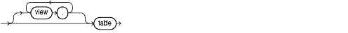
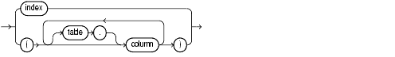

## 19 Using Optimizer Hints

You can use optimizer hints with SQL statements to alter execution plans. This chapter explains how to use hints to instruct the optimizer to use specific approaches.

The chapter contains the following sections:

## 19.1 Overview of Optimizer Hints

A [hint](glossary.md) is an instruction to the optimizer. When writing SQL, you may know information about the data unknown to the optimizer. Hints enable you to make decisions normally made by the optimizer, sometimes causing the optimizer to select a plan that it sees as higher cost.

In a test or development environments, hints are useful for testing the performance of a specific access path. For example, you may know that a certain index is more selective for certain queries. In this case, you may use hints to instruct the optimizer to use a better execution plan.

The disadvantage of hints is the extra code that must be managed, checked, and controlled. Changes in the database and host environment can make hints obsolete or even have negative consequences. For this reason, test by means of hints, but use other techniques to manage the SQL execution plans, such as SQL Tuning advisor and SQL Plan Baselines.

Oracle Database supports more than 60 hints, each of which may have zero or more parameters. A statement block can have only one comment containing hints, and that comment must follow the `SELECT`, `UPDATE`, `INSERT`, `MERGE`, or `DELETE` keyword. For example, the following hint directs the optimizer to pick the query plan that produces the first 10 rows from the `employees` table at the lowest cost:

```
SELECT /*+ FIRST_ROWS(10) */ * FROM employees;
```

See Also:

[Oracle Database SQL Language Reference](https://docs.oracle.com/cd/E11882_01/server.112/e41084/sql_elements006.htm#SQLRF00219) to a complete list of hints supported by Oracle Database

### 19.1.1 Types of Hints

Hints can be of the following general types:

- Single-table
	Single-table hints are specified on one table or view. [`INDEX`](https://docs.oracle.com/cd/E11882_01/server.112/e41084/sql_elements006.htm#SQLRF50405) and [`USE_NL`](https://docs.oracle.com/cd/E11882_01/server.112/e41084/sql_elements006.htm#SQLRF50701) are examples of single-table hints.
- Multi-table
	Multi-table hints are like single-table hints, except that the hint can specify one or more tables or views. [`LEADING`](https://docs.oracle.com/cd/E11882_01/server.112/e41084/sql_elements006.htm#SQLRF50705) is an example of a multi-table hint. Note that [`USE_NL(table1 table2)`](https://docs.oracle.com/cd/E11882_01/server.112/e41084/sql_elements006.htm#SQLRF50701) is not considered a multi-table hint because it is a shortcut for `USE_NL(table1)` and `USE_NL(table2)`.
- Query block
	Query block hints operate on single query blocks. [`STAR_TRANSFORMATION`](https://docs.oracle.com/cd/E11882_01/server.112/e41084/sql_elements006.htm#SQLRF50508) and [`UNNEST`](https://docs.oracle.com/cd/E11882_01/server.112/e41084/sql_elements006.htm#SQLRF50905) are examples of query block hints.
- Statement
	Statement hints apply to the entire SQL statement. [`ALL_ROWS`](https://docs.oracle.com/cd/E11882_01/server.112/e41084/sql_elements006.htm#SQLRF50301) is an example of a statement hint.

### 19.1.2 Hints by Category

Optimizer hints are grouped into the following categories:

- Hints for Optimization Approaches and Goals
- Hints for Enabling Optimizer Features
- Hints for Access Paths
- Hints for Join Orders
- Hints for Join Operations
- Hints for Online Application Upgrade
- Hints for Parallel Execution
- Hints for Query Transformations
- Additional Hints

These categories, and the hints contained within each category, are listed in the sections that follow.

See Also:

[Oracle Database SQL Language Reference](https://docs.oracle.com/cd/E11882_01/server.112/e41084/sql_elements003.htm#SQLRF00217) for syntax and a more detailed description of each hint

#### 19.1.2.1 Hints for Optimization Approaches and Goals

The `ALL_ROWS` and [`FIRST_ROWS(``n``)`](https://docs.oracle.com/cd/E11882_01/server.112/e41084/sql_elements006.htm#SQLRF50302) hints let you choose between optimization approaches and goals. If a SQL statement has a hint specifying an optimization approach and goal, then the optimizer uses the specified approach regardless of the presence or absence of statistics, the value of the `OPTIMIZER_MODE` initialization parameter, and the `OPTIMIZER_MODE` parameter of the `ALTER` `SESSION` statement.

Note:

The optimizer goal applies only to queries submitted directly. Use hints to specify the access path for any SQL statements submitted from within PL/SQL. The `ALTER` `SESSION ...` `SET` `OPTIMIZER_MODE` statement does not affect SQL run within PL/SQL.

If you specify either the `ALL_ROWS` or the `FIRST_ROWS` (`n`) hint in a SQL statement, and if the data dictionary does not have statistics about tables accessed by the statement, then the optimizer uses default statistical values, such as allocated storage for such tables, to estimate the missing statistics and choose an execution plan. These estimates might not be as accurate as those gathered by the `DBMS_STATS` package, so use `DBMS_STATS` to gather statistics.

If you specify hints for access paths or join operations along with either the `ALL_ROWS` or `FIRST_ROWS` (`n`) hint, then the optimizer gives precedence to the access paths and join operations specified by the hints.

See Also:

"Optimization Approaches and Goal Hints in Views" for hint behavior with mergeable views

#### 19.1.2.2 Hints for Enabling Optimizer Features

The `OPTIMIZER_FEATURES_ENABLE` hint acts as an umbrella parameter for enabling a series of optimizer features based on an Oracle Database release number. This hint is a useful way to check for plan regressions after database upgrades.

Specify the release number as an argument to the hint. The following example runs a query with the optimizer features from Oracle Database 11g Release 1 (11.1.0.6):

```
SELECT /*+ optimizer_features_enable('11.1.0.6') */ employee_id, last_name
FROM    employees
ORDER BY employee_id;
```

See Also:

[Oracle Database Reference](https://docs.oracle.com/cd/E11882_01/server.112/e40402/initparams168.htm#REFRN10141) to learn about the `OPTIMIZER_FEATURES_ENABLE` initialization parameter

#### 19.1.2.3 Hints for Access Paths

The following hints instructs the optimizer to use a specific access path for a table:

- [`FULL`](https://docs.oracle.com/cd/E11882_01/server.112/e41084/sql_elements006.htm#SQLRF50401)
- [`CLUSTER`](https://docs.oracle.com/cd/E11882_01/server.112/e41084/sql_elements006.htm#SQLRF50403)
- [`HASH`](https://docs.oracle.com/cd/E11882_01/server.112/e41084/sql_elements006.htm#SQLRF50404)
- [`INDEX`](https://docs.oracle.com/cd/E11882_01/server.112/e41084/sql_elements006.htm#SQLRF50405) and [`NO_INDEX`](https://docs.oracle.com/cd/E11882_01/server.112/e41084/sql_elements006.htm#SQLRF50411)
- [`INDEX_ASC`](https://docs.oracle.com/cd/E11882_01/server.112/e41084/sql_elements006.htm#SQLRF50406) and [`INDEX_DESC`](https://docs.oracle.com/cd/E11882_01/server.112/e41084/sql_elements006.htm#SQLRF50409)
- [`INDEX_COMBINE`](https://docs.oracle.com/cd/E11882_01/server.112/e41084/sql_elements006.htm#SQLRF50407) and [`INDEX_JOIN`](https://docs.oracle.com/cd/E11882_01/server.112/e41084/sql_elements006.htm#SQLRF50408)
- [`INDEX_JOIN`](https://docs.oracle.com/cd/E11882_01/server.112/e41084/sql_elements006.htm#SQLRF50408)
- [`INDEX_FFS`](https://docs.oracle.com/cd/E11882_01/server.112/e41084/sql_elements006.htm#SQLRF50410) and [`NO_INDEX_FFS`](https://docs.oracle.com/cd/E11882_01/server.112/e41084/sql_elements006.htm#SQLRF50413)
- [`INDEX_SS`](https://docs.oracle.com/cd/E11882_01/server.112/e41084/sql_elements006.htm#SQLRF50415) and [`NO_INDEX_SS`](https://docs.oracle.com/cd/E11882_01/server.112/e41084/sql_elements006.htm#SQLRF50414)
- [`INDEX_SS_ASC`](https://docs.oracle.com/cd/E11882_01/server.112/e41084/sql_elements006.htm#SQLRF50416) and [`INDEX_SS_DESC`](https://docs.oracle.com/cd/E11882_01/server.112/e41084/sql_elements006.htm#SQLRF50417)

Specifying one of the preceding hints causes the optimizer to choose the specified access path only if the access path is available based on the existence of an index or cluster and on the syntactic constructs of the SQL statement. If a hint specifies an unavailable access path, then the optimizer ignores it.

You must specify the table to be accessed exactly as it appears in the statement. If the statement uses an alias for the table, then use the alias rather than the table name in the hint. The table name within the hint should not include the schema name if the schema name is present in the statement.

Note:

For access path hints, Oracle Database ignores the hint if you specify the `SAMPLE` option in the `FROM` clause of a `SELECT` statement.

See Also:

- "Access Path and Join Hints on Views" and "Access Path and Join Hints Inside Views" for hint behavior with mergeable views
- [Oracle Database SQL Language Reference](https://docs.oracle.com/cd/E11882_01/server.112/e41084/toc.htm) for more information on the `SAMPLE` option

#### 19.1.2.4 Hints for Join Orders

The following hints suggest join orders:

- [`LEADING`](https://docs.oracle.com/cd/E11882_01/server.112/e41084/sql_elements006.htm#SQLRF50705)
- [`ORDERED`](https://docs.oracle.com/cd/E11882_01/server.112/e41084/sql_elements006.htm#SQLRF50601)

#### 19.1.2.5 Hints for Join Operations

The following hints instructs the optimizer to use a specific join operation for a table:

- [`USE_NL`](https://docs.oracle.com/cd/E11882_01/server.112/e41084/sql_elements006.htm#SQLRF50701) and [`NO_USE_NL`](https://docs.oracle.com/cd/E11882_01/server.112/e41084/sql_elements006.htm#SQLRF50708)
- [`USE_NL_WITH_INDEX`](https://docs.oracle.com/cd/E11882_01/server.112/e41084/sql_elements006.htm#SQLRF50702)
- [`USE_MERGE`](https://docs.oracle.com/cd/E11882_01/server.112/e41084/sql_elements006.htm#SQLRF50702) and [`NO_USE_MERGE`](https://docs.oracle.com/cd/E11882_01/server.112/e41084/sql_elements006.htm#SQLRF50710)
- [`USE_HASH`](https://docs.oracle.com/cd/E11882_01/server.112/e41084/sql_elements006.htm#SQLRF50703) and [`NO_USE_HASH`](https://docs.oracle.com/cd/E11882_01/server.112/e41084/sql_elements006.htm#SQLRF50703)
- [`NO_USE_HASH`](https://docs.oracle.com/cd/E11882_01/server.112/e41084/sql_elements006.htm#SQLRF50711)

Use of the `USE_NL` and `USE_MERGE` hints is recommended with any join order hint. See "Hints for Join Orders". Oracle Database uses these hints when the referenced table is forced to be the inner table of a join; the hints are ignored if the referenced table is the outer table.

See "Access Path and Join Hints on Views" and "Access Path and Join Hints Inside Views" for hint behavior with mergeable views.

#### 19.1.2.6 Hints for Online Application Upgrade

The online application upgrade hints suggest how to handle conflicting `INSERT` and `UPDATE` operations when performing an online application upgrade using edition-based redefinition:

- [`CHANGE_DUPKEY_ERROR_INDEX`](https://docs.oracle.com/cd/E11882_01/server.112/e41084/sql_elements006.htm#SQLRF30053)
- [`IGNORE_ROW_ON_DUPKEY_INDEX`](https://docs.oracle.com/cd/E11882_01/server.112/e41084/sql_elements006.htm#SQLRF30052)
- [`RETRY_ON_ROW_CHANGE`](https://docs.oracle.com/cd/E11882_01/server.112/e41084/sql_elements006.htm#SQLRF30054)

You can use the `CHANGE_DUPKEY_ERROR_INDEX` and `IGNORE_ROW_ON_DUPKEY_INDEX` hints to handle conflicting `INSERT` operations during an online application upgrade. You can use the `CHANGE_DUPKEY_ERROR_INDEX` hint to identify unique key violations for a specified set of columns or index. When a unique key violation is encountered during an `INSERT` or `UPDATE` operation, an `ORA-38911` error is reported instead of an `ORA-001`. You can use the `IGNORE_ROW_ON_DUPKEY_INDEX` hint to ignore unique key violations for a specified set of columns or index. When a unique key violation is encountered during a single-table `INSERT` operation, a row-level rollback occurs and execution resumes with the next input row. Therefore, a unique key violation does not cause the `INSERT` to terminate or an error to be reported.

You can use the `RETRY_ON_ROW_CHANGE` hint to handle conflicting `UPDATE` operations during an online application upgrade. You can use this hint to retry an `UPDATE` or `DELETE` operation if one or more rows changed from the time when the set of rows to be modified was determined to the time when the set of rows was actually modified.

See Also:

[Oracle Database Advanced Application Developer's Guide](https://docs.oracle.com/cd/E11882_01/appdev.112/e41502/adfns_editions.htm#ADFNS020) for more information about performing an online application upgrade using edition-based redefinition

#### 19.1.2.7 Hints for Parallel Execution

The parallel execution hints instruct the optimizer about whether and how to parallelize operations. You can use the following parallel hints:

- [`PARALLEL`](https://docs.oracle.com/cd/E11882_01/server.112/e41084/sql_elements006.htm#SQLRF50801) and [`NO_PARALLEL`](https://docs.oracle.com/cd/E11882_01/server.112/e41084/sql_elements006.htm#SQLRF50802)
- [`PARALLEL_INDEX`](https://docs.oracle.com/cd/E11882_01/server.112/e41084/sql_elements006.htm#SQLRF50804) and [`NO_PARALLEL_INDEX`](https://docs.oracle.com/cd/E11882_01/server.112/e41084/sql_elements006.htm#SQLRF50805)
- [`PQ_DISTRIBUTE`](https://docs.oracle.com/cd/E11882_01/server.112/e41084/sql_elements006.htm#SQLRF50803)

The following sections group the hints into functional categories.

See Also:

- [Oracle Database VLDB and Partitioning Guide](https://docs.oracle.com/cd/E11882_01/server.112/e25523/parallel.htm#VLDBG010) to learn how to use parallel execution
- [Oracle Database 2 Day + Data Warehousing Guide](https://docs.oracle.com/cd/E11882_01/server.112/e25555/tdpdw_perform.htm#TDPDW00831) for more information on parallel execution

##### 19.1.2.7.1 Hints Controlling the Degree of Parallelism

Hints beginning with the keyword `PARALLEL` indicate the degree of parallelism for the query. Hints beginning with `NO_PARALLEL` disable parallelism.

Note:

You can perform conventional inserts in parallel mode using the / `*+ NOAPPEND PARALLEL */` hint.

You can specify parallelism at the statement or object level. If you do not explicitly specify an object in the hint, then parallelism occurs at the statement level. In contrast to most hints, parallel statement-level hints take precedence over object-level hints.

To illustrate the difference between object-level and statement-level parallelism settings, suppose that you perform the following steps:

1. You set the parallelism setting on the `employees` table to `2` and disable parallelism on the `departments` table as follows:
	```
	ALTER TABLE employees PARALLEL 2;
	ALTER TABLE departments NOPARALLEL;
	```
2. You execute the following `SELECT` statement:
	```
	SELECT /*+ PARALLEL(employees 3) */ e.last_name, d.department_name
	FROM   employees e, departments d
	WHERE  e.department_id=d.department_id;
	```
	The `PARALLEL` hint for `employees` overrides the degree of parallelism of `2` for this table specified in Step 1.
	In the explain plan in Example 19-1, the `IN-OUT` column shows `PCWP` for parallel access of `employees` and `S` for serial access of `departments`. Access to `departments` is serialized because a `NOPARALLEL` setting was applied to this table in Step 1.
	Example 19-1 Explain Plan for Query with /\*+ PARALLEL(employees 3) \*/ Hint
	```
	----------------------------------------------------------------------------------------------------------------
	| Id | Operation               | Name        | Rows | Bytes | Cost (%CPU)| Time     |    TQ  |IN-OUT| PQ Distrib 
	----------------------------------------------------------------------------------------------------------------
	|  0 | SELECT STATEMENT        |             |   14 |   588 |     5  (20)| 00:00:01 |        |      |          |
	|  1 |  PX COORDINATOR         |             |      |       |            |          |        |      |          |
	|  2 |   PX SEND QC (RANDOM)   | :TQ10001    |   14 |   588 |     5  (20)| 00:00:01 |  Q1,01 | P->S | QC (RAND)|
	|* 3 |    HASH JOIN            |             |   14 |   588 |     5  (20)| 00:00:01 |  Q1,01 | PCWP |          |
	|  4 |     BUFFER SORT         |             |      |       |            |          |  Q1,01 | PCWC |          |
	|  5 |      PX RECEIVE         |             |    4 |    88 |     2   (0)| 00:00:01 |  Q1,01 | PCWP |          |
	|  6 |       PX SEND BROADCAST | :TQ10000    |    4 |    88 |     2   (0)| 00:00:01 |        | S->P | BROADCAST|
	|  7 |        TABLE ACCESS FULL| DEPARTMENTS |    4 |    88 |     2   (0)| 00:00:01 |        |      |          |
	|  8 |     PX BLOCK ITERATOR   |             |   14 |   280 |     2   (0)| 00:00:01 |  Q1,01 | PCWC |          |
	|  9 |      TABLE ACCESS FULL  | EMPLOYEES   |   14 |   280 |     2   (0)| 00:00:01 |  Q1,01 | PCWP |          |
	----------------------------------------------------------------------------------------------------------------
	```
3. You execute the following `SELECT` statement:
	```
	SELECT /*+ PARALLEL(4) */ hr_emp.last_name, d.department_name
	FROM   employees hr_emp, departments d
	WHERE  hr_emp.department_id=d.department_id;
	```
	Because no schema object is specified in the `PARALLEL` hint, the scope of the hint is the statement, not an object. This statement forces the query of the `employees` and `departments` tables to execute with a degree of parallelism of `4`, overriding the parallelism setting defined on the tables.

##### 19.1.2.7.2 Hints Controlling the Distribution Method for Joins

The `PQ_DISTRIBUTE` hint controls the distribution method for a specified join operation. The basic syntax is as follows, where `distribution` is the distribution method to use between the producer and the consumer slaves for the left and the right side of the join:

```
/*+ PQ_DISTRIBUTE(tablespec, distribution) */
```

For example, in a `HASH,HASH` distribution the rows of each table are mapped to consumer query servers, using a hash function on the join keys. When mapping is complete, each query server performs the join between a pair of resulting partitions. This distribution is recommended when the tables are comparable in size and the join operation is implemented by hash join or sort merge join. The following query contains a hint to use hash distribution:

```
SELECT /*+ORDERED PQ_DISTRIBUTE(departments HASH, HASH) USE_HASH (departments)*/
       e.employee_id, d.department_name
FROM   employees e, departments d
WHERE  e.department_id=d.department_id;
```

See Also:

[Oracle Database SQL Language Reference](https://docs.oracle.com/cd/E11882_01/server.112/e41084/sql_elements006.htm#SQLRF50803) for valid syntax and semantics for the `PQ_DISTRIBUTE` hint

##### 19.1.2.7.3 Hints Controlling the Distribution Method for Loads

The `PQ_DISTRIBUTE` hint applies to parallel `INSERT ... SELECT` and parallel `CREATE TABLE AS SELECT` statements to specify how rows should be distributed between the producer (query) and the consumer (load) slaves.

For example, a `PARTITION` distribution use the partitioning information of the table being loaded to distribute rows from the query slaves to the load slaves. Use this method when the following conditions are met:

- It is not possible or desirable to combine the query and load operations into each slave.
- The number of partitions being loaded is greater than or equal to the number of load slaves.
- The input data is evenly distributed across the partitions being loaded.

The following sample statement creates a table and specifies the `PARTITION` distribution method:

```
CREATE /*+ PQ_DISTRIBUTE(lineitem, PARTITION) */ TABLE lineitem
  NOLOGGING PARALLEL 16
  PARTITION BY HASH (l_orderkey) PARTITIONS 512
  AS SELECT * FROM lineitemxt;
```

In contrast, a `NONE` distribution combines the query and load operation into each slave. Thus, all slaves load all partitions. Use this distribution to avoid the overhead of distribution of rows when there is no skew. The following sample SQL statement specifies a distribution of `NONE` for an insert into the `lineitem` table:

```
INSERT /*+ APPEND PARALLEL(LINEITEM, 16) PQ_DISTRIBUTE(LINEITEM, NONE) */
  INTO lineitem
  (SELECT * FROM lineitemxt);
```

#### 19.1.2.8 Hints for Query Transformations

Each of the following hints instructs the optimizer to use a specific SQL query transformation:

- [`NO_QUERY_TRANSFORMATION`](https://docs.oracle.com/cd/E11882_01/server.112/e41084/sql_elements006.htm#SQLRF50512)
- [`USE_CONCAT`](https://docs.oracle.com/cd/E11882_01/server.112/e41084/sql_elements006.htm#SQLRF50501)
- [`NO_EXPAND`](https://docs.oracle.com/cd/E11882_01/server.112/e41084/sql_elements006.htm#SQLRF50502)
- [`REWRITE`](https://docs.oracle.com/cd/E11882_01/server.112/e41084/sql_elements006.htm#SQLRF50503) and [`NO_REWRITE`](https://docs.oracle.com/cd/E11882_01/server.112/e41084/sql_elements006.htm#SQLRF50505)
- [`MERGE`](https://docs.oracle.com/cd/E11882_01/server.112/e41084/sql_elements006.htm#SQLRF50706) and [`NO_MERGE`](https://docs.oracle.com/cd/E11882_01/server.112/e41084/sql_elements006.htm#SQLRF50507)
- [`STAR_TRANSFORMATION`](https://docs.oracle.com/cd/E11882_01/server.112/e41084/sql_elements006.htm#SQLRF50508) and [`NO_STAR_TRANSFORMATION`](https://docs.oracle.com/cd/E11882_01/server.112/e41084/sql_elements006.htm#SQLRF50511)
- [`FACT`](https://docs.oracle.com/cd/E11882_01/server.112/e41084/sql_elements006.htm#SQLRF50509) and [`NO_FACT`](https://docs.oracle.com/cd/E11882_01/server.112/e41084/sql_elements006.htm#SQLRF50510)
- [`UNNEST`](https://docs.oracle.com/cd/E11882_01/server.112/e41084/sql_elements006.htm#SQLRF50905) and [`NO_UNNEST`](https://docs.oracle.com/cd/E11882_01/server.112/e41084/sql_elements006.htm#SQLRF50906)

## 19.2 Specifying Hints

Hints apply only to the optimization of the block of a statement in which they appear. A statement block is any one of the following statements or parts of statements:

- A simple `SELECT`, `UPDATE`, or `DELETE` statement
- A parent statement or subquery of a complex statement
- A part of a compound query

For example, a compound query consisting of two component queries combined by the `UNION` operator has two blocks, one for each component query. For this reason, hints in the first component query apply only to its optimization, not to the optimization of the second component query.

The following sections discuss the use of hints in more detail.

### 19.2.1 Specifying a Full Set of Hints

When using hints, in some cases, you might need to specify a full set of hints to ensure the optimal execution plan. For example, if you have a very complex query, which consists of many table joins, and if you specify only the `INDEX` hint for a given table, then the optimizer must determine the remaining access paths to be used, and the corresponding join methods. Therefore, even though you gave the `INDEX` hint, the optimizer might not necessarily use that hint, because the optimizer might have determined that the requested index cannot be used due to the join methods and access paths selected by the optimizer.

In Example 19-2, the `LEADING` hint specifies the exact join order. The join methods are also specified.

Example 19-2 Specifying a Full Set of Hints

```
SELECT /*+ LEADING(e2 e1) USE_NL(e1) INDEX(e1 emp_emp_id_pk) 
           USE_MERGE(j) FULL(j) */
    e1.first_name, e1.last_name, j.job_id, sum(e2.salary) total_sal
  FROM employees e1, employees e2, job_history j
  WHERE e1.employee_id = e2.manager_id
    AND e1.employee_id = j.employee_id
    AND e1.hire_date = j.start_date
  GROUP BY e1.first_name, e1.last_name, j.job_id
  ORDER BY total_sal;
```

### 19.2.2 Specifying a Query Block in a Hint

To identify a query block in a query, you can use an optional query block name in a hint to specify the block to which the hint applies. The syntax of the query block argument is of the form `@` `queryblock`, where `queryblock` is an identifier that specifies a block in the query. The `queryblock` identifier can either be system-generated or user-specified.

Note the following guidelines:

- You can obtain the system-generated identifier by using `EXPLAIN` `PLAN` for the query. You can determine pre-transformation query block names by running `EXPLAIN` `PLAN` for the query using the `NO_QUERY_TRANSFORMATION` hint.
- You can set the user-specified name with the [`QB_NAME`](https://docs.oracle.com/cd/E11882_01/server.112/e41084/sql_elements006.htm#SQLRF50917) hint.

Assumptions

This tutorial assumes the following:

- You intend to create a join view of `employees` and `job_history` that contains a nested query block.
- You want to query all rows in the view, but apply the `NO_UNNEST` hint to the query block only.

To apply the NO\_UNNEST hint to the query block:

1. Start SQL\*Plus and log in as user `hr`.
2. Create the view.
	For example, run the following statement:
	```
	CREATE OR REPLACE VIEW v_emp_job_history AS
	  SELECT e1.first_name, e1.last_name, j.job_id, sum(e2.salary) total_sal
	  FROM   employees e1, (SELECT * FROM employees e3) e2, job_history j
	  WHERE  e1.employee_id = e2.manager_id
	  AND    e1.employee_id = j.employee_id
	  AND    e1.hire_date = j.start_date
	  AND    e1.salary = ( SELECT max(e2.salary) 
	                       FROM employees e2 
	                       WHERE e2.department_id = e1.department_id ) 
	  GROUP BY e1.first_name, e1.last_name, j.job_id
	  ORDER BY total_sal;
	```
3. Explain the plan for a query of `v_emp_job_history`.
	For example, run the following SQL statement:
	```
	EXPLAIN PLAN FOR SELECT * FROM v_emp_job_history;
	```
4. Query the plan table.
	For example, run the following SQL statement:
	```
	SELECT PLAN_TABLE_OUTPUT 
	FROM   TABLE(DBMS_XPLAN.DISPLAY(NULL, NULL, 'ALL'));
	```
	The database displays the plan.
5. In the query plan output, obtain the operation ID associated with the query block, and then use the ID to find the query block name.
	For example, the following plan shows that the full scan of the `employees` table occurs in operation `11`, which corresponds to query block `@SEL$4`:
	```
	------------------------------------------------------------------------------
	|Id| Operation                        |Name        |Rows|Bytes|Cost |Time
	------------------------------------------------------------------------------
	|0 | SELECT STATEMENT                 |            |1   |46   |9(34)|00:00:01|
	.
	.
	.
	|11|          TABLE ACCESS FULL       | EMPLOYEES  |107 |749  |3(0) |00:00:01|
	.
	.
	.
	-------------------------------------------------------------------------------
	Query Block Name / Object Alias (identified by operation id):
	-------------------------------------------------------------
	 
	   1 - SEL$2980E977 / V_EMP_JOB_HISTORY@SEL$1
	   2 - SEL$2980E977
	   8 - SEL$8F9407EC / VW_SQ_1@SEL$32F848CB
	   9 - SEL$8F9407EC
	  11 - SEL$8F9407EC / E2@SEL$4
	```
6. Query the view using the `NO_UNNEST` hint.
	For example, run the following SQL statement to apply the `NO_UNNEST` hint to query block `@SEL$4` (sample output included):
	```
	SQL> SELECT /*+ NO_UNNEST( @SEL$4 ) */ * FROM v_emp_job_history;
	FIRST_NAME           LAST_NAME                 JOB_ID      TOTAL_SAL
	-------------------- ------------------------- ---------- ----------
	Michael              Hartstein                 MK_REP           6000
	```

### 19.2.3 Specifying Global Table Hints

Hints that specify a table typically refer to tables in the `DELETE`, `SELECT`, or `UPDATE` query block in which the hint occurs, not to tables inside any views referenced by the statement. When you want to specify hints for tables that appear inside views, Oracle recommends using global hints instead of embedding the hint in the view. You can transform the table hints described in this chapter into a global hint by using an extended `tablespec` syntax that includes view names with the table name.

In addition, an optional query block name can precede the `tablespec` syntax. See "Specifying a Query Block in a Hint".

Hints that specify a table use the following syntax, where `view` specifies a view name and `table` specifies the name or alias of the table:

tablespec::= 

> /\*+ \[view\_1.\[view\_2.\]... \] table \*/
>
> Copyright © 2000, 2014, Oracle and/or its affiliates. All rights reserved.  
> [Legal Notices](https://docs.oracle.com/cd/E11882_01/dcommon/html/cpyr.htm)
  

If the view path is specified, then the database resolves the hint from left to right, where the first view must be present in the `FROM` clause, and each subsequent view must be specified in the `FROM` clause of the preceding view.

Note:

The view\_name.table\_name notation for global hints does not work for queries using ANSI join syntax because the optimizer generates additional views during parsing. When using ANSI join syntax, specify the query block name in the hint instead of the view\_name.table\_name notation.

Example 19-3 creates a view `v` to return the first and last name of the employee, his or her first job, and the total salary of all direct reports of that employee for each employee with the highest salary in his or her department. When querying the data, you want to force the use of the index `emp_job_ix` for the table `e3` in view `e2`.

Example 19-3 Using Global Hints Example

```
CREATE OR REPLACE VIEW v AS
  SELECT e1.first_name, e1.last_name, j.job_id, sum(e2.salary) total_sal
  FROM   employees e1, ( SELECT * FROM employees e3) e2, job_history j
  WHERE e1.employee_id = e2.manager_id
  AND e1.employee_id = j.employee_id
  AND e1.hire_date = j.start_date
  AND e1.salary = ( SELECT max(e2.salary) FROM employees e2
                    WHERE e2.department_id = e1.department_id )
  GROUP BY e1.first_name, e1.last_name, j.job_id
  ORDER BY total_sal;
```

By using the global hint structure, you can avoid the modification of view `v` with the specification of the index hint in the body of view `e2`. To force the use of the index `emp_job_ix` for the table `e3`, you can use one of the following statements:

```
SELECT /*+ INDEX(v.e2.e3 emp_job_ix) */  * FROM v;

SELECT /*+ INDEX(@SEL$2 e2.e3 emp_job_ix) */ * FROM v;

SELECT /*+ INDEX(@SEL$3 e3 emp_job_ix) */ * FROM v;
```

Note:

Oracle Database ignores global hints that refer to multiple query blocks. For example, the `LEADING` hint is ignored in the following query because it uses the dot notation to the main query block containing table `a` and view query block `v`:
```
SELECT /*+ LEADING(v.b a v.c) */ *
FROM a, v
WHERE a.id = v.id;
```

To avoid this issue, Oracle recommends that you specify a query block in the hint using the `@SEL` notation:

```
SELECT /*+ LEADING(A@SEL$1 B@SEL$2 C@SEL$2) */
FROM a a, v v
WHERE a.id = v.id;
```

Example 19-4 Using Global Hints with NO\_MERGE

The global hint syntax also applies to unmergeable views as in Example 19-4.

```
CREATE OR REPLACE VIEW v1 AS
  SELECT *
    FROM employees
    WHERE employee_id < 150;

CREATE OR REPLACE VIEW v2 AS
  SELECT v1.employee_id employee_id, departments.department_id department_id
    FROM v1, departments
    WHERE v1.department_id = departments.department_id;

SELECT /*+ NO_MERGE(v2) INDEX(v2.v1.employees emp_emp_id_pk)
                        FULL(v2.departments) */ *
  FROM v2
  WHERE department_id = 30;
```

The hints cause `v2` not to be merged and specify access path hints for the employee and department tables. These hints are pushed down into the (nonmerged) view `v2`.

See Also:

"Using Hints with Views"

### 19.2.4 Specifying Complex Index Hints

Hints that specify an index can use either a simple index name or a parenthesized list of columns as follows:

indexspec::=



> /\*+ index | (\[table\_1.\]column\_a \[\[table\_2.\]column\_b\]... \*/
>
> Copyright © 2000, 2014, Oracle and/or its affiliates. All rights reserved.  
> [Legal Notices](https://docs.oracle.com/cd/E11882_01/dcommon/html/cpyr.htm)
  
  

The semantics are as follows:

- `table` specifies the name
- `column` specifies the name of a column in the specified table
	- The columns can optionally be prefixed with table qualifiers allowing the hint to specify bitmap join indexes where the index columns are on a different table than the indexed table. If tables qualifiers are present, then they must be base tables, not aliases in the query.
		- Each column in an index specification must be a base column in the specified table, not an expression. Function-based indexes cannot be hinted using a column specification unless the columns specified in the index specification form the prefix of a function-based index.
- `index` specifies an index name
	When `tablespec` is followed by `indexspec` in the specification of a hint, a comma separating the table name and index name is permitted but not required. Commas are also permitted, but not required, to separate multiple occurrences of `indexspec`.

The hint is resolved as follows:

- If an index name is specified, then the database only considered the specified index.
- If a column list is specified, and if an index exists whose columns match the specified columns in number and order, then the database only consider this index. If no such index exists, then any index on the table with the specified columns as the prefix in the order specified is considered. In either case, the behavior is exactly as if the user had specified the same hint individually on all the matching indexes.

For example, in Example 19-3 the `job_history` table has a single-column index on the `employee_id` column and a concatenated index on `employee_id` and `start_date` columns. To specifically instruct the optimizer on index use, you can hint the query as follows:

```
SELECT /*+ INDEX(v.j jhist_employee_ix (employee_id start_date)) */ * FROM v;
```

## 19.3 Using Hints with Views

Oracle does not encourage hints inside or on views (or subqueries) because you can define views in one context and use them in another. Also, such hints can result in unexpected execution plans. In particular, hints inside views or on views are handled differently, depending on whether the view is mergeable into the top-level query.

To specify a hint for a table in a view or subquery, the global hint syntax is preferable. See "Specifying Global Table Hints".

If you decide to use hints with views, then the following sections describe the behavior.

### 19.3.1 Hints and Complex Views

By default, hints do not propagate inside a complex view. For example, if you specify a hint in a query that selects against a complex view, then this hint is not honored, because it is not pushed inside the view.

Note:

If the view is on a single table, then the hint is propagated.

Unless the hints are inside the base view, they might not be honored from a query against the view.

### 19.3.2 Hints and Mergeable Views

A mergeable view is a view that Oracle Database can replace with the query that defines the view. For example, suppose you create a view as follows:

```
CREATE OR REPLACE VIEW emp_view AS 
  SELECT last_name, department_name FROM employees e, departments d
  WHERE e.department_id=d.department_id;
```

This view is mergeable because the database can optimize the following query to use the `SELECT` statement that defines the view, avoiding use of the view itself.

```
SELECT * FROM emp_view;
```

#### 19.3.2.1 Optimization Approaches and Goal Hints in Views

Optimization approach and goal hints can occur in a top-level query or inside views.

- If such a hint exists in the top-level query, then the database uses this hint regardless of any such hints inside the views.
- If there is no top-level optimizer mode hint, then the database uses mode hints in referenced views as long as all mode hints in the views are consistent.
- If two or more mode hints in the referenced views conflict, then the database discards all mode hints in the views and uses the session mode, whether default or user-specified.

#### 19.3.2.2 Access Path and Join Hints on Views

Access path and join hints on referenced views are ignored unless the view contains a single table or references an Additional Hints view with a single table. For such single-table views, an access path hint or a join hint on the view applies to the table inside the view.

#### 19.3.2.3 Access Path and Join Hints Inside Views

Access path and join hints can appear in a view definition.

- If the view is an inline view (that is, if it appears in the `FROM` clause of a `SELECT` statement), then all access path and join hints inside the view are preserved when the view is merged with the top-level query.
- For views that are non-inline views, access path and join hints in the view are preserved only if the referencing query references no other tables or views (that is, if the `FROM` clause of the `SELECT` statement contains only the view).

### 19.3.3 Hints and Nonmergeable Views

With nonmergeable views, optimization approach and goal hints inside the view are ignored; the top-level query decides the optimization mode.

Because nonmergeable views are optimized separately from the top-level query, access path and join hints inside the view are preserved. For the same reason, access path hints on the view in the top-level query are ignored.

However, join hints on the view in the top-level query are preserved because, in this case, a nonmergeable view is similar to a table.