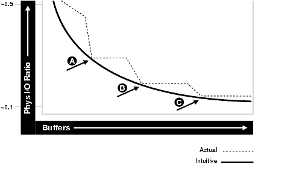
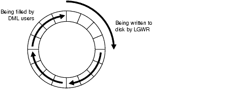
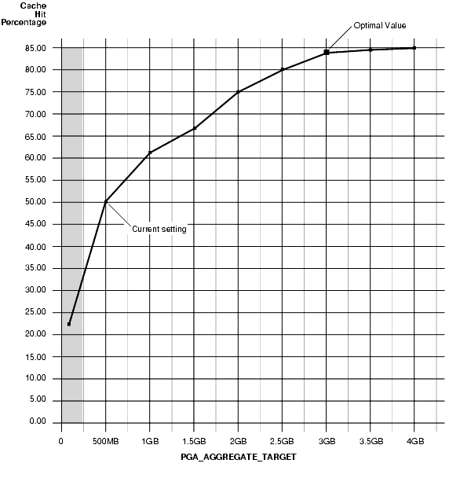

## 7 Configuring and Using Memory

This chapter explains how to allocate memory to Oracle Database memory caches, and how to use those caches. Proper sizing and effective use of the Oracle Database memory caches greatly improves database performance. Oracle recommends using automatic memory management to manage the memory on your system. However, you can choose to manually adjust the memory pools on your system, as described in this chapter.

This chapter contains the following sections:

## 7.1 Understanding Memory Allocation Issues

Oracle Database stores information in memory caches and on disk. Memory access is much faster than disk access. Disk access (physical I/O) take a significant amount of time, compared with memory access, typically in the order of 10 milliseconds. Physical I/O also increases the CPU resources required, because of the path length in device drivers and operating system event schedulers. For this reason, it is more efficient for data requests of frequently accessed objects to be perform by memory, rather than also requiring disk access.

A performance goal is to reduce the physical I/O overhead as much as possible, either by making it more likely that the required data is in memory, or by making the process of retrieving the required data more efficient.

This section contains the following topics:

- Oracle Memory Caches
- Automatic Memory Management
- Automatic Shared Memory Management
- Dynamically Changing Cache Sizes
- Application Considerations
- Operating System Memory Use
- Iteration During Configuration

### 7.1.1 Oracle Memory Caches

The main Oracle Database memory caches that affect performance are:

- Shared pool
- Large pool
- Java pool
- Buffer cache
- Streams pool size
- Log buffer
- Process-private memory, such as memory used for sorting and hash joins

### 7.1.2 Automatic Memory Management

Oracle strongly recommends the use of automatic memory management to manage the memory on your system. Automatic memory management enables Oracle Database to automatically manage and tune the instance memory. Automatic memory management can be configured using a target memory size initialization parameter (`MEMORY_TARGET`) and a maximum memory size initialization parameter (`MEMORY_MAX_TARGET`). The database tunes to the target memory size, redistributing memory as needed between the system global area (SGA) and the instance program global area (instance PGA). Before setting any memory pool sizes, consider using the automatic memory management feature of Oracle Database. If you must configure memory allocations, consider using the Memory Advisor for managing memory.

See Also:

- [Oracle Database Administrator's Guide](https://docs.oracle.com/cd/E11882_01/server.112/e25494/memory.htm#ADMIN11011) for information about using automatic memory management
- [Oracle Database 2 Day DBA](https://docs.oracle.com/cd/E11882_01/server.112/e10897/montune.htm#ADMQS1034) for information about using the Memory Advisor

### 7.1.3 Automatic Shared Memory Management

Automatic Shared Memory Management simplifies the configuration of the SGA. To use Automatic Shared Memory Management, set the `SGA_TARGET` initialization parameter to a nonzero value and set the `STATISTICS_LEVEL` initialization parameter to `TYPICAL` or `ALL`. Set the value of the `SGA_TARGET` parameter to the amount of memory that you intend to dedicate for the SGA. In response to the workload on the system, the automatic SGA management distributes the memory appropriately for the following memory pools:

- Database buffer cache (default pool)
- Shared pool
- Large pool
- Java pool
- Streams pool

If these automatically tuned memory pools had been set to nonzero values, those values are used as minimum levels by Automatic Shared Memory Management. You would set minimum values if an application component needs a minimum amount of memory to function properly.

`SGA_TARGET` is a dynamic parameter that can be changed by accessing the SGA Size Advisor from the Memory Parameters SGA page in Oracle Enterprise Manager, or by querying the `V$SGA_TARGET_ADVICE` view and using the `ALTER` `SYSTEM` command. `SGA_TARGET` can be set less than or equal to the value of `SGA_MAX_SIZE` initialization parameter. Changes in the value of `SGA_TARGET` automatically resize the automatically tuned memory pools.

See Also:

- [Oracle Database Concepts](https://docs.oracle.com/cd/E11882_01/server.112/e40540/memory.htm#CNCPT802) for information about the System Global Area (SGA)
- [Oracle Database Administrator's Guide](https://docs.oracle.com/cd/E11882_01/server.112/e25494/memory.htm#ADMIN00207) for information about managing the System Global Area (SGA)

If you dynamically disable `SGA_TARGET` by setting its value to 0 at instance startup, Automatic Shared Memory Management will be disabled and the current auto-tuned sizes will be used for each memory pool. If necessary, you can manually resize each memory pool using the `DB_CACHE_SIZE`, `SHARED_POOL_SIZE`, `LARGE_POOL_SIZE`, `JAVA_POOL_SIZE`, and `STREAMS_POOL_SIZE` initialization parameters. See "Dynamically Changing Cache Sizes".

The following pools are manually sized components and are not affected by Automatic Shared Memory Management:

- Log buffer
- Other buffer caches (such as `KEEP`, `RECYCLE`, and other nondefault block size)
- Fixed SGA and other internal allocations

To manually size these memory pools, you must set the `DB_KEEP_CACHE_SIZE`, `DB_RECYCLE_CACHE_SIZE`, `DB_nK_CACHE_SIZE`, and `LOG_BUFFER` initialization parameters. The memory allocated to these pools is deducted from the total available for `SGA_TARGET` when Automatic Shared Memory Management computes the values of the automatically tuned memory pools.

See Also:

- [Oracle Database Administrator's Guide](https://docs.oracle.com/cd/E11882_01/server.112/e25494/create.htm#ADMIN002) for information about managing initialization parameters
- [Oracle Streams Replication Administrator's Guide](https://docs.oracle.com/cd/E11882_01/server.112/e10705/prep_rep.htm#STREP201) for information about the `STREAMS_POOL_SIZE` initialization parameter
- [Oracle Database Java Developer's Guide](https://docs.oracle.com/cd/E11882_01/java.112/e10588/toc.htm) for information about Java memory usage

### 7.1.4 Dynamically Changing Cache Sizes

If the system is not using Automatic Memory Management or Automatic Shared Memory Management, you can choose to dynamically reconfigure the sizes of the shared pool, the large pool, the buffer cache, and the process-private memory. The following sections contain details on sizing of caches:

- Configuring and Using the Buffer Cache
- Configuring and Using the Shared Pool and Large Pool
- Configuring and Using the Redo Log Buffer

The size of these memory caches is configurable using initialization configuration parameters, such as `DB_CACHE_SIZE`, `JAVA_POOL_SIZE`, `LARGE_POOL_SIZE`, `LOG_BUFFER`, `and` `SHARED_POOL_SIZE`. The values for these parameters are also dynamically configurable using the `ALTER` `SYSTEM` statement except for the log buffer pool and process-private memory, which are static after startup.

Memory for the shared pool, large pool, java pool, and buffer cache is allocated in units of granules. The granule size is 4MB if the SGA size is less than 1GB. If the SGA size is greater than 1GB, the granule size changes to 16MB. The granule size is calculated and fixed when the instance starts up. The size does not change during the lifetime of the instance.

The granule size that is currently being used for SGA can be viewed in the view `V$SGA_DYNAMIC_COMPONENTS`. The same granule size is used for all dynamic components in the SGA.

You can expand the total SGA size to a value equal to the `SGA_MAX_SIZE` parameter. If the `SGA_MAX_SIZE` is not set, you can decrease the size of one cache and reallocate that memory to another cache if necessary. `SGA_MAX_SIZE` defaults to the aggregate setting of all the components.

Note:

`SGA_MAX_SIZE` cannot be dynamically resized.

The maximum amount of memory usable by the instance is determined at instance startup by the initialization parameter `SGA_MAX_SIZE`. You can specify `SGA_MAX_SIZE` to be larger than the sum of all of the memory components, such as buffer cache and shared pool. Otherwise, `SGA_MAX_SIZE` defaults to the actual size used by those components. Setting `SGA_MAX_SIZE` larger than the sum of memory used by all of the components lets you dynamically increase a cache size without needing to decrease the size of another cache.

See Also:

Your operating system's documentation for information about managing dynamic SGA

#### 7.1.4.1 Viewing Information About Dynamic Resize Operations

The following views provide information about dynamic resize operations:

- `V$MEMORY_CURRENT_RESIZE_OPS` displays information about memory resize operations (both automatic and manual) which are currently in progress.
- `V$MEMORY_DYNAMIC_COMPONENTS` displays information about the current sizes of all dynamically tuned memory components, including the total sizes of the SGA and instance PGA.
- `V$MEMORY_RESIZE_OPS` displays information about the last 800 completed memory resize operations (both automatic and manual). This does not include in-progress operations.
- `V$MEMORY_TARGET_ADVICE` displays tuning advice for the `MEMORY_TARGET` initialization parameter.
- `V$SGA_CURRENT_RESIZE_OPS` displays information about SGA resize operations that are currently in progress. An operation can be a grow or a shrink of a dynamic SGA component.
- `V$SGA_RESIZE_OPS` displays information about the last 800 completed SGA resize operations. This does not include any operations currently in progress.
- `V$SGA_DYNAMIC_COMPONENTS` displays information about the dynamic components in SGA. This view summarizes information based on all completed SGA resize operations that occurred after startup.
- `V$SGA_DYNAMIC_FREE_MEMORY` displays information about the amount of SGA memory available for future dynamic SGA resize operations.
	See Also:
	- [Oracle Database Concepts](https://docs.oracle.com/cd/E11882_01/server.112/e40540/toc.htm) for more information about dynamic SGA
	- [Oracle Database Reference](https://docs.oracle.com/cd/E11882_01/server.112/e40402/toc.htm) for detailed column information for these views

### 7.1.5 Application Considerations

When configuring memory, size the cache appropriately for the application's needs. Conversely, tuning the application's use of the caches can greatly reduce resource requirements. Efficient use of Oracle Database memory caches also reduces the load on related resources such as the latches, the CPU, and the I/O system.

For best performance, you should consider the following:

- The cache should be optimally designed to use the operating system and database resources most efficiently.
- Memory allocations to Oracle Database memory structures should best reflect the needs of the application.

Making changes or additions to an existing application might require resizing Oracle Database memory structures to meet the needs of your modified application.

If your application uses Java, you should investigate whether you need to modify the default configuration for the Java pool. See the [Oracle Database Java Developer's Guide](https://docs.oracle.com/cd/E11882_01/java.112/e10588/toc.htm) for information about Java memory usage.

### 7.1.6 Operating System Memory Use

For most operating systems, it is important to consider the following:

- Reduce Paging
- Fit the SGA into Main Memory
- Allow Adequate Memory to Individual Users

#### 7.1.6.1 Reduce Paging

Paging occurs when an operating system transfers memory-resident pages to disk solely to allow new pages to be loaded into memory. Many operating systems page to accommodate large amounts of information that do not fit into real memory. On most operating systems, paging reduces performance.

Use operating system utilities to examine the operating system, to identify whether there is a lot of paging on your system. If so, then the total system memory may not be large enough to hold everything for which you have allocated memory. Either increase the total memory on your system, or decrease the amount of memory allocated.

#### 7.1.6.2 Fit the SGA into Main Memory

Because the purpose of the SGA is to store data in memory for fast access, the SGA should be within main memory. If pages of the SGA are swapped to disk, then the data is no longer quickly accessible. On most operating systems, the disadvantage of paging significantly outweighs the advantage of a large SGA.

Note:

You can use the `LOCK_SGA` parameter to lock the SGA into physical memory and prevent it from being paged out. The database does not use the `MEMORY_TARGET` and `MEMORY_MAX_TARGET` parameters when the `LOCK_SGA` parameter is enabled.

To see how much memory is allocated to the SGA and each of its internal structures, enter the following SQL\*Plus statement:

```
SHOW SGA
```

The output of this statement will look similar to the following:

```
Total System Global Area  840205000 bytes
Fixed Size                   279240 bytes
Variable Size             520093696 bytes
Database Buffers          318767104 bytes
Redo Buffers                1064960 bytes
```

#### 7.1.6.3 Allow Adequate Memory to Individual Users

When sizing the SGA, ensure that you allow enough memory for the individual server processes and any other programs running on the system.

See Also:

Your operating system hardware and software documentation, and the Oracle documentation specific to your operating system, for more information on tuning operating system memory usage

### 7.1.7 Iteration During Configuration

Configuring memory allocation involves distributing available memory to Oracle Database memory structures, depending on the needs of the application. The distribution of memory to Oracle Database structures can affect the amount of physical I/O necessary for Oracle Database t operate. Having a good first initial memory configuration also provides an indication of whether the I/O system is effectively configured.

It might be necessary to repeat the steps of memory allocation after the initial pass through the process. Subsequent passes let you make adjustments in earlier steps, based on changes in later steps. For example, decreasing the size of the buffer cache lets you increase the size of another memory structure, such as the shared pool.

## 7.2 Configuring and Using the Buffer Cache

For many types of operations, Oracle Database uses the buffer cache to store blocks read from disk. Oracle Database bypasses the buffer cache for particular operations, such as sorting and parallel reads. For operations that use the buffer cache, this section explains the following:

- Using the Buffer Cache Effectively
- Sizing the Buffer Cache
- Interpreting and Using the Buffer Cache Advisory Statistics
- Considering Multiple Buffer Pools

### 7.2.1 Using the Buffer Cache Effectively

To use the buffer cache effectively, tune SQL statements for the application to avoid unnecessary resource consumption. To meet this goal, verify that frequently executed SQL statements and SQL statements that perform many buffer gets have been tuned.

When using parallel query, you can configure the database to use the database buffer cache instead of performing direct reads into the PGA. This configuration may be appropriate when the database servers have a large amount of memory.

See Also:

- [Chapter 16, "SQL Tuning Overview"](sql_overview.md)
- [Oracle Database VLDB and Partitioning Guide](https://docs.oracle.com/cd/E11882_01/server.112/e25523/parallel.htm#VLDBG010) to learn more using parallel execution

### 7.2.2 Sizing the Buffer Cache

When configuring a new instance, it is impossible to know the correct size for the buffer cache. Typically, a database administrator makes a first estimate for the cache size, then runs a representative workload on the instance and examines the relevant statistics to see whether the cache is under or over configured.

#### 7.2.2.1 Buffer Cache Advisory Statistics

You can use several statistics to examine buffer cache activity, including the following:

- `V$DB_CACHE_ADVICE`
- Buffer cache hit ratio

#### 7.2.2.2 Using V$DB\_CACHE\_ADVICE

This view is populated when the `DB_CACHE_ADVICE` initialization parameter is set to `ON`. This view shows the simulated miss rates for a range of potential buffer cache sizes.

Each cache size simulated has its own row in this view, with the predicted physical I/O activity that would take place for that size. The `DB_CACHE_ADVICE` parameter is dynamic, so the advisory can be enabled and disabled dynamically to allow you to collect advisory data for a specific workload.

There is some overhead associated with this advisory. When the advisory is enabled, there is a small increase in CPU usage, because additional bookkeeping is required.

Oracle Database uses DBA-based sampling to gather cache advisory statistics. Sampling substantially reduces both CPU and memory overhead associated with bookkeeping. Sampling is not used for a buffer pool if the number of buffers in that buffer pool is small to begin with.

To use `V$DB_CACHE_ADVICE`, the parameter `DB_CACHE_ADVICE` should be set to `ON`, and a representative workload should be running on the instance. Allow the workload to stabilize before querying the `V$DB_CACHE_ADVICE` view.

The following SQL statement returns the predicted I/O requirement for the default buffer pool for various cache sizes:

```
COLUMN size_for_estimate          FORMAT 999,999,999,999 heading 'Cache Size (MB)'
COLUMN buffers_for_estimate       FORMAT 999,999,999 heading 'Buffers'
COLUMN estd_physical_read_factor  FORMAT 999.90 heading 'Estd Phys|Read Factor'
COLUMN estd_physical_reads        FORMAT 999,999,999 heading 'Estd Phys| Reads'

SELECT size_for_estimate, buffers_for_estimate, estd_physical_read_factor, estd_physical_reads
   FROM V$DB_CACHE_ADVICE
   WHERE name          = 'DEFAULT'
     AND block_size    = (SELECT value FROM V$PARAMETER WHERE name = 'db_block_size')
     AND advice_status = 'ON';
```

The following output shows that if the cache was 212 MB, rather than the current size of 304 MB, the estimated number of physical reads would increase by a factor of 1.74 or 74%. This means it would not be advisable to decrease the cache size to 212MB.

However, increasing the cache size to 334MB would potentially decrease reads by a factor of.93 or 7%. If an additional 30MB memory is available on the host computer and the `SGA_MAX_SIZE` setting allows the increment, it would be advisable to increase the default buffer cache pool size to 334MB.

```
Estd Phys    Estd Phys
 Cache Size (MB)      Buffers Read Factor        Reads
---------------- ------------ ----------- ------------
              30        3,802       18.70  192,317,943      10% of Current Size 
              60        7,604       12.83  131,949,536
              91       11,406        7.38   75,865,861
             121       15,208        4.97   51,111,658
             152       19,010        3.64   37,460,786
             182       22,812        2.50   25,668,196
             212       26,614        1.74   17,850,847
             243       30,416        1.33   13,720,149
             273       34,218        1.13   11,583,180
             304       38,020        1.00   10,282,475      Current Size 
             334       41,822         .93    9,515,878
             364       45,624         .87    8,909,026
             395       49,426         .83    8,495,039
             424       53,228         .79    8,116,496
             456       57,030         .76    7,824,764
             486       60,832         .74    7,563,180
             517       64,634         .71    7,311,729
             547       68,436         .69    7,104,280
             577       72,238         .67    6,895,122
             608       76,040         .66    6,739,731      200% of Current Size
```

This view assists in cache sizing by providing information that predicts the number of physical reads for each potential cache size. The data also includes a physical read factor, which is a factor by which the current number of physical reads is estimated to change if the buffer cache is resized to a given value.

Note:

With Oracle Database, physical reads do not necessarily indicate disk reads; physical reads may well be satisfied from the file system cache.

The relationship between successfully finding a block in the cache and the size of the cache is not always a smooth distribution. When sizing the buffer pool, avoid the use of additional buffers that contribute little or nothing to the cache hit ratio. In the example illustrated in Figure 7-1, only narrow bands of increments to the cache size may be worthy of consideration.

Figure 7-1 Physical I/O and Buffer Cache Size



> This illustration shows a graph that has Buffers along the horizontal axis and Physical I/O Ratio along the vertical axis. The values of the physical I/O ratio shown are between approximately 0.1 and 0.5.
>
> The graph of the intuitive values is a smooth curve showing that as the number of buffers increases, the physical I/O ratio decreases.
>
> The graph of the actual values shows that at some values (points A, B, and C in the illustration), the physical I/O ratio stays about the same as the number of buffers increases, then decreases quickly at a higher number of buffers.
>
> End of image description.
  

Examining Figure 7-1 leads to the following observations:

- The benefit from increasing buffers from point A to point B is considerably higher than from point B to point C.
- The decrease in the physical I/O between points A and B and points B and C is not smooth, as indicated by the dotted line in the graph.

#### 7.2.2.3 Calculating the Buffer Cache Hit Ratio

The buffer cache hit ratio calculates how often a requested block has been found in the buffer cache without requiring disk access. This ratio is computed using data selected from the dynamic performance view `V$SYSSTAT`. You can use the buffer cache hit ratio to verify the physical I/O as predicted by `V$DB_CACHE_ADVICE`.

The statistics in Table 7-1 are used to calculate the hit ratio.

Table 7-1 Statistics for Calculating the Hit Ratio

| Statistic | Description |
| --- | --- |
| `consistent gets from cache` | Number of times a consistent read was requested for a block from the buffer cache. |
| `db block gets from cache` | Number of times a CURRENT block was requested from the buffer cache. |
| `physical reads cache` | Total number of data blocks read from disk into buffer cache. |

Example 7-1 has been simplified by using values selected directly from the `V$SYSSTAT` table, rather than over an interval. It is best to calculate the delta of these statistics over an interval while your application is running, then use them to determine the hit ratio.

See Also:

[Chapter 6, "Automatic Performance Diagnostics"](diag.md) for more information on collecting statistics over an interval

Example 7-1 Calculating the Buffer Cache Hit Ratio

```
SELECT NAME, VALUE
  FROM V$SYSSTAT
WHERE NAME IN ('db block gets from cache', 'consistent gets from cache', 'physical reads cache');
```

Using the values in the output of the query, calculate the hit ratio for the buffer cache with the following formula:

```
1 - (('physical reads cache') / ('consistent gets from cache' + 'db block gets from cache'))
```

See Also:

[Oracle Database Reference](https://docs.oracle.com/cd/E11882_01/server.112/e40402/toc.htm) for information about the `V$SYSSTAT` view

### 7.2.3 Interpreting and Using the Buffer Cache Advisory Statistics

There are many factors to examine before considering whether to increase or decrease the buffer cache size. For example, you should examine `V$DB_CACHE_ADVICE` data and the buffer cache hit ratio.

A low cache hit ratio does not imply that increasing the size of the cache would be beneficial for performance. A good cache hit ratio could wrongly indicate that the cache is adequately sized for the workload.

To interpret the buffer cache hit ratio, you should consider the following:

- Repeated scanning of the same large table or index can artificially inflate a poor cache hit ratio. Examine frequently executed SQL statements with a large number of buffer gets, to ensure that the execution plan for such SQL statements is optimal. If possible, avoid repeated scanning of frequently accessed data by performing all of the processing in a single pass or by optimizing the SQL statement.
- If possible, avoid requerying the same data, by caching frequently accessed data in the client program or middle tier.
- Database blocks accessed during a long full table scan are put on the tail end of the least recently used LRU list and not on the head of the list. Therefore, the blocks are aged out faster than blocks read when performing indexed lookups or small table scans. When interpreting the buffer cache data, poor hit ratios when valid large full table scans are occurring should also be considered.
	Note:
	Short table scans are scans performed on tables under a certain size threshold. The definition of a small table is the maximum of 2% of the buffer cache and 20, whichever is bigger.
- In any large database running OLTP applications in any given unit of time, most rows are accessed either one or zero times. On this basis, there might be little purpose in keeping the block in memory for very long following its use.
- A common mistake is to continue increasing the buffer cache size. Such increases have no effect if you are doing full table scans or operations that do not use the buffer cache.

#### 7.2.3.1 Increasing Memory Allocated to the Buffer Cache

As a general rule, investigate increasing the size of the cache if the cache hit ratio is low and your application has been tuned to avoid performing full table scans.

To increase cache size, first set the `DB_CACHE_ADVICE` initialization parameter to `ON`, and let the cache statistics stabilize. Examine the advisory data in the `V$DB_CACHE_ADVICE` view to determine the next increment required to significantly decrease the amount of physical I/O performed. If it is possible to allocate the required extra memory to the buffer cache without causing the host operating system to page, then allocate this memory. To increase the amount of memory allocated to the buffer cache, increase the value of the `DB_CACHE_SIZE` initialization parameter.

If required, resize the buffer pools dynamically, rather than shutting down the instance to perform this change.

Note:

When the cache is resized significantly (greater than 20%), the old cache advisory value is discarded and the cache advisory is set to the new size. Otherwise, the old cache advisory value is adjusted to the new size by the interpolation of existing values.

The `DB_CACHE_SIZE` parameter specifies the size of the default cache for the database's standard block size. To create and use tablespaces with block sizes different than the database's standard block sizes (such as to support transportable tablespaces), you must configure a separate cache for each block size used. You can use the `DB_` `n` `K_CACHE_SIZE` parameter to configure the nonstandard block size needed (where `n` is 2, 4, 8, 16 or 32 and `n` is not the standard block size).

Note:

The process of choosing a cache size is the same, regardless of whether the cache is the default standard block size cache, the `KEEP` or `RECYCLE` cache, or a nonstandard block size cache.

See Also:

[Oracle Database Reference](https://docs.oracle.com/cd/E11882_01/server.112/e40402/toc.htm) and [Oracle Database Administrator's Guide](https://docs.oracle.com/cd/E11882_01/server.112/e25494/toc.htm) for more information on using the `DB_` `n` `K_CACHE_SIZE` parameters

#### 7.2.3.2 Reducing Memory Allocated to the Buffer Cache

If the cache hit ratio is high, then the cache is probably large enough to hold the most frequently accessed data. Check `V$DB_CACHE_ADVICE` data to see whether decreasing the cache size significantly causes the number of physical I/Os to increase. If not, and if you require memory for another memory structure, then you might be able to reduce the cache size and still maintain good performance. To make the buffer cache smaller, reduce the size of the cache by changing the value for the parameter `DB_CACHE_SIZE`.

### 7.2.4 Considering Multiple Buffer Pools

A single default buffer pool is generally adequate for most systems. However, users with detailed knowledge of an application's buffer pool might benefit from configuring multiple buffer pools.

With segments that have atypical access patterns, store blocks from those segments in two different buffer pools: the `KEEP` pool and the `RECYCLE` pool. A segment's access pattern may be atypical if it is constantly accessed (that is, hot) or infrequently accessed (for example, a large segment accessed by a batch job only once a day).

Multiple buffer pools let you address these differences. You can use a `KEEP` buffer pool to maintain frequently accessed segments in the buffer cache, and a `RECYCLE` buffer pool to prevent objects from consuming unnecessary space in the cache. When an object is associated with a cache, all blocks from that object are placed in that cache. Oracle Database maintains a `DEFAULT` buffer pool for objects that have not been assigned to a specific buffer pool. The default buffer pool is of size `DB_CACHE_SIZE`. Each buffer pool uses the same Least Recently Used (LRU) replacement policy (for example, if the `KEEP` pool is not large enough to store all of the segments allocated to it, then the oldest blocks age out of the cache).

By allocating objects to appropriate buffer pools, you can:

- Reduce or eliminate I/Os
- Isolate or limit an object to a separate cache

#### 7.2.4.1 Random Access to Large Segments

A problem can occur with an LRU aging method when a very large segment is accessed with a large or unbounded index range scan. Here, very large means large compared to the size of the cache. Any single segment that accounts for a substantial portion (more than 10%) of nonsequential physical reads can be considered very large. Random reads to a large segment can cause buffers that contain data for other segments to be aged out of the cache. The large segment ends up consuming a large percentage of the cache, but it does not benefit from the cache.

Very frequently accessed segments are not affected by large segment reads because their buffers are warmed frequently enough that they do not age out of the cache. However, the problem affects warm segments that are not accessed frequently enough to survive the buffer aging caused by the large segment reads. There are three options for solving this problem:

1. If the object accessed is an index, find out whether the index is selective. If not, tune the SQL statement to use a more selective index.
2. If the SQL statement is tuned, you can move the large segment into a separate `RECYCLE` cache so that it does not affect the other segments. The `RECYCLE` cache should be smaller than the `DEFAULT` buffer pool, and it should reuse buffers more quickly than the `DEFAULT` buffer pool.
3. Alternatively, you can move the small warm segments into a separate `KEEP` cache that is not used at all for large segments. The `KEEP` cache can be sized to minimize misses in the cache. You can make the response times for specific queries more predictable by putting the segments accessed by the queries in the `KEEP` cache to ensure that they do not age out.

#### 7.2.4.2 Oracle Real Application Clusters Instances

You can create multiple buffer pools for each database instance. The same set of buffer pools need not be defined for each instance of the database. Among instances, the buffer pools can be different sizes or not defined at all. Tune each instance according to the application requirements for that instance.

#### 7.2.4.3 Using Multiple Buffer Pools

To define a default buffer pool for an object, use the `BUFFER_POOL` keyword of the `STORAGE` clause. This clause is valid for `CREATE` and `ALTER` `TABLE`, `CLUSTER`, and `INDEX` SQL statements. After a buffer pool has been specified, all subsequent blocks read for the object are placed in that pool.

If a buffer pool is defined for a partitioned table or index, then each partition of the object inherits the buffer pool from the table or index definition, unless you override it with a specific buffer pool.

When the buffer pool of an object is changed using the `ALTER` statement, all buffers currently containing blocks of the altered segment remain in the buffer pool they were in before the `ALTER` statement. Newly loaded blocks and any blocks that have aged out and are reloaded go into the new buffer pool.

See Also:

[Oracle Database SQL Language Reference](https://docs.oracle.com/cd/E11882_01/server.112/e41084/toc.htm) for information about specifying `BUFFER_POOL` in the `STORAGE` clause

### 7.2.5 Buffer Pool Data in V$DB\_CACHE\_ADVICE

You can use `V$DB_CACHE_ADVICE` to size all pools configured on a database instance. Make the initial cache size estimate, run the representative workload, then simply query the `V$DB_CACHE_ADVICE` view for the pool you want to use.

For example, to query data from the `KEEP` pool:

```
SELECT SIZE_FOR_ESTIMATE, BUFFERS_FOR_ESTIMATE, ESTD_PHYSICAL_READ_FACTOR, ESTD_PHYSICAL_READS
  FROM V$DB_CACHE_ADVICE
    WHERE NAME          = 'KEEP'
     AND BLOCK_SIZE    = (SELECT VALUE FROM V$PARAMETER WHERE NAME = 'db_block_size')
     AND ADVICE_STATUS = 'ON';
```

### 7.2.6 Buffer Pool Hit Ratios

The data in `V$SYSSTAT` reflects the logical and physical reads for all buffer pools within one set of statistics. To determine the hit ratio for the buffer pools individually, query the `V$BUFFER_POOL_STATISTICS` view. This view maintains statistics for each pool on the number of logical reads and writes.

The buffer pool hit ratio can be determined using the following formula:

```
1 - (physical_reads/(db_block_gets + consistent_gets))
```

The ratio can be calculated with the following query:

```
SELECT NAME, PHYSICAL_READS, DB_BLOCK_GETS, CONSISTENT_GETS,
      1 - (PHYSICAL_READS / (DB_BLOCK_GETS + CONSISTENT_GETS)) "Hit Ratio"
  FROM V$BUFFER_POOL_STATISTICS;
```

See Also:

[Oracle Database Reference](https://docs.oracle.com/cd/E11882_01/server.112/e40402/toc.htm) for information about the `V$BUFFER_POOL_STATISTICS` view

### 7.2.7 Determining Which Segments Have Many Buffers in the Pool

The `V$BH` view shows the data object ID of all blocks that currently reside in the SGA. To determine which segments have many buffers in the pool, you can use one of the two methods described in this section. You can either look at the buffer cache usage pattern for all segments (Method 1) or examine the usage pattern of a specific segment, (Method 2).

Method 1

The following query counts the number of blocks for all segments that reside in the buffer cache at that point in time. Depending on buffer cache size, this might require a lot of sort space.

```
COLUMN OBJECT_NAME FORMAT A40
COLUMN NUMBER_OF_BLOCKS FORMAT 999,999,999,999

SELECT o.OBJECT_NAME, COUNT(*) NUMBER_OF_BLOCKS
     FROM DBA_OBJECTS o, V$BH bh
    WHERE o.DATA_OBJECT_ID = bh.OBJD
      AND o.OWNER         != 'SYS'
    GROUP BY o.OBJECT_NAME
    ORDER BY COUNT(*);

OBJECT_NAME                              NUMBER_OF_BLOCKS
---------------------------------------- ----------------
OA_PREF_UNIQ_KEY                                        1
SYS_C002651                                             1
..
DS_PERSON                                              78
OM_EXT_HEADER                                         701
OM_SHELL                                            1,765
OM_HEADER                                           5,826
OM_INSTANCE                                        12,644
```

Method 2

Use the following steps to determine the percentage of the cache used by an individual object at a given point in time:

1. Find the Oracle Database internal object number of the segment by entering the following query:
	```
	SELECT DATA_OBJECT_ID, OBJECT_TYPE
	  FROM DBA_OBJECTS 
	 WHERE OBJECT_NAME = UPPER('segment_name');
	```
	Because two objects can have the same name (if they are different types of objects), use the `OBJECT_TYPE` column to identify the object of interest.
2. Find the number of buffers in the buffer cache for `SEGMENT_NAME`:
	```
	SELECT COUNT(*) BUFFERS 
	  FROM V$BH
	 WHERE OBJD = data_object_id_value;
	```
	where `data_object_id_value` is from step 1.
3. Find the number of buffers in the instance:
	```
	SELECT NAME, BLOCK_SIZE, SUM(BUFFERS)
	  FROM V$BUFFER_POOL
	 GROUP BY NAME, BLOCK_SIZE
	 HAVING SUM(BUFFERS) 0;
	```
4. Calculate the ratio of buffers to total buffers to obtain the percentage of the cache currently used by `SEGMENT_NAME`:
	```
	% cache used by segment_name = [buffers(Step2)/total buffers(Step3)]
	```
	Note:
	This technique works only for a single segment. You must run the query for each partition for a partitioned object.

### 7.2.8 KEEP Pool

If there are certain segments in your application that are referenced frequently, then store the blocks from those segments in a separate cache called the `KEEP` buffer pool. Memory is allocated to the `KEEP` buffer pool by setting the parameter `DB_KEEP_CACHE_SIZE` to the required size. The memory for the `KEEP` pool is not a subset of the default pool. Typical segments that can be kept are small reference tables that are used frequently. Application developers and DBAs can determine which tables are candidates.

You can check the number of blocks from candidate tables by querying `V$BH`, as described in "Determining Which Segments Have Many Buffers in the Pool".

Note:

The `NOCACHE` clause has no effect on a table in the `KEEP` cache.

The goal of the `KEEP` buffer pool is to retain objects in memory, thus avoiding I/O operations. The size of the `KEEP` buffer pool, therefore, depends on the objects to be kept in the buffer cache. You can compute an approximate size for the `KEEP` buffer pool by adding the blocks used by all objects assigned to this pool. If you gather statistics on the segments, you can query `DBA_TABLES.BLOCKS` and `DBA_TABLES`.`EMPTY_BLOCKS` to determine the number of blocks used.

Calculate the hit ratio by taking two snapshots of system performance at different times, using the previous query. Subtract the more recent values for `physical` `reads`, `block` `gets`, and `consistent` `gets` from the older values, and use the results to compute the hit ratio.

A buffer pool hit ratio of 100% might not be optimal. Often, you can decrease the size of your `KEEP` buffer pool and still maintain a sufficiently high hit ratio. Allocate blocks removed from the `KEEP` buffer pool to other buffer pools.

Note:

If an object grows in size, then it might no longer fit in the `KEEP` buffer pool. You will begin to lose blocks out of the cache.

Each object kept in memory results in a trade-off. It is beneficial to keep frequently-accessed blocks in the cache, but retaining infrequently-used blocks results in less space for other, more active blocks.

### 7.2.9 RECYCLE Pool

It is possible to configure a `RECYCLE` buffer pool for blocks belonging to those segments that you do not want to remain in memory. The `RECYCLE` pool is good for segments that are scanned rarely or are not referenced frequently. If an application accesses the blocks of a very large object in a random fashion, then there is little chance of reusing a block stored in the buffer pool before it is aged out. This is true regardless of the size of the buffer pool (given the constraint of the amount of available physical memory). Consequently, the object's blocks need not be cached; those cache buffers can be allocated to other objects.

Memory is allocated to the `RECYCLE` buffer pool by setting the parameter `DB_RECYCLE_CACHE_SIZE` to the required size. This memory for the `RECYCLE` buffer pool is not a subset of the default pool.

Do not discard blocks from memory too quickly. If the buffer pool is too small, then blocks can age out of the cache before the transaction or SQL statement has completed execution. For example, an application might select a value from a table, use the value to process some data, and then update the record. If the block is removed from the cache after the `SELECT` statement, then it must be read from disk again to perform the update. The block should be retained for the duration of the user transaction.

## 7.3 Configuring and Using the Shared Pool and Large Pool

Oracle Database uses the shared pool to cache many different types of data. Cached data includes the textual and executable forms of PL/SQL blocks and SQL statements, dictionary cache data, result cache data, and other data.

Proper use and sizing of the shared pool can reduce resource consumption in at least four ways:

- Parse overhead is avoided if the SQL statement is in the shared pool. This saves CPU resources on the host and elapsed time for the end user.
- Latching resource usage is significantly reduced, which results in greater scalability.
- Shared pool memory requirements are reduced, because all applications use the same pool of SQL statements and dictionary resources.
- I/O resources are saved, because dictionary elements that are in the shared pool do not require disk access.

This section covers the following:

- Shared Pool Concepts
- Using the Shared Pool Effectively
- Sizing the Shared Pool
- Interpreting Shared Pool Statistics
- Using the Large Pool
- Using CURSOR\_SPACE\_FOR\_TIME
- Caching Session Cursors
- Configuring the Reserved Pool
- Keeping Large Objects to Prevent Aging
- Sharing Cursors for Existing Applications
- Maintaining Connections

Note:

The server result cache is an optional cache of query and function results within the shared pool. Information related to result caching is consolidated in "Managing the Server and Client Result Caches".

### 7.3.1 Shared Pool Concepts

The main components of the shared pool are the library cache, the dictionary cache, and, depending on your configuration, the server result cache. The library cache stores the executable (parsed or compiled) form of recently referenced SQL and PL/SQL code. The dictionary cache stores data referenced from the data dictionary. The server result cache stores the results of queries and PL/SQL function results.

Many of the caches in the shared pool automatically increase or decrease in size, as needed, including the library cache and the dictionary cache. Old entries are aged out to accommodate new entries when the shared pool does not have free space.

A cache miss on the data dictionary cache or library cache is more expensive than a miss on the buffer cache. For this reason, the shared pool should be sized to ensure that frequently used data is cached.

Several features make large memory allocations in the shared pool: for example, the shared server, parallel query, or Recovery Manager. Oracle recommends segregating the SGA memory used by these features by configuring a distinct memory area, called the large pool.

Allocation of memory from the shared pool is performed in chunks. This chunking enables large objects (over 5 KB) to be loaded into the cache without requiring a single contiguous area. In this way, the database reduces the possibility of running out of enough contiguous memory due to fragmentation.

Infrequently, Java, PL/SQL, or SQL cursors may make allocations out of the shared pool that are larger than 5 KB. To allow these allocations to occur most efficiently, Oracle Database segregates a small amount of the shared pool. This memory is used if the shared pool does not have enough space. The segregated area of the shared pool is called the reserved pool.

See Also:

- "Configuring the Reserved Pool" for more information on the reserved area of the shared pool
- "Using the Large Pool" for more information on configuring the large pool

#### 7.3.1.1 Dictionary Cache Concepts

Information stored in the data dictionary cache includes usernames, segment information, profile data, tablespace information, and sequence numbers. The dictionary cache also stores descriptive information, or metadata, about schema objects. Oracle Database uses this metadata when parsing SQL cursors or during the compilation of PL/SQL programs.

#### 7.3.1.2 Library Cache Concepts

The library cache holds executable forms of SQL cursors, PL/SQL programs, and Java classes. This section focuses on tuning as it relates to cursors, PL/SQL programs, and Java classes. These are collectively referred to as application code.

When application code is run, Oracle Database attempts to reuse existing code if it has been executed previously and can be shared. If the parsed representation of the statement does exist in the library cache and it can be shared, then the database reuses the existing code. This is known as a soft parse, or a library cache hit. If Oracle Database cannot use existing code, then the database must build a new executable version of the application code. This is known as a hard parse, or a library cache miss. See "SQL Sharing Criteria" for details on when a SQL and PL/SQL statements can be shared.

Library cache misses can occur on either the parse step or the execute step when processing a SQL statement. When an application makes a parse call for a SQL statement, if the parsed representation of the statement does not exist in the library cache, then Oracle Database parses the statement and stores the parsed form in the shared pool. This is a hard parse. You might be able to reduce library cache misses on parse calls by ensuring that all sharable SQL statements are in the shared pool whenever possible.

If an application makes an execute call for a SQL statement, and if the executable portion of the previously built SQL statement has been aged out (that is, deallocated) from the library cache to make room for another statement, then Oracle Database implicitly reparses the statement, creating a new shared SQL area for it, and executes it. This also results in a hard parse. Usually, you can reduce library cache misses on execution calls by allocating more memory to the library cache.

In order to perform a hard parse, Oracle Database uses more resources than during a soft parse. Resources used for a soft parse include CPU and library cache latch gets. Resources required for a hard parse include additional CPU, library cache latch gets, and shared pool latch gets. See ["SQL Execution Efficiency"](design.md) for a discussion of hard and soft parsing.

#### 7.3.1.3 SQL Sharing Criteria

Oracle Database automatically determines whether a SQL statement or PL/SQL block being issued is identical to another statement currently in the shared pool.

Oracle Database performs the following steps to compare the text of the SQL statement to existing SQL statements in the shared pool:

1. The text of the statement is hashed. If there is no matching hash value, then the SQL statement does not currently exist in the shared pool, and a hard parse is performed.
2. If there is a matching hash value for an existing SQL statement in the shared pool, then Oracle Database compares the text of the matched statement to the text of the statement hashed to see if they are identical. The text of the SQL statements or PL/SQL blocks must be identical, character for character, including spaces, case, and comments. For example, the following statements cannot use the same shared SQL area:
	```
	SELECT * FROM employees;
	SELECT * FROM Employees;
	SELECT *  FROM employees;
	```
	Usually, SQL statements that differ only in literals cannot use the same shared SQL area. For example, the following statements do not resolve to the same SQL area:
	```
	SELECT count(1) FROM employees WHERE manager_id = 121;
	SELECT count(1) FROM employees WHERE manager_id = 247;
	```
	The only exception to this rule is when the parameter `CURSOR_SHARING` has been set to `FORCE`. Similar statements can share SQL areas when the `CURSOR_SHARING` is set to `FORCE`. The costs and benefits involved in using `CURSOR_SHARING` are explained in "When to Set CURSOR\_SHARING to a Nondefault Value".
	See Also:
	[Oracle Database Reference](https://docs.oracle.com/cd/E11882_01/server.112/e40402/toc.htm) for more information on the `CURSOR_SHARING` initialization parameter
3. The objects referenced in the issued statement are compared to the referenced objects of all existing statements in the shared pool to ensure that they are identical.
	References to schema objects in the SQL statements or PL/SQL blocks must resolve to the same object in the same schema. For example, if two users each issue the following SQL statement and they each have their own `employees` table, then this statement is not considered identical, because the statement references different tables for each user:
	```
	SELECT * FROM employees;
	```
4. Bind variables in the SQL statements must match in name, data type, and length.
	For example, the following statements cannot use the same shared SQL area, because the bind variable names differ:
	```
	SELECT * FROM employees WHERE department_id = :department_id;
	SELECT * FROM employees WHERE department_id = :dept_id;
	```
	Many Oracle products, such as Oracle Forms and the precompilers, convert the SQL before passing statements to the database. Characters are uniformly changed to uppercase, white space is compressed, and bind variables are renamed so that a consistent set of SQL statements is produced.
5. The session's environment must be identical. For example, SQL statements must be optimized using the same optimization goal.

### 7.3.2 Using the Shared Pool Effectively

An important purpose of the shared pool is to cache the executable versions of SQL and PL/SQL statements. This allows multiple executions of the same SQL or PL/SQL code to be performed without the resources required for a hard parse, which results in significant reductions in CPU, memory, and latch usage.

The shared pool is also able to support unshared SQL in data warehousing applications, which execute low-concurrency, high-resource SQL statements. In this situation, using unshared SQL with literal values is recommended. Using literal values rather than bind variables allows the optimizer to make good column selectivity estimates, thus providing an optimal data access plan.

In an OLTP system, there are several ways to ensure efficient use of the shared pool and related resources. Discuss the following items with application developers and agree on strategies to ensure that the shared pool is used effectively:

- Shared Cursors
- Single-User Logon and Qualified Table Reference
- Use of PL/SQL
- Avoid Performing DDL
- Cache Sequence Numbers
- Cursor Access and Management

Efficient use of the shared pool in high-concurrency OLTP systems significantly reduces the probability of parse-related application scalability issues.

See Also:

[Oracle Database Data Warehousing Guide](https://docs.oracle.com/cd/E11882_01/server.112/e25554/toc.htm)

#### 7.3.2.1 Shared Cursors

Reuse of shared SQL for multiple users running the same application, avoids hard parsing. Soft parses provide a significant reduction in the use of resources such as the shared pool and library cache latches. To share cursors, do the following:

- Use bind variables rather than literals in SQL statements whenever possible. For example, the following two statements cannot use the same shared area because they do not match character for character:
	```
	SELECT employee_id FROM employees WHERE department_id = 10;
	SELECT employee_id FROM employees WHERE department_id = 20;
	```
	By replacing the literals with a bind variable, only one SQL statement would result, which could be executed twice:
	```
	SELECT employee_id FROM employees WHERE department_id = :dept_id;
	```
	Note:
	For existing applications where rewriting the code to use bind variables is impractical, you can use the `CURSOR_SHARING` initialization parameter to avoid some of the hard parse overhead. See "Sharing Cursors for Existing Applications".
- Avoid application designs that result in large numbers of users issuing dynamic, unshared SQL statements. Typically, the majority of data required by most users can be satisfied using preset queries. Use dynamic SQL where such functionality is required.
- Ensure that users of the application do not change the optimization approach and goal for their individual sessions.
- Establish the following policies for application developers:
	- Standardize naming conventions for bind variables and spacing conventions for SQL statements and PL/SQL blocks.
		- Consider using stored procedures whenever possible. Multiple users issuing the same stored procedure use the same shared PL/SQL area automatically. Because stored procedures are stored in a parsed form, their use reduces run-time parsing.
- For SQL statements which are identical but are not being shared, you can query `V$SQL_SHARED_CURSOR` to determine why the cursors are not shared. This would include optimizer settings and bind variable mismatches.

#### 7.3.2.2 Single-User Logon and Qualified Table Reference

Large OLTP systems where users log in to the database as their own user ID can benefit from explicitly qualifying the segment owner, rather than using public synonyms. This significantly reduces the number of entries in the dictionary cache. For example:

```
SELECT employee_id FROM hr.employees WHERE department_id = :dept_id;
```

An alternative to qualifying table names is to connect to the database through a single user ID, rather than individual user IDs. User-level validation can take place locally on the middle tier. Reducing the number of distinct userIDs also reduces the load on the dictionary cache.

#### 7.3.2.3 Use of PL/SQL

Using stored PL/SQL packages can overcome many of the scalability issues for systems with thousands of users, each with individual user sign-on and public synonyms. This is because a package is executed as the owner, rather than the caller, which reduces the dictionary cache load considerably.

Note:

Oracle encourages the use of definer's rights packages to overcome scalability issues. The benefits of reduced dictionary cache load are not as obvious with invoker's rights packages.

#### 7.3.2.4 Avoid Performing DDL

Avoid performing DDL operations on high-usage segments during peak hours. Performing DDL on such segments often results in the dependent SQL being invalidated and hence reparsed on a later execution.

#### 7.3.2.5 Cache Sequence Numbers

Allocating sufficient cache space for frequently updated sequence numbers significantly reduces the frequency of dictionary cache locks, which improves scalability. The `CACHE` keyword on the `CREATE` `SEQUENCE` or `ALTER` `SEQUENCE` statement lets you configure the number of cached entries for each sequence.

See Also:

[Oracle Database SQL Language Reference](https://docs.oracle.com/cd/E11882_01/server.112/e41084/toc.htm) for details on the `CREATE SEQUENCE` and `ALTER` `SEQUENCE` statements

#### 7.3.2.6 Cursor Access and Management

Depending on the application tool that you are using, you can control how frequently your application performs parse calls.

The frequency with which your application either closes cursors or reuses existing cursors for new SQL statements affects the amount of memory used by a session and often the amount of parsing performed by that session.

An application that closes cursors or reuses cursors (for a different SQL statement), does not need as much session memory as an application that keeps cursors open. Conversely, that same application may need to perform more parse calls, using extra CPU and Oracle Database resources.

Cursors associated with SQL statements that are not executed frequently can be closed or reused for other statements, because the likelihood of reexecuting (and reparsing) that statement is low.

Extra parse calls are required when a cursor containing a SQL statement that will be reexecuted is closed or reused for another statement. Had the cursor remained open, it could have been reused without the overhead of issuing a parse call.

The ways in which you control cursor management depends on your application development tool. The following sections introduce the methods used for some Oracle Database t.

See Also:

- The tool-specific documentation for more information about each tool
- [Oracle Database Concepts](https://docs.oracle.com/cd/E11882_01/server.112/e40540/sqllangu.htm#CNCPT015) for more information on cursors shared SQL

##### 7.3.2.6.1 Reducing Parse Calls with OCI

When using Oracle Call Interface (OCI), do not close and reopen cursors that you will be reexecuting. Instead, leave the cursors open, and change the literal values in the bind variables before execution.

Avoid reusing statement handles for new SQL statements when the existing SQL statement will be reexecuted in the future.

##### 7.3.2.6.2 Reducing Parse Calls with the Oracle Precompilers

When using the Oracle precompilers, you can control when cursors are closed by setting precompiler clauses. In Oracle mode, the clauses are as follows:

- `HOLD_CURSOR = YES`
- `RELEASE_CURSOR = NO`
- `MAXOPENCURSORS =` `desired_value`

Oracle Database recommends that you not use ANSI mode, in which the values of `HOLD_CURSOR` and `RELEASE_CURSOR` are switched.

The precompiler clauses can be specified on the precompiler command line or within the precompiler program. With these clauses, you can employ different strategies for managing cursors during execution of the program.

See Also:

Your language's precompiler manual for more information on these clauses

##### 7.3.2.6.3 Reducing Parse Calls with SQLJ

Prepare the statement, then reexecute the statement with the new values for the bind variables. The cursor stays open for the duration of the session.

##### 7.3.2.6.4 Reducing Parse Calls with JDBC

Avoid closing cursors if they will be reexecuted, because the new literal values can be bound to the cursor for reexecution. Alternatively, JDBC provides a SQL statement cache within the JDBC client using the `setStmtCacheSize()` method. Using this method, JDBC creates a SQL statement cache that is local to the JDBC program.

See Also:

[Oracle Database JDBC Developer's Guide](https://docs.oracle.com/cd/E11882_01/java.112/e16548/toc.htm) for more information on using the JDBC SQL statement cache

##### 7.3.2.6.5 Reducing Parse Calls with Oracle Forms

With Oracle Forms, it is possible to control some aspects of cursor management. You can exercise this control either at the trigger level, at the form level, or at run time.

### 7.3.3 Sizing the Shared Pool

When configuring a brand new instance, it is impossible to know the correct size to make the shared pool cache. Typically, a DBA makes a first estimate for the cache size, then runs a representative workload on the instance, and examines the relevant statistics to see whether the cache is under-configured or over-configured.

For most OLTP applications, shared pool size is an important factor in application performance. Shared pool size is less important for applications that issue a very limited number of discrete SQL statements, such as decision support systems (DSS).

If the shared pool is too small, then extra resources are used to manage the limited amount of available space. This consumes CPU and latching resources, and causes contention. Optimally, the shared pool should be just large enough to cache frequently accessed objects. Having a significant amount of free memory in the shared pool is a waste of memory. When examining the statistics after the database has been running, a DBA should check that none of these mistakes are in the workload.

#### 7.3.3.1 Shared Pool: Library Cache Statistics

When sizing the shared pool, the goal is to ensure that SQL statements that will be executed multiple times are cached in the library cache, without allocating too much memory.

The statistic that shows the amount of reloading (that is, reparsing) of a previously cached SQL statement that was aged out of the cache is the `RELOADS` column in the `V$LIBRARYCACHE` view. In an application that reuses SQL effectively, on a system with an optimal shared pool size, the `RELOADS` statistic will have a value near zero.

The `INVALIDATIONS` column in `V$LIBRARYCACHE` view shows the number of times library cache data was invalidated and had to be reparsed. `INVALIDATIONS` should be near zero. This means SQL statements that could have been shared were invalidated by some operation (for example, a DDL). This statistic should be near zero on OLTP systems during peak loads.

Another key statistic is the amount of free memory in the shared pool at peak times. The amount of free memory can be queried from `V$SGASTAT`, looking at the free memory for the shared pool. Optimally, free memory should be as low as possible, without causing any reloads on the system.

Lastly, a broad indicator of library cache health is the library cache hit ratio. This value should be considered along with the other statistics discussed in this section and other data, such as the rate of hard parsing and whether there is any shared pool or library cache latch contention.

These statistics are discussed in more detail in the following section.

#### 7.3.3.2 V$LIBRARYCACHE

You can monitor statistics reflecting library cache activity by examining the dynamic performance view `V$LIBRARYCACHE`. These statistics reflect all library cache activity after the most recent instance startup.

Each row in this view contains statistics for one type of item kept in the library cache. The item described by each row is identified by the value of the `NAMESPACE` column. Rows with the following `NAMESPACE` values reflect library cache activity for SQL statements and PL/SQL blocks:

- `SQL` `AREA`
- `TABLE/PROCEDURE`
- `BODY`
- `TRIGGER`

Rows with other `NAMESPACE` values reflect library cache activity for object definitions that Oracle Database uses for dependency maintenance.

See Also:

[Oracle Database Reference](https://docs.oracle.com/cd/E11882_01/server.112/e40402/dynviews_part.htm#REFRN003) for information about the dynamic performance `V$LIBRARYCACHE` view

To examine each namespace individually, use the following query:

```
SELECT NAMESPACE, PINS, PINHITS, RELOADS, INVALIDATIONS
  FROM V$LIBRARYCACHE
 ORDER BY NAMESPACE;
```

The output of this query could look like the following:

```
NAMESPACE             PINS    PINHITS    RELOADS INVALIDATIONS
--------------- ---------- ---------- ---------- -------------
BODY                  8870       8819          0             0
CLUSTER                393        380          0             0
INDEX                   29          0          0             0
OBJECT                   0          0          0             0
PIPE                 55265      55263          0             0
SQL AREA          21536413   21520516      11204             2
TABLE/PROCEDURE   10775684   10774401          0             0
TRIGGER               1852       1844          0             0
```

To calculate the library cache hit ratio, use the following formula:

```
Library Cache Hit Ratio = sum(pinhits) / sum(pins)
```

Using the library cache hit ratio formula, the cache hit ratio is the following:

```
SUM(PINHITS)/SUM(PINS)
----------------------
            .999466248
```

Note:

These queries return data from instance startup, rather than statistics gathered during an interval; interval statistics can better identify the problem.

See Also:

[Chapter 6, "Automatic Performance Diagnostics"](diag.md) to learn how to gather information over an interval

Examining the returned data leads to the following observations:

- For the `SQL AREA` namespace, there were 21,536,413 executions.
- 11,204 of the executions resulted in a library cache miss, requiring Oracle Database t implicitly reparse a statement or block or reload an object definition because it aged out of the library cache (that is, a `RELOAD`).
- SQL statements were invalidated two times, again causing library cache misses.
- The hit percentage is about 99.94%. This means that only.06% of executions resulted in reparsing.

The amount of free memory in the shared pool is reported in `V$SGASTAT`. Report the current value from this view using the following query:

```
SELECT * FROM V$SGASTAT 
 WHERE NAME = 'free memory'
   AND POOL = 'shared pool';
```

The output will be similar to the following:

```
POOL        NAME                            BYTES
----------- -------------------------- ----------
shared pool free memory                   4928280
```

If free memory is always available in the shared pool, then increasing the size of the pool offers little or no benefit. However, just because the shared pool is full does not necessarily mean there is a problem. It may be indicative of a well-configured system.

#### 7.3.3.3 Shared Pool Advisory Statistics

The amount of memory available for the library cache can drastically affect the parse rate of an Oracle database instance. The shared pool advisory statistics provide a database administrator with information about library cache memory, allowing a DBA to predict how changes in the size of the shared pool can affect aging out of objects in the shared pool.

The shared pool advisory statistics track the library cache's use of shared pool memory and predict how the library cache will behave in shared pools of different sizes. Two fixed views provide the information to determine how much memory the library cache is using, how much is currently pinned, how much is on the shared pool's LRU list, and how much time might be lost or gained by changing the size of the shared pool.

The following views of the shared pool advisory statistics are available. These views display any data when shared pool advisory is on. These statistics reset when the advisory is turned off.

##### 7.3.3.3.1 V$SHARED\_POOL\_ADVICE

This view displays information about estimated parse time in the shared pool for different pool sizes. The sizes range from 10% of the current shared pool size or the amount of pinned library cache memory, whichever is higher, to 200% of the current shared pool size, in equal intervals. The value of the interval depends on the current size of the shared pool.

##### 7.3.3.3.2 V$LIBRARY\_CACHE\_MEMORY

This view displays information about memory allocated to library cache memory objects in different namespaces. A memory object is an internal grouping of memory for efficient management. A library cache object may consist of one or more memory objects.

##### 7.3.3.3.3 V$JAVA\_POOL\_ADVICE and V$JAVA\_LIBRARY\_CACHE\_MEMORY

These views contain Java pool advisory statistics that track information about library cache memory used for Java and predict how changes in the size of the Java pool can affect the parse rate.

`V$JAVA_POOL_ADVICE` displays information about estimated parse time in the Java pool for different pool sizes. The sizes range from 10% of the current Java pool size or the amount of pinned Java library cache memory, whichever is higher, to 200% of the current Java pool size, in equal intervals. The value of the interval depends on the current size of the Java pool.

See Also:

[Oracle Database Reference](https://docs.oracle.com/cd/E11882_01/server.112/e40402/dynviews_part.htm#REFRN003) for information about the dynamic performance `V$SHARED_POOL_ADVICE`, `V$LIBRARY_CACHE_MEMORY`, `V$JAVA_POOL_ADVICE`, and `V$JAVA_LIBRARY_CACHE_MEMORY` view

#### 7.3.3.4 Shared Pool: Dictionary Cache Statistics

Typically, if the shared pool is adequately sized for the library cache, it will also be adequate for the dictionary cache data.

Misses on the data dictionary cache are to be expected in some cases. On instance startup, the data dictionary cache contains no data. Therefore, any SQL statement issued is likely to result in cache misses. As more data is read into the cache, the likelihood of cache misses decreases. Eventually, the database reaches a steady state, in which the most frequently used dictionary data is in the cache. At this point, very few cache misses occur.

Each row in the `V$ROWCACHE` view contains statistics for a single type of data dictionary item. These statistics reflect all data dictionary activity since the most recent instance startup. The columns in the `V$ROWCACHE` view that reflect the use and effectiveness of the data dictionary cache are listed in Table 7-2.

Table 7-2 V$ROWCACHE Columns

| Column | Description |
| --- | --- |
| `PARAMETER` | Identifies a particular data dictionary item. For each row, the value in this column is the item prefixed by `dc_`. For example, in the row that contains statistics for file descriptions, this column has the value `dc_files`. |
| `GETS` | Shows the total number of requests for information about the corresponding item. For example, in the row that contains statistics for file descriptions, this column has the total number of requests for file description data. |
| `GETMISSES` | Shows the number of data requests which were not satisfied by the cache, requiring an I/O. |
| `MODIFICATIONS` | Shows the number of times data in the dictionary cache was updated. |

Use the following query to monitor the statistics in the `V$ROWCACHE` view over a period while your application is running. The derived column `PCT_SUCC_GETS` can be considered the item-specific hit ratio:

```
column parameter format a21
column pct_succ_gets format 999.9
column updates format 999,999,999

SELECT parameter
     , sum(gets)
     , sum(getmisses)
     , 100*sum(gets - getmisses) / sum(gets)  pct_succ_gets
     , sum(modifications)                     updates
  FROM V$ROWCACHE
 WHERE gets > 0
 GROUP BY parameter;
```

The output of this query will be similar to the following:

```
PARAMETER              SUM(GETS) SUM(GETMISSES) PCT_SUCC_GETS      UPDATES
--------------------- ---------- -------------- ------------- ------------
dc_database_links             81              1          98.8            0
dc_free_extents            44876          20301          54.8       40,453
dc_global_oids                42              9          78.6            0
dc_histogram_defs           9419            651          93.1            0
dc_object_ids              29854            239          99.2           52
dc_objects                 33600            590          98.2           53
dc_profiles                19001              1         100.0            0
dc_rollback_segments       47244             16         100.0           19
dc_segments               100467          19042          81.0       40,272
dc_sequence_grants           119             16          86.6            0
dc_sequences               26973             16          99.9       26,811
dc_synonyms                 6617            168          97.5            0
dc_tablespace_quotas         120              7          94.2           51
dc_tablespaces            581248             10         100.0            0
dc_used_extents            51418          20249          60.6       42,811
dc_user_grants             76082             18         100.0            0
dc_usernames              216860             12         100.0            0
dc_users                  376895             22         100.0            0
```

Examining the data returned by the sample query leads to these observations:

- There are large numbers of misses and updates for used extents, free extents, and segments. This implies that the instance had a significant amount of dynamic space extension.
- Based on the percentage of successful gets, and comparing that statistic with the actual number of gets, the shared pool is large enough to store dictionary cache data adequately.

It is also possible to calculate an overall dictionary cache hit ratio using the following formula; however, summing up the data over all the caches will lose the finer granularity of data:

```
SELECT (SUM(GETS - GETMISSES - FIXED)) / SUM(GETS) "ROW CACHE" FROM V$ROWCACHE;
```

### 7.3.4 Interpreting Shared Pool Statistics

Shared pool statistics indicate adjustments that can be made. The following sections describe some of your choices.

#### 7.3.4.1 Increasing Memory Allocation

Increasing the amount of memory for the shared pool increases the amount of memory available to the library cache, the dictionary cache, and the result cache (see "Managing Server Result Cache Memory with Initialization Parameters").

##### 7.3.4.1.1 Allocating Additional Memory for the Library Cache

To ensure that shared SQL areas remain in the cache after their SQL statements are parsed, increase the amount of memory available to the library cache until the `V$LIBRARYCACHE`.`RELOADS` value is near zero. To increase the amount of memory available to the library cache, increase the value of the initialization parameter `SHARED_POOL_SIZE`. The maximum value for this parameter depends on your operating system. This measure reduces implicit reparsing of SQL statements and PL/SQL blocks on execution.

##### 7.3.4.1.2 Allocating Additional Memory to the Data Dictionary Cache

Examine cache activity by monitoring the `GETS` and `GETMISSES` columns. For frequently accessed dictionary caches, the ratio of total `GETMISSES` to total `GETS` should be less than 10% or 15%, depending on the application.

Consider increasing the amount of memory available to the cache if all of the following are true:

- Your application is using the shared pool effectively. See "Using the Shared Pool Effectively".
- Your system has reached a steady state, any of the item-specific hit ratios are low, and there are a large numbers of gets for the caches with low hit ratios.

Increase the amount of memory available to the data dictionary cache by increasing the value of the initialization parameter `SHARED_POOL_SIZE`.

#### 7.3.4.2 Reducing Memory Allocation

If your `RELOADS` are near zero, and if you have a small amount of free memory in the shared pool, then the shared pool is probably large enough to hold the most frequently accessed data.

If you always have significant amounts of memory free in the shared pool, and if you would like to allocate this memory elsewhere, then you might be able to reduce the shared pool size and still maintain good performance.

To make the shared pool smaller, reduce the size of the cache by changing the value for the parameter `SHARED_POOL_SIZE`.

### 7.3.5 Using the Large Pool

Unlike the shared pool, the large pool does not have an LRU list. Oracle Database does not attempt to age objects out of the large pool.

You should consider configuring a large pool if your instance uses any of the following:

- Parallel query
	Parallel query uses shared pool memory to cache parallel execution message buffers.
	See Also:
	- [Oracle Database VLDB and Partitioning Guide](https://docs.oracle.com/cd/E11882_01/server.112/e25523/parallel.htm#VLDBG010) to learn how to perform parallel execution
	- [Oracle Database Data Warehousing Guide](https://docs.oracle.com/cd/E11882_01/server.112/e25554/toc.htm) for more information on sizing the large pool with parallel query
- Recovery Manager
	Recovery Manager uses the shared pool to cache I/O buffers during backup and restore operations. For I/O server processes and backup and restore operations, Oracle Database allocates buffers that are a few hundred kilobytes in size.
	See Also:
	[Oracle Database Backup and Recovery User's Guide](https://docs.oracle.com/cd/E11882_01/backup.112/e10642/rcmtunin.htm#BRADV89857) for more information on sizing the large pool when using Recovery Manager
- Shared server
	In a shared server architecture, the session memory for each client process is included in the shared pool.

#### 7.3.5.1 Tuning the Large Pool and Shared Pool for the Shared Server Architecture

As Oracle Database allocates shared pool memory for shared server session memory, the amount of shared pool memory available for the library cache and dictionary cache decreases. If you allocate this session memory from a different pool, then Oracle Database can use the shared pool primarily for caching shared SQL and not incur the performance overhead from shrinking the shared SQL cache.

Oracle Database recommends using the large pool to allocate the shared server-related User Global Area (UGA), rather that using the shared pool. This is because Oracle Database uses the shared pool to allocate System Global Area (SGA) memory for other purposes, such as shared SQL and PL/SQL procedures. Using the large pool instead of the shared pool decreases fragmentation of the shared pool.

To store shared server-related UGA in the large pool, specify a value for the initialization parameter `LARGE_POOL_SIZE`. To see which pool (shared pool or large pool) the memory for an object resides in, check the column `POOL` in `V$SGASTAT`. The large pool is not configured by default; its minimum value is 300K. If you do not configure the large pool, then Oracle Database uses the shared pool for shared server user session memory.

Configure the size of the large pool based on the number of simultaneously active sessions. Each application requires a different amount of memory for session information, and your configuration of the large pool or SGA should reflect the memory requirement. For example, assuming that the shared server requires 200K to 300K to store session information for each active session. If you anticipate 100 active sessions simultaneously, then configure the large pool to be 30M, or increase the shared pool accordingly if the large pool is not configured.

Note:

If a shared server architecture is used, then Oracle Database allocates some fixed amount of memory (about 10K) for each configured session from the shared pool, even if you have configured the large pool. The `CIRCUITS` initialization parameter specifies the maximum number of concurrent shared server connections that the database allows.

See Also:

- [Oracle Database Concepts](https://docs.oracle.com/cd/E11882_01/server.112/e40540/toc.htm) for more information about the large pool
- [Oracle Database Reference](https://docs.oracle.com/cd/E11882_01/server.112/e40402/toc.htm) for complete information about initialization parameters

##### 7.3.5.1.1 Determining an Effective Setting for Shared Server UGA Storage

The exact amount of UGA that Oracle Database uses depends on each application. To determine an effective setting for the large or shared pools, observe UGA use for a typical user and multiply this amount by the estimated number of user sessions.

Even though use of shared memory increases with shared servers, the total amount of memory use decreases. This is because there are fewer processes; therefore, Oracle Database uses less PGA memory with shared servers when compared to dedicated server environments.

Note:

For best performance with sorts using shared servers, set `SORT_AREA_SIZE` and `SORT_AREA_RETAINED_SIZE` to the same value. This keeps the sort result in the large pool instead of having it written to disk.

##### 7.3.5.1.2 Checking System Statistics in the V$SESSTAT View

Oracle Database collects statistics on total memory used by a session and stores them in the dynamic performance view `V$SESSTAT`. Table 7-3 lists these statistics.

Table 7-3 V$SESSTAT Statistics Reflecting Memory

| Statistic | Description |
| --- | --- |
| `session UGA memory` | The value of this statistic is the amount of memory in bytes allocated to the session. |
| `Session UGA memory max` | The value of this statistic is the maximum amount of memory in bytes ever allocated to the session. |

To find the value, query `V$STATNAME`. If you are using a shared server, you can use the following query to decide how much larger to make the shared pool. Issue the following queries while your application is running:

```
SELECT SUM(VALUE) || ' BYTES' "TOTAL MEMORY FOR ALL SESSIONS"
    FROM V$SESSTAT, V$STATNAME
    WHERE NAME = 'session uga memory'
    AND V$SESSTAT.STATISTIC# = V$STATNAME.STATISTIC#;

SELECT SUM(VALUE) || ' BYTES' "TOTAL MAX MEM FOR ALL SESSIONS"
    FROM V$SESSTAT, V$STATNAME
    WHERE NAME = 'session uga memory max'
    AND V$SESSTAT.STATISTIC# = V$STATNAME.STATISTIC#;
```

These queries also select from the dynamic performance view `V$STATNAME` to obtain internal identifiers for `session memory` and `max session memory.` The results of these queries could look like the following:

```
TOTAL MEMORY FOR ALL SESSIONS
-----------------------------
157125 BYTES

TOTAL MAX MEM FOR ALL SESSIONS
------------------------------
417381 BYTES
```

The result of the first query indicates that the memory currently allocated to all sessions is 157,125 bytes. This value is the total memory with a location that depends on how the sessions are connected to Oracle. If the sessions are connected to dedicated server processes, then this memory is part of the memories of the user processes. If the sessions are connected to shared server processes, then this memory is part of the shared pool.

The result of the second query indicates that the sum of the maximum size of the memory for all sessions is 417,381 bytes. The second result is greater than the first because some sessions have deallocated memory since allocating their maximum amounts.

If you use a shared server architecture, you can use the result of either of these queries to determine how much larger to make the shared pool. The first value is likely to be a better estimate than the second unless nearly all sessions are likely to reach their maximum allocations at the same time.

##### 7.3.5.1.3 Limiting Memory Use for Each User Session by Setting PRIVATE\_SGA

You can set the `PRIVATE_SGA` resource limit to restrict the memory used by each client session from the SGA. `PRIVATE_SGA` defines the number of bytes of memory used from the SGA by a session. However, this parameter is used rarely, because most DBAs do not limit SGA consumption on a user-by-user basis.

See Also:

[Oracle Database SQL Language Reference](https://docs.oracle.com/cd/E11882_01/server.112/e41084/toc.htm), `ALTER` `RESOURCE` `COST` statement, for more information about setting the `PRIVATE_SGA` resource limit

##### 7.3.5.1.4 Reducing Memory Use with Three-Tier Connections

If you have a high number of connected users, then you can reduce memory usage by implementing three-tier connections. This by-product of using a transaction process (TP) monitor is feasible only with pure transactional models because locks and uncommitted DMLs cannot be held between calls. A shared server environment offers the following advantages:

- It is much less restrictive of the application design than a TP monitor.
- It dramatically reduces operating system process count and context switches by enabling users to share a pool of servers.
- It substantially reduces overall memory usage, even though more SGA is used in shared server mode.

### 7.3.6 Using CURSOR\_SPACE\_FOR\_TIME

If you have no library cache misses, then you might be able to accelerate execution calls by setting the value of the initialization parameter `CURSOR_SPACE_FOR_TIME` to `true`. This parameter specifies whether a cursor can be deallocated from the library cache to make room for a new SQL statement. `CURSOR_SPACE_FOR_TIME` has the following values meanings:

- If `CURSOR_SPACE_FOR_TIME` is set to `false` (the default), then a cursor can be deallocated from the library cache regardless of whether application cursors associated with its SQL statement are open. In this case, Oracle Database must verify that the cursor containing the SQL statement is in the library cache.
- If `CURSOR_SPACE_FOR_TIME` is set to `true`, then a cursor can be deallocated only when all application cursors associated with its statement are closed. In this case, Oracle Database need not verify that a cursor is in the cache because it cannot be deallocated while an application cursor associated with it is open.

Setting the value of the parameter to `true` saves Oracle Database a small amount of time and can slightly improve the performance of execution calls. This value also prevents the deallocation of cursors until associated application cursors are closed.

Do not set the value of `CURSOR_SPACE_FOR_TIME` to `true` if you have found library cache misses on execution calls. Such library cache misses indicate that the shared pool is not large enough to hold the shared SQL areas of all concurrently open cursors. If the value is `true`, and if the shared pool has no space for a new SQL statement, then the statement cannot be parsed, and Oracle Database returns an error saying that there is no more shared memory. If the value is `false`, and if there is no space for a new statement, then Oracle Database deallocates an existing cursor. Although deallocating a cursor could result in a library cache miss later (only if the cursor is reexecuted), it is preferable to an error halting your application because a SQL statement cannot be parsed.

Do not set the value of `CURSOR_SPACE_FOR_TIME` to `true` if the amount of memory available to each user for private SQL areas is scarce. This value also prevents the deallocation of private SQL areas associated with open cursors. If the private SQL areas for all concurrently open cursors fills your available memory so that there is no space for a new SQL statement, then the statement cannot be parsed. Oracle Database returns an error indicating that there is not enough memory.

### 7.3.7 Caching Session Cursors

The session cursor cache contains closed session cursors for SQL and PL/SQL, including recursive SQL.

This cache can be useful for applications that use Oracle Forms because switching from one form to another closes all session cursors associated with the first form. If an application repeatedly issues parse calls on the same set of SQL statements, then reopening session cursors can degrade performance. By reusing cursors, the database can reduce parse times, leading to faster overall execution times.

#### 7.3.7.1 How the Session Cursor Cache Works

A session cursor represents an instantiation of a shared child cursor, which is stored in the shared pool, for a specific session. Each session cursor stores a reference to a child cursor that it has instantiated.

Oracle Database checks the library cache to determine whether more than three parse requests have been issued on a given statement. If a cursor has been closed three times, then Oracle Database assumes that the session cursor associated with the statement should be cached and moves the cursor into the session cursor cache.

Subsequent requests to parse a SQL statement by the same session search an array for pointers to the shared cursor. If the pointer is found, then the database dereferences the pointer to determine whether the shared cursor exists. To reuse a cursor from the cache, the cache manager checks whether the cached states of the cursor match the current session and system environment.

Note:

Reuse of a cached cursor still registers as a parse, even though it is not a hard parse.

An LRU algorithm removes entries in the session cursor cache to make room for new entries when needed. The cache also uses an internal time-based algorithm to evict cursors that have been idle for an certain amount of time.

#### 7.3.7.2 Enabling the Session Cursor Cache

The following initialization parameters are relevant to the cursor cache:

- `SESSION_CACHED_CURSORS`
	This parameter sets the maximum number of cached closed cursors for each session. The default setting is 50. You can use this parameter to prevent a session from opening an excessive number of cursors, thereby filling the library cache or forcing excessive hard parses.
- `OPEN_CURSORS`
	This parameter specifies the maximum number of cursors a session can have open simultaneously. For example, if `OPEN_CURSORS` is set to 1000, then each session can have up to 1000 cursors open at one time.

`SESSION_CACHED_CURSORS` and `OPEN_CURSORS` parameters are independent. For example, you can set `SESSION_CACHED_CURSORS` higher than `OPEN_CURSORS` because session cursors are not cached in an open state.

To enable caching of session cursors:

1. Determine the maximum number of session cursors to keep in the cache.
2. Do one of the following:
	- To enable caching statically, set the initialization parameter `SESSION_CACHED_CURSORS` to the number determined in the previous step.
		- To enable caching dynamically, execute the following statement:
		```
		ALTER SESSION SET SESSION_CACHED_CURSORS = value;
		```

#### 7.3.7.3 Tuning the Session Cursor Cache

You can query `V$SYSSTAT` to determine whether the session cursor cache is sufficiently large for the database instance.

To tune the session cursor cache:

1. Determine how many cursors are currently cached in a particular session.
	For example, enter the following query for session 35:
	```
	sys@DBS1> SELECT a.value curr_cached, p.value max_cached,
	  2         s.username, s.sid, s.serial#
	  3  FROM   v$sesstat a, v$statname b, v$session s, v$parameter2 p
	  4  WHERE  a.statistic# = b.statistic#  and s.sid=a.sid and a.sid=&sid
	  5  AND    p.name='session_cached_cursors'
	  6  AND    b.name = 'session cursor cache count';
	Enter value for sid: 35
	old   4: WHERE  a.statistic# = b.statistic#  and s.sid=a.sid and a.sid=&sid
	new   4: WHERE  a.statistic# = b.statistic#  and s.sid=a.sid and a.sid=35
	 
	CURR_CACHED MAX_CACHED USERNAME   SID    SERIAL#
	----------- ---------- -------- ----- ----------
	         49 50         APP         35        263
	```
	The preceding result shows that the number of cursors currently cached for session 35 is close to the maximum.
2. Find the percentage of parse calls that found a cursor in the session cursor cache.
	For example, enter the following query for session 35:
	```
	SQL> SELECT cach.value cache_hits, prs.value all_parses,
	  2         round((cach.value/prs.value)*100,2) as "% found in cache"
	  3  FROM   v$sesstat cach, v$sesstat prs, v$statname nm1, v$statname nm2
	  4  WHERE  cach.statistic# = nm1.statistic#
	  5  AND    nm1.name = 'session cursor cache hits'
	  6  AND    prs.statistic#=nm2.statistic#
	  7  AND    nm2.name= 'parse count (total)'
	  8  AND    cach.sid= &sid and prs.sid= cach.sid;
	Enter value for sid: 35
	old   8: AND    cach.sid= &sid and prs.sid= cach.sid
	new   8: AND    cach.sid= 35 and prs.sid= cach.sid
	 
	CACHE_HITS ALL_PARSES % found in cache
	---------- ---------- ----------------
	        34        700             4.57
	```
	The preceding result shows that the number of hits in the session cursor cache for session 35 is low compared to the total number of parses.
3. Consider increasing `SESSION_CACHED_CURSORS` when the following statements are true:
	- The session cursor cache count is close to the maximum.
		- The percentage of session cursor cache hits is low relative to the total parses.
		- The application repeatedly makes parse calls for the same queries.
	In this example, setting `SESSION_CACHED_CURSORS` to 100 may help boost performance.

### 7.3.8 Configuring the Reserved Pool

Although Oracle Database breaks down very large requests for memory into smaller chunks, on some systems there might still be a requirement to find a contiguous chunk (for example, over 5 KB) of memory. (The default minimum reserved pool allocation is 4,400 bytes.)

If there is not enough free space in the shared pool, then Oracle Database must search for and free enough memory to satisfy this request. This operation could conceivably hold the latch resource for detectable periods of time, causing minor disruption to other concurrent attempts at memory allocation.

Thus, Oracle Database internally reserves a small memory area in the shared pool that the database can use if the shared pool does not have enough space. This reserved pool makes allocation of large chunks more efficient.

By default, Oracle Database configures a small reserved pool. The database can use this memory for operations such as PL/SQL and trigger compilation or for temporary space while loading Java objects. After the memory allocated from the reserved pool is freed, it returns to the reserved pool.

You probably will not need to change the default amount of space Oracle Database reserves. However, if necessary, the reserved pool size can be changed by setting the `SHARED_POOL_RESERVED_SIZE` initialization parameter. This parameter sets aside space in the shared pool for unusually large allocations.

For large allocations, Oracle Database attempts to allocate space in the shared pool in the following order:

1. From the unreserved part of the shared pool.
2. From the reserved pool. If there is not enough space in the unreserved part of the shared pool, then Oracle Database checks whether the reserved pool has enough space.
3. From memory. If there is not enough space in the unreserved and reserved parts of the shared pool, then Oracle Database attempts to free enough memory for the allocation. It then retries the unreserved and reserved parts of the shared pool.

#### 7.3.8.1 Using SHARED\_POOL\_RESERVED\_SIZE

The default value for `SHARED_POOL_RESERVED_SIZE` is 5% of the `SHARED_POOL_SIZE`. This means that, by default, the reserved list is configured.

If you set `SHARED_POOL_RESERVED_SIZE` to more than half of `SHARED_POOL_SIZE`, then Oracle Database signals an error. Oracle Database does not let you reserve too much memory for the reserved pool. The amount of operating system memory, however, might constrain the size of the shared pool. In general, set `SHARED_POOL_RESERVED_SIZE` to 10% of `SHARED_POOL_SIZE`. For most systems, this value is sufficient if you have tuned the shared pool. If you increase this value, then the database takes memory from the shared pool. (This reduces the amount of unreserved shared pool memory available for smaller allocations.)

Statistics from the `V$SHARED_POOL_RESERVED` view help you tune these parameters. On a system with ample free memory to increase the size of the SGA, the goal is to have the value of `REQUEST_MISSES` equal zero. If the system is constrained for operating system memory, then the goal is to not have `REQUEST_FAILURES` or at least prevent this value from increasing.

If you cannot achieve these target values, then increase the value for `SHARED_POOL_RESERVED_SIZE`. Also, increase the value for `SHARED_POOL_SIZE` by the same amount, because the reserved list is taken from the shared pool.

See Also:

[Oracle Database Reference](https://docs.oracle.com/cd/E11882_01/server.112/e40402/toc.htm) for details on setting the `LARGE_POOL_SIZE` parameter

#### 7.3.8.2 When SHARED\_POOL\_RESERVED\_SIZE Is Too Small

The reserved pool is too small when the value for `REQUEST_FAILURES` is more than zero and increasing. To resolve this, increase the value for the `SHARED_POOL_RESERVED_SIZE` and `SHARED_POOL_SIZE` accordingly. The settings you select for these parameters depend on your system's SGA size constraints.

Increasing the value of `SHARED_POOL_RESERVED_SIZE` increases the amount of memory available on the reserved list without having an effect on users who do not allocate memory from the reserved list.

#### 7.3.8.3 When SHARED\_POOL\_RESERVED\_SIZE Is Too Large

Too much memory might have been allocated to the reserved list if:

- `REQUEST_MISSES` is zero or not increasing
- `FREE_SPACE` is greater than or equal to 50% of `SHARED_POOL_RESERVED_SIZE` minimum

If either of these conditions is true, then decrease the value for `SHARED_POOL_RESERVED_SIZE`.

#### 7.3.8.4 When SHARED\_POOL\_SIZE is Too Small

The `V$SHARED_POOL_RESERVED` fixed view can also indicate when the value for `SHARED_POOL_SIZE` is too small. This can be the case if `REQUEST_FAILURES` is greater than zero and increasing.

If you have enabled the reserved list, then decrease the value for `SHARED_POOL_RESERVED_SIZE`. If you have not enabled the reserved list, then you could increase `SHARED_POOL_SIZE`.

### 7.3.9 Keeping Large Objects to Prevent Aging

After an entry has been loaded into the shared pool, it cannot be moved. Sometimes, as entries are loaded and aged, the free memory can become fragmented.

Use the PL/SQL package `DBMS_SHARED_POOL` to manage the shared pool. Shared SQL and PL/SQL areas age out of the shared pool according to a least recently used LRU algorithm, similar to database buffers. To improve performance and prevent reparsing, you might want to prevent large SQL or PL/SQL areas from aging out of the shared pool.

The `DBMS_SHARED_POOL` package enables you to keep objects in shared memory, so that they do not age out with the normal LRU mechanism. By using the `DBMS_SHARED_POOL` package and by loading the SQL and PL/SQL areas before memory fragmentation occurs, the database can keep objects in memory. This technique ensures that memory is available, and it prevents the sudden, inexplicable slowdowns in user response time that occur when SQL and PL/SQL areas are accessed after aging out.

The `DBMS_SHARED_POOL` package is useful for the following:

- When loading large PL/SQL objects, such as the `STANDARD` and `DIUTIL` packages
	When large PL/SQL objects are loaded, user response time may be affected if smaller objects that must age out of the shared pool to make room. In some cases, there might be insufficient memory to load the large objects.
- Frequently executed triggers
	You might want to keep compiled triggers on frequently used tables in the shared pool.
- Sequences
	Sequence numbers are lost when a sequence ages out of the shared pool. `DBMS_SHARED_POOL` keeps sequences in the shared pool, thus preventing the loss of sequence numbers.

To use the `DBMS_SHARED_POOL` package to pin a SQL or PL/SQL area, complete the following steps:

1. Decide which packages or cursors to pin in memory.
2. Start up the database.
3. Make the call to `DBMS_SHARED_POOL`.`KEEP` to pin your objects.
	This procedure ensures that your system does not run out of shared memory before the kept objects are loaded. By pinning the objects early in the life of the instance, you prevent memory fragmentation that could result from pinning a large portion of memory in the middle of the shared pool.
	See Also:
	[Oracle Database PL/SQL Packages and Types Reference](https://docs.oracle.com/cd/E11882_01/appdev.112/e40758/toc.htm) for specific information on using `DBMS_SHARED_POOL` procedures

### 7.3.10 Sharing Cursors for Existing Applications

In the context of SQL parsing, an identical statement is a statement whose text is identical to another, character for character, including spaces, case, and comments. A similar statement is identical except for the values of some literals.

The parse phase compares the statement text with statements in the shared pool to determine whether the statement can be shared. If the initialization parameter `CURSOR_SHARING=EXACT` (default), and if a statement in the pool is not identical, then the database does not share the SQL area. Each statement has its own parent cursor and its own execution plan based on the literal in the statement.

#### 7.3.10.1 How Similar Statements Can Share SQL Areas

When SQL statements use literals rather than bind variables, a nondefault setting for `CURSOR_SHARING` enables the database to replace literals with system-generated bind variables. Using this technique, the database can sometimes reduce the number of parent cursors in the shared SQL area.

When `CURSOR_SHARING` is set to a nondefault value, the database performs the following steps during the parse:

1. Searches for an identical statement in the shared pool
	If an identical statement is found, then the database skips to Step 3. Otherwise, the database proceeds to the next step.
2. Searches for a similar statement in the shared pool
	If a similar statement is not found, then the database performs a hard parse. If a similar statement is found, then the database proceeds to the next step.
3. Proceeds through the remaining steps of the parse phase to ensure that the execution plan of the existing statement is applicable to the new statement
	If the plan is not applicable, then the database performs a hard parse. If the plan is applicable, then the database proceeds to the next step.
4. Shares the SQL area of the statement

Note:

The database does not perform literal replacement on the `ORDER BY` clause because it is not semantically correct to consider the constant column number as a literal. The column number in the `ORDER BY` clause affects the query plan and execution, so the database cannot share two cursors having different column numbers.

See Also:

"SQL Sharing Criteria" for more details on the various checks performed

#### 7.3.10.2 When to Set CURSOR\_SHARING to a Nondefault Value

The best practice is to write sharable SQL and use the default of `EXACT` for `CURSOR_SHARING`. However, for applications with many similar statements, setting `CURSOR_SHARING` can significantly improve cursor sharing, resulting in reduced memory usage, faster parses, and reduced latch contention. Consider this approach when statements in the shared pool differ only in the values of literals, and when response time is poor because of a very high number of library cache misses.

If stored outlines were generated with `CURSOR_SHARING` set to `EXACT`, then the database does not use stored outlines generated with literals. To avoid this problem, generate outlines with `CURSOR_SHARING` set to `FORCE` and use the `CREATE_STORED_OUTLINES` parameter.

Setting `CURSOR_SHARING` to `FORCE` has the following drawbacks:

- The database must perform extra work during the soft parse to find a similar statement in the shared pool.
- There is an increase in the maximum lengths (as returned by `DESCRIBE`) of any selected expressions that contain literals in a `SELECT` statement. However, the actual length of the data returned does not change.
- Star transformation is not supported.

When deciding whether to set `CURSOR_SHARING` to `FORCE`, consider the performance implications of each setting. When `CURSOR_SHARING` is set to `FORCE`, the database uses one parent cursor and one child cursor for each distinct SQL statement. The database uses the same plan for each execution of the same statement. For example, consider the following statement:

```
SELECT * FROM hr.employees WHERE employee_id = 101
```

If `FORCE` is used, then the database optimizes this statement as if it contained a bind variable and uses bind peeking to estimate cardinality. Statements that differ only in the bind variable share the same execution plan.

Note:

Starting with Oracle Database 11g Release 2, setting the value of the `CURSOR_SHARING` to `SIMILAR` is obsolete. Consider adaptive cursor sharing instead.

See Also:

- ["Adaptive Cursor Sharing"](optimops.md)
- ["Enabling Query Optimizer Features"](optimops.md)
- [Oracle Database Reference](https://docs.oracle.com/cd/E11882_01/server.112/e40402/initparams044.htm#REFRN10025) to learn about the `CURSOR_SHARING` initialization parameter

### 7.3.11 Maintaining Connections

Large OLTP applications with middle tiers should maintain connections, rather than connecting and disconnecting for each database request. Maintaining persistent connections saves CPU resources and database resources, such as latches.

See Also:

["Operating System Statistics"](autostat.md) for a description of important operating system statistics

## 7.4 Configuring and Using the Redo Log Buffer

Server processes making changes to data blocks in the buffer cache generate redo data into the log buffer. LGWR begins writing to copy entries from the redo log buffer to the online redo log if any of the following are true:

- The log buffer becomes at least one-third full
- LGWR is posted by a server process performing a `COMMIT` or `ROLLBACK`
- DBWR posts LGWR to do so

When LGWR writes redo entries from the redo log buffer to a redo log file or disk, user processes can then copy new entries over the entries in memory that have been written to disk. LGWR usually writes fast enough to ensure that space is available in the buffer for new entries, even when access to the redo log is heavy.

A larger buffer makes it more likely that there is space for new entries, and also gives LGWR the opportunity to efficiently write out redo records (too small a log buffer on a system with large updates means that LGWR is continuously flushing redo to disk so that the log buffer remains two-thirds empty).

On computers with fast processors and relatively slow disks, the processors might be filling the rest of the buffer in the time it takes the redo log writer to move a portion of the buffer to disk. A larger log buffer can temporarily mask the effect of slower disks in this situation. Alternatively, you can do one of the following:

- Improve the checkpointing or archiving process
- Improve the performance of log writer (perhaps by moving all online logs to fast raw devices)

Good usage of the redo log buffer is a simple matter of:

- Batching commit operations for batch jobs, so that log writer is able to write redo log entries efficiently
- Using `NOLOGGING` operations when you are loading large quantities of data

The size of the redo log buffer is determined by the initialization parameter `LOG_BUFFER`. You cannot modify the log buffer size after instance startup.

Figure 7-2 Redo Log Buffer



> This illustration shows a circular process in which the redo log buffer is being filled by DML users while the LGWR is writing a portion of the buffer to disk.
>
> End of image description.
>
> Copyright © 2000, 2014, Oracle and/or its affiliates. All rights reserved.  
> [Legal Notices](https://docs.oracle.com/cd/E11882_01/dcommon/html/cpyr.htm)
  

### 7.4.1 Sizing the Log Buffer

Applications that insert, modify, or delete large volumes of data usually need to change the default log buffer size. The log buffer is small compared with the total SGA size, and a modestly sized log buffer can significantly enhance throughput on systems that perform many updates.

A reasonable first estimate for such systems is to the default value, which is:

```
MAX(0.5M, (128K * number of cpus))
```

On most systems, sizing the log buffer larger than 1M does not provide any performance benefit. Increasing the log buffer size does not have any negative implications on performance or recoverability. It merely uses extra memory.

### 7.4.2 Log Buffer Statistics

The statistic `REDO` `BUFFER` `ALLOCATION` `RETRIES` reflects the number of times a user process waits for space in the redo log buffer. This statistic can be queried through the dynamic performance view `V$SYSSTAT`.

Use the following query to monitor these statistics over a period while your application is running:

```
SELECT NAME, VALUE
  FROM V$SYSSTAT
 WHERE NAME = 'redo buffer allocation retries';
```

The value of `redo buffer allocation retries` should be near zero over an interval. If this value increments consistently, then processes have had to wait for space in the redo log buffer. The wait can be caused by the log buffer being too small or by checkpointing. Increase the size of the redo log buffer, if necessary, by changing the value of the initialization parameter `LOG_BUFFER`. The value of this parameter is expressed in bytes. Alternatively, improve the checkpointing or archiving process.

Another data source is to check whether the `log` `buffer` `space` wait event is not a significant factor in the wait time for the instance; if not, the log buffer size is most likely adequate.

## 7.5 PGA Memory Management

The Program Global Area (PGA) is a private memory region containing data and control information for a server process. Access to it is exclusive to the server process and is read and written only by the Oracle Database code acting on behalf of it. An example of such information is the run-time area of a cursor. Each time a cursor is executed, a new run-time area is created for that cursor in the PGA memory region of the server process executing that cursor.

Note:

Part of the run-time area can be located in the SGA when using shared servers.

For complex queries (for example, decision support queries), a big portion of the run-time area is dedicated to work areas allocated by memory intensive operators, such as the following:

- Sort-based operators, such as `ORDER` `BY`, `GROUP` `BY`, `ROLLUP`, and window functions
- Hash-join
- Bitmap merge
- Bitmap create
- Write buffers used by bulk load operations

A sort operator uses a work area (the sort area) to perform the in-memory sort of a set of rows. Similarly, a hash-join operator uses a work area (the hash area) to build a hash table from its left input.

The size of a work area can be controlled and tuned. Generally, bigger work areas can significantly improve the performance of a particular operator at the cost of higher memory consumption. Ideally, the size of a work area is big enough that it can accommodate the input data and auxiliary memory structures allocated by its associated SQL operator. This is known as the optimal size of a work area. When the size of the work area is smaller than optimal, the response time increases, because an extra pass is performed over part of the input data. This is known as the one-pass size of the work area. Under the one-pass threshold, when the size of a work area is far too small compared to the input data size, multiple passes over the input data are needed. This could dramatically increase the response time of the operator. This is known as the multi-pass size of the work area. For example, a serial sort operation that must sort 10 GB of data needs a little more than 10 GB to run optimal and at least 40 MB to run one-pass. If this sort gets less that 40 MB, then it must perform several passes over the input data.

The goal is to have most work areas running with an optimal size (for example, more than 90% or even 100% for pure OLTP systems), while a smaller fraction of them run with a one-pass size (for example, less than 10%). Multi-pass execution should be avoided. Even for DSS systems running large sorts and hash-joins, the memory requirement for the one-pass executions is relatively small. A system configured with a reasonable amount of PGA memory should not need to perform multiple passes over the input data.

Automatic PGA memory management simplifies and improves the way PGA memory is allocated. By default, PGA memory management is enabled. In this mode, Oracle Database dynamically adjusts the size of the portion of the PGA memory dedicated to work areas, based on 20% of the SGA memory size. The minimum value is 10MB.

Note:

For backward compatibility, automatic PGA memory management can be disabled by setting the value of the `PGA_AGGREGATE_TARGET` initialization parameter to 0. When automatic PGA memory management is disabled, the maximum size of a work area can be sized with the associated `_AREA_SIZE` parameter, such as the `SORT_AREA_SIZE` initialization parameter.

See Also:

For information about the `PGA_AGGREGATE_TARGET`, `SORT_AREA_SIZE`, `HASH_AREA_SIZE`, `BITMAP_MERGE_AREA_SIZE` and `CREATE_BITMAP_AREA_SIZE` initialization parameters, see [Oracle Database Reference](https://docs.oracle.com/cd/E11882_01/server.112/e40402/toc.htm).

### 7.5.1 Configuring Automatic PGA Memory

When running under the automatic PGA memory management mode, sizing of work areas for all sessions becomes automatic and the `*_AREA_SIZE` parameters are ignored by all sessions running in that mode. At any given time, the total amount of PGA memory available to active work areas in the instance is automatically derived from the `PGA_AGGREGATE_TARGET` initialization parameter. This amount is set to the value of `PGA_AGGREGATE_TARGET` minus the amount of PGA memory allocated by other components of the system (for example, PGA memory allocated by sessions). The resulting PGA memory is then assigned to individual active work areas, based on their specific memory requirements.

Under automatic PGA memory management mode, the main goal of Oracle Database is to honor the `PGA_AGGREGATE_TARGET` limit set by the DBA, by controlling dynamically the amount of PGA memory allotted to SQL work areas. At the same time, Oracle Database t to maximize the performance of all the memory-intensive SQL operations, by maximizing the number of work areas that are using an optimal amount of PGA memory (cache memory). The rest of the work areas are executed in one-pass mode, unless the PGA memory limit set by the DBA with the parameter `PGA_AGGREGATE_TARGET` is so low that multi-pass execution is required to reduce even more the consumption of PGA memory and honor the PGA target limit.

When configuring a brand new instance, it is hard to know precisely the appropriate setting for `PGA_AGGREGATE_TARGET`. You can determine this setting in three stages:

1. Make a first estimate for `PGA_AGGREGATE_TARGET`. By default, Oracle Database uses 20% of the SGA size. However, this initial setting may be too low for a large DSS system.
2. Run a representative workload on the instance and monitor performance, using PGA statistics collected by Oracle Database, to see whether the maximum PGA size is under-configured or over-configured.
3. Tune `PGA_AGGREGATE_TARGET`, using Oracle PGA advice statistics.
	See Also:
	[Oracle Database Reference](https://docs.oracle.com/cd/E11882_01/server.112/e40402/toc.htm) for information about the `PGA_AGGREGATE_TARGET` initialization parameter

The following sections explain this in detail:

- Setting PGA\_AGGREGATE\_TARGET Initially
- Monitoring the Performance of the Automatic PGA Memory Management
- Tuning PGA\_AGGREGATE\_TARGET

#### 7.5.1.1 Setting PGA\_AGGREGATE\_TARGET Initially

The value of the `PGA_AGGREGATE_TARGET` initialization parameter (for example 100000 KB, 2500 MB, or 50 GB) should be set based on the total amount of memory available for the Oracle database instance. This value can then be tuned and dynamically modified at the instance level. Example 7-2 illustrates a typical situation.

Example 7-2 Initial Setting of PGA\_AGGREGATE\_TARGET

Assume that an Oracle database instance is configured to run on a system with 4 GB of physical memory. Part of that memory should be left for the operating system and other non-Oracle applications running on the same hardware system. You might decide to dedicate only 80% (3.2 GB) of the available memory to the Oracle database instance.

You must then divide the resulting memory between the SGA and the PGA.

- For OLTP systems, the PGA memory typically accounts for a small fraction of the total memory available (for example, 20%), leaving 80% for the SGA.
- For DSS systems running large, memory-intensive queries, PGA memory can typically use up to 70% of that total (up to 2.2 GB in this example).

Good initial values for the parameter `PGA_AGGREGATE_TARGET` might be:

- For OLTP`:` `PGA_AGGREGATE_TARGET` = (`total_mem` \* 80%) \* 20%
- For DSS`:` `PGA_AGGREGATE_TARGET` = (`total_mem` \* 80%) \* 50%
	where `total_mem` is the total amount of physical memory available on the system.

In this example, with a value of `total_mem` equal to 4 GB, you can initially set `PGA_AGGREGATE_TARGET` to 1600 MB for a DSS system and to 655 MB for an OLTP system.

#### 7.5.1.2 Monitoring the Performance of the Automatic PGA Memory Management

Before starting the tuning process, you need to know how to monitor and interpret the key statistics collected by Oracle Database to help in assessing the performance of the automatic PGA memory management component. Several dynamic performance views are available for this purpose:

- V$PGASTAT
- V$PROCESS
- V$PROCESS\_MEMORY
- V$SQL\_WORKAREA\_HISTOGRAM
- V$SQL\_WORKAREA\_ACTIVE
- V$SQL\_WORKAREA

##### 7.5.1.2.1 V$PGASTAT

This view gives instance-level statistics on the PGA memory usage and the automatic PGA memory manager. For example:

```
SELECT * FROM V$PGASTAT;
```

The output of this query might look like the following:

```
NAME                                                          VALUE UNIT
-------------------------------------------------------- ---------- ------------
aggregate PGA target parameter                             41156608 bytes
aggregate PGA auto target                                  21823488 bytes
global memory bound                                         2057216 bytes
total PGA inuse                                            16899072 bytes
total PGA allocated                                        35014656 bytes
maximum PGA allocated                                     136795136 bytes
total freeable PGA memory                                    524288 bytes
PGA memory freed back to OS                              1713242112 bytes
total PGA used for auto workareas                                 0 bytes
maximum PGA used for auto workareas                         2383872 bytes
total PGA used for manual workareas                               0 bytes
maximum PGA used for manual workareas                       8470528 bytes
over allocation count                                           291
bytes processed                                          2124600320 bytes
extra bytes read/written                                   39949312 bytes
cache hit percentage                                          98.15 percent
```

The main statistics displayed in `V$PGASTAT` are as follows:

- `aggregate PGA target parameter`: This is the current value of the initialization parameter `PGA_AGGREGATE_TARGET`. The default value is 20% of the SGA size. If you set this parameter to 0, automatic management of the PGA memory is disabled.
- `aggregate PGA auto target`: This gives the amount of PGA memory Oracle Database can use for work areas running in automatic mode. This amount is dynamically derived from the value of the parameter `PGA_AGGREGATE_TARGET` and the current work area workload. Hence, it is continuously adjusted by Oracle. If this value is small compared to the value of `PGA_AGGREGATE_TARGET`, then a lot of PGA memory is used by other components of the system (for example, PL/SQL or Java memory) and little is left for sort work areas. You must ensure that enough PGA memory is left for work areas running in automatic mode.
- `global memory bound`: This gives the maximum size of a work area executed in `AUTO` mode. This value is continuously adjusted by Oracle Database to reflect the current state of the work area workload. The global memory bound generally decreases when the number of active work areas is increasing in the system. As a rule of thumb, the value of the global bound should not decrease to less than one megabyte. If it does, then the value of `PGA_AGGREGATE_TARGET` should probably be increased.
- `total PGA allocated`: This gives the current amount of PGA memory allocated by the instance. Oracle Database tries to keep this number less than the value of `PGA_AGGREGATE_TARGET`. However, it is possible for the PGA allocated to exceed that value by a small percentage and for a short period, when the work area workload is increasing very rapidly or when the initialization parameter `PGA_AGGREGATE_TARGET` is set to a too small value.
- `total freeable PGA memory:` This indicates how much allocated PGA memory which can be freed.
- `total PGA used for auto workareas`: This indicates how much PGA memory is currently consumed by work areas running under automatic memory management mode. This number can be used to determine how much memory is consumed by other consumers of the PGA memory (for example, PL/SQL or Java):
	```
	PGA other = total PGA allocated - total PGA used for auto workareas
	```
- `over allocation count`: This statistic is cumulative from instance startup. Over-allocating PGA memory can happen if the value of `PGA_AGGREGATE_TARGET` is too small to accommodate the `PGA other` component in the previous equation plus the minimum memory required to execute the work area workload. When this happens, Oracle Database cannot honor the initialization parameter `PGA_AGGREGATE_TARGET`, and extra PGA memory must be allocated. If over-allocation occurs, you should increase the value of `PGA_AGGREGATE_TARGET` using the information provided by the advice view `V$PGA_TARGET_ADVICE`.
- `total bytes processed`: This is the number of bytes processed by memory-intensive SQL operators since instance startup. For example, the number of byte processed is the input size for a sort operation. This number is used to compute the `cache` `hit` `percentage` metric.
- `extra bytes read/written`: When a work area cannot run optimally, one or more extra passes is performed over the input data. `extra` `bytes` `read/written` represents the number of bytes processed during these extra passes since instance startup. This number is also used to compute the `cache` `hit` `percentage`. Ideally, it should be small compared to `total bytes processed`.
- `cache hit percentage`: This metric is computed by Oracle Database to reflect the performance of the PGA memory component. It is cumulative from instance startup. A value of 100% means that all work areas executed by the system since instance startup have used an optimal amount of PGA memory. This is, of course, ideal but rarely happens except maybe for pure OLTP systems. In reality, some work areas run one-pass or even multi-pass, depending on the overall size of the PGA memory. When a work area cannot run optimally, one or more extra passes is performed over the input data. This reduces the `cache` `hit` `percentage` in proportion to the size of the input data and the number of extra passes performed. Example 7-3 shows how `cache` `hit` `percentage` is affected by extra passes.

Example 7-3 Calculating Cache Hit Percentage

Consider a simple example: Four sort operations have been executed, three were small (1 MB of input data) and one was bigger (100 MB of input data). The total number of bytes processed (`BP`) by the four operations is 103 MB. If one of the small sorts runs one-pass, an extra pass over 1 MB of input data is performed. This 1 MB value is the number of `extra` `bytes` `read/written`, or `EBP`. The `cache` `hit` `percentage` is calculated by the following formula:

```
BP x 100 / (BP + EBP)
```

The `cache` `hit` `percentage` in this case is 99.03%, almost 100%. This value reflects the fact that only one of the small sorts had to perform an extra pass while all other sorts were able to run optimally. Hence, the `cache` `hit` `percentage` is almost 100%, because this extra pass over 1 MB represents a tiny overhead. However, if the big sort is the one to run one-pass, then EBP is 100 MB instead of 1 MB, and the `cache` `hit` `percentage` falls to 50.73%, because the extra pass has a much bigger impact.

##### 7.5.1.2.2 V$PROCESS

This view has one row for each Oracle process connected to the instance. The columns `PGA_USED_MEM`, `PGA_ALLOC_MEM`, `PGA_FREEABLE_MEM` and `PGA_MAX_MEM` can be used to monitor the PGA memory usage of these processes. For example:

```
SELECT PROGRAM, PGA_USED_MEM, PGA_ALLOC_MEM, PGA_FREEABLE_MEM, PGA_MAX_MEM 
  FROM V$PROCESS;
```

The output of this query might look like the following:

```
PROGRAM                                PGA_USED_MEM PGA_ALLOC_MEM PGA_FREEABLE_MEM PGA_MAX_MEM
-------------------------------------- ------------ ------------- ---------------- -----------
PSEUDO                                            0             0                0           0
oracle@examp1690 (PMON)                      314540        685860                0      685860
oracle@examp1690 (MMAN)                      313992        685860                0      685860
oracle@examp1690 (DBW0)                      696720       1063112                0     1063112
oracle@examp1690 (LGWR)                    10835108      22967940                0    22967940
oracle@examp1690 (CKPT)                      352716        710376                0      710376
oracle@examp1690 (SMON)                      541508        948004                0     1603364
oracle@examp1690 (RECO)                      323688        685860                0      816932
oracle@examp1690 (q001)                      233508        585128                0      585128
oracle@examp1690 (QMNC)                      314332        685860                0      685860
oracle@examp1690 (MMON)                      885756       1996548           393216     1996548
oracle@examp1690 (MMNL)                      315068        685860                0      685860
oracle@examp1690 (q000)                      330872        716200            65536      716200
oracle@examp1690 (TNS V1-V3)                 635768        928024                0     1255704
oracle@examp1690 (CJQ0)                      533476       1013540                0     1144612
oracle@examp1690 (TNS V1-V3)                 430648        812108                0      812108
```

##### 7.5.1.2.3 V$PROCESS\_MEMORY

This view displays dynamic PGA memory usage by named component categories for each Oracle process. This view will contain up to six rows for each Oracle process, one row for:

- Each named component category: Java, PL/SQL, OLAP, and SQL.
- Freeable: memory that has been allocated to the process by the operating system, but not to a specific category.
- Other: memory that has been allocated to a category, but not to one of the named categories.

You can use the columns `CATEGORY`, `ALLOCATED`, `USED`, and `MAX_ALLOCATED` to dynamically monitor the PGA memory usage of Oracle processes for each of the six categories.

See Also:

[Oracle Database Reference](https://docs.oracle.com/cd/E11882_01/server.112/e40402/toc.htm) for more information on the `V$PROCESS_MEMORY` view.

##### 7.5.1.2.4 V$SQL\_WORKAREA\_HISTOGRAM

This view shows the number of work areas executed with optimal memory size, one-pass memory size, and multi-pass memory size since instance startup. Statistics in this view are subdivided into buckets that are defined by the optimal memory requirement of the work area. Each bucket is identified by a range of optimal memory requirements specified by the values of the columns `LOW_OPTIMAL_SIZE` and `HIGH_OPTIMAL_SIZE`.

Example 7-3 and Example 7-4 show two ways of using `V$SQL_WORKAREA_HISTOGRAM`.

Example 7-4 Querying V$SQL\_WORKAREA\_HISTOGRAM: Non-empty Buckets

Consider a sort operation that requires 3 MB of memory to run optimally (cached). Statistics about the work area used by this sort are placed in the bucket defined by `LOW_OPTIMAL_SIZE = 2097152` (2 MB) and `HIGH_OPTIMAL_SIZE = 4194303` (4 MB minus 1 byte), because 3 MB falls within that range of optimal sizes. Statistics are segmented by work area size, because the performance impact of running a work area in optimal, one-pass or multi-pass mode depends mainly on the size of that work area.

The following query shows statistics for all non-empty buckets. Empty buckets are removed with the predicate `WHERE TOTAL_EXECUTION!= 0`.

```
SELECT LOW_OPTIMAL_SIZE/1024 low_kb,
       (HIGH_OPTIMAL_SIZE+1)/1024 high_kb,
       OPTIMAL_EXECUTIONS, ONEPASS_EXECUTIONS, MULTIPASSES_EXECUTIONS
  FROM V$SQL_WORKAREA_HISTOGRAM
 WHERE TOTAL_EXECUTIONS != 0;
```

The result of the query might look like the following:

```
LOW_KB HIGH_KB OPTIMAL_EXECUTIONS ONEPASS_EXECUTIONS MULTIPASSES_EXECUTIONS
------ ------- ------------------ ------------------ ----------------------
     8      16             156255                  0                      0
    16      32                150                  0                      0
    32      64                 89                  0                      0
    64     128                 13                  0                      0
   128     256                 60                  0                      0
   256     512                  8                  0                      0
   512    1024                657                  0                      0
  1024    2048                551                 16                      0
  2048    4096                538                 26                      0
  4096    8192                243                 28                      0
  8192   16384                137                 35                      0
 16384   32768                 45                107                      0
 32768   65536                  0                153                      0
 65536  131072                  0                 73                      0
131072  262144                  0                 44                      0
262144  524288                  0                 22                      0
```

The query result shows that, in the 1024 KB to 2048 KB bucket, 551 work areas used an optimal amount of memory, while 16 ran in one-pass mode and none ran in multi-pass mode. It also shows that all work areas under 1 MB were able to run in optimal mode.

Example 7-5 Querying V$SQL\_WORKAREA\_HISTOGRAM: Percent Optimal

You can also use `V$SQL_WORKAREA_HISTOGRAM` to find the percentage of times work areas were executed in optimal, one-pass, or multi-pass mode since startup. This query only considers work areas of a certain size, with an optimal memory requirement of at least 64 KB.

```
SELECT optimal_count, round(optimal_count*100/total, 2) optimal_perc, 
       onepass_count, round(onepass_count*100/total, 2) onepass_perc,
       multipass_count, round(multipass_count*100/total, 2) multipass_perc
FROM
 (SELECT decode(sum(total_executions), 0, 1, sum(total_executions)) total,
         sum(OPTIMAL_EXECUTIONS) optimal_count,
         sum(ONEPASS_EXECUTIONS) onepass_count,
         sum(MULTIPASSES_EXECUTIONS) multipass_count
    FROM v$sql_workarea_histogram
   WHERE low_optimal_size >= 64*1024);
```

The output of this query might look like the following:

```
OPTIMAL_COUNT OPTIMAL_PERC ONEPASS_COUNT ONEPASS_PERC MULTIPASS_COUNT MULTIPASS_PERC
------------- ------------ ------------- ------------ --------------- --------------
         2239        81.63           504        18.37               0              0
```

This result shows that 81.63% of these work areas have been able to run using an optimal amount of memory. The rest (18.37%) ran one-pass. None of them ran multi-pass. Such behavior is preferable, for the following reasons:

- Multi-pass mode can severely degrade performance. A high number of multi-pass work areas has an exponentially adverse effect on the response time of its associated SQL operator.
- Running one-pass does not require a large amount of memory; only 22 MB is required to sort 1 GB of data in one-pass mode.

##### 7.5.1.2.5 V$SQL\_WORKAREA\_ACTIVE

You can use this view to display the work areas that are active (or executing) in the instance. Small active sorts (under 64 KB) are excluded from the view. Use this view to precisely monitor the size of all active work areas and to determine if these active work areas spill to a temporary segment. Example 7-6 shows a typical query of this view:

Example 7-6 Querying V$SQL\_WORKAREA\_ACTIVE

```
SELECT to_number(decode(SID, 65535, NULL, SID)) sid,
       operation_type OPERATION,
       trunc(EXPECTED_SIZE/1024) ESIZE,
       trunc(ACTUAL_MEM_USED/1024) MEM,
       trunc(MAX_MEM_USED/1024) "MAX MEM",
       NUMBER_PASSES PASS,
       trunc(TEMPSEG_SIZE/1024) TSIZE
  FROM V$SQL_WORKAREA_ACTIVE
 ORDER BY 1,2;

The output of this query might look like the following:
SID         OPERATION     ESIZE       MEM   MAX MEM  PASS   TSIZE
--- ----------------- --------- --------- --------- ----- -------
  8   GROUP BY (SORT)       315       280       904     0
  8         HASH-JOIN      2995      2377      2430     1   20000
  9   GROUP BY (SORT)     34300     22688     22688     0
 11         HASH-JOIN     18044     54482     54482     0
 12         HASH-JOIN     18044     11406     21406     1  120000
```

This output shows that session 12 (column `SID`) is running a hash-join having its work area running in one-pass mode (`PASS` column). This work area is currently using 11406 KB of memory (`MEM` column) and has used, in the past, up to 21406 KB of PGA memory (`MAX` `MEM` column). It has also spilled to a temporary segment of size 120000 KB. Finally, the column `ESIZE` indicates the maximum amount of memory that the PGA memory manager expects this hash-join to use. This maximum is dynamically computed by the PGA memory manager according to workload.

When a work area is deallocated—that is, when the execution of its associated SQL operator is complete—the work area is automatically removed from the `V$SQL_WORKAREA_ACTIVE` view.

##### 7.5.1.2.6 V$SQL\_WORKAREA

Oracle Database maintains cumulative work area statistics for each loaded cursor whose execution plan uses one or more work areas. Every time a work area is deallocated, the `V$SQL_WORKAREA` table is updated with execution statistics for that work area.

`V$SQL_WORKAREA` can be joined with `V$SQL` to relate a work area to a cursor. It can even be joined to `V$SQL_PLAN` to precisely determine which operator in the plan uses a work area.

Example 7-7 shows three typical queries on the `V$SQL_WORKAREA` dynamic view:

Example 7-7 Querying V$SQL\_WORKAREA

The following query finds the top 10 work areas requiring most cache memory:

```
SELECT *
FROM   (SELECT workarea_address, operation_type, policy, estimated_optimal_size
        FROM V$SQL_WORKAREA
        ORDER BY estimated_optimal_size DESC)
 WHERE ROWNUM <= 10;
```

The following query finds the cursors with one or more work areas that have been executed in one or even multiple passes:

```
col sql_text format A80 wrap 
SELECT sql_text, sum(ONEPASS_EXECUTIONS) onepass_cnt,
       sum(MULTIPASSES_EXECUTIONS) mpass_cnt 
FROM V$SQL s, V$SQL_WORKAREA wa 
WHERE s.address = wa.address 
GROUP BY sql_text 
HAVING sum(ONEPASS_EXECUTIONS+MULTIPASSES_EXECUTIONS)>0;
```

Using the hash value and address of a particular cursor, the following query displays the cursor execution plan, including information about the associated work areas.

```
col "O/1/M" format a10
col name format a20
SELECT operation, options, object_name name, trunc(bytes/1024/1024) "input(MB)",
       trunc(last_memory_used/1024) last_mem,
       trunc(estimated_optimal_size/1024) optimal_mem, 
       trunc(estimated_onepass_size/1024) onepass_mem, 
       decode(optimal_executions, null, null, 
              optimal_executions||'/'||onepass_executions||'/'||
              multipasses_executions) "O/1/M"
  FROM V$SQL_PLAN p, V$SQL_WORKAREA w 
 WHERE p.address=w.address(+) 
   AND p.hash_value=w.hash_value(+) 
   AND p.id=w.operation_id(+) 
   AND p.address='88BB460C'
   AND p.hash_value=3738161960; 

OPERATION    OPTIONS  NAME     input(MB) LAST_MEM OPTIMAL_ME ONEPASS_ME O/1/M 
------------ -------- -------- --------- -------- ---------- ---------- ------
SELECT STATE                                                                  
HASH         GROUP BY               4582        8         16         16 16/0/0
HASH JOIN    SEMI                   4582     5976       5194       2187 16/0/0
TABLE ACCESS FULL     ORDERS          51                                      
TABLE ACCESS FUL      LINEITEM      1000
```

You can get the address and hash value from the `V$SQL` view by specifying a pattern in the query. For example:

```
SELECT address, hash_value 
  FROM V$SQL 
WHERE sql_text LIKE '%my_pattern%';
```

#### 7.5.1.3 Tuning PGA\_AGGREGATE\_TARGET

To help you tune the initialization parameter `PGA_AGGREGATE_TARGET`, Oracle Database provides the `V$PGA_TARGET_ADVICE` and `V$PGA_TARGET_ADVICE_HISTOGRAM` views. By examining these views, you no longer need to use an empirical approach to tune the value of `PGA_AGGREGATE_TARGET`. Instead, you can use these views to determine how key PGA statistics will be impacted if you change the value of `PGA_AGGREGATE_TARGET`.

In both views, values of `PGA_AGGREGATE_TARGET` used for the prediction are derived from fractions and multiples of the current value of that parameter, to assess possible higher and lower values. Values used for the prediction range from 10 MB to a maximum of 256 GB.

Oracle Database generates PGA advice performance views by recording the workload history and then simulating this history for different values of `PGA_AGGREGATE_TARGET`. The simulation process happens in the background and continuously updates the workload history to produce the simulation result. You can view the result at any time by querying `V$PGA_TARGET_ADVICE` or `V$PGA_TARGET_ADVICE_HISTOGRAM`.

To enable automatic generation of PGA advice performance views, make sure the following parameters are set:

- `PGA_AGGREGATE_TARGET`, to enable automatic PGA memory management (see "Setting PGA\_AGGREGATE\_TARGET Initially").
- `STATISTICS_LEVEL`. Set this to `TYPICAL` (the default) or `ALL`; setting this parameter to `BASIC` turns off generation of PGA performance advice views.

The content of these PGA advice performance views is reset at instance startup or when `PGA_AGGREGATE_TARGET` is altered.

Note:

Simulation cannot include all factors of real execution, so derived statistics may not exactly match up with real performance statistics. Always monitor the system after changing `PGA_AGGREGATE_TARGET` to verify that the new performance is what you expect.

##### 7.5.1.3.1 V$PGA\_TARGET\_ADVICE

This view predicts how the statistics `cache` `hit` `percentage` and `over` `allocation` `count` in `V$PGASTAT` will be impacted if you change the value of the initialization parameter `PGA_AGGREGATE_TARGET`. Example 7-8 shows a typical query of this view.

Example 7-8 Querying V$PGA\_TARGET\_ADVICE

```
SELECT round(PGA_TARGET_FOR_ESTIMATE/1024/1024) target_mb,
       ESTD_PGA_CACHE_HIT_PERCENTAGE cache_hit_perc,
       ESTD_OVERALLOC_COUNT
  FROM V$PGA_TARGET_ADVICE;
```

The output of this query might look like the following:

```
TARGET_MB  CACHE_HIT_PERC  ESTD_OVERALLOC_COUNT
----------  --------------  --------------------
        63              23                   367
       125              24                    30
       250              30                     3
       375              39                     0
       500              58                     0
       600              59                     0
       700              59                     0
       800              60                     0
       900              60                     0
      1000              61                     0
      1500              67                     0
      2000              76                     0
      3000              83                     0
      4000              85                     0
```

The result of the this query can be plotted as shown in Figure 7-3:

Figure 7-3 Graphical Representation of V$PGA\_TARGET\_ADVICE



> The illustration shows a line representation of V$PGA\_TARGET\_ADVICE. The content of the graph shows the cache hit percentage as related to the value of the PGA\_AGGREGATE\_TARGET parameter.
>
> The current setting and optimal value are displayed on the graph. At the optimal setting, the cache hit percentage is nearly 85%, approximately 35% higher than the current setting.
>
> End of image description.
  

The curve shows how the PGA `cache` `hit` `percentage` improves as the value of `PGA_AGGREGATE_TARGET` increases. The shaded zone in the graph is the `over` `allocation` zone, where the value of the column `ESTD_OVERALLOCATION_COUNT` is nonzero. It indicates that `PGA_AGGREGATE_TARGET` is too small to even meet the minimum PGA memory needs. If `PGA_AGGREGATE_TARGET` is set within the `over` `allocation` zone, the memory manager will over-allocate memory and actual PGA memory consumed will be more than the limit you set. It is therefore meaningless to set a value of `PGA_AGGREGATE_TARGET` in that zone. In this particular example `PGA_AGGREGATE_TARGET` should be set to at least 375 MB.

Note:

Although the theoretical maximum for the PGA `cache` `hit` `percentage` is 100%, there is a practical limit on the maximum size of a work area, which may prevent this theoretical maximum from being reached, even if you further increase `PGA_AGGREGATE_TARGET`. This should happen only in large DSS systems where the optimal memory requirement is large and might cause the value of the `cache` `hit` `percentage` to taper off at a lower percentage, like 90%.

Beyond the `over` `allocation` zone, the value of the PGA `cache` `hit` `percentage` increases rapidly. This is due to an increase in the number of work areas which run optimally or one-pass and a decrease in the number of multi-pass executions. At some point, around 500 MB in this example, an inflection in the curve corresponds to the point where most (probably all) work areas can run optimally or at least one-pass. After this inflection, the `cache` `hit` `percentage` keeps increasing, though at a lower pace, up to the point where it starts to taper off and shows only slight improvement with increase in `PGA_AGGREGATE_TARGET`. In Figure 7-3, this happens when `PGA_AGGREGATE_TARGET` reaches 3 GB. At that point, the `cache` `hit` `percentage` is 83% and only improves marginally (by 2%) with one extra gigabyte of PGA memory. In this example, 3 GB is probably the optimal value for `PGA_AGGREGATE_TARGET`.

Ideally, `PGA_AGGREGATE_TARGET` should be set at the optimal value, or at least to the maximum value possible in the region beyond the `over` `allocation` zone. As a rule of thumb, the PGA `cache` `hit` `percentage` should be higher than 60%, because at 60% the system is almost processing double the number of bytes it actually needs to process in an ideal situation. Using this particular example, it makes sense to set `PGA_AGGREGATE_TARGET` to at least 500 MB and as close as possible to 3 GB. But the right setting for the parameter `PGA_AGGREGATE_TARGET` depends on how much memory can be dedicated to the PGA component. Generally, adding PGA memory requires reducing memory for some SGA components, like the shared pool or buffer cache, because the overall memory dedicated to the instance is often bound by the amount of physical memory available on the system. Thus, any decisions to increase PGA memory must be taken in the larger context of the available memory in the system and the performance of the various SGA components (which you monitor with shared pool advisory and buffer cache advisory statistics). If you cannot take memory from the SGA, consider adding physical memory to the computer.

See Also:

"Shared Pool Advisory Statistics" and "Sizing the Buffer Cache"

##### 7.5.1.3.2 How to Tune PGA\_AGGREGATE\_TARGET

You can use the following steps as a tuning guideline in tuning `PGA_AGGREGATE_TARGET`:

1. Set `PGA_AGGREGATE_TARGET` so there is no memory over-allocation; avoid setting it in the over-allocation zone. In Example 7-8, `PGA_AGGREGATE_TARGET` should be set to at least 375 MB.
2. After eliminating over-allocations, aim at maximizing the PGA `cache` `hit` `percentage`, based on your response-time requirement and memory constraints. In Example 7-8, assume you have a limit X on memory you can allocate to PGA.
	- If this limit X is beyond the optimal value, then you would set `PGA_AGGREGATE_TARGET` to the optimal value. After this point, the incremental benefit with higher memory allocation to `PGA_AGGREGATE_TARGET` is very small. In Example 7-8, if you have 10 GB to dedicate to PGA, set `PGA_AGGREGATE_TARGET` to 3 GB, the optimal value. The remaining 7 GB is dedicated to the SGA.
		- If the limit X is less than the optimal value, then you would set `PGA_AGGREGATE_TARGET` to X. In Example 7-8, if you have only 2 GB to dedicate to PGA, set `PGA_AGGREGATE_TARGET` to 2 GB and accept a `cache` `hit` `percentage` of 75%.

Finally, like most statistics collected by Oracle Database that are cumulative since instance startup, you can take a snapshot of the view at the beginning and at the end of a time interval. You can then derive the predicted statistics for that time interval as follows:

```
estd_overalloc_count = (difference in estd_overalloc_count between the two snapshots)
```
```
(difference in bytes_processed between the two snapshots)
estd_pga_cache_hit_percentage = ----------------------------------------------------------------- 
                                (difference in bytes_processed + extra_bytes_rw  between the two snapshots )
```

##### 7.5.1.3.3 V$PGA\_TARGET\_ADVICE\_HISTOGRAM

This view predicts how the statistics displayed by the performance view `V$SQL_WORKAREA_HISTOGRAM` will be impacted if you change the value of the initialization parameter `PGA_AGGREGATE_TARGET`. You can use the dynamic view `V$PGA_TARGET_ADVICE_HISTOGRAM` to view detailed information on the predicted number of optimal, one-pass and multi-pass work area executions for the set of `PGA_AGGREGATE_TARGET` values you use for the prediction.

The `V$PGA_TARGET_ADVICE_HISTOGRAM` view is identical to the `V$SQL_WORKAREA_HISTOGRAM` view, with two additional columns to represent the `PGA_AGGREGATE_TARGET` values used for the prediction. Therefore, any query executed against the `V$SQL_WORKAREA_HISTOGRAM` view can be used on this view, with an additional predicate to select the desired value of `PGA_AGGREGATE_TARGET`.

Example 7-9 Querying V$PGA\_TARGET\_ADVICE\_HISTOGRAM

The following query displays the predicted content of `V$SQL_WORKAREA_HISTOGRAM` for a value of the initialization parameter `PGA_AGGREGATE_TARGET` set to twice its current value.

```
SELECT LOW_OPTIMAL_SIZE/1024 low_kb, (HIGH_OPTIMAL_SIZE+1)/1024 high_kb, 
       estd_optimal_executions estd_opt_cnt, 
       estd_onepass_executions estd_onepass_cnt, 
       estd_multipasses_executions estd_mpass_cnt 
  FROM v$pga_target_advice_histogram 
 WHERE pga_target_factor = 2 
   AND estd_total_executions != 0 
 ORDER BY 1;
```

The output of this query might look like the following.

```
LOW_KB   HIGH_KB   ESTD_OPTIMAL_CNT   ESTD_ONEPASS_CNT   ESTD_MPASS_CNT
------   -------   ----------------   ----------------   --------------
     8        16             156107                  0                0
    16        32                148                  0                0
    32        64                 89                  0                0
    64       128                 13                  0                0
   128       256                 58                  0                0
   256       512                 10                  0                0
   512      1024                653                  0                0
  1024      2048                530                  0                0
  2048      4096                509                  0                0
  4096      8192                227                  0                0
  8192     16384                176                  0                0
 16384     32768                133                 16                0
 32768     65536                 66                103                0
 65536    131072                 15                 47                0
131072    262144                  0                 48                0
262144    524288                  0                 23                0
```

The output shows that increasing `PGA_AGGREGATE_TARGET` by a factor of 2 will allow all work areas under 16 MB to execute in optimal mode.

See Also:

[Oracle Database Reference](https://docs.oracle.com/cd/E11882_01/server.112/e40402/toc.htm)

#### 7.5.1.4 V$SYSSTAT and V$SESSTAT

Statistics in the `V$SYSSTAT` and `V$SESSTAT` views show the total number of work areas executed with optimal memory size, one-pass memory size, and multi-pass memory size. These statistics are cumulative since the instance or the session was started.

The following query gives the total number and the percentage of times work areas were executed in these three modes since the instance was started:

```
SELECT name profile, cnt, decode(total, 0, 0, round(cnt*100/total)) percentage
    FROM (SELECT name, value cnt, (sum(value) over ()) total
    FROM V$SYSSTAT 
    WHERE name like 'workarea exec%');
```

The output of this query might look like the following:

```
PROFILE                                    CNT PERCENTAGE
----------------------------------- ---------- ----------
workarea executions - optimal             5395         95
workarea executions - onepass              284          5
workarea executions - multipass              0          0
```

### 7.5.2 Configuring OLAP\_PAGE\_POOL\_SIZE

The `OLAP_PAGE_POOL_SIZE` initialization parameter specifies (in bytes) the maximum size of the paging cache to be allocated to an OLAP session.

For performance reasons, it is usually preferable to configure a small OLAP paging cache and set a larger default buffer pool with `DB_CACHE_SIZE`. An OLAP paging cache of 4 MB is fairly typical, with 2 MB used for systems with limited memory.

See Also:

[Oracle OLAP User's Guide](https://docs.oracle.com/cd/E11882_01/olap.112/e17123/toc.htm)

## 7.6 Managing the Server and Client Result Caches

A result cache is an area of memory, either in the SGA or client application memory, that stores the result of a database query or query block for reuse. The cached rows are shared across statements and sessions unless they become stale.

This section contains the following topics:

- Managing the Server Result Cache
- Managing the Client Result Cache
- Managing Memory for the Server Result Cache
- Specifying Queries for Result Caching
- Requirements for the Result Cache
- Accessing Result Cache Information

### 7.6.1 Managing the Server Result Cache

The server result cache is a memory pool within the shared pool. This pool contains a SQL query result cache, which stores results of SQL queries, and a PL/SQL function result cache, which stores values returned by PL/SQL functions.

OLAP applications can benefit significantly from the use of the server result cache. The benefits highly depend on the application. Good candidates for caching are queries that access a high number of rows but return a small number, as in a data warehouse. For example, you can use advanced query rewrite with equivalences to create materialized views that materialize queries in the result cache instead of using tables.

See Also:

- [Oracle Database Concepts](https://docs.oracle.com/cd/E11882_01/server.112/e40540/memory.htm#CNCPT1919) for a conceptual overview of the server result cache
- [Oracle Database PL/SQL Language Reference](https://docs.oracle.com/cd/E11882_01/appdev.112/e25519/subprograms.htm#LNPLS00817) to learn how to use the PL/SQL function result cache
- [Oracle Database Data Warehousing Guide](https://docs.oracle.com/cd/E11882_01/server.112/e25554/qradv.htm#DWHSG0807) for examples of how to use the result cache and advance query rewrite with equivalences

#### 7.6.1.1 How the Server Result Cache Works

When a query executes, the database looks in the cache memory to determine whether the result exists in the cache. If the result exists, then the database retrieves the result from memory instead of executing the query. If the result is not cached, then the database executes the query, returns the result as output, and stores the result in the result cache.

When users execute queries and functions repeatedly, the database retrieves rows from the cache, decreasing response time. Cached results become invalid when data in dependent database objects is modified.

Example 7-10 queries `hr.employees` and uses the `RESULT_CACHE` hint to retrieve rows from the server result cache. Example 7-10 includes a portion of the execution plan, which shows that in step 1 the results are retrieved directly from the cache. The value in the `Name` column is the cache ID of the result.

Example 7-10 Using the RESULT\_CACHE Hint in a Query

```
SELECT   /*+ RESULT_CACHE */ department_id, AVG(salary) 
FROM     hr.employees 
GROUP BY department_id;
.
.
.
--------------------------------------------------------------
| Id | Operation          | Name                       |Rows
--------------------------------------------------------------
| 0 | SELECT STATEMENT    |                            | 11
| 1 |  RESULT CACHE       | 8fpza04gtwsfr6n595au15yj4y |
| 2 |   HASH GROUP BY     |                            | 11
| 3 |    TABLE ACCESS FULL| EMPLOYEES                  | 107
--------------------------------------------------------------
```

As shown in Example 7-11, after the query is executed you can obtain detailed statistics about the cached result by querying `V$RESULT_CACHE_OBJECTS`, where the cache ID obtained from the explain plan is equal to the `CACHE_ID` value.

Example 7-11 Querying Statistics for Cached Results

```
SELECT ID, TYPE, CREATION_TIMESTAMP, BLOCK_COUNT, COLUMN_COUNT, 
       PIN_COUNT, ROW_COUNT 
FROM   V$RESULT_CACHE_OBJECTS 
WHERE  CACHE_ID = '8fpza04gtwsfr6n595au15yj4y';
.
.
.
        ID TYPE       CREATION_ BLOCK_COUNT COLUMN_COUNT  PIN_COUNT  ROW_COUNT
---------- ---------- --------- ----------- ------------ ---------- ----------
         2 Result     06-MAR-09           1            2          0         12
```

Example 7-12 uses the `RESULT_CACHE` hint within a `WITH` clause view. The example shows a portion of the execution plan. In step 3, the `RESULT CACHE` Operation indicates that the `summary` view results are retrieved directly from the cache.

Example 7-12 Using the RESULT\_CACHE Hint in a WITH Clause View

```
WITH summary AS
( SELECT /*+ RESULT_CACHE */ department_id, avg(salary) avg_sal
  FROM   hr.employees
  GROUP BY department_id )
SELECT d.*, avg_sal
FROM   hr.departments d, summary s
WHERE  d.department_id = s.department_id;
.
.
.
---------------------------------------------------------------------------------------------------
| Id  | Operation             | Name                       | Rows | Bytes | Cost (%CPU)| Time     |
---------------------------------------------------------------------------------------------------
|   0 | SELECT STATEMENT      |                            |   11 |   517 |     7  (29)| 00:00:01 |
|*  1 |  HASH JOIN            |                            |   11 |   517 |     7  (29)| 00:00:01 |
|   2 |   VIEW                |                            |   11 |   286 |     4  (25)| 00:00:01 |
|   3 |    RESULT CACHE       | 8nknvkh64ctmz94a5muf2tyb8r |      |       |            |          |
|   4 |     HASH GROUP BY     |                            |   11 |    77 |     4  (25)| 00:00:01 |
|   5 |      TABLE ACCESS FULL| EMPLOYEES                  |  107 |   749 |     3   (0)| 00:00:01 |
|   6 |   TABLE ACCESS FULL   | DEPARTMENTS                |   27 |   567 |     2   (0)| 00:00:01 |
---------------------------------------------------------------------------------------------------
```

#### 7.6.1.2 Server Result Cache Initialization Parameters

The following database initialization parameters control the server result cache:

- `RESULT_CACHE_MAX_SIZE`
	This parameter sets the memory allocated to the server result cache. The server result cache is enabled unless you set this parameter to `0`, in which case the cache is disabled.
- `RESULT_CACHE_MAX_RESULT`
	This parameter sets the maximum amount of server result cache memory that can be used for a single result. The default is 5%, but you can specify any percentage value between `1` and `100`. You can set this parameter at the system or session level.
- `RESULT_CACHE_REMOTE_EXPIRATION`
	This parameter specifies the expiration time for a result in the server result cache that depends on remote database objects. The default value is `0` minutes, which implies that results using remote objects should not be cached.
	Note:
	When you use a non zero value for this parameter, DML on the remote database does not invalidate the server result cache.

See Also:

[Oracle Database Reference](https://docs.oracle.com/cd/E11882_01/server.112/e40402/toc.htm) for details about the server result cache initialization parameters

#### 7.6.1.3 Managing Memory for the Server Result Cache

You can manage memory for the server result cache by setting database initialization parameters and by using the `DBMS_RESULT_CACHE` package.

##### 7.6.1.3.1 Managing Server Result Cache Memory with Initialization Parameters

By default, on database startup, Oracle Database allocates memory to the server result cache in the shared pool. The memory size allocated depends on the memory size of the shared pool and the memory management system. The database uses the following algorithm:

- When using the `MEMORY_TARGET` initialization parameter to specify the memory allocation, Oracle Database allocates 0.25% of `MEMORY_TARGET` to the result cache.
- When you set the size of the shared pool using the `SGA_TARGET` initialization parameter, Oracle Database allocates 0.50% of `SGA_TARGET` to the result cache.
- If you specify the size of the shared pool using the `SHARED_POOL_SIZE` initialization parameter, then Oracle Database allocates 1% of the shared pool size to the result cache.

The size of the server result cache grows until reaching the maximum size. Query results larger than the available space in the cache are not cached. The database employs an LRU algorithm to age out cached results, but does not otherwise automatically release memory from the server result cache. You can use the `DBMS_RESULT_CACHE.FLUSH` procedure to purge memory.

You can change the memory allocated to the result cache by setting the `RESULT_CACHE_MAX_SIZE` initialization parameter. In an Oracle RAC environment, the result cache itself is specific to each instance and can be sized differently on each instance. However, invalidations work across instances. To disable the server result cache in a cluster, you must explicitly set this parameter to `0` for each instance startup.

Note:

Oracle Database will not allocate more than 75% of the shared pool to the server result cache.

##### 7.6.1.3.2 Managing Server Result Cache Memory with DBMS\_RESULT\_CACHE

The `DBMS_RESULT_CACHE` package provides statistics, information, and operators that enable you to manage memory allocation for the server result cache. You can use the `DBMS_RESULT_CACHE` package to perform operations such as bypassing the cache, retrieving statistics on the cache memory usage, flushing the cache, and so on.

For example, use the following SQL procedure to view the memory allocation statistics for the result cache:

```
SQLSET SERVEROUTPUT ON
EXECUTE DBMS_RESULT_CACHE.MEMORY_REPORT
```

The output of this command will be similar to the following:

```
R e s u l t  C a c h e  M e m o r y  R e p o r t
[Parameters]
Block Size = 1024 bytes
Maximum Cache Size = 950272 bytes (928 blocks)
Maximum Result Size = 47104 bytes (46 blocks)
[Memory]
Total Memory = 46340 bytes [0.048% of the Shared Pool]
... Fixed Memory = 10696 bytes [0.011% of the Shared Pool]
... State Object Pool = 2852 bytes [0.003% of the Shared Pool]
... Cache Memory = 32792 bytes (32 blocks) [0.034% of the Shared Pool]
....... Unused Memory = 30 blocks
....... Used Memory = 2 blocks
........... Dependencies = 1 blocks
........... Results = 1 blocks
............... SQL = 1 blocks
 
PL/SQL procedure successfully completed.
```

To remove all existing results and clear the result cache memory, use the command:

```
EXECUTE DBMS_RESULT_CACHE.FLUSH
```

See Also:

[Oracle Database PL/SQL Packages and Types Reference](https://docs.oracle.com/cd/E11882_01/appdev.112/e40758/toc.htm) for detailed information on the `DBMS_RESULT_CACHE` package

### 7.6.2 Managing the Client Result Cache

The Oracle Call Interface (OCI) client result cache is a memory area inside a client process that caches SQL query result sets for OCI applications. This client cache exists for each client process and is shared by all sessions inside the process. Oracle Database recommends client result caching for queries of read-only or read-mostly tables.

Note:

The client result cache is distinct from the server result cache, which resides in the SGA. When client result caching is enabled, the query result set can be cached on the client, server, or both. Client caching can be enabled even if the server result cache is disabled.

OCI drivers such as OCCI, the JDBC OCI driver, and ODP.NET support client result caching. Performance benefits of the client result cache include:

- Reduced query response time
	When queries are executed repeatedly, the application retrieves results directly from the client cache memory, resulting in faster query response time.
- More efficient use of database resources
	The reduction in server round trips can result in huge performance savings for server resources, for example, server CPU and I/O. These resources are freed for other tasks, thereby making the server more scalable.
- Reduced memory cost
	The cache uses client memory that may be cheaper than server memory.

#### 7.6.2.1 How the Client Result Cache Works

The client result cache stores the results of the outermost query, which are the columns defined by the OCI application. Subqueries and query blocks are not cached.

Figure 7-4 shows a client process with a database login session. This client process has one client result cache shared among multiple application sessions running in the client process. If the first application session runs a query, then it retrieves rows from the database and caches them in the client result cache. If other application sessions run the same query, then they also retrieve rows from the client result cache.

Figure 7-4 Client Result Cache


> This graphic shows a client process with two sessions. Each session submits the same SQL statement: SELECT department\_id FROM departments. Each session retrieves the result set from the Client Result Cache. The Result Set contains the values 10,20,30,40, and so on. A vertical dotted line divides this part of the diagram, labeled Client, from the part labeled Server. A database icon is shown interacting with the cache, with the label "Keeps Consistent."
  

The client result cache transparently keeps the result set consistent with session state or database changes that affect it. When a transaction changes the data or metadata of database objects used to build the cached result, the database sends an invalidation to the OCI client on its next round trip to the server.

See Also:

[Oracle Call Interface Programmer's Guide](https://docs.oracle.com/cd/E11882_01/appdev.112/e10646/oci10new.htm#LNOCI10103) for details about the client result cache

#### 7.6.2.2 Client Result Cache Initialization Parameters

Table 7-4 lists the database initialization parameters that enable or influence the behavior of the client result cache.

Table 7-4 Client Result Cache Initialization Parameters

| Initialization Parameter | Description |
| --- | --- |
| `CLIENT_RESULT_CACHE_SIZE` | Sets the maximum size of the client result cache for each client process. To enable the client result cache, set the size to `32768` bytes or greater. A lesser value, including the default of `0`, disables the client result cache.  Note: If the `CLIENT_RESULT_CACHE_SIZE` setting disables the client cache, then a client node cannot enable it. If the `CLIENT_RESULT_CACHE_SIZE` setting enables the client cache, however, then a client node can override the setting. For example, a client node can disable client result caching or increase the size of its cache. |
| `CLIENT_RESULT_CACHE_LAG` | Specifies the amount of lag time for the client result cache. If the OCI application performs no database calls for a period, then the client cache lag setting forces the next statement execution call to check for validations.  If the OCI application accesses the database infrequently, then setting this parameter to a low value results in more round trips from the OCI client to the database to keep the client result cache synchronized with the database. The client cache lag is specified in milliseconds, with a default value of `3000` (3 seconds). |
| `COMPATIBLE` | Specifies the release with which Oracle Database must maintain compatibility. For the client result cache to be enabled, this parameter must be set to `11.0.0.0` or higher. For client caching on views, this parameter must be set to `11.2.0.0.0` or higher. |

For the client result cache, an optional client configuration file overrides cache parameters set in the server parameter file. Note that you can only set the client result cache lag with a database initialization parameter.

See Also:

- [Oracle Database Reference](https://docs.oracle.com/cd/E11882_01/server.112/e40402/toc.htm) for details about the client result cache initialization parameters
- [Oracle Call Interface Programmer's Guide](https://docs.oracle.com/cd/E11882_01/appdev.112/e10646/oci10new.htm#LNOCI10103) for parameters that you can set in a client configuration file

### 7.6.3 Specifying Queries for Result Caching

If the server or client result cache is enabled, then Oracle Database gives you control over which queries are eligible to be cached.

#### 7.6.3.1 About the Result Cache Mode

The result cache mode is a database setting that determines which queries are eligible to store result sets in the client and server result caches. Oracle Database recommends that applications cache results for queries of read-only or read-mostly database objects.

The `RESULT_CACHE_MODE` initialization parameter determines the result cache behavior. Table 7-5 describes the values for this initialization parameter.

Table 7-5 Values for the RESULT\_CACHE\_MODE Initialization Parameter

| Value | Default | Description |
| --- | --- | --- |
| `MANUAL` | Yes | Query results can only be stored in the result cache by using a query hint or table annotation. This is the recommended value. |
| `FORCE` | No | All results are stored in the result cache. If a query result is not in the cache, then the database executes the query and stores the result in the cache. Subsequent executions of the same statement, including the result cache hint, retrieve data from the cache.  Sessions uses these results if possible. To exclude query results from the cache, you must use the `/*+ NO_RESULT_CACHE */` query hint.  Note: `FORCE` mode is not recommended because the database and clients attempt to cache all queries, which can create significant performance and latching overhead. Moreover, because queries that call non-deterministic PL/SQL functions are also cached, enabling the result cache in such a broad-based manner may cause material changes to the results. |

You can set the `RESULT_CACHE_MODE` initialization parameter for the instance (`ALTER SYSTEM`), session (`ALTER SESSION`), or in the server parameter file.

If a query is eligible for caching, then the application checks the result cache to determine whether the query result set exists in the cache. If it exists, then the result is retrieved directly from the result cache. Otherwise, the database executes the query and returns the result as output and stores it in the result cache.

When the result cache is enabled, the database also caches queries that call non-deterministic PL/SQL functions. When caching `SELECT` statements that call such functions, the result cache tracks data dependencies for the PL/SQL functions and the database objects. However, if the function uses data that are not being tracked (such as sequences, `SYSDATE`, `SYS_CONTEXT`, and package variables), using the result cache on queries that call this function can produce stale results. In this regard, the behavior of the result cache is identical to caching PL/SQL functions. Therefore, always consider data accuracy, as well as performance, when choosing to enable the result cache.

See Also:

[Oracle Database Reference](https://docs.oracle.com/cd/E11882_01/server.112/e40402/initparams221.htm#REFRN10270) to learn about the `RESULT_CACHE_MODE` initialization parameter

#### 7.6.3.2 Using SQL Result Cache Hints

You can use result cache hints at the application level to control caching behavior. The SQL result cache hints take precedence over the result cache mode and result cache table annotations.

When the result cache mode is `MANUAL`, the `/*+ RESULT_CACHE */` hint instructs the database to cache the results of a query block and to use the cached results in future executions. Example 7-13 instructs the database to cache rows for a query of the `sales` table.

Example 7-13 RESULT\_CACHE Hint

```
SELECT   /*+ RESULT_CACHE */ prod_id, SUM(amount_sold)
FROM     sales 
GROUP BY prod_id
ORDER BY prod_id;
```

The `/*+ NO_RESULT_CACHE */` hint instructs the database not to cache the results in either the server or client result caches. Example 7-14 instructs the database not to cache rows for a query of the `sales` table.

Example 7-14 NO\_RESULT\_CACHE Hint

```
SELECT   /*+ NO_RESULT_CACHE */ prod_id, SUM(amount_sold) 
FROM     sales 
GROUP BY prod_id
ORDER BY prod_id;
```

##### 7.6.3.2.1 RESULT\_CACHE Hint in Query Blocks: Example

The `RESULT_CACHE` hint applies only to the query block in which the hint is specified. If the hint is specified only in a view, then only these results are cached. Note the following characteristics of view caching:

- The view must be a standard view (a view created with the `CREATE ... VIEW` statement), an inline view specified in the `FROM` clause of a `SELECT` statement, or an inline view created with the `WITH` clause.
- The result of a view query with a correlated column, which is a reference to an outer query block, cannot be cached.
- Query results are stored in the server result cache, not the client result cache.
- A caching view is not merged into its outer (or referring) query block. Adding the `RESULT_CACHE` hint to inline views disables optimizations between the outer query and inline view to maximize reusability of the cached result.

Example 7-15 queries the inline view `view1`. The `SELECT` from `view1` is the outer block, whereas the `SELECT` from `employees` is the inner block. Because the `RESULT_CACHE` hint is specified only in the inner block, the results of the outer query are not cached. The results of the inner query are stored in the server result cache.

Example 7-15 RESULT\_CACHE Hint Specified in Inline View

```
SELECT * 
FROM   ( SELECT /*+ RESULT_CACHE */ department_id, manager_id, count(*) count 
         FROM   hr.employees 
         GROUP BY department_id, manager_id ) view1 
WHERE  department_id = 30;
```

Assume that the same session runs the statement in Example 7-16. This statement queries `view2`. Because the `RESULT_CACHE` hint is specified only in the query block in the `WITH` clause, the results of the `employees` query are eligible to be cached. Because Example 7-15 cached these results, the `SELECT` statement in the `WITH` clause in Example 7-16 can retrieve the cached rows.

Example 7-16 RESULT\_CACHE Hint Specified in WITH View

```
WITH view2 AS
( SELECT /*+ RESULT_CACHE */ department_id, manager_id, count(*) count 
  FROM hr.employees 
  GROUP BY department_id, manager_id ) 
SELECT *
FROM   view2 
WHERE  count BETWEEN 1 and 5;
```

See Also:

[Oracle Database SQL Language Reference](https://docs.oracle.com/cd/E11882_01/server.112/e41084/sql_elements006.htm#SQLRF20004) to learn about the `RESULT_CACHE` and `NO_RESULT_CACHE` hints

#### 7.6.3.3 Using Result Cache Table Annotations

You can use table annotations to control result caching. Table annotations are in effect only for the whole query, not for query segments. The primary benefit of these annotations is avoiding the necessity of adding result cache hints to queries at the application level.

A table annotation has a lower precedence than a SQL hint. Thus, you can override table and session settings by using hints at the query level. Permitted values for the `RESULT_CACHE` table annotation are as follows:

- `DEFAULT`
	If at least one table in a query is set to `DEFAULT`, then result caching is not enabled at the table level for this query, unless the `RESULT_CACHE_MODE` initialization parameter is set to `FORCE` or the `RESULT_CACHE` hint is specified. This is the default value.
- `FORCE`
	If all the tables of a query are marked as `FORCE`, then the query result is considered for caching. The table annotation `FORCE` takes precedence over the `RESULT_CACHE_MODE` parameter value of `MANUAL` set at the session level.

Example 7-17 shows the creation of the `sales` table with a table annotation that disables result caching. The example also shows a query of `sales`, whose results are not considered for caching because of the table annotation.

Example 7-17 DEFAULT Table Annotation

```
CREATE TABLE sales (...) RESULT_CACHE (MODE DEFAULT);

SELECT   prod_id, SUM(amount_sold)
FROM     sales 
GROUP BY prod_id 
ORDER BY prod_id;
```

Assume that later you decide to force result caching for the `sales` table as shown in Example 7-18. This example includes two queries of `sales`. The first query, which is frequently used and returns few rows, is eligible for caching because of the table annotation. The second query, which is a one-time query that returns many rows, uses a hint to prevent result caching.

Example 7-18 FORCE Table Annotation

```
ALTER TABLE sales RESULT_CACHE (MODE FORCE);

SELECT   prod_id, SUM(amount_sold)
FROM     sales 
GROUP BY prod_id 
HAVING   prod_id=136;

SELECT   /*+ NO_RESULT_CACHE */ * 
FROM     sales
ORDER BY time_id DESC;
```

See Also:

[Oracle Database SQL Language Reference](https://docs.oracle.com/cd/E11882_01/server.112/e41084/statements_7002.htm#SQLRF01402) for `CREATE TABLE` syntax and semantics

### 7.6.4 Requirements for the Result Cache

If you enable the result cache, then this setting does not guarantee that a specific result set will be included in the client or server cache.

#### 7.6.4.1 Read Consistency Requirements for the Result Cache

For a snapshot to be reusable, it must have read consistency. One of the following statements must be true for a result set to be eligible to be cached:

- The read-consistent snapshot used to build the result must retrieve the most current committed state of the data.
- The query points to an explicit point in time using flashback query.

If the current session has an active transaction referencing objects in a query, then the results from this query are not eligible for caching.

#### 7.6.4.2 Additional Requirements for the Result Cache

You cannot cache results when the following objects or functions are in a query:

- Temporary tables and tables in the `SYS` or `SYSTEM` schemas
- Sequence `CURRVAL` and `NEXTVAL` pseudo columns
- SQL functions `CURRENT_DATE`, `CURRENT_TIMESTAMP`, `LOCAL_TIMESTAMP`, `USERENV/SYS_CONTEXT` (with non-constant variables), `SYS_GUID`, `SYSDATE`, and `SYS_TIMESTAMP`

The client result cache has additional limitations for result caching. Refer to [Oracle Call Interface Programmer's Guide](https://docs.oracle.com/cd/E11882_01/appdev.112/e10646/oci10new.htm#LNOCI10103) for details.

#### 7.6.4.3 Query Parameter Requirements for the Result Cache

Cache results can be reused when they are parameterized with variable values when queries are equivalent and the parameter values are the same. Different values or bind variable names may cause cache misses. Results are parameterized if any of the following constructs are used in the query:

- Bind variables
- The SQL functions `DBTIMEZONE`, `SESSIONTIMEZONE`, `USERENV/SYS_CONTEXT` (with constant variables), `UID`, and `USER`
- NLS parameters

### 7.6.5 Accessing Result Cache Information

You can query database views and tables to obtain information about the server and client result caches. Table 7-6 describes the most useful views and tables. The description column specifies the result cache to which they are applicable.

Table 7-6 Views and Tables Related to the Server and Client Result Caches

| View/Table | Description |
| --- | --- |
| `V$RESULT_CACHE_STATISTICS` | Lists various server result cache settings and memory usage statistics. |
| `V$RESULT_CACHE_MEMORY` | Lists all the memory blocks in the server result cache and their corresponding statistics. |
| `V$RESULT_CACHE_OBJECTS` | Lists all the objects whose results are in the server result cache along with their attributes. |
| `V$RESULT_CACHE_DEPENDENCY` | Lists the dependency details between the results in the server cache and dependencies among these results. |
| `CLIENT_RESULT_CACHE_STATS$` | Stores cache settings and memory usage statistics for the client result caches obtained from the OCI client processes. This statistics table has entries for each client process that is using result caching. After the client processes terminate, the database removes their entries from this table. The client table lists information similar to `V$RESULT_CACHE_STATISTICS`.  See Also: [Oracle Database Reference](https://docs.oracle.com/cd/E11882_01/server.112/e40402/statviews_2156.htm#REFRN29085) for details about `CLIENT_RESULT_CACHE_STATS$` |
| `DBA_TABLES`, `USER_TABLES`, `ALL_TABLES` | Includes a `RESULT_CACHE` column that shows the result cache mode annotation for the table. If the table has not been annotated, then this column shows `DEFAULT`. This column applies to both server and client result caching. |

The following sample query monitors the server result cache statistics (sample output included):

```
COLUMN NAME FORMAT A20
SELECT NAME, VALUE 
FROM   V$RESULT_CACHE_STATISTICS;
```
```
NAME                          VALUE
--------------------     ----------
Block Size (Bytes)             1024
Block Count Maximum            3136
Block Count Current              32
Result Size Maximum (Blocks)    156
Create Count Success              2
Create Count Failure              0
Find Count                        0
Invalidation Count                0
Delete Count Invalid              0
Delete Count Valid                0
```

The following sample query monitors the client result cache statistics (sample output included):

```
SELECT STAT_ID, SUBSTR(NAME,1,20), VALUE, CACHE_ID
FROM   CLIENT_RESULT_CACHE_STATS$ 
ORDER BY CACHE_ID, STAT_ID;

STAT_ID    NAME OF STATISTICS      VALUE   CACHE_ID
=======    ==================      =====   ========
    1      Block Size               256         124
    2      Block Count Max          256         124
    3      Block Count Current      128         124
    4      Hash Bucket Count       1024         124
    5      Create Count Success      10         124
    6      Create Count Failure       0         124
    7      Find Count                12         124
    8      Invalidation Count         8         124
    9      Delete Count Invalid       0         124
   10      Delete Count Valid         0         124
```

The `CLIENT_RESULT_CACHE_STATS$` table has statistics entries for each active client process performing client result caching. Every client process has a unique cache ID. To find the client connection information (for example, process IDs) for the sessions performing client caching, do the following:

- Obtain the session IDs from `GV$SESSION_CONNECT_INFO` for the `CLIENT_REGID` that exists in `CLIENT_RESULT_CACHE_STATS$` (the column name is `CACHE_ID`)
- Query the relevant columns from `GV$SESSION_CONNECT_INFO` and `GV$SESSION`

For both client and server result cache statistics, a database that makes good use of result caching should show relatively low values for `Create Count Failure` and `Delete Count Valid`, while showing relatively high values for `Find Count`.

See Also:

[Oracle Database Reference](https://docs.oracle.com/cd/E11882_01/server.112/e40402/toc.htm) for details about these views