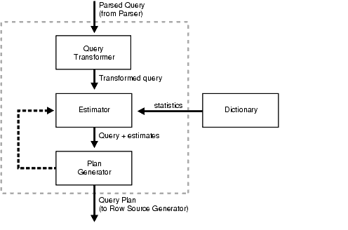

## 11 The Query Optimizer

This chapter discusses SQL processing, optimization methods, and how the query optimizer (usually called the optimizer) chooses a specific plan to execute SQL.

The chapter contains the following sections:

## 11.1 Overview of the Query Optimizer

The [optimizer](glossary.md) is built-in software that determines the most efficient way to execute a SQL statement.

This section contains the following topics:

- Optimizer Operations
- Components of the Query Optimizer
- Bind Variable Peeking

### 11.1.1 Optimizer Operations

The database can execute a SQL statement in multiple ways, such as [full table scans](glossary.md), index scans, nested loops, and [hash joins](glossary.md). The optimizer considers many factors related to the objects and the conditions in the query when determining an execution plan. This determination is an important step in SQL processing and can greatly affect execution time.

Note:

The optimizer might not make the same decisions from one version of Oracle Database to the next. In recent versions, the optimizer might make different decisions because better information is available.

When the user submits a SQL statement for execution, the optimizer performs the following steps:

1. The optimizer generates a set of potential plans for the SQL statement based on available access paths and hints.
2. The optimizer estimates the cost of each plan based on statistics in the data dictionary. Statistics include information on the data distribution and storage characteristics of the tables, indexes, and partitions accessed by the statement.
	The cost is an estimated value proportional to the expected resource use needed to execute the statement with a particular plan. The optimizer calculates the cost of access paths and join orders based on the estimated computer resources, which includes I/O, CPU, and memory.
	Serial plans with higher costs take longer to execute than those with smaller costs. When using a parallel plan, resource use is not directly related to elapsed time.
3. The optimizer compares the plans and chooses the plan with the lowest cost.
	The output from the optimizer is an [execution plan](glossary.md) that describes the optimum method of execution. The plans shows the combination of the steps Oracle Database uses to execute a SQL statement. Each step either retrieves rows physically from the database or prepares them for the user issuing the statement.

See Also:

[Chapter 19, "Using Optimizer Hints"](hintsref.md) for detailed information on hints

For any SQL statement processed by Oracle Database, the optimizer performs the operations listed in Table 11-1.

Table 11-1 Optimizer Operations

| Operation | Description |
| --- | --- |
| Evaluation of expressions and conditions | The optimizer first evaluates expressions and conditions containing constants as fully as possible. |
| Statement transformation | For complex statements involving, for example, correlated subqueries or views, the optimizer might transform the original statement into an equivalent join statement. |
| Choice of optimizer goals | The optimizer determines the goal of optimization. See "Choosing an Optimizer Goal". |
| Choice of access paths | For each table accessed by the statement, the optimizer chooses one or more of the available access paths to obtain table data. See "Overview of Optimizer Access Paths". |
| Choice of join orders | For a join statement that joins more than two tables, the optimizer chooses which pair of tables is joined first, and then which table is joined to the result, and so on. See "How the Query Optimizer Chooses Execution Plans for Joins". |

Sometimes, you may have more information about a particular application's data than is available to the optimizer. In such cases you can use [hints](glossary.md) in SQL statements to instruct the optimizer about how a statement should be executed.

See Also:

- [Chapter 13, "Managing Optimizer Statistics"](stats.md)
- [Chapter 19, "Using Optimizer Hints"](hintsref.md)
- [Oracle Database Concepts](https://docs.oracle.com/cd/E11882_01/server.112/e40540/sqllangu.htm#CNCPT015) for an overview of SQL processing and the optimizer

### 11.1.2 Components of the Query Optimizer

The query optimizer operations include:

- Query Transformation
- Estimation
- Plan Generation

Figure 11-1 illustrates optimizer components.

Figure 11-1 Optimizer Components



> This illustration depicts a parsed query (from the parser) entering the Query Transformer.
>
> The transformed query is then sent to the Estimator. Statistics are retrieved from the Dictionary, then the query and estimates are sent to the Plan Generator.
>
> The plan generator either returns the plan to the estimator or sends the query plan to the row source generator.
>
> End of image description.
  

#### 11.1.2.1 Query Transformation

Each query portion of a statement is called a query block. The input to the query transformer is a parsed query, which is represented by a set of query blocks.

In the following example, the SQL statement consists of two query blocks. The subquery in parentheses is the inner query block. The outer query block, which is the rest of the SQL statement, retrieves names of employees in the departments whose IDs were supplied by the subquery.

```
SELECT first_name, last_name
FROM   employees
WHERE  department_id 
IN     (SELECT department_id FROM departments WHERE location_id = 1800);
```

The query form determines how query blocks are interrelated. The transformer determines whether it is advantageous to rewrite the original SQL statement into a semantically equivalent SQL statement that can be processed more efficiently.

The query transformer employs several query transformation techniques, including the following:

- View Merging
- Predicate Pushing
- Subquery Unnesting
- Query Rewrite with Materialized Views

Any combination of these transformations can apply to a given query.

##### 11.1.2.1.1 View Merging

Each view referenced in a query is expanded by the parser into a separate query block. The block essentially represents the view definition, and thus the result of a view. One option for the optimizer is to analyze the view query block separately and generate a view subplan. The optimizer then processes the rest of the query by using the view subplan to generate an overall query plan. This technique usually leads to a suboptimal query plan because the view is optimized separately.

In view merging, the transformer merges the query block representing the view into the containing query block. For example, suppose you create a view as follows:

```
CREATE VIEW employees_50_vw AS
  SELECT employee_id, last_name, job_id, salary, commission_pct, department_id
  FROM   employees
  WHERE  department_id = 50;
```

You then query the view as follows:

```
SELECT employee_id
FROM   employees_50_vw 
WHERE  employee_id > 150;
```

The optimizer can use view merging to transform the query of `employees_50_vw` into the following equivalent query:

```
SELECT employee_id
FROM   employees
WHERE  department_id = 50 
AND    employee_id > 150;
```

The view merging optimization applies to views that contain only selections, projections, and joins. That is, mergeable views do not contain set operators, aggregate functions, `DISTINCT`, `GROUP BY`, `CONNECT BY`, and so on.

To enable the optimizer to use view merging for any query issued by the user, you must grant the `MERGE` `ANY` `VIEW` privilege to the user. Grant the `MERGE` `VIEW` privilege to a user on specific views to enable the optimizer to use view merging for queries on these views. These privileges are required only under specific conditions, such as when a view is not merged because the security checks fail.

See Also:

- [Oracle Database SQL Language Reference](https://docs.oracle.com/cd/E11882_01/server.112/e41084/statements_9013.htm#SQLRF01603) for more information about the `MERGE` `ANY` `VIEW` and `MERGE` `VIEW` privileges
- [Oracle Database Reference](https://docs.oracle.com/cd/E11882_01/server.112/e40402/initparams172.htm#REFRN10262) for more information about the `OPTIMIZER_SECURE_VIEW_MERGING` initialization parameter

##### 11.1.2.1.2 Predicate Pushing

In predicate pushing, the optimizer "pushes" the relevant predicates from the containing query block into the view query block. For views that are not merged, this technique improves the subplan of the unmerged view because the database can use the pushed-in predicates to access indexes or to use as filters.

For example, suppose you create a view that references two employee tables. The view is defined with a compound query that uses the `UNION` set operator, as follows:

```
CREATE VIEW all_employees_vw AS
  ( SELECT employee_id, last_name, job_id, commission_pct, department_id
    FROM   employees )
  UNION
  ( SELECT employee_id, last_name, job_id, commission_pct, department_id
    FROM   contract_workers );
```

You then query the view as follows:

```
SELECT last_name
FROM   all_employees_vw
WHERE  department_id = 50;
```

Because the view is a compound query, the optimizer cannot merge the view's query into the accessing query block. Instead, the optimizer can transform the accessing statement by pushing its predicate, the `WHERE` clause condition `department_id=50`, into the view's compound query. The equivalent transformed query is as follows:

```
SELECT last_name
FROM   ( SELECT employee_id, last_name, job_id, commission_pct, department_id
         FROM   employees
         WHERE  department_id=50
         UNION
         SELECT employee_id, last_name, job_id, commission_pct, department_id
         FROM   contract_workers
         WHERE  department_id=50 );
```

##### 11.1.2.1.3 Subquery Unnesting

In subquery unnesting, the optimizer transforms a nested query into an equivalent join statement, and then optimizes the join. This transformation enables the optimizer to take advantage of the join optimizer technique. The optimizer can perform this transformation only if the resulting join statement is guaranteed to return exactly the same rows as the original statement, and if subqueries do not contain aggregate functions such as `AVG`.

For example, suppose you connect as user `sh` and execute the following query:

```
SELECT * 
FROM   sales
WHERE  cust_id IN ( SELECT cust_id FROM customers );
```

Because the `customers.cust_id column` is a primary key, the optimizer can transform the complex query into the following join statement that is guaranteed to return the same data:

```
SELECT sales.* 
FROM   sales, customers
WHERE  sales.cust_id = customers.cust_id;
```

If the optimizer cannot transform a complex statement into a join statement, it selects execution plans for the parent statement and the subquery as though they were separate statements. The optimizer then executes the subquery and uses the rows returned to execute the parent query. To improve execution speed of the overall query plan, the optimizer orders the subplans efficiently.

##### 11.1.2.1.4 Query Rewrite with Materialized Views

A materialized view is like a query with a result that the database materializes and stores in a table. When the database finds a user query compatible with the query associated with a materialized view, then the database can rewrite the query in terms of the materialized view. This technique improves query execution because most of the query result has been precomputed.

The query transformer looks for any materialized views that are compatible with the user query and selects one or more materialized views to rewrite the user query. The use of materialized views to rewrite a query is cost-based. That is, the optimizer does not rewrite the query if the plan generated without the materialized views has a lower cost than the plan generated with the materialized views.

Consider the following materialized view, `cal_month_sales_mv`, which aggregates the dollar amount sold each month:

```
CREATE MATERIALIZED VIEW cal_month_sales_mv
  ENABLE QUERY REWRITE 
AS
  SELECT t.calendar_month_desc, SUM(s.amount_sold) AS dollars
  FROM   sales s, times t 
  WHERE  s.time_id = t.time_id
  GROUP BY t.calendar_month_desc;
```

Assume that sales number is around one million in a typical month. The view has the precomputed aggregates for the dollar amount sold for each month. Consider the following query, which asks for the sum of the amount sold for each month:

```
SELECT t.calendar_month_desc, SUM(s.amount_sold)
FROM   sales s, times t
WHERE  s.time_id = t.time_id
GROUP BY t.calendar_month_desc;
```

Without query rewrite, the database must access `sales` directly and compute the sum of the amount sold. This method involves reading many million rows from `sales`, which invariably increases query response time. The join also further slows query response because the database must compute the join on several million rows. With query rewrite, the optimizer transparently rewrites the query as follows:

```
SELECT calendar_month, dollars
FROM   cal_month_sales_mv;
```

See Also:

[Oracle Database Data Warehousing Guide](https://docs.oracle.com/cd/E11882_01/server.112/e25554/qrbasic.htm#DWHSG018) to learn more about query rewrite

#### 11.1.2.2 Estimation

The estimator determines the overall cost of a given execution plan. The estimator generates three different types of measures to achieve this goal:

- Selectivity
	This measure represents a fraction of rows from a row set. The selectivity is tied to a query predicate, such as `last_name='Smith'`, or a combination of predicates.
- Cardinality
	This measure represents the number of rows in a row set.
- Cost
	This measure represents units of work or resource used. The query optimizer uses disk I/O, CPU usage, and memory usage as units of work.

If statistics are available, then the estimator uses them to compute the measures. The statistics improve the degree of accuracy of the measures.

##### 11.1.2.2.1 Selectivity

The [selectivity](glossary.md) represents a fraction of rows from a row set. The row set can be a base table, a view, or the result of a join or a `GROUP` `BY` operator. The selectivity is tied to a query predicate, such as `last_name` = `'Smith'`, or a combination of predicates, such as `last_name` = `'Smith'` `AND` `job_type` = `'Clerk'`.

A predicate filters a specific number of rows from a row set. Thus, the selectivity of a predicate indicates how many rows pass the predicate test. Selectivity ranges from 0.0 to 1.0. A selectivity of 0.0 means that no rows are selected from a row set, whereas a selectivity of 1.0 means that all rows are selected. A predicate becomes more selective as the value approaches 0.0 and less selective (or more unselective) as the value approaches 1.0.

The optimizer estimates selectivity depending on whether statistics are available:

- Statistics not available
	Depending on the value of the `OPTIMIZER_DYNAMIC_SAMPLING` initialization parameter, the optimizer either uses [dynamic statistics](glossary.md) or an internal default value. The database uses different internal defaults depending on the predicate type. For example, the internal default for an equality predicate (`last_name` = `'Smith'`) is lower than for a range predicate (`last_name >` `'Smith'`) because an equality predicate is expected to return a smaller fraction of rows. See ["Controlling Dynamic Statistics"](stats.md).
- Statistics available
	When statistics are available, the estimator uses them to estimate selectivity. Assume there are 150 distinct employee last names. For an equality predicate `last_name =` `'Smith'`, selectivity is the reciprocal of the number `n` of distinct values of `last_name`, which in this example is.006 because the query selects rows that contain 1 out of 150 distinct values.
	If a histogram is available on the `last_name` column, then the estimator uses the histogram instead of the number of distinct values. The histogram captures the distribution of different values in a column, so it yields better selectivity estimates, especially for columns that contain [skewed data](glossary.md). See ["Viewing Histograms"](stats.md).

##### 11.1.2.2.2 Cardinality

Cardinality represents the number of rows in a row set. In this context, the row set can be a base table, a view, or the result of a join or `GROUP` `BY` operator.

##### 11.1.2.2.3 Cost

The cost represents units of work or resource used in an operation. The optimizer uses disk I/O, CPU usage, and memory usage as units of work. The operation can be scanning a table, accessing rows from a table by using an index, joining two tables together, or sorting a row set. The cost is the number of work units expected to be incurred when the database executes the query and produces its result.

The [access path](glossary.md) determines the number of units of work required to get data from a base table. The access path can be a table scan, a fast full index scan, or an index scan.

- Table scan or fast full index scan
	During a table scan or [fast full index scan](glossary.md), the database reads multiple blocks from disk in a single I/O. Therefore, the cost of the scan depends on the number of blocks to be scanned and the multiblock read count value.
- Index scan
	The cost of an index scan depends on the levels in the B-tree, the number of index leaf blocks to be scanned, and the number of rows to be fetched using the rowid in the index keys. The cost of fetching rows using rowids depends on the [index clustering factor](glossary.md). See "Assessing I/O for Blocks, not Rows".

The join cost represents the combination of the individual access costs of the two row sets being joined, plus the cost of the join operation.

See Also:

"Overview of Joins"

#### 11.1.2.3 Plan Generation

The [plan generator](glossary.md) explores various plans for a query block by trying out different access paths, join methods, and join orders. Many plans are possible because of the various combinations of different access paths, join methods, and join orders that the database can use to produce the same result. The purpose of the generator is to pick the plan with the lowest cost.

##### 11.1.2.3.1 Join Order

A join order is the order in which different join items, such as tables, are accessed and joined together. Assume that the database joins `table1`, `table2`, and `table3`. The join order might be as follows:

1. The database accesses `table1`.
2. The database accesses `table2` and joins its rows to `table1`.
3. The database accesses `table3` and joins its data to the result of the join between `table1` and `table2`.

##### 11.1.2.3.2 Query Subplans

The optimizer represents each nested subquery or unmerged view by a separate query block and generates a subplan. The database optimizes query blocks separately from the bottom up. Thus, the database optimizes the innermost query block first and generates a subplan for it, and then lastly generates the outer query block representing the entire query.

The number of possible plans for a query block is proportional to the number of join items in the `FROM` clause. This number rises exponentially with the number of join items. For example, the possible plans for a join of five tables will be significantly higher than the possible plans for a join of two tables.

##### 11.1.2.3.3 Cutoff for Plan Selection

The plan generator uses an internal cutoff to reduce the number of plans it tries when finding the lowest-cost plan. The cutoff is based on the cost of the current best plan. If the current best cost is large, then the plan generator explores alternative plans to find a lower cost plan. If the current best cost is small, then the generator ends the search swiftly because further cost improvement will not be significant.

The cutoff works well if the plan generator starts with an initial join order that produces a plan with cost close to optimal. Finding a good initial join order is a difficult problem.

### 11.1.3 Bind Variable Peeking

In bind variable peeking (also known as bind peeking), the optimizer looks at the value in a bind variable when the database performs a hard parse of a statement.

When a query uses literals, the optimizer can use the literal values to find the best plan. However, when a query uses bind variables, the optimizer must select the best plan without the presence of literals in the SQL text. This task can be extremely difficult. By peeking at bind values the optimizer can determine the selectivity of a `WHERE` clause condition as if literals had been used, thereby improving the plan.

Example 11-1 Bind Peeking

Assume that the following 100,000 row `emp` table exists in the database. The table has the following definition:

```
SQL> DESCRIBE emp

Name                   Null?    Type
---------------------- -------- ----------------------------------
ENAME                           VARCHAR2(20)
EMPNO                           NUMBER
PHONE                           VARCHAR2(20)
DEPTNO                          NUMBER
```

The data is significantly skewed in the `deptno` column. The value 10 is found in 99.9% of the rows. Each of the other `deptno` values (`0` through `9`) is found in 1% of the rows. You have gathered statistics for the table, resulting in a histogram on the `deptno` column. You define a bind variable and query `emp` using the bind value `9` as follows:

```
VARIABLE deptno NUMBER
EXEC :deptno := 9

SELECT /*ACS_1*/ count(*), max(empno) 
FROM   emp 
WHERE  deptno = :deptno;
```

The query returns 10 rows:

```
COUNT(*) MAX(EMPNO)
---------- ----------
    10         99
```

To generate the execution plan for the query, the database peeked at the value `9` during the hard parse. The optimizer generated selectivity estimates as if the user had executed the following query:

```
select /*ACS_1*/ count(*), max(empno)
from emp
where deptno = 9;
```

When choosing a plan, the optimizer only peeks at the bind value during the hard parse. This plan may not be optimal for all possible values.

#### 11.1.3.1 Adaptive Cursor Sharing

The adaptive cursor sharing feature enables a single statement that contains bind variables to use multiple execution plans. Cursor sharing is "adaptive" because the cursor adapts its behavior so that the database does not always use the same plan for each execution or bind variable value.

For appropriate queries, the database monitors data accessed over time for different bind values, ensuring the optimal choice of cursor for a specific bind value. For example, the optimizer might choose one plan for bind value `9` and a different plan for bind value `10`. Cursor sharing is "adaptive" because the cursor adapts its behavior so that the same plan is not always used for each execution or bind variable value.

Adaptive cursor sharing is enabled for the database by default and cannot be disabled. Note that adaptive cursor sharing does not apply to SQL statements containing more than 14 bind variables.

Note:

Adaptive cursor sharing is independent of the `CURSOR_SHARING` initialization parameter (see ["Sharing Cursors for Existing Applications"](memory.md)). Adaptive cursor sharing is equally applicable to statements that contain user-defined and system-generated bind variables.

##### 11.1.3.1.1 Bind-Sensitive Cursors

A bind-sensitive cursor is a cursor whose optimal plan may depend on the value of a bind variable. The database monitors the behavior of a bind-sensitive cursor that uses different bind values to determine whether a different plan is beneficial.

The criteria used by the optimizer to decide whether a cursor is bind-sensitive include the following:

- The optimizer has peeked at the bind values to generate selectivity estimates.
- A histogram exists on the column containing the bind value.

Example 11-2 Bind-Sensitive Cursors

In Example 11-1 you queried the `emp` table using the bind value `9` for `deptno`. Now you run the `DBMS_XPLAN.DISPLAY_CURSOR` function to show the query plan:

```
SELECT * FROM TABLE(DBMS_XPLAN.DISPLAY_CURSOR);
```

The output is as follows:

```
----------------------------------------------------------------------------------
| Id  | Operation                    | Name   | Rows  | Bytes | Cost (%CPU)| Time|
----------------------------------------------------------------------------------
|  0 | SELECT STATEMENT             |        |      |       |   2 (100)|         |
|  1 |  SORT AGGREGATE              |        |    1 |    16 |          |         |
|  2 |   TABLE ACCESS BY INDEX ROWID| EMP    |    1 |    16 |   2   (0)| 00:00:01|
|* 3 |    INDEX RANGE SCAN          | EMP_I1 |    1 |       |   1   (0)| 00:00:01|
----------------------------------------------------------------------------------
```

The plan indicates that the optimizer chose an index range scan, which is expected because of the selectivity (only 1%) of the value `9`. You can query `V$SQL` to view statistics about the cursor:

```
COL BIND_SENSI FORMAT a10
COL BIND_AWARE FORMAT a10
COL BIND_SHARE FORMAT a10
SELECT CHILD_NUMBER, EXECUTIONS, BUFFER_GETS, IS_BIND_SENSITIVE AS "BIND_SENSI", 
       IS_BIND_AWARE AS "BIND_AWARE", IS_SHAREABLE AS "BIND_SHARE"
FROM   V$SQL
WHERE  SQL_TEXT LIKE 'select /*ACS_1%';
```

As shown in the following output, one child cursor exists for this statement and has been executed once. A small number of buffer gets are associated with the child cursor. Because the `deptno` data is skewed, the database created a histogram. This histogram led the database to mark the cursor as bind-sensitive (`IS_BIND_SENSITIVE` is `Y`).

```
CHILD_NUMBER EXECUTIONS BUFFER_GETS BIND_SENSI BIND_AWARE BIND_SHARE
------------ ---------- ----------- ---------- ---------- ----------
           0          1          56 Y          N          Y
```

For each execution of the query with a new bind value, the database records the execution statistics for the new value and compares them to the execution statistics for the previous value. If execution statistics vary greatly, then the database marks the cursor bind-aware.

##### 11.1.3.1.2 Bind-Aware Cursors

A bind-aware cursor is a bind-sensitive cursor eligible to use different plans for different bind values. After a cursor has been made bind-aware, the optimizer chooses plans for future executions based on the bind value and its selectivity estimate.

When a statement with a bind-sensitive cursor executes, the database decides whether to mark the cursor bind-aware. The decision depends on whether the cursor produces significantly different data access patterns for different bind values. If the database marks the cursor bind-aware, then the next time that the cursor executes the database does the following:

- Generates a new plan based on the new bind value.
- Marks the original cursor generated for the statement as not shareable (`V$SQL.IS_SHAREABLE` is `N`). This cursor is no longer usable and will be among the first to be aged out of the shared SQL area.

Example 11-3 Bind-Aware Cursors

In Example 11-1 you queried emp using the bind value `9`. Now you query `emp` using the bind value `10`. The query returns 99,900 rows that contain the value `10`:

```
COUNT(*)   MAX(EMPNO)
---------- ----------
99900      100000
```

Because the cursor for this statement is bind-sensitive, the optimizer assumes that the cursor can be shared. Consequently, the optimizer uses the same index range scan for the value `10` as for the value `9`.

The `V$SQL` output shows that the same bind-sensitive cursor was executed a second time (the query using `10`) and required many more buffer gets than the first execution:

```
SELECT CHILD_NUMBER, EXECUTIONS, BUFFER_GETS, IS_BIND_SENSITIVE AS "BIND_SENSI", 
       IS_BIND_AWARE AS "BIND_AWARE", IS_SHAREABLE AS "BIND_SHARE"
FROM   V$SQL
WHERE  SQL_TEXT LIKE 'select /*ACS_1%';
 
CHILD_NUMBER EXECUTIONS BUFFER_GETS BIND_SENSI BIND_AWARE BIND_SHARE
------------ ---------- ----------- ---------- ---------- ----------
           0          2        1010 Y          N          Y
```

Now you execute the query using the value `10` a second time. The database compares statistics for previous executions and marks the cursor as bind-aware. In this case, the optimizer decides that a new plan is warranted, so it performs a hard parse of the statement and generates a new plan. The new plan uses a full table scan instead of an index range scan:

```
---------------------------------------------------------------------------
| Id  | Operation          | Name | Rows  | Bytes | Cost (%CPU)| Time     |
---------------------------------------------------------------------------
|   0 | SELECT STATEMENT   |      |       |       |   208 (100)|          |
|   1 |  SORT AGGREGATE    |      |     1 |    16 |            |          |
|*  2 |   TABLE ACCESS FULL| EMP  | 95000 |  1484K|   208   (1)| 00:00:03 |
---------------------------------------------------------------------------
```

A query of `V$SQL` shows that the database created an additional child cursor (child number `1`) that represents the plan containing the full table scan. This new cursor shows a lower number of buffer gets and is marked bind-aware:

```
SELECT CHILD_NUMBER, EXECUTIONS, BUFFER_GETS, IS_BIND_SENSITIVE AS "BIND_SENSI", 
       IS_BIND_AWARE AS "BIND_AWARE", IS_SHAREABLE AS "BIND_SHARE"
FROM   V$SQL
WHERE  SQL_TEXT LIKE 'select /*ACS_1%';
 
CHILD_NUMBER EXECUTIONS BUFFER_GETS BIND_SENSI BIND_AWARE BIND_SHARE
------------ ---------- ----------- ---------- ---------- ----------
           0          2        1010 Y          N          Y
           1          2        1522 Y          Y          Y
```

After you execute the query twice with value `10`, you execute it again using the more selective value `9`. Because of adaptive cursor sharing, the optimizer "adapts" the cursor and chooses an index range scan rather than a full table scan for this value.

A query of `V$SQL` indicates that the database created a new child cursor (child number `2`) for the execution of the query:

```
CHILD_NUMBER EXECUTIONS BUFFER_GETS BIND_SENSI BIND_AWARE BIND_SHARE
------------ ---------- ----------- ---------- ---------- ----------
           0          2        1010 Y          N          N
           1          1        1522 Y          Y          Y
           2          1           7 Y          Y          Y
```

Because the database is now using adaptive cursor sharing, the database no longer uses the original cursor (child `0`), which is not bind-aware. The shared SQL area will age out the defunct cursor.

##### 11.1.3.1.3 Cursor Merging

If the optimizer creates a plan for a bind-aware cursor, and if this plan is the same as an existing cursor, then the optimizer can perform cursor merging. In this case, the database merges cursors to save space in the shared SQL area. The database increases the selectivity range for the cursor to include the selectivity of the new bind.

Suppose you execute a query with a bind value that does not fall within the selectivity ranges of the existing cursors. The database performs a hard parse and generates a new plan and new cursor. If this new plan is the same plan used by an existing cursor, then the database merges these two cursors and deletes one of the old cursors.

## 11.2 Overview of Optimizer Access Paths

Access paths are ways in which data is retrieved from the database. In general, index access paths are useful for statements that retrieve a small subset of table rows, whereas full scans are more efficient when accessing a large portion of the table. Online transaction processing (OLTP) applications, which consist of short-running SQL statements with high selectivity, often are characterized by the use of index access paths. Decision support systems, however, tend to use partitioned tables and perform full scans of the relevant partitions.

This section describes the data access paths that the database can use to locate and retrieve any row in any table.

- Full Table Scans
- Rowid Scans
- Index Scans
- Cluster Access
- Hash Access
- Sample Table Scans
- How the Query Optimizer Chooses an Access Path

### 11.2.1 Full Table Scans

This type of scan reads all rows from a table and filters out those that do not meet the selection criteria. During a full table scan, all blocks in the table that are under the high water mark are scanned. The high water mark indicates the amount of used space, or space that had been formatted to receive data. Each row is examined to determine whether it satisfies the statement's `WHERE` clause.

When Oracle Database performs a full table scan, the blocks are read sequentially. Because the blocks are adjacent, the database can make I/O calls larger than a single block to speed up the process. The size of the read calls range from one block to the number of blocks indicated by the initialization parameter `DB_FILE_MULTIBLOCK_READ_COUNT`. Using multiblock reads, the database can perform a full table scan very efficiently. The database reads each block only once.

Example 11-14, "EXPLAIN PLAN Output" contains an example of a full table scan on the `employees` table.

#### 11.2.1.1 Why a Full Table Scan Is Faster for Accessing Large Amounts of Data

Full table scans are cheaper than index range scans when accessing a large fraction of the blocks in a table. Full table scans can use larger I/O calls, and making fewer large I/O calls is cheaper than making many smaller calls.

#### 11.2.1.2 When the Optimizer Uses Full Table Scans

The optimizer uses a full table scan in any of the following cases:

##### 11.2.1.2.1 Lack of Index

If the query cannot use existing indexes, then it uses a full table scan. For example, if there is a function used on the indexed column in the query, then the optimizer cannot use the index and instead uses a full table scan.

If you need to use the index for case-independent searches, then either do not permit mixed-case data in the search columns or create a function-based index, such as `UPPER` (`last_name`), on the search column. See ["Using Function-based Indexes for Performance"](data_acc.md).

##### 11.2.1.2.2 Large Amount of Data

If the optimizer thinks that the query requires most of the blocks in the table, then it uses a full table scan, even though indexes are available.

##### 11.2.1.2.3 Small Table

If a table contains less than `DB_FILE_MULTIBLOCK_READ_COUNT` blocks under the high water mark, which the database can read in a single I/O call, then a full table scan might be cheaper than an index range scan, regardless of the fraction of tables being accessed or indexes present.

##### 11.2.1.2.4 High Degree of Parallelism

A high degree of parallelism for a table skews the optimizer toward full table scans over range scans. Examine the `DEGREE` column in `ALL_TABLES` for the table to determine the degree of parallelism.

#### 11.2.1.3 Full Table Scan Hints

Use the hint `FULL(``table` `alias``)` to instruct the optimizer to use a full table scan. For more information on the `FULL` hint, see ["Hints for Access Paths"](hintsref.md).

You can use the `CACHE` and `NOCACHE` hints to indicate where the retrieved blocks are placed in the buffer cache. The `CACHE` hint instructs the optimizer to place the retrieved blocks at the most recently used end of the LRU list in the buffer cache when the database performs a full table scan.

Small tables are automatically cached according to the criteria in Table 11-2.

Table 11-2 Table Caching Criteria

| Table Size | Size Criteria | Caching |
| --- | --- | --- |
| Small | Number of blocks < 20 or 2% of total cached blocks, whichever is larger | If `STATISTICS_LEVEL` is se to `TYPICAL` or higher, then Oracle Database decides whether to cache a table depending on the table scan history. The database caches the table only if a future table scan is likely to find the cached blocks. If `STATISTICS_LEVEL` is set to `BASIC`, then the table is not cached. |
| Medium | Larger than a small table, but < 10% of total cached blocks | Oracle Database decides whether to cache a table based on its table scan and workload history. It caches the table only if a future table scan is likely to find the cached blocks. |
| Large | \> 10% of total cached blocks | Not cached |

Automatic caching of small tables is disabled for tables that are created or altered with the `CACHE` attribute.

#### 11.2.1.4 Parallel Query Execution

When a full table scan is required, the database can improve response time by using multiple parallel execution servers. In some cases, as when the database has a large amount of memory, the database can cache parallel query data in the SGA instead of using direct reads into the PGA. Typically, parallel queries occur in low-concurrency data warehouses because of the potential resource usage.

See Also:

- [Oracle Database Data Warehousing Guide](https://docs.oracle.com/cd/E11882_01/server.112/e25554/toc.htm)
- [Oracle Database VLDB and Partitioning Guide](https://docs.oracle.com/cd/E11882_01/server.112/e25523/parallel.htm#VLDBG010) to learn more using parallel execution

### 11.2.2 Rowid Scans

The rowid of a row specifies the data file and data block containing the row and the location of the row in that block. Locating a row by specifying its rowid is the fastest way to retrieve a single row, because the exact location of the row in the database is specified.

To access a table by rowid, Oracle Database first obtains the rowids of the selected rows, either from the statement's `WHERE` clause or through an index scan of one or more of the table's indexes. Oracle Database then locates each selected row in the table based on its rowid.

In Example 11-14, "EXPLAIN PLAN Output", the plan includes an index scan on the `jobs` and `departments` tables. The database uses the rowids retrieved to return the rows.

#### 11.2.2.1 When the Optimizer Uses Rowids

This is generally the second step after retrieving the rowid from an index. The table access might be required for any columns in the statement not present in the index.

Access by rowid does not need to follow every index scan. If the index contains all the columns needed for the statement, then table access by rowid might not occur.

Note:

Rowids are an internal representation of where the database stores data. Rowids can change between versions. Accessing data based on position is not recommended because rows can move around due to row migration and chaining, export and import, and some other operations. Foreign keys should be based on primary keys. For more information on rowids, see [Oracle Database Advanced Application Developer's Guide](https://docs.oracle.com/cd/E11882_01/appdev.112/e41502/toc.htm).

### 11.2.3 Index Scans

In this method, a row is retrieved by traversing the index, using the indexed column values specified by the statement. An index scan retrieves data from an index based on the value of one or more columns in the index. To perform an index scan, Oracle Database searches the index for the indexed column values accessed by the statement. If the statement accesses only columns of the index, then Oracle Database reads the indexed column values directly from the index, rather than from the table.

The index contains not only the indexed value, but also the rowids of rows in the table having that value. Therefore, if the statement accesses other columns in addition to the indexed columns, then Oracle Database can find the rows in the table by using either a table access by rowid or a cluster scan.

An index scan can be one of the following types:

- Assessing I/O for Blocks, not Rows
- Index Unique Scans
- Index Range Scans
- Index Range Scans Descending
- Index Skip Scans
- Full Scans
- Fast Full Index Scans
- Index Joins
- Bitmap Indexes

#### 11.2.3.1 Assessing I/O for Blocks, not Rows

Oracle Database performs I/O by blocks. Therefore, the optimizer's decision to use full table scans is influenced by the percentage of blocks accessed, not rows. This is called the index clustering factor. If blocks contain single rows, then rows accessed and blocks accessed are the same.

However, most tables have multiple rows in each block. Consequently, the desired number of rows may be clustered in a few blocks or spread out over a larger number of blocks.

Although the clustering factor is a property of the index, the clustering factor actually relates to the spread of similar indexed column values within data blocks in the table. A lower clustering factor indicates that the individual rows are concentrated within fewer blocks in the table. Conversely, a high clustering factor indicates that the individual rows are scattered more randomly across blocks in the table. Therefore, a high clustering factor means that it costs more to use a range scan to fetch rows by rowid, because more blocks in the table need to be visited to return the data. Example 11-4 shows how the clustering factor can affect cost.

Example 11-4 Effects of Clustering Factor on Cost

Assume the following situation:

- There is a table with 9 rows.
- There is a non-unique index on `col1` for table.
- The `c1` column currently stores the values `A`, `B`, and `C`.
- The table only has three data blocks.

Case 1: The index clustering factor is low for the rows as they are arranged in the following diagram.

```
Block 1       Block 2        Block 3
-------       -------        -------
A  A  A       B  B  B        C  C  C
```

This is because the rows that have the same indexed column values for `c1` are located within the same physical blocks in the table. The cost of using a range scan to return all rows that have the value `A` is low because only one block in the table must be read.

Case 2: If the same rows in the table are rearranged so that the index values are scattered across the table blocks (rather than collocated), then the index clustering factor is higher.

```
Block 1       Block 2        Block 3
-------       -------        -------
A  B  C       A  B  C        A  B  C
```

This is because all three blocks in the table must be read in order to retrieve all rows with the value `A` in `col1`.

#### 11.2.3.2 Index Unique Scans

This scan returns, at most, a single rowid. Oracle Database performs a unique scan if a statement contains a `UNIQUE` or a `PRIMARY` `KEY` constraint that guarantees that only a single row is accessed.

In "EXPLAIN PLAN Output", the database performs an index scan on the `jobs` and `departments` tables, using the `job_id_pk` and `dept_id_pk` indexes respectively.

##### 11.2.3.2.1 When the Optimizer Uses Index Unique Scans

The database uses this access path when the user specifies all columns of a unique (B-tree) index or an index created as a result of a primary key constraint with equality conditions.

See Also:

[Oracle Database Concepts](https://docs.oracle.com/cd/E11882_01/server.112/e40540/tablecls.htm#CNCPT010) for more details on index structures and for detailed information on how a B-tree is searched

##### 11.2.3.2.2 Index Unique Scan Hints

In general, you should not need to use a hint to do a unique scan. There might be cases where the table is across a database link and being accessed from a local table, or where the table is small enough for the optimizer to prefer a full table scan.

The hint `INDEX(``alias index_name``)` specifies the index to use, but not an access path (range scan or unique scan). For more information on the `INDEX` hint, see ["Hints for Access Paths"](hintsref.md).

#### 11.2.3.3 Index Range Scans

An index range scan is a common operation for accessing selective data. It can be bounded (bounded on both sides) or unbounded (on one or both sides). Data is returned in the ascending order of index columns. Multiple rows with identical values are sorted in ascending order by rowid.

If you require the data to be sorted by order, then use the `ORDER` `BY` clause, and do not rely on an index. If an index can satisfy an `ORDER` `BY` clause, then the optimizer uses this option and avoids a sort.

In Example 11-5, the order has been imported from a legacy system, and you are querying the order by the reference used in the legacy system. Assume this reference is the `order_date`.

Example 11-5 Index Range Scan

```
SELECT order_status, order_id
  FROM orders
 WHERE order_date = :b1;

---------------------------------------------------------------------------------------
| Id  | Operation                   |  Name              | Rows  | Bytes | Cost (%CPU)|
---------------------------------------------------------------------------------------
|   0 | SELECT STATEMENT            |                    |     1 |    20 |     3  (34)|
|   1 |  TABLE ACCESS BY INDEX ROWID| ORDERS             |     1 |    20 |     3  (34)|
|*  2 |   INDEX RANGE SCAN          | ORD_ORDER_DATE_IX  |     1 |       |     2  (50)|
---------------------------------------------------------------------------------------

Predicate Information (identified by operation id):
---------------------------------------------------
   2 - access("ORDERS"."ORDER_DATE"=:Z)
```

This should be a highly selective query, and you should see the query using the index on the column to retrieve the desired rows. The data returned is sorted in ascending order by the rowids for the `order_date`. Because the index column `order_date` is identical for the selected rows here, the data is sorted by rowid.

##### 11.2.3.3.1 When the Optimizer Uses Index Range Scans

The optimizer uses a range scan when it finds one or more leading columns of an index specified in conditions, such as the following:

- `col1 = :b1`
- `col1 < :b1`
- `col1 > :b1`
- `AND` combination of the preceding conditions for leading columns in the index
- `col1 like 'ASD%'` wild-card searches should not be in a leading position otherwise the condition `col1 like '%ASD'` does not result in a range scan

Range scans can use unique or non-unique indexes. Range scans avoid sorting when index columns constitute the `ORDER` `BY` / `GROUP` `BY` clause.

##### 11.2.3.3.2 Index Range Scan Hints

A hint might be required if the optimizer chooses some other index or uses a full table scan. The hint `INDEX(``table_alias` `index_name``)` instructs the optimizer to use a specific index. For more information on the `INDEX` hint, see ["Hints for Access Paths"](hintsref.md).

#### 11.2.3.4 Index Range Scans Descending

An index range scan descending is identical to an index range scan, except that the data is returned in descending order. Indexes, by default, are stored in ascending order. Usually, the database uses this scan when ordering data in a descending order to return the most recent data first, or when seeking a value less than a specified value.

##### 11.2.3.4.1 When the Optimizer Uses Index Range Scans Descending

The optimizer uses index range scan descending when an index can satisfy an order by descending clause.

##### 11.2.3.4.2 Index Range Scan Descending Hints

Use the hint `INDEX_DESC(``table_alias` `index_name``)` for this access path. For more information on the `INDEX_DESC` hint, see ["Hints for Access Paths"](hintsref.md).

#### 11.2.3.5 Index Skip Scans

Index skip scans improve index scans by nonprefix columns. Often, scanning index blocks is faster than scanning table data blocks.

Skip scanning lets a composite index be split logically into smaller subindexes. In skip scanning, the initial column of the composite index is not specified in the query. In other words, it is skipped.

The database determines the number of logical subindexes by the number of distinct values in the initial column. Skip scanning is advantageous when there are few distinct values in the leading column of the composite index and many distinct values in the nonleading key of the index.

The database may choose an index skip scan when the leading column of the composite index is not specified in a query predicate. For example, assume that you run the following query for a customer in the `sh.customers` table:

```
SELECT * FROM sh.customers WHERE cust_email = 'Abbey@company.com';
```

The `customers` table has a column `cust_gender` whose values are either `M` or `F`. Assume that a composite index exists on the columns (`cust_gender`, `cust_email`) that was created as follows:

```
CREATE INDEX customers_gender_email ON sh.customers (cust_gender, cust_email);
```

Example 11-6 shows a portion of the index entries.

Example 11-6 Composite Index Entries

```
F,Wolf@company.com,rowid
F,Wolsey@company.com,rowid
F,Wood@company.com,rowid
F,Woodman@company.com,rowid
F,Yang@company.com,rowid
F,Zimmerman@company.com,rowid
M,Abbassi@company.com,rowid
M,Abbey@company.com,rowid
```

The database can use a skip scan of this index even though `cust_gender` is not specified in the `WHERE` clause.

In a skip scan, the number of logical subindexes is determined by the number of distinct values in the leading column. In Example 11-6, the leading column has two possible values. The database logically splits the index into one subindex with the key `F` and a second subindex with the key `M`.

When searching for the record for the customer whose email is `Abbey@company.com`, the database searches the subindex with the value `F` first and then searches the subindex with the value `M`. Conceptually, the database processes the query as follows:

```
SELECT * FROM sh.customers WHERE cust_gender = 'F' 
  AND cust_email = 'Abbey@company.com'
UNION ALL
SELECT * FROM sh.customers WHERE cust_gender = 'M'
  AND cust_email = 'Abbey@company.com';
```

See Also:

[Oracle Database Concepts](https://docs.oracle.com/cd/E11882_01/server.112/e40540/indexiot.htm#CNCPT88842) to learn more about skip scans

#### 11.2.3.6 Full Scans

A full index scan eliminates a sort operation, because the data is ordered by the index key. It reads the blocks singly. Oracle Database may use a full scan in any of the following situations:

- An `ORDER` `BY` clause that meets the following requirements is present in the query:
	- All of the columns in the `ORDER` `BY` clause must be in the index.
		- The order of the columns in the `ORDER` `BY` clause must match the order of the leading index columns.
	The `ORDER` `BY` clause can contain all of the columns in the index or a subset of the columns in the index.
- The query requires a sort merge join. The database can perform a full index scan instead of doing a full table scan followed by a sort when the query meets the following requirements:
	- All of the columns referenced in the query must be in the index.
		- The order of the columns referenced in the query must match the order of the leading index columns.
	The query can contain all of the columns in the index or a subset of the columns in the index.
- A `GROUP` `BY` clause is present in the query, and the columns in the `GROUP` `BY` clause are present in the index. The columns do not need to be in the same order in the index and the `GROUP` `BY` clause. The `GROUP` `BY` clause can contain all of the columns in the index or a subset of the columns in the index.

See Also:

"Sort Merge Joins"

#### 11.2.3.7 Fast Full Index Scans

Fast full index scans are an alternative to a full table scan when the index contains all the columns that are needed for the query, and at least one column in the index key has the `NOT` `NULL` constraint. A fast full scan accesses the data in the index itself, without accessing the table. The database cannot use this scan to eliminate a sort operation because the data is not ordered by the index key. The database reads the entire index using multiblock reads, unlike a full index scan, and can scan in parallel.

You can specify fast full index scans with the initialization parameter `OPTIMIZER_FEATURES_ENABLE` or the `INDEX_FFS` hint. A fast full scan is faster than a normal full index scan because it can use multiblock I/O and can run in parallel just like a table scan.

Note:

Setting `PARALLEL` for indexes does not impact the cost calculation.

##### 11.2.3.7.1 Fast Full Index Scan Hints

The fast full scan has a special index hint, `INDEX_FFS`, which has the same format and arguments as the regular `INDEX` hint. For more information on the `INDEX_FFS` hint, see ["Hints for Access Paths"](hintsref.md).

#### 11.2.3.8 Index Joins

An index join is a hash join of several indexes that together contain all the table columns referenced in the query. If the database uses an index join, then table access is not needed because the database can retrieve all the relevant column values from the indexes. The database cannot use an index join to eliminate a sort operation.

##### 11.2.3.8.1 Index Join Hints

You can specify an index join with the `INDEX_JOIN` hint. For more information on the `INDEX_JOIN` hint, see ["Hints for Access Paths"](hintsref.md).

#### 11.2.3.9 Bitmap Indexes

A bitmap join uses a bitmap for key values and a mapping function that converts each bit position to a rowid. Bitmaps can efficiently merge indexes that correspond to several conditions in a `WHERE` clause, using Boolean operations to resolve `AND` and `OR` conditions.

Note:

Bitmap indexes and bitmap join indexes are available only in the Oracle Enterprise Edition.

See Also:

[Oracle Database Data Warehousing Guide](https://docs.oracle.com/cd/E11882_01/server.112/e25554/toc.htm) for more information about bitmap indexes

### 11.2.4 Cluster Access

The database uses a cluster scan to retrieve all rows that have the same cluster key value from a table stored in an indexed cluster. In an indexed cluster, the database stores all rows with the same cluster key value in the same data block. To perform a cluster scan, Oracle Database first obtains the rowid of one of the selected rows by scanning the cluster index. Oracle Database then locates the rows based on this rowid.

### 11.2.5 Hash Access

The database uses a hash scan to locate rows in a hash cluster based on a hash value. In a hash cluster, all rows with the same hash value are stored in the same data block. To perform a hash scan, Oracle Database first obtains the hash value by applying a hash function to a cluster key value specified by the statement. Oracle Database then scans the data blocks containing rows with that hash value.

### 11.2.6 Sample Table Scans

A sample table scan retrieves a random sample of data from a simple table or a complex `SELECT` statement, such as a statement involving joins and views. The database uses this access path when a statement's `FROM` clause includes the `SAMPLE` clause or the `SAMPLE` `BLOCK` clause. To perform a sample table scan when sampling by rows with the `SAMPLE` clause, the database reads a specified percentage of rows in the table. To perform a sample table scan when sampling by blocks with the `SAMPLE` `BLOCK` clause, the database reads a specified percentage of table blocks.

Example 11-7 uses a sample table scan to access 1% of the `employees` table, sampling by blocks.

Example 11-7 Sample Table Scan

```
SELECT * 
    FROM employees SAMPLE BLOCK (1);
```

The `EXPLAIN` `PLAN` output for this statement might look like this:

```
-------------------------------------------------------------------------
| Id  | Operation            |  Name       | Rows  | Bytes | Cost (%CPU)|
-------------------------------------------------------------------------
|   0 | SELECT STATEMENT     |             |     1 |    68 |     3  (34)|
|   1 |  TABLE ACCESS SAMPLE | EMPLOYEES   |     1 |    68 |     3  (34)|
-------------------------------------------------------------------------
```

### 11.2.7 How the Query Optimizer Chooses an Access Path

The query optimizer chooses an access path based on the following factors:

- The available access paths for the statement
- The estimated cost of executing the statement, using each access path or combination of paths

To choose an access path, the optimizer first determines which access paths are available by examining the conditions in the statement's `WHERE` clause and its `FROM` clause. The optimizer then generates a set of possible execution plans using available access paths and estimates the cost of each plan, using the statistics for the index, columns, and tables accessible to the statement. Finally, the optimizer chooses the execution plan with the lowest estimated cost.

When choosing an access path, the query optimizer is influenced by the following:

- Optimizer Hints
	You can instruct the optimizer to use a specific access path using a hint, except when the statement's `FROM` clause contains `SAMPLE` or `SAMPLE` `BLOCK`.
	See Also:
	[Chapter 19, "Using Optimizer Hints"](hintsref.md) for information about hints in SQL statements
- Old Statistics
	For example, if a table has not been analyzed since it was created, and if it has less than `DB_FILE_MULTIBLOCK_READ_COUNT` blocks under the high water mark, then the optimizer thinks that the table is small and uses a full table scan. Review the `LAST_ANALYZED` and `BLOCKS` columns in the `ALL_TABLES` table to examine the statistics.

## 11.3 Overview of Joins

Joins are statements that retrieve data from multiple tables. A join is characterized by multiple tables in the `FROM` clause. The existence of a join condition in the `WHERE` clause defines the relationship between the tables. In a join, one row set is called inner, and the other is called outer.

This section discusses:

- How the Query Optimizer Executes Join Statements
- How the Query Optimizer Chooses Execution Plans for Joins
- Nested Loop Joins
- Hash Joins
- Sort Merge Joins
- Cartesian Joins
- Outer Joins

### 11.3.1 How the Query Optimizer Executes Join Statements

To choose an execution plan for a join statement, the optimizer must make these interrelated decisions:

- Access Paths
	As for simple statements, the optimizer must choose an access path to retrieve data from each table in the join statement.
- Join Method
	To join each pair of row sources, Oracle Database must perform a join operation. Join methods include nested loop, sort merge, cartesian, and hash joins.
- Join Order
	To execute a statement that joins more than two tables, Oracle Database joins two of the tables and then joins the resulting row source to the next table. This process continues until all tables are joined into the result.
	See Also:
	"Overview of Optimizer Access Paths"

### 11.3.2 How the Query Optimizer Chooses Execution Plans for Joins

The query optimizer considers the following when choosing an execution plan:

- The optimizer first determines whether joining two or more tables definitely results in a row source containing at most one row. The optimizer recognizes such situations based on `UNIQUE` and `PRIMARY` `KEY` constraints on the tables. If such a situation exists, then the optimizer places these tables first in the join order. The optimizer then optimizes the join of the remaining set of tables.
- For join statements with outer join conditions, the table with the outer join operator must come after the other table in the condition in the join order. The optimizer does not consider join orders that violate this rule. Similarly, when a subquery has been converted into an antijoin or semijoin, the tables from the subquery must come after those tables in the outer query block to which they were connected or correlated. However, hash antijoins and semijoins are able to override this ordering condition in certain circumstances.

With the query optimizer, the optimizer generates a set of execution plans, according to possible join orders, join methods, and available access paths. The optimizer then estimates the cost of each plan and chooses the one with the lowest cost. The optimizer estimates costs in the following ways:

- The cost of a nested loops operation is based on the cost of reading each selected row of the outer table and each of its matching rows of the inner table into memory. The optimizer estimates these costs using the statistics in the data dictionary.
- The cost of a sort merge join is based largely on the cost of reading all the sources into memory and sorting them.
- The cost of a hash join is based largely on the cost of building a hash table on one of the input sides to the join and using the rows from the other of the join to probe it.

The optimizer also considers other factors when determining the cost of each operation. For example:

- A smaller sort area size is likely to increase the cost for a sort merge join because sorting takes more CPU time and I/O in a smaller sort area. See ["PGA Memory Management"](memory.md) to learn how to size SQL work areas.
- A larger multiblock read count is likely to decrease the cost for a sort merge join in relation to a nested loop join. If the database can read a large number of sequential blocks from disk in a single I/O, then an index on the inner table for the nested loop join is less likely to improve performance over a full table scan. The multiblock read count is specified by the initialization parameter `DB_FILE_MULTIBLOCK_READ_COUNT`.

You can use the `ORDERED` hint to override the optimizer's choice of join orders. If the `ORDERED` hint specifies a join order that violates the rule for an outer join, then the optimizer ignores the hint and chooses the order. Also, you can override the optimizer's choice of join method with hints.

See Also:

[Chapter 19, "Using Optimizer Hints"](hintsref.md) for more information about optimizer hints

### 11.3.3 Nested Loop Joins

Nested loop joins are useful when the following conditions are true:

- The database joins small subsets of data.
- The join condition is an efficient method of accessing the second table.

It is important to ensure that the inner table is driven from (dependent on) the outer table. If the inner table's access path is independent of the outer table, then the same rows are retrieved for every iteration of the outer loop, degrading performance considerably. In such cases, hash joins joining the two independent row sources perform better.

A nested loop join involves the following steps:

1. The optimizer determines the driving table and designates it as the outer table.
2. The other table is designated as the inner table.
3. For every row in the outer table, Oracle Database accesses all the rows in the inner table. The outer loop is for every row in the outer table and the inner loop is for every row in the inner table. The outer loop appears before the inner loop in the execution plan, as follows:
	```
	NESTED LOOPS 
	  outer_loop 
	  inner_loop
	```

See Also:

"Cartesian Joins"

#### 11.3.3.1 Original and New Implementation for Nested Loop Joins

Oracle Database 11g introduces a new implementation for nested loop joins. As a result, execution plans that include nested loops might appear different than they did in previous releases of Oracle Database. Both the new implementation and the original implementation for nested loop joins are possible in Oracle Database 11g. So, when analyzing execution plans, it is important to understand that the number of `NESTED` `LOOPS` join row sources might be different.

##### 11.3.3.1.1 Original Implementation for Nested Loop Joins

Consider the following query:

```
SELECT e.first_name, e.last_name, e.salary, d.department_name
    FROM hr.employees e, hr.departments d
    WHERE d.department_name IN ('Marketing', 'Sales')
      AND e.department_id = d.department_id;
```

Before Oracle Database 11g, the execution plan for this query might appear similar to the following execution plan:

```
-------------------------------------------------------------------------------------------------
| Id  | Operation                   | Name              | Rows  | Bytes | Cost (%CPU)| Time     |
-------------------------------------------------------------------------------------------------
|   0 | SELECT STATEMENT            |                   |    19 |   722 |     3  (0)| 00:00:01 |
|   1 |  TABLE ACCESS BY INDEX ROWID| EMPLOYEES         |    10 |   220 |     1  (0)| 00:00:01 |
|   2 |   NESTED LOOPS              |                   |    19 |   722 |     3  (0)| 00:00:01 |
|*  3 |    TABLE ACCESS FULL        | DEPARTMENTS       |     2 |    32 |     2  (0)| 00:00:01 |
|*  4 |    INDEX RANGE SCAN         | EMP_DEPARTMENT_IX |    10 |       |     0  (0)| 00:00:01 |
-------------------------------------------------------------------------------------------------
 
Predicate Information (identified by operation id):
---------------------------------------------------
   3 - filter("D"."DEPARTMENT_NAME"='Marketing' OR "D"."DEPARTMENT_NAME"='Sales')
   4 - access("E"."DEPARTMENT_ID"="D"."DEPARTMENT_ID")
```

In this example, the outer side of the join consists of a scan of the `hr.departments` table that returns the rows that match the condition `department_name` `IN` `('Marketing', 'Sales')`. The inner loop retrieves the employees in the `hr.employees` table that are associated with those departments.

##### 11.3.3.1.2 New Implementation for Nested Loop Joins

Oracle Database 11g introduces a new implementation for nested loop joins to reduce overall latency for physical I/O. When an index or a table block is not in the buffer cache and is needed to process the join, a physical I/O is required. Oracle Database 11g can batch multiple physical I/O requests and process them using a vector I/O instead of processing them one at a time.

As part of the new implementation for nested loop joins, two `NESTED` `LOOPS` join row sources might appear in the execution plan where only one would have appeared in prior releases. In such cases, Oracle Database allocates one `NESTED` `LOOPS` join row source to join the values from the table on the outer side of the join with the index on the inner side. A second row source is allocated to join the result of the first join, which includes the rowids stored in the index, with the table on the inner side of the join.

Consider the query in "Original Implementation for Nested Loop Joins". In Oracle Database 11g, with the new implementation for nested loop joins, the execution plan for this query might appear similar to the following execution plan:

```
------------------------------------------------------------------------------------------------
| Id  | Operation                    | Name              | Rows  | Bytes | Cost(%CPU)| Time      |
-------------------------------------------------------------------------------------------------
|   0 | SELECT STATEMENT             |                   |    19 |   722 |     3   (0)| 00:00:01 |
|   1 |  NESTED LOOPS                |                   |       |       |            |          |
|   2 |   NESTED LOOPS               |                   |    19 |   722 |     3   (0)| 00:00:01 |
|*  3 |    TABLE ACCESS FULL         | DEPARTMENTS       |     2 |    32 |     2   (0)| 00:00:01 |
|*  4 |    INDEX RANGE SCAN          | EMP_DEPARTMENT_IX |    10 |       |     0   (0)| 00:00:01 |
|   5 |   TABLE ACCESS BY INDEX ROWID| EMPLOYEES         |    10 |   220 |     1   (0)| 00:00:01 |
-------------------------------------------------------------------------------------------------
 
Predicate Information (identified by operation id):
---------------------------------------------------
   3 - filter("D"."DEPARTMENT_NAME"='Marketing' OR "D"."DEPARTMENT_NAME"='Sales')
   4 - access("E"."DEPARTMENT_ID"="D"."DEPARTMENT_ID")
```

In this case, the rows from the `hr.departments` table constitute the outer side of the first join. The inner side of the first join is the index `emp_department_ix`. The results of the first join constitute the outer side of the second join, which has the `hr.employees` table as its inner side.

There are cases where a second join row source is not allocated, and the execution plan looks the same as it did in prior releases. The following list describes such cases:

- All of the columns needed from the inner side of the join are present in the index, and there is no table access required. In this case, Oracle Database allocates only one join row source.
- The order of the rows returned might be different than it was in previous releases. Hence, when Oracle Database tries to preserve a specific ordering of the rows, for example to eliminate the need for an `ORDER` `BY` sort, Oracle Database might use the original implementation for nested loop joins.
- The `OPTIMIZER_FEATURES_ENABLE` initialization parameter is set to a release before Oracle Database 11g. In this case, Oracle Database uses the original implementation for nested loop joins.

#### 11.3.3.2 When the Optimizer Uses Nested Loop Joins

The optimizer uses nested loop joins when joining small number of rows, with a good driving condition between the two tables. You drive from the outer loop to the inner loop, so the order of tables in the execution plan is important.

The outer loop is the driving row source. It produces a set of rows for driving the join condition. The row source can be a table accessed using an index scan or a full table scan. Also, the rows can be produced from any other operation. For example, the output from a nested loop join can serve as a row source for another nested loop join.

The inner loop is iterated for every row returned from the outer loop, ideally by an index scan. If the access path for the inner loop is not dependent on the outer loop, then you can end up with a Cartesian product; for every iteration of the outer loop, the inner loop produces the same set of rows. Therefore, you should use other join methods when two independent row sources are joined together.

#### 11.3.3.3 Nested Loop Join Hints

If the optimizer chooses to use some other join method, then you can use the `USE_NL` (`table1 table2`) hint, where `table1` and `table2` are the aliases of the tables being joined.

For some SQL examples, the data is small enough for the optimizer to prefer full table scans and use hash joins. This is the case for the SQL example shown in Example 11-8, "Hash Joins". However, you can add a `USE_NL` to instruct the optimizer to change the join method to nested loop. For more information on the `USE_NL` hint, see ["Hints for Join Operations"](hintsref.md).

#### 11.3.3.4 Nesting Nested Loops

The outer loop of a nested loop can be a nested loop itself. You can nest two or more outer loops to join as many tables as needed. Each loop is a data access method, as follows:

```
SELECT STATEMENT
 NESTED LOOP 3
  NESTED LOOP 2          (OUTER LOOP 3.1)
   NESTED LOOP 1         (OUTER LOOP 2.1)
    OUTER LOOP 1.1     - #1
    INNER LOOP 1.2     - #2
   INNER LOOP 2.2      - #3
  INNER LOOP 3.2       - #4
```

### 11.3.4 Hash Joins

The database uses hash joins to join large data sets. The optimizer uses the smaller of two tables or data sources to build a hash table on the join key in memory. It then scans the larger table, probing the hash table to find the joined rows.

This method is best when the smaller table fits in available memory. The cost is then limited to a single read pass over the data for the two tables.

#### 11.3.4.1 When the Optimizer Uses Hash Joins

The optimizer uses a hash join to join two tables if they are joined using an equijoin and if either of the following conditions are true:

- A large amount of data must be joined.
- A large fraction of a small table must be joined.

In Example 11-8, the database uses the table `orders` to build the hash table. The database scans the larger `order_items` later.

Example 11-8 Hash Joins

```
SELECT o.customer_id, l.unit_price * l.quantity
  FROM orders o ,order_items l
 WHERE l.order_id = o.order_id;

--------------------------------------------------------------------------
| Id  | Operation            |  Name        | Rows  | Bytes | Cost (%CPU)|
--------------------------------------------------------------------------
|   0 | SELECT STATEMENT     |              |   665 | 13300 |     8  (25)|
|*  1 |  HASH JOIN           |              |   665 | 13300 |     8  (25)|
|   2 |   TABLE ACCESS FULL  | ORDERS       |   105 |   840 |     4  (25)|
|   3 |   TABLE ACCESS FULL  | ORDER_ITEMS  |   665 |  7980 |     4  (25)|
--------------------------------------------------------------------------

Predicate Information (identified by operation id):
---------------------------------------------------
   1 - access("L"."ORDER_ID"="O"."ORDER_ID")
```

#### 11.3.4.2 Hash Join Hints

Apply the `USE_HASH` hint to instruct the optimizer to use a hash join when joining two tables together. See ["PGA Memory Management"](memory.md) to learn how to size SQL work areas. See ["Hints for Join Operations"](hintsref.md) to learn about the `USE_HASH` hint.

### 11.3.5 Sort Merge Joins

Sort merge joins can join rows from two independent sources. Hash joins generally perform better than sort merge joins. However, sort merge joins can perform better than hash joins if both of the following conditions exist:

- The row sources are sorted already.
- A sort operation does not have to be done.

However, if a sort merge join involves choosing a slower access method (an index scan as opposed to a full table scan), then the benefit of using a sort merge might be lost.

Sort merge joins are useful when the join condition between two tables is an inequality condition such as `<`, `<=`, `>`, or `>=`. Sort merge joins perform better than nested loop joins for large data sets. You cannot use hash joins unless there is an equality condition.

In a merge join, there is no concept of a driving table. The join consists of two steps:

1. Sort join operation: Both the inputs are sorted on the join key.
2. Merge join operation: The sorted lists are merged together.

If the input is sorted by the join column, then a sort join operation is not performed for that row source. However, a sort merge join always creates a positionable sort buffer for the right side of the join so that it can seek back to the last match in the case where duplicate join key values come out of the left side of the join.

#### 11.3.5.1 When the Optimizer Uses Sort Merge Joins

The optimizer can choose a sort merge join over a hash join for joining large amounts of data if any of the following conditions are true:

- The join condition between two tables is not an equijoin.
- Because of sorts required by other operations, the optimizer finds it is cheaper to use a sort merge than a hash join.

#### 11.3.5.2 Sort Merge Join Hints

To instruct the optimizer to use a sort merge join, apply the `USE_MERGE` hint. You might also need to give hints to force an access path.

There are situations where it makes sense to override the optimizer with the `USE_MERGE` hint. For example, the optimizer can choose a full scan on a table and avoid a sort operation in a query. However, there is an increased cost because a large table is accessed through an index and single block reads, as opposed to faster access through a full table scan.

For more information on the `USE_MERGE` hint, see ["Hints for Join Operations"](hintsref.md).

### 11.3.6 Cartesian Joins

The database uses a Cartesian join when one or more of the tables does not have any join conditions to any other tables in the statement. The optimizer joins every row from one data source with every row from the other data source, creating the Cartesian product of the two sets.

#### 11.3.6.1 When the Optimizer Uses Cartesian Joins

The optimizer uses Cartesian joins when it is asked to join two tables with no join conditions. In some cases, a common filter condition between the two tables could be picked up by the optimizer as a possible join condition. In other cases, the optimizer may decide to generate a Cartesian product of two very small tables that are both joined to the same large table.

#### 11.3.6.2 Cartesian Join Hints

Applying the `ORDERED` hint, instructs the optimizer to use a Cartesian join. By specifying a table before its join table is specified, the optimizer does a Cartesian join.

### 11.3.7 Outer Joins

An outer join extends the result of a simple join. An outer join returns all rows that satisfy the join condition and also returns some or all of those rows from one table for which no rows from the other satisfy the join condition.

#### 11.3.7.1 Nested Loop Outer Joins

The database uses this operation to loop through an outer join between two tables. The outer join returns the outer (preserved) table rows, even when no corresponding rows are in the inner (optional) table.

In a regular outer join, the optimizer chooses the order of tables (driving and driven) based on the cost. However, in a nested loop outer join, the join condition determines the order of tables. The database uses the outer table, with rows that are being preserved, to drive to the inner table.

The optimizer uses nested loop joins to process an outer join in the following circumstances:

- It is possible to drive from the outer table to inner table.
- Data volume is low enough to make the nested loop method efficient.

For an example of a nested loop outer join, you can add the `USE_NL` hint to Example 11-9 to instruct the optimizer to use a nested loop. For example:

```
SELECT /*+ USE_NL(c o) */ cust_last_name, SUM(NVL2(o.customer_id,0,1)) "Count"
FROM   customers c, orders o
WHERE  c.credit_limit > 1000
AND    c.customer_id = o.customer_id(+)
GROUP BY cust_last_name;
```

#### 11.3.7.2 Hash Join Outer Joins

The optimizer uses hash joins for processing an outer join in the following cases:

- The data volume is large enough to make the hash join method efficient.
- It is not possible to drive from the outer table to the inner table.

The order of tables is determined by cost. The outer table, including preserved rows, may be used to build the hash table, or it may be used to probe one.

Example 11-9 shows a typical query that uses a hash join outer join. This example queries all customers with credit limits greater than 1000. An outer join is needed to avoid missing customers who have no orders.

Example 11-9 Hash Join Outer Joins

```
SELECT cust_last_name, SUM(NVL2(o.customer_id,0,1)) "Count"
FROM   customers c, orders o
WHERE  c.credit_limit > 1000
AND    c.customer_id = o.customer_id(+)
GROUP BY cust_last_name;

---------------------------------------------------------------------------------
| Id  | Operation           | Name      | Rows  | Bytes | Cost (%CPU)| Time     |
---------------------------------------------------------------------------------
 
PLAN_TABLE_OUTPUT
----------------------------------------------------------------------------------|   0 | SELECT STATEMENT    |           |       |       |     7 (100)|          |
|   1 |  HASH GROUP BY      |           |   168 |  3192 |     7  (29)| 00:00:01 |
|*  2 |   HASH JOIN OUTER   |           |   318 |  6042 |     6  (17)| 00:00:01 |
|*  3 |    TABLE ACCESS FULL| CUSTOMERS |   260 |  3900 |     3   (0)| 00:00:01 |
|*  4 |    TABLE ACCESS FULL| ORDERS    |   105 |   420 |     2   (0)| 00:00:01 |
---------------------------------------------------------------------------------
 
Predicate Information (identified by operation id):
---------------------------------------------------
 
   2 - access("C"."CUSTOMER_ID"="O"."CUSTOMER_ID")
 
PLAN_TABLE_OUTPUT
----------------------------------------------------------------------------------
   3 - filter("C"."CREDIT_LIMIT">1000)
   4 - filter("O"."CUSTOMER_ID">0)
```

The query looks for customers which satisfy various conditions. An outer join returns `NULL` for the inner table columns along with the outer (preserved) table rows when it does not find any corresponding rows in the inner table. This operation finds all the `customers` rows that do not have any `orders` rows.

In this case, the outer join condition is the following:

```
customers.customer_id = orders.customer_id(+)
```

The components of this condition represent the following:

- The outer table is `customers`.
- The inner table is `orders`.
- The join preserves the `customers` rows, including those rows without a corresponding row in `orders`.

You could use a `NOT` `EXISTS` subquery to return the rows. However, because you are querying all the rows in the table, the hash join performs better (unless the `NOT` `EXISTS` subquery is not nested).

In Example 11-10, the outer join is to a multitable view. The optimizer cannot drive into the view like in a normal join or push the predicates, so it builds the entire row set of the view.

Example 11-10 Outer Join to a Multitable View

```
SELECT c.cust_last_name, sum(revenue)
  FROM customers c, v_orders o
 WHERE c.credit_limit > 2000
   AND o.customer_id(+) = c.customer_id
 GROUP BY c.cust_last_name;

----------------------------------------------------------------------------
| Id  | Operation              |  Name        | Rows  | Bytes | Cost (%CPU)|
----------------------------------------------------------------------------
|   0 | SELECT STATEMENT       |              |   144 |  4608 |    16  (32)|
|   1 |  HASH GROUP BY         |              |   144 |  4608 |    16  (32)|
|*  2 |   HASH JOIN OUTER      |              |   663 | 21216 |    15  (27)|
|*  3 |    TABLE ACCESS FULL   | CUSTOMERS    |   195 |  2925 |     6  (17)|
|   4 |    VIEW                | V_ORDERS     |   665 | 11305 |            |
|   5 |     HASH GROUP BY      |              |   665 | 15960 |     9  (34)|
|*  6 |      HASH JOIN         |              |   665 | 15960 |     8  (25)|
|*  7 |       TABLE ACCESS FULL| ORDERS       |   105 |   840 |     4  (25)|
|   8 |       TABLE ACCESS FULL| ORDER_ITEMS  |   665 | 10640 |     4  (25)|
----------------------------------------------------------------------------

Predicate Information (identified by operation id):
---------------------------------------------------
   2 - access("O"."CUSTOMER_ID"(+)="C"."CUSTOMER_ID")
   3 - filter("C"."CREDIT_LIMIT">2000)
   6 - access("O"."ORDER_ID"="L"."ORDER_ID")
   7 - filter("O"."CUSTOMER_ID">0)
```

The view definition is as follows:

```
CREATE OR REPLACE view v_orders AS
SELECT l.product_id, SUM(l.quantity*unit_price) revenue, 
       o.order_id, o.customer_id
  FROM orders o, order_items l
 WHERE o.order_id = l.order_id
 GROUP BY l.product_id, o.order_id, o.customer_id;
```

#### 11.3.7.3 Sort Merge Outer Joins

When an outer join cannot drive from the outer (preserved) table to the inner (optional) table, it cannot use a hash join or nested loop joins. Then it uses the sort merge outer join for performing the join operation.

The optimizer uses sort merge for an outer join:

- If a nested loop join is inefficient. A nested loop join can be inefficient because of data volumes.
- The optimizer finds it is cheaper to use a sort merge over a hash join because of sorts required by other operations.

#### 11.3.7.4 Full Outer Joins

A full outer join acts like a combination of the left and right outer joins. In addition to the inner join, rows from both tables that have not been returned in the result of the inner join are preserved and extended with nulls. In other words, full outer joins let you join tables together, yet still show rows that do not have corresponding rows in the joined tables.

The query in Example 11-11 retrieves all departments and all employees in each department, but also includes:

- Any employees without departments
- Any departments without employees

Example 11-11 Full Outer Join

```
SELECT d.department_id, e.employee_id
  FROM employees e
  FULL OUTER JOIN departments d
    ON e.department_id = d.department_id
 ORDER BY d.department_id;
```

The statement produces the following output:

```
DEPARTMENT_ID EMPLOYEE_ID
------------- -----------
           10         200
           20         201
           20         202
           30         114
           30         115
           30         116
...
          270
          280
                      178
                      207

125 rows selected.
```

Starting with Oracle Database 11g, Oracle Database automatically uses a native execution method based on a hash join for executing full outer joins whenever possible. When the database uses the new method to execute a full outer join, the execution plan for the query contains `HASH` `JOIN` `FULL` `OUTER`. Example 11-12 shows the execution plan for the query in Example 11-11.

Example 11-12 Execution Plan for a Full Outer Join

```
----------------------------------------------------------------------------------------
| Id  | Operation               | Name       | Rows  | Bytes | Cost (%CPU)| Time      |
----------------------------------------------------------------------------------------
|   0 | SELECT STATEMENT        |            |   122 |  4758 |     6  (34)| 00:0 0:01 |
|   1 |  SORT ORDER BY          |            |   122 |  4758 |     6  (34)| 00:0 0:01 |
|   2 |   VIEW                  | VW_FOJ_0   |   122 |  4758 |     5  (20)| 00:0 0:01 |
|*  3 |    HASH JOIN FULL OUTER |            |   122 |  1342 |     5  (20)| 00:0 0:01 |
|   4 |     INDEX FAST FULL SCAN| DEPT_ID_PK |    27 |   108 |     2   (0)| 00:0 0:01 |
|   5 |     TABLE ACCESS FULL   | EMPLOYEES  |   107 |   749 |     2   (0)| 00:0 0:01 |
----------------------------------------------------------------------------------------
 
Predicate Information (identified by operation id):
---------------------------------------------------
   3 - access("E"."DEPARTMENT_ID"="D"."DEPARTMENT_ID")
```

Notice that `HASH` `JOIN` `FULL` `OUTER` is included in the plan. Therefore, the query uses the hash full outer join execution method. Typically, when the full outer join condition between two tables is an equi-join, the hash full outer join execution method is possible, and Oracle Database uses it automatically.

To instruct the optimizer to consider using the hash full outer join execution method, apply the `NATIVE_FULL_OUTER_JOIN` hint. To instruct the optimizer not to consider using the hash full outer join execution method, apply the `NO_NATIVE_FULL_OUTER_JOIN` hint. The `NO_NATIVE_FULL_OUTER_JOIN` hint instructs the optimizer to exclude the native execution method when joining each specified table. Instead, the full outer join is executed as a union of left outer join and an anti-join.

## 11.4 Reading and Understanding Execution Plans

To execute a SQL statement, Oracle Database may need to perform many steps. Each step either retrieves rows of data physically from the database or prepares them in some way for the user issuing the statement. The combination of the steps that Oracle Database uses to execute a statement is an execution plan. An execution plan includes an access path for each table that the statement accesses and an ordering of the tables (the join order) with the appropriate join method.

See Also:

- "Overview of Optimizer Access Paths"
- [Chapter 12, "Using EXPLAIN PLAN"](ex_plan.md)

### 11.4.1 Overview of EXPLAIN PLAN

You can examine the execution plan chosen by the optimizer for a SQL statement by using the `EXPLAIN PLAN` statement. When the statement is issued, the optimizer chooses an execution plan and then inserts data describing the plan into a database table. Simply issue the `EXPLAIN PLAN` statement and then query the output table.

These are the basics of using the `EXPLAIN PLAN` statement:

- Use the SQL script `CATPLAN`.`SQL` to create a sample output table called `PLAN_TABLE` in your schema. See ["The PLAN\_TABLE Output Table"](ex_plan.md).
- Include the `EXPLAIN PLAN` `FOR` clause before the SQL statement. See ["Running EXPLAIN PLAN"](ex_plan.md).
- After issuing the `EXPLAIN PLAN` statement, use one of the scripts or package provided by Oracle Database to display the most recent plan table output. See ["Displaying PLAN\_TABLE Output"](ex_plan.md).
- The execution order in `EXPLAIN PLAN` output begins with the line that is the furthest indented to the right. The next step is the parent of that line. If two lines are indented equally, then the top line is normally executed first.
	Notes:
	- The `EXPLAIN` `PLAN` output tables in this chapter were displayed with the `utlxpls.sql` script.
	- The steps in the `EXPLAIN` `PLAN` output in this chapter may be different on your system. The optimizer may choose different execution plans, depending on database configurations.

Example 11-13 uses `EXPLAIN PLAN` to examine a SQL statement that selects the `employee_id`, `job_title`, `salary`, and `department_name` for the employees whose IDs are less than 103.

Example 11-13 Using EXPLAIN PLAN

```
EXPLAIN PLAN FOR
SELECT e.employee_id, j.job_title, e.salary, d.department_name
    FROM employees e, jobs j, departments d
    WHERE  e.employee_id < 103
       AND e.job_id = j.job_id 
       AND e.department_id = d.department_id;
```

The resulting output table in Example 11-14 shows the execution plan chosen by the optimizer to execute the SQL statement in the example:

Example 11-14 EXPLAIN PLAN Output

```
-----------------------------------------------------------------------------------
| Id  | Operation                     |  Name        | Rows  | Bytes | Cost (%CPU)|
-----------------------------------------------------------------------------------
|   0 | SELECT STATEMENT              |              |     3 |   189 |    10  (10)|
|   1 |  NESTED LOOPS                 |              |     3 |   189 |    10  (10)|
|   2 |   NESTED LOOPS                |              |     3 |   141 |     7  (15)|
|*  3 |    TABLE ACCESS FULL          | EMPLOYEES    |     3 |    60 |     4  (25)|
|   4 |    TABLE ACCESS BY INDEX ROWID| JOBS         |    19 |   513 |     2  (50)|
|*  5 |     INDEX UNIQUE SCAN         | JOB_ID_PK    |     1 |       |            |
|   6 |   TABLE ACCESS BY INDEX ROWID | DEPARTMENTS  |    27 |   432 |     2  (50)|
|*  7 |    INDEX UNIQUE SCAN          | DEPT_ID_PK   |     1 |       |            |
-----------------------------------------------------------------------------------

Predicate Information (identified by operation id):
---------------------------------------------------
   3 - filter("E"."EMPLOYEE_ID"<103)
   5 - access("E"."JOB_ID"="J"."JOB_ID")
   7 - access("E"."DEPARTMENT_ID"="D"."DEPARTMENT_ID"

-------------------------------------------------------------------------------------------------
| Id  | Operation                       | Name          | Rows  | Bytes | Cost (%CPU)| Time     |
-------------------------------------------------------------------------------------------------
|   0 | SELECT STATEMENT                |               |     3 |   189 |     8  (13)| 00:00:01 |
|   1 |  NESTED LOOPS                   |               |       |       |            |          |
|   2 |   NESTED LOOPS                  |               |     3 |   189 |     8  (13)| 00:00:01 |
|   3 |    MERGE JOIN                   |               |     3 |   141 |     5  (20)| 00:00:01 |
|   4 |     TABLE ACCESS BY INDEX ROWID | JOBS          |    19 |   513 |     2   (0)| 00:00:01 |
|   5 |      INDEX FULL SCAN            | JOB_ID_PK     |    19 |       |     1   (0)| 00:00:01 |
|*  6 |     SORT JOIN                   |               |     3 |    60 |     3  (34)| 00:00:01 |
|   7 |      TABLE ACCESS BY INDEX ROWID| EMPLOYEES     |     3 |    60 |     2   (0)| 00:00:01 |
|*  8 |       INDEX RANGE SCAN          | EMP_EMP_ID_PK |     3 |       |     1   (0)| 00:00:01 |
|*  9 |    INDEX UNIQUE SCAN            | DEPT_ID_PK    |     1 |       |     0   (0)| 00:00:01 |
|  10 |   TABLE ACCESS BY INDEX ROWID   | DEPARTMENTS   |     1 |    16 |     1   (0)| 00:00:01 |
-------------------------------------------------------------------------------------------------
 
Predicate Information (identified by operation id):
---------------------------------------------------
 
   6 - access("E"."JOB_ID"="J"."JOB_ID")
       filter("E"."JOB_ID"="J"."JOB_ID")
   8 - access("E"."EMPLOYEE_ID"<103)
   9 - access("E"."DEPARTMENT_ID"="D"."DEPARTMENT_ID")
```

### 11.4.2 Steps in the Execution Plan

Each row in the output table corresponds to a single step in the execution plan. Note that the step IDs with asterisks are listed in the Predicate Information section.

See Also:

[Chapter 12, "Using EXPLAIN PLAN"](ex_plan.md)

Each step of the execution plan returns a set of rows. The next step either uses these rows or, in the last step, returns the rows to the user or application issuing the SQL statement. A row set is a set of rows returned by a step.

The numbering of the step IDs reflects the order in which they are displayed in response to the `EXPLAIN` `PLAN` statement. Each step of the execution plan either retrieves rows from the database or accepts rows from one or more row sources as input.

- The following steps in Example 11-14 physically retrieve data from an object in the database:
	- Step 3 reads all rows of the `employees` table.
		- Step 5 looks up each `job_id` in `JOB_ID_PK` index and finds the rowids of the associated rows in the `jobs` table.
		- Step 4 retrieves the rows with rowids that were returned by Step 5 from the `jobs` table.
		- Step 7 looks up each `department_id` in `DEPT_ID_PK` index and finds the rowids of the associated rows in the `departments` table.
		- Step 6 retrieves the rows with rowids that were returned by Step 7 from the `departments` table.
- The following steps in Example 11-14 operate on rows returned by the previous row source:
	- Step 2 performs the nested loop operation on `job_id` in the `jobs` and `employees` tables, accepting row sources from Steps 3 and 4, joining each row from Step 3 source to its corresponding row in Step 4, and returning the resulting rows to Step 2.
		- Step 1 performs the nested loop operation, accepting row sources from Step 2 and Step 6, joining each row from Step 2 source to its corresponding row in Step 6, and returning the resulting rows to Step 1.
		See Also:
		- "Overview of Optimizer Access Paths" for more information on access paths
		- "Overview of Joins" for more information on the methods by which Oracle Database joins row sources

## 11.5 Controlling Optimizer Behavior

Table 11-3 lists initialization parameters that you can use to control the behavior of the query optimizer. You can use these parameters to enable various optimizer features to improve the performance of SQL execution.

Table 11-3 Initialization Parameters That Control Optimizer Behavior

| Initialization Parameter | Description |
| --- | --- |
| `CURSOR_SHARING` | Converts literal values in SQL statements to bind variables. Converting the values improves cursor sharing and can affect the execution plans of SQL statements. The optimizer generates the execution plan based on the presence of the bind variables and not the actual literal values. |
| `DB_FILE_MULTIBLOCK_READ_COUNT` | Specifies the number of blocks that are read in a single I/O during a full table scan or index fast full scan. The optimizer uses the value of `DB_FILE_MULTIBLOCK_READ_COUNT` to cost full table scans and index fast full scans. Larger values result in a cheaper cost for full table scans and can result in the optimizer choosing a full table scan over an index scan. If this parameter is not set explicitly (or is set is 0), then the default value corresponds to the maximum I/O size that can be efficiently performed and is platform-dependent. |
| `OPTIMIZER_INDEX_CACHING` | Controls the costing of an index probe in conjunction with a nested loop. The range of values `0` to `100` indicates percentage of index blocks in the buffer cache, which modifies the optimizer's assumptions about index caching for nested loops and IN-list iterators. A value of `100` infers that 100% of the index blocks are likely to be found in the buffer cache and the optimizer adjusts the cost of an index probe or nested loop accordingly. Use caution when using this parameter because execution plans can change in favor of index caching. |
| `OPTIMIZER_INDEX_COST_ADJ` | Adjusts the cost of index probes. The range of values is 1 to 10000. The default value is 100, which means that indexes are evaluated as an access path based on the normal costing model. A value of 10 means that the cost of an index access path is one-tenth the normal cost of an index access path. |
| `OPTIMIZER_MODE` | Sets the mode of the optimizer at instance startup. The possible values are `ALL_ROWS`, `FIRST_ROWS_` `n`, and `FIRST_ROWS`. For descriptions of these parameter values, see "Setting the OPTIMIZER\_MODE Initialization Parameter". |
| `PGA_AGGREGATE_TARGET` | Controls the amount of memory allocated for sorts and hash joins. Larger amounts of memory allocated for sorts or hash joins reduce the optimizer cost of these operations. |
| `STAR_TRANSFORMATION_ENABLED` | Enables the optimizer to cost a star transformation for star queries (if `true`). The star transformation combines the bitmap indexes on the various fact table columns. |

See Also:

[Oracle Database Reference](https://docs.oracle.com/cd/E11882_01/server.112/e40402/initparams_part.htm#REFRN001) for complete information about each initialization parameter

### 11.5.1 Enabling Query Optimizer Features

The `OPTIMIZER_FEATURES_ENABLE` initialization parameter enables a series of optimizer-related features, depending on the release. It accepts one of a list of valid string values corresponding to the release numbers, such as `10.2.0.1` or `11.2.0.1`.

You can use this parameter to preserve the old behavior of the optimizer after a database upgrade. For example, if you upgrade the Oracle Database 11g from Release 1 (11.1.0.7) to Release 2 (11.2.0.2), then the default value of the `OPTIMIZER_FEATURES_ENABLE` parameter changes from `11.1.0.7` to `11.2.0.2`. This upgrade results in the optimizer enabling optimization features based on 11.2.0.2.

For backward compatibility, you might not want the query plans to change because of new optimizer features in a new release. In such a case, you can set the `OPTIMIZER_FEATURES_ENABLE` parameter to an earlier version.

Note:

Oracle does not recommend explicitly setting the `OPTIMIZER_FEATURES_ENABLE` parameter to an earlier release. To avoid possible SQL performance regression that may result from execution plan changes, consider using SQL plan management instead. See [Chapter 15, "Using SQL Plan Management."](optplanmgmt.md)

To set OPTIMIZER\_FEATURES\_ENABLE:

1. Query the current optimizer features settings.
	For example, run the following SQL\*Plus command:
	```
	SQL> SHOW PARAMETER optimizer_features_enable
	 
	NAME                                 TYPE        VALUE
	------------------------------------ ----------- ------------------------------
	optimizer_features_enable            string      11.2.0.2
	```
2. Set the optimizer features setting at the instance or session level.
	For example, run the following SQL statement to set the optimizer version to 10.2.0.5:
	```
	SQL> ALTER SYSTEM SET optimizer_features_enable='10.2.0.5';
	```
	The preceding statement disables all new optimizer features that were added in releases following release 10.2.0.5. If you upgrade to a new release and you want to enable the features available with that release, then you do not need to explicitly set the `OPTIMIZER_FEATURES_ENABLE` initialization parameter.

See Also:

[Oracle Database Reference](https://docs.oracle.com/cd/E11882_01/server.112/e40402/initparams168.htm#REFRN10141) for information about optimizer features that are enabled when you set the `OPTIMIZER_FEATURES_ENABLE` parameter to each of the release values

### 11.5.2 Choosing an Optimizer Goal

You can influence the optimizer's choices by setting the optimizer goal and by gathering representative statistics for the query optimizer. You can set the following optimizer goals:

- Best throughput (default)
	The database uses the least amount of resources necessary to process all rows accessed by the statement.
	For applications performed in batch, such as Oracle Reports applications, optimize for best throughput. Usually, throughput is more important in batch applications, because the user initiating the application is only concerned with the time necessary for the application to complete. Response time is less important because the user does not examine the results of individual statements while the application is running.
- Best response time
	The database uses the least amount of resources necessary to process the first row accessed by a SQL statement.
	For interactive applications such as Oracle Forms applications or SQL\*Plus queries, optimize for best response time. Usually, response time is important in interactive applications because the interactive user is waiting to see the first row or first few rows accessed by the statement.

The optimizer behavior when choosing an optimization approach and goal for a SQL statement is affected by the following factors:

- Setting the OPTIMIZER\_MODE Initialization Parameter
- Using Hints to Change the Optimizer Goal
- Optimizer Statistics in the Data Dictionary

#### 11.5.2.1 Setting the OPTIMIZER\_MODE Initialization Parameter

The `OPTIMIZER_MODE` initialization parameter establishes the default behavior for choosing an optimization approach for the instance. Table 11-4 lists the possible values and description.

Table 11-4 OPTIMIZER\_MODE Initialization Parameter Values

| Value | Description |
| --- | --- |
| `ALL_ROWS` | The optimizer uses a cost-based approach for all SQL statements in the session regardless of the presence of statistics and optimizes with a goal of best throughput (minimum resource use to complete the entire statement). This is the default value. |
| `FIRST_ROWS_` `n` | The optimizer uses a cost-based approach, regardless of the presence of statistics, and optimizes with a goal of best response time to return the first n number of rows, where n equals 1, 10, 100, or 1000. |
| `FIRST_ROWS` | The optimizer uses a mix of cost and heuristics to find a best plan for fast delivery of the first few rows.  Note that using heuristics sometimes leads the optimizer to generate a plan with a cost that is significantly larger than the cost of a plan without applying the heuristic. `FIRST_ROWS` is available for backward compatibility and plan stability; use `FIRST_ROWS_` `n` instead. |

You can change the goal of the query optimizer for all SQL statements in a session by changing the parameter value in initialization file or by the `ALTER` `SESSION` `SET` `OPTIMIZER_MODE` statement. For example:

- The following statement in an initialization parameter file establishes the goal of the query optimizer for all sessions of the instance to best response time:
	```
	OPTIMIZER_MODE = FIRST_ROWS_1
	```
- The following SQL statement changes the goal of the query optimizer for the current session to best response time:
	```
	ALTER SESSION SET OPTIMIZER_MODE = FIRST_ROWS_1;
	```

If the optimizer uses the cost-based approach for a SQL statement, and if some tables accessed by the statement have no statistics, then the optimizer uses internal information, such as the number of data blocks allocated to these tables, to estimate other statistics for these tables.

See Also:

[Oracle Database Reference](https://docs.oracle.com/cd/E11882_01/server.112/e40402/initparams171.htm#REFRN10145) to learn about `OPTIMIZER_MODE`

#### 11.5.2.2 Using Hints to Change the Optimizer Goal

To specify the goal of the optimizer for an individual SQL statement, use a hint from Table 11-5. Any of these hints in an individual SQL statement can override the `OPTIMIZER_MODE` initialization parameter for that SQL statement.

Table 11-5 Hints for Changing the Query Optimizer Goal

| Hint | Description |
| --- | --- |
| `FIRST_ROWS(``n``)` | This hint instructs Oracle Database to optimize an individual SQL statement with a goal of best response time to return the first n number of rows, where n equals any positive integer. The hint uses a cost-based approach for the SQL statement, regardless of the presence of statistic. |
| `ALL_ROWS` | This hint explicitly chooses the cost-based approach to optimize a SQL statement with a goal of best throughput. |

See Also:

[Chapter 19, "Using Optimizer Hints"](hintsref.md)

#### 11.5.2.3 Optimizer Statistics in the Data Dictionary

The statistics used by the query optimizer are stored in the data dictionary. You can use the `DBMS_STATS` package to collect exact or estimated statistics about physical storage characteristics and data distribution in these schema objects.

To maintain the effectiveness of the query optimizer, you must have statistics that are representative of the data. For table columns that contain values with large variations in number of duplicates, called skewed data, you should collect histograms.

The resulting statistics provide the query optimizer with information about data uniqueness and distribution. Using this information, the query optimizer is able to compute plan costs with a high degree of accuracy and choose the best execution plan based on the least cost.

By default, during the compilation of a SQL statement, the optimizer automatically decides whether to use [dynamic statistics](glossary.md) by considering whether the available statistics are sufficient to generate an optimal execution plan (see ["When the Optimizer Uses Dynamic Statistics"](stats.md)). If the available statistics are insufficient, then the optimizer uses dynamic statistics to augment the existing statistics.

Starting in Oracle Database 11g Release 2 (11.2.0.4), the `OPTIMIZER_DYNAMIC_SAMPLING` initialization parameter has an `11` setting that enables the optimizer to gather dynamic statistics whenever it deems them necessary. For example, the optimizer can gather dynamic statistics for table scans, index access, joins, and `GROUP BY` operations, thus improving the quality of optimizer decisions.