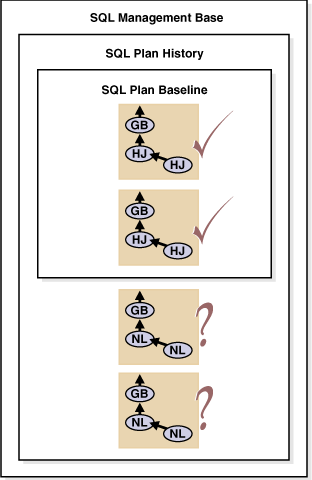
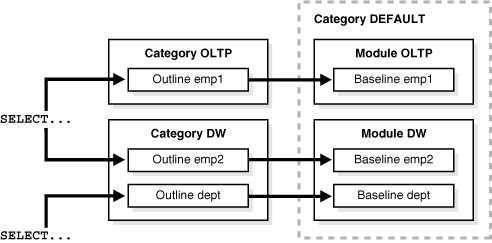

## 15 Using SQL Plan Management

This chapter describes how to manage SQL execution plans using SQL plan management. SQL plan management prevents performance regressions resulting from sudden changes to the execution plan of a SQL statement by providing components for capturing, selecting, and evolving SQL plan information.

This chapter contains the following topics:

## 15.1 Overview of SQL Plan Baselines

SQL plan management is a preventative mechanism that records and evaluates the execution plans of SQL statements over time. This mechanism can build a SQL plan baseline, which is a set of accepted plans for a SQL statement. The accepted plans have been proven to perform well.

### 15.1.1 Purpose of SQL Plan Baselines

The goal of SQL plan baselines is to preserve the performance of corresponding SQL statements, regardless of changes in the database. Examples of changes include:

- New optimizer version
- Changes to optimizer statistics and optimizer parameters
- Changes to schema and metadata definitions
- Changes to system settings
- SQL profile creation

SQL plan baselines cannot help in cases where an event has caused irreversible execution plan changes, such as dropping an index.

The SQL tuning features of Oracle Database generate SQL profiles that help the optimizer to produce well-tuned plans. However, this mechanism is reactive and cannot guarantee stable performance when drastic database changes occur. SQL tuning can only resolve performance issues after they have occurred and are identified. For example, a SQL statement may become high-load because of a plan change, but SQL tuning cannot solve this problem until after the plan change occurs.

Common scenarios where SQL plan management can improve or preserve SQL performance include:

- A database upgrade that installs a new optimizer version usually results in plan changes for a small percentage of SQL statements. Most of these plan changes result in either no performance change or improvement. However, some plan changes may cause performance regressions. SQL plan baselines significantly minimize potential regressions resulting from an upgrade.
- Ongoing system and data changes can impact plans for some SQL statements, potentially causing performance regressions. SQL plan baselines help minimize performance regressions and stabilize SQL performance.
- Deployment of new application modules means introducing new SQL statements into the database. The application software may use appropriate SQL execution plans developed in a standard test configuration for the new statements. If the system configuration is significantly different from the test configuration, then the database can evolve SQL plan baselines over time to produce better performance.

### 15.1.2 Architecture of SQL Plan Baselines

A SQL plan baseline contains one or more accepted plans, each of which contains the following information:

- Set of hints
- Plan hash value
- Plan-related information

The plan history is the set of plans, both accepted and not accepted, that the optimizer generates for a SQL statement over time. Because only accepted plans are in the SQL plan baseline, the plans in the baseline form a susbset of the plan history. For example, after the optimizer generates the first acceptable plan for a SQL plan baseline, subsequent plans are part of the plan history but not part of the plan baseline.

The process of adding plans to a SQL plan baseline is plan evolution. To be eligible to be evolved, a plan must be enabled for use by the optimizer.

Figure 15-1 shows a single `SELECT` statement that has two accepted plans in its SQL plan baseline. The SQL plan history includes two other plans for the statement that have not been proven to perform well.

Figure 15-1 SQL Plan Baseline and SQL Plan History



> This graphic shows a box labeled SQL Plan History. Three plans are in the SQL plan baseline and three plans in the SQL plan history but not the baseline. The plans in the baseline have check marks. The plans in the history have question marks.
>
> Copyright © 2000, 2014, Oracle and/or its affiliates. All rights reserved.  
> [Legal Notices](https://docs.oracle.com/cd/E11882_01/dcommon/html/cpyr.htm)
  

The SQL management base (SMB), which is part of the data dictionary, stores the SQL plan baselines and plan history in the `SYSAUX` tablespace. The SMB also contains SQL profiles. The SMB uses automatic space management.

## 15.2 Managing SQL Plan Baselines

Managing SQL plan baselines involves the following phases:

- Capturing SQL Plan Baselines
- Selecting SQL Plan Baselines
- Evolving SQL Plan Baselines

### 15.2.1 Capturing SQL Plan Baselines

During the SQL plan baseline capture phase, the database detects plan changes and records the new plan so that it can be evolved (verified) by the database administrator. To this end, the database maintains a plan history for individual SQL statements. Because ad hoc SQL statements do not repeat and thus do not suffer performance degradation, the database maintains plan history only for repeatable SQL statements.

To recognize repeatable SQL statements, the database maintains a statement log that contains the SQL ID of various SQL statements that the optimizer has evaluated. The database recognizes a SQL statement as repeatable when it is parsed or executed again after it has been logged.

For each repeatable SQL statement, the database maintains a plan history that contains all plans generated by the optimizer. The set of all accepted plans in the plan history is the SQL plan baseline.

You can configure the SQL Plan Baseline Capture phase for automatic capture of plan history and SQL plan baselines for repeatable SQL statements. Alternatively, you can manually load plans as SQL plan baselines.

This section contains the following topics:

- Capturing Plans Automatically
- Creating Baselines from Existing Plans

#### 15.2.1.1 Capturing Plans Automatically

When automatic plan capture is enabled, the database automatically creates and maintains the plan history for SQL statements using information provided by the optimizer. The plan history includes relevant information used by the optimizer to reproduce an execution plan, such as the SQL text, outline, bind variables, and compilation environment.

The optimizer marks the initial plan generated for a SQL statement as accepted for use, and represents both the plan history and SQL plan baseline. The plan history includes all subsequent plans. During the SQL plan baseline evolution phase, the database adds plans to the baseline that have been verified not to cause performance regressions.

To enable automatic plan capture, set the `OPTIMIZER_CAPTURE_SQL_PLAN_BASELINES` initialization parameter to `TRUE`. By default, this parameter is `FALSE`.

#### 15.2.1.2 Creating Baselines from Existing Plans

You can create SQL plan baselines by manually loading existing plans for a set of SQL statements as plan baselines. The database does not verify manually loaded plans for performance, but adds them as accepted plans to existing or new SQL plan baselines. You can use manual plan loading with or as an alternative to automatic plan capture.

You can perform manual plan loading by:

- Loading Plans from SQL Tuning Sets and AWR Snapshots
- Loading Plans from the Shared SQL Area

See Also:

"SQL Management Base"

##### 15.2.1.2.1 Loading Plans from SQL Tuning Sets and AWR Snapshots

To load plans from a SQL tuning set, use the `LOAD_PLANS_FROM_SQLSET` function of the `DBMS_SPM` package. The following example loads the plans stored in the SQL tuning set named `tset1`:

```
DECLARE
  my_plans PLS_INTEGER;
BEGIN
  my_plans := DBMS_SPM.LOAD_PLANS_FROM_SQLSET( sqlset_name => 'tset1');
END;
/
```

To load plans from Automatic Workload Repository (AWR), load the plans stored in AWR snapshots into a SQL tuning set before using the `LOAD_PLANS_FROM_SQLSET` function as described in this section.

See Also:

- ["Overview of the Automatic Workload Repository"](autostat.md)
- ["Managing SQL Tuning Sets"](sql_tune.md)
- [Oracle Database PL/SQL Packages and Types Reference](https://docs.oracle.com/cd/E11882_01/appdev.112/e40758/d_spm.htm#ARPLS150) to learn about additional parameters used by the `LOAD_PLANS_FROM_SQLSET` function

##### 15.2.1.2.2 Loading Plans from the Shared SQL Area

To load plans from the shared SQL area, use the `LOAD_PLANS_FROM_CURSOR_CACHE` function of the `DBMS_SPM` package. In the following example, Oracle Database loads the plans located in the shared SQL area for the SQL statement identified by its `sql_id`:

```
DECLARE
  my_plans PLS_INTEGER;
BEGIN
  my_plans := DBMS_SPM.LOAD_PLANS_FROM_CURSOR_CACHE( sql_id => '99twu5t2dn5xd');
END;
/
```

You can identify plans in the shared SQL area by:

- SQL identifier (`SQL_ID`)
- SQL text (`SQL_TEXT`)
- One of the following attributes:
	- `PARSING_SCHEMA_NAME`
		- `MODULE`
		- `ACTION`

See Also:

[Oracle Database PL/SQL Packages and Types Reference](https://docs.oracle.com/cd/E11882_01/appdev.112/e40758/d_spm.htm#ARPLS150) to learn how to use the `LOAD_PLANS_FROM_CURSOR_CACHE` function

### 15.2.2 Selecting SQL Plan Baselines

During the SQL plan baseline selection phase, Oracle Database detects plan changes based on the stored plan history, and selects plans to avoid potential performance regressions for a set of SQL statements.

Each time the database compiles a SQL statement, the optimizer does the following:

1. Uses a cost-based search method to build a best-cost plan
2. Tries to find a matching plan in the SQL plan baseline
3. Does either of the following depending on whether a match is found:
	- If found, then the optimizer proceeds using the matched plan
		- If not found, then the optimizer evaluates the cost of each accepted plan in the SQL plan baseline and selects the plan with the lowest cost

The best-cost plan found by the optimizer that does not match any plans in the plan history for the SQL statement represents a new plan. The database adds this plan as a nonaccepted plan to the plan history. The database does not use the new plan until it is verified to not cause a performance regression. However, if a change in the system (such as a dropped index) causes all accepted plans to become non-reproducible, then the optimizer selects the best-cost plan. Thus, the presence of a SQL plan baseline causes the optimizer to use conservative plan selection strategy for the SQL statement.

To enable the use of SQL plan baselines, set the `OPTIMIZER_USE_SQL_PLAN_BASELINES` initialization parameter to `TRUE` (default).

### 15.2.3 Evolving SQL Plan Baselines

During the SQL plan baseline evolution phase, the database evaluates the performance of new plans and integrates plans with better performance into SQL plan baselines.

When the optimizer finds a new plan for a SQL statement, the database adds the plan to the plan history as a nonaccepted plan. The database can verify the plan for performance relative to the SQL plan baseline performance. A successful verification of a nonaccepted plan consists of comparing its performance to that of a plan selected from the SQL plan baseline and ensuring that it delivers better performance. When the database verifies that a nonaccepted plan will not cause a performance regression, the database changes it to an accepted plan and integrates it into the baseline.

This section describes how to evolve SQL plan baselines and contains the following topics:

- Evolving Plans with Manual Plan Loading
- Evolving Plans with DBMS\_SPM.EVOLVE\_SQL\_PLAN\_BASELINE

#### 15.2.3.1 Evolving Plans with Manual Plan Loading

You can evolve an existing SQL plan baseline by manually loading plans from the shared SQL area or from a SQL tuning set. When you manually load plans into a SQL plan baseline, the database adds these loaded plans as accepted plans.

See Also:

"Creating Baselines from Existing Plans"

#### 15.2.3.2 Evolving Plans with DBMS\_SPM.EVOLVE\_SQL\_PLAN\_BASELINE

The PL/SQL function `DBMS_SPM.EVOLVE_SQL_PLAN_BASELINE` tries to evolve new plans that have been added by the optimizer to the plan history of existing plan baselines. If the function can verify that the new plan performs better than a plan chosen from the corresponding SQL plan baseline, then the database adds the new plan as an accepted plan.

The following example of the `DBMS_SPM.EVOLVE_SQL_PLAN_BASELINE` function evolves a new plan for a SQL statement identified by its SQL handle, which is its unique SQL identifier in string form. You can find the SQL handle by querying `DBA_SQL_PLAN_BASELINES.SQL_HANDLE`.

```
SET SERVEROUTPUT ON
SET LONG 10000
DECLARE
    report clob;
BEGIN
    report := DBMS_SPM.EVOLVE_SQL_PLAN_BASELINE(
                  sql_handle => 'SYS_SQL_593bc74fca8e6738');
    DBMS_OUTPUT.PUT_LINE(report);
END;
/
```

The following output shows that Oracle Database successfully evolved a plan:

```
REPORT
--------------------------------------------------------------------------------

--------------------------------------------------------------------------------
                       Evolve SQL Plan Baseline Report
--------------------------------------------------------------------------------
 
Inputs:
-------
 SQL_HANDLE = SYS_SQL_593bc74fca8e6738
 PLAN_NAME  =
 TIME_LIMIT = DBMS_SPM.AUTO_LIMIT
 VERIFY     = YES
 COMMIT     = YES
 
Plan: SYS_SQL_PLAN_ca8e6738a57b5fc2
-----------------------------------
 Plan was verified: Time used .07 seconds.
 Passed performance criterion: Compound improvement ratio >= 7.32.
 Plan was changed to an accepted plan.
 
                     Baseline Plan      Test Plan     Improv. Ratio
                     -------------      ---------     -------------
 Execution Status:        COMPLETE       COMPLETE
 Rows Processed:                40             40
 Elapsed Time(ms):              23              8              2.88
 CPU Time(ms):                  23              8              2.88
 Buffer Gets:                  450             61              7.38
 Disk Reads:                     0              0
 Direct Writes:                  0              0
 Fetches:                        0              0
 Executions:                     1              1
 
-------------------------------------------------------------------------------
                                Report Summary
-------------------------------------------------------------------------------
Number of SQL plan baselines verified: 1.
Number of SQL plan baselines evolved: 1.
```

Alternatively, you can use the `DBMS_SPM.EVOLVE_SQL_PLAN_BASELINE` function to specify:

- The name of a particular plan to evolve
- A list of plans to evolve
- No value
	By specifying no value, you enable Oracle Database to evolve all nonaccepted plans currently in the SMB.

See Also:

[Oracle Database PL/SQL Packages and Types Reference](https://docs.oracle.com/cd/E11882_01/appdev.112/e40758/d_spm.htm#ARPLS150) for information about using the `DBMS_SPM.EVOLVE_SQL_PLAN_BASELINE` function

## 15.3 Using SQL Plan Baselines with SQL Tuning Advisor

When tuning SQL statements with SQL Tuning Advisor, if the advisor finds a tuned plan and verifies its performance to be better than a plan chosen from the corresponding SQL plan baseline, then it makes a recommendation to accept a SQL profile. When the SQL profile is accepted, the database adds the tuned plan to the corresponding SQL plan baseline. However, SQL Tuning Advisor does not verify existing unaccepted plans in the plan history.

In Oracle Database 11g, an automatically configured task runs SQL Tuning Advisor during a maintenance window. This task targets high-load SQL statements as identified by the execution performance data collected in the Automatic Workload Repository (AWR) snapshots. The automatic SQL tuning task implements the SQL profile recommendations made by SQL Tuning Advisor. Thus, the database automatically adds tuned plans to the SQL plan baselines of the identified high-load SQL statements.

## 15.4 Using Fixed SQL Plan Baselines

A SQL plan baseline is fixed when it contains at least one enabled plan whose `FIXED` attribute is set to `YES`. You can use fixed SQL plan baselines to fix the set of possible plans (usually one plan) for a SQL statement, or migrate an existing stored outline by loading the "outlined" plan as a fixed plan.

If a fixed SQL plan baseline also contains non-fixed plans, then the optimizer gives preference to fixed plans over non-fixed ones. Thus, the optimizer picks the fixed plan with the least cost even though a non-fixed plan may have an even lower cost. If none of the fixed plans is reproducible, then the optimizer picks the best non-fixed plan.

The optimizer does not add new plans to a fixed SQL plan baseline. Because the optimizer does not automatically add new plans, the database does not evolve a fixed SQL plan baseline when you execute `DBMS_SPM.EVOLVE_SQL_PLAN_BASELINE`. However, you can evolve a fixed SQL plan baseline by manually loading new plans into it from the shared SQL area or a SQL tuning set.

When you tune a SQL statement with a fixed SQL plan baseline using SQL Tuning Advisor, a SQL profile recommendation has special meaning. When the SQL profile is accepted, the database adds the tuned plan to the fixed SQL plan baseline as a non-fixed plan. However, as described above, the optimizer does not use the tuned plan when a reproducible fixed plan is present. Therefore, the benefit of SQL tuning may not be realized. To enable the use of the tuned plan, manually alter the tuned plan to a fixed plan by setting its `FIXED` attribute to `YES`.

## 15.5 Displaying SQL Plan Baselines

To view the plans stored in the SQL plan baseline for a given statement, use the `DISPLAY_SQL_PLAN_BASELINE` function of the `DBMS_XPLAN` package. The following example displays one or more execution plans for the specified SQL statement, specified by the handle (`sql_handle`):

```
SELECT * FROM TABLE( 
    DBMS_XPLAN.DISPLAY_SQL_PLAN_BASELINE( 
        sql_handle=>'SYS_SQL_209d10fabbedc741', 
        format=>'basic'));
```

Alternatively, you can display a single plan by supplying a plan name (`plan_name`).

This function uses plan information stored in the SQL management base to explain and display the plans. In this example, the `DISPLAY_SQL_PLAN_BASELINE` function displays the execution plans for the SQL statement specified by the handle `SYS_SQL_209d10fabbedc741`:

```
SQL handle: SYS_SQL_209d10fabbedc741
SQL text: select cust_last_name, amount_sold from customers c,
          sales s where c.cust_id=s.cust_id and cust_year_of_birth=:yob
----------------------------------------------------------------------------------
----------------------------------------------------------------------------------
Plan name: SYS_SQL_PLAN_bbedc741a57b5fc2
Enabled: YES      Fixed: NO      Accepted: NO      Origin: AUTO-CAPTURE
----------------------------------------------------------------------------------
Plan hash value: 2776326082

----------------------------------------------------------------------------------
| Id  | Operation                                | Name                          |
----------------------------------------------------------------------------------
|   0 | SELECT STATEMENT                         |                               |
|   1 | HASH JOIN                                |                               |
|   2 |   TABLE ACCESS BY INDEX ROWID            | CUSTOMERS                     |
|   3 |     BITMAP CONVERSION TO ROWIDS          |                               |
|   4 |     BITMAP INDEX SINGLE VALUE            | CUSTOMERS_YOB_BIX             |
|   5 |    PARTITION RANGE ALL                   |                               |
|   6 |    TABLE ACCESS FULL                     | SALES                         |
----------------------------------------------------------------------------------

----------------------------------------------------------------------------------
Plan name: SYS_SQL_PLAN_bbedc741f554c408
Enabled: YES     Fixed: NO      Accepted: YES       Origin: MANUAL-LOAD
----------------------------------------------------------------------------------
Plan hash value: 4115973128

----------------------------------------------------------------------------------
| Id  | Operation                                | Name                          |
----------------------------------------------------------------------------------
|   0 | SELECT STATEMENT                         |                               |
|   1 |   NESTED LOOPS                           |                               |
|   2 |     NESTED LOOPS                         |                               |
|   3 |       TABLE ACCESS BY INDEX ROWID        | CUSTOMERS                     |
|   4 |         BITMAP CONVERSION TO ROWIDS      |                               |
|   5 |           BITMAP INDEX SINGLE VALUE      | CUSTOMERS_YOB_BIX             |
|   6 |       PARTITION RANGE                    |                               |
|   7 |        BITMAP CONVERSION TO ROWIDS       |                               |
|   8 |          BITMAP INDEX SINGLE VALUE       | SALES_CUST_BIX                |
|   9 |     TABLE ACCESS BY LOCAL INDEX ROWID    | SALES                         |
----------------------------------------------------------------------------------
```

You can also display SQL plan baseline information using a `SELECT` statement directly on the `DBA_SQL_PLAN_BASELINES` view, as shown in the following example:

```
SELECT SQL_HANDLE, PLAN_NAME, ENABLED, ACCEPTED, FIXED 
FROM   DBA_SQL_PLAN_BASELINES;
 
SQL_HANDLE                PLAN_NAME                      ENA  ACC    FIX
------------------------------------------------------------------------
SYS_SQL_209d10fabbedc741  SYS_SQL_PLAN_bbedc741a57b5fc2  YES  NO     NO
SYS_SQL_209d10fabbedc741  SYS_SQL_PLAN_bbedc741f554c408  YES  YES    NO
```

See Also:

[Oracle Database PL/SQL Packages and Types Reference](https://docs.oracle.com/cd/E11882_01/appdev.112/e40758/d_xplan.htm#ARPLS378) to learn about additional parameters used by the `DISPLAY_SQL_PLAN_BASELINE` function

## 15.6 SQL Management Base

The SQL management base (SMB) is a part of the data dictionary that resides in the `SYSAUX` tablespace. It stores statement logs, plan histories, SQL plan baselines, and SQL profiles. To allow weekly purging of unused plans and logs, the SMB uses automatic space management.

You can also add plans manually to the SMB for a set of SQL statements. This feature is especially useful when upgrading the database from a version before Oracle Database 11g because it helps to minimize plan regressions resulting from the use of a new optimizer version.

Because the SMB is located entirely within `SYSAUX`, the database does not use SQL plan management and SQL tuning features when this tablespace is unavailable.

### 15.6.1 Disk Space Usage

Disk space used by the SMB is regularly checked against a limit based on the size of the `SYSAUX` tablespace. By default, the limit for the SMB is no more than 10% of the size of `SYSAUX`. The allowable range for this limit is between 1% and 50%.

A weekly background process measures the total space occupied by the SMB. When the defined limit is exceeded, the process writes a warning to the alert log. The database generates alerts weekly until one of the following conditions is met:

- The SMB space limit is increased
- The size of the `SYSAUX` tablespace is increased
- The disk space used by the SMB is decreased by purging SQL management objects (SQL plan baselines or SQL profiles)

To change the percentage limit, use the `CONFIGURE` procedure of the `DBMS_SPM` package. The following example changes the space limit to 30%:

```
BEGIN
  DBMS_SPM.CONFIGURE('space_budget_percent',30);
END;
/
```

See Also:

[Oracle Database PL/SQL Packages and Types Reference](https://docs.oracle.com/cd/E11882_01/appdev.112/e40758/d_spm.htm#ARPLS150) to learn about additional parameters used by the `CONFIGURE` procedure

### 15.6.2 Purging Policy

A weekly scheduled purging task manages the disk space used by SQL plan management. The task runs as an automated task in the maintenance window.

The database purges plans not used for more than 53 weeks, as identified by the `LAST_EXECUTED` timestamp stored in the SMB for that plan. The 53-week period ensures plan information is available during any yearly SQL processing. The unused plan retention period can range between 5 and 523 weeks (a little more than 10 years).

To configure the retention period, use the `CONFIGURE` procedure of the `DBMS_SPM` PL/SQL package. The following example changes the retention period to 105 weeks:

```
BEGIN
  DBMS_SPM.CONFIGURE( 'plan_retention_weeks',105);
END;
/
```

See Also:

[Oracle Database PL/SQL Packages and Types Reference](https://docs.oracle.com/cd/E11882_01/appdev.112/e40758/d_spm.htm#ARPLS150) to learn about additional parameters used by the `CONFIGURE` procedure

### 15.6.3 SQL Management Base Configuration Parameters

You can access the current configuration settings for the SQL management base using the `DBA_SQL_MANAGEMENT_CONFIG` view. The following query shows this information:

```
SELECT PARAMETER_NAME, PARAMETER_VALUE 
FROM   DBA_SQL_MANAGEMENT_CONFIG;
 
PARAMETER_NAME                 PARAMETER_VALUE
------------------------------ ---------------
SPACE_BUDGET_PERCENT                        30
PLAN_RETENTION_WEEKS                       105
```

## 15.7 Importing and Exporting SQL Plan Baselines

Oracle Database supports the export and import of SQL plan baselines using the Oracle Data Pump Import and Export utilities. Use the `DBMS_SPM` package to define a staging table, which you can use to pack and unpack SQL plan baselines.

To import a set of SQL plan baselines from one system to another:

1. On the original database, create a staging table using the `CREATE_STGTAB_BASELINE` procedure.
	The following example creates a staging table named `stage1`:
	```
	BEGIN
	  DBMS_SPM.CREATE_STGTAB_BASELINE(
	    table_name => 'stage1');
	END;
	/
	```
2. Pack the SQL plan baselines you want to export from the SQL management base into the staging table using the `PACK_STGTAB_BASELINE` function.
	The following example packs enabled plan baselines created by user `dba1` into staging table `stage1`. You can select SQL plan baselines using the plan name (`plan_name`), SQL handle (`sql_handle`), or any other plan criteria. The `table_name` parameter is mandatory.
	```
	DECLARE
	  my_plans number;
	BEGIN
	  my_plans := DBMS_SPM.PACK_STGTAB_BASELINE(
	    table_name => 'stage1',
	    enabled => 'yes',
	    creator => 'dba1');
	END;
	/
	```
3. Export the staging table `stage1` into a flat file using the Oracle Data Pump Export utility.
4. Transfer the flat file to the target system.
5. Import the staging table `stage1` from the flat file using the Oracle Data Pump Import utility.
6. Unpack the SQL plan baselines from the staging table into the SQL management base on the target system using the `UNPACK_STGTAB_BASELINE` function.
	The following example unpacks all fixed plan baselines stored in the staging table `stage1`:
	```
	DECLARE
	  my_plans number;
	BEGIN
	  my_plans := DBMS_SPM.UNPACK_STGTAB_BASELINE(
	    table_name => 'stage1',
	    fixed => 'yes');
	END;
	/
	```

See Also:

- [Oracle Database PL/SQL Packages and Types Reference](https://docs.oracle.com/cd/E11882_01/appdev.112/e40758/d_spm.htm#ARPLS150) for more information about using the `DBMS_SPM` package
- [Oracle Database Utilities](https://docs.oracle.com/cd/E11882_01/server.112/e22490/dp_overview.htm#SUTIL100) for detailed information about using the Data Pump Export and Import utilities

## 15.8 Migrating Stored Outlines to SQL Plan Baselines

This section explains the concepts and tasks relating to stored outline migration. This section contains the following topics:

- Overview of Stored Outline Migration
- Preparing for Stored Outline Migration
- Migrating Outlines to Utilize SQL Plan Management Features
- Migrating Outlines to Preserve Stored Outline Behavior
- Performing Follow-Up Tasks After Stored Outline Migration

### 15.8.1 Overview of Stored Outline Migration

A stored outline is a set of hints for a SQL statement. The hints direct the optimizer to choose a specific plan for the statement. A stored outline is a legacy technique for providing plan stability.

Stored outline migration is the user-initiated process of converting stored outlines to SQL plan baselines. A SQL plan baseline is a set of plans proven to provide good performance.

This section contains the following topics:

- Purpose of Stored Outline Migration
- How Stored Outline Migration Works
- User Interface for Stored Outline Migration
- Basic Steps in Stored Outline Migration

#### 15.8.1.1 Purpose of Stored Outline Migration

This section assumes that you rely on stored outlines to maintain plan stability and prevent performance regressions. The goal of this section is to provide a convenient method to safely migrate from stored outlines to SQL plan baselines. After the migration, you can maintain the same plan stability that you had using stored outlines while being able to utilize the more advanced features provided by the SQL Plan Management framework.

Specifically, the section explains how to address the following problems:

- Stored outlines cannot automatically evolve over time. Consequently, a stored outline may be good when you create it, but become a bad plan after a database change, leading to performance degradation.
- Hints in a stored outline can become invalid, for example, an index hint on a dropped index. In such cases, the database still uses the outlines but excludes the invalid hints, producing a plan that is often worse than the original plan or the current best-cost plan generated by the optimizer.
- For a SQL statement, the optimizer can only choose the plan defined in the stored outline in the currently specified category. The optimizer cannot choose from other stored outlines in different categories or the current cost-based plan even if they improve performance.
- Stored outlines are a reactive tuning technique, which means that you only use a stored outline to address a performance problem after it has occurred. For example, you may implement a stored outline to correct the plan of a SQL statement that became high-load. In this case, you used stored outlines instead of proactively tuning the statement before it became high-load.

The stored outline migration PL/SQL API helps solve the preceding problems in the following ways:

- SQL plan baselines enable the optimizer to use the same good plan and allow this plan to evolve over time.
	For a specified SQL statement, you can add new plans as SQL plan baselines after they are verified not to cause performance regressions.
- SQL plan baselines prevent plans from going bad because of invalid hints.
	If hints stored in a plan baseline become invalid, then the plan may not be reproducible by the optimizer. In this case, the optimizer selects an alternative reproducible plan baseline or the current best-cost plan generated by optimizer.
- For a specific SQL statement, the database can maintain multiple plan baselines.
	The optimizer can choose from a set of good plans for a specific SQL statement instead of being restricted to a single plan per category, as required by stored outlines.

#### 15.8.1.2 How Stored Outline Migration Works

This section explains how the database migrates stored outlines to SQL plan baselines. This information is important for performing the task of migrating stored outlines.

##### 15.8.1.2.1 Stages of Stored Outline Migration

The following graphic shows the main stages in stored outline migration:


> This graphic shows a vertical flow chart as a stack of boxes. Each box points to a box beneath it.
>
> At the top of the chart is a box that says: outline1... outlinen.
>
> The next box says: Copy information from outlines.
>
> The next box says: Reparse hints to generate plans.
>
> The next box says: baseline1... baselinen.
>
> The next box says: Obtain missing information such as bind data.
>
> The first box is labeled: User specifies outlines.
>
> The next three boxes are labeled: Database creates baselines.
>
> The last box is labeled: Database updates baselines at first statement execution.
  
  

The migration process has the following stages:

1. The user invokes a function that specifies which outlines should be migrated.
2. The database processes the outlines as follows:
	1. The database copies information in the outline needed by the plan baseline.
		The database copies it directly or calculates it based on information in the outline. For example, the text of the SQL statement exists in both schemas, so the database can copy the text from outline to baseline.
		2. The database reparses the hints to obtain information not in the outline.
		The plan hash value and plan cost cannot be derived from the existing information in the outline, which necessitates reparsing the hints.
		3. The database creates the baselines.
3. The database obtains missing information when it chooses the SQL plan baseline for the first time to execute the same SQL statement.
	The compilation environment and execution statistics are only available during execution when the plan baseline is parsed and compiled.

The migration is complete only after the preceding phases complete.

##### 15.8.1.2.2 Outline Categories and Baseline Modules

An outline is a set of hints, whereas a SQL plan baseline is a set of plans. Because they are different technologies, some functionality of outlines does not map exactly to functionality of baselines. For example, a single SQL statement can have multiple outlines, each of which is in a different outline category, but the only category that currently exists for baselines is `DEFAULT`.

The equivalent of a category for an outline is a module for a SQL plan baseline. Table 15-1 explains how outline categories map to modules.

Table 15-1 Outline Categories

| Concept | Description | Default Value |
| --- | --- | --- |
| Outline Category | Specifies a user-defined grouping for a set of stored outlines.  You can use categories to maintain different stored outlines for a SQL statement. For example, a single statement can have an outline in the `OLTP` category and the `DW` category.  Each SQL statement can have one or more stored outlines. Each stored outline is in one and only one outline category. A statement can have multiple stored outlines in different categories, but only one stored outline exists per category per statement.  During migration, the database maps each outline category to a SQL plan baseline module. | `DEFAULT` |
| Baseline Module | Specifies a high-level function being performed.  A SQL plan baseline can belong to one and only one module. | After an outline is migrated to a SQL plan baseline, module name defaults to outline category name |
| Baseline Category | Only one SQL plan baseline category exists. This category is named `DEFAULT`. During stored outline migration, the module name of the SQL plan baseline is set to the category name of the stored outline.  A statement can have multiple SQL plan baselines in the `DEFAULT` category. | `DEFAULT` |

When migrating stored outlines to SQL plan baselines, Oracle Database maps every outline category to a SQL plan baseline module with the same name. As shown in the following diagram, the outline category `OLTP` is mapped to the baseline module `OLTP`. After migration, `DEFAULT` is a super-category that contains all SQL plan baselines.



> On the left of the graphic are two SELECT statements.
>
> The top SELECT points to outline emp1 in category OLTP. This statement also points to outline emp2 in category DW.
>
> The bottom SELECT points to outline dept2 in category DW.
>
> emp1 points to baseline emp1. This baseline is in module OLTP.
>
> emp2 points to baseline emp2. dept points to baseline dept. Both of these baselines are in module DW.
>
> All modules are in category DEFAULT.
  

#### 15.8.1.3 User Interface for Stored Outline Migration

You can use the `DBMS_SPM` package to perform the stored outline migration. Table 15-2 describes the relevant functions in this package.

Table 15-2 DBMS\_SPM Functions Relating to Stored Outline Migration

| DBMS\_SPM Function | Description |
| --- | --- |
| `MIGRATE_STORED_OUTLINE` | Migrates existing stored outlines to plan baselines.  Use either of the following formats:  - Specify outline name, SQL text, outline category, or all stored outlines. - Specify a list of outline names. |
| `ALTER_SQL_PLAN_BASELINE` | Changes an attribute of a single plan or all plans associated with a SQL statement. |
| `DROP_MIGRATED_STORED_OUTLINE` | Drops stored outlines that have been migrated to SQL plan baselines.  The function finds stored outlines marked as `MIGRATED` in the `DBA_OUTLINES` view, and then drops these outlines from the database. |

You can control stored outline and plan baseline behavior with initialization and session parameters. Table 15-3 describes the relevant parameters. See Table 15-5 and Table 15-6 for an explanation of how these parameter settings interact.

Table 15-3 Parameters Relating to Stored Outline Migration

| Initialization or Session Parameter | Description |
| --- | --- |
| `CREATE_STORED_OUTLINES` | Determines whether Oracle Database automatically creates and stores an outline for each query submitted during the session. |
| `OPTIMIZER_CAPTURE_SQL_PLAN_BASELINES` | Enables or disables the automatic recognition of repeatable SQL statement and the generation of SQL plan baselines for these statements. |
| `USE_STORED_OUTLINES` | Determines whether the optimizer uses stored outlines to generate execution plans.  Note: This is a session parameter, not an initialization parameter. |
| `OPTIMIZER_USE_SQL_PLAN_BASELINES` | Enables or disables the use of SQL plan baselines stored in SQL Management Base. |

You can use database views to access information relating to stored outline migration. Table 15-4 describes the following main views.

Table 15-4 Views Relating to Stored Outline Migration

| View | Description |
| --- | --- |
| `DBA_OUTLINES` | Describes all stored outlines in the database.  The `MIGRATED` column is important for outline migration and shows one of the following values: `NOT-MIGRATED` and `MIGRATED`. When `MIGRATED`, the stored outline has been migrated to a plan baseline and is not usable. |
| `DBA_SQL_PLAN_BASELINES` | Displays information about the SQL plan baselines currently created for specific SQL statements.  The `ORIGIN` column indicates how the plan baseline was created. The value `STORED-OUTLINE` indicates the baseline was created by migrating an outline. |

See Also:

- [Oracle Database PL/SQL Packages and Types Reference](https://docs.oracle.com/cd/E11882_01/appdev.112/e40758/d_spm.htm#ARPLS150) to learn about the `DBMS_SPM` package
- [Oracle Database Reference](https://docs.oracle.com/cd/E11882_01/server.112/e40402/toc.htm) to learn about database initialization parameters and database fixed views

#### 15.8.1.4 Basic Steps in Stored Outline Migration

This section explains the basic steps in using the PL/SQL API to perform stored outline migration. The basic steps are as follows:

1. Prepare for stored outline migration.
	Review the migration prerequisites and determine how you want the migrated plan baselines to behave.
	See "Preparing for Stored Outline Migration".
2. Do one of the following:
	- Migrate to baselines to utilize SQL Plan Management features.
		See "Migrating Outlines to Utilize SQL Plan Management Features".
		- Migrate to baselines while exactly preserving the behavior of the stored outlines.
		See "Migrating Outlines to Preserve Stored Outline Behavior".
3. Perform post-migration confirmation and cleanup.
	See "Performing Follow-Up Tasks After Stored Outline Migration".

### 15.8.2 Preparing for Stored Outline Migration

This section explains how to prepare for stored outline migration.

To prepare for stored outline migration:

1. Start SQL\*Plus and log on as a user with `SYSDBA` privileges or the `EXECUTE` privilege on the `DBMS_SPM` package.
	For example, do the following to use operating system authentication to log on to a database as `SYS`:
	```
	% sqlplus /nolog
	SQL> CONNECT / AS SYSDBA
	```
2. Query the stored outlines in the database.
	The following example queries all stored outlines that have not been migrated to SQL plan baselines:
	```
	SELECT NAME, CATEGORY, SQL_TEXT
	FROM   DBA_OUTLINES
	WHERE  MIGRATED = 'NOT-MIGRATED';
	```
3. Determine which stored outlines meet the following prerequisites for migration eligibility:
	- The statement must not be a run-time `INSERT AS SELECT` statement.
		- The statement must not reference a remote object.
		- This statement must not be a private stored outline.
4. Decide whether to migrate all outlines, specified stored outlines, or outlines belonging to a specified outline category.
	If you do not decide to migrate all outlines, then list the outlines or categories that you intend to migrate.
5. Decide whether the stored outlines migrated to SQL plan baselines should use fixed plans or nonfixed plans:
	- Fixed plans
		A fixed plan is frozen. If a fixed plan is reproducible using the hints stored in plan baseline, then the optimizer always chooses the lowest-cost fixed plan baseline over plan baselines that are not fixed. Essentially, a fixed plan baseline acts as a stored outline with valid hints.
		A fixed plan is reproducible when the database can parse the statement based on the hints stored in the plan baseline and create a plan with the same plan hash value as the one in the plan baseline. If one of more of the hints become invalid, then the database may not be able to create a plan with the same plan hash value. In this case, the plan is nonreproducible.
		If a fixed plan cannot be reproduced when parsed using its hints, then the optimizer chooses a different plan, which can be either of the following:
		- Another plan for the SQL plan baseline
				- The current cost-based plan created by the optimizer
		In some cases, a performance regression occurs because of the different plan, requiring SQL tuning.
		- Nonfixed plans
		If a plan baseline does not contain fixed plans, then SQL Plan Management considers the plans equally when picking a plan for a SQL statement.
6. Before beginning the actual migration, ensure that the Oracle database meets the following prerequisites:
	- The database must be Enterprise Edition.
		- The database must be open and must not be in a suspended state.
		- The database must not be in restricted access (DBA), read-only, or migrate mode.
		- OCI must be available.

See Also:

- [Oracle Database Administrator's Guide](https://docs.oracle.com/cd/E11882_01/server.112/e25494/dba.htm#ADMIN11046) to learn about administrator privileges
- [Oracle Database Reference](https://docs.oracle.com/cd/E11882_01/server.112/e40402/statviews_4168.htm#REFRN23153) to learn about the `DBA_OUTLINES` views

### 15.8.3 Migrating Outlines to Utilize SQL Plan Management Features

The goals of this task are as follows:

- To allow SQL Plan Management to select from all plans in a plan baseline for a SQL statement instead of applying the same fixed plan after migration
- To allow the SQL plan baseline to evolve in the face of database changes by adding new plans to the baseline

The scenario in this section assumes the following:

- You migrate all outlines.
	To migrate specific outlines, see [Oracle Database PL/SQL Packages and Types Reference](https://docs.oracle.com/cd/E11882_01/appdev.112/e40758/d_spm.htm#ARPLS150) for details about the `DBMS_SPM.MIGRATE_STORED_OUTLINE` function.
- You want the module names of the baselines to be identical to the category names of the migrated outlines.
- You do not want the SQL plans to be fixed.
	By default, generated plans are not fixed and SQL Plan Management considers all plans equally when picking a plan for a SQL statement. This situation permits the advanced feature of plan evolution to capture new plans for a SQL statement, verify their performance, and accept these new plans into the plan baseline.

To migrate stored outlines to SQL plan baselines:

1. In SQL\*Plus, call PL/SQL function `MIGRATE_STORED_OUTLINE`.
	The following sample PL/SQL block migrates all stored outlines to fixed baselines:
	```
	DECLARE
	  my_report CLOB;
	BEGIN
	  my_report := DBMS_SPM.MIGRATE_STORED_OUTLINE( attribute_name => 'all' );
	END;
	/
	```

See Also:

- [Oracle Database PL/SQL Packages and Types Reference](https://docs.oracle.com/cd/E11882_01/appdev.112/e40758/d_spm.htm#ARPLS150) to learn about the `DBMS_SPM` package
- [Oracle Database SQL Language Reference](https://docs.oracle.com/cd/E11882_01/server.112/e41084/statements_2014.htm#SQLRF00902) to learn about the `ALTER SYSTEM` statement

### 15.8.4 Migrating Outlines to Preserve Stored Outline Behavior

The goal of this task is to migrate stored outlines to SQL plan baselines and preserve the original behavior of the stored outlines by creating fixed plan baselines. A fixed plan has higher priority over other plans for the same SQL statement. If a plan is fixed, then the plan baseline cannot be evolved. The database does not add new plans to a plan baseline that contains a fixed plan.

This section assumes the following:

- You want to migrate only the stored outlines in the category named `firstrow`.
	See [Oracle Database PL/SQL Packages and Types Reference](https://docs.oracle.com/cd/E11882_01/appdev.112/e40758/d_spm.htm#ARPLS150) for syntax and semantics of the `DBMS_SPM.MIGRATE_STORED_OUTLINE` function.
- You want the module names of the baselines to be identical to the category names of the migrated outlines.

To migrate stored outlines to plan baselines:

1. In SQL\*Plus, call PL/SQL function `MIGRATE_STORED_OUTLINE`.
	The following sample PL/SQL block migrates stored outlines in the category `firstrow` to fixed baselines:
	```
	DECLARE
	  my_report CLOB;
	BEGIN
	  my_outlines := DBMS_SPM.MIGRATE_STORED_OUTLINE( 
	    attribute_name => 'category', 
	    attribute_value => 'firstrow',
	    fixed => 'YES' );
	END;
	/
	```
	After migration, the SQL plan baselines is in module `firstrow` and category `DEFAULT`.

See Also:

- [Oracle Database PL/SQL Packages and Types Reference](https://docs.oracle.com/cd/E11882_01/appdev.112/e40758/d_spm.htm#ARPLS150) to learn about the `DBMS_SPM` package
- [Oracle Database SQL Language Reference](https://docs.oracle.com/cd/E11882_01/server.112/e41084/statements_2014.htm#SQLRF00902) to learn about the `ALTER SYSTEM` statement

### 15.8.5 Performing Follow-Up Tasks After Stored Outline Migration

The goals of this task are as follows:

- To configure the database to use plan baselines instead of stored outlines for stored outlines that have been migrated to SQL plan baselines
- To create SQL plan baselines instead of stored outlines for future SQL statements
- To drop the stored outlines that have been migrated to SQL plan baselines

This section assumes the following:

- You have completed the basic steps in the stored outline migration.
- Some stored outlines may have been created before Oracle Database 10g.
	Hints in releases before Oracle Database 10g use a local hint format. After migration, hints stored in a plan baseline use the global hints format introduced in Oracle Database 10g.

This section explains how to set initialization parameters relating to stored outlines and plan baselines. The `OPTIMIZER_CAPTURE_SQL_PLAN_BASELINES` and `CREATE_STORED_OUTLINES` initialization parameters determine how and when the database creates stored outlines and SQL plan baselines. Table 15-5 explains the interaction between these parameters.

Table 15-5 Creation of Outlines and Baselines

| CREATE\_STORED\_OUTLINES Initialization Parameter | OPTIMIZER\_CAPTURE\_SQL\_PLAN\_BASELINES Initialization Parameter | Database Behavior |
| --- | --- | --- |
| `FALSE` | `FALSE` | When executing a SQL statement, the database does not create stored outlines or SQL plan baselines. |
| `FALSE` | `TRUE` | The automatic recognition of repeatable SQL statements and the generation of SQL plan baselines for these statements is enabled. When executing a SQL statement, the database creates only new SQL plan baselines (if they do not exist) with the category name `DEFAULT` for the statement. |
| `TRUE` | `FALSE` | Oracle Database automatically creates and stores an outline for each query submitted during the session. When executing a SQL statement, the database creates only new stored outlines (if they do not exist) with the category name `DEFAULT` for the statement. |
| `category` | `FALSE` | When executing a SQL statement, the database creates only new stored outlines (if they do not exist) with the specified category name for the statement. |
| `TRUE` | `TRUE` | Oracle Database automatically creates and stores an outline for each query submitted during the session. The automatic recognition of repeatable SQL statements and the generation of SQL plan baselines for these statements is also enabled.  When executing a SQL statement, the database creates both stored outlines and SQL plan baselines with the category name `DEFAULT`. |
| `category` | `TRUE` | Oracle Database automatically creates and stores an outline for each query submitted during the session. The automatic recognition of repeatable SQL statements and the generation of SQL plan baselines for these statements is also enabled.  When executing a SQL statement, the database creates stored outlines with the specified category name and SQL plan baselines with the category name `DEFAULT`. |

The `USE_STORED_OUTLINES` session parameter (it is not an initialization parameter) and `OPTIMIZER_USE_SQL_PLAN_BASELINES` initialization parameter determine how the database uses stored outlines and plan baselines. Table 15-6 explains how these parameters interact.

Table 15-6 Use of Stored Outlines and SQL Plan Baselines

| USE\_STORED\_OUTLINES Session Parameter | OPTIMIZER\_USE\_SQL\_PLAN\_BASELINES Initialization Parameter | Database Behavior |
| --- | --- | --- |
| `FALSE` | `FALSE` | When choosing a plan for a SQL statement, the database does not use stored outlines or plan baselines. |
| `FALSE` | `TRUE` | When choosing a plan for a SQL statement, the database uses only SQL plan baselines. |
| `TRUE` | `FALSE` | When choosing a plan for a SQL statement, the database uses stored outlines with the category name `DEFAULT`. |
| `category` | `FALSE` | When choosing a plan for a SQL statement, the database uses stored outlines with the specified category name.  If a stored outline with the specified category name does not exist, then the database uses a stored outline in the `DEFAULT` category if it exists. |
| `TRUE` | `TRUE` | When choosing a plan for a SQL statement, stored outlines take priority over plan baselines.  If a stored outline with the category name `DEFAULT` exists for the statement and is applicable, then the database applies the stored outline. Otherwise, the database uses SQL plan baselines. |
| `category` | `TRUE` | When choosing a plan for a SQL statement, stored outlines take priority over plan baselines.  If a stored outline with the specified category name or the `DEFAULT` category exists for the statement and is applicable, then the database applies the stored outline. Otherwise, the database uses SQL plan baselines. However, if the stored outline has the property `MIGRATED`, then the database does not use the outline and uses the corresponding SQL plan baseline instead (if it exists). |

To place the database in the proper state after the migration:

1. Check that SQL plan baselines have been created as the result of migration.
	Ensure that the plans are enabled and accepted. For example, enter the following query (partial sample output included):
	```
	SELECT SQL_HANDLE, PLAN_NAME, ORIGIN, ENABLED, ACCEPTED, FIXED, MODULE
	FROM   DBA_SQL_PLAN_BASELINES;
	SQL_HANDLE                     PLAN_NAME  ORIGIN         ENA ACC FIX MODULE
	------------------------------ ---------- -------------- --- --- --- ------
	SYS_SQL_f44779f7089c8fab       STMT01     STORED-OUTLINE YES YES NO  DEFAULT
	.
	.
	.
	```
2. Optionally, change the attributes of the SQL plan baselines.
	For example, the following statement changes the status of the baseline for the specified SQL statement to `fixed`:
	```
	DECLARE
	  v_cnt PLS_INTEGER;
	BEGIN 
	  v_cnt := DBMS_SPM.ALTER_SQL_PLAN_BASELINE(               
	                           sql_handle=>'SYS_SQL_f44779f7089c8fab', 
	                           attribute_name=>'FIXED', 
	                           attribute_value=>'NO');
	  DBMS_OUTPUT.PUT_LINE('Plans altered: ' || v_cnt);
	END;
	/
	```
3. Check the status of the original stored outlines.
	For example, enter the following query (partial sample output included):
	```
	SELECT NAME, OWNER, CATEGORY, USED, MIGRATED 
	FROM   DBA_OUTLINES
	ORDER BY NAME;
	NAME       OWNER      CATEGORY   USED   MIGRATED
	---------- ---------- ---------- ------ ------------
	STMT01     SYS        DEFAULT    USED   MIGRATED
	STMT02     SYS        DEFAULT    USED   MIGRATED
	.
	.
	.
	```
4. Drop all stored outlines that have been migrated to SQL plan baselines.
	For example, the following statements drops all stored outlines with status `MIGRATED` in `DBA_OUTLINES`:
	```
	DECLARE
	  v_cnt PLS_INTEGER;
	BEGIN 
	  v_cnt := DBMS_SPM.DROP_MIGRATED_STORED_OUTLINE();
	  DBMS_OUTPUT.PUT_LINE('Migrated stored outlines dropped: ' || v_cnt);
	END;
	/
	```
5. Set initialization parameters so that:
	- When executing a SQL statement, the database creates plan baselines but does not create stored outlines.
		- The database only uses stored outlines when the equivalent SQL plan baselines do not exist.
	For example, the following SQL statements instruct the database to create SQL plan baselines instead of stored outlines when a SQL statement is executed. The example also instructs the database to apply a stored outline in category `allrows` or `DEFAULT` only if it exists and has not been migrated to a SQL plan baseline. In other cases, the database applies SQL plan baselines instead.
	```
	ALTER SYSTEM 
	  SET CREATE_STORED_OUTLINE = false;
	ALTER SYSTEM 
	  SET OPTIMIZER_CAPTURE_SQL_PLAN_BASELINES = true;
	ALTER SYSTEM 
	   SET OPTIMIZER_USE_SQL_PLAN_BASELINES = true;
	ALTER SESSION
	   SET USE_STORED_OUTLINES = allrows;
	```

See Also:

- [Oracle Database PL/SQL Packages and Types Reference](https://docs.oracle.com/cd/E11882_01/appdev.112/e40758/d_spm.htm#ARPLS150) to learn about the `DBMS_SPM` package
- [Oracle Database Reference](https://docs.oracle.com/cd/E11882_01/server.112/e40402/toc.htm) to learn about database fixed views