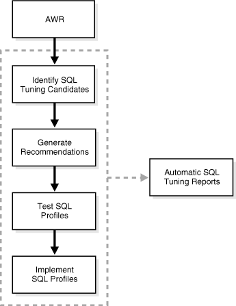
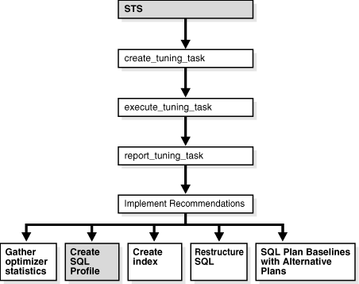
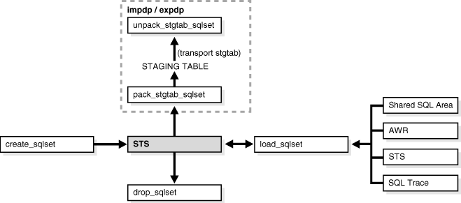
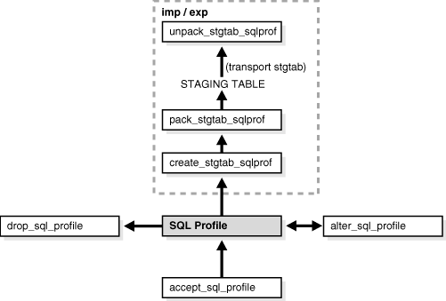

## 17 Automatic SQL Tuning

This chapter discusses the automatic SQL tuning features of Oracle Database. Automatic SQL tuning automates the manual process, which is complex, repetitive, and time-consuming.

This chapter contains the following sections:

## 17.1 Overview of the Automatic Tuning Optimizer

Oracle Database uses the optimizer to generate the execution plans for submitted SQL statements. The optimizer operates in the following modes:

- Normal mode
	The optimizer compiles the SQL and generates an execution plan. The normal mode generates a reasonable plan for the vast majority of SQL statements. Under normal mode, the optimizer operates with very strict time constraints, usually a fraction of a second.
- Tuning mode
	The optimizer performs additional analysis to check whether it can further improve the plan produced in normal mode. The optimizer output is not an execution plan, but a series of actions, along with their rationale and expected benefit for producing a significantly better plan. When running in tuning mode, the optimizer is known as the Automatic Tuning Optimizer.

Under tuning mode, the optimizer can take several minutes to tune a single statement. It is both time and resource intensive to invoke Automatic Tuning Optimizer every time a query must be hard-parsed. Automatic Tuning Optimizer is meant for complex and high-load SQL statements that have nontrivial impact on the database.

Automatic Database Diagnostic Monitor (ADDM) proactively identifies high-load SQL statements that are good candidates for SQL tuning (see [Chapter 6, "Automatic Performance Diagnostics"](diag.md)). The automatic SQL tuning feature also automatically identifies problematic SQL statements and implements tuning recommendations during system maintenance windows as an automated maintenance task.

The Automatic Tuning Optimizer performs the following types of tuning analysis:

- Statistics Analysis
- SQL Profiling
- Access Path Analysis
- SQL Structure Analysis
- Alternative Plan Analysis

### 17.1.1 Statistics Analysis

The optimizer relies on object statistics to generate execution plans. If these statistics are stale or missing, then the optimizer does not have the necessary information it needs and can generate poor execution plans. The Automatic Tuning Optimizer checks each query object for missing or stale statistics, and produces two types of output:

- Recommendations to gather relevant statistics for objects with stale or no statistics
	Because optimizer statistics are automatically collected and refreshed, this problem occurs only when automatic optimizer statistics collection is disabled. See ["Managing Automatic Optimizer Statistics Collection"](stats.md).
- Auxiliary statistics for objects with no statistics, and statistic adjustment factor for objects with stale statistics

The database stores this auxiliary information in an object called a SQL profile.

### 17.1.2 SQL Profiling

A [SQL profile](glossary.md) is a set of auxiliary information specific to a SQL statement. Conceptually, a SQL profile is to a SQL statement what statistics are to a table or index. The database can use the auxiliary information to improve execution plans.

See Also:

"Managing SQL Profiles"

### 17.1.3 Access Path Analysis

An [access path](glossary.md) is the means by which data is retrieved from a database. For example, a query using an index and a query using a full table scan use different access paths.

Indexes can tremendously enhance performance of a SQL statement by reducing the need for full scans of large tables. Effective indexing is a common tuning technique. Automatic Tuning Optimizer explores whether a new index can significantly enhance query performance. If so, then the advisor recommends index creation.

Because the Automatic Tuning Optimizer does not analyze how its index recommendation can affect the entire SQL workload, it also recommends running SQL Access Advisor on the SQL statement along with a representative SQL workload. SQL Access Advisor looks at the impact of creating an index on the entire SQL workload before making recommendations. See ["Automatic SQL Tuning Features"](sql_overview.md).

### 17.1.4 SQL Structure Analysis

Automatic Tuning Optimizer identifies common problems with the structure of SQL statements that can lead to poor performance. These could be syntactic, semantic, or design problems. In each case, Automatic Tuning Optimizer makes relevant suggestions to restructure the statements. The suggested alternative is similar, but not equivalent, to the original statement.

For example, the optimizer may suggest replacing the `UNION` operator with `UNION` `ALL` or `NOT` `IN` with `NOT` `EXISTS`. You can then determine if the advice is applicable to your situation. For example, if the schema design is such that duplicates are not possible, then the `UNION` `ALL` operator is much more efficient than the `UNION` operator. These changes require a good understanding of the data properties and should be implemented only after careful consideration.

### 17.1.5 Alternative Plan Analysis

While tuning a SQL statement, SQL Tuning Advisor searches real-time and historical performance data for alternative execution plans for the statement. If plans other than the original plan exist, then SQL Tuning Advisor reports an alternative plan finding.

SQL Tuning Advisor validates the alternative execution plans and notes any plans that are not reproducible. When reproducible alternative plans are found, you can create a SQL plan baseline to instruct the optimizer to choose these plans in the future.

Example 17-1 shows an alternative plan finding for a `SELECT` statement.

Example 17-1 Alternative Plan Finding

```
2- Alternative Plan Finding
---------------------------
  Some alternative execution plans for this statement were found by searching
  the system's real-time and historical performance data.
 
  The following table lists these plans ranked by their average elapsed time.
  See section "ALTERNATIVE PLANS SECTION" for detailed information on each
  plan.
 
  id plan hash  last seen            elapsed (s)  origin          note
  -- ---------- -------------------- ------------ --------------- ----------------
   1 1378942017  2009-02-05/23:12:08        0.000 Cursor Cache    original plan
   2 2842999589  2009-02-05/23:12:08        0.002 STS
 
  Information
  -----------
  - The Original Plan appears to have the best performance, based on the
    elapsed time per execution.  However, if you know that one alternative
    plan is better than the Original Plan, you can create a SQL plan baseline
    for it. This will instruct the Oracle optimizer to pick it over any other
    choices in the future.
    execute dbms_sqltune.create_sql_plan_baseline(task_name => 'TASK_XXXXX',
            object_id => 2, task_owner => 'SYS', plan_hash => xxxxxxxx);
```

Example 17-1 shows that SQL Tuning Advisor found two plans, one in the shared SQL area and one in a SQL tuning set. The plan in the shared SQL area is the same as the original plan.

SQL Tuning Advisor only recommends an alternative plan if the elapsed time of the original plan is worse than alternative plans. In this case, SQL Tuning Advisor recommends that users create a SQL plan baseline on the plan with the best performance. In Example 17-1, the alternative plan did not perform as well as the original plan, so SQL Tuning Advisor did not recommend using the alternative plan.

In Example 17-2, the alternative plans section of the SQL Tuning Advisor output includes both the original and alternative plans and summarizes their performance. The most important statistic is elapsed time. The original plan used an index, whereas the alternative plan used a full table scan, increasing elapsed time by.002 seconds.

Example 17-2 Alternative Plans Section

```
Plan 1
------
 
  Plan Origin                 :Cursor Cache
  Plan Hash Value             :1378942017
  Executions                  :50
  Elapsed Time                :0.000 sec
  CPU Time                    :0.000 sec
  Buffer Gets                 :0
  Disk Reads                  :0
  Disk Writes                 :0
 
Notes:
  1. Statistics shown are averaged over multiple executions.
  2. The plan matches the original plan.
 
--------------------------------------------
| Id  | Operation            | Name        |
--------------------------------------------
|   0 | SELECT STATEMENT     |             |
|   1 |  SORT AGGREGATE      |             |
|   2 |   MERGE JOIN         |             |
|   3 |    INDEX FULL SCAN   | TEST1_INDEX |
|   4 |    SORT JOIN         |             |
|   5 |     TABLE ACCESS FULL| TEST        |
--------------------------------------------
 
Plan 2
------
 
  Plan Origin                 :STS
  Plan Hash Value             :2842999589
  Executions                  :10
  Elapsed Time                :0.002 sec
  CPU Time                    :0.002 sec
  Buffer Gets                 :3
  Disk Reads                  :0
  Disk Writes                 :0
 
Notes:
  1. Statistics shown are averaged over multiple executions.
 
-------------------------------------
| Id  | Operation           | Name  | 
-------------------------------------
|   0 | SELECT STATEMENT    |       |
|   1 |  SORT AGGREGATE     |       |
|   2 |   HASH JOIN         |       |
|   3 |    TABLE ACCESS FULL| TEST  |
|   4 |    TABLE ACCESS FULL| TEST1 |
-------------------------------------
```

To adopt an alternative plan regardless of whether SQL Tuning Advisor recommends it, call `DBMS_SQLTUNE.CREATE_SQL_PLAN_BASELINE`. You can use this procedure to create a SQL plan baseline on any existing reproducible plan.

## 17.2 Managing the Automatic SQL Tuning Advisor

SQL Tuning Advisor takes one or more SQL statements as an input and invokes the Automatic Tuning Optimizer to perform SQL tuning on the statements. The output takes the form of advice or recommendations, along with a rationale for each recommendation and its expected benefit. The recommendation relates to a collection of statistics on objects, creation of new indexes, restructuring of the SQL statement, or creation of a SQL profile. You can choose to accept the recommendation to complete the tuning of the SQL statements.

The database can automatically tune SQL statements by identifying problematic statements and implementing recommendations using SQL Tuning Advisor during system maintenance windows. When run automatically, SQL Tuning Advisor is known as the Automatic SQL Tuning Advisor.

This section explains how to manage the Automatic SQL Tuning Advisor:

- How Automatic SQL Tuning Works
- Enabling and Disabling Automatic SQL Tuning
- Configuring Automatic SQL Tuning
- Viewing Automatic SQL Tuning Reports

See Also:

[Oracle Database Administrator's Guide](https://docs.oracle.com/cd/E11882_01/server.112/e25494/tasks.htm#ADMIN12331) for information about automated maintenance tasks

### 17.2.1 How Automatic SQL Tuning Works

Oracle Database automatically runs SQL Tuning Advisor on selected high-load SQL statements from the Automatic Workload Repository (AWR) that qualify as tuning candidates. This task, called Automatic SQL Tuning, runs in the default maintenance windows on a nightly basis. By default, automatic SQL tuning runs for at most one hour. You can customize attributes of the maintenance windows, including start and end time, frequency, and days of the week.

After automatic SQL tuning begins, the database performs the following steps:

1. Identifies SQL candidates in the AWR for tuning
	Oracle Database analyzes statistics in AWR and generates a list of potential SQL statements that are eligible for tuning. These statements include repeating high-load statements that have a significant impact on the database.
	The database tunes only SQL statements that have an execution plan with a high potential for improvement. The database ignores recursive SQL and statements that have been tuned recently (in the last month), parallel queries, DML, DDL, and SQL statements with performance problems caused by concurrency issues.
	The database orders the SQL statements that are selected as candidates based on their performance impact. The database calculates the impact by summing the CPU time and the I/O times in AWR for the selected statement in the past week.
2. Tunes each SQL statement individually by calling SQL Tuning Advisor
	During the tuning process, the database considers and reports all recommendation types, but it can implement only SQL profiles automatically.
3. Tests SQL profiles by executing the SQL statement
	If a SQL profile is recommended, the database tests the new profile by executing the SQL statement both with and without the profile. If the performance improvement improves at least threefold, then the database accepts the SQL profile, but only if the `ACCEPT_SQL_PROFILES` task parameter is set to `TRUE`. Otherwise, the automatic SQL tuning reports merely report the recommendation to create a SQL profile.
4. Optionally, implements the SQL profiles provided they meet the criteria of threefold performance improvement
	The database considers other factors when deciding whether to implement the SQL profile. For example, the database does not implement a profile when the objects referenced in the statement have stale optimizer statistics. SQL profiles that have been implemented automatically show type is `AUTO` in the `DBA_SQL_PROFILES` view.
	If the database uses SQL plan management, and if a SQL plan baseline exists for the SQL statement, then the database adds a new plan baseline when creating the SQL profile. As a result, the optimizer uses the new plan immediately after profile creation. See [Chapter 15, "Using SQL Plan Management"](optplanmgmt.md).

At any time during or after the automatic SQL tuning process, you can view the results using the automatic SQL tuning report. This report describes in detail all the SQL statements that were analyzed, the recommendations generated, and the SQL profiles that were automatically implemented.

Figure 17-1 shows the steps performed by the database during automatic SQL tuning.

Figure 17-1 Automatic SQL Tuning



> This flowchart diagram shows the steps performed by Oracle Database during the automatic SQL tuning process.
>
> Starting from the top of the diagram, AWR leads to:
>
> 1. Identify SQL tuning candidates
> 2. Generate recommendations
> 3. Test SQL profiles
> 4. Implement SQL profiles
>
> These four steps are wrapped inside a dotted area which points to the automatic SQL tuning reports on the right side of the diagram.
>
> End of image description.
  

### 17.2.2 Enabling and Disabling Automatic SQL Tuning

Automatic SQL tuning runs as part of the automated maintenance tasks infrastructure.

To enable automatic SQL tuning, use the `ENABLE` procedure in the `DBMS_AUTO_TASK_ADMIN` package:

```
BEGIN
  DBMS_AUTO_TASK_ADMIN.ENABLE(
    client_name => 'sql tuning advisor'
,   operation   => NULL
,   window_name => NULL
);
END;
/
```

To disable automatic SQL tuning, use the `DISABLE` procedure in the `DBMS_AUTO_TASK_ADMIN` package:

```
BEGIN
  DBMS_AUTO_TASK_ADMIN.DISABLE(
    client_name => 'sql tuning advisor'
,   operation   => NULL
,   window_name => NULL
);
END;
/
```

You can pass a specific window name using the `window_name` parameter to enable or disable the task in certain maintenance windows only.

Setting the `STATISTICS_LEVEL` parameter to `BASIC` disables automatic statistics gathering by the AWR and, as a result, also disables automatic SQL tuning.

See Also:

- [Oracle Database Administrator's Guide](https://docs.oracle.com/cd/E11882_01/server.112/e25494/tasks.htm#ADMIN0235) for information about the AutoTask infrastructure
- [Oracle Database PL/SQL Packages and Types Reference](https://docs.oracle.com/cd/E11882_01/appdev.112/e40758/d_autotaskadm.htm#ARPLS032) for information about the `DBMS_AUTO_TASK_ADMIN` package

### 17.2.3 Configuring Automatic SQL Tuning

Starting with Oracle Database 11g Release 2 (11.2.0.2), you can use the `DBMS_AUTO_SQLTUNE` package to configure the behavior of the automatic SQL tuning task. For previous releases, use `DBMS_SQLTUNE` instead.

Table 17-2 lists the configurable parameters specific to automatic SQL tuning.

Table 17-1 SET\_AUTO\_TUNING\_TASK\_PARAMETER Automatic SQL Tuning Parameters

| Parameter | Description |
| --- | --- |
| `ACCEPT_SQL_PROFILE` | Specifies whether to accept SQL profiles automatically. |
| `EXECUTION_DAYS_TO_EXPIRE` | Specifies the number of days for which to save the task history in the advisor framework schema. By default, the task history is saved for 30 days before it expires. |
| `MAX_SQL_PROFILES_PER_EXEC` | Specifies the limit of SQL profiles that are accepted for each automatic SQL tuning task. Consider setting the limit of SQL profiles that are accepted for each automatic SQL tuning task based on the acceptable level of changes that can be made to the system on a daily basis. |
| `MAX_AUTO_SQL_PROFILES` | Specifies the limit of SQL profiles that are accepted in total. |

To use the `DBMS_AUTO_SQLTUNE` package, you must have the `DBA` role, or have `EXECUTE` privileges granted by an administrator. The only exception is the `EXECUTE_AUTO_TUNING_TASK` procedure, which can only be run by `SYS`.

To configure automatic SQL tuning:

1. Start SQL\*Plus, and connect to the database with `DBA` privileges (or connect as `SYS` if you plan to run `EXECUTE_AUTO_TUNING_TASK`).
2. Run the `DBMS_AUTO_SQLTUNE.SET_AUTO_TUNING_TASK_PARAMETER` procedure.
	The following example configures the automatic SQL tuning task to automatically accept SQL profiles recommended by SQL Tuning Advisor:
	```
	BEGIN
	  DBMS_AUTO_SQLTUNE.SET_AUTO_TUNING_TASK_PARAMETER(
	    parameter => 'ACCEPT_SQL_PROFILES', value => 'TRUE');
	END;
	/
	```

See Also:

- "Configuring a SQL Tuning Task" to learn about other parameters that you can configure for a SQL tuning task
- [Oracle Database PL/SQL Packages and Types Reference](https://docs.oracle.com/cd/E11882_01/appdev.112/e40758/d_autosta.htm#ARPLS73155) for information about the `DBMS_AUTO_SQLTUNE` package

### 17.2.4 Viewing Automatic SQL Tuning Reports

Starting with Oracle Database 11g Release 2 (11.2.0.2), you can use the `DBMS_AUTO_SQLTUNE`.`REPORT_AUTO_TUNING_TASK` function to generate the automatic SQL tuning report. For previous releases, use the `DBMS_SQLTUNE` package instead.

The report contains information about multiple executions of the Automatic SQL Tuning task. Depending on the sections that were included in the report, you can view information about the automatic SQL tuning task in the following sections:

- General information
	The general information section has a high-level description of the automatic SQL tuning task, including information about the inputs given for the report, the number of SQL statements tuned during the maintenance, and the number of SQL profiles created.
- Summary
	The summary section lists the SQL statements (by their SQL identifiers) that were tuned during the maintenance window and the estimated benefit of each SQL profile, or their actual execution statistics after test executing the SQL statement with the SQL profile.
- Tuning findings
	This section contains the following information about each SQL statement analyzed by SQL Tuning Advisor:
	- All findings associated with each SQL statement
		- Whether the profile was accepted on the database, and why
		- Whether the SQL profile is currently enabled on the database
		- Detailed execution statistics captured when testing the SQL profile
- Explain plans
	This section shows the old and new explain plans used by each SQL statement analyzed by SQL Tuning Advisor.
- Errors
	This section lists all errors encountered by the automatic SQL tuning task.

To view the automatic SQL tuning report using DBMS\_AUTO\_SQLTUNE:

1. Start SQL\*Plus, and connect to the database with the appropriate privileges.
2. Run the `DBMS_AUTO_SQLTUNE.REPORT_AUTO_TUNING_TASK` function.
	In the following example, the advisor generates a text report to show all SQL statements that were analyzed in the most recent execution, including recommendations that were not implemented.
	```
	VARIABLE my_rept CLOB;
	BEGIN
	  :my_rept :=DBMS_AUTO_SQLTUNE.REPORT_AUTO_TUNING_TASK(
	    begin_exec   => NULL,
	    end_exec     => NULL,
	    type         => 'TEXT',
	    level        => 'TYPICAL',
	    section      => 'ALL',
	    object_id    => NULL,
	    result_limit => NULL);
	END;
	/
	PRINT :my_rept
	```

See Also:

- [Oracle Database 2 Day + Performance Tuning Guide](https://docs.oracle.com/cd/E11882_01/server.112/e10822/tdppt_sqltune.htm#TDPPT311) to learn how to view automatic SQL tuning reports using Enterprise Manager
- [Oracle Database PL/SQL Packages and Types Reference](https://docs.oracle.com/cd/E11882_01/appdev.112/e40758/d_sqltun.htm#ARPLS220) for information about the `DBMS_AUTO_SQLTUNE` package

## 17.3 Tuning Reactively with SQL Tuning Advisor

You can invoke SQL Tuning Advisor manually for on-demand tuning of one or more SQL statements. To tune multiple statements, you must create a SQL tuning set (STS). A SQL tuning set is a database object that stores SQL statements along with their execution context. You can create a SQL tuning set using command line APIs or Enterprise Manager. See "Managing SQL Tuning Sets".

### 17.3.1 Input Sources

Input for SQL Tuning Advisor can come from several sources, including the following:

- ADDM (Automatic Database Diagnostic Monitor)
	The primary input source is ADDM. By default, ADDM runs proactively once every hour and analyzes key statistics gathered by the Automatic Workload Repository (AWR) over the last hour to identify any performance problems including high-load SQL statements. If a high-load SQL is identified, ADDM recommends running SQL Tuning Advisor on the SQL. See ["Overview of the Automatic Database Diagnostic Monitor"](diag.md).
- AWR
	The second most important input source is the Automatic Workload Repository (AWR). AWR takes regular snapshots of system activity, including high-load SQL statements ranked by relevant statistics, such as CPU consumption and wait time.
	You can view the AWR and manually identify high-load SQL statements. You can run SQL Tuning Advisor on these statements, although Oracle Database automatically performs this work as part of automatic SQL tuning. By default, AWR retains data for the last eight days. You can locate and tune any high-load SQL that ran within the retention period of AWR using this method. See ["Overview of the Automatic Workload Repository"](autostat.md).
- Shared SQL area
	The third likely source of input is the shared SQL area. The database uses this source to tune recent SQL statements that have yet to be captured in the AWR. The shared SQL area and AWR provide the capability to identify and tune high-load SQL statements from the current time going as far back as the AWR retention allows, which by default is at least 8 days.
- SQL tuning set
	Another possible input source for SQL Tuning Advisor is the SQL tuning set. A SQL tuning set (STS) is a database object that stores SQL statements along with their execution context. An STS can include SQL statements that are yet to be deployed, with the goal of measuring their individual performance, or identifying the ones whose performance falls short of expectation. When a set of SQL statements serve as input, the database must first construct and use an STS. See "Managing SQL Tuning Sets".

### 17.3.2 Tuning Options

SQL Tuning Advisor provides options to manage the scope and duration of a tuning task. You can set the scope of a tuning task either of the following:

- Limited
	In this case, SQL Tuning Advisor produces recommendations based on statistical checks, access path analysis, and SQL structure analysis. SQL profile recommendations are not generated.
- Comprehensive
	In this case, SQL Tuning Advisor carries out all the analysis it performs under limited scope plus SQL Profiling. With the comprehensive option you can also specify a time limit for the tuning task, which by default is 30 minutes.

### 17.3.3 Advisor Output

After analyzing the SQL statements, SQL Tuning Advisor provides advice on optimizing the execution plan, the rationale for the proposed optimization, the estimated performance benefit, and the command to implement the advice. You choose whether to accept the recommendations to optimize the SQL statements.

### 17.3.4 Running SQL Tuning Advisor

The recommended interface for running SQL Tuning Advisor is Enterprise Manager. Whenever possible, run SQL Tuning Advisor using Enterprise Manager, as described in the [Oracle Database 2 Day + Performance Tuning Guide](https://docs.oracle.com/cd/E11882_01/server.112/e10822/tdppt_sqltune.htm#TDPPT161). If Enterprise Manager is unavailable, then you can run SQL Tuning Advisor using procedures in the `DBMS_SQLTUNE` package. To use the APIs, the user must be granted specific privileges.

Running SQL Tuning Advisor using `DBMS_SQLTUNE` package is a multi-step process:

1. Create a SQL tuning set (if tuning multiple SQL statements)
2. Create a SQL tuning task
3. Execute a SQL tuning task
4. Display the results of a SQL tuning task
5. Implement recommendations as appropriate

You can create a SQL tuning task for a single SQL statement. For tuning multiple statements, a SQL tuning set (STS) has to be first created. An STS is a database object that stores SQL statements along with their execution context. You can create an STS manually using command line APIs or automatically using Enterprise Manager. See "Managing SQL Tuning Sets".

Figure 17-2 shows the steps involved when running SQL Tuning Advisor using the `DBMS_SQLTUNE` package.

Figure 17-2 SQL Tuning Advisor APIs



> This flowchart diagram shows the SQL Tuning Advisor APIs.
>
> The following SQL Tuning Advisor API procedures are shown: `CREATE_TUNING_TASK`, `EXECUTE_TUNING_TASK`, and `REPORT_TUNING_TASK`.
>
> Starting from the top of the diagram, STS leads to the `CREATE_TUNING_TASK` procedure, which leads to `EXECUTE_TUNING_TASK`. The `REPORT_TUNING_TASK` procedure is shown to only take place after execute and leads to four types of recommendations that user may choose to implement: store, SQL Profile, access, and rewrite.
>
> End of image description.
  

This section covers the following topics:

- Creating a SQL Tuning Task
- Configuring a SQL Tuning Task
- Executing a SQL Tuning Task
- Checking the Status of a SQL Tuning Task
- Checking the Progress of SQL Tuning Advisor
- Displaying the Results of a SQL Tuning Task
- Additional Operations on a SQL Tuning Task

See Also:

- [Oracle Database 2 Day + Performance Tuning Guide](https://docs.oracle.com/cd/E11882_01/server.112/e10822/tdppt_sqltune.htm#TDPPT310) to learn how to run SQL Tuning Advisor manually using Enterprise Manager
- [Oracle Database PL/SQL Packages and Types Reference](https://docs.oracle.com/cd/E11882_01/appdev.112/e40758/d_sqltun.htm#ARPLS220) for information about the `DBMS_SQLTUNE` package

#### 17.3.4.1 Creating a SQL Tuning Task

You can create tuning tasks from the text of a single SQL statement, a SQL tuning set containing multiple statements, a SQL statement selected by SQL identifier from the shared SQL area, or a SQL statement selected by SQL identifier from AWR.

For example, to use SQL Tuning Advisor to optimize a specified SQL statement text, create a tuning task with the SQL statement passed as a CLOB argument. For the following PL/SQL code, the user `hr` has been granted the `ADVISOR` privilege, and the function is run as user `hr` on the `hr.employees` table.

```
DECLARE
 my_task_name VARCHAR2(30);
 my_sqltext   CLOB;
BEGIN
 my_sqltext := 'SELECT /*+ ORDERED */ * '                      ||
               'FROM employees e, locations l, departments d ' ||
               'WHERE e.department_id = d.department_id AND '  ||
                     'l.location_id = d.location_id AND '      ||
                     'e.employee_id < :bnd';

 my_task_name := DBMS_SQLTUNE.CREATE_TUNING_TASK(
         sql_text    => my_sqltext,
         bind_list   => sql_binds(anydata.ConvertNumber(100)),
         user_name   => 'HR',
         scope       => 'COMPREHENSIVE',
         time_limit  => 60,
         task_name   => 'my_sql_tuning_task',
         description => 'Task to tune a query on a specified employee');
END;
/
```

In the preceding example, `100` is the value for bind variable `:bnd` passed as function argument of type `SQL_BINDS`, `HR` is the user under which the `CREATE_TUNING_TASK` function analyzes the SQL statement, the scope is set to `COMPREHENSIVE` which means that the advisor also performs SQL Profiling analysis, and 60 is the maximum time in seconds that the function can run. In addition, values for task name and description are provided.

The `CREATE_TUNING_TASK` function returns the task name that you provided or generates a unique name. You can use the task name to specify this task when using other APIs. To view task names associated with an owner, run the following query:

```
SELECT TASK_NAME 
FROM   DBA_ADVISOR_LOG 
WHERE  OWNER = 'HR';
```

#### 17.3.4.2 Configuring a SQL Tuning Task

You can fine tune a SQL tuning task after it has been created by configuring its parameters using the `SET_TUNING_TASK_PARAMETER` procedure in the `DBMS_SQLTUNE` package:

```
BEGIN
  DBMS_SQLTUNE.SET_TUNING_TASK_PARAMETER(
    task_name => 'my_sql_tuning_task',
    parameter => 'TIME_LIMIT', value => 300);
END;
/
```

In the preceding example, the maximum time that the SQL tuning task can run is changed to 300 seconds.

Table 17-2 lists parameters that you can configure using the `SET_TUNING_TASK_PARAMETER` procedure.

Table 17-2 SET\_TUNING\_TASK\_PARAMETER Procedure Parameters

| Parameter | Description |
| --- | --- |
| `MODE` | Specifies the scope of the tuning task:  - `LIMITED` takes approximately 1 second to tune each SQL statement but does not recommend a SQL profile - `COMPREHENSIVE` performs a complete analysis and recommends a SQL profile, when appropriate, but may take much longer. |
| `USERNAME` | Username under which the SQL statement is parsed |
| `DAYS_TO_EXPIRE` | Number of days before the task is deleted |
| `DEFAULT_EXECUTION_TYPE` | Default execution type if not specified by the `EXECUTE_TUNING_TASK` function when the task is executed |
| `TIME_LIMIT` | Time limit (in number of seconds) before the task times out |
| `LOCAL_TIME_LIMIT` | Time limit (in number of seconds) for each SQL statement |
| `TEST_EXECUTE` | Determines if the SQL Tuning Advisor test executes the SQL statements to verify the recommendation benefit:  - `FULL` - Test executes SQL statements for as much of the local time limit as necessary - `AUTO` - Test executes SQL statements using an automatic time limit - `OFF` - Does not test execute SQL statements |
| `BASIC_FILTER` | Basic filter used for SQL tuning set |
| `OBJECT_FILTER` | Object filter used for SQL tuning set |
| `PLAN_FILTER` | Plan filter used for SQL tuning set |
| `RANK_MEASURE1` | First ranking measure used for SQL tuning set |
| `RANK_MEASURE2` | Second ranking measure used for SQL tuning set |
| `RANK_MEASURE3` | Third ranking measure used for SQL tuning set |
| `RESUME_FILTER` | Extra filter used for SQL tuning set (besides `BASIC_FILTER`) |
| `SQL_LIMIT` | Maximum number of SQL statements to tune |
| `SQL_PERCENTAGE` | Percentage filter of statements from SQL tuning set |

#### 17.3.4.3 Executing a SQL Tuning Task

After you have created a tuning task, execute the task and start the tuning process. For example, run the following PL/SQL code:

```
BEGIN
  DBMS_SQLTUNE.EXECUTE_TUNING_TASK( task_name => 'my_sql_tuning_task' );
END;
/
```

Like any other SQL Tuning Advisor task, you can also execute the automatic tuning task `SYS_AUTO_SQL_TUNING_TASK` using the `EXECUTE_TUNING_TASK` API. SQL Tuning Advisor performs the same analysis and actions as it would when run automatically. You can also pass an execution name to the API to name the new execution.

#### 17.3.4.4 Checking the Status of a SQL Tuning Task

You can check the status of the task by reviewing the information in the `USER_ADVISOR_TASKS` view or check execution progress of the task in the `V$SESSION_LONGOPS` view. For example, run the following query:

```
SELECT status 
FROM   USER_ADVISOR_TASKS 
WHERE  task_name = 'my_sql_tuning_task';
```

#### 17.3.4.5 Checking the Progress of SQL Tuning Advisor

You can check the execution progress of SQL Tuning Advisor in the `V$ADVISOR_PROGRESS` view. For example, run the following query:

```
SELECT SOFAR, TOTALWORK 
FROM   V$ADVISOR_PROGRESS 
WHERE  USER_NAME = 'HR' AND TASK_NAME = 'my_sql_tuning_task';
```

See Also:

[Oracle Database Reference](https://docs.oracle.com/cd/E11882_01/server.112/e40402/dynviews_1008.htm#REFRN30327) to learn about the `V$ADVISOR_PROGRESS` view

#### 17.3.4.6 Displaying the Results of a SQL Tuning Task

After a task has been executed, you display a report of the results with the `REPORT_TUNING_TASK` function. For example:

```
SET LONG 1000
SET LONGCHUNKSIZE 1000
SET LINESIZE 100
SELECT DBMS_SQLTUNE.REPORT_TUNING_TASK( 'my_sql_tuning_task')
FROM   DUAL;
```

The report contains all the findings and recommendations of SQL Tuning Advisor. For each proposed recommendation, the rationale and benefit is provided along with the SQL statements needed to implement the recommendation.

You can find additional information about tuning tasks and results in DBA views. See "SQL Tuning Views".

#### 17.3.4.7 Additional Operations on a SQL Tuning Task

You can use the following APIs for managing SQL tuning tasks:

- `INTERRUPT_TUNING_TASK` to interrupt a task while executing, causing a normal exit with intermediate results
- `RESUME_TUNING_TASK` to resume a previously interrupted task
- `CANCEL_TUNING_TASK` to cancel a task while executing, removing all results from the task
- `RESET_TUNING_TASK` to reset a task while executing, removing all results from the task and returning the task to its initial state
- `DROP_TUNING_TASK` to drop a task, removing all results associated with the task

## 17.4 Managing SQL Tuning Sets

A SQL tuning set (STS) is a database object that includes one or more SQL statements along with their execution statistics and execution context, and could include a user priority ranking. You can load SQL statements into a SQL tuning set from different SQL sources, such as AWR, the shared SQL area, or customized SQL provided by the user. An STS includes:

- A set of SQL statements
- Associated execution context, such as user schema, application module name and action, list of bind values, and the cursor compilation environment
- Associated basic execution statistics, such as elapsed time, CPU time, buffer gets, disk reads, rows processed, cursor fetches, the number of executions, the number of complete executions, optimizer cost, and the command type
- Associated execution plans and row source statistics for each SQL statement (optional)

You can filter SQL statements using the application module name and action, or any of the execution statistics. In addition, you can rank statements based on any combination of execution statistics.

You can use an STS as input to SQL Tuning Advisor, which performs automatic tuning of the SQL statements based on other user-specified input parameters. You can export SQL tuning sets from one database to another, enabling transfer of SQL workloads between databases for remote performance diagnostics and tuning. When poorly performing SQL statements occur on a production database, developers may not want investigate and tune directly on the production database. The DBA can transport the problematic SQL statements to a test database where the developers can safely analyze and tune them. To transport SQL tuning sets, use the `DBMS_SQLTUNE` package.

Whenever possible, you should manage SQL tuning sets using Enterprise Manager, as described in the [Oracle Database 2 Day + Performance Tuning Guide](https://docs.oracle.com/cd/E11882_01/server.112/e10822/tdppt_sqltune.htm#TDPPT164). If Enterprise Manager is unavailable, then you can manage SQL tuning sets using the `DBMS_SQLTUNE` package procedures.

Typically, you use STS operations in the following sequence:

1. Create a new STS
	"Creating a SQL Tuning Set" describes this task.
2. Load the STS
	"Loading a SQL Tuning Set" describes this task.
3. Select the STS to review the contents
	"Displaying the Contents of a SQL Tuning Set" describes this task.
4. Update the STS if necessary
	"Modifying a SQL Tuning Set" describes this task.
5. Create a tuning task with the STS as input
6. Transport the STS to another system, if necessary
	"Transporting a SQL Tuning Set" describes this task.
7. Drop the STS when finished
	"Dropping a SQL Tuning Set" describes this task.

To use the APIs, you need the `ADMINISTER SQL TUNING SET` system privilege to manage SQL tuning sets that you own, or the `ADMINISTER` `ANY` `SQL` `TUNING` `SET` system privilege to manage any SQL tuning sets.

Figure 17-3 shows the steps involved when using SQL tuning sets APIs.

Figure 17-3 SQL Tuning Sets APIs



> This flowchart diagram shows the SQL Tuning Sets APIs.
>
> The following SQL Tuning Set API procedures are shown: `CREATE_SQLSET`, `DROP_SQLSET`, `LOAD_SQLSET`, `UNPACK_STQTAB_SQLSET`, and `PACK_STQTAB_SQLSET`. All procedures either lead into or from the SQL Tuning Set (STS).
>
> Three input sources are shown leading into the `LOAD_SQLSET` procedure: cursor cache, AWR, and another STS.
>
> End of image description.
  

This section covers the following topics:

- Creating a SQL Tuning Set
- Loading a SQL Tuning Set
- Displaying the Contents of a SQL Tuning Set
- Modifying a SQL Tuning Set
- Transporting a SQL Tuning Set
- Dropping a SQL Tuning Set
- Additional Operations on SQL Tuning Sets

See Also:

- [Oracle Database 2 Day + Performance Tuning Guide](https://docs.oracle.com/cd/E11882_01/server.112/e10822/tdppt_sqltune.htm#TDPPT164) to learn how to manage SQL tuning sets using Enterprise Manager
- [Oracle Database PL/SQL Packages and Types Reference](https://docs.oracle.com/cd/E11882_01/appdev.112/e40758/d_sqltun.htm#ARPLS220) for information about the `DBMS_SQLTUNE` package

### 17.4.1 Creating a SQL Tuning Set

The `CREATE_SQLSET` procedure creates an empty STS object in the database. For example, the following procedure creates an STS object that you could use to tune I/O-intensive SQL statements during a specific period:

```
BEGIN
  DBMS_SQLTUNE.CREATE_SQLSET(
    sqlset_name => 'my_sql_tuning_set', 
    description  => 'I/O intensive workload');
END;
/
```

In the preceding example, `my_sql_tuning_set` is the name of the STS in the database. `'I/O intensive workload'` is the description assigned to the STS.

### 17.4.2 Loading a SQL Tuning Set

The `LOAD_SQLSET` procedure populates the STS with selected SQL statements. The standard sources for populating an STS are the workload repository, another STS, or the shared SQL area. For both the workload repository and STS, predefined table functions can select columns from the source to populate a new STS.

In the following example, procedure calls load `my_sql_tuning_set` from an AWR baseline called `peak` `baseline`. The data has been filtered to select only the top 30 SQL statements ordered by elapsed time. First a ref cursor is opened to select from the specified baseline. Next the statements and their statistics are loaded from the baseline into the STS.

```
DECLARE
 baseline_cursor DBMS_SQLTUNE.SQLSET_CURSOR;
BEGIN
 OPEN baseline_cursor FOR
    SELECT VALUE(p)
    FROM TABLE (DBMS_SQLTUNE.SELECT_WORKLOAD_REPOSITORY(
                  'peak baseline',
                   NULL, NULL,
                   'elapsed_time',
                   NULL, NULL, NULL,
                   30)) p;

    DBMS_SQLTUNE.LOAD_SQLSET(
             sqlset_name     => 'my_sql_tuning_set',
             populate_cursor => baseline_cursor);
END;
/
```

### 17.4.3 Displaying the Contents of a SQL Tuning Set

The `SELECT_SQLSET` table function reads the contents of the STS. After an STS has been created and populated, you can browse the SQL in the STS using different filtering criteria. The `SELECT_SQLSET` procedure is provided for this purpose.

In the following example, the SQL statements in the STS are displayed for statements with a disk-reads to buffer-gets ratio greater than or equal to 75%.

```
SELECT * FROM TABLE(DBMS_SQLTUNE.SELECT_SQLSET( 
   'my_sql_tuning_set',
   '(disk_reads/buffer_gets) >= 0.75'));
```

Additional details of the SQL tuning sets that have been created and loaded can also be displayed with DBA views, such as `DBA_SQLSET`, `DBA_SQLSET_STATEMENTS`, and `DBA_SQLSET_BINDS`.

### 17.4.4 Modifying a SQL Tuning Set

You can update and delete SQL statements from an STS based on a search condition. In the following example, the `DELETE_SQLSET` procedure deletes SQL statements from `my_sql_tuning_set` that have been executed less than fifty times.

```
BEGIN
  DBMS_SQLTUNE.DELETE_SQLSET(
      sqlset_name  => 'my_sql_tuning_set',
      basic_filter => 'executions < 50');
END;
/
```

### 17.4.5 Transporting a SQL Tuning Set

You can transport SQL tuning sets. This operation involves exporting the STS from one database to a staging table, and then importing the STS from the staging table into another database.

You can transport a SQL tuning set to any database created in Oracle Database 10g (Release 2) or later. This technique is useful when using SQL Performance Analyzer to tune regressions on a test database. For example, you can transport an STS in the following scenario:

- An STS with regressed SQL resides in a production database created in Oracle Database 11g Release 2 (11.2).
- You are running SQL Performance Analyzer trials on a remote test database created in Oracle Database 11g Release 1 (11.1) or Oracle Database 10g.
- You want to copy the STS from the production database to the test database and tune the regressions from the SQL Performance Analyzer trials.

To transport a SQL tuning set:

1. Use the `CREATE_STGTAB_SQLSET` procedure to create a staging table where the SQL tuning sets will be exported.
	The following example creates `my_10g_staging_table` in the `dba1` schema and specifies the format of the staging table as 10.2:
	```
	BEGIN
	  DBMS_SQLTUNE.create_stgtab_sqlset( 
	    table_name  => 'my_10g_staging_table',
	    schema_name => 'dba1',
	    db_version  => DBMS_SQLTUNE.STS_STGTAB_10_2_VERSION );
	END;
	/
	```
2. Use the `PACK_STGTAB_SQLSET` procedure to export SQL tuning sets into the staging table.
	The following example populates `dba1.my_10g_staging_table` with the STS `my_sts` owned by `hr`:
	```
	BEGIN
	  DBMS_SQLTUNE.pack_stgtab_sqlset(      
	    sqlset_name          => 'my_sts',     
	    sqlset_owner         => 'hr',     
	    staging_table_name   => 'my_10g_staging_table',
	    staging_schema_owner => 'dba1',
	    db_version           => DBMS_SQLTUNE.STS_STGTAB_10_2_VERSION );
	END;
	/
	```
3. Move the staging table to the database where the SQL tuning sets will be imported using the mechanism of choice (such as Oracle Data Pump or database link).
4. On the database where the SQL tuning sets will be imported, use the `UNPACK_STGTAB_SQLSET` procedure to import SQL tuning sets from the staging table.
	The following example shows how to import SQL tuning sets contained in the staging table:
	```
	BEGIN
	  DBMS_SQLTUNE.UNPACK_STGTAB_SQLSET(
	      sqlset_name  => '%',
	      replace  => TRUE,
	      staging_table_name => 'my_10g_staging_table');
	END;
	/
	```

### 17.4.6 Dropping a SQL Tuning Set

The `DROP_SQLSET` procedure drops an STS that is no longer needed. For example:

```
BEGIN
  DBMS_SQLTUNE.DROP_SQLSET( sqlset_name => 'my_sql_tuning_set' );
END;
/
```

### 17.4.7 Additional Operations on SQL Tuning Sets

You can use the following APIs to manage an STS:

- Updating the attributes of SQL statements in an STS
	The `UPDATE_SQLSET` procedure updates the attributes of SQL statements (such as `PRIORITY` or `OTHER`) in an existing STS identified by STS name and SQL ID.
- Capturing the full system workload
	The `CAPTURE_CURSOR_CACHE_SQLSET` function enables the capture of the full system workload by repeatedly polling the shared SQL area over a specified interval. This function more efficient than repeatedly using the `SELECT_CURSOR_CACHE` and `LOAD_SQLSET` procedures to capture the shared SQL area over an extended period. This function effectively captures the entire workload, as opposed to the AWR—which only captures the workload of high-load SQL statements—or the `LOAD_SQLSET` procedure, which accesses the data source only once.
- Adding and removing a reference to an STS
	The `ADD_SQLSET_REFERENCE` function adds a new reference to an existing STS to indicate its use by a client. The function returns the identifier of the added reference. The `REMOVE_SQLSET_REFERENCE` procedure deactivates an STS to indicate it is no longer used by the client.

## 17.5 Managing SQL Profiles

A SQL profile is a set of auxiliary information specific to a SQL statement.

This section contains the following topics:

- Overview of SQL Profiles
- Accepting a SQL Profile
- Altering a SQL Profile
- Dropping a SQL Profile
- Transporting a SQL Profile

See Also:

[Oracle Database 2 Day + Performance Tuning Guide](https://docs.oracle.com/cd/E11882_01/server.112/e10822/tdppt_sqltune.htm#TDPPT163) to learn how to manage SQL profiles using Enterprise Manager

### 17.5.1 Overview of SQL Profiles

A SQL profile contains corrections for poor optimizer estimates discovered during Automatic SQL Tuning. This information can improve optimizer cardinality and selectivity estimates, which in turn leads the optimizer to select better plans.

The SQL profile does not contain information about individual execution plans. Rather, the optimizer has the following sources of information when choosing plans:

- The environment, which contains the database configuration, bind variable values, optimizer statistics, data set, and so on
- The supplemental statistics in the SQL profile

If the environment or SQL profile change, then the optimizer can create a new plan.

You can use SQL profiles with or without SQL plan management. If you use SQL plan management, then the plan chosen by the optimizer must be an enabled plan baseline. If the statement has multiple plans in the baseline, then the profile remains useful because it enables the optimizer to chose the lowest-cost plan in the baseline.

Figure 17-4 illustrates the relationship between a SQL statement and the SQL profile for this statement. The optimizer uses the profile and the environment to generate a query plan. In this example, the plan is in the SQL plan baseline for the statement.

Figure 17-4 SQL Profile


> The graphic shows a SELECT statement pointing to a SQL profile. The profile, along with an icon representing the environment, points to the optimizer. The optimizer icon points to a plan in the SQL plan baseline.
>
> Copyright © 2000, 2014, Oracle and/or its affiliates. All rights reserved.  
> [Legal Notices](https://docs.oracle.com/cd/E11882_01/dcommon/html/cpyr.htm)
  

SQL profiles provide the following benefits:

- Unlike hints and stored outlines, profiles do not tie the optimizer to a specific plan or subplan. Profiles fix incorrect estimates while giving the optimizer the flexibility to pick the best plan in different situations.
- Unlike hints, no changes to application source code are necessary when using profiles.
	The use of SQL profiles by the database is transparent to the user.

#### 17.5.1.1 SQL Profile Recommendations

During SQL tuning, you select a statement for automatic tuning and run SQL Tuning Advisor. The database can profile the following types of statement:

- DML statements (`SELECT`, `INSERT` with a `SELECT` clause, `UPDATE`, and `DELETE`)
- `CREATE` `TABLE` statements (only with the `AS` `SELECT` clause)
- `MERGE` statements (the update or insert operations)

SQL Tuning Advisor invokes Automatic Tuning Optimizer to generate recommendations. Recommendations to accept SQL profiles occur in a finding.

Example 17-3 shows that the database found a better plan for a `SELECT` statement that uses several expensive joins. The recommendation is to run `DBMS_SQLTUNE.ACCEPT_SQL_PROFILE` to accept the profile, which should enable the statement to run 98.53% faster.

Example 17-3 Sample SQL Profile Finding

```
-------------------------------------------------------------------------------
FINDINGS SECTION (2 findings)
-------------------------------------------------------------------------------
 
1- SQL Profile Finding (see explain plans section below)
--------------------------------------------------------
  A potentially better execution plan was found for this statement. Choose
  one of the following SQL profiles to implement.
 
  Recommendation (estimated benefit: 99.45%)
  ------------------------------------------
  - Consider accepting the recommended SQL profile.
    execute dbms_sqltune.accept_sql_profile(task_name => 'my_task',
            object_id => 3, task_owner => 'SH', replace => TRUE);
 
  Validation results
  ------------------
  The SQL profile was tested by executing both its plan and the original plan
  and measuring their respective execution statistics. A plan may have been
  only partially executed if the other could be run to completion in less time.
 
                           Original Plan  With SQL Profile  % Improved
                           -------------  ----------------  ----------
  Completion Status:             PARTIAL          COMPLETE
  Elapsed Time(us):            15467783            226902      98.53 %
  CPU Time(us):                15336668            226965      98.52 %
  User I/O Time(us):                  0                 0
  Buffer Gets:                  3375243             18227      99.45 %
  Disk Reads:                         0                 0
  Direct Writes:                      0                 0
  Rows Processed:                     0               109
  Fetches:                            0               109
  Executions:                         0                 1
 
  Notes
  -----
  1. The SQL profile plan was first executed to warm the buffer cache.
  2. Statistics for the SQL profile plan were averaged over next 3 executions.
```

Sometimes SQL Tuning Advisor may recommend accepting a profile that uses the Automatic Degree of Parallelism (Auto DOP) feature. A parallel query profile is only recommended when the original plan is serial and when parallel execution can significantly reduce the response time for a long-running query. When it recommends a profile that uses Auto DOP, SQL Tuning Advisor gives details about the performance overhead of using parallel execution for the SQL statement in the report.

For parallel execution recommendations, SQL Tuning Advisor may provide two SQL profile recommendations, one using serial execution and one using parallel. In this case, the parallel profile is identical to the standard profile except for the directive to run in parallel.

Example 17-4 shows a parallel query recommendation. In this example, a degree of parallelism of 7 improves response time significantly at the cost of increasing resource consumption by almost 25%. You must decide whether the reduction in database throughput is worth the increase in response time.

Example 17-4 Parallel Query Recommendation

```
Recommendation (estimated benefit: 99.99%)
------------------------------------------
- Consider accepting the recommended SQL profile to use parallel execution
  for this statement.
  execute dbms_sqltune.accept_sql_profile(task_name => 'gfk_task',
          object_id => 3, task_owner => 'SH', replace => TRUE,
          profile_type => DBMS_SQLTUNE.PX_PROFILE);

Executing this query parallel with DOP 7 will improve its response time
82.22% over the SQL profile plan. However, there is some cost in enabling
parallel execution. It will increase the statement's resource consumption by
an estimated 24.43% which may result in a reduction of system throughput.
Also, because these resources are consumed over a much smaller duration, the
response time of concurrent statements might be negatively impacted if
sufficient hardware capacity is not available.

The following data shows some sampled statistics for this SQL from the past
week and projected weekly values when parallel execution is enabled.

                               Past week sampled statistics for this SQL
                               -----------------------------------------
Number of executions                                                   0
Percent of total activity                                            .29
Percent of samples with #Active Sessions > 2*CPU                       0
Weekly DB time (in sec)                                            76.51

                            Projected statistics with Parallel Execution
                            --------------------------------------------
Weekly DB time (in sec)                                            95.21
```

#### 17.5.1.2 SQL Profile Creation

When you accept a profile, the database creates the profile and stores it persistently in the data dictionary. If a user issues a statement for which a profile has been built, then the query optimizer (in normal mode) uses both the environment and the SQL profile to build a well-tuned plan.

If the database uses SQL plan management, and if a SQL plan baseline exists for the SQL statement, then the database adds a new plan to the baseline when a SQL profile is created. Otherwise, the database does not add a new plan baseline.

No strict relationship exists between the SQL profile and the plan baseline. When hard parsing, the optimizer uses the SQL profile to select the best plan baseline from the available plans. In some conditions, the SQL profile may cause the optimizer to select different plan baselines.

See Also:

[Chapter 15, "Using SQL Plan Management"](optplanmgmt.md)

#### 17.5.1.3 SQL Profile APIs

While SQL profiles are usually handled by Enterprise Manager as part of Automatic SQL tuning, you can manage SQL profiles with the `DBMS_SQLTUNE` package. To use the APIs, you must have the `ADMINISTER SQL MANAGEMENT OBJECT` privilege.

Table 17-3 shows the main procedures and functions for managing SQL profiles.

Table 17-3 DBMS\_SQLTUNE APIs for SQL Profiles

| Procedure or Function | Description | Section |
| --- | --- | --- |
| `ACCEPT_SQL_PROFILE` | Creates a SQL Profile for the specified tuning task | "Accepting a SQL Profile" |
| `ALTER_SQL_PROFILE` | Alters specific attributes of an existing SQL Profile object | "Altering a SQL Profile" |
| `DROP_SQL_PROFILE` | Drops the named SQL Profile from the database | "Dropping a SQL Profile" |
| `CREATE_STGTAB_SQLPROF` | Creates the staging table used for copying SQL profiles from one system to another | "Transporting a SQL Profile" |
| `PACK_STGTAB_SQLPROF` | Moves profile data out of the `SYS` schema into the staging table | "Transporting a SQL Profile" |
| `UNPACK_STGTAB_SQLPROF` | Uses the profile data stored in the staging table to create profiles on this system | "Transporting a SQL Profile" |

Figure 17-5 shows the possible actions when using SQL profile APIs.

Figure 17-5 SQL Profile APIs



> This flowchart diagram shows the SQL Profile APIs.
>
> The following SQL Profile API procedures are shown: `ACCEPT_SQL_PROFILE`, `ALTER_SQL_PROFILE`, and `DROP_SQL_PROFILE`. The `ACCEPT_SQL_PROFILE` procedure leads to a SQL Profile. The other procedures lead out of the SQL Profile.
>
> End of image description.
>
> Copyright © 2000, 2014, Oracle and/or its affiliates. All rights reserved.  
> [Legal Notices](https://docs.oracle.com/cd/E11882_01/dcommon/html/cpyr.htm)
  

As tables grow or indexes are created or dropped, the plan for a profile can change. The profile continues to be relevant even if the data distribution or access path of the corresponding statement changes. In general, you do not need to refresh SQL profiles.

Over a long period, profile content can become outdated. In this case, the performance of the corresponding SQL statement may degrade. The poorly performing statement may appear as high-load or top SQL. In this situation, the Automatic SQL Tuning task again captures the statement as high-load SQL. You can create a new profile for the statement.

See Also:

[Oracle Database PL/SQL Packages and Types Reference](https://docs.oracle.com/cd/E11882_01/appdev.112/e40758/d_sqltun.htm#ARPLS220) for information about the `DBMS_SQLTUNE` package

### 17.5.2 Accepting a SQL Profile

You can use the `DBMS_SQLTUNE.ACCEPT_SQL_PROFILE` procedure or function to accept a SQL profile recommended by SQL Tuning Advisor. This procedure creates and stores a SQL profile in the database.

As a rule of thumb, accept a SQL profile recommended by SQL Tuning Advisor. If both an index and a SQL profile are recommended, then either use both or use the SQL profile only. If you create an index, then the optimizer may need the profile to pick the new index.

In some situations, SQL Tuning Advisor may find an improved serial plan in addition to an even better parallel plan. In this case, the advisor recommends both a standard and a parallel SQL profile, enabling you to choose between the best serial and best parallel plan for the statement. Accept a parallel plan only if the increase in response time is worth the decrease in throughput (see Example 17-4).

To accept a SQL profile:

- Call the `DBMS_SQLTUNE.ALTER_SQL_PROFILE` procedure.
	In following example, `my_sql_tuning_task` is the name of the SQL tuning task and `my_sql_profile` is the name of the SQL profile. The PL/SQL block accepts a profile that uses parallel execution (`profile_type`):
	```
	DECLARE
	  my_sqlprofile_name VARCHAR2(30);
	BEGIN
	  my_sqlprofile_name := DBMS_SQLTUNE.ACCEPT_SQL_PROFILE ( 
	    task_name    => 'my_sql_tuning_task',
	    name         => 'my_sql_profile',
	    profile_type => DBMS_SQLTUNE.PX_PROFILE,
	    force_match  => TRUE );
	END;
	/
	```
	The `force_match` setting controls statement matching. Typically, an accepted SQL profile is associated with the SQL statement through a SQL signature that is generated using a hash function. This hash function changes the SQL statement to upper case and removes all extra whites spaces before generating the signature. Thus, the same SQL profile works for all SQL statements in which the only difference is case and white spaces.
	By setting `force_match` to `TRUE`, the SQL profile additionally targets all SQL statements that have the same text after normalizing literal values to bind variables. This setting may be useful for applications that use only literal values because it allows SQL with text differing only in its literal values to share a SQL profile. If both literal values and bind variables are in the SQL text, or if `force_match` is set to `FALSE` (default), then literal values are not normalized.
	You can view information about a SQL profile in the `DBA_SQL_PROFILES` view.

### 17.5.3 Altering a SQL Profile

You can alter attributes of an existing SQL profile with the `ALTER_SQL_PROFILE` procedure. Modifiable attributes are `STATUS`, `NAME`, `DESCRIPTION`, and `CATEGORY`.

The `CATEGORY` attribute determines which sessions can apply a profile. You can view the `CATEGORY` attribute by querying `DBA_SQL_PROFILES.CATEGORY`. By default, all profiles are in the `DEFAULT` category, which means that all sessions in which the `SQLTUNE_CATEGORY` initialization parameter is set to `DEFAULT` can use the profile.

By altering the category of a SQL profile, you can determine which sessions are affected by profile creation. For example, by setting the category to `DEV`, only sessions in which the `SQLTUNE_CATEGORY` initialization parameter is set to `DEV` can use the profile. Other sessions do not have access to the SQL profile and execution plans for SQL statements are not impacted by the SQL profile. This technique enables you to test a profile in a restricted environment before making it available to other sessions.

To alter a SQL profile:

- Call the `DBMS_SQLTUNE.ALTER_SQL_PROFILE` procedure.
	In the following example, the `STATUS` attribute of `my_sql_profile` is changed to `DISABLED`, which means the SQL profile is not used during SQL compilation:
	```
	BEGIN
	  DBMS_SQLTUNE.ALTER_SQL_PROFILE(
	    name            => 'my_sql_profile', 
	    attribute_name  => 'STATUS', 
	    value           => 'DISABLED');
	END;
	/
	```

See Also:

[Oracle Database Reference](https://docs.oracle.com/cd/E11882_01/server.112/e40402/initparams250.htm#REFRN10257) to learn about the `SQLTUNE_CATEGORY` initialization parameter

### 17.5.4 Dropping a SQL Profile

You can drop a SQL profile with the `DROP_SQL_PROFILE` procedure. You can specify whether to ignore errors raised if the name does not exist. For this example, the default value of `FALSE` is accepted

To drop a SQL profile:

- Call the `DBMS_SQLTUNE.DROP_SQL_PROFILE` procedure.
	The following example drops the profile named `my_sql_profile`:
	```
	BEGIN
	  DBMS_SQLTUNE.DROP_SQL_PROFILE( name => 'my_sql_profile' );
	END;
	/
	```

### 17.5.5 Transporting a SQL Profile

You can transport SQL profiles. This operation involves exporting the SQL profile from the `SYS` schema in one database to a staging table, and then importing the SQL profile from the staging table into another database. You can transport a SQL profile to any Oracle database created in the same release or later.

To transport a SQL profile:

1. Use the `CREATE_STGTAB_SQLPROF` procedure to create a staging table where the SQL profiles will be exported.
	The following example creates `my_staging_table` in the `DBA1` schema:
	```
	BEGIN
	  DBMS_SQLTUNE.create_stgtab_sqlprof( 
	    table_name  => 'my_staging_table',
	    schema_name => 'DBA1' );
	END;
	/
	```
2. Use the `PACK_STGTAB_SQLPROF` procedure to export SQL profiles into the staging table.
	The following example populates `dba1.my_staging_table` with the SQL profile `my_profile`:
	```
	BEGIN
	  DBMS_SQLTUNE.pack_stgtab_sqlprof(      
	    profile_name         => 'my_profile',   
	    staging_table_name   => 'my_staging_table',
	    staging_schema_owner => 'dba1' );
	END;
	/
	```
3. Move the staging table to the database where the SQL profiles will be imported using the mechanism of choice (such as Oracle Data Pump or database link).
4. On the database where the SQL profiles will be imported, use the `UNPACK_STGTAB_SQLPROF` procedure to import SQL profiles from the staging table.
	The following example shows how to import SQL profiles contained in the staging table:
	```
	BEGIN
	  DBMS_SQLTUNE.UNPACK_STGTAB_SQLPROF(
	      replace  => TRUE,
	      staging_table_name => 'my_staging_table');
	END;
	/
	```

## 17.6 SQL Tuning Views

This section summarizes views that shows information gathered for tuning the SQL statements. You need DBA privileges to access these views.

- Advisor information views, such as `DBA_ADVISOR_TASKS`, `DBA_ADVISOR_EXECUTIONS`, `DBA_ADVISOR_FINDINGS`, `DBA_ADVISOR_RECOMMENDATIONS`, and `DBA_ADVISOR_RATIONALE` views.
- SQL tuning information views, such as `DBA_SQLTUNE_STATISTICS`, `DBA_SQLTUNE_BINDS`, and `DBA_SQLTUNE_PLANS` views.
- SQL tuning set views, such as `DBA_SQLSET`, `DBA_SQLSET_BINDS`, `DBA_SQLSET_STATEMENTS`, and `DBA_SQLSET_REFERENCES` views.
- Information on captured execution plans for statements in SQL tuning sets are displayed in the `DBA_SQLSET_PLANS` and `USER_SQLSET_PLANS` views.
- SQL profile information is displayed in the `DBA_SQL_PROFILES` view.
	If `TYPE` = `MANUAL`, then the SQL profile was created manually by SQL Tuning Advisor. If `TYPE` = `AUTO`, then the profile was created by automatic SQL tuning.
- Advisor execution progress information is displayed in the `V$ADVISOR_PROGRESS` view.
- Dynamic views containing information relevant to the SQL tuning, such as `V$SQL`, `V$SQLAREA`, `V$SQLSTATS`, and `V$SQL_BIND_DATA` views.
	See Also:
	[Oracle Database Reference](https://docs.oracle.com/cd/E11882_01/server.112/e40402/toc.htm) for descriptions of the static data dictionary and dynamic views