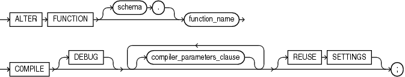

The `ALTER` `FUNCTION` statement explicitly recompiles a standalone function. Explicit recompilation eliminates the need for implicit runtime recompilation and prevents associated runtime compilation errors and performance overhead.

Note:

This statement does not change the declaration or definition of an existing function. To redeclare or redefine a standalone function, use the ["CREATE FUNCTION Statement"](create_function.md) with the `OR` `REPLACE` clause.

Topics

Prerequisites

If the function is in the `SYS` schema, you must be connected as `SYSDBA`. Otherwise, the function must be in your schema or you must have `ALTER` `ANY` `PROCEDURE` system privilege.

Syntax

alter\_function::=



> ```
> ALTER FUNCTION [ schema. ] function
>   COMPILE [ DEBUG ]
>   [ compiler_parameters_clause ... ]
>   [ REUSE SETTINGS ]
>   ;
> ```
>
> [Copyright © 1996, 2014, Oracle and/or its affiliates. All rights reserved.](https://docs.oracle.com/cd/E11882_01/dcommon/html/cpyr.htm)
  

compiler\_parameters\_clause::=

  
[Description of the illustration compiler\_parameters\_clause.gif](https://docs.oracle.com/cd/E11882_01/appdev.112/e25519/img_text/compiler_parameters_clause.htm)  
  

Semantics

schema

Name of the schema containing the function. Default: your schema.

function

Name of the function to be recompiled.

COMPILE

Recompiles the function, whether it is valid or invalid.

First, if any of the objects upon which the function depends are invalid, the database recompiles them.

The database also invalidates any local objects that depend upon the function, such as subprograms that invoke the recompiled function or package bodies that define subprograms that invoke the recompiled function.

If the database recompiles the function successfully, then the function becomes valid. Otherwise, the database returns an error and the function remains invalid.

During recompilation, the database drops all persistent compiler switch settings, retrieves them again from the session, and stores them after compilation. To avoid this process, specify the `REUSE` `SETTINGS` clause.

DEBUG

Has the same effect as `PLSQL_OPTIMIZE_LEVEL=1` —instructs the PL/SQL compiler to generate and store the code for use by the PL/SQL debugger. Oracle recommends using `PLSQL_OPTIMIZE_LEVEL=1` instead of `DEBUG`.

REUSE SETTINGS

Prevents Oracle Database from dropping and reacquiring compiler switch settings. With this clause, Oracle preserves the existing settings and uses them for the recompilation of any parameters for which values are not specified elsewhere in this statement.

compiler\_parameters\_clause

Specifies a value for a PL/SQL compilation parameter in [Table 1-2](overview.md). The compile-time value of each of these parameters is stored with the metadata of the PL/SQL unit being compiled.

You can specify each parameter only once in each statement. Each setting is valid only for the PL/SQL unit being compiled and does not affect other compilations in this session or system. To affect the entire session or system, you must set a value for the parameter using the `ALTER` `SESSION` or `ALTER` `SYSTEM` statement.

If you omit any parameter from this clause and you specify `REUSE` `SETTINGS`, then if a value was specified for the parameter in an earlier compilation of this PL/SQL unit, the database uses that earlier value. If you omit any parameter and either you do not specify `REUSE` `SETTINGS` or no value was specified for the parameter in an earlier compilation, then the database obtains the value for that parameter from the session environment.

Example

Recompiling a Function: Example To explicitly recompile the function `get_bal` owned by the sample user `oe`, issue this statement:

```
ALTER FUNCTION oe.get_bal COMPILE;
```

If the database encounters no compilation errors while recompiling `get_bal`, then `get_bal` becomes valid. The database can subsequently run it without recompiling it at run time. If recompiling `get_bal` results in compilation errors, then the database returns an error, and `get_bal` remains invalid.

The database also invalidates all objects that depend upon `get_bal`. If you subsequently reference one of these objects without explicitly recompiling it first, then the database recompiles it implicitly at run time.