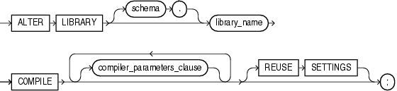

The `ALTER` `LIBRARY` statement explicitly recompiles a library. Explicit recompilation eliminates the need for implicit runtime recompilation and prevents associated runtime compilation errors and performance overhead.

Note:

This statement does not change the declaration or definition of an existing library. To redeclare or redefine a library, use the ["CREATE LIBRARY Statement"](create_library.md) with the `OR` `REPLACE` clause.

Topics

Prerequisites

If the library is in the `SYS` schema, you must be connected as `SYSDBA`. Otherwise, the library must be in your schema or you must have the `ALTER` `ANY` `LIBRARY` system privilege.

Syntax

alter\_library::=



> ```
> ALTER LIBRARY [ schema. ] library
>   COMPILE [ compiler_parameters_clause ... ]
>   [ REUSE SETTINGS ]
>   ;
> ```
>
> [Copyright © 1996, 2014, Oracle and/or its affiliates. All rights reserved.](https://docs.oracle.com/cd/E11882_01/dcommon/html/cpyr.htm)
  

compiler\_parameters\_clause::=

  
[Description of the illustration compiler\_parameters\_clause.gif](https://docs.oracle.com/cd/E11882_01/appdev.112/e25519/img_text/compiler_parameters_clause.htm)  
  

Semantics

library\_name

Name of the library to be recompiled.

COMPILE

Recompiles the library.

During recompilation, the database drops all persistent compiler switch settings, retrieves them again from the session, and stores them after compilation. To avoid this process, specify `REUSE` `SETTINGS`.

DEBUG

Has the same effect as `PLSQL_OPTIMIZE_LEVEL=1` —instructs the PL/SQL compiler to generate and store the code for use by the PL/SQL debugger. Oracle recommends using `PLSQL_OPTIMIZE_LEVEL=1` instead of `DEBUG`.

REUSE SETTINGS

Prevents Oracle from dropping and reacquiring compiler switch settings. Preserves the existing settings and uses them for the recompilation of any parameters for which values are not specified elsewhere in this statement.

compiler\_parameters\_clause

Has the same behavior for a type as it does for a function. See the `ALTER` `FUNCTION` ["compiler\_parameters\_clause"](alter_function.md).

Examples

Recompiling a Library: Example To explicitly recompile the library `my_ext_lib` owned by the sample user `hr`, issue this statement:

```
ALTER LIBRARY hr.my_ext_lib COMPILE;
```

If the database encounters no compilation errors while recompiling `my_ext_lib`, then `my_ext_lib` becomes valid. The database can subsequently run it without recompiling it at run time. If recompiling `my_ext_lib` results in compilation errors, then the database returns an error, and `my_ext_lib` remains invalid.

The database also invalidates all objects that depend upon `my_ext_lib`. If you subsequently reference one of these objects without explicitly recompiling it first, then the database recompiles it implicitly at run time.