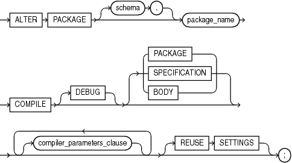

The `ALTER` `PACKAGE` statement explicitly recompiles a package specification, body, or both. Explicit recompilation eliminates the need for implicit runtime recompilation and prevents associated runtime compilation errors and performance overhead.

Because all objects in a package are stored as a unit, the `ALTER` `PACKAGE` statement recompiles all package objects. You cannot use the `ALTER` `PROCEDURE` statement or `ALTER` `FUNCTION` statement to recompile individually a procedure or function that is part of a package.

Note:

This statement does not change the declaration or definition of an existing package. To redeclare or redefine a package, use the ["CREATE PACKAGE Statement"](create_package.md), or the ["CREATE PACKAGE BODY Statement"](create_package_body.md) with the `OR` `REPLACE` clause.

Topics

Prerequisites

If the package is in the `SYS` schema, you must be connected as `SYSDBA`. Otherwise, the package must be in your schema or you must have `ALTER` `ANY` `PROCEDURE` system privilege.

Syntax

alter\_package::=



> ```
> ALTER PACKAGE [ schema. ] package
>   COMPILE [ DEBUG ] { PACKAGE | SPECIFICATION | BODY }
>   [ compiler_parameters_clause ... ]
>   [ REUSE SETTINGS ]
>   ;
> ```
>
> [Copyright © 1996, 2014, Oracle and/or its affiliates. All rights reserved.](https://docs.oracle.com/cd/E11882_01/dcommon/html/cpyr.htm)
  
  

compiler\_parameters\_clause::=

  
[Description of the illustration compiler\_parameters\_clause.gif](https://docs.oracle.com/cd/E11882_01/appdev.112/e25519/img_text/compiler_parameters_clause.htm)  

Semantics

schema

Name of the schema containing the package. Default: your schema.

package

Name of the package to be recompiled.

COMPILE

Recompiles the package specification, body, or both.

During recompilation, the database drops all persistent compiler switch settings, retrieves them again from the session, and stores them after compilation. To avoid this process, specify `REUSE` `SETTINGS`.

See Also:

"Recompiling a Package: Examples"

DEBUG

Has the same behavior for a type as it does for a function. See ["DEBUG"](alter_function.md).

SPECIFICATION

Recompiles only the package specification, whether it is valid or invalid. You might want to recompile a package specification to check for compilation errors after modifying the specification.

When you recompile a package specification, the database invalidates any local objects that depend on the specification, such as procedures that invoke procedures or functions in the package. The body of a package also depends on its specification. If you subsequently reference one of these dependent objects without first explicitly recompiling it, then the database recompiles it implicitly at run time.

BODY

Recompiles only the package body, whether it is valid or invalid. You might want to recompile a package body after modifying it. Recompiling a package body does not invalidate objects that depend upon the package specification.

When you recompile a package body, the database first recompiles the objects on which the body depends, if any of those objects are invalid. If the database recompiles the body successfully, then the body becomes valid.

PACKAGE

(Default) Recompiles both the package specification and (if it exists) the package body, whether they are valid or invalid. The recompilation of the package specification and body lead to the invalidation and recompilation of dependent objects as described for `SPECIFICATION` and `BODY`.

REUSE SETTINGS

Has the same behavior for a package as it does for a function. See ["REUSE SETTINGS"](alter_function.md).

compiler\_parameters\_clause

Has the same behavior for a package as it does for a function. See the `ALTER` `FUNCTION` ["compiler\_parameters\_clause"](alter_function.md).

Examples

Recompiling a Package: Examples This statement explicitly recompiles the specification and body of the `hr.emp_mgmt` package. See ["Creating a Package: Example"](create_package.md) for the example that creates this package.

```
ALTER PACKAGE emp_mgmt COMPILE PACKAGE;
```

If the database encounters no compilation errors while recompiling the `emp_mgmt` specification and body, then `emp_mgmt` becomes valid. The user `hr` can subsequently invoke or reference all package objects declared in the specification of `emp_mgmt` without runtime recompilation. If recompiling `emp_mgmt` results in compilation errors, then the database returns an error and `emp_mgmt` remains invalid.

The database also invalidates all objects that depend upon `emp_mgmt`. If you subsequently reference one of these objects without explicitly recompiling it first, then the database recompiles it implicitly at run time.

To recompile the body of the `emp_mgmt` package in the schema `hr`, issue this statement:

```
ALTER PACKAGE hr.emp_mgmt  COMPILE BODY;
```

If the database encounters no compilation errors while recompiling the package body, then the body becomes valid. The user `hr` can subsequently invoke or reference all package objects declared in the specification of `emp_mgmt` without runtime recompilation. If recompiling the body results in compilation errors, then the database returns an error message and the body remains invalid.

Because this statement recompiles the body and not the specification of `emp_mgmt`, the database does not invalidate dependent objects.