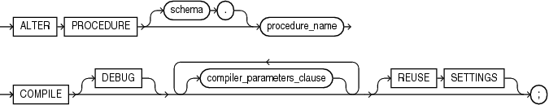

The `ALTER` `PROCEDURE` statement explicitly recompiles a standalone procedure. Explicit recompilation eliminates the need for implicit runtime recompilation and prevents associated runtime compilation errors and performance overhead.

To recompile a procedure that is part of a package, recompile the entire package using the ["ALTER PACKAGE Statement"](alter_package.md)).

Note:

This statement does not change the declaration or definition of an existing procedure. To redeclare or redefine a standalone procedure, use the ["CREATE PROCEDURE Statement"](create_procedure.md) with the `OR` `REPLACE` clause.

The `ALTER` `PROCEDURE` statement is very similar to the `ALTER` `FUNCTION` statement. See ["ALTER FUNCTION Statement"](alter_function.md) for more information.

Topics

Prerequisites

If the procedure is in the `SYS` schema, you must be connected as `SYSDBA`. Otherwise, the procedure must be in your schema or you must have `ALTER` `ANY` `PROCEDURE` system privilege.

Syntax

alter\_procedure::=



> ```
> ALTER PROCEDURE [ schema. ] procedure
>   COMPILE [ DEBUG ]
>   [ compiler_parameters_clause ... ]
>   [ REUSE SETTINGS ]
>   ;
> ```
>
> [Copyright © 1996, 2014, Oracle and/or its affiliates. All rights reserved.](https://docs.oracle.com/cd/E11882_01/dcommon/html/cpyr.htm)
  
  

compiler\_parameters\_clause::=

  
[Description of the illustration compiler\_parameters\_clause.gif](https://docs.oracle.com/cd/E11882_01/appdev.112/e25519/img_text/compiler_parameters_clause.htm)  

Semantics

schema

Name of the schema containing the procedure. Default: your schema.

procedure

Name of the procedure to be recompiled.

COMPILE

Has the same behavior for a procedure as it does for a function. See the `ALTER` `FUNCTION` ["COMPILE"](alter_function.md).

See Also:

"Recompiling a Procedure: Example"

DEBUG

Has the same behavior for a procedure as it does for a function. See ["DEBUG"](alter_function.md).

See Also:

[Oracle Database Advanced Application Developer's Guide](https://docs.oracle.com/cd/E11882_01/appdev.112/e41502/adfns_psp.htm#ADFNS1210) for information about debugging procedures

REUSE SETTINGS

Has the same behavior for a procedure as it does for a function. See ["REUSE SETTINGS"](alter_function.md).

compiler\_parameters\_clause

Has the same behavior for a procedure as it does for a function. See the `ALTER` `FUNCTION` ["compiler\_parameters\_clause"](alter_function.md).

Example

Recompiling a Procedure: Example To explicitly recompile the procedure `remove_emp` owned by the user `hr`, issue this statement:

```
ALTER PROCEDURE hr.remove_emp COMPILE;
```

If the database encounters no compilation errors while recompiling `remove_emp`, then `remove_emp` becomes valid. The database can subsequently run it without recompiling it at run time. If recompiling `remove_emp` results in compilation errors, then the database returns an error and `remove_emp` remains invalid.

the database also invalidates all dependent objects. These objects include any procedures, functions, and package bodies that invoke `remove_emp`. If you subsequently reference one of these objects without first explicitly recompiling it, then the database recompiles it implicitly at run time.