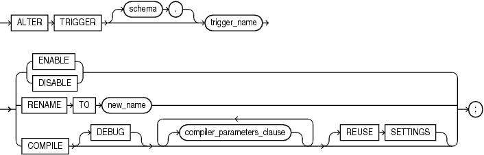

The `ALTER` `TRIGGER` statement enables, disables, compiles, or renames a database trigger.

Note:

This statement does not change the declaration or definition of an existing trigger. To redeclare or redefine a trigger, use the ["CREATE TRIGGER Statement"](create_trigger.md) with the `OR` `REPLACE` clause.

Topics

Prerequisites

If the trigger is in the `SYS` schema, you must be connected as `SYSDBA`. Otherwise, the trigger must be in your schema or you must have `ALTER` `ANY` `TRIGGER` system privilege.

In addition, to alter a trigger on `DATABASE`, you must have the `ADMINISTER` `DATABASE` `TRIGGER` system privilege.

See Also:

["CREATE TRIGGER Statement"](create_trigger.md) for more information about triggers based on `DATABASE` triggers

Syntax

alter\_trigger::=



> ```
> ALTER TRIGGER [ schema. ] trigger
>   { { ENABLE | DISABLE }
>   | RENAME TO new_name
>   | COMPILE [ DEBUG ] [ compiler_parameters_clause ... ] [ REUSE SETTINGS ]
>   }
>   ;
> ```
>
> [Copyright © 1996, 2014, Oracle and/or its affiliates. All rights reserved.](https://docs.oracle.com/cd/E11882_01/dcommon/html/cpyr.htm)
  
  

compiler\_parameters\_clause::=

  
[Description of the illustration compiler\_parameters\_clause.gif](https://docs.oracle.com/cd/E11882_01/appdev.112/e25519/img_text/compiler_parameters_clause.htm)  

Semantics

schema

Name of the schema containing the trigger. Default: your schema.

trigger

Name of the trigger to be altered.

ENABLE

Enables the trigger.

DISABLE

Disables the trigger.

See Also:

- "Enabling Triggers: Example"
- "Disabling Triggers: Example"

RENAME TO new\_name

Renames the trigger without changing its state.

When you rename a trigger, the database rebuilds the remembered source of the trigger in the `USER_SOURCE`, `ALL_SOURCE`, and `DBA_SOURCE` static data dictionary views. As a result, comments and formatting may change in the `TEXT` column of those views even though the trigger source did not change.

COMPILE

Recompiles the trigger, whether it is valid or invalid.

First, if any of the objects upon which the trigger depends are invalid, the database recompiles them.

If the database recompiles the trigger successfully, then the trigger becomes valid. Otherwise, the database returns an error and the trigger remains invalid.

During recompilation, the database drops all persistent compiler switch settings, retrieves them again from the session, and stores them after compilation. To avoid this process, specify `REUSE` `SETTINGS`.

DEBUG

Has the same behavior for a trigger as it does for a function. See ["DEBUG"](alter_function.md).

See Also:

[Oracle Database Advanced Application Developer's Guide](https://docs.oracle.com/cd/E11882_01/appdev.112/e41502/adfns_sqltypes.htm#ADFNS209) for information about debugging a trigger using the same facilities available for stored subprograms

REUSE SETTINGS

Has the same behavior for a trigger as it does for a function. See [REUSE SETTINGS](alter_function.md).

compiler\_parameters\_clause

Has the same behavior for a trigger as it does for a function. See the `ALTER` `FUNCTION` ["compiler\_parameters\_clause"](alter_function.md).

Examples

Disabling Triggers: Example The sample schema `hr` has a trigger named `update_job_history` created on the `employees` table. The trigger fires whenever an `UPDATE` statement changes an employee's `job_id`. The trigger inserts into the `job_history` table a row that contains the employee's ID, begin and end date of the last job, and the job ID and department.

When this trigger is created, the database enables it automatically. You can subsequently disable the trigger with this statement:

```
ALTER TRIGGER update_job_history DISABLE;
```

When the trigger is disabled, the database does not fire the trigger when an `UPDATE` statement changes an employee's job.

Enabling Triggers: Example After disabling the trigger, you can subsequently enable it with this statement:

```
ALTER TRIGGER update_job_history ENABLE;
```

After you reenable the trigger, the database fires the trigger whenever an `UPDATE` statement changes an employee's job. If an employee's job is updated while the trigger is disabled, then the database does not automatically fire the trigger for this employee until another transaction changes the `job_id` again.