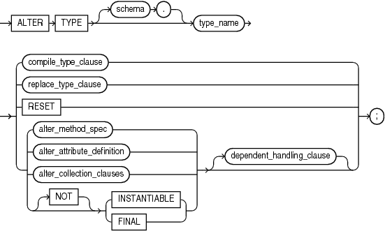
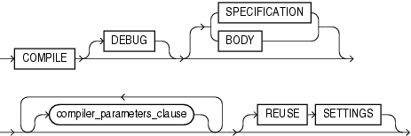
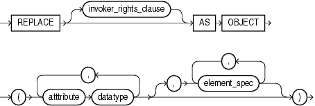
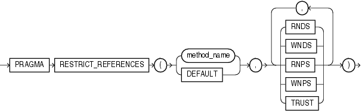
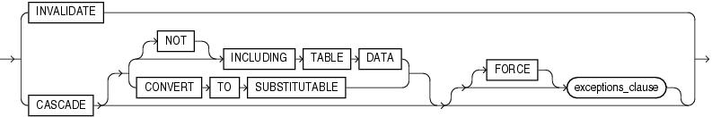
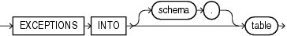

The `ALTER` `TYPE` statement does one of the following to a type that was created with ["CREATE TYPE Statement"](create_type.md) and ["CREATE TYPE BODY Statement"](create_type_body.md):

- Evolves the type; that is, adds or drops member attributes or methods.
	For more information about type evolution, see [Oracle Database Object-Relational Developer's Guide](https://docs.oracle.com/cd/E11882_01/appdev.112/e11822/adobjadv.htm#ADOBJ00603).
- Changes the specification of the type by adding object member subprogram specifications.
- Recompiles the specification or body of the type.
- Resets the version of the type to 1, so that it is no longer considered to be evolved.

Topics

Prerequisites

If the type is in the `SYS` schema, you must be connected as `SYSDBA`. Otherwise, the type must be in your schema and you must have `CREATE` `TYPE` or `CREATE` `ANY` `TYPE` system privilege, or you must have `ALTER` `ANY` `TYPE` system privileges.

Syntax

alter\_type::=



> ```
> ALTER TYPE [ schema. ]type
>   { compile_type_clause
>   | replace_type_clause
>   | { alter_method_spec
>     | alter_attribute_definition
>     | alter_collection_clauses
>     | [ NOT ] { INSTANTIABLE | FINAL }
>     }
>     [ dependent_handling_clause ]
>   }
>   ;
> ```
>
> [Copyright © 1996, 2014, Oracle and/or its affiliates. All rights reserved.](https://docs.oracle.com/cd/E11882_01/dcommon/html/cpyr.htm)
  
  

See:

- "alter\_attribute\_definition::="
- "alter\_method\_spec::="
- "alter\_collections\_clauses::="
- "compile\_type\_clause::="
- "dependent\_handling\_clause::="
- "replace\_type\_clause::="

compile\_type\_clause::=



> ```
> COMPILE
>    [ DEBUG ]
>    [ SPECIFICATION | BODY ]
>    [ compiler_parameters_clause ...
>    [ REUSE SETTINGS ]
> ```
>
> [Copyright © 1996, 2014, Oracle and/or its affiliates. All rights reserved.](https://docs.oracle.com/cd/E11882_01/dcommon/html/cpyr.htm)
  
  

compiler\_parameters\_clause::=

  
[Description of the illustration compiler\_parameters\_clause.gif](https://docs.oracle.com/cd/E11882_01/appdev.112/e25519/img_text/compiler_parameters_clause.htm)  
  

replace\_type\_clause::=



> ```
> REPLACE [ invoker_rights_clause ] AS OBJECT
>    (attribute datatype [, attribute datatype ]...   [, element_spec [, element_spec ]... ])
> ```
>
> [Copyright © 1996, 2014, Oracle and/or its affiliates. All rights reserved.](https://docs.oracle.com/cd/E11882_01/dcommon/html/cpyr.htm)
  
  

invoker\_rights\_clause::=


> ```
> AUTHID { CURRENT_USER | DEFINER }
> ```
>
> [Copyright © 1996, 2014, Oracle and/or its affiliates. All rights reserved.](https://docs.oracle.com/cd/E11882_01/dcommon/html/cpyr.htm)
  
  

element\_spec::=


> ```
> [ inheritance_clauses ]
> { subprogram_spec
> | constructor_spec
> | map_order_function_spec
> }... [, restrict_references_pragma ]
> ```
>
> [Copyright © 1996, 2014, Oracle and/or its affiliates. All rights reserved.](https://docs.oracle.com/cd/E11882_01/dcommon/html/cpyr.htm)
  
  

See:

- "constructor\_spec::="
- "inheritance\_clauses::="
- "map\_order\_function\_spec::="
- "restrict\_references\_pragma"
- "subprogram\_spec::="

inheritance\_clauses::=


> ```
> { [ NOT ] { OVERRIDING | FINAL | INSTANTIABLE } }...
> ```
>
> [Copyright © 1996, 2014, Oracle and/or its affiliates. All rights reserved.](https://docs.oracle.com/cd/E11882_01/dcommon/html/cpyr.htm)
  
  

subprogram\_spec::=


> ```
> { MEMBER | STATIC } { procedure_spec | function_spec }
> ```
>
> [Copyright © 1996, 2014, Oracle and/or its affiliates. All rights reserved.](https://docs.oracle.com/cd/E11882_01/dcommon/html/cpyr.htm)
  
  

See:

- "function\_spec::="
- "procedure\_spec::="

procedure\_spec::=


> ```
> PROCEDURE procedure_name
>   (parameter datatype [, parameter datatype ]...)
>   [ { IS | AS } call_spec ]
> ```
>
> [Copyright © 1996, 2014, Oracle and/or its affiliates. All rights reserved.](https://docs.oracle.com/cd/E11882_01/dcommon/html/cpyr.htm)
  
  

See ["call\_spec::="](create_function.md).

function\_spec::=


> ```
> FUNCTION name
>    (parameter datatype [, parameter datatype ]...)
>    return_clause
> ```
>
> [Copyright © 1996, 2014, Oracle and/or its affiliates. All rights reserved.](https://docs.oracle.com/cd/E11882_01/dcommon/html/cpyr.htm)
  
  

return\_clause::=


> ```
> { RETURN datatype [ { IS | AS } call_spec ]| sqlj_object_type_sig }
> ```
>
> [Copyright © 1996, 2014, Oracle and/or its affiliates. All rights reserved.](https://docs.oracle.com/cd/E11882_01/dcommon/html/cpyr.htm)
  
  

See ["call\_spec::="](create_function.md).

constructor\_spec::=


> ```
> [ FINAL ] [ INSTANTIABLE ]
> CONSTRUCTOR FUNCTION datatype
> [ ([ SELF IN OUT datatype, ]
>    parameter datatype [, parameter datatype ]...
>   )
> ]
> RETURN SELF AS RESULT
> [ { IS | AS } call_spec ]
> ```
>
> [Copyright © 1996, 2014, Oracle and/or its affiliates. All rights reserved.](https://docs.oracle.com/cd/E11882_01/dcommon/html/cpyr.htm)
  
  

See ["call\_spec::="](create_function.md).

map\_order\_function\_spec::=


> ```
> { MAP | ORDER } MEMBER function_spec
> ```
>
> [Copyright © 1996, 2014, Oracle and/or its affiliates. All rights reserved.](https://docs.oracle.com/cd/E11882_01/dcommon/html/cpyr.htm)
  
  

See "function\_spec::=".

pragma\_clause::=



> ```
> PRAGMA RESTRICT_REFERENCES
> ( { method_name | DEFAULT } ,
>   { RNDS | WNDS | RNPS | WNPS | TRUST }
>    [, { RNDS | WNDS | RNPS | WNPS | TRUST } ]...
> )
> ```
>
> [Copyright © 1996, 2014, Oracle and/or its affiliates. All rights reserved.](https://docs.oracle.com/cd/E11882_01/dcommon/html/cpyr.htm)
  
  

alter\_method\_spec::=


> ```
> { ADD | DROP } { map_order_function_spec | subprogram_spec }
>   [, { ADD | DROP } { map_order_function_spec | subprogram_spec } ]...
> ```
>
> [Copyright © 1996, 2014, Oracle and/or its affiliates. All rights reserved.](https://docs.oracle.com/cd/E11882_01/dcommon/html/cpyr.htm)
  
  

See:

- "map\_order\_function\_spec::="
- "subprogram\_spec::="

alter\_attribute\_definition::=


> ```
> { { ADD | MODIFY } ATTRIBUTE
>      { attribute [ datatype ]
>      | ( attribute datatype [, attribute datatype ]... )
>      }
> | DROP ATTRIBUTE
>      { attribute
>      | ( attribute [, attribute ]... )
>      }
> }
> ```
>
> [Copyright © 1996, 2014, Oracle and/or its affiliates. All rights reserved.](https://docs.oracle.com/cd/E11882_01/dcommon/html/cpyr.htm)
  
  

alter\_collections\_clauses::=


> ```
> MODIFY { LIMIT integer | ELEMENT TYPE datatype }
> ```
>
> [Copyright © 1996, 2014, Oracle and/or its affiliates. All rights reserved.](https://docs.oracle.com/cd/E11882_01/dcommon/html/cpyr.htm)
  
  

dependent\_handling\_clause::=



> ```
> { INVALIDATE
> | CASCADE [ { [ NOT ] INCLUDING TABLE DATA
>             | CONVERT TO SUBSTITUTABLE
>             }
>           ]
>      [ [FORCE ] exceptions_clause ]
> }
> ```
>
> [Copyright © 1996, 2014, Oracle and/or its affiliates. All rights reserved.](https://docs.oracle.com/cd/E11882_01/dcommon/html/cpyr.htm)
  
  

exceptions\_clause::=



> ```
> EXCEPTIONS INTO [ schema. ] table
> ```
>
> [Copyright © 1996, 2014, Oracle and/or its affiliates. All rights reserved.](https://docs.oracle.com/cd/E11882_01/dcommon/html/cpyr.htm)
  

Semantics

schema

Name of the schema containing the type. Default: your schema.

type

Name of an ADT, `VARRAY` type, or nested table type.

Restriction on type You cannot evolve an editioned ADT.

The `ALTER` `TYPE` statement fails with ORA-22348 if either of the following is true:

- `type` is an editioned ADT and the `ALTER` `TYPE` statement has no `compile_type_clause`.
	(You can use the `ALTER` `TYPE` statement to recompile an editioned object type, but not for any other purpose.)
- `type` has a dependent that is an editioned ADT and the `ALTER` `TYPE` statement has a `CASCADE` clause.

An editioned object is a schema object that has an editionable object type and was created by a user for whom editions are enabled. For more information about editioned objects, see [Oracle Database Advanced Application Developer's Guide](https://docs.oracle.com/cd/E11882_01/appdev.112/e41502/adfns_editions.htm#ADFNS99923).

RESET

Resets the version of this type to 1, so that it is no longer considered to be evolved.

Note:

Resetting the version of this type to 1 invalidates all of its dependents.

`RESET` is intended for evolved ADTs that are preventing their owners from being editions-enabled. For information about enabling editions for users, see [Oracle Database Advanced Application Developer's Guide](https://docs.oracle.com/cd/E11882_01/appdev.112/e41502/adfns_editions.htm#ADFNS99878).

To see the version number of an ADT, select `VERSION#` from the static data dictionary view `*_TYPE_VERSIONS`. For example:

```
SELECT Version# FROM DBA_TYPE_VERSIONS
WHERE Owner = schema
AND Name = 'type_name'
AND Type = 'TYPE'
```

For an evolved ADT, the preceding query returns multiple rows with different version numbers. `RESET` deletes every row whose version number is less than the maximum version number, and resets the version number of the remaining rows to 1—see "Evolving and Resetting an ADT: Example".

Restriction on RESET You cannot specify `RESET` if the type has any table dependents (direct or indirect).

\[NOT\] INSTANTIABLE

Specify `INSTANTIABLE` if object instances of this type can be constructed.

Specify `NOT` `INSTANTIABLE` if no constructor (default or user-defined) exists for this type. You must specify these keywords for any type with noninstantiable methods and for any type that has no attributes (either inherited or specified in this statement).

Restriction on NOT INSTANTIABLE You cannot change a user-defined type from `INSTANTIABLE` to `NOT` `INSTANTIABLE` if the type has any table dependents.

\[NOT\] FINAL

Specify `FINAL` if no further subtypes can be created for this type.

Specify `NOT` `FINAL` if further subtypes can be created under this type.

If you change the property from `FINAL` to `NOT` `FINAL`, or the reverse, then you must specify the `CASCADE` clause of the "dependent\_handling\_clause" to convert data in dependent columns and tables. Specifically:

- If you change a type from `NOT` `FINAL` to `FINAL`, then you must specify `CASCADE` \[`INCLUDING` `TABLE` `DATA`\]. You cannot defer data conversion with `CASCADE` `NOT` `INCLUDING` `TABLE` `DATA`.
- If you change a type from `FINAL` to `NOT` `FINAL`, then:
	- Specify `CASCADE` `INCLUDING` `TABLE` `DATA` if you want to create substitutable tables and columns of that type, but you are not concerned about the substitutability of the existing dependent tables and columns.
		The database marks all existing dependent columns and tables `NOT` `SUBSTITUTABLE` `AT` `ALL` `LEVELS`, so you cannot insert the subtype instances of the altered type into these existing columns and tables.
		- Specify `CASCADE` `CONVERT` `TO` `SUBSTITUTABLE` if you want to create substitutable tables and columns of the type and also store subtype instances of the altered type in existing dependent tables and columns.
		The database marks all existing dependent columns and tables `SUBSTITUTABLE` `AT` `ALL` `LEVELS` except those that are explicitly marked `NOT` `SUBSTITUTABLE` `AT` `ALL` `LEVELS`.
		See Also:
		[Oracle Database Object-Relational Developer's Guide](https://docs.oracle.com/cd/E11882_01/appdev.112/e11822/adobjadv.htm#ADOBJ00603) for a full discussion of ADT evolution

Restriction on FINAL You cannot change a user-defined type from `NOT` `FINAL` to `FINAL` if the type has any subtypes.

compile\_type\_clause

(Default) Recompiles the type specification and body.

During recompilation, the database drops all persistent compiler switch settings, retrieves them again from the session, and stores them after compilation. To avoid this process, specify `REUSE` `SETTINGS`.

If recompiling the type results in compilation errors, then the database returns an error and the type remains invalid. You can see the associated compiler error messages with the SQL\*Plus command `SHOW` `ERRORS`.

See Also:

- "Recompiling a Type: Example"
- "Recompiling a Type Specification: Example"

COMPILE

Has the same behavior for a type as it does for a function. See ["COMPILE"](alter_function.md).

DEBUG

Has the same behavior for a type as it does for a function. See ["DEBUG"](alter_function.md).

SPECIFICATION

Recompiles only the type specification.

BODY

Recompiles only the type body.

compiler\_parameters\_clause

Has the same behavior for a type as it does for a function. See the `ALTER` `FUNCTION` ["compiler\_parameters\_clause"](alter_function.md).

REUSE SETTINGS

Has the same behavior for a type as it does for a function. See ["REUSE SETTINGS"](alter_function.md).

replace\_type\_clause

Adds member subprogram specifications.

Restriction on replace\_type\_clause This clause is valid only for ADTs, not for nested tables or varrays.

invoker\_rights\_clause

Specifies the `AUTHID` property of the member functions and procedures of the ADT. For information about the `AUTHID` property, see ["Invoker's Rights and Definer's Rights (AUTHID Property)"](subprograms.md).

Restriction on invoker\_rights\_clause You can specify this clause only for an ADT, not for a nested table or varray.

attribute

Name of an object attribute. Attributes are data items with a name and a type specifier that form the structure of the object.

element\_spec

Specifies elements of the redefined object.

inheritance\_clauses

Specifies the relationship between supertypes and subtypes.

subprogram\_spec

Specifies a subprogram to be referenced as an ADT attribute. For each such subprogram, you must specify a corresponding method body in the ADT body.

See Also:

- ["CREATE TYPE Statement"](create_type.md) for a description of the difference between member and static methods, and for examples
- ["CREATE TYPE BODY Statement"](create_type_body.md)
- ["Overloaded Subprograms"](subprograms.md) for information about overloading subprogram names in a package

procedure\_spec

Specification of a procedure subprogram.

function\_spec

Specification of a function subprogram.

restrict\_references\_pragma

Deprecated clause, described in ["RESTRICT\_REFERENCES Pragma"](restrictreferences_pragma.md).

Restriction on restrict\_references\_pragma This clause is not valid when dropping a method.

See Also:

[Oracle Database Advanced Application Developer's Guide](https://docs.oracle.com/cd/E11882_01/appdev.112/e41502/adfns_sqlproc.htm#ADFNS007) for more information about pragmas

map\_order\_function\_spec

You can declare either one `MAP` method or one `ORDER` method, regardless of how many `MEMBER` or `STATIC` methods you declare. However, a subtype can override a `MAP` method if the supertype defines a `NOT` `FINAL` `MAP` method. If you declare either method, then you can compare object instances in SQL.

If you do not declare either method, then you can compare object instances only for equality or inequality. Instances of the same type definition are equal only if each pair of their corresponding attributes is equal. You must not specify a comparison method to determine the equality of two ADTs.

MAP

For `MAP`, specify a member function (`MAP` method) that returns the relative position of a given instance in the ordering of all instances of the object. A map method is called implicitly and induces an ordering of object instances by mapping them to values of a predefined scalar type. The database uses the ordering for comparison conditions and `ORDER` `BY` clauses.

If `type` is to be referenced in queries involving sorts (through `ORDER` `BY`, `GROUP` `BY`, `DISTINCT`, or `UNION` clauses) or joins, and you want those queries to be parallelized, then you must specify a `MAP` member function.

If the argument to the `MAP` method is null, then the `MAP` method returns null and the method is not invoked.

An object specification can contain only one `MAP` method, which must be a function. The result type must be a predefined SQL scalar type, and the `MAP` function can have no arguments other than the implicit `SELF` argument.

A subtype cannot define a new `MAP` method, but it can override an inherited `MAP` method.

ORDER

For `ORDER`, specify a member function (`ORDER` method) that takes an instance of an object as an explicit argument and the implicit `SELF` argument and returns either a negative, zero, or positive integer. The negative, zero, or positive value indicates that the implicit `SELF` argument is less than, equal to, or greater than the explicit argument.

If either argument to the `ORDER` method is null, then the `ORDER` method returns null and the method is not invoked.

When instances of the same ADT definition are compared in an `ORDER` `BY` clause, the `ORDER` method function is invoked.

An object specification can contain only one `ORDER` method, which must be a function having the return type `NUMBER`.

A subtype cannot define an `ORDER` method, nor can it override an inherited `ORDER` method.

alter\_method\_spec

Adds a method to or drops a method from `type`. The database disables any function-based indexes that depend on the type.

In one `ALTER` `TYPE` statement you can add or drop multiple methods, but you can reference each method only once.

ADD

When you add a method, its name must not conflict with any existing attributes in its type hierarchy.

See Also:

"Adding a Member Function: Example"

DROP

When you drop a method, the database removes the method from the target type.

Restriction on DROP You cannot drop from a subtype a method inherited from its supertype. Instead you must drop the method from the supertype.

subprogram\_spec

The `MEMBER` and `STATIC` clauses let you add a procedure subprogram to or drop it from the ADT.

Restriction on subprogram\_spec You cannot define a `STATIC` method on a subtype that redefines a `MEMBER` method in its supertype, or vice versa.

map\_order\_function\_spec

If you declare either a `MAP` or `ORDER` method, then you can compare object instances in SQL.

Restriction on map\_order\_function\_spec You cannot add an `ORDER` method to a subtype.

alter\_attribute\_definition

Adds, drops, or modifies an attribute of an ADT. In one `ALTER` `TYPE` statement, you can add, drop, or modify multiple member attributes or methods, but you can reference each attribute or method only once.

ADD ATTRIBUTE

Name of the attribute must not conflict with existing attributes or methods in the type hierarchy. The database adds the attribute to the end of the locally defined attribute list.

If you add the attribute to a supertype, then it is inherited by all of its subtypes. In subtypes, inherited attributes always precede declared attributes. Therefore, you might need to update the mappings of the implicitly altered subtypes after adding an attribute to a supertype.

See Also:

"Adding a Collection Attribute: Example"

DROP ATTRIBUTE

When you drop an attribute from a type, the database drops the column corresponding to the dropped attribute and any indexes, statistics, and constraints referencing the dropped attribute.

You need not specify the data type of the attribute you are dropping.

Restrictions on DROP ATTRIBUTE

- You cannot drop an attribute inherited from a supertype. Instead you must drop the attribute from the supertype.
- You cannot drop an attribute that is part of a partitioning, subpartitioning, or cluster key.
	Caution:
	If you use the `INVALIDATE` option, then the compiler does not check dependents; therefore, this rule is not enforced. However, dropping such an attribute leaves the table in an unusable state.
- You cannot drop an attribute of a primary-key-based object identifier of an object table or a primary key of an index-organized table.
- You cannot drop all of the attributes of a root type. Instead you must drop the type. However, you can drop all of the locally declared attributes of a subtype.

MODIFY ATTRIBUTE

Modifies the data type of an existing scalar attribute. For example, you can increase the length of a `VARCHAR2` or `RAW` attribute, or you can increase the precision or scale of a numeric attribute.

Restriction on MODIFY ATTRIBUTE You cannot expand the size of an attribute referenced in a function-based index, domain index, or cluster key.

alter\_collection\_clauses

These clauses are valid only for collection types.

MODIFY LIMIT integer

Increases the number of elements in a varray. It is not valid for nested tables. Specify an integer greater than the current maximum number of elements in the varray.

See Also:

"Increasing the Number of Elements of a Collection Type: Example"

ELEMENT TYPE datatype

Increases the precision, size, or length of a scalar data type of a varray or nested table. This clause is not valid for collections of ADTs.

- For a collection of `NUMBER`, you can increase the precision or scale.
- For a collection of `RAW`, you can increase the maximum size.
- For a collection of `VARCHAR2` or `NVARCHAR2`, you can increase the maximum length.
	See Also:
	"Increasing the Length of a Collection Type: Example"

dependent\_handling\_clause

Specifies how the database is to handle objects that are dependent on the modified type. If you omit this clause, then the `ALTER` `TYPE` statement terminates if `type` has any dependent type or table.

INVALIDATE

Invalidates all dependent objects without any checking mechanism.

Caution:

The database does not validate the type change, so use this clause with caution. For example, if you drop an attribute that is a partitioning or cluster key, then the table becomes unusable.

CASCADE

Propagates the type change to dependent types and tables. The database terminates the statement if any errors are found in the dependent types or tables unless you also specify `FORCE`.

If you change the property of the type between `FINAL` and `NOT` `FINAL`, then you must specify this clause to convert data in dependent columns and tables. See ["\[NOT\] FINAL"](#i2129717).

INCLUDING TABLE DATA

(Default) Converts data stored in all user-defined columns to the most recent version of the column type.

Note:

You must specify this clause if your column data is in Oracle database version 8.0 image format. This clause is also required if you are changing the type property between `FINAL` and `NOT` `FINAL`

- For each attribute added to the column type, the database adds an attribute to the data and initializes it to null.
- For each attribute dropped from the referenced type, the database removes the corresponding attribute data from each row in the table.

If you specify `INCLUDING` `TABLE` `DATA`, then all of the tablespaces containing the table data must be in read/write mode.

If you specify `NOT` `INCLUDING` `TABLE` `DATA`, then the database upgrades the metadata of the column to reflect the changes to the type but does not scan the dependent column and update the data as part of this `ALTER` `TYPE` statement. However, the dependent column data remains accessible, and the results of subsequent queries of the data reflect the type modifications.

See Also:

[Oracle Database Object-Relational Developer's Guide](https://docs.oracle.com/cd/E11882_01/appdev.112/e11822/adobjadv.htm#ADOBJ00603) for more information about the implications of not including table data when modifying type attribute

CONVERT TO SUBSTITUTABLE

Specify this clause if you are changing the type from `FINAL` to `NOT` `FINAL` and you want to create substitutable tables and columns of the type and also store subtype instances of the altered type in existing dependent tables and columns. See ["\[NOT\] FINAL"](#i2129717) for more information.

exceptions\_clause

Specify `FORCE` if you want the database to ignore the errors from dependent tables and indexes and log all errors in the specified exception table. The exception table must have been created by running the `DBMS_UTILITY`.`CREATE_ALTER_TYPE_ERROR_TABLE` procedure.

Examples

Adding a Member Function: Example This example uses the ADT `data_typ1`. See ["ADT Examples"](create_type.md) for the example that creates this ADT. A method is added to `data_typ1` and its type body is modified to correspond. The date formats are consistent with the `order_date` column of the `oe.orders` sample table:

```
ALTER TYPE data_typ1 
   ADD MEMBER FUNCTION qtr(der_qtr DATE) 
   RETURN CHAR CASCADE;

CREATE OR REPLACE TYPE BODY data_typ1 IS 
  MEMBER FUNCTION prod (invent NUMBER) RETURN NUMBER IS 
  BEGIN 
  RETURN (year + invent); 
  END; 
     MEMBER FUNCTION qtr(der_qtr DATE) RETURN CHAR IS 
     BEGIN 
       IF (der_qtr < TO_DATE('01-APR', 'DD-MON')) THEN 
         RETURN 'FIRST'; 
       ELSIF (der_qtr < TO_DATE('01-JUL', 'DD-MON')) THEN 
         RETURN 'SECOND'; 
       ELSIF (der_qtr < TO_DATE('01-OCT', 'DD-MON')) THEN 
         RETURN 'THIRD'; 
       ELSE 
         RETURN 'FOURTH'; 
       END IF; 
     END; 
   END;
/
```

Adding a Collection Attribute: Example This example adds the `author` attribute to the `textdoc_tab` object column of the `text` table. See ["ADT Examples"](create_type.md) for the example that creates the underlying `textdoc_typ` type.

```
CREATE TABLE text (
   doc_id       NUMBER,
   description  textdoc_tab)
   NESTED TABLE description STORE AS text_store;

ALTER TYPE textdoc_typ 
   ADD ATTRIBUTE (author VARCHAR2) CASCADE;
```

The `CASCADE` keyword is required because both the `textdoc_tab` and `text` table are dependent on the `textdoc_typ` type.

Increasing the Number of Elements of a Collection Type: Example This example increases the maximum number of elements in the varray `phone_list_typ_demo`. See ["ADT Examples"](create_type.md) for the example that creates this type.

```
ALTER TYPE phone_list_typ_demo
  MODIFY LIMIT 10 CASCADE;
```

Increasing the Length of a Collection Type: Example This example increases the length of the varray element type `phone_list_typ`:

```
ALTER TYPE phone_list_typ
  MODIFY ELEMENT TYPE VARCHAR(64) CASCADE;
```

Recompiling a Type: Example This example recompiles type `cust_address_typ` in the `hr` schema:

```
ALTER TYPE cust_address_typ2 COMPILE;
```

Recompiling a Type Specification: Example This example compiles the type specification of `link2`.

```
CREATE TYPE link1 AS OBJECT
  (a NUMBER); 
/
CREATE TYPE link2 AS OBJECT
  (a NUMBER, 
   b link1, 
   MEMBER FUNCTION p(c1 NUMBER) RETURN NUMBER); 
/
CREATE TYPE BODY link2 AS
   MEMBER FUNCTION p(c1 NUMBER) RETURN NUMBER IS 
      BEGIN  
         dbms_output.put_line(c1);
         RETURN c1; 
      END; 
   END; 
/
```

In this example, both the specification and body of `link2` are invalidated because `link1`, which is an attribute of `link2`, is altered.

```
ALTER TYPE link1 ADD ATTRIBUTE (b NUMBER) INVALIDATE;
```

You must recompile the type by recompiling the specification and body in separate statements:

```
ALTER TYPE link2 COMPILE SPECIFICATION;
         
ALTER TYPE link2 COMPILE BODY;
```

Alternatively, you can compile both specification and body at the same time:

```
ALTER TYPE link2 COMPILE;
```

Evolving and Resetting an ADT: Example This example creates an ADT in the schema `Usr`, evolves that ADT, and then tries to enable editions for `Usr`, which fails. Then the example resets the version of the ADT to 1 and succeeds in enabling editions for `Usr`. To show the version numbers of the newly created, evolved, and reset ADT, the example uses the static data dictionary view `DBA_TYPE_VERSIONS`.

```
-- Create ADT in schema Usr:
create type Usr.My_ADT authid Definer is object(a1 number)

-- Show version number of ADT:
select Version#||Chr(10)||Text t
from DBA_Type_Versions
where Owner = 'USR'
and Type_Name = 'MY_ADT'
/
```

Result:

```
T
--------------------------------------------------------------------------------
1
type     My_ADT authid Definer is object(a1 number)

1 row selected.

-- Evolve ADT:
alter type Usr.My_ADT add attribute (a2 number)
/

-- Show version number of evolved ADT:
select Version#||Chr(10)||Text t
from DBA_Type_Versions
where Owner = 'USR'
and Type_Name = 'MY_ADT'
/
```

Result:

```
T
--------------------------------------------------------------------------------
1
type     My_ADT authid Definer is object(a1 number)

2
type     My_ADT authid Definer is object(a1 number)

2
 alter type     My_ADT add attribute (a2 number)

3 rows selected.

-- Try to enable editions for Usr:
alter user Usr enable editions
/
```

Result:

```
alter user Usr enable editions
*
ERROR at line 1:
ORA-38820: user has evolved object type

-- Reset version of ADT to 1:
alter type Usr.My_ADT reset
/

-- Show version number of reset ADT:
select Version#||Chr(10)||Text t
from DBA_Type_Versions
where Owner = 'USR'
and Type_Name = 'MY_ADT'
/
```

Result:

```
T
--------------------------------------------------------------------------------
1
type     My_ADT authid Definer is object(a1 number)

1
 alter type     My_ADT add attribute (a2 number)

2 rows selected.

-- Try to enable editions for Usr:
alter user Usr enable editions
/
```

Result:

```
User altered.
```