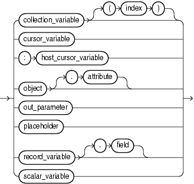
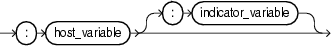

The assignment statement sets the value of a data item to a valid value.

Topics

Syntax

assignment\_statement::=

  
[Description of the illustration assignment\_statement.gif](https://docs.oracle.com/cd/E11882_01/appdev.112/e25519/img_text/assignment_statement.htm)  
  

See ["expression::="](expression.md).

assignment\_statement\_target::=



> ```
> { collection_variable [ ( index ) ]
> | cursor_variable
> | :host_cursor_variable
> | object[.attribute]
> | out_parameter
> | placeholder
> | record_variable[.field]
> | scalar_variable
> }
> ```
>
> [Copyright © 1996, 2014, Oracle and/or its affiliates. All rights reserved.](https://docs.oracle.com/cd/E11882_01/dcommon/html/cpyr.htm)
  

placeholder::=



> ```
> :host_variable[:indicator_variable]
> ```
>
> [Copyright © 1996, 2014, Oracle and/or its affiliates. All rights reserved.](https://docs.oracle.com/cd/E11882_01/dcommon/html/cpyr.htm)
  
  

Semantics

assignment\_statement\_target

Data item to which the value of `expression` is to be assigned.

collection\_variable

Name of a collection variable.

index

Index of an element of `collection_variable`. Without `index`, the entire collection variable is the assignment statement target.

`index` must be a numeric expression whose data type either is `PLS_INTEGER` or can be implicitly converted to `PLS_INTEGER` (for information about the latter, see ["Predefined PLS\_INTEGER Subtypes"](datatypes.md)).

cursor\_variable

Name of a cursor variable.

:host\_cursor\_variable

Name of a cursor variable declared in a PL/SQL host environment and passed to PL/SQL as a bind variable. Do not put space between the colon (:) and `host_cursor_variable`.

The data type of a host cursor variable is compatible with the return type of any PL/SQL cursor variable.

object

Name of an instance of an abstract data type (ADT).

attribute

Name of an attribute of `object`. Without `attribute`, the entire ADT is the assignment statement target.

out\_parameter

Name of a formal `OUT` or `IN` `OUT` parameter of the subprogram in which the assignment statement appears.

record\_variable

Name of a record variable.

field

Name of a field of `record_variable`. Without `field`, the entire record variable is the assignment statement target.

scalar\_variable

Name of a PL/SQL scalar variable.

placeholder

:host\_variable

Name of a variable declared in a PL/SQL host environment and passed to PL/SQL as a bind variable. Do not put space between the colon (:) and `host_variable`.

:indicator\_variable

Name of an indicator variable declared in a PL/SQL host environment and passed to PL/SQL as a bind variable. (An indicator variable indicates the value or condition of its associated host variable. For example, in the Oracle Precompiler environment, an indicator variable can a detect null or truncated value in an output host variable.) Do not put space between `host_variable` and the colon (:) or between the colon and `indicator_variable`. This is correct:

```
:host_variable:indicator_variable
```

expression

Expression whose value is to be assigned to `assignment_statement_target`.

`expression` and `assignment_statement_target` must have compatible data types.

Note:

Collections with elements of the same type might not have the same data type. For the syntax of collection type definitions, see ["Collection Variable Declaration"](collection.md).