The block, which groups related declarations and statements, is the basic unit of a PL/SQL source program. It has an optional declarative part, a required executable part, and an optional exception-handling part. Declarations are local to the block and cease to exist when the block completes execution. Blocks can be nested.

An anonymous block is an executable statement.

Topics

Syntax

plsql\_block::=

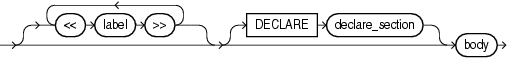

> ```
> [ << label >> ]... [ DECLARE declare_section ] body
> ```
>
> [Copyright © 1996, 2014, Oracle and/or its affiliates. All rights reserved.](https://docs.oracle.com/cd/E11882_01/dcommon/html/cpyr.htm)
  
  

See "body::=".

declare\_section::=

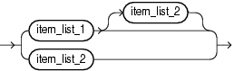

> ```
> { item_list_1 [ item_list_2 ] | item_list_2 }
> ```
>
> [Copyright © 1996, 2014, Oracle and/or its affiliates. All rights reserved.](https://docs.oracle.com/cd/E11882_01/dcommon/html/cpyr.htm)
  
  

See "item\_list\_2::=".

item\_list\_1::=

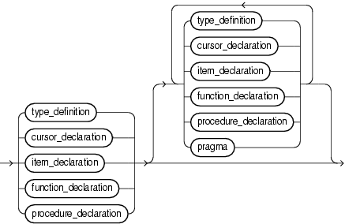

> ```
> { type_definition
> | cursor_declaration
> | item_declaration
> | function_declaration
> | procedure_declaration
> }
>   [ { type_definition
>     | cursor_declaration
>     | item_declaration
>     | function_declaration
>     | procedure_declaration
>     | pragma
>     }
>   ]...
> ```
>
> [Copyright © 1996, 2014, Oracle and/or its affiliates. All rights reserved.](https://docs.oracle.com/cd/E11882_01/dcommon/html/cpyr.htm)
  
  

See:

- ["cursor\_declaration::="](explicit_cursor.md)
- ["function\_declaration::="](function.md)
- "item\_declaration::="
- ["procedure\_declaration::="](procedure.md)
- "pragma::="
- "type\_definition::="

item\_list\_2::=

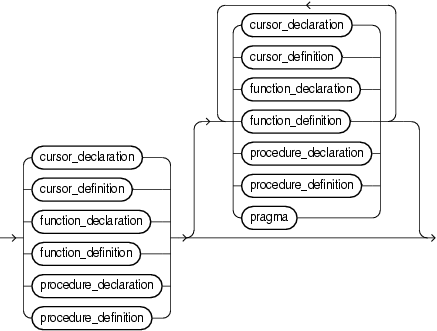

> ```
> { cursor_declaration
> | cursor_definition
> | function_declaration
> | function_definition
> | procedure_declaration
> | procedure_definition
> }
>   [ { cursor_declaration
>     | cursor_definition
>     | function_declaration
>     | function_definition
>     | procedure_declaration
>     | procedure_definition
>     | pragma
>     }
>   ]...
> ```
>
> [Copyright © 1996, 2014, Oracle and/or its affiliates. All rights reserved.](https://docs.oracle.com/cd/E11882_01/dcommon/html/cpyr.htm)
  
  

See:

- ["cursor\_declaration::="](explicit_cursor.md)
- ["cursor\_definition::="](explicit_cursor.md)
- ["function\_declaration::="](function.md)
- ["function\_definition::="](function.md)
- "pragma::="
- ["procedure\_declaration::="](procedure.md)
- ["procedure\_definition::="](procedure.md)
- "type\_definition::="

type\_definition::=

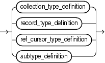

> ```
> { collection_type_definition
> | record_type_definition
> | ref_cursor_type_definition
> | subtype_definition
> }
> ```
>
> [Copyright © 1996, 2014, Oracle and/or its affiliates. All rights reserved.](https://docs.oracle.com/cd/E11882_01/dcommon/html/cpyr.htm)
  
  

See:

- ["collection\_type\_definition::="](collection.md)
- ["record\_type\_definition::="](record_definition.md)
- ["ref\_cursor\_type\_definition::="](cursor_variable.md)
- "subtype\_definition::="

subtype\_definition::=

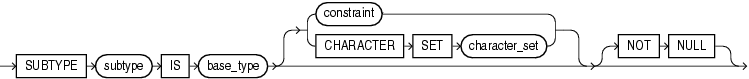

> ```
> SUBTYPE subtype IS base_type [ constraint | CHARACTER SET character_set ]
>   [ NOT NULL ]
> ```
>
> [Copyright © 1996, 2014, Oracle and/or its affiliates. All rights reserved.](https://docs.oracle.com/cd/E11882_01/dcommon/html/cpyr.htm)
  
  

constraint::=

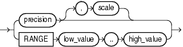

> ```
> { precision [, scale ] | RANGE low_value .. high_value }
> ```
>
> [Copyright © 1996, 2014, Oracle and/or its affiliates. All rights reserved.](https://docs.oracle.com/cd/E11882_01/dcommon/html/cpyr.htm)
  
  

item\_declaration::=

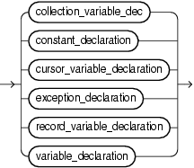

> ```
> { collection_variable_dec
> | constant_declaration
> | cursor_variable_declaration
> | exception_declaration
> | record_variable_declaration
> | variable_declaration
> }
> ```
>
> [Copyright © 1996, 2014, Oracle and/or its affiliates. All rights reserved.](https://docs.oracle.com/cd/E11882_01/dcommon/html/cpyr.htm)
  
  

See:

- ["collection\_variable\_dec::="](collection.md)
- ["constant\_declaration::="](constant.md)
- ["cursor\_declaration::="](explicit_cursor.md)
- ["cursor\_variable\_declaration::="](cursor_variable.md)
- ["exception\_declaration::="](exception_declaration.md)
- ["record\_variable\_declaration::="](record_definition.md)
- ["variable\_declaration::="](variable_declaration.md)

pragma::=

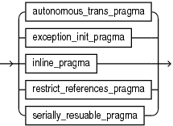

> ```
> { autonomous_trans_pragma
> | exception_init_pragma
> | inline_pragma
> | restrict_references_pragma
> | serially_reusable_pragma
> }
> ```
>
> [Copyright © 1996, 2014, Oracle and/or its affiliates. All rights reserved.](https://docs.oracle.com/cd/E11882_01/dcommon/html/cpyr.htm)
  
  

See:

- ["autonomous\_trans\_pragma::="](autotransaction_pragma.md)
- ["exception\_init\_pragma::="](exceptioninit_pragma.md)
- ["inline\_pragma::="](inline_pragma.md)
- ["restrict\_references\_pragma::="](restrictreferences_pragma.md)
- ["serially\_resuable\_pragma::="](seriallyreusable_pragma.md)

body::=

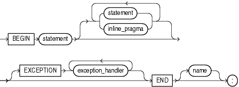

> ```
> BEGIN statement [ statement | inline_pragma ]...
>   [ EXCEPTION exception_handler [ exception_handler ]... ] END [ name ] ;
> ```
>
> [Copyright © 1996, 2014, Oracle and/or its affiliates. All rights reserved.](https://docs.oracle.com/cd/E11882_01/dcommon/html/cpyr.htm)
  
  

See:

- ["exception\_handler::="](exception_handler.md)
- ["inline\_pragma::="](inline_pragma.md)

statement::=

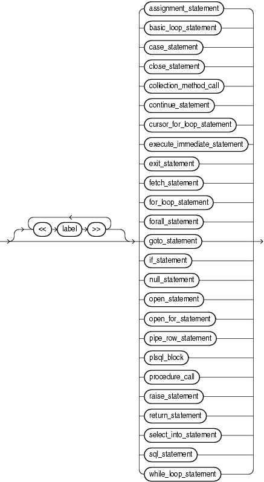

> ```
> [ << label >> [ << label >> ] ...]
>   { assignment_statement
>   | basic_loop_statement
>   | case_statement
>   | close_statement
>   | continue_statement
>   | cursor_for_loop_statement
>   | execute_immediate_statement
>   | exit_statement
>   | fetch_statement
>   | for_loop_statement
>   | forall_statement
>   | goto_statement
>   | if_statement
>   | null_statement
>   | open_statement
>   | open_for_statement
>   | pipe_row_statement
>   | plsql_block
>   | raise_statement
>   | return_statement
>   | select_into_statement
>   | sql_statement
>   | while_loop_statement
>   }
> ```
  
  

See:

- "plsql\_block::="
- "procedure\_call::="
- "sql\_statement::="

procedure\_call::=

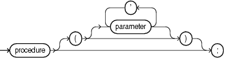

> ```
> procedure [ ( [ parameter [, parameter ]... ] ) ] ;
> ```
>
> [Copyright © 1996, 2014, Oracle and/or its affiliates. All rights reserved.](https://docs.oracle.com/cd/E11882_01/dcommon/html/cpyr.htm)
  
  

sql\_statement::=

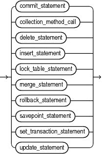

> ```
> { commit_statement
> | collection_method_call
> | delete_statement
> | insert_statement
> | lock_table_statement
> | merge_statement
> | rollback_statement
> | savepoint_statement
> | set_transaction_statement
> | update_statement
> }
> ```
>
> [Copyright © 1996, 2014, Oracle and/or its affiliates. All rights reserved.](https://docs.oracle.com/cd/E11882_01/dcommon/html/cpyr.htm)
  

Semantics

plsql\_block

label

Undeclared identifier, unique for the block.

DECLARE

Starts the declarative part of the block.

declare\_section

Contains local declarations, which exist only in the block and its sub-blocks and are not visible to enclosing blocks.

Restrictions on declare\_section

- A `declare_section` in `create_package`, `create_package_body`, or `compound_trigger_block` cannot include `PRAGMA` `AUTONOMOUS_TRANSACTION`.
- A `declare_section` in `trigger_body` or `tps_body` cannot declare variables of the data type `LONG` or `LONG` `RAW`.

See Also:

- ["CREATE PACKAGE Statement"](create_package.md) for more information about `create_package`
- ["CREATE PACKAGE BODY Statement"](create_package_body.md) for more information about `create_package_body`
- ["CREATE TRIGGER Statement"](create_trigger.md) for more information about `compound_trigger_block`, `trigger_body`, and `tps_body`

subtype\_definition

subtype

Name of the user-defined subtype that you are defining.

base\_type

Base type of the subtype that you are defining. `base_type` can be any scalar or user-defined PL/SQL datatype specifier such as `CHAR`, `DATE`, or `RECORD`.

CHARACTER SET character\_set

Specifies the character set for a subtype of a character data type.

Restriction on CHARACTER SET character\_set Do not specify this clause if `base_type` is not a character data type.

NOT NULL

Imposes the `NOT` `NULL` constraint on data items declared with this subtype. For information about this constraint, see ["NOT NULL Constraint"](fundamentals.md).

constraint

Specifies a constraint for a subtype of a numeric data type.

Restriction on constraint Do not specify `constraint` if `base_type` is not a numeric data type.

precision

Specifies the precision for a constrained subtype of a numeric data type.

Restriction on precision Do not specify `precision` if `base_type` cannot specify precision.

scale

Specifies the scale for a constrained subtype of a numeric data type.

Restriction on scale Do not specify `scale` if `base_type` cannot specify scale.

RANGE low\_value.. high\_value

Specifies the range for a constrained subtype of a numeric data type. The `low_value` and `high_value` must be numeric literals.

Restriction on RANGE high\_value.. low\_value Specify this clause only if `base_type` is `PLS_INTEGER` or a subtype of `PLS_INTEGER` (either predefined or user-defined). (For a summary of the predefined subtypes of `PLS_INTEGER`, see [Table 3-3](datatypes.md). For information about user-defined subtypes with ranges, see ["Constrained Subtypes"](datatypes.md).)

body

BEGIN

Starts the executable part of the block, which contains executable statements.

EXCEPTION

Starts the exception-handling part of the block. When PL/SQL raises an exception, normal execution of the block stops and control transfers to the appropriate `exception_handler`. After the exception handler completes, execution resumes with the statement following the block. For more information about exception-handling, see [Chapter 11, "PL/SQL Error Handling."](errors.md)

exception\_handler

See ["Exception Handler"](exception_handler.md).

END

Ends the block.

name

The name of the block to which `END` applies—a label, function name, procedure name, or package name.

statement

label

Undeclared identifier, unique for the statement.

assignment\_statement

See ["Assignment Statement"](assignment_statement.md).

basic\_loop\_statement

See ["Basic LOOP Statement"](basic_loop_statement.md).

case\_statement

See ["CASE Statement"](case_statement.md).

close\_statement

See ["CLOSE Statement"](close_statement.md).

collection\_method\_call

Invocation of one of these collection methods, which are procedures:

- `DELETE`
- `EXTEND`
- `TRIM`

For syntax, see ["Collection Method Invocation"](collection_method.md).

continue\_statement

See ["CONTINUE Statement"](continue_statement.md).

cursor\_for\_loop\_statement

See ["Cursor FOR LOOP Statement"](cursor_for_loop_statement.md).

execute\_immediate\_statement

See ["EXECUTE IMMEDIATE Statement"](executeimmediate_statement.md).

exit\_statement

See ["EXIT Statement"](exit_statement.md).

fetch\_statement

See ["FETCH Statement"](fetch_statement.md).

for\_loop\_statement

See ["FOR LOOP Statement"](for_loop_statement.md).

forall\_statement

See ["FORALL Statement"](forall_statement.md).

goto\_statement

See ["GOTO Statement"](goto_statement.md).

if\_statement

See ["IF Statement"](if_statement.md).

null\_statement

See ["NULL Statement"](null_statement.md).

open\_statement

See ["OPEN Statement"](open_statement.md).

open\_for\_statement

See ["OPEN FOR Statement"](openfor_statement.md).

pipe\_row\_statement

See ["PIPE ROW Statement"](pipe_row_statement.md).

Restriction on pipe\_row\_statement This statement can appear only in the body of a pipelined table function; otherwise, PL/SQL raises an exception.

raise\_statement

See ["RAISE Statement"](raise_statement.md).

return\_statement

See ["RETURN Statement"](return_statement.md).

select\_into\_statement

See ["SELECT INTO Statement"](selectinto_statement.md).

while\_loop\_statement

See ["WHILE LOOP Statement"](while_loop_statement.md).

procedure\_call

procedure

Name of the procedure that you are invoking.

parameter \[, parameter \]...

List of actual parameters for the procedure that you are invoking. The data type of each actual parameter must be compatible with the data type of the corresponding formal parameter. The mode of the formal parameter determines what the actual parameter can be:

| Formal Parameter Mode | Actual Parameter |
| --- | --- |
| `IN` | Constant, initialized variable, literal, or expression |
| `OUT` | Variable whose data type is not defined as `NOT` `NULL` |
| `IN` `OUT` | Variable (typically, it is a string buffer or numeric accumulator) |

If the procedure specifies a default value for a parameter, you can omit that parameter from the parameter list. If the procedure has no parameters, or specifies a default value for every parameter, you can either omit the parameter list or specify an empty parameter list.

See Also:

["Positional, Named, and Mixed Notation for Actual Parameters"](subprograms.md)

sql\_statement

commit\_statement

SQL `COMMIT` statement. For syntax, see [Oracle Database SQL Language Reference](https://docs.oracle.com/cd/E11882_01/server.112/e41084/statements_4010.htm#SQLRF01110).

delete\_statement

SQL `DELETE` statement. For syntax, see [Oracle Database SQL Language Reference](https://docs.oracle.com/cd/E11882_01/server.112/e41084/statements_8005.htm#SQLRF01505). See also ["DELETE Statement Extension"](delete_statement.md).

insert\_statement

SQL `INSERT` statement. For syntax, see [Oracle Database SQL Language Reference](https://docs.oracle.com/cd/E11882_01/server.112/e41084/statements_8005.htm#SQLRF01505). See also ["INSERT Statement Extension"](insert_statement.md).

lock\_table\_statement

SQL `LOCK` `TABLE` statement. For syntax, see [Oracle Database SQL Language Reference](https://docs.oracle.com/cd/E11882_01/server.112/e41084/statements_9015.htm#SQLRF01605).

merge\_statement

SQL `MERGE` statement. For syntax, see [Oracle Database SQL Language Reference](https://docs.oracle.com/cd/E11882_01/server.112/e41084/statements_9016.htm#SQLRF01606).

rollback\_statement

SQL `ROLLBACK` statement. For syntax, see [Oracle Database SQL Language Reference](https://docs.oracle.com/cd/E11882_01/server.112/e41084/statements_9021.htm#SQLRF01610).

savepoint\_statement

SQL `SAVEPOINT` statement. For syntax, see [Oracle Database SQL Language Reference](https://docs.oracle.com/cd/E11882_01/server.112/e41084/statements_10001.htm#SQLRF01701).

set\_transaction\_statement

SQL `SET` `TRANSACTION` statement. For syntax, see [Oracle Database SQL Language Reference](https://docs.oracle.com/cd/E11882_01/server.112/e41084/statements_10005.htm#SQLRF01705).

update\_statement

SQL `UPDATE` statement. For syntax, see [Oracle Database SQL Language Reference](https://docs.oracle.com/cd/E11882_01/server.112/e41084/statements_10008.htm#SQLRF01708). See also ["UPDATE Statement Extensions"](update_statement.md).