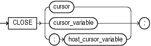

The `CLOSE` statement closes a named cursor, freeing its resources for reuse.

After closing an explicit cursor, you can reopen it with the `OPEN` statement. You must close an explicit cursor before reopening it.

After closing a cursor variable, you can reopen it with the `OPEN` `FOR` statement. You need not close a cursor variable before reopening it.

Topics

Syntax

close\_statement::=



> ```
> CLOSE { cursor | cursor_variable | :host_cursor_variable } ;
> ```
>
> [Copyright © 1996, 2014, Oracle and/or its affiliates. All rights reserved.](https://docs.oracle.com/cd/E11882_01/dcommon/html/cpyr.htm)
  

Semantics

cursor

Name of an open explicit cursor.

cursor\_variable

Name of an open cursor variable.

:host\_cursor\_variable

Name of a cursor variable declared in a PL/SQL host environment and passed to PL/SQL as a bind variable. Do not put space between the colon (:) and `host_cursor_variable`.