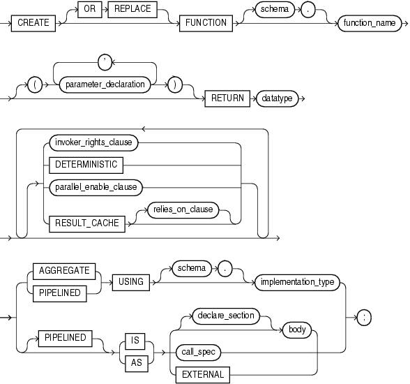
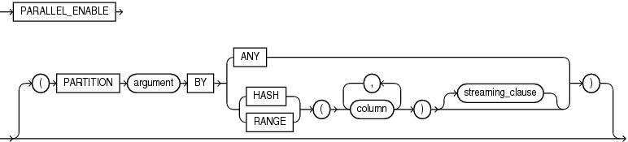
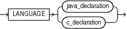
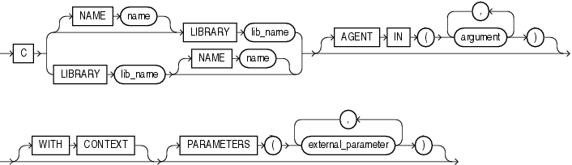
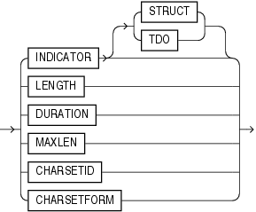

The `CREATE` `FUNCTION` statement creates or replaces a standalone function or a call specification.

A standalone function is a function (a subprogram that returns a single value) that is stored in the database.

Note:

A standalone function that you create with the `CREATE` `FUNCTION` statement differs from a function that you declare and define in a PL/SQL block or package. For information about the latter, see ["Function Declaration and Definition"](function.md).

A call specification declares a Java method or a third-generation language (3GL) subprogram so that it can be invoked from PL/SQL. You can also use the SQL `CALL` statement to invoke such a method or subprogram. The call specification tells the database which Java method, or which named function in which shared library, to invoke when an invocation is made. It also tells the database what type conversions to make for the arguments and return value.

Note:

To be callable from SQL statements, a stored function must obey certain rules that control side effects. See ["Subprogram Side Effects"](subprograms.md).

Topics

Prerequisites

To create or replace a standalone function in your schema, you must have the `CREATE` `PROCEDURE` system privilege. To create or replace a standalone function in another user's schema, you must have the `CREATE` `ANY` `PROCEDURE` system privilege.

To invoke a call specification, you may need additional privileges, for example, `EXECUTE` privileges on a C library for a C call specification.

To embed a `CREATE` `FUNCTION` statement inside an Oracle precompiler program, you must terminate the statement with the keyword `END-EXEC` followed by the embedded SQL statement terminator for the specific language.

See Also:

For more information about such prerequisites:
- [Oracle Database Advanced Application Developer's Guide](https://docs.oracle.com/cd/E11882_01/appdev.112/e41502/adfns_packages.htm#ADFNS00906)
- [Oracle Database Java Developer's Guide](https://docs.oracle.com/cd/E11882_01/java.112/e10588/toc.htm)

Syntax

create\_function::=



> ```
> CREATE [ OR REPLACE ] FUNCTION [ schema. ] function_name
>   [ ( parameter_declaration [, parameter_declaration]... ) 
>   ]
>   RETURN datatype
>   [ { invoker_rights_clause
>     | DETERMINISTIC
>     | parallel_enable_clause
>     | RESULT_CACHE  [ relies_on_clause ]
>     }...
>   ]
>   { { AGGREGATE | PIPELINED }  USING [ schema. ] implementation_type
>   | [ PIPELINED ] { IS | AS } { [ declare_section ] body 
>                               | call_spec
>                               | EXTERNAL
>                               }
>   } ;
> ```
  
  

See:

- ["body::="](block.md)
- "call\_spec::="
- ["datatype::="](collection.md)
- ["declare\_section::="](block.md)
- "parallel\_enable\_clause::="
- ["parameter\_declaration::="](parameter_declaration.md)
- ["relies\_on\_clause::="](function.md)

invoker\_rights\_clause::=


> ```
> AUTHID { CURRENT_USER | DEFINER }
> ```
>
> [Copyright © 1996, 2014, Oracle and/or its affiliates. All rights reserved.](https://docs.oracle.com/cd/E11882_01/dcommon/html/cpyr.htm)
  
  

parallel\_enable\_clause::=



> ```
> PARALLEL_ENABLE
> [ (PARTITION argument BY
>     { ANY
>     | { HASH | RANGE } (column [, column ]...) [ streaming_clause ]
>     }
>   )
> ```
>
> [Copyright © 1996, 2014, Oracle and/or its affiliates. All rights reserved.](https://docs.oracle.com/cd/E11882_01/dcommon/html/cpyr.htm)
  
  

streaming\_clause::=


> ```
> { ORDER | CLUSTER } expr BY (column [, column ]...)
> ```
>
> [Copyright © 1996, 2014, Oracle and/or its affiliates. All rights reserved.](https://docs.oracle.com/cd/E11882_01/dcommon/html/cpyr.htm)
  
  

call\_spec::=



> ```
> LANGUAGE { java_declaration | c_declaration }
> ```
>
> [Copyright © 1996, 2014, Oracle and/or its affiliates. All rights reserved.](https://docs.oracle.com/cd/E11882_01/dcommon/html/cpyr.htm)
  
  

java\_declaration::=

  
[Description of the illustration java\_declaration.gif](https://docs.oracle.com/cd/E11882_01/appdev.112/e25519/img_text/java_declaration.htm)  
  

c\_declaration::=



> ```
> C { [ NAME name ] LIBRARY lib_name | LIBRARY lib_name [ NAME name ] }
>    [ AGENT IN ( argument[, argument ]... ) ]
>    [ WITH CONTEXT ]
>    [ PARAMETERS ( external_parameter[, external_parameter ]... ) ]
> ```
>
> [Copyright © 1996, 2014, Oracle and/or its affiliates. All rights reserved.](https://docs.oracle.com/cd/E11882_01/dcommon/html/cpyr.htm)
  
  

external\_parameter::=


> ```
> { CONTEXT
> | SELF [ TDO | property ]
> | { parameter | RETURN } [ property ] [ BY REFERENCE ] [ external_datatype ]
> }
> ```
>
> [Copyright © 1996, 2014, Oracle and/or its affiliates. All rights reserved.](https://docs.oracle.com/cd/E11882_01/dcommon/html/cpyr.htm)
  
  

property::=



> ```
> { INDICATOR [ STRUCT | TDO ]
> | LENGTH
> | DURATION
> | MAXLEN
> | CHARSETID
> | CHARSETFORM
> }
> ```
>
> [Copyright © 1996, 2014, Oracle and/or its affiliates. All rights reserved.](https://docs.oracle.com/cd/E11882_01/dcommon/html/cpyr.htm)
  

Semantics

OR REPLACE

Re-creates the function if it exists, and recompiles it.

Users who were granted privileges on the function before it was redefined can still access the function without being regranted the privileges.

If any function-based indexes depend on the function, then the database marks the indexes `DISABLED`.

schema

Name of the schema containing the function. Default: your schema.

function\_name

Name of the function to be created.

Note:

If you plan to invoke a stored subprogram using a stub generated by SQL\*Module, then the stored subprogram name must also be a legal identifier in the invoking host 3GL language, such as Ada or C.

RETURN datatype

For `datatype`, specify the data type of the return value of the function. The return value can have any data type supported by PL/SQL.

Note:

Oracle SQL does not support invoking functions with `BOOLEAN` parameters or returns. Therefore, for SQL statements to invoke your user-defined functions, you must design them to return numbers (0 or 1) or character strings (' `TRUE` ' or ' `FALSE` ').

The data type cannot specify a length, precision, or scale. The database derives the length, precision, or scale of the return value from the environment from which the function is called.

If the return type is `ANYDATASET` and you intend to use the function in the `FROM` clause of a query, then you must also specify the `PIPELINED` clause and define a describe method (`ODCITableDescribe`) as part of the implementation type of the function.

You cannot constrain this data type (with `NOT` `NULL`, for example).

See Also:

- [Chapter 3, "PL/SQL Data Types,"](datatypes.md) for information about PL/SQL data types
- [Oracle Database Data Cartridge Developer's Guide](https://docs.oracle.com/cd/E11882_01/appdev.112/e10765/pipe_paral_tbl.htm#ADDCI2140) for information about defining the `ODCITableDescribe` function

invoker\_rights\_clause

Specifies the `AUTHID` property of the function. For information about the `AUTHID` property, see ["Invoker's Rights and Definer's Rights (AUTHID Property)"](subprograms.md).

DETERMINISTIC

Indicates that the function returns the same result value whenever it is called with the same values for its parameters.

You must specify this keyword if you intend to invoke the function in the expression of a function-based index or from the query of a materialized view that is marked `REFRESH` `FAST` or `ENABLE` `QUERY` `REWRITE`. When the database encounters a deterministic function in one of these contexts, it attempts to use previously calculated results when possible rather than reexecuting the function. If you subsequently change the semantics of the function, then you must manually rebuild all dependent function-based indexes and materialized views.

Do not specify this clause to define a function that uses package variables or that accesses the database in any way that might affect the return result of the function. The results of doing so are not captured if the database chooses not to reexecute the function.

These semantic rules govern the use of the `DETERMINISTIC` clause:

- You can declare a schema-level subprogram `DETERMINISTIC`.
- You can declare a package-level subprogram `DETERMINISTIC` in the package specification but not in the package body.
- You cannot declare `DETERMINISTIC` a private subprogram (declared inside another subprogram or inside a package body).
- A `DETERMINISTIC` subprogram can invoke another subprogram whether the called program is declared `DETERMINISTIC` or not.

See Also:

- [Oracle Database Data Warehousing Guide](https://docs.oracle.com/cd/E11882_01/server.112/e25554/basicmv.htm#DWHSG008) for information about materialized views
- [Oracle Database SQL Language Reference](https://docs.oracle.com/cd/E11882_01/server.112/e41084/statements_5012.htm#SQLRF01209) for information about function-based indexes

parallel\_enable\_clause

Indicates that the function can run from a parallel execution server of a parallel query operation. The function must not use session state, such as package variables, as those variables are not necessarily shared among the parallel execution servers.

- Use the optional `PARTITION` `argument` `BY` clause only with a function that has a `REF` `CURSOR` data type. This clause lets you define the partitioning of the inputs to the function from the `REF` `CURSOR` argument.
	Partitioning the inputs to the function affects the way the query is parallelized when the function is used as a table function in the `FROM` clause of the query. `ANY` indicates that the data can be partitioned randomly among the parallel execution servers. Alternatively, you can specify `RANGE` or `HASH` partitioning on a specified column list.
	Note:
	You can partition weak cursor variable arguments to table functions only with `ANY`, not with `RANGE` or `HASH`.
- The optional `streaming_clause` lets you order or cluster the parallel processing by a specified column list.
	- `ORDER` `BY` indicates that the rows on a parallel execution server must be locally ordered.
		- `CLUSTER` `BY` indicates that the rows on a parallel execution server must have the same key values as specified by the `column_list`.
		- `expr` identifies the `REF` `CURSOR` parameter name of the table function on which partitioning was specified, and on whose columns you are specifying ordering or clustering for each slave in a parallel query execution.

The columns specified in all of these optional clauses refer to columns that are returned by the `REF` `CURSOR` argument of the function.

See Also:

[Oracle Database Data Cartridge Developer's Guide](https://docs.oracle.com/cd/E11882_01/appdev.112/e10765/pipe_paral_tbl.htm#ADDCI2140) for information about using parallel table functions

PIPELINED { IS | USING }

Instructs the database to return the results of a table function iteratively. A table function returns a collection type (a nested table or varray). You query table functions by using the `TABLE` keyword before the function name in the `FROM` clause of the query. For example:

```
SELECT * FROM TABLE(function_name(...))
```

the database then returns rows as they are produced by the function.

- If you specify the keyword `PIPELINED` alone (`PIPELINED` `IS`...), then the PL/SQL function body must use the `PIPE` keyword. This keyword instructs the database to return single elements of the collection out of the function, instead of returning the whole collection as a single value.
- You can specify the `PIPELINED` `USING` `implementation_type` clause to predefine an interface containing the start, fetch, and close operations. The implementation type must implement the `ODCITable` interface and must exist at the time the table function is created. This clause is useful for table functions implemented in external languages such as C++ and Java.
	If the return type of the function is `ANYDATASET`, then you must also define a describe method (`ODCITableDescribe`) as part of the implementation type of the function.

See Also:

- ["Chaining Pipelined Table Functions for Multiple Transformations"](tuning.md)
- [Oracle Database Data Cartridge Developer's Guide](https://docs.oracle.com/cd/E11882_01/appdev.112/e10765/pipe_paral_tbl.htm#ADDCI2140) for information about using pipelined table functions

AGGREGATE USING

Identifies this function as an aggregate function, or one that evaluates a group of rows and returns a single row. You can specify aggregate functions in the select list, `HAVING` clause, and `ORDER` `BY` clause.

When you specify a user-defined aggregate function in a query, you can treat it as an analytic function (one that operates on a query result set). To do so, use the `OVER` `analytic_clause` syntax available for SQL analytic functions. See [Oracle Database SQL Language Reference](https://docs.oracle.com/cd/E11882_01/server.112/e41084/functions004.htm#SQLRF06174) for syntax and semantics of analytic functions.

In the `USING` clause, specify the name of the implementation type of the function. The implementation type must be an ADT containing the implementation of the `ODCIAggregate` subprograms. If you do not specify `schema`, then the database assumes that the implementation type is in your schema.

Restriction on AGGREGATE USING If you specify this clause, then you can specify only one input argument for the function.

See Also:

- [Oracle Database Data Cartridge Developer's Guide](https://docs.oracle.com/cd/E11882_01/appdev.112/e10765/aggr_functions.htm#ADDCI2120) for more information about user-defined aggregate functions
- [Oracle Database Data Cartridge Developer's Guide](https://docs.oracle.com/cd/E11882_01/appdev.112/e10765/aggr_functions.htm#ADDCI2120) for information about ODCI subprograms

body

The required executable part of the function and, optionally, the exception-handling part of the function.

declare\_section

The optional declarative part of the function. Declarations are local to the function, can be referenced in `body`, and cease to exist when the function completes execution.

call\_spec

Maps a C procedure or Java method name, parameter types, and return type to their SQL counterparts. In `java_declaration`, `string` identifies the Java implementation of the method. In `c_declaration`, `LIBRARY` `lib_name` identifies a library created by the ["CREATE LIBRARY Statement"](create_library.md).

See Also:

- [Oracle Database Java Developer's Guide](https://docs.oracle.com/cd/E11882_01/java.112/e10588/toc.htm) to learn how to write Java call specifications
- [Oracle Database Advanced Application Developer's Guide](https://docs.oracle.com/cd/E11882_01/appdev.112/e41502/adfns_externproc.htm#ADFNS010) to learn how to write C call specifications

EXTERNAL

Deprecated way of declaring a C function, supported only for backward compatibility. Oracle recommends that you use the `LANGUAGE` `C` syntax.

Examples

Creating a Function: Examples This statement creates the function `get_bal` on the sample table `oe.orders`:

```
CREATE FUNCTION get_bal(acc_no IN NUMBER) 
   RETURN NUMBER 
   IS acc_bal NUMBER(11,2);
   BEGIN 
      SELECT order_total 
      INTO acc_bal 
      FROM orders 
      WHERE customer_id = acc_no; 
      RETURN(acc_bal); 
    END;
/
```

The `get_bal` function returns the balance of a specified account.

When you invoke the function, you must specify the argument `acc_no`, the number of the account whose balance is sought. The data type of `acc_no` is `NUMBER`.

The function returns the account balance. The `RETURN` clause of the `CREATE` `FUNCTION` statement specifies the data type of the return value to be `NUMBER`.

The function uses a `SELECT` statement to select the `balance` column from the row identified by the argument `acc_no` in the `orders` table. The function uses a `RETURN` statement to return this value to the environment in which the function is called.

The function created in the preceding example can be used in a SQL statement. For example:

```
SELECT get_bal(165) FROM DUAL; 

GET_BAL(165)
------------
        2519
```

The hypothetical following statement creates a PL/SQL standalone function `get_val` that registers the C subprogram `c_get_val` as an external function. (The parameters have been omitted from this example.)

```
CREATE FUNCTION get_val
   ( x_val IN NUMBER,
    y_val IN NUMBER,
    image IN LONG RAW )
   RETURN BINARY_INTEGER AS LANGUAGE C
      NAME "c_get_val"
      LIBRARY c_utils
      PARAMETERS (...);
```

Creating Aggregate Functions: Example The next statement creates an aggregate function called `SecondMax` to aggregate over number values. It assumes that the ADT `SecondMaxImpl` subprograms contains the implementations of the `ODCIAggregate` subprograms:

```
CREATE FUNCTION SecondMax (input NUMBER) RETURN NUMBER
    PARALLEL_ENABLE AGGREGATE USING SecondMaxImpl;
```

See Also:

[Oracle Database Data Cartridge Developer's Guide](https://docs.oracle.com/cd/E11882_01/appdev.112/e10765/aggr_functions.htm#ADDCI2120) for the complete implementation of type and type body for `SecondMaxImpl`

Use such an aggregate function in a query like this statement, which queries the sample table `hr.employees`:

```
SELECT SecondMax(salary) "SecondMax", department_id
      FROM employees
      GROUP BY department_id
      HAVING SecondMax(salary) > 9000
      ORDER BY "SecondMax", department_id;

SecondMax DEPARTMENT_ID
--------- -------------
      9450           100
  13670.74            50
     14175            80
   18742.5            90
```

Package Procedure in a Function: Example This statement creates a function that uses a `DBMS_LOB.GETLENGTH` procedure to return the length of a `CLOB` column:

```
CREATE OR REPLACE FUNCTION text_length(a CLOB) 
   RETURN NUMBER DETERMINISTIC IS
BEGIN 
  RETURN DBMS_LOB.GETLENGTH(a);
END;
```

Related Topics

In this chapter:

- ["ALTER FUNCTION Statement"](alter_function.md)
- ["CREATE PROCEDURE Statement"](create_procedure.md)
- ["DROP FUNCTION Statement"](drop_function.md)

In other chapters:

- ["Function Declaration and Definition"](function.md) for information about creating a function in a PL/SQL block
- ["Formal Parameter Declaration"](parameter_declaration.md)
- [Chapter 8, "PL/SQL Subprograms"](subprograms.md)

See Also:

- [Oracle Database SQL Language Reference](https://docs.oracle.com/cd/E11882_01/server.112/e41084/statements_4008.htm#SQLRF01108) for information about the `CALL` statement
- [Oracle Database Advanced Application Developer's Guide](https://docs.oracle.com/cd/E11882_01/appdev.112/e41502/adfns_packages.htm#ADFNS00908) for information about restrictions on user-defined functions that are called from SQL statements
- [Oracle Database Advanced Application Developer's Guide](https://docs.oracle.com/cd/E11882_01/appdev.112/e41502/adfns_externproc.htm#ADFNS010) for more information about call specifications