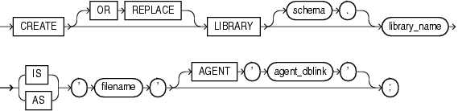

Note:

The `CREATE` `LIBRARY` statement is valid only on platforms that support shared libraries and dynamic linking.

The `CREATE` `LIBRARY` statement creates a library, which is a schema object associated with an operating-system shared library. (For instructions for creating an operating-system shared library, or DLL, see [Oracle Database Advanced Application Developer's Guide](https://docs.oracle.com/cd/E11882_01/appdev.112/e41502/adfns_externproc.htm#ADFNS1404).)

You can use the name of the library schema object in the `call_spec` of `CREATE` `FUNCTION` or `CREATE` `PROCEDURE` statements, or when declaring a function or procedure in a package or type, so that SQL and PL/SQL can invoke third-generation-language (3GL) functions and procedures.

Topics

Prerequisites

To create a library in your schema, you must have the `CREATE` `LIBRARY` system privilege. To create a library in another user's schema, you must have the `CREATE` `ANY` `LIBRARY` system privilege.

To use the library in the `call_spec` of a `CREATE` `FUNCTION` statement, or when declaring a function in a package or type, you must have the `EXECUTE` object privilege on the library and the `CREATE` `FUNCTION` system privilege.

To use the library in the `call_spec` of a `CREATE` `PROCEDURE` statement, or when declaring a procedure in a package or type, you must have the `EXECUTE` object privilege on the library and the `CREATE` `PROCEDURE` system privilege.

To execute a procedure or function defined with the `call_spec` (including a procedure or function defined within a package or type), you must have the `EXECUTE` object privilege on the procedure or function (but you do not need the `EXECUTE` object privilege on the library).

Syntax

create\_library::=



> ```
> CREATE [ OR REPLACE ] LIBRARY [ schema. ] library_name
>   { IS | AS } 'filename'[ AGENT 'agent_dblink' ] ;
> ```
>
> [Copyright © 1996, 2014, Oracle and/or its affiliates. All rights reserved.](https://docs.oracle.com/cd/E11882_01/dcommon/html/cpyr.htm)
  

Semantics

OR REPLACE

Re-creates the library if it exists, and recompiles it.

Users who were granted privileges on the library before it was redefined can still access the library without being regranted the privileges.

schema

Name of the schema containing the library. Default: your schema.

library\_name

Name that represents the library in a `call_spec`.

filename

A string literal, enclosed in single quotation marks. This string should be the path or filename your operating system recognizes as naming the shared library.

The `filename` is not interpreted during execution of the `CREATE` `LIBRARY` statement. The existence of the library file is not checked until an attempt is made to run a routine from it.

AGENT 'agent\_dblink'

Causes external procedures to run from a database link other than the server. Oracle Database uses the database link that `agent_dblink` specifies to run external procedures. If you omit this clause, then the default agent on the server (`extproc`) runs external procedures.

Examples

Creating a Library: Examples The following statement creates library `ext_lib`:

```
CREATE LIBRARY ext_lib AS '/OR/lib/ext_lib.so';
/
```

The following statement re-creates library `ext_lib`:

```
CREATE OR REPLACE LIBRARY ext_lib IS '/OR/newlib/ext_lib.so';
/
```

Specifying an External Procedure Agent: Example The following example creates a library `app_lib` and specifies that external procedures run from the public database `sales.hq.example.com`:

```
CREATE LIBRARY app_lib as '${ORACLE_HOME}/lib/app_lib.so'
   AGENT 'sales.hq.example.com';
/
```

See Also:

[Oracle Database SQL Language Reference](https://docs.oracle.com/cd/E11882_01/server.112/e41084/statements_5005.htm#SQLRF01205) for information about creating database links