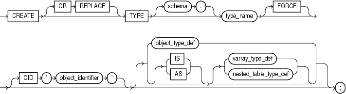
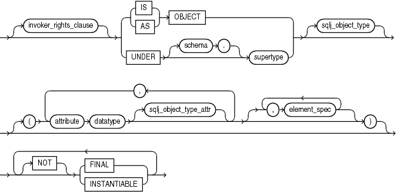
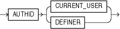
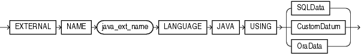
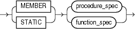
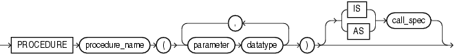
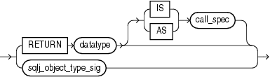
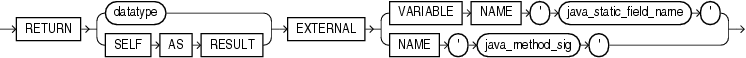

The `CREATE` `TYPE` statement creates or replaces the specification of one of these:

- Abstract Data Type (ADT) (including a SQLJ object type)
- Standalone varying array (varray) type
- Standalone nested table type
- Incomplete object type
	An incomplete type is a type created by a forward type definition. It is called incomplete because it has a name but no attributes or methods. It can be referenced by other types, allowing you define types that refer to each other. However, you must fully specify the type before you can use it to create a table or an object column or a column of a nested table type.

The `CREATE` `TYPE` statement specifies the name of the type and its attributes, methods, and other properties. The `CREATE` `TYPE` `BODY` statement contains the code for the methods that implement the type.

Notes:

- If you create a type whose specification declares only attributes but no methods, then you need not specify a type body.
- If you create a SQLJ object type, then you cannot specify a type body. The implementation of the type is specified as a Java class.
- A standalone collection type that you create with the `CREATE` `TYPE` statement differs from a collection type that you define with the keyword `TYPE` in a PL/SQL block or package. For information about the latter, see ["Collection Variable Declaration"](collection.md).
- With the `CREATE` `TYPE` statement, you can create nested table and `VARRAY` types, but not associative arrays. In a PL/SQL block or package, you can define all three collection types.

Topics

Syntax

create\_type::=



> ```
> CREATE [OR REPLACE] TYPE [ schema. ] type_name [ FORCE ]
>   [ OID 'object_identifier' ]
>
>   [ object_type 
>   | | { IS | AS } { varray_type_def | nested_table_type_def }
>   ];
> ```
>
> [Copyright © 1996, 2014, Oracle and/or its affiliates. All rights reserved.](https://docs.oracle.com/cd/E11882_01/dcommon/html/cpyr.htm)
  
  

See:

- ["nested\_table\_type\_def::="](collection.md)
- ["varray\_type\_def::="](collection.md)

object\_type\_def::=



> ```
> [ invoker_rights_clause ]
> { { IS | AS } OBJECT | UNDER [schema.]supertype } [ sqlj_object_type ]
>   [ ( attribute datatype [ sqlj_object_type_attr ]
>       [, attribute datatype [ sqlj_object_type_attr ] ]...
>       [, element_spec [, element_spec ]...]
>     )
>   [ [NOT] { FINAL | INSTANTIABLE } ]...
> ```
>
> [Copyright © 1996, 2014, Oracle and/or its affiliates. All rights reserved.](https://docs.oracle.com/cd/E11882_01/dcommon/html/cpyr.htm)
  
  

See "element\_spec::=".

invoker\_rights\_clause::=



> ```
> AUTHID { CURRENT_USER | DEFINER }
> ```
>
> [Copyright © 1996, 2014, Oracle and/or its affiliates. All rights reserved.](https://docs.oracle.com/cd/E11882_01/dcommon/html/cpyr.htm)
  
  

sqlj\_object\_type::=



> ```
> EXTERNAL NAME java_ext_name LANGUAGE JAVA
>    USING (SQLData | CustomDatum | OraData)
> ```
>
> [Copyright © 1996, 2014, Oracle and/or its affiliates. All rights reserved.](https://docs.oracle.com/cd/E11882_01/dcommon/html/cpyr.htm)
  
  

sqlj\_object\_type\_attr::=

  
[Description of the illustration sqlj\_object\_type\_attr.gif](https://docs.oracle.com/cd/E11882_01/appdev.112/e25519/img_text/sqlj_object_type_attr.htm)  
  

element\_spec::=


> ```
> [ inheritance_clauses ]
> { subprogram_spec
> | constructor_spec
> | map_order_function_spec
> }... [, restrict_references_pragma ]
> ```
>
> [Copyright © 1996, 2014, Oracle and/or its affiliates. All rights reserved.](https://docs.oracle.com/cd/E11882_01/dcommon/html/cpyr.htm)
  
  

See:

- "constructor\_spec::="
- "map\_order\_function\_spec::="
- ["restrict\_references\_pragma::="](restrictreferences_pragma.md)

inheritance\_clauses::=


> ```
> { [ NOT ] { OVERRIDING | FINAL | INSTANTIABLE } }...
> ```
>
> [Copyright © 1996, 2014, Oracle and/or its affiliates. All rights reserved.](https://docs.oracle.com/cd/E11882_01/dcommon/html/cpyr.htm)
  
  

subprogram\_spec::=



> ```
> { MEMBER | STATIC } { procedure_spec | function_spec }
> ```
>
> [Copyright © 1996, 2014, Oracle and/or its affiliates. All rights reserved.](https://docs.oracle.com/cd/E11882_01/dcommon/html/cpyr.htm)
  
  

procedure\_spec::=



> ```
> PROCEDURE procedure_name
>   (parameter datatype [, parameter datatype ]...)
>   [ { IS | AS } call_spec ]
> ```
>
> [Copyright © 1996, 2014, Oracle and/or its affiliates. All rights reserved.](https://docs.oracle.com/cd/E11882_01/dcommon/html/cpyr.htm)
  
  

See ["call\_spec::="](create_function.md).

function\_spec::=


> ```
> FUNCTION name
>    (parameter datatype [, parameter datatype ]...)
>    return_clause
> ```
>
> [Copyright © 1996, 2014, Oracle and/or its affiliates. All rights reserved.](https://docs.oracle.com/cd/E11882_01/dcommon/html/cpyr.htm)
  
  

return\_clause::=



> ```
> { RETURN datatype [ { IS | AS } call_spec ]| sqlj_object_type_sig }
> ```
>
> [Copyright © 1996, 2014, Oracle and/or its affiliates. All rights reserved.](https://docs.oracle.com/cd/E11882_01/dcommon/html/cpyr.htm)
  
  

See ["call\_spec::="](create_function.md).

constructor\_spec::=


> ```
> [ FINAL ] [ INSTANTIABLE ]
> CONSTRUCTOR FUNCTION datatype
> [ ([ SELF IN OUT datatype, ]
>    parameter datatype [, parameter datatype ]...
>   )
> ]
> RETURN SELF AS RESULT
> [ { IS | AS } call_spec ]
> ```
>
> [Copyright © 1996, 2014, Oracle and/or its affiliates. All rights reserved.](https://docs.oracle.com/cd/E11882_01/dcommon/html/cpyr.htm)
  
  

See ["call\_spec::="](create_function.md).

map\_order\_function\_spec::=


> ```
> { MAP | ORDER } MEMBER function_spec
> ```
>
> [Copyright © 1996, 2014, Oracle and/or its affiliates. All rights reserved.](https://docs.oracle.com/cd/E11882_01/dcommon/html/cpyr.htm)
  
  

See "function\_spec::=".

sqlj\_object\_type\_sig::=



> ```
> RETURN { datatype | SELF AS RESULT }
> EXTERNAL { VARIABLE NAME 'java_static_field_name'
>          | NAME 'java_method_sig'
>          }
> ```
>
> [Copyright © 1996, 2014, Oracle and/or its affiliates. All rights reserved.](https://docs.oracle.com/cd/E11882_01/dcommon/html/cpyr.htm)
  

Prerequisites

To create a type in your schema, you must have the `CREATE` `TYPE` system privilege. To create a type in another user's schema, you must have the `CREATE` `ANY` `TYPE` system privilege. You can acquire these privileges explicitly or be granted them through a role.

To create a subtype, you must have the `UNDER` `ANY` `TYPE` system privilege or the `UNDER` object privilege on the supertype.

The owner of the type must be explicitly granted the `EXECUTE` object privilege to access all other types referenced in the definition of the type, or the type owner must be granted the `EXECUTE` `ANY` `TYPE` system privilege. The owner cannot obtain these privileges through roles.

If the type owner intends to grant other users access to the type, then the owner must be granted the `EXECUTE` object privilege on the referenced types with the `GRANT` `OPTION` or the `EXECUTE` `ANY` `TYPE` system privilege with the `ADMIN` `OPTION`. Otherwise, the type owner has insufficient privileges to grant access on the type to other users.

Semantics

OR REPLACE

Re-creates the type if it exists, and recompiles it.

Users who were granted privileges on the type before it was redefined can still access the type without being regranted the privileges.

If any function-based indexes depend on the type, then the database marks the indexes `DISABLED`.

schema

Name of the schema containing the type. Default: your schema.

type\_name

Name of an ADT, a nested table type, or a `VARRAY` type.

If creating the type results in compilation errors, then the database returns an error. You can see the associated compiler error messages with the SQL\*Plus command `SHOW` `ERRORS`.

The database implicitly defines a constructor method for each user-defined type that you create. A constructor is a system-supplied procedure that is used in SQL statements or in PL/SQL code to construct an instance of the type value. The name of the constructor method is the name of the user-defined type. You can also create a user-defined constructor using the `constructor_spec` syntax.

The parameters of the ADT constructor method are the data attributes of the ADT. They occur in the same order as the attribute definition order for the ADT. The parameters of a nested table or varray constructor are the elements of the nested table or the varray.

FORCE

If `type_name` exists and has type dependents, but not table dependents, `FORCE` forces the statement to replace the type. (If `type_name` has table dependents, the statement fails with or without `FORCE`.)

Note:

If type `t1` has type dependent `t2`, and type `t2` has table dependents, then type `t1` also has table dependents.

See Also:

[Oracle Database Object-Relational Developer's Guide](https://docs.oracle.com/cd/E11882_01/appdev.112/e11822/adobjmng.htm#ADOBJ00402)

object\_type\_def

Creates an ADT. The variables that form the data structure are called attributes. The member subprograms that define the behavior of the ADT are called methods. The keywords `AS` `OBJECT` are required when creating an ADT.

See Also:

"ADT Examples"

OID 'object\_identifier'

Establishes type equivalence of identical objects in multiple databases. See [Oracle Database Object-Relational Developer's Guide](https://docs.oracle.com/cd/E11882_01/appdev.112/e11822/adobjvew.htm#ADOBJ00513) for information about this clause.

invoker\_rights\_clause

Specifies the `AUTHID` property of the member functions and procedures of the ADT. For information about the `AUTHID` property, see ["Invoker's Rights and Definer's Rights (AUTHID Property)"](subprograms.md).

Restrictions on invoker\_rights\_clause This clause is subject to these restrictions:

- You can specify this clause only for an ADT, not for a nested table or `VARRAY` type.
- You can specify this clause for clarity if you are creating a subtype. However, a subtype inherits the `AUTHID` property of its supertype, so you cannot specify a different value than was specified for the supertype.
- If the supertype was created with `AUTHID` `DEFINER`, then you must create the subtype in the same schema as the supertype.

AS OBJECT

Creates a schema-level ADT. Such ADTs are sometimes called root ADTs.

UNDER supertype

Creates a subtype of an existing type. The existing supertype must be an ADT. The subtype you create in this statement inherits the properties of its supertype. It must either override some of those properties or add properties to distinguish it from the supertype.

See Also:

"Subtype Example" and "Type Hierarchy Example"

sqlj\_object\_type

Creates a SQLJ object type. With a SQLJ object type, you map a Java class to a SQL user-defined type. You can then define tables or columns of the SQLJ object type as you can with any other user-defined type.

You can map one Java class to multiple SQLJ object types. If there exists a subtype or supertype of a SQLJ object type, then it must also be a SQLJ object type. All types in the hierarchy must be SQLJ object types.

See Also:

[Oracle Database Object-Relational Developer's Guide](https://docs.oracle.com/cd/E11882_01/appdev.112/e11822/adobjenv.htm#ADOBJ00301) for more information about creating SQLJ object types

java\_ext\_name

Name of the Java class. If the class exists, then it must be public. The Java external name, including the schema, is validated.

Multiple SQLJ object types can be mapped to the same class. However:

- A subtype must be mapped to a class that is an immediate subclass of the class to which its supertype is mapped.
- Two subtypes of a common supertype cannot be mapped to the same class.

SQLData | CustomDatum | OraData

Specifies the mechanism for creating the Java instance of the type. `SQLData`, `CustomDatum`, and `OraData` are the interfaces that determine which mechanism to use.

See Also:

[Oracle Database JDBC Developer's Guide](https://docs.oracle.com/cd/E11882_01/java.112/e16548/toc.htm) for information about these three interfaces and "SQLJ Object Type Example"

element\_spec

Specifies each attribute of the ADT.

attribute

Name of an ADT attribute. An ADT attribute is a data item with a name and a type specifier that forms the structure of the ADT. You must specify at least one attribute for each ADT. The name must be unique in the ADT, but can be used in other ADTs.

If you are creating a subtype, then the attribute name cannot be the same as any attribute or method name declared in the supertype chain.

datatype

The data type of an ADT attribute. This data type must be stored in the database; that is, either a predefined data type or a user-defined standalone collection type. For information about predefined data types, see [Chapter 3, "PL/SQL Data Types."](datatypes.md) For information about user-defined standalone collection types, see ["Collection Types"](composites.md).

Restrictions on datatype

- You cannot impose the `NOT` `NULL` constraint on an attribute.
- You cannot specify attributes of type `ROWID`, `LONG`, or `LONG` `RAW`.
- You cannot specify a data type of `UROWID` for an ADT.
- If you specify an object of type `REF`, then the target object must have an object identifier.
- If you are creating a collection type for use as a nested table or varray column of a table, then you cannot specify attributes of type `ANYTYPE`, `ANYDATA`, or `ANYDATASET`.

sqlj\_object\_type\_attr

This clause is valid only if you have specified the `sqlj_object_type` clause to map a Java class to a SQLJ object type. Specify the external name of the Java field that corresponds to the attribute of the SQLJ object type. The Java `field_name` must exist in the class. You cannot map a Java `field_name` to multiple SQLJ object type attributes in the same type hierarchy.

This clause is optional when you create a SQLJ object type.

subprogram\_spec

Associates a procedure subprogram with the ADT.

MEMBER

A function or procedure subprogram associated with the ADT that is referenced as an attribute. Typically, you invoke `MEMBER` methods in a selfish style, such as `object_expression.method` `()`. This class of method has an implicit first argument referenced as `SELF` in the method body, which represents the object on which the method was invoked.

Restriction on MEMBER You cannot specify a `MEMBER` method if you are mapping a Java class to a SQLJ object type.

See Also:

"Creating a Member Method: Example"

STATIC

A function or procedure subprogram associated with the ADT. Unlike `MEMBER` methods, `STATIC` methods do not have any implicit parameters. You cannot reference `SELF` in their body. They are typically invoked as `type_name.method` `()`.

Restrictions on STATIC

- You cannot map a `MEMBER` method in a Java class to a `STATIC` method in a SQLJ object type.
- For both `MEMBER` and `STATIC` methods, you must specify a corresponding method body in the type body for each procedure or function specification.

See Also:

"Creating a Static Method: Example"

\[NOT\] FINAL, \[NOT\] INSTANTIABLE

At the schema level of the syntax, these clauses specify the inheritance attributes of the type.

Use the \[`NOT`\] `FINAL` clause to indicate whether any further subtypes can be created for this type:

- (Default) Specify `FINAL` if no further subtypes can be created for this type.
- Specify `NOT` `FINAL` if further subtypes can be created under this type.

Use the \[`NOT`\] `INSTANTIABLE` clause to indicate whether any object instances of this type can be constructed:

- (Default) Specify `INSTANTIABLE` if object instances of this type can be constructed.
- Specify `NOT` `INSTANTIABLE` if no default or user-defined constructor exists for this ADT. You must specify these keywords for any type with noninstantiable methods and for any type that has no attributes, either inherited or specified in this statement.

inheritance\_clauses

Specify the relationship between supertypes and subtypes.

OVERRIDING

Specifies that this method overrides a `MEMBER` method defined in the supertype. This keyword is required if the method redefines a supertype method. Default: `NOT` `OVERRIDING`.

Restriction on OVERRIDING The `OVERRIDING` clause is not valid for a `STATIC` method or for a SQLJ object type.

FINAL

Specifies that this method cannot be overridden by any subtype of this type. Default: `NOT` `FINAL`.

NOT INSTANTIABLE

Specifies that the type does not provide an implementation for this method. Default: all methods are `INSTANTIABLE`.

Restriction on NOT INSTANTIABLE If you specify `NOT` `INSTANTIABLE`, then you cannot specify `FINAL` or `STATIC`.

See Also:

constructor\_spec

procedure\_spec or function\_spec

Specifies the parameters and data types of the procedure or function. If this subprogram does not include the declaration of the procedure or function, then you must issue a corresponding `CREATE` `TYPE` `BODY` statement.

Restriction on procedure\_spec or function\_spec If you are creating a subtype, then the name of the procedure or function cannot be the same as the name of any attribute, whether inherited or not, declared in the supertype chain.

return\_clause

The first form of the `return_clause` is valid only for a function. The syntax shown is an abbreviated form.

See Also:

- ["Collection Method Invocation"](collection_method.md) for information about method invocation and methods
- ["CREATE PROCEDURE Statement"](create_procedure.md) and ["CREATE FUNCTION Statement"](create_function.md) for the full syntax with all possible clauses

sqlj\_object\_type\_sig

Use this form of the `return_clause` if you intend to create SQLJ object type functions or procedures.

- If you are mapping a Java class to a SQLJ object type and you specify `EXTERNAL` `NAME`, then the value of the Java method returned must be compatible with the SQL returned value, and the Java method must be public. Also, the method signature (method name plus parameter types) must be unique in the type hierarchy.
- If you specify `EXTERNAL` `VARIABLE` `NAME`, then the type of the Java static field must be compatible with the return type.

call\_spec, EXTERNAL

See ["call\_spec"](create_function.md) and ["EXTERNAL"](create_function.md).

restrict\_references\_pragma

Deprecated clause, described in ["RESTRICT\_REFERENCES Pragma"](restrictreferences_pragma.md).

constructor\_spec

Creates a user-defined constructor, which is a function that returns an initialized instance of an ADT. You can declare multiple constructors for a single ADT, if the parameters of each constructor differ in number, order, or data type.

- User-defined constructor functions are always `FINAL` and `INSTANTIABLE`, so these keywords are optional.
- The parameter-passing mode of user-defined constructors is always `SELF` `IN` `OUT`. Therefore you need not specify this clause unless you want to do so for clarity.
- `RETURN` `SELF` `AS` `RESULT` specifies that the runtime type of the value returned by the constructor is runtime type of the `SELF` argument.

See Also:

[Oracle Database Object-Relational Developer's Guide](https://docs.oracle.com/cd/E11882_01/appdev.112/e11822/adobjadv.htm#ADOBJ006) for more information about and examples of user-defined constructors and "Constructor Example"

map\_order\_function\_spec

You can define either one `MAP` method or one `ORDER` method in a type specification, regardless of how many `MEMBER` or `STATIC` methods you define. If you declare either method, then you can compare object instances in SQL.

You cannot define either `MAP` or `ORDER` methods for subtypes. However, a subtype can override a `MAP` method if the supertype defines a nonfinal `MAP` method. A subtype cannot override an `ORDER` method at all.

You can specify either `MAP` or `ORDER` when mapping a Java class to a SQL type. However, the `MAP` or `ORDER` methods must map to `MEMBER` functions in the Java class.

If neither a `MAP` nor an `ORDER` method is specified, then only comparisons for equality or inequality can be performed. Therefore object instances cannot be ordered. Instances of the same type definition are equal only if each pair of their corresponding attributes is equal. No comparison method must be specified to determine the equality of two ADTs.

Use `MAP` if you are performing extensive sorting or hash join operations on object instances. `MAP` is applied once to map the objects to scalar values, and then the database uses the scalars during sorting and merging. A `MAP` method is more efficient than an `ORDER` method, which must invoke the method for each object comparison. You must use a `MAP` method for hash joins. You cannot use an `ORDER` method because the hash mechanism hashes on the object value.

See Also:

[Oracle Database Object-Relational Developer's Guide](https://docs.oracle.com/cd/E11882_01/appdev.112/e11822/adobjdes.htm#ADOBJ00803) for more information about object value comparisons

MAP MEMBER

Specifies a `MAP` member function that returns the relative position of a given instance in the ordering of all instances of the object. A `MAP` method is called implicitly and induces an ordering of object instances by mapping them to values of a predefined scalar type. PL/SQL uses the ordering to evaluate Boolean expressions and to perform comparisons.

If the argument to the `MAP` method is null, then the `MAP` method returns null and the method is not invoked.

An object specification can contain only one `MAP` method, which must be a function. The result type must be a predefined SQL scalar type, and the `MAP` method can have no arguments other than the implicit `SELF` argument.

Note:

If `type_name` is to be referenced in queries containing sorts (through an `ORDER` `BY`, `GROUP` `BY`, `DISTINCT`, or `UNION` clause) or containing joins, and you want those queries to be parallelized, then you must specify a `MAP` member function.

A subtype cannot define a new `MAP` method, but it can override an inherited `MAP` method.

ORDER MEMBER

Specifies an `ORDER` member function that takes an instance of an object as an explicit argument and the implicit `SELF` argument and returns either a negative, zero, or positive integer. The negative, positive, or zero indicates that the implicit `SELF` argument is less than, equal to, or greater than the explicit argument.

If either argument to the `ORDER` method is null, then the `ORDER` method returns null and the method is not invoked.

When instances of the same ADT definition are compared in an `ORDER` `BY` clause, the `ORDER` method `map_order_function_spec` is invoked.

An object specification can contain only one `ORDER` method, which must be a function having the return type `NUMBER`.

A subtype can neither define nor override an `ORDER` method.

varray\_type\_def

Creates the type as an ordered set of elements, each of which has the same data type.

Restrictions on varray\_type\_def You can create a `VARRAY` type of `XMLType` or of a LOB type for procedural purposes, for example, in PL/SQL or in view queries. However, database storage of such a varray is not supported, so you cannot create an object table or an column of such a `VARRAY` type.

See Also:

"Varray Type Example"

nested\_table\_type\_def

Creates a named nested table of type `datatype`.

See Also:

- "Nested Table Type Example"
- "Nested Table Type Containing a Varray"

Examples

ADT Examples This example shows how the sample type `customer_typ` was created for the sample Order Entry (`oe`) schema. A hypothetical name is given to the table so that you can duplicate this example in your test database:

```
CREATE TYPE customer_typ_demo AS OBJECT
    ( customer_id        NUMBER(6)
    , cust_first_name    VARCHAR2(20)
    , cust_last_name     VARCHAR2(20)
    , cust_address       CUST_ADDRESS_TYP
    , phone_numbers      PHONE_LIST_TYP
    , nls_language       VARCHAR2(3)
    , nls_territory      VARCHAR2(30)
    , credit_limit       NUMBER(9,2)
    , cust_email         VARCHAR2(30)
    , cust_orders        ORDER_LIST_TYP
    ) ;
/
```

In this example, the `data_typ1` ADT is created with one member function `prod`, which is implemented in the `CREATE` `TYPE` `BODY` statement:

```
CREATE TYPE data_typ1 AS OBJECT 
   ( year NUMBER, 
     MEMBER FUNCTION prod(invent NUMBER) RETURN NUMBER 
   ); 
/
 
CREATE TYPE BODY data_typ1 IS   
      MEMBER FUNCTION prod (invent NUMBER) RETURN NUMBER IS 
         BEGIN 
             RETURN (year + invent);
         END; 
      END; 
/
```

Subtype Example This statement shows how the subtype `corporate_customer_typ` in the sample `oe` schema was created. It is based on the `customer_typ` supertype created in the preceding example and adds the `account_mgr_id` attribute. A hypothetical name is given to the table so that you can duplicate this example in your test database:

```
CREATE TYPE corporate_customer_typ_demo UNDER customer_typ
    ( account_mgr_id     NUMBER(6)
    );
```

SQLJ Object Type Example These examples create a SQLJ object type and subtype. The `address_t` type maps to the Java class `Examples.Address`. The subtype `long_address_t` maps to the Java class `Examples.LongAddress`. The examples specify SQLData as the mechanism used to create the Java instance of these types. Each of the functions in these type specifications has a corresponding implementation in the Java class.

See Also:

[Oracle Database Object-Relational Developer's Guide](https://docs.oracle.com/cd/E11882_01/appdev.112/e11822/adobjdes.htm#ADOBJ008) for the Java implementation of the functions in these type specifications

```
CREATE TYPE address_t AS OBJECT
  EXTERNAL NAME 'Examples.Address' LANGUAGE JAVA 
  USING SQLData(
    street_attr varchar(250) EXTERNAL NAME 'street',
    city_attr varchar(50) EXTERNAL NAME 'city',
    state varchar(50) EXTERNAL NAME 'state',
    zip_code_attr number EXTERNAL NAME 'zipCode',
    STATIC FUNCTION recom_width RETURN NUMBER
      EXTERNAL VARIABLE NAME 'recommendedWidth',
    STATIC FUNCTION create_address RETURN address_t
      EXTERNAL NAME 'create() return Examples.Address',
    STATIC FUNCTION construct RETURN address_t
      EXTERNAL NAME 'create() return Examples.Address',
    STATIC FUNCTION create_address (street VARCHAR, city VARCHAR, 
        state VARCHAR, zip NUMBER) RETURN address_t
      EXTERNAL NAME 'create (java.lang.String, java.lang.String, java.lang.String, int) return Examples.Address',
    STATIC FUNCTION construct (street VARCHAR, city VARCHAR, 
        state VARCHAR, zip NUMBER) RETURN address_t
      EXTERNAL NAME 
        'create (java.lang.String, java.lang.String, java.lang.String, int) return Examples.Address',
    MEMBER FUNCTION to_string RETURN VARCHAR
      EXTERNAL NAME 'tojava.lang.String() return java.lang.String',
    MEMBER FUNCTION strip RETURN SELF AS RESULT 
      EXTERNAL NAME 'removeLeadingBlanks () return Examples.Address'
  ) NOT FINAL;
/

CREATE OR REPLACE TYPE long_address_t
UNDER address_t
EXTERNAL NAME 'Examples.LongAddress' LANGUAGE JAVA 
USING SQLData(
    street2_attr VARCHAR(250) EXTERNAL NAME 'street2',
    country_attr VARCHAR (200) EXTERNAL NAME 'country',
    address_code_attr VARCHAR (50) EXTERNAL NAME 'addrCode',    
    STATIC FUNCTION create_address RETURN long_address_t 
      EXTERNAL NAME 'create() return Examples.LongAddress',
    STATIC FUNCTION  construct (street VARCHAR, city VARCHAR, 
        state VARCHAR, country VARCHAR, addrs_cd VARCHAR) 
      RETURN long_address_t 
      EXTERNAL NAME 
        'create(java.lang.String, java.lang.String,
        java.lang.String, java.lang.String, java.lang.String) 
          return Examples.LongAddress',
    STATIC FUNCTION construct RETURN long_address_t
      EXTERNAL NAME 'Examples.LongAddress() 
        return Examples.LongAddress',
    STATIC FUNCTION create_longaddress (
      street VARCHAR, city VARCHAR, state VARCHAR, country VARCHAR, 
      addrs_cd VARCHAR) return long_address_t
      EXTERNAL NAME 
        'Examples.LongAddress (java.lang.String, java.lang.String,
         java.lang.String, java.lang.String, java.lang.String)
           return Examples.LongAddress',
    MEMBER FUNCTION get_country RETURN VARCHAR
      EXTERNAL NAME 'country_with_code () return java.lang.String'
  );
/
```

Type Hierarchy Example These statements create a type hierarchy. Type `employee_t` inherits the `name` and `ssn` attributes from type `person_t` and in addition has `department_id` and `salary` attributes. Type `part_time_emp_t` inherits all of the attributes from `employee_t` and, through `employee_t`, those of `person_t` and in addition has a `num_hrs` attribute. Type `part_time_emp_t` is final by default, so no further subtypes can be created under it.

```
CREATE TYPE person_t AS OBJECT (name VARCHAR2(100), ssn NUMBER) 
   NOT FINAL;
/

CREATE TYPE employee_t UNDER person_t 
   (department_id NUMBER, salary NUMBER) NOT FINAL;
/

CREATE TYPE part_time_emp_t UNDER employee_t (num_hrs NUMBER);
/
```

You can use type hierarchies to create substitutable tables and tables with substitutable columns.

Varray Type Example This statement shows how the `phone_list_typ` `VARRAY` type with five elements in the sample `oe` schema was created. A hypothetical name is given to the table so that you can duplicate this example in your test database:

```
CREATE TYPE phone_list_typ_demo AS VARRAY(5) OF VARCHAR2(25);
```

Nested Table Type Example This example from the sample schema `pm` creates the table type `textdoc_tab` of type `textdoc_typ`:

```
CREATE TYPE textdoc_typ AS OBJECT
    ( document_typ      VARCHAR2(32)
    , formatted_doc     BLOB
    ) ;

CREATE TYPE textdoc_tab AS TABLE OF textdoc_typ;
```

Nested Table Type Containing a Varray This example of multilevel collections is a variation of the sample table `oe.customers`. In this example, the `cust_address` object column becomes a nested table column with the `phone_list_typ` varray column embedded in it. The phone\_list\_typ type was created in "Varray Type Example".

```
CREATE TYPE cust_address_typ2 AS OBJECT
       ( street_address     VARCHAR2(40)
       , postal_code        VARCHAR2(10)
       , city               VARCHAR2(30)
       , state_province     VARCHAR2(10)
       , country_id         CHAR(2)
       , phone              phone_list_typ_demo
       );

CREATE TYPE cust_nt_address_typ
   AS TABLE OF cust_address_typ2;
```

Constructor Example This example invokes the system-defined constructor to construct the `demo_typ` object and insert it into the `demo_tab` table:

```
CREATE TYPE demo_typ1 AS OBJECT (a1 NUMBER, a2 NUMBER);

CREATE TABLE demo_tab1 (b1 NUMBER, b2 demo_typ1);

INSERT INTO demo_tab1 VALUES (1, demo_typ1(2,3));
```

See Also:

[Oracle Database Object-Relational Developer's Guide](https://docs.oracle.com/cd/E11882_01/appdev.112/e11822/adobjadv.htm#ADOBJ006) for more information about constructors

Creating a Member Method: Example This example invokes method constructor `col.get_square`. First the type is created:

```
CREATE TYPE demo_typ2 AS OBJECT (a1 NUMBER,  
   MEMBER FUNCTION get_square RETURN NUMBER);
```

Next a table is created with an ADT column and some data is inserted into the table:

```
CREATE TABLE demo_tab2(col demo_typ2); 

INSERT INTO demo_tab2 VALUES (demo_typ2(2));
```

The type body is created to define the member function, and the member method is invoked:

```
CREATE TYPE BODY demo_typ2 IS
   MEMBER FUNCTION get_square
   RETURN NUMBER
   IS x NUMBER;
   BEGIN
      SELECT c.col.a1*c.col.a1 INTO x
      FROM demo_tab2 c;
      RETURN (x);
   END;
END;
/
 
SELECT t.col.get_square() FROM demo_tab2 t;

T.COL.GET_SQUARE()
------------------
                 4
```

Unlike function invocations, method invocations require parentheses, even when the methods do not have additional arguments.

Creating a Static Method: Example This example changes the definition of the `employee_t` type to associate it with the `construct_emp` function. The example first creates an ADT `department_t` and then an ADT `employee_t` containing an attribute of type `department_t`:

```
CREATE OR REPLACE TYPE department_t AS OBJECT (
   deptno number(10),
   dname CHAR(30));

CREATE OR REPLACE TYPE employee_t AS OBJECT(
   empid RAW(16),
   ename CHAR(31),
   dept REF department_t,
      STATIC function construct_emp
      (name VARCHAR2, dept REF department_t)
      RETURN employee_t
);
```

This statement requires this type body statement.

```
CREATE OR REPLACE TYPE BODY employee_t IS
   STATIC FUNCTION construct_emp
   (name varchar2, dept REF department_t)
   RETURN employee_t IS
      BEGIN
         return employee_t(SYS_GUID(),name,dept);
      END;
END;
```

Next create an object table and insert into the table:

```
CREATE TABLE emptab OF employee_t;
INSERT INTO emptab
   VALUES (employee_t.construct_emp('John Smith', NULL));
```

Related Topics

In this chapter:

- ["ALTER TYPE Statement"](alter_type.md)
- ["CREATE TYPE BODY Statement"](create_type_body.md)
- ["DROP TYPE Statement"](drop_type.md)

In other chapters:

- ["Abstract Data Types"](overview.md)
- ["Conditional Compilation Directive Restrictions"](fundamentals.md)
- ["Collection Variable Declaration"](collection.md)

See Also:

[Oracle Database Object-Relational Developer's Guide](https://docs.oracle.com/cd/E11882_01/appdev.112/e11822/adobjint.htm#ADOBJ001) for more information about objects, incomplete types, varrays, and nested tables