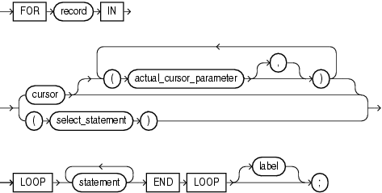

The cursor `FOR` `LOOP` statement implicitly declares its loop index as a record variable of the row type that a specified cursor returns, and then opens a cursor. With each iteration, the cursor `FOR` `LOOP` statement fetches a row from the result set into the record. When there are no more rows to fetch, the cursor `FOR` `LOOP` statement closes the cursor. The cursor also closes if a statement inside the loop transfers control outside the loop or raises an exception.

Topics

Syntax

cursor\_for\_loop\_statement::=



> ```
> [ FOR record IN
>   { cursor [ ( cursor_parameter_dec
>                [ [,] cursor_parameter_dec ]... )]
>   | ( select_statement )
>   }
>     LOOP statement... END LOOP [label] ;
> ```
>
> [Copyright © 1996, 2014, Oracle and/or its affiliates. All rights reserved.](https://docs.oracle.com/cd/E11882_01/dcommon/html/cpyr.htm)
  

See ["statement::="](block.md).

Semantics

record

Name for the loop index that the cursor `FOR` `LOOP` statement implicitly declares as a `%ROWTYPE` record variable of the type that `cursor` or `select_statement` returns.

`record` is local to the cursor `FOR` `LOOP` statement. Statements inside the loop can reference `record` and its fields. They can reference virtual columns only by aliases. Statements outside the loop cannot reference `record`. After the cursor `FOR` `LOOP` statement runs, `record` is undefined.

cursor

Name of an explicit cursor that is not open when the cursor `FOR` `LOOP` is entered.

actual\_cursor\_parameter

Actual parameter that corresponds to a formal parameter of `cursor`.

select\_statement

SQL `SELECT` statement (not PL/SQL `SELECT` `INTO` statement). For `select_statement`, PL/SQL declares, opens, fetches from, and closes an implicit cursor. However, because `select_statement` is not an independent statement, the implicit cursor is internal—you cannot reference it with the name `SQL`.

See Also:

[Oracle Database SQL Language Reference](https://docs.oracle.com/cd/E11882_01/server.112/e41084/statements_10002.htm#SQLRF01702) for `SELECT` statement syntax

label

Label that identifies `cursor_for_loop_statement` (see ["statement::="](block.md) and ["label"](block.md)). `CONTINUE`, `EXIT`, and `GOTO` statements can reference this label.

Labels improve readability, especially when `LOOP` statements are nested, but only if you ensure that the label in the `END` `LOOP` statement matches a label at the beginning of the same `LOOP` statement (the compiler does not check).

Examples

- [Example 6-18, "Implicit Cursor FOR LOOP Statement"](static.md)
- [Example 6-19, "Explicit Cursor FOR LOOP Statement"](static.md)
- [Example 6-20, "Passing Parameters to Explicit Cursor FOR LOOP Statement"](static.md)
- [Example 6-21, "Cursor FOR Loop References Virtual Columns"](static.md)

Related Topics

In this chapter:

- ["Basic LOOP Statement"](basic_loop_statement.md)
- ["CONTINUE Statement"](continue_statement.md)
- ["EXIT Statement"](exit_statement.md)
- ["Explicit Cursor Declaration and Definition"](explicit_cursor.md)
- ["FETCH Statement"](fetch_statement.md)
- ["FOR LOOP Statement"](for_loop_statement.md)
- ["FORALL Statement"](forall_statement.md)
- ["OPEN Statement"](open_statement.md)
- ["WHILE LOOP Statement"](while_loop_statement.md)

In other chapters:

- ["Query Result Set Processing With Cursor FOR LOOP Statements"](static.md)