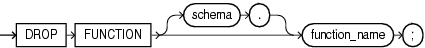

The `DROP` `FUNCTION` statement drops a standalone function from the database.

Note:

Do not use this statement to drop a function that is part of a package. Instead, either drop the entire package using the ["DROP PACKAGE Statement"](drop_package.md) or redefine the package without the function using the ["CREATE PACKAGE Statement"](create_package.md) with the `OR` `REPLACE` clause.

Topics

Prerequisites

The function must be in your schema or you must have the `DROP` `ANY` `PROCEDURE` system privilege.

Syntax

drop\_function::=



> ```
> DROP FUNCTION [ schema. ] function_name ;
> ```
>
> [Copyright © 1996, 2014, Oracle and/or its affiliates. All rights reserved.](https://docs.oracle.com/cd/E11882_01/dcommon/html/cpyr.htm)
  

Semantics

schema

Name of the schema containing the function. Default: your schema.

function\_name

Name of the function to be dropped.

The database invalidates any local objects that depend on, or invoke, the dropped function. If you subsequently reference one of these objects, then the database tries to recompile the object and returns an error if you have not re-created the dropped function.

If any statistics types are associated with the function, then the database disassociates the statistics types with the `FORCE` option and drops any user-defined statistics collected with the statistics type.

See Also:

- [Oracle Database SQL Language Reference](https://docs.oracle.com/cd/E11882_01/server.112/e41084/statements_4006.htm#SQLRF01106) for information about the `ASSOCIATE` `STATISTICS` statement
- [Oracle Database SQL Language Reference](https://docs.oracle.com/cd/E11882_01/server.112/e41084/statements_8006.htm#SQLRF01507) for information about the `DISASSOCIATE` `STATISTICS` statement

Example

Dropping a Function: Example This statement drops the function `SecondMax` in the sample schema `oe` and invalidates all objects that depend upon `SecondMax`:

```
DROP FUNCTION oe.SecondMax;
```

See Also:

["Creating Aggregate Functions: Example"](create_function.md) for information about creating the `SecondMax` function