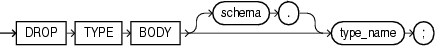

The `DROP` `TYPE` `BODY` statement drops the body of an ADT, `VARRAY` type, or nested table type. When you drop a type body, the type specification still exists, and you can re-create the type body. Prior to re-creating the body, you can still use the type, although you cannot invoke its member functions.

Topics

Prerequisites

The type body must be in your schema or you must have the `DROP` `ANY` `TYPE` system privilege.

Syntax

drop\_type\_body::=



> ```
> DROP TYPE BODY [ schema. ] type_name ;
> ```
>
> [Copyright © 1996, 2014, Oracle and/or its affiliates. All rights reserved.](https://docs.oracle.com/cd/E11882_01/dcommon/html/cpyr.htm)
  

Semantics

schema

Name of the schema containing the type. Default: your schema.

type\_name

Name of the type body to be dropped.

Restriction on type\_name You can drop a type body only if it has no type or table dependencies.

Example

Dropping an ADT Body: Example This statement removes the ADT body `data_typ1`. See ["ADT Examples"](create_type.md) for the example that creates this ADT.

```
DROP TYPE BODY data_typ1;
```