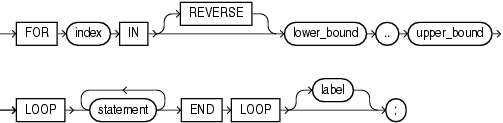

With each iteration of the `FOR` `LOOP` statement, its statements run, its index is either incremented or decremented, and control returns to the top of the loop. The `FOR` `LOOP` statement ends when its index reaches a specified value, or when a statement inside the loop transfers control outside the loop or raises an exception.

Topics

Syntax

for\_loop\_statement::=



> ```
> [ FOR index IN [ REVERSE ] lower_bound .. upper_bound
>     LOOP statement... END LOOP [ label ] ;
> ```
>
> [Copyright © 1996, 2014, Oracle and/or its affiliates. All rights reserved.](https://docs.oracle.com/cd/E11882_01/dcommon/html/cpyr.htm)
  

See ["statement::="](block.md).

Semantics

index

Name for the implicitly declared integer variable that is local to the `FOR` `LOOP` statement. Statements outside the loop cannot reference `index`. Statements inside the loop can reference `index`, but cannot change its value. After the `FOR` `LOOP` statement runs, `index` is undefined.

See Also:

["FOR LOOP Index"](controlstatements.md)

\[ REVERSE \] lower\_bound.. upper\_bound

`lower_bound` and `upper_bound` must evaluate to numbers (see ["Lower Bound and Upper Bound"](controlstatements.md)). PL/SQL evaluates `lower_bound` and `upper_bound` once, when the `FOR` `LOOP` statement is entered, and stores them as temporary `PLS_INTEGER` values, rounding them to the nearest integer if necessary.

If `lower_bound` equals `upper_bound`, the `statements` run only once.

If `lower_bound` does not equal `upper_bound` when the `FOR` `LOOP` statement begins to run, then:

- If `REVERSE` is omitted:
	If `lower_bound` is greater than `upper_bound`, the `statements` do not run, and control transfers to the statement after the `FOR` `LOOP` statement.
	Otherwise, `lower_bound` is assigned to `index`, the `statements` run, and control returns to the top of the loop, where `index` is compared to `upper_bound`. If `index` is less than `upper_bound`, `index` is incremented by one, the `statements` run again, and control returns to the top of the loop. When `index` is greater than `upper_bound`, control transfers to the statement after the `FOR` `LOOP` statement.
- If `REVERSE` is specified:
	If `upper_bound` is less than `lower_bound`, the `statements` do not run, and control transfers to the statement after the `FOR` `LOOP` statement.
	Otherwise, `upper_bound` is assigned to `index`, the `statements` run, and control returns to the top of the loop, where `index` is compared to `lower_bound`. If `index` is greater than `lower_bound`, `index` is decremented by one, the `statements` run again, and control returns to the top of the loop. When `index` is less than `lower_bound`, control transfers to the statement after the `FOR` `LOOP` statement.

label

A label that identifies `for_loop_statement` (see ["statement::="](block.md) and ["label"](block.md)). `CONTINUE`, `EXIT`, and `GOTO` statements can reference this label.

Labels improve readability, especially when `LOOP` statements are nested, but only if you ensure that the label in the `END` `LOOP` statement matches a label at the beginning of the same `LOOP` statement (the compiler does not check).

Examples

- [Example 4-15, "FOR LOOP Statements"](controlstatements.md)
- [Example 4-16, "Reverse FOR LOOP Statements"](controlstatements.md)
- [Example 4-17, "Simulating STEP Clause in FOR LOOP Statement"](controlstatements.md)
- [Example 4-19, "Outside Statement References FOR LOOP Statement Index"](controlstatements.md)
- [Example 4-20, "FOR LOOP Statement Index with Same Name as Variable"](controlstatements.md)
- [Example 4-21, "FOR LOOP Statement References Variable with Same Name as Index"](controlstatements.md)
- [Example 4-22, "Nested FOR LOOP Statements with Same Index Name"](controlstatements.md)
- [Example 4-23, "FOR LOOP Statement Bounds"](controlstatements.md)
- [Example 4-24, "Specifying FOR LOOP Statement Bounds at Run Time"](controlstatements.md)

Related Topics

In this chapter:

- ["Basic LOOP Statement"](basic_loop_statement.md)
- ["CONTINUE Statement"](continue_statement.md)
- ["Cursor FOR LOOP Statement"](cursor_for_loop_statement.md)
- ["EXIT Statement"](exit_statement.md)
- ["FETCH Statement"](fetch_statement.md)
- ["FORALL Statement"](forall_statement.md)
- ["OPEN Statement"](open_statement.md)
- ["WHILE LOOP Statement"](while_loop_statement.md)

In other chapters:

- ["FOR LOOP Statement"](controlstatements.md)