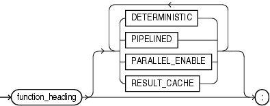
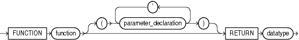
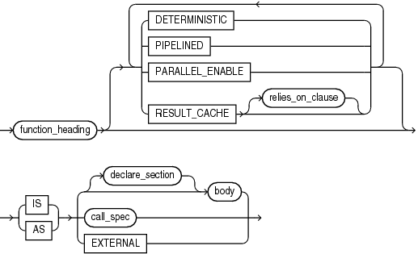
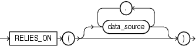

A function is a subprogram that returns a value. The data type of the value is the data type of the function. A function invocation (or call) is an expression, whose data type is that of the function.

Before invoking a function, you must declare and define it. You can either declare it first (with function\_declaration) and then define it later in the same block, subprogram, or package (with function\_definition) or declare and define it at the same time (with function\_definition).

A function declaration is also called a function specification or function spec.

Note:

This topic applies to nested functions. For information about standalone functions, see ["CREATE FUNCTION Statement"](create_function.md). For information about package functions, see ["CREATE PACKAGE Statement"](create_package.md).

Topics

Syntax

function\_declaration::=



> ```
> function_heading
>   [ DETERMINISTIC | PIPELINED | PARALLEL_ENABLE | RESULT_CACHE ]... ;
> ```
>
> [Copyright © 1996, 2014, Oracle and/or its affiliates. All rights reserved.](https://docs.oracle.com/cd/E11882_01/dcommon/html/cpyr.htm)
  
  

function\_heading::=



> ```
> FUNCTION function [ ( parameter_declaration [, parameter_declaration ] ) ]
>   RETURN datatype
> ```
>
> [Copyright © 1996, 2014, Oracle and/or its affiliates. All rights reserved.](https://docs.oracle.com/cd/E11882_01/dcommon/html/cpyr.htm)
  
  

See:

- ["datatype::="](collection.md)
- ["parameter\_declaration::="](parameter_declaration.md)

function\_definition::=



> ```
> function_heading [ DETERMINISTIC
>                  | PIPELINED
>                  | PARALLEL_ENABLE
>                  | RESULT_CACHE [ relies_on_clause ]
>                  ]...
>   { IS | AS } { [ declare_section ] body | call_spec | EXTERNAL }
> ```
>
> [Copyright © 1996, 2014, Oracle and/or its affiliates. All rights reserved.](https://docs.oracle.com/cd/E11882_01/dcommon/html/cpyr.htm)
  
  

See:

- ["body::="](block.md)
- ["call\_spec::="](create_function.md)
- ["declare\_section::="](block.md)
- ["call\_spec"](create_function.md)

relies\_on\_clause::=



> ```
> RELIES_ON ( [ data_source [, data_source]... ] )
> ```
>
> [Copyright © 1996, 2014, Oracle and/or its affiliates. All rights reserved.](https://docs.oracle.com/cd/E11882_01/dcommon/html/cpyr.htm)
  

Semantics

function\_declaration

Declares a function, but does not define it. The definition must appear later in the same block, subprogram, or package as the declaration.

DETERMINISTIC

Tells the optimizer that the function returns the same value whenever it is invoked with the same parameter values (if this is not true, then specifying `DETERMINISTIC` causes unpredictable results). If the function was invoked previously with the same parameter values, the optimizer can use the previous result instead of invoking the function again.

Do not specify `DETERMINISTIC` for a function whose result depends on the state of session variables or schema objects, because results might vary across invocations. Instead, consider making the function result-cached (see ["Making Result-Cached Functions Handle Session-Specific Settings"](subprograms.md) and ["Making Result-Cached Functions Handle Session-Specific Application Contexts"](subprograms.md)).

Only `DETERMINISTIC` functions can be invoked from a function-based index or a materialized view that has query-rewrite enabled. For more information and possible limitations of the `DETERMINISTIC` option, see ["CREATE FUNCTION Statement"](create_function.md).

Restriction on DETERMINISTIC You cannot specify `DETERMINISTIC` for a nested function.

See Also:

- ["Subprogram Side Effects"](subprograms.md)
- `CREATE` `INDEX` statement in [Oracle Database SQL Language Reference](https://docs.oracle.com/cd/E11882_01/server.112/e41084/statements_5012.htm#SQLRF01209)

PIPELINED

Use only with a table function, to specify that it is pipelined. A pipelined table function returns a row to its invoker immediately after processing that row and continues to process rows. To return a row (but not control) to the invoker, the function uses the ["PIPE ROW Statement"](pipe_row_statement.md).

Restriction on PIPELINED You cannot specify `PIPELINED` for a nested function.

Note:

You cannot run a pipelined table function over a database link. The reason is that the return type of a pipelined table function is a SQL user-defined type, which can be used only in a single database (as explained in [Oracle Database Object-Relational Developer's Guide](https://docs.oracle.com/cd/E11882_01/appdev.112/e11822/adobjbas.htm#ADOBJ7083)). Although the return type of a pipelined table function might appear to be a PL/SQL type, the database actually converts that PL/SQL type to a corresponding SQL user-defined type.

See Also:

- ["Overview of Table Functions"](tuning.md)
- ["Creating Pipelined Table Functions"](tuning.md)

PARALLEL\_ENABLE

Enables the function for parallel execution, making it safe for use in slave sessions of parallel DML evaluations.

Restriction on PARALLEL\_ENABLE You cannot specify `PARALLEL_ENABLE` for a nested function.

RESULT\_CACHE

Caches the results of the function. For more information, see ["PL/SQL Function Result Cache"](subprograms.md).

Restriction on RESULT\_CACHE You cannot specify `RESULT_CACHE` for a nested function.

function\_heading

function

Name of the function that you are declaring or defining.

RETURN datatype

Specifies the data type of the value that the function returns, which can be any PL/SQL data type (see [Chapter 3, "PL/SQL Data Types"](datatypes.md)).

Restriction on datatype You cannot constrain this data type (with `NOT` `NULL`, for example). If `datatype` is a constrained subtype, then the returned value does not inherit the constraints of the subtype (see ["Formal Parameters of Constrained Subtypes"](subprograms.md)).

function\_definition

Either defines a function that was declared earlier or both declares and defines a function.

declare\_section

Declares items that are local to the function, can be referenced in `body`, and cease to exist when the function completes execution.

body

Required executable part and optional exception-handling part of the function. In the executable part, at least one execution path must lead to a `RETURN` statement; otherwise, a runtime error occurs.

call\_spec, EXTERNAL

See ["call\_spec"](create_function.md) and ["EXTERNAL"](create_function.md).

Restriction on call\_spec, EXTERNAL These clauses can appear only in a package specification or package body.

relies\_on\_clause

Specifies the data sources on which the results of the function depend. Each `data_source` is the name of either a database table or view.

Note:

- This clause is deprecated. As of Oracle Database 11g Release 2, the database detects all data sources that are queried while a result-cached function is running, and `relies_on_clause` does nothing.
- You cannot use `relies_on_clause` in a function declared in an anonymous block.