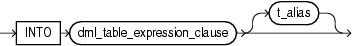

The PL/SQL extension to the SQL `INSERT` statement lets you specify a record name in the `values_clause` of the `single_table_insert` instead of specifying a column list in the `insert_into_clause`. Effectively, this form of the `INSERT` statement inserts the record into the table; actually, it adds a row to the table and gives each column of the row the value of the corresponding record field.

See Also:

[Oracle Database SQL Language Reference](https://docs.oracle.com/cd/E11882_01/server.112/e41084/statements_9014.htm#SQLRF01604) for the syntax of the SQL `INSERT` statement

Topics

- Syntax
- Semantics
- Examples
- Related Topics

Syntax

insert\_into\_clause::=



> ```
> INTO dml_expression_clause [ t_alias ]
> ```
>
> [Copyright © 1996, 2014, Oracle and/or its affiliates. All rights reserved.](https://docs.oracle.com/cd/E11882_01/dcommon/html/cpyr.htm)
  
  

values\_clause::=

  
[Description of the illustration values\_clause.gif](https://docs.oracle.com/cd/E11882_01/appdev.112/e25519/img_text/values_clause.htm)  

Semantics

insert\_into\_clause

dml\_table\_expression\_clause

Typically a table name. For complete information, see [Oracle Database SQL Language Reference](https://docs.oracle.com/cd/E11882_01/server.112/e41084/statements_9014.htm#SQLRF01604).

t\_alias

An alias for `dml_table_expression_clause`.

values\_clause

record

Name of a record variable of type `RECORD` or `%ROWTYPE`. `record` must represent a row of the item explained by `dml_table_expression_clause`. That is, for every column of the row, the record must have a field with a compatible data type. If a column has a `NOT` `NULL` constraint, then its corresponding field cannot have a `NULL` value.

See Also:

[Oracle Database SQL Language Reference](https://docs.oracle.com/cd/E11882_01/server.112/e41084/statements_9014.htm#SQLRF01604) for the complete syntax of the `INSERT` statement