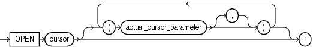

The `OPEN` statement opens an explicit cursor, allocates database resources to process the associated query, identifies the result set, and positions the cursor before the first row of the result set. If the query has a `FOR` `UPDATE` clause, the `OPEN` statement locks the rows of the result set.

Topics

Syntax

open\_statement::=



> ```
> OPEN cursor [ ( cursor_parameter [ [,] actual_cursor_parameter ]... ) ] ;
> ```
>
> [Copyright © 1996, 2014, Oracle and/or its affiliates. All rights reserved.](https://docs.oracle.com/cd/E11882_01/dcommon/html/cpyr.htm)
  

Semantics

cursor

Name of an explicit cursor that is not open.

actual\_cursor\_parameter \[, actual\_cursor\_parameter \]...

List of actual parameters for the cursor that you are opening. An actual parameter can be a constant, initialized variable, literal, or expression. The data type of each actual parameter must be compatible with the data type of the corresponding formal parameter.

You can specify actual cursor parameters with either positional notation or named notation. For information about these notations, see ["Positional, Named, and Mixed Notation for Actual Parameters"](subprograms.md).

If the cursor specifies a default value for a parameter, you can omit that parameter from the parameter list. If the cursor has no parameters, or specifies a default value for every parameter, you can either omit the parameter list or specify an empty parameter list.