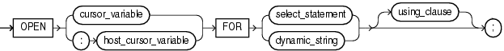
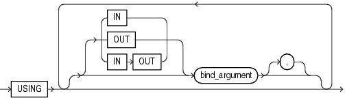

The `OPEN` `FOR` statement associates a cursor variable with a query, allocates database resources to process the query, identifies the result set, and positions the cursor before the first row of the result set. If the query has a `FOR` `UPDATE` clause, then the `OPEN` `FOR` statement locks the rows of the result set.

Topics

Syntax

open\_for\_statement::=



> ```
> OPEN { cursor_variable | :host_cursor_variable}
>   FOR select_statement [ using_clause ] ;
> ```
>
> [Copyright © 1996, 2014, Oracle and/or its affiliates. All rights reserved.](https://docs.oracle.com/cd/E11882_01/dcommon/html/cpyr.htm)
  
  

using\_clause::=



> ```
> USING [ IN | OUT | IN OUT ] bind_argument
>   [ [,] [ [ IN | OUT | IN OUT ] bind_argument ]...
> ```
>
> [Copyright © 1996, 2014, Oracle and/or its affiliates. All rights reserved.](https://docs.oracle.com/cd/E11882_01/dcommon/html/cpyr.htm)
  

Semantics

open\_for\_statement

cursor\_variable

Name of a cursor variable. If `cursor_variable` is the formal parameter of a subprogram, then it must not have a return type. For information about cursor variables as subprogram parameters, see ["Cursor Variables as Subprogram Parameters"](static.md).

:host\_cursor\_variable

Name of a cursor variable that was declared in a PL/SQL host environment and passed to PL/SQL as a bind variable. Do not put space between the colon (:) and `host_cursor_variable`.

The data type of a host cursor variable is compatible with the return type of any PL/SQL cursor variable.

select\_statement

SQL `SELECT` statement (not a PL/SQL `SELECT` `INTO` statement). Typically, `select_statement` returns multiple rows.

See:

[Oracle Database SQL Language Reference](https://docs.oracle.com/cd/E11882_01/server.112/e41084/statements_10002.htm#SQLRF01702) for `SELECT` statement syntax

dynamic\_string

String literal, string variable, or string expression of the data type `CHAR`, `VARCHAR2`, or `CLOB`, which represents a SQL `SELECT` statement. Typically, `dynamic_statement` represents a SQL `SELECT` statement that returns multiple rows.

using\_clause

Specifies bind variables, using positional notation.

Note:

If you repeat placeholder names in `dynamic_sql_statement`, be aware that the way placeholders are associated with bind variables depends on the kind of dynamic SQL statement. For details, see ["Repeated Placeholder Names in Dynamic SQL Statements."](dynamic.md)

Restrictions on using\_clause

- Use if and only if `select_statement` or `dynamic_sql_stmt` includes placeholders for bind variables.
- If `dynamic_sql_stmt` has a `RETURNING` `INTO` clause, `using_clause` can contain only `IN` bind variables. The bind variables in the `RETURNING` `INTO` clause are `OUT` bind variables by definition.

bind\_argument

Expression whose value replaces its corresponding placeholder in `select_statement` or `dynamic_string` at run time. You must specify a `bind_argument` for every placeholder.

IN, OUT, IN OUT

Parameter modes of bind variables. An `IN` bind variable passes its value to the `select_statement` or `dynamic_string`. An `OUT` bind variable stores a value that `dynamic_string` returns. An `IN` `OUT` bind variable passes its initial value to `dynamic_string` and stores a value that `dynamic_string` returns. Default: `IN`.

Examples

- [Example 6-26, "Fetching Data with Cursor Variables"](static.md)
- [Example 6-30, "Procedure to Open Cursor Variable for One Query"](static.md)
- [Example 6-31, "Opening Cursor Variable for Chosen Query (Same Return Type)"](static.md)
- [Example 6-32, "Opening Cursor Variable for Chosen Query (Different Return Types)"](static.md)
- [Example 7-4, "Native Dynamic SQL with OPEN FOR, FETCH, and CLOSE Statements"](dynamic.md)

Related Topics

In this chapter:

- ["CLOSE Statement"](close_statement.md)
- ["Cursor Variable Declaration"](cursor_variable.md)
- ["EXECUTE IMMEDIATE Statement"](executeimmediate_statement.md)
- ["FETCH Statement"](fetch_statement.md)
- ["OPEN Statement"](open_statement.md)

In other chapters:

- ["Opening and Closing Cursor Variables"](static.md)
- ["OPEN FOR, FETCH, and CLOSE Statements"](dynamic.md)