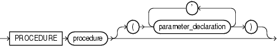
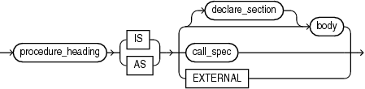

A procedure is a subprogram that performs a specific action. A procedure invocation (or call) is a statement.

Before invoking a procedure, you must declare and define it. You can either declare it first (with procedure\_declaration) and then define it later in the same block, subprogram, or package (with procedure\_definition) or declare and define it at the same time (with procedure\_definition).

A procedure declaration is also called a procedure specification or procedure spec.

Note:

This topic applies to nested procedures. For information about standalone procedures, see ["CREATE PROCEDURE Statement"](create_procedure.md). For information about package procedures, see ["CREATE PACKAGE Statement"](create_package.md).

Topics

- Syntax
- Semantics
- Examples
- Related Topics

Syntax

procedure\_declaration::=

  
[Description of the illustration procedure\_declaration.gif](https://docs.oracle.com/cd/E11882_01/appdev.112/e25519/img_text/procedure_declaration.htm)  
  

procedure\_heading::=



> ```
> PROCEDURE procedure [ ( parameter_declaration [, parameter_declaration ]... ) ]
> ```
>
> [Copyright © 1996, 2014, Oracle and/or its affiliates. All rights reserved.](https://docs.oracle.com/cd/E11882_01/dcommon/html/cpyr.htm)
  
  

See ["parameter\_declaration::="](parameter_declaration.md).

procedure\_definition::=



> ```
> procedure_heading { IS | AS }
>   { [ declare_section ] body | call_spec | EXTERNAL }
> ```
>
> [Copyright © 1996, 2014, Oracle and/or its affiliates. All rights reserved.](https://docs.oracle.com/cd/E11882_01/dcommon/html/cpyr.htm)
  
  

See:

- ["body::="](block.md)
- ["declare\_section::="](block.md)
- ["call\_spec::="](create_function.md)

Semantics

procedure\_declaration

Declares a procedure, but does not define it. The definition must appear later in the same block, subprogram, or package as the declaration.

procedure\_heading

procedure

Name of the procedure that you are declaring or defining.

procedure\_definition

Either defines a procedure that was declared earlier or both declares and defines a procedure.

declare\_section

Declares items that are local to the procedure, can be referenced in `body`, and cease to exist when the procedure completes execution.

body

Required executable part and optional exception-handling part of the procedure.

call\_spec, EXTERNAL

See ["call\_spec"](create_function.md) and ["EXTERNAL"](create_function.md).

Restriction on call\_spec, EXTERNAL These clauses can appear only in a package specification or package body.