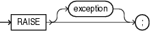

The `RAISE` statement explicitly raises an exception. Outside an exception handler, you must specify the exception name. Inside an exception handler, if you omit the exception name, the `RAISE` statement reraises the current exception.

Topics

Syntax

raise\_statement::=



> ```
> RAISE [ exception ] ;
> ```
>
> [Copyright © 1996, 2014, Oracle and/or its affiliates. All rights reserved.](https://docs.oracle.com/cd/E11882_01/dcommon/html/cpyr.htm)
  

Semantics

exception

Name of an exception, either predefined (see [Table 11-3](errors.md)) or user-declared (see ["Exception Declaration"](exception_declaration.md)).

`exception` is optional only in an exception handler, where the default is the current exception (see ["Reraising Current Exception with RAISE Statement"](errors.md)).